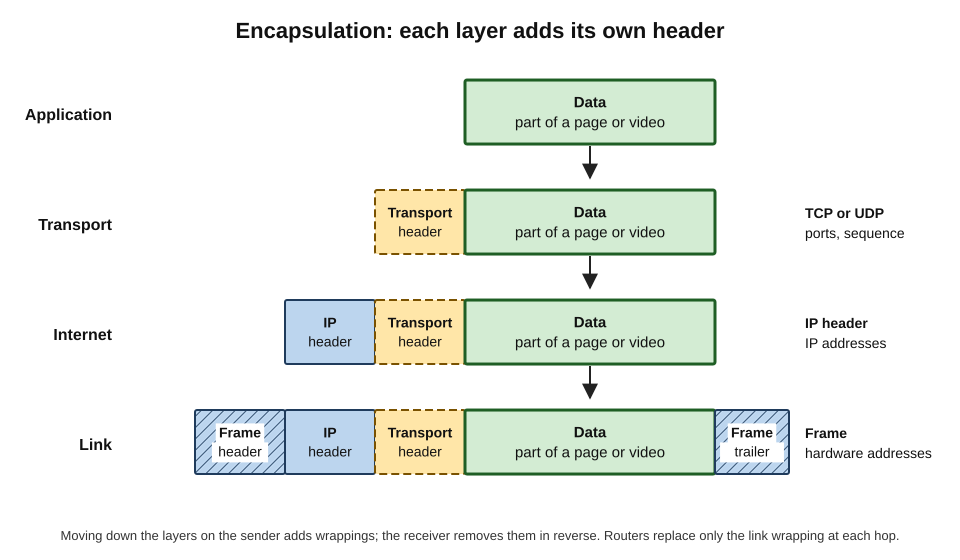
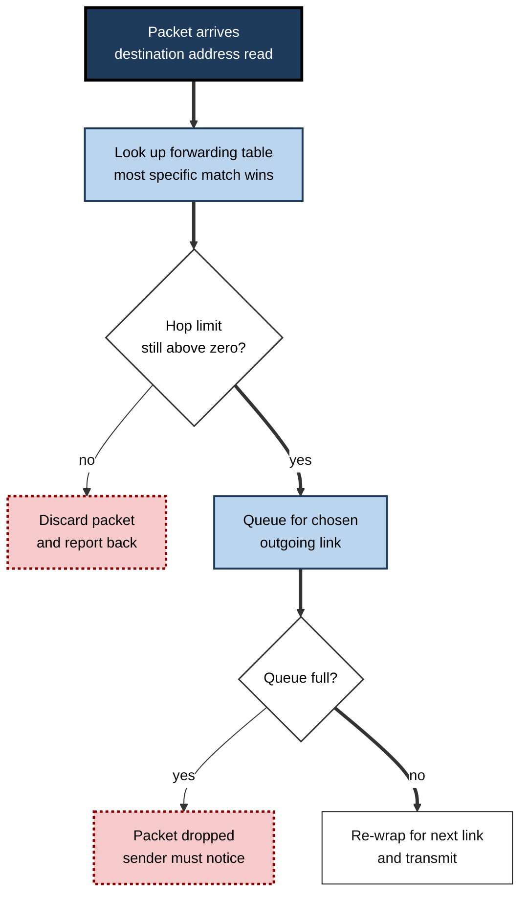
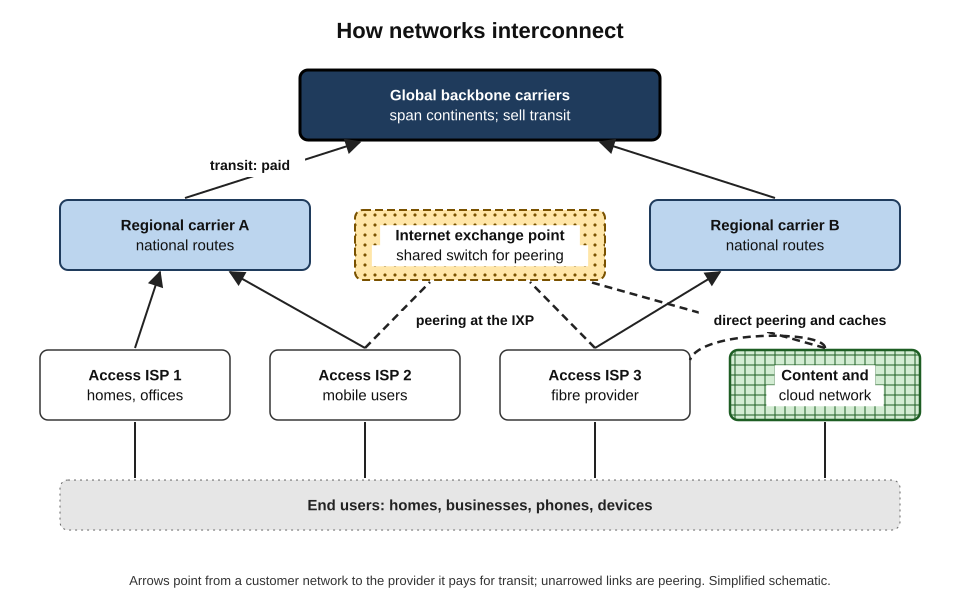
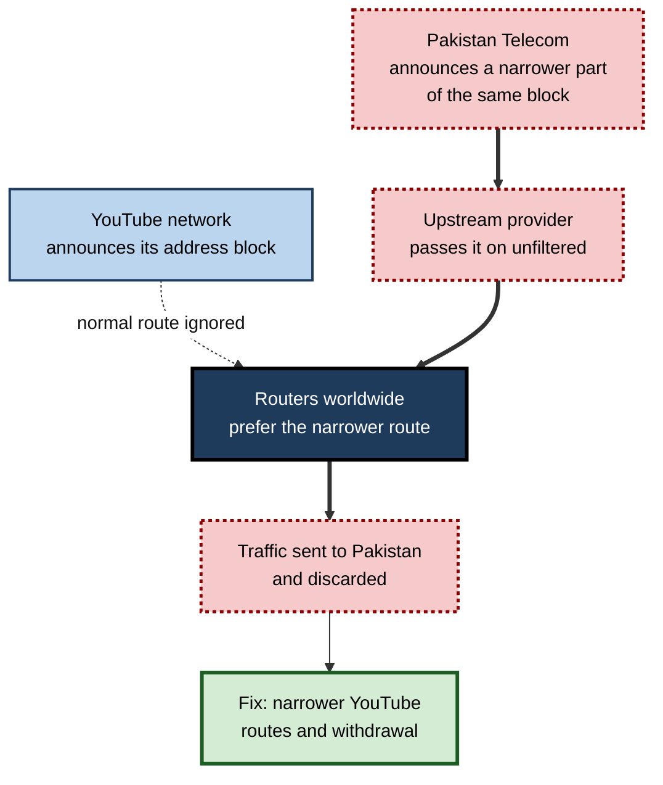
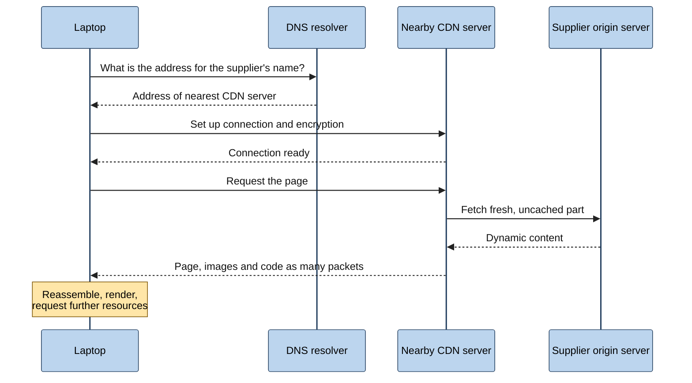

# E.3. How the Internet Works

A photograph sent from a phone in Nairobi to a relative in Toronto is chopped into a few thousand small pieces. The pieces cross a mobile mast, a city network, an undersea cable, perhaps a dozen routers on two continents, and arrive — some by different paths, some out of order — to be reassembled into the original picture in under a second. No one plans the route in advance, and no single organisation controls it. The way this works is the core engineering idea of the modern world.

> **Definition — How the Internet works (in one sentence):** data is broken into addressed **packets**, which are wrapped in successive layers of control information, forwarded hop by hop by **routers** across independently run networks that exchange **routing** information, and reassembled by the receiving device.

**Why understanding the mechanism matters**

- It explains everyday experience: why connections slow at peak times, why a video stutters while email does not, why one website fails while others work.
- It lets professionals diagnose problems systematically instead of guessing.
- It shows where security, privacy and resilience can — and cannot — be provided.
- It is the foundation for judging cloud architectures, content delivery, remote working and AI services, all of which depend on moving data quickly between distant machines.

---

## Packets: The Unit of Everything

### Why data is cut into pieces

- **Sharing** — small packets from many users can be interleaved on one link, so no one monopolises it.
- **Resilience** — if a link fails, later packets can take another path.
- **Efficiency** — a lost packet can be resent on its own; there is no need to resend a whole file.
- **Fairness** — a large download cannot block a short message for long.

> **Definition — Packet:** a small, self-contained unit of data, typically up to about 1,500 bytes on common networks, consisting of a **header** (control information such as source and destination addresses) and a **payload** (the piece of user data being carried).

### What a packet carries

- **Destination address** — where the packet must go.
- **Source address** — where replies should be sent.
- **Protocol information** — which program or service on the receiving device should get it.
- **Sequence information** — so the receiver can put pieces back in order and detect gaps.
- **A hop limit** — a counter reduced by one at each router; when it reaches zero, the packet is discarded, so packets caught in a loop do not circulate for ever.
- **Error-checking values** — so damaged packets can be detected.
- **The payload** — a slice of the email, web page, video frame or file.

> **Example:** a 3-megabyte photograph sent in packets of about 1,400 bytes of payload needs well over 2,000 packets. Each one is addressed and forwarded independently.

### Layers and encapsulation

- Each **layer** of the Internet's design adds its own header in front of the data it receives from the layer above — like putting a letter in an envelope, the envelope in a courier bag, and the bag in a lorry.
  - **Application layer** — the actual message, *e.g.* a request for a web page.
  - **Transport layer** — adds port numbers (which program) and sequence numbers (what order).
  - **Internet layer** — adds the source and destination IP addresses.
  - **Link layer** — adds the local hardware addresses needed to cross the next single link, such as Wi-Fi or Ethernet.
- At every router the **link-layer wrapping is removed and replaced** for the next link; the IP packet inside stays essentially the same from end to end.
- The receiving computer **unwraps** the layers in reverse order and hands the message to the right program.

> **Definition — Encapsulation:** the process by which each protocol layer wraps the data from the layer above in its own header (and sometimes trailer) before passing it down.

**Figure 1.** Encapsulation: each layer wraps the data from the layer above.

> **Key point:** layering lets each part of the system change independently. A router does not need to understand video calls, and a video-call application does not need to understand fibre optics.

> **Watch out:** the textbook **seven-layer OSI model** and the **four-layer Internet (TCP/IP) model** describe the same ideas at different granularity. The Internet actually runs on the TCP/IP protocols; OSI is mainly a teaching and vocabulary tool ("a layer-2 problem", "a layer-7 firewall").

---

## Routers and Forwarding

### What a router does

> **Definition — Router:** a device that connects two or more networks and forwards each incoming packet towards its destination by choosing an outgoing link.

- **Receives** a packet on one interface.
- **Reads** the destination IP address in its header.
- **Looks up** that address in its **forwarding table** — a list of address ranges and the next hop for each.
- **Chooses** the most specific matching entry (the "longest prefix match").
- **Decrements** the hop limit and re-wraps the packet for the next link.
- **Sends** it on its way — often within microseconds.

> **Definition — Forwarding table:** a router's list mapping destination address ranges to outgoing links or next-hop routers.

> **Definition — Hop:** one step of a packet's journey from one router (or host) to the next.

### Forwarding versus routing

| | Forwarding | Routing |
|---|---|---|
| Question answered | "Where does *this* packet go next?" | "What are the best paths to every destination?" |
| Timescale | Nanoseconds to microseconds, per packet | Seconds to minutes, as the network changes |
| Done by | Specialised router hardware | Router software running routing protocols |
| Output | A packet sent on an outgoing link | The forwarding table itself |
| Analogy | A sorting-office worker reading each envelope | Managers deciding which delivery routes exist |

- **Routing protocols** let routers exchange information about which destinations they can reach and at what cost.
- When a link fails, routers learn this and **recompute** paths; traffic flows around the damage.

**Figure 2.** A router reads the destination of each packet and forwards it on the best matching link.

### Queues and congestion

- Packets arriving faster than an outgoing link can send them wait in a **queue** (a buffer).
- **Short queues** → small delays.
- **Full queues** → packets are **dropped**.
- Dropped packets are the network's way of signalling "slow down"; the sending computers detect the loss and reduce their sending rate.
- This cooperative slowing is **congestion control**, built into the transport layer after near-collapses of the network in the mid-1980s.

**Study card — Congestion collapse and Van Jacobson (1986–1988)**

- **Observation:** in October 1986, throughput on part of the early Internet fell by a factor of around a thousand — data was being retransmitted so aggressively that links carried mostly duplicates.
- **Diagnosis:** senders kept transmitting at full speed regardless of losses, so congestion fed on itself.
- **Remedy:** Van Jacobson and Michael Karels designed algorithms (published 1988) in which senders start slowly, increase their rate gradually and **cut it sharply when packets are lost**.
- **Conclusion:** the Internet stays usable because every end system voluntarily **backs off** under congestion — a remarkable act of distributed cooperation.

> **Definition — Congestion control:** mechanisms by which senders adjust their transmission rate to the capacity available in the network, avoiding overload.

> **Watch out:** packet loss is not always a fault. A small amount of loss is a **normal signal** in a busy network; persistent heavy loss, however, means a link is overloaded or faulty.

---

## Reliability Built at the Edges

### Best-effort network, reliable conversation

- The core network is **best-effort**: packets may be lost, duplicated, delayed or reordered.
- Reliability is added by the **end devices** using the transport layer:
  1. **Number** each piece of data.
  2. **Acknowledge** what has arrived.
  3. **Retransmit** anything not acknowledged in time.
  4. **Reorder** pieces that arrive out of sequence.
  5. **Pace** sending to avoid overwhelming the receiver or the network.
- Some applications prefer **speed to perfection** — a live call or game would rather skip a lost fragment than wait for it — and use a lighter transport that does not retransmit.

> **Key point:** "reliable delivery" on the Internet is an **illusion created by the endpoints** on top of an unreliable network. This is the end-to-end principle at work.

### Worked example (illustrative): a lost packet during a file upload

Situation: a consultant uploads a 10-megabyte report to a client portal over hotel Wi-Fi.

1. The laptop's transport software splits the file into thousands of numbered segments.
2. Segment 4,812 is lost when the hotel's congested router drops it.
3. The portal's server receives 4,811 and then 4,813, so it keeps acknowledging only up to 4,811.
4. The laptop notices the repeated acknowledgements, concludes that 4,812 was lost and **resends it**.
5. It also **reduces its sending rate**, interpreting the loss as congestion.
6. The upload completes intact; the consultant sees only a brief slowing of the progress bar.

> **Remember:** loss → retransmission → slowing down. That is why congested networks feel **slow** rather than **broken** for most applications.

---

## The Shape of the Internet

### Networks of different sizes

- **Access networks** — the ISPs and mobile operators that connect homes and businesses.
- **Regional and national carriers** — networks that link cities and aggregate traffic from access providers.
- **Global backbone carriers** — very large networks spanning continents, carrying traffic for others.
- **Content and cloud networks** — the private global networks of large technology firms, often among the largest on Earth.
- **Enterprise, university and government networks** — usually customers of the above.

### How networks connect: transit and peering

> **Definition — Transit:** a paid service in which one network carries another's traffic to and from the rest of the Internet.

> **Definition — Peering:** an arrangement in which two networks exchange traffic directly between their own customers, often without payment, because both benefit.

- A small ISP **buys transit** from a larger carrier to reach everywhere.
- Two networks of similar size, or a content network and an access network, often **peer** to save money and shorten paths.
- Peering commonly happens at an **Internet exchange point (IXP)** — a facility with a shared switch where hundreds of networks connect.
- Commercially these arrangements vary widely; technically, all that matters is that **some chain of agreements** links every pair of networks.

> **Definition — Internet exchange point (IXP):** a physical facility where many networks connect to a shared infrastructure to exchange traffic directly.

**Figure 3.** The layered shape of interconnection, from access networks to global carriers and content networks.

### Routing between networks: BGP

- Inside its own network, an operator chooses routes to suit itself.
- **Between** networks, the **Border Gateway Protocol (BGP)** is used.
  - Each autonomous system **announces** to its neighbours the blocks of addresses it can deliver to.
  - Neighbours pass these announcements on, adding themselves to the path.
  - Each network chooses among the paths it hears, based on **business policy** (cost, contracts, preferences) as much as on distance.
- BGP is sometimes called **the postal map of the Internet**: it tells every network which direction to send traffic for every address range.

> **Definition — Border Gateway Protocol (BGP):** the routing protocol used between autonomous systems to announce which address ranges each can reach and to select paths between them.

> **Watch out:** BGP was designed largely on **trust**. Historically, a network could announce address ranges it did not own, and neighbours would often believe it. Cryptographic route validation (RPKI) has been spreading to check that announcements come from legitimate owners, but coverage is incomplete.

### Case study: The day YouTube was swallowed (February 2008)

- **Situation:** Pakistan's government ordered domestic access to YouTube blocked.
- **Action:** Pakistan Telecom, to implement the block, announced a **more specific** route for part of YouTube's address space, intending to send local users to nowhere.
- **Error:** the announcement leaked to an international provider, which passed it on to the rest of the Internet.
- **Consequence:**
  1. Routers worldwide preferred the more specific route (longest-prefix match).
  2. A large share of the world's YouTube traffic flowed towards Pakistan Telecom and was discarded.
  3. YouTube was unreachable for much of the Internet for roughly two hours.
- **Resolution:** YouTube announced even more specific routes to win traffic back, and the upstream provider withdrew the leaked announcement.
- **Lessons:**
  - a single misconfiguration by one network can affect the whole world;
  - routing security depends on operators **filtering** what customers announce and on route-origin validation;
  - national censorship actions can have international side effects.

**Figure 4.** How a leaked, more specific route diverted YouTube's traffic.

---

## Bringing Content Closer: CDNs and Data Centres

### Why distance matters

- Signals in optical fibre travel at roughly **two-thirds of the speed of light** — about 200,000 km per second.
- A round trip between London and Sydney therefore takes, at the very least, well over 100 milliseconds — before any router queues or processing are added.
- Many web pages need **dozens of round trips** to load; distance multiplies.

### Content delivery networks

> **Definition — Content delivery network (CDN):** a distributed system of servers placed in many locations, which stores copies of content close to users and serves them from the nearest location.

- **How it works:**
  1. A website's images, videos and code are copied to CDN servers in hundreds of cities.
  2. A user's request is directed to the **nearest healthy** server.
  3. Only content that is not cached, or that must be fresh, travels back to the original server.
- **Effects:**
  - faster loading and smoother video;
  - less long-distance traffic and lower cost;
  - protection against floods of malicious traffic, because load is spread out.
- **Scale:** a large majority of web and video traffic is now delivered from CDNs and from servers that large content companies place **inside ISPs' own networks**.

> **Key point:** the modern Internet is much "flatter" than its textbook picture. Much traffic travels only from a nearby cache to the user, never crossing an ocean.

### Data centres and cloud regions

- **Data centres** house servers, storage and network equipment with redundant power and cooling.
- **Cloud regions** — clusters of data centres in one geographic area — let organisations choose where their data and processing live.
- **Inside a data centre**, networks link tens of thousands of servers with very high capacity; training large AI models depends on especially fast links between thousands of processors.
- **Between data centres**, cloud providers run private fibre networks and own or lease capacity on submarine cables.

---

## Physical Infrastructure

### The hidden plant

- **Fibre-optic cables** — glass strands carrying light pulses; the backbone of almost all long-distance traffic.
- **Submarine cables** — around 600 systems active or under construction in 2025, landing at a little over 1,700 coastal sites, carrying the overwhelming majority of intercontinental traffic.
  - Typically no thicker than a garden hose in deep water; heavily armoured near shore.
  - Damage is common — mostly from ships' anchors and fishing gear — and a small fleet of specialised vessels carries out repairs.
- **Terrestrial fibre** — along railways, roads, pipelines and power lines.
- **Radio links** — mobile networks, microwave links, Wi-Fi.
- **Satellites** — geostationary satellites high above the equator and, increasingly, low-Earth-orbit constellations.

> **Watch out:** the idea that the Internet is "wireless" or "in the cloud" hides how physical it is. A few cable landing stations and data-centre clusters concentrate a great deal of critical traffic; their protection is now a national-security concern.

### Resilience through redundancy

- **Multiple paths** — major cities are linked by several independent routes.
- **Automatic re-routing** — when a cable is cut, routing protocols shift traffic to alternatives, usually within seconds to minutes.
- **Limits** — some regions depend on very few cables; a single cut can slow or disconnect a whole country.

> **Example:** island nations and some coastal states that rely on one or two submarine cables have experienced near-total Internet outages lasting days after cable damage, with banking, government services and communications affected.

---

## A Complete Journey

### Worked example (illustrative): "what happens when someone opens a web page"

Situation: a manager in Manchester opens a supplier's web page.

1. **Name resolution** — the browser asks a DNS resolver to translate the supplier's name into an IP address (it returns a number).
2. **Connection set-up** — the laptop and the server exchange a few packets to agree to talk and to set up **encryption**.
3. **Request** — the browser sends a small request: "send me this page".
4. **Local hop** — the request travels over Wi-Fi to the office router, then over fibre to the ISP.
5. **Inter-network hops** — routers forward packets hop by hop, guided by forwarding tables built from BGP; the path may cross an exchange point into a CDN's network.
6. **Edge response** — a nearby CDN server returns cached images and code; the dynamic part of the page comes from the supplier's own servers.
7. **Reassembly** — the laptop acknowledges, reorders and reassembles the packets; the browser renders the page.
8. **Follow-up requests** — the page triggers dozens of further requests for fonts, scripts, analytics and adverts, each repeating parts of this process.

**Figure 5.** The sequence of exchanges when a web page is opened.

> **Remember:** a page load is not one request but **many conversations**, each needing name lookups, connection set-up and packet exchange. Speed depends far more on the number of round trips and distance than most users imagine.

### Seeing the path: traceroute

- **Traceroute** is a diagnostic tool that reveals the routers a packet passes through.
- **How it works:** it sends packets with hop limits of 1, 2, 3 and so on; each router that discards a packet because its hop limit reached zero sends back a message, revealing itself and the round-trip time.
- **What it shows:** the number of hops, where delay increases sharply and where packets stop.

**Worked example — reading a traceroute from a London office to a server in Mumbai (illustrative)**

| Hop | Network | Round-trip time | Interpretation |
|---|---|---|---|
| 1 | Office router | 1 ms | Local network healthy |
| 2–3 | Office ISP, London | 3–5 ms | Access network healthy |
| 4–5 | Transit carrier, London | 6 ms | Handover to long-distance carrier |
| 6 | Carrier, Marseille | 20 ms | Crossed to southern Europe |
| 7 | Carrier, Mumbai landing | 110 ms | Large jump = undersea cable distance, as expected |
| 8–9 | Hosting provider, Mumbai | 112 ms | Arrived; little extra delay |

- **Conclusion:** the large jump at hop 7 reflects physical distance, not a fault; a sudden jump at hop 2 would instead point to a local problem.

> **Watch out:** some routers deliberately ignore or deprioritise traceroute messages, so a "missing" or slow hop in the middle is not necessarily a problem if later hops are normal.

---

## The Internet in Professional Practice

### Design decisions that depend on how the Internet works

| Decision | Mechanism involved | Typical professional choice |
|---|---|---|
| Where to host a customer-facing application | Distance and round trips | Host near customers; use a CDN for static content |
| How to connect a critical office | Single points of failure in access and routing | Two ISPs on physically separate routes, with automatic failover |
| How to send real-time video | Loss versus delay trade-off | Use transports that tolerate loss rather than wait for retransmissions |
| How to protect a public service from traffic floods | Distributed capacity at the edge | Front the service with a CDN or scrubbing provider |
| How to train or serve AI models | Data movement between processors and regions | Co-locate compute and data; minimise cross-region traffic |

### Common failure modes

- **Local** — Wi-Fi interference, faulty cables, overloaded office routers.
- **Access** — ISP outages, damaged street cabinets, mobile congestion.
- **Routing** — misconfigured or leaked BGP announcements; a network withdrawing its routes.
- **Naming** — DNS failures that make working servers unreachable by name.
- **Physical** — cable cuts, power failures at data centres.
- **Overload** — deliberate floods (distributed denial-of-service attacks) or sudden legitimate demand.

> **In practice:** network engineers diagnose by **layer** — "can the device see the local network? can it reach the ISP? can it resolve names? can it reach the server? does the application respond?" — mirroring the layered design.

### The Internet underneath cloud and AI services

- **Cloud platforms** are built on the same principles: packets, routing, redundancy — at enormous scale inside and between data centres.
- **AI assistants**:
  - a prompt travels as packets to a cloud region;
  - the request may be routed to whichever data centre has spare specialised processors;
  - the answer is often **streamed** back in small pieces so text appears progressively.
- **Implications:**
  - an AI feature's responsiveness depends on network distance as well as model speed;
  - data-protection rules about where data is processed are, in practice, rules about **routing and hosting locations**.

---

## Open Questions

- **Can routing be made secure without sacrificing flexibility?**
  - Route validation is spreading, but full protection against forged paths is not yet widely deployed.
- **Is the "flattening" of the Internet healthy?**
  - Direct links between big content networks and ISPs improve performance but concentrate traffic in a few companies' hands.
- **How should critical physical infrastructure be protected?**
  - Submarine cables and landing stations are vulnerable to accidents and sabotage; repair capacity is limited.
- **Will congestion control keep working fairly?**
  - New transport designs from large firms optimise their own traffic; whether this remains fair to others is studied and debated.
- **How will AI workloads change network design?**
  - Training clusters and inference traffic place unprecedented demands on data-centre and long-distance links.

---

## Summary

- Data travels as **packets** — headers plus payload — that are forwarded independently and reassembled at the destination.
- Each layer **encapsulates** the data from the layer above; routers rewrap only the link layer at each hop.
- **Routers** forward packets using **forwarding tables**; **routing protocols** build those tables and re-route around failures.
- **Queues** absorb bursts; full queues **drop** packets; **congestion control** makes senders back off, a lesson of the 1986 congestion collapse.
- **Reliability** is created at the edges by numbering, acknowledging, retransmitting and reordering data; some applications prefer speed and skip retransmission.
- Networks interconnect through **transit** and **peering**, often at **IXPs**; **BGP** announces which networks can reach which addresses — powerful but historically trust-based, as the 2008 YouTube incident showed.
- **CDNs** and **data centres** bring content close to users, flattening the Internet; **fibre and submarine cables** carry almost all long-distance traffic.
- **Traceroute** reveals the path and where delay arises.
- Professionals use these mechanisms to choose hosting locations, design resilient connectivity, protect services and understand the performance of cloud and AI services.

---

## Self-Check

1. Why is data divided into packets? Give three reasons.
2. List five items of information a packet header may carry.
3. Explain encapsulation using an analogy, and state which wrapping changes at each router.
4. Distinguish forwarding from routing across three attributes.
5. What does a router do when its outgoing queue is full, and how do senders respond?
6. Summarise the 1986 congestion collapse and the remedy introduced.
7. How does the transport layer create reliable delivery over a best-effort network?
8. Why might a live video call choose not to retransmit lost data?
9. Define transit, peering and an IXP.
10. What does BGP do, and why is its trust-based design a risk?
11. Explain how the 2008 YouTube incident happened and two lessons from it.
12. How does a CDN improve speed and resilience?
13. Interpret a traceroute in which delay jumps from 5 ms to 110 ms between two hops located in different continents.
14. Name four categories of Internet failure and one example of each.
15. A firm's customers in Australia complain that its European-hosted web application is sluggish, although the servers are lightly loaded. Diagnose the likely cause and propose two remedies.

### Answer Key

1. Sharing links among many users; resilience (packets can be re-routed); efficiency (only lost pieces are resent); fairness (large transfers cannot monopolise a link).
2. Source address; destination address; protocol or port information; sequence information; hop limit; error-checking values.
3. Like a letter placed in an envelope, then a courier bag, then a lorry, each layer wraps the data in its own header. At each router the link-layer wrapping is removed and replaced for the next link; the IP packet inside stays essentially the same.
4. Forwarding decides where each packet goes next, in microseconds, using hardware and the forwarding table. Routing works out the best paths to all destinations over seconds or minutes, using routing protocols, and produces the forwarding table.
5. It drops arriving packets. Senders detect the loss, retransmit the missing data and reduce their sending rate (congestion control).
6. Throughput on part of the early Internet fell drastically because senders retransmitted at full speed regardless of loss. Van Jacobson and Michael Karels introduced algorithms in which senders start slowly, grow gradually and cut their rate sharply on loss.
7. By numbering data, acknowledging receipt, retransmitting unacknowledged data, reordering out-of-sequence pieces and pacing transmission.
8. A late fragment of speech or video is useless; waiting for retransmission would add delay. It is better to skip the fragment and keep the conversation flowing.
9. Transit: a paid service carrying another network's traffic to the whole Internet. Peering: direct exchange of traffic between two networks' customers, often unpaid. IXP: a facility where many networks connect to exchange traffic.
10. BGP lets autonomous systems announce which address ranges they can reach and choose paths between them. Because announcements were historically trusted, a network could announce addresses it did not own, diverting traffic by error or malice.
11. Pakistan Telecom announced a more specific part of YouTube's address space to block it locally; an upstream provider leaked it globally; routers preferred the more specific route. Lessons: one network's error can affect the world; providers must filter customer announcements and validate route origins.
12. It stores copies of content in many locations and serves each user from the nearest one, reducing distance and round trips; it spreads load, absorbing traffic floods.
13. The jump reflects the physical distance of an intercontinental (probably undersea) link and is expected; it does not indicate a fault if subsequent hops add little delay.
14. Local (Wi-Fi interference); access (ISP outage); routing (BGP leak); naming (DNS failure); physical (cable cut); overload (denial-of-service attack).
15. Distance: each round trip between Australia and Europe takes a few hundred milliseconds, and page loads need many round trips. Remedies: serve static content through a CDN; host the application, or a replica, in an Australian or nearby cloud region; reduce the number of round trips the application needs.

---

## Glossary

| Term | Meaning |
|---|---|
| Acknowledgement | A message confirming that data has been received. |
| Autonomous system | A network under one administration with its own routing policy. |
| Best-effort | A network service that tries to deliver packets without guarantees. |
| BGP | Border Gateway Protocol; routing between autonomous systems. |
| CDN | Content delivery network; servers in many locations serving cached content near users. |
| Congestion control | Senders' adjustment of transmission rate to available capacity. |
| Data centre | A facility housing servers, storage and network equipment. |
| Encapsulation | Wrapping data in successive protocol headers as it passes down the layers. |
| Forwarding | Sending each packet on the appropriate outgoing link. |
| Forwarding table | A router's map from destination address ranges to next hops. |
| Header | The control information at the front of a packet. |
| Hop | One step between routers or hosts. |
| Hop limit | A counter reduced at each hop; the packet is discarded at zero. |
| IXP | Internet exchange point; a facility where networks interconnect. |
| Longest prefix match | The rule that the most specific matching route is chosen. |
| Packet | A small addressed unit of data. |
| Payload | The user data carried by a packet. |
| Peering | Direct traffic exchange between networks, often unpaid. |
| Queue | A buffer holding packets waiting to be sent. |
| Retransmission | Resending data that was not acknowledged. |
| Router | A device that forwards packets between networks. |
| Routing | Computing paths to destinations and building forwarding tables. |
| RPKI | A system for cryptographically validating which network may announce which addresses. |
| Submarine cable | A fibre-optic cable on the sea bed. |
| Traceroute | A tool that reveals the routers along a path and their delays. |
| Transit | A paid service carrying traffic to the rest of the Internet. |
