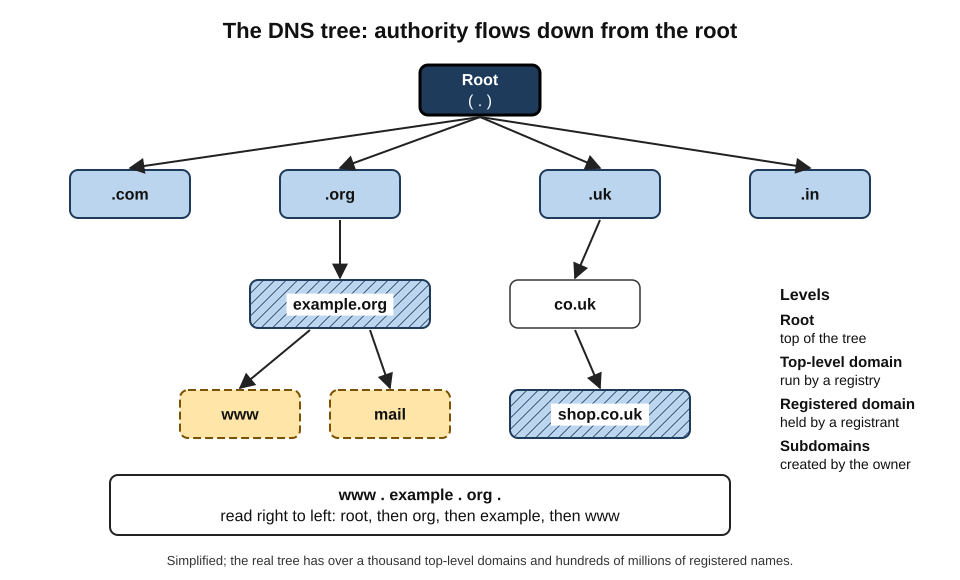
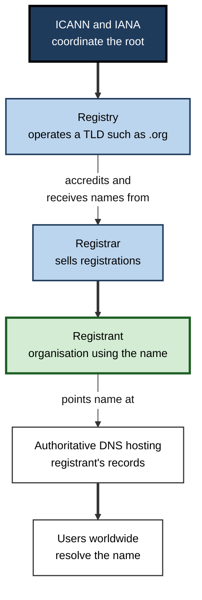
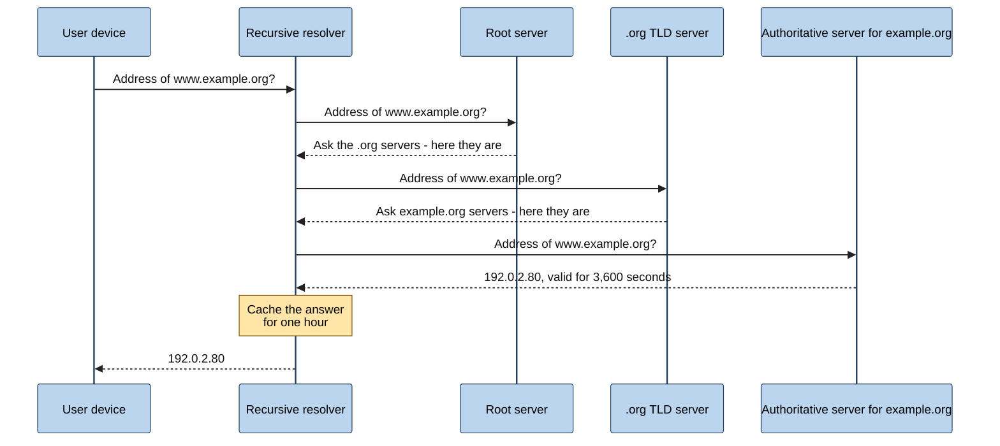
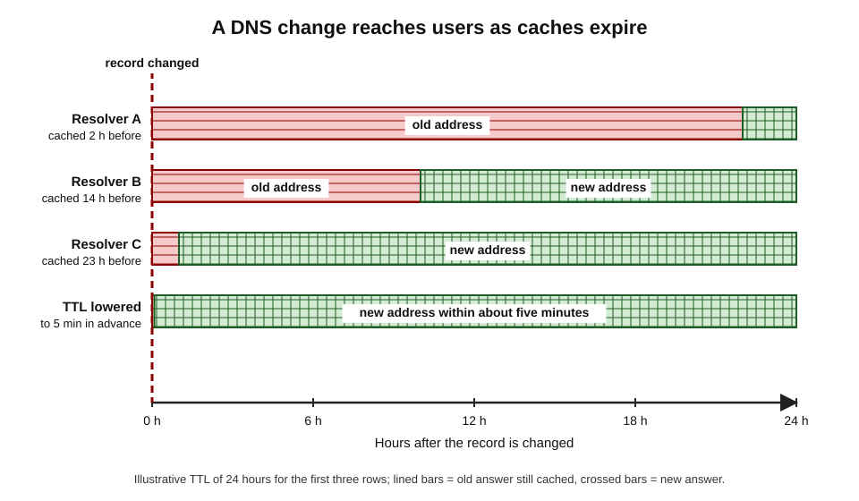
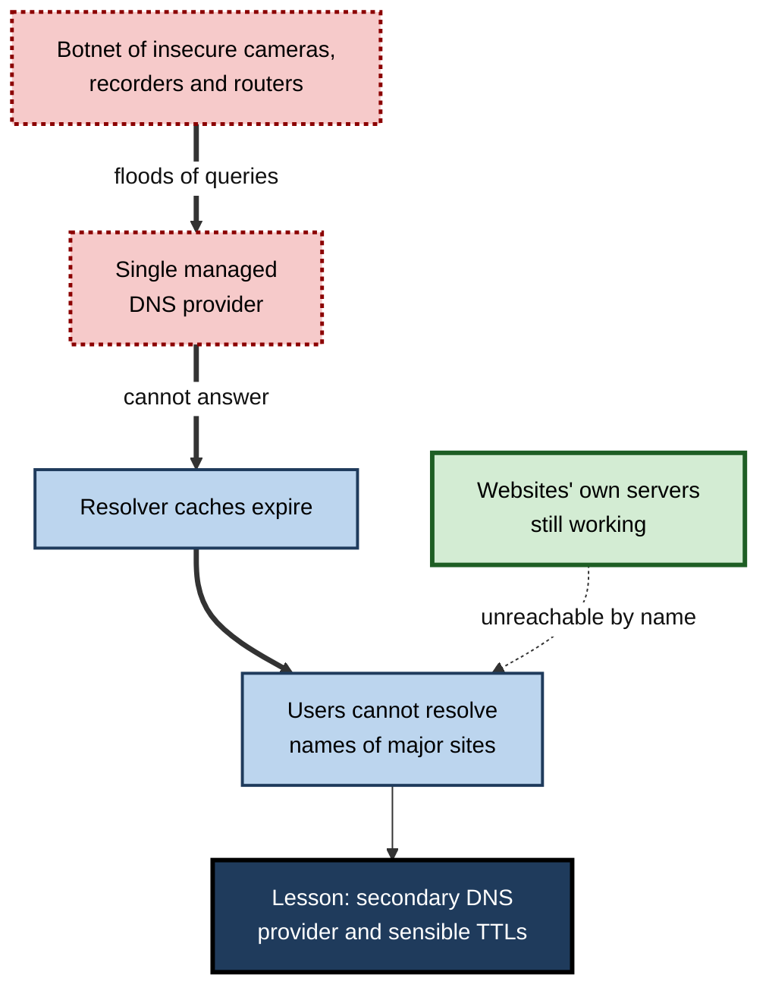

# E.7. Domain Names & DNS

Nobody types 142.250.180.14 to search the web or 2a03:2880:f10c::1 to message a friend. People type names — a company's brand followed by ".com", a government service ending ".gov.uk", a bank ending ".co.in" — and within a few milliseconds a worldwide, distributed directory turns each name into the numbers machines need. When that directory fails, perfectly healthy services vanish from the Internet.

> **Definition — Domain name:** a human-readable name, made of labels separated by dots (such as *mail.example.org*), that identifies a resource or administrative realm on the Internet.

> **Definition — Domain Name System (DNS):** the hierarchical, distributed naming system that translates domain names into IP addresses and other information, operated by millions of cooperating servers worldwide.

**Why DNS matters**

- Almost every Internet action **begins with a DNS lookup** — web pages, email, apps, software updates, cloud services.
- DNS lets services **change addresses without changing names**, which is what makes cloud hosting, content delivery and failover practical.
- A domain name is a **legal and commercial asset**: brands, trust and email delivery depend on it.
- DNS is a frequent **target and tool** of attackers — and one of the most effective places for defenders to block threats.

---

## Why Names Are Needed

### Names for people, numbers for machines

- **Memorability** — names are easier to remember, type and say than long numbers.
- **Stability** — a service can move to new servers, providers or countries while keeping its name.
- **Flexibility** — one name can lead to many servers (spreading load), and different users can be sent to different servers (nearest location).
- **Meaning** — names carry brand, organisation and sometimes country.

### From a single list to a distributed system

- **The early ARPANET** used one file, **HOSTS.TXT**, listing every host's name and address, maintained centrally and copied by every computer.
- **The problem by the early 1980s:**
  - the file changed faster than it could be distributed;
  - name collisions were hard to prevent;
  - the central maintainer became a bottleneck.
- **1983:** Paul Mockapetris designed the **Domain Name System**, published as standards documents that year and refined in 1987.
- **Three key design choices:**
  1. **Hierarchy** — names organised in a tree, so that responsibility can be delegated.
  2. **Distribution** — each part of the tree is served by those responsible for it.
  3. **Caching** — answers are stored temporarily wherever they are used, so that most lookups never travel far.

> **Key point:** DNS solved a scaling problem by **delegating** authority. No one maintains the whole directory; each organisation maintains its own part.

---

## The Structure of a Domain Name

### Reading a name from right to left

- **Root** — the unnamed top of the tree, sometimes written as a final dot.
- **Top-level domain (TLD)** — the rightmost label, *e.g.* .com, .org, .uk, .in.
- **Second-level domain** — the label to its left, usually chosen by the registrant, *e.g.* "example" in example.org.
- **Subdomains** — further labels created by the domain's owner, *e.g.* "mail" in mail.example.org, or "eu.shop" in eu.shop.example.org.
- **Fully qualified domain name (FQDN)** — the complete name, all the way to the root.

> **Definition — Top-level domain (TLD):** the highest level of the domain-name hierarchy below the root, such as .com or .de.

> **Definition — Subdomain:** a domain located beneath another in the hierarchy, created and controlled by the owner of the parent domain.

**Figure 1.** The domain-name hierarchy, read from the root downwards.

> **Watch out:** names are read **right to left** for authority. *example.com.attacker.net* belongs to **attacker.net**, not to example.com. Many phishing links exploit readers who look only at the left.

### Kinds of top-level domain

- **Generic TLDs (gTLDs)** — .com, .org, .net, .info and, since a major expansion programme from 2012, over a thousand others such as .app, .bank, .london and brand names.
- **Country-code TLDs (ccTLDs)** — two letters based on country codes: .in (India), .uk (United Kingdom), .de (Germany), .br (Brazil).
  - Some are marketed globally because their letters suggest something else — *e.g.* .io, .ai, .tv — which brings significant revenue to the territories concerned.
- **Sponsored and restricted TLDs** — limited to particular communities, *e.g.* .gov (US government), .edu (accredited US higher education).
- **Internationalised TLDs** — in non-Latin scripts, such as Chinese, Arabic, Cyrillic or Devanagari.
- **Infrastructure** — .arpa, used for technical purposes such as reverse lookups.

> **Example:** in 2026 a new round of applications for generic TLDs opened after more than a decade; over 1,600 applications proceeded to evaluation, many of them brands and cities.

| | Generic TLD (e.g. .com, .app) | Country-code TLD (e.g. .in, .de) | Restricted TLD (e.g. .gov, .bank) |
|---|---|---|---|
| Policy set by | Registry under ICANN contract | National registry under local policy | Sponsoring body or registry with eligibility rules |
| Who may register | Generally anyone | Varies — some require local presence | Only eligible organisations |
| Signals to users | Global, commercial or thematic | National identity or local market | Verified type of organisation |
| Typical use | Global brands, services | Local businesses, government, citizens | Government agencies, banks, universities |

---

## Who Runs Domain Names

### Registry, registrar, registrant

> **Definition — Registry:** the organisation that operates a top-level domain, maintaining the authoritative database of all names registered under it.

> **Definition — Registrar:** an accredited company that sells domain registrations to the public and submits them to registries.

> **Definition — Registrant:** the person or organisation that holds the right to use a registered domain name for a period.

- **ICANN** coordinates the root and the generic TLD system through contracts with registries and accreditation of registrars.
- **IANA functions** maintain the root zone — the list of every TLD and its authoritative servers.
- **Registrants rent, not own** — a domain is registered for a fixed period (typically one to ten years) and must be **renewed**.
- **Registration data** — contact details of registrants are collected; since European data-protection rules took effect in 2018, most personal details are no longer published, and access goes through request procedures.

**Figure 2.** The roles involved in registering and resolving a domain name.

---

## How a Name Is Resolved

### The cast of servers

- **Stub resolver** — the simple DNS client inside the user's device.
- **Recursive resolver** — a server, usually run by the ISP, the employer, or a public provider, that does the work of finding the answer and **caches** it.
- **Root servers** — know where to find the servers for every TLD.
  - There are **13 named root server identities** (lettered A to M), operated by **12 independent organisations**.
  - Each identity is served by many copies around the world using **anycast** — the same address announced from many locations — giving **more than 1,900 instances** in 2025.
- **TLD servers** — know which servers are authoritative for each domain within the TLD.
- **Authoritative servers** — hold the actual records for a domain, as set by its owner.

> **Definition — Recursive resolver:** a DNS server that receives queries from clients, follows the chain of referrals from the root to the authoritative servers, returns the answer and caches it.

> **Definition — Authoritative name server:** a server that holds the definitive DNS records for a domain and answers queries about it.

> **Definition — Anycast:** a routing technique in which the same IP address is announced from many locations, so each user reaches the nearest instance.

> **Watch out:** the claim that "there are only 13 root servers in the world" is outdated. There are 13 root server **identities**, each served by many physical servers around the world — collectively well over a thousand.

### The lookup step by step

**Figure 3.** Resolving a name with an empty cache.

1. **The device asks** its configured recursive resolver.
2. **The resolver asks a root server**, which replies with a **referral** to the servers for the TLD.
3. **The resolver asks a TLD server**, which refers it to the domain's authoritative servers.
4. **The resolver asks an authoritative server**, which gives the answer and a **time to live**.
5. **The resolver caches** the answer and returns it to the device, which may also cache it.

> **Remember:** **root → TLD → authoritative**, then **cache**. Most lookups skip the first steps because the resolver already knows the TLD and domain servers.

### Caching and time to live

> **Definition — Time to live (TTL):** the number of seconds for which a DNS answer may be cached before it must be looked up again.

- **Long TTLs** (hours or a day) → fewer lookups, faster responses, less load — but changes take longer to spread.
- **Short TTLs** (seconds or minutes) → quick changes and failover — but more queries and more dependence on authoritative servers being reachable.
- **Negative caching** — "this name does not exist" answers are cached too.

**Figure 4.** Why a DNS change takes time to reach everyone: caches expire at different moments.

> **Watch out:** "DNS propagation takes 48 hours" is a myth in its common form. There is no propagation process; old answers simply remain in caches until their TTL expires. Lowering the TTL **before** a planned change makes the change visible quickly.

---

## DNS Records

| Record type | What it holds | Example use |
|---|---|---|
| A | An IPv4 address | www → 192.0.2.80 |
| AAAA | An IPv6 address | www → 2001:db8::80 |
| CNAME | An alias pointing to another name | shop → a cloud store's hostname |
| MX | The mail servers that accept email for the domain, with priorities | Email for the domain delivered to a cloud mail provider |
| TXT | Free text, widely used for verification and email-security policies | Proving domain ownership; publishing anti-spoofing policies |
| NS | The authoritative name servers for the domain | Delegating the domain to a DNS hosting provider |
| CAA | Which certificate authorities may issue certificates for the domain | Restricting certificate issuance to one approved authority |
| PTR | Reverse mapping from an address to a name | Mail servers checking a sender's address |

- **Email depends on DNS** in several ways:
  - **MX** records route incoming mail;
  - **SPF** (in TXT) lists servers allowed to send mail for the domain;
  - **DKIM** publishes keys used to sign outgoing mail;
  - **DMARC** tells receivers what to do with mail failing those checks and where to send reports.
- **Cloud services depend on DNS** — CNAMEs point company names at provider infrastructure; TXT records prove ownership before services are activated.

> **Mnemonic — "All Aliens Count Many Tiny Nebulae":** A, AAAA, CNAME, MX, TXT, NS — the six records met most often.

> **In practice:** large email providers increasingly **reject or quarantine** mail from domains without proper SPF, DKIM and DMARC records. Correct DNS configuration is now a precondition for an organisation's email to be delivered.

---

## DNS and Security

### Attacks on DNS

- **Cache poisoning (spoofing)** — tricking a resolver into caching a false answer, so users are sent to an attacker's server.
  - **Dan Kaminsky (2008)** disclosed a technique making poisoning far easier than believed; a coordinated, industry-wide patch followed before details were published.
- **Domain hijacking** — taking over a domain through a compromised registrar account, social engineering or an expired registration, then changing its records.
- **Denial of service** — flooding DNS providers so that names cannot be resolved.
- **Subdomain takeover** — a company's subdomain still points (via CNAME) to a cloud resource it has deleted; an attacker claims the resource and serves content under the company's name.
- **Lookalike and typo domains** — registering names close to a brand (*e.g.* with a swapped letter or a different TLD) for phishing.
- **DNS tunnelling** — hiding data or commands in DNS queries to slip past firewalls.

### Defences

- **DNSSEC** — digitally signs DNS records so resolvers can verify they are authentic and unaltered.
  - The root zone has been signed since **2010**; adoption by individual domains remains uneven.
- **Registrar security** — strong authentication on registrar accounts; **registry lock** for critical domains, requiring manual, verified steps for changes.
- **Monitoring** — watching for lookalike registrations, unexpected record changes and expiring domains.
- **Protective DNS** — resolvers that refuse to resolve known malicious domains, widely used by organisations and some national cyber-security agencies.
- **Cleaning up** — removing records that point at decommissioned cloud resources.

> **Definition — DNSSEC (DNS Security Extensions):** a set of extensions that add digital signatures to DNS data, allowing resolvers to verify its origin and integrity.

> **Watch out:** DNSSEC proves that an answer is **authentic**; it does **not** encrypt it. Privacy needs a different tool.

### DNS and privacy

- **Traditional DNS queries are unencrypted** — anyone on the path (the Wi-Fi operator, the ISP) can see which names a device looks up.
- **Encrypted DNS** — **DNS over HTTPS (DoH)** and **DNS over TLS (DoT)** protect queries between the device and the resolver.
- **Trade-offs:**
  - users gain privacy from local networks and ISPs;
  - but the chosen resolver sees everything instead;
  - organisations and parents lose visibility used for security filtering, unless they provide their own encrypted resolver.

| | Traditional DNS | Encrypted DNS (DoH or DoT) |
|---|---|---|
| Visible to local network and ISP | Yes | No (only that a resolver is being used) |
| Visible to the resolver operator | Yes | Yes |
| Can be filtered by network administrators | Easily | Only if they control the resolver or block alternatives |
| Protection against tampering in transit | None | Yes, between device and resolver |
| Typical use | Default in many networks | Default in some browsers and operating systems |

---

## Case Study: The Day DNS Took Down Major Websites (October 2016)

- **Situation:** on 21 October 2016, a major managed-DNS provider, Dyn, served authoritative DNS for many well-known services.
- **Attack:** a botnet called **Mirai**, made of tens of thousands — by the provider's estimate up to around a hundred thousand — of compromised **cameras, video recorders and home routers** using default passwords, flooded Dyn's servers in several waves.
- **Effect:**
  1. Dyn's authoritative servers could not answer many queries.
  2. As cached answers expired, resolvers could not refresh them.
  3. Large services — including major social-media, streaming, news and payment sites — became unreachable for many users, especially in North America and Europe, for several hours.
- **What was not affected:** the services' own servers were working; only their **names** could not be resolved.
- **Lessons:**
  - **concentration risk** — many organisations depended on one DNS provider;
  - **use more than one authoritative DNS provider** for critical domains;
  - **set TTLs thoughtfully** — longer TTLs keep cached answers alive during an outage, at the cost of slower intended changes;
  - **insecure consumer devices** threaten everyone; this attack helped drive later laws requiring unique default passwords on connected devices.

**Figure 5.** How a botnet attack on one DNS provider made healthy websites unreachable.

---

## DNS in Professional Practice

### Managing an organisation's domains

- **Inventory** — keep a register of every domain, its registrar, renewal date, owner and purpose.
- **Renewal** — enable automatic renewal; use corporate (not personal) payment methods and contact addresses.
- **Consolidation** — fewer registrars and accounts, protected with strong authentication.
- **Defensive registrations** — register obvious variants and key country codes, within reason.
- **Change control** — DNS changes reviewed and logged like other production changes.

> **Watch out:** expired domains are a real and recurring risk. Organisations have lost email and websites — and sometimes control of the domain itself, bought by others the moment it lapsed — because a renewal reminder went to a former employee's inbox.

### Worked example (illustrative): migrating a website with minimal disruption

Situation: a firm moves its website from an old hosting company to a cloud provider. The current A record has a TTL of 86,400 seconds (one day).

1. **Two days before the move** — lower the TTL to 300 seconds (five minutes). Wait at least one old TTL (a day) so all caches hold the short TTL.
2. **Prepare** — set up the new site and test it using its new address directly.
3. **Switch** — change the A (or CNAME) record to point at the cloud provider.
4. **Observe** — within about five minutes, most users reach the new site; keep the old site running for a while for stragglers.
5. **Restore** — after the move is stable, raise the TTL again (*e.g.* to an hour) to reduce load and improve resilience.

> **Formula — Worst-case staleness:** the longest time a user may still be sent to the old address ≈ the TTL in force when the change was made. Example: with TTL 86,400 s, up to **24 hours**; after lowering to 300 s, about **5 minutes**.

### DNS as a traffic-management tool

- **Geographic steering** — returning different answers depending on the user's location, to send users to the nearest region.
- **Load balancing** — returning several addresses or rotating them.
- **Failover** — health checks automatically remove failed servers from answers.
- **Content delivery networks** — rely heavily on DNS to direct each user to a nearby cache.

### DNS, cloud and AI services

- **Cloud adoption multiplies DNS records** — every service, region and environment needs names, often managed through automation.
- **Split-horizon DNS** — the same name resolves differently inside the corporate network and on the public Internet, for private access to cloud services.
- **AI services** are reached by name like any other; organisations often control which AI tools staff can use partly through **DNS filtering**, blocking or allowing particular domains.
- **Automated agents** that browse and act online rely on DNS like any user, making secure and accurate name resolution part of trustworthy automation.

> **In practice:** in incident response, "Is it DNS?" is among the first questions asked — because DNS failures look like everything else failing.

---

## Resolvers in Practice

### Choosing a resolver

- **ISP resolvers** — the default for most homes; close to users, sometimes used for legally required blocking.
- **Public resolvers** — large free services run by technology companies and non-profits, often with encrypted access and optional malware or family filtering.
- **Enterprise resolvers** — run or contracted by organisations to apply security policy, log queries for investigations and resolve internal names.

| | ISP resolver | Public resolver | Enterprise protective resolver |
|---|---|---|---|
| Who sees the queries | The ISP | The resolver operator | The organisation and its provider |
| Filtering | Legal blocking orders; sometimes optional filters | Optional malware or family filtering | Policy-based blocking of malicious and unapproved domains |
| Typical speed | Good — nearby | Good — anycast worldwide | Good if well deployed |
| Visibility for security teams | None | None | Full query logs for detection and investigation |

### DNS in security operations

- **Detection** — a device suddenly querying newly registered or algorithmically generated domain names is a classic sign of malware contacting its controllers.
- **Investigation** — DNS logs show which devices looked up a phishing domain, and when — often the fastest way to find everyone who clicked.
- **Containment** — blocking a malicious domain at the resolver protects every device at once.

> **In practice:** after a phishing campaign, a security team typically blocks the phishing domain at the resolver within minutes, then searches DNS logs to identify every device that resolved it before the block.

### Reverse DNS

- **What it is** — looking up the **name** associated with an IP address, using PTR records in a special part of the namespace.
- **Uses:**
  - mail servers check that a sending server's address has sensible reverse DNS, a basic anti-spam signal;
  - network tools display router names in traces;
  - logs become easier to read.
- **Limit** — whoever controls the address block controls its reverse names, so reverse DNS is a hint, not proof of identity.

---

## Choosing Domain Names for an Organisation

### Worked example (illustrative): naming a new product line

Situation: a mid-sized company is launching a consumer app called "Kitebox" in several countries.

1. **Check availability** — the .com is taken by an unrelated firm; the national domains in the main markets are free.
2. **Check trademarks** — confirm no conflicting trademark in target markets, to avoid disputes.
3. **Choose the primary** — use a subdomain of the company's existing trusted domain for login and payments (*e.g.* kitebox under the corporate domain) to inherit its reputation and email-security set-up; use a short marketing domain only for redirects.
4. **Register defensively** — the main national domains and obvious misspellings, within budget.
5. **Configure security** — registry lock, DNSSEC, CAA records, SPF/DKIM/DMARC for any domain that could be spoofed — including domains that send **no** email, which should publish policies saying so.
6. **Record ownership** — add all domains to the inventory with renewal dates and owners.
- **Conclusion:** fewer, well-protected domains are safer than many loosely managed ones; every additional domain is another asset to renew, secure and monitor.

> **Watch out:** using many different domains for logins and payments trains customers to accept unfamiliar addresses — which makes them easier to phish. Consistency of the domains customers see is itself a security measure.

---

## Common DNS Failures and Their Symptoms

| Symptom | Likely cause | First check |
|---|---|---|
| One website unreachable by name but reachable by address | That domain's DNS records or servers | Query the domain's authoritative servers |
| Every website fails to load, but apps using existing connections work | Local resolver or DNS settings | Try another resolver; check router DNS settings |
| New service works for some users, not others | Old answers still cached after a change | Compare TTLs; wait or flush caches |
| Email to one domain bounces | Missing or wrong MX records | Look up the domain's MX records |
| Certificate errors after moving a site | DNS points to the new host before its certificate is ready | Check records and certificate together |

> **Remember:** when "nothing works", test **by address and by name**. If addresses work and names fail, the problem is DNS.

---

## Open Questions

- **Who should see users' DNS queries?**
  - Encrypted DNS shifts visibility from networks to resolver operators; whether concentration in a few large public resolvers is acceptable is debated.
- **Will DNSSEC ever be universal?**
  - It is technically mature but adds operational complexity; many domains still do not sign their records.
- **How many TLDs does the Internet need?**
  - New TLDs increase choice but also confusion and defensive-registration costs; evidence on their benefits is mixed.
- **Can lookalike-domain abuse be curbed without restricting legitimate registrations?**
  - Registries, registrars and brands disagree on responsibility.
- **Will alternative naming systems matter?**
  - Blockchain-based and platform-specific naming schemes exist outside the DNS root; most experts warn they risk fragmenting the shared namespace.

---

## Summary

- A **domain name** is a hierarchical, human-readable name; **DNS** translates names into addresses and other data.
- DNS (Mockapetris, **1983**) replaced the central **HOSTS.TXT** file with **hierarchy, delegation and caching**.
- Names are read **right to left**: root → **TLD** → second-level domain → **subdomains**. TLDs include **generic**, **country-code**, **restricted** and **internationalised** domains.
- **Registries** run TLDs, **registrars** sell names, **registrants** hold them for a renewable period; **ICANN/IANA** coordinate the root.
- Resolution: device → **recursive resolver** → **root** → **TLD** → **authoritative** server; answers are **cached** for their **TTL**. There are **13 root identities**, run by **12 organisations**, served by **more than 1,900 anycast instances**.
- Key records: **A, AAAA, CNAME, MX, TXT, NS**, plus CAA and PTR; email security (**SPF, DKIM, DMARC**) lives in DNS.
- Threats: **cache poisoning**, **hijacking**, **denial of service**, **subdomain takeover**, **lookalike domains**, **tunnelling**. Defences: **DNSSEC** (authenticity), **registry lock**, monitoring, **protective DNS**.
- **Encrypted DNS** (DoH, DoT) protects privacy in transit but moves visibility to the resolver.
- The **2016 Dyn attack** showed the risk of concentrating authoritative DNS in one provider.
- Professionals manage domain **inventories and renewals**, plan **TTL changes** for migrations, and use DNS for **steering, failover and filtering**.

---

## Self-Check

1. Why did the Internet replace HOSTS.TXT with DNS, and what three design choices made DNS scale?
2. Label each part of the name eu.shop.example.co.uk.
3. Who controls the name login.bank.example.com.secure-check.net, and why does this matter?
4. Distinguish generic, country-code and restricted TLDs with examples.
5. Explain the roles of registry, registrar and registrant.
6. Describe the steps of resolving a name with an empty cache.
7. Correct the statement "there are only 13 root servers".
8. What is a TTL, and what is the trade-off between long and short TTLs?
9. Why is "DNS propagation takes 48 hours" misleading?
10. State what each of the A, AAAA, CNAME, MX and TXT records does.
11. How do SPF, DKIM and DMARC use DNS to protect email?
12. Explain cache poisoning and subdomain takeover.
13. What does DNSSEC provide, and what does it not provide?
14. Summarise the 2016 Dyn attack and two lessons for organisations.
15. Plan the DNS steps for moving a company's email to a new provider with minimal disruption.

### Answer Key

1. The central file could not keep up with growth, collisions and distribution. DNS used hierarchy, delegation of authority and distribution, and caching.
2. uk = country-code TLD; co = second-level (a public category under .uk); example = the registered domain; shop and eu = subdomains created by the domain owner; the whole is an FQDN.
3. secure-check.net — names are read right to left for authority. Attackers place a familiar brand on the left to deceive readers.
4. Generic: .com, .app — open, global or thematic. Country-code: .in, .de — national policy. Restricted: .gov, .bank — eligibility rules.
5. The registry operates the TLD database; the registrar sells registrations and submits them; the registrant holds the right to use the name for a renewable period.
6. Device asks a recursive resolver; resolver asks a root server (referral to TLD servers); asks the TLD server (referral to authoritative servers); asks the authoritative server (answer with TTL); caches and returns it.
7. There are 13 root server identities (A–M) run by 12 organisations, each served by many anycast instances — more than 1,900 worldwide.
8. The time an answer may be cached. Long TTLs reduce load and survive provider outages but slow changes; short TTLs allow quick changes and failover but increase queries and dependence on authoritative servers.
9. There is no propagation process; old answers persist only until cached TTLs expire. Lowering TTLs before a change makes it visible within minutes.
10. A: IPv4 address. AAAA: IPv6 address. CNAME: alias to another name. MX: mail servers for the domain. TXT: text used for verification and email policies.
11. SPF lists permitted sending servers; DKIM publishes keys to verify message signatures; DMARC tells receivers how to handle failures and where to report — all published as DNS records.
12. Cache poisoning: tricking a resolver into caching a false answer, redirecting users. Subdomain takeover: a subdomain still points to a deleted cloud resource, which an attacker claims to serve content under the organisation's name.
13. Authenticity and integrity of DNS answers through signatures; it does not encrypt queries or provide privacy.
14. The Mirai botnet of insecure IoT devices flooded Dyn's authoritative DNS; as caches expired, major sites became unreachable by name although their servers worked. Lessons: use multiple DNS providers for critical domains; choose TTLs that balance agility and resilience.
15. Lower MX record TTLs days in advance; set up and verify the new provider (TXT verification, SPF, DKIM, DMARC); switch MX records; monitor delivery and keep the old service accepting mail for a period; restore longer TTLs once stable.

---

## Glossary

| Term | Meaning |
|---|---|
| A record | DNS record mapping a name to an IPv4 address. |
| AAAA record | DNS record mapping a name to an IPv6 address. |
| Anycast | Announcing one address from many locations so users reach the nearest. |
| Authoritative name server | A server holding the definitive records for a domain. |
| Cache poisoning | Inserting false answers into a resolver's cache. |
| ccTLD | Country-code top-level domain, such as .in or .uk. |
| CNAME | DNS alias pointing one name to another. |
| DKIM | Email signing scheme whose public keys are published in DNS. |
| DMARC | DNS-published policy for handling email that fails authentication. |
| DNS | Domain Name System. |
| DNSSEC | Extensions adding digital signatures to DNS data. |
| DoH / DoT | DNS over HTTPS / DNS over TLS; encrypted DNS. |
| Domain name | A hierarchical human-readable name on the Internet. |
| FQDN | Fully qualified domain name, complete to the root. |
| gTLD | Generic top-level domain, such as .com or .app. |
| MX record | DNS record naming a domain's mail servers. |
| Recursive resolver | A server that finds answers on clients' behalf and caches them. |
| Registrant | The holder of a domain registration. |
| Registrar | A company selling domain registrations. |
| Registry | The operator of a top-level domain. |
| Root zone | The top of the DNS hierarchy listing all TLDs. |
| SPF | DNS-published list of servers allowed to send a domain's email. |
| Subdomain | A domain beneath another, controlled by the parent's owner. |
| Subdomain takeover | Hijacking a subdomain that points to an abandoned resource. |
| TLD | Top-level domain. |
| TTL | Time to live; how long a DNS answer may be cached. |
