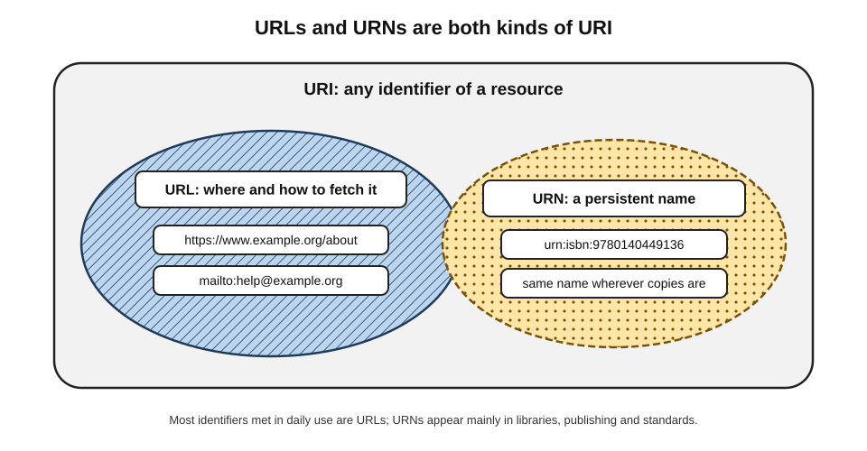
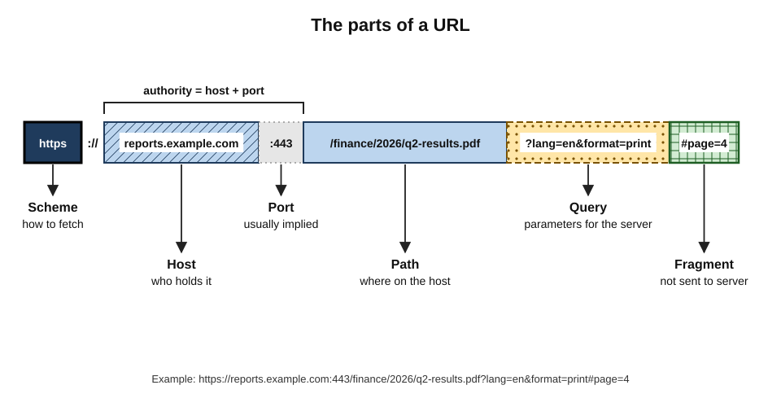
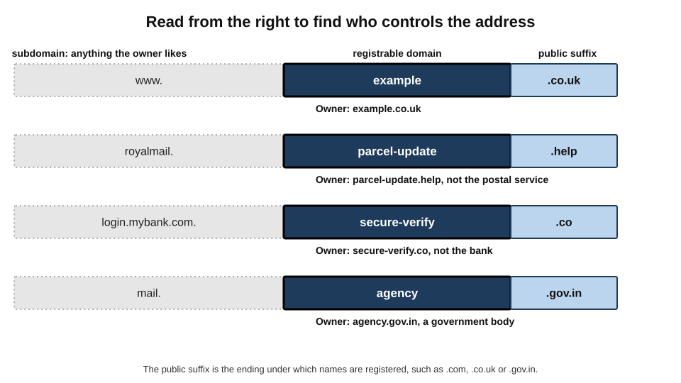
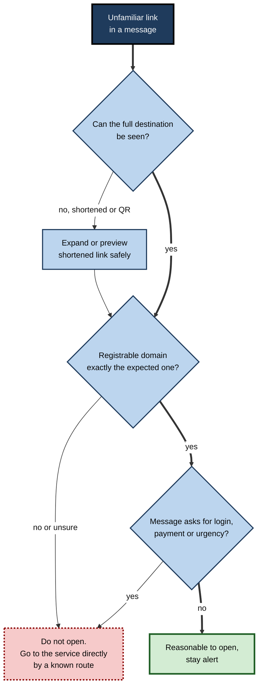
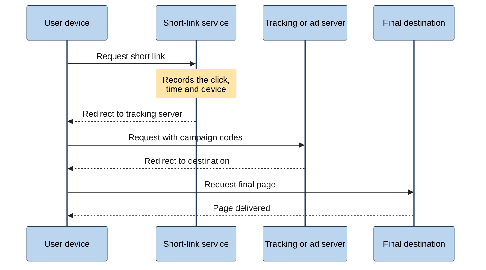

# E.8. URLs & Web Addresses

A message arrives: "Your parcel is held — confirm delivery at royalmail.parcel-update.help/track?id=48213". A colleague shares a link to a report that, two years later, leads only to an error page. A marketing team wonders why its campaign links are so long and full of strange codes. Each case turns on the same small string of characters — the **URL** — and on whether the person reading it knows how to interpret it.

> **Definition — URL (Uniform Resource Locator):** a standardised text string that identifies a resource on a network and specifies how and where to retrieve it — for example, the protocol to use, the host that holds it and the path to it on that host.

**Why URLs matter**

- They are the **addresses of the web and of most online services**: pages, files, images, API endpoints, cloud documents, meeting rooms.
- Reading a URL correctly is one of the **most effective everyday defences** against phishing and fraud.
- URLs carry **information** — sometimes more than intended, such as tracking codes or personal data.
- For organisations, URL design affects **findability, trust, security, analytics and longevity** of their online presence.

---

## Identifiers on the Web

### URI, URL and URN

- **URI (Uniform Resource Identifier)** — the general term for any string that identifies a resource.
- **URL** — a URI that also says **how to locate** the resource (*e.g.* "fetch it over HTTPS from this host at this path").
- **URN (Uniform Resource Name)** — a URI that names a resource **persistently**, independent of location.
  - *e.g.* urn:isbn:9780140449136 identifies a book edition by its ISBN, wherever copies are kept.

> **Definition — URI (Uniform Resource Identifier):** a string of characters that unambiguously identifies a resource; URLs and URNs are both kinds of URI.

**Figure 1.** URLs and URNs as two kinds of URI.



> **Watch out:** in everyday and professional speech, "URL", "web address" and "link" are used interchangeably. Strictly, a **link** is an element in a page or message that *contains* a URL; the URL is the address itself.

### Origins

- **Tim Berners-Lee (1990–94)** defined URLs as one of the three founding technologies of the web, with HTML and HTTP.
- His innovation was a **single address format** for resources reached by many different protocols — web, file transfer, news, email — so that any document could link to any other.
- The general syntax was later consolidated in a standard (2005) that still governs URIs today.

> **Key point:** the URL is what made the web a *web*. A universal address format meant any resource, anywhere, could be referenced from anywhere else.

---

## Anatomy of a URL

### The parts

Consider the URL:

```text
https://reports.example.com:443/finance/2026/q2-results.pdf?lang=en&format=print#page=4
```

- **Scheme** — *https* — the protocol or method of access.
- **Authority** — *reports.example.com:443* — who holds the resource:
  - **host** — *reports.example.com* — a domain name or an IP address;
  - **port** — *443* — usually omitted because each scheme has a default (443 for HTTPS, 80 for HTTP).
- **Path** — */finance/2026/q2-results.pdf* — the location of the resource on that host.
- **Query** — *?lang=en&format=print* — parameters passed to the server, usually as *key=value* pairs separated by *&*.
- **Fragment** — *#page=4* — a part *within* the resource, handled by the user's software and **not sent to the server**.

**Figure 2.** The parts of a URL.



> **Mnemonic — "Seven Ants Harvest Plums Quietly For Pudding":** Scheme, Authority (Host, Port), Path, Query, Fragment — read left to right. (Host and Port sit inside Authority.)

### Schemes

- **https** — fetch over the web, encrypted.
- **http** — fetch over the web, unencrypted; now rare for anything that matters.
- **mailto** — start an email to an address.
- **tel** — start a phone call.
- **ftp** — file transfer; now rare.
- **file** — a file on the user's own computer.
- **data** — small content embedded directly in the URL itself.
- **App-specific schemes** — open a particular app at a particular place ("deep links"), such as a meeting app's link that opens the meeting directly.

```text
https://shop.example.org/about
http://legacy.example.org
mailto:help@example.org
tel:+44-20-7946-0000
ftp://files.example.org/data.csv
file:///C:/Reports/plan.docx
data:text/plain,hello
```

> **Watch out:** the padlock and "https" mean the connection is **encrypted to the named host** — not that the host is honest. Fraudsters obtain valid certificates for their own lookalike domains just as easily as legitimate businesses do.

### Hosts

- **Domain name** — the common case, *e.g.* shop.example.org.
- **IP address** — occasionally used directly as the host, *e.g.* 192.0.2.80 in place of a name; unusual for public services and therefore **suspicious** in messages from unknown senders.
- **Case** — host names are **not case-sensitive**: EXAMPLE.org and example.org are the same.
- **Internationalised domain names** — hosts may contain non-Latin characters (*e.g.* Arabic, Chinese, Devanagari). Internally these are converted into an ASCII form beginning **xn--** (called Punycode).

> **Definition — Punycode:** an encoding that represents internationalised domain names using only the limited ASCII characters permitted in DNS, marked by the prefix "xn--".

### Paths

- **Hierarchical** — like folders: /products/laptops/model-x.
- **Case may matter** — unlike hosts, paths are interpreted by the server and **can be case-sensitive** (/Report and /report may differ).
- **Not necessarily real folders** — modern web applications treat the path as a request to be interpreted, not a file location.
- **Trailing slashes and file extensions** — conventions differ by server; good sites redirect variants to one canonical form.

### Queries

- **Purpose** — pass information to the server: search terms, filters, page numbers, identifiers.
  - *e.g.* ?q=solar+panels&sort=price&page=2
- **Tracking parameters** — marketers append codes recording the campaign, source and medium of a click.
  - *e.g.* ?utm_source=newsletter&utm_medium=email&utm_campaign=spring-sale
- **Sensitive data risk** — queries are stored in browser history, server logs and analytics, and may be passed to other sites; they should never contain passwords, health data or personal identifiers.

> **Example (illustrative):** a hospital appointment system that put patients' national identity numbers in its URLs exposed them to every analytics service the page loaded and to anyone who saw a shared link. Moving the identifier out of the URL closed the leak.

### Fragments

- **Purpose** — point to a section within a page or document (*e.g.* #summary), or to client-side state in web applications.
- **Never sent to the server** — handled entirely by the user's software.
- **Uses** — table-of-contents links, highlighting a passage, single-page applications.

---

## Encoding: Characters That Need Escaping

### Reserved and unsafe characters

- URLs may contain only a limited set of characters directly.
- **Reserved characters** — such as **: / ? # [ ] @ & = + $ ,** — have special meanings as separators.
- **Other characters** (spaces, most punctuation, non-Latin letters) must be **percent-encoded**: replaced by **%** followed by two hexadecimal digits for each byte.

> **Definition — Percent-encoding:** representing a character in a URL as "%" followed by the hexadecimal value of each of its bytes (in UTF-8), e.g. a space as %20.

| Character | Encoded form | Why it needs encoding |
|---|---|---|
| Space | %20 (or + in query strings) | Not permitted in URLs |
| & | %26 | Separates query parameters |
| ? | %3F | Starts the query |
| # | %23 | Starts the fragment |
| / | %2F | Separates path segments |
| é | %C3%A9 | Non-ASCII; encoded as two UTF-8 bytes |

> **Formula — Decoding a percent sequence:** each %XY is one byte with hexadecimal value XY. Example: %41 = hexadecimal 41 = decimal 65 = the letter "A".

> **Watch out:** attackers use encoding to **disguise** URLs — for example, writing parts of a malicious address in percent-encoded form so that filters or readers do not recognise it. Security tools decode URLs fully before judging them.

---

## Absolute and Relative URLs

- **Absolute URL** — complete, including scheme and host, like the address dissected earlier.
- **Relative URL** — interpreted relative to the current page's address; used inside websites so that pages work regardless of domain.
  - **/help/faq** — from the root of the current host.
  - **faq** — in the same "folder" as the current page.
  - **../pricing** — one level up.
- **Protocol-relative and scheme-less forms** are older practices now discouraged in favour of explicit HTTPS.

**Worked example — resolving relative links found on one page**

Situation: a page at the address below contains five relative links; each is resolved against the page's own address.

```text
Page:        https://shop.example.org/products/laptops/index.html

Link                          Resolves to
specs.html                    https://shop.example.org/products/laptops/specs.html
../tablets/                   https://shop.example.org/products/tablets/
/contact                      https://shop.example.org/contact
//cdn.example.net/logo.png    https://cdn.example.net/logo.png
#reviews                      https://shop.example.org/products/laptops/index.html#reviews
```

1. **A bare file name** replaces the last segment of the page's path.
2. **"../"** climbs one level before adding the rest.
3. **A leading "/"** starts from the root of the same host.
4. **A leading "//"** keeps only the scheme and supplies a new host.
5. **A leading "#"** keeps the whole page address and adds a fragment.

> **Key point:** relative URLs keep a website portable; absolute URLs are needed whenever a link leaves the site — in emails, documents, social posts and APIs.

---

## Reading URLs Safely

### Find the real owner: the registrable domain

- The part of a host that someone actually **registers and controls** is its **registrable domain** — the label just to the left of the public suffix (such as .com, .co.uk or .gov.in).
- **Everything to the left** of the registrable domain is a subdomain chosen by that owner — and can say anything.
- **Read from the right**: find the public suffix, then the label before it.

> **Definition — Registrable domain:** the part of a host name that is registered by an organisation — one label plus its public suffix, such as example.co.uk — and that therefore indicates who controls the address.

**Figure 3.** Finding who really controls a web address.



### Common deception techniques

- **Brand in a subdomain** — *royalmail.parcel-update.help*: the owner is **parcel-update.help**, not the postal service.
- **Brand in the path** — *secure-login.example.net/paypal/*: the owner is example.net.
- **Lookalike spelling** — *rnicrosoft* (r + n resembling m), *arnazon*, doubled letters, swapped letters.
- **Different TLD** — the right brand with a wrong ending: brand.co instead of brand.com, or a newer TLD.
- **Homographs** — characters from other scripts that look identical to Latin ones.
  - In 2017 a security researcher demonstrated a site whose address appeared, in several browsers, to read exactly like a famous technology company's domain, although it was written entirely in Cyrillic letters. Browsers responded by showing Punycode (xn--) forms in suspicious cases.
- **The "@" trick** — in the address below, everything before "@" is treated as a user name; the real host is **evil.example**.

```text
https://bank.com@evil.example/login
```
- **Shortened links and QR codes** — hide the destination entirely until followed.
- **Open redirects** — a trusted site's URL that forwards the user to any destination given in a parameter, *e.g.* trusted.example/redirect?to=evil.example.

> **Watch out:** "it starts with the bank's name, so it must be the bank" is the single most exploited misreading of URLs. Position from the **right** decides ownership, not what appears first.

**Figure 4.** A quick procedure for judging an unfamiliar link before opening it.



> **Remember:** for anything involving **credentials or money**, do not follow the link at all — open the service by a **known route** (a bookmark, the official app or a typed address).

---

## Redirects, Short Links and Link Rot

### Redirects

- A server can answer a request for one URL by telling the client to go to another — a **redirect**.
- **Permanent redirects** — used when content has moved for good; search engines update their records.
- **Temporary redirects** — used for maintenance, A/B tests or sign-in flows.
- **Chains** — several redirects in a row slow loading and obscure the final destination.

### URL shorteners

- Services that replace a long URL with a short one that redirects to it.
- **Benefits** — shorter links for print, SMS and social media; click analytics.
- **Risks:**
  - the destination is hidden, a gift to phishers;
  - links die if the shortening service closes or deletes them;
  - privacy — the service sees every click.

**Figure 5.** What happens when a shortened link is followed.



### Link rot

> **Definition — Link rot:** the process by which URLs stop working over time because content is moved, renamed or deleted, or because the domain lapses.

- **Scale of the problem:**
  - a 2014 Harvard study by Jonathan Zittrain and colleagues found that around half of the URLs cited in United States Supreme Court opinions no longer led to the originally cited material;
  - a 2024 analysis by the Pew research organisation estimated that roughly a quarter of web pages that existed at some point between 2013 and 2023 were no longer accessible by late 2023, rising to over a third for pages from 2013.
- **Content drift** — even when a URL works, the content behind it may have changed.
- **Remedies:**
  - persistent identifiers for important documents (such as DOIs for research articles);
  - web archives that capture snapshots;
  - organisations committing to stable URLs and redirecting old ones.

> **Watch out:** precise link-rot percentages vary with the sample and method. The consistent finding is that a **large fraction of web links decay within a decade**.

> **Key point:** Tim Berners-Lee's 1998 principle **"Cool URIs don't change"** remains good practice: the cost of keeping old addresses working is small compared with the cost of broken links to customers, partners and the public record.

---

## URLs in Organisations

### Designing good URLs

- **Readable** — words, not codes: /careers/graduate-programme rather than /page?id=8823.
- **Stable** — design paths that will not need to change when the organisation restructures; avoid department names, technology names (.php, .aspx) and dates unless the content is truly dated.
- **Canonical** — one preferred URL for each piece of content; redirect duplicates (with and without "www", trailing slashes, upper/lower case).
- **Secure by default** — HTTPS everywhere; redirect HTTP to HTTPS.
- **Free of personal data** — no names, emails, identity numbers or session tokens in paths or queries.
- **Consistent** — predictable patterns across the site and across APIs.

| | Poor URL | Better URL |
|---|---|---|
| Readability | /index.php?pg=12&cat=7 | /services/cloud-migration |
| Stability | /marketing-dept/2019/new/offer | /offers/student-discount |
| Privacy | /account?email=priya@example.com | /account (identity from the signed-in session) |
| Canonical form | Many variants: /About, /about/, /about.html | One form, others redirected: /about |
| Security | Portal served with the http scheme | Same portal served only with https |

### URLs in APIs and cloud services

- **API endpoints** — programs call URLs such as api.example.com/v2/orders/58213 (over HTTPS), with the path naming resources and the query selecting options.
- **Versioning** — including a version (*e.g.* /v2/) lets providers evolve an API without breaking existing clients.
- **Signed (pre-signed) URLs** — cloud storage can issue a URL that grants temporary access to one file, containing a cryptographic signature and an expiry time.
  - Convenient for sharing large files; dangerous if the link is forwarded, because **anyone with the URL has access** until it expires.
- **Capability URLs** — "anyone with the link can view" sharing in office suites works the same way; the URL itself is the key.

> **Watch out:** a shared document link set to "anyone with the link" is only as private as the people and systems that see the link — email gateways, chat histories, browser extensions and search crawlers if it is ever posted publicly.

### Case study (illustrative): a campaign link that leaked customer data

- **Situation:** an insurance company emailed renewal reminders containing personalised links of the form */renew?policy=…&dob=…&postcode=…*, so that customers could renew without signing in.
- **Problem:**
  - the policy number, date of birth and postcode appeared in **plain text** in the URL;
  - the renewal page loaded third-party analytics and advertising scripts, which received the full URL;
  - some customers forwarded the email to family members or posted screenshots asking for help.
- **Discovery:** a privacy researcher noticed the parameters in an analytics provider's shared reports and alerted the company.
- **Actions:**
  1. replaced personal data with a **single random, expiring token**;
  2. required a second verification step before showing policy details;
  3. removed third-party scripts from authenticated and personalised pages;
  4. reviewed all other URLs for personal data;
  5. notified the data-protection regulator as required.
- **Result:** the leak was closed; the company faced regulatory scrutiny and a costly review of its marketing systems.
- **Lesson:** **URLs are not private.** They are logged, shared, cached and passed on; anything placed in them should be assumed to become public.

---

## URLs, Search and AI

- **Search engines** use URLs as identifiers of pages; clean, canonical URLs help them index content correctly (search itself is a separate subject).
- **AI assistants** increasingly cite sources by URL.
  - Language models have been documented **inventing plausible-looking URLs** that do not exist — a form of fabrication.
  - Professionals should open and check any URL an AI tool provides before relying on it.
- **AI agents and automation** — tools that browse and act on the web follow URLs automatically, so malicious or manipulated URLs (including ones hidden in web content) are a growing security concern for automated systems as well as people.
- **Machine-readable access rules** — websites publish files at standard URL paths (such as /robots.txt) to tell crawlers, including AI crawlers, which paths they may visit.

> **In practice:** in professional writing, cite a URL only after confirming it works and leads to the cited content; for durable references, prefer **persistent identifiers** or archived copies.

---

## Tracking, QR Codes and Deep Links

### Tracking parameters in detail

- **Campaign tags** — parameters naming the source, medium and campaign of a link, so analytics can attribute visits.
- **Click identifiers** — long unique codes added by advertising platforms to connect a click with a particular advert and, often, a particular user.
- **Personalised identifiers** — codes in email links identifying the recipient, so the sender knows who clicked.
- **Privacy responses:**
  - some browsers and email apps strip known tracking parameters automatically;
  - privacy regulations treat identifiers linked to individuals as personal data;
  - users can remove the query portion before sharing a link — the page usually still loads.

> **In practice:** before sharing a link publicly, professionals trim everything after the **?** unless it is needed to reach the content. This protects their own privacy and that of anyone whose identifier is embedded in the link.

### QR codes

- **What they are** — a two-dimensional barcode that usually encodes a URL.
- **Why they are risky** — the destination is invisible until scanned; a sticker can be placed over a genuine code on a poster, menu or parking meter.
- **Safe use:**
  - read the address the phone displays before opening it;
  - prefer the official app or a typed address for payments;
  - be especially wary of codes that lead to login or payment pages.

### Deep links

> **Definition — Deep link:** a URL that opens a specific screen or item inside an app, rather than the app's start page or a website.

- **Uses** — opening a particular product in a shopping app, a meeting in a video app, an invoice in an accounting app.
- **Verified links** — operating systems can verify that a website and an app belong to the same organisation, so web URLs open in the right app securely.
- **Risk** — unverified custom schemes can be claimed by malicious apps; organisations should use verified links.

---

## URLs as Durable References

### Persistent identifiers

- **Digital Object Identifiers (DOIs)** — permanent identifiers for research articles, datasets and reports, resolved through a central service to the current location.
- **Handles and archival identifiers** — used by libraries and archives.
- **Permalinks** — URLs that a site commits never to change, often used for legal texts, standards and policy documents.

> **Definition — Persistent identifier:** a long-lasting reference to a digital resource that remains valid even if the resource moves, because a maintained resolution service redirects it to the current location.

### Worked example (illustrative): citing an online source in a client report

Situation: a consultant cites a regulator's guidance page in a report that clients will use for several years.

1. **Check the URL works** and leads to the exact content cited.
2. **Prefer a stable form** — a permalink or the document's official identifier, rather than a long search-results address with tracking codes.
3. **Record the access date** — content may change later.
4. **Archive a copy** — save a snapshot in an approved archive or the firm's document system.
5. **Describe the source in words** — title, publisher, date — so it can be found even if the URL breaks.
- **Conclusion:** a URL alone is a fragile citation; a URL plus a description and an archived copy is robust.

---

## URLs Across Languages and Scripts

- **Internationalised domain names** allow hosts in local scripts, essential for users who do not read Latin letters.
- **Internationalised paths and queries** are percent-encoded in UTF-8 behind the scenes, but displayed in readable form by most software.
- **Benefits** — inclusion, easier recall for local audiences, brand consistency in local markets.
- **Costs** — typing difficulty for international users, inconsistent support in older systems, and homograph risk.

> **In practice:** organisations serving several language communities often register a Latin-script domain as the main address, add internationalised variants that redirect to it, and keep all login and payment pages on the main domain so that customers learn one trusted address.

### URLs, accessibility and usability

- **Link text** — pages should describe where a link goes ("annual report, PDF, 2 MB") rather than showing a raw URL or "click here"; screen-reader users often navigate by link text alone.
- **Readable URLs** help everyone judge where a link leads before following it.
- **Printed materials** — short, memorable, stable paths on the organisation's main domain are safer than shortened links or QR codes alone.

---

## Open Questions

- **Will URLs remain visible to ordinary users?**
  - Some software increasingly hides full URLs, showing only domains or nothing; this simplifies interfaces but may weaken people's ability to spot fraud.
- **How can link rot be reduced at web scale?**
  - Archiving helps but cannot capture everything; incentives for organisations to keep URLs stable are weak.
- **Can homograph and lookalike attacks be eliminated?**
  - Internationalised names are essential for many languages, yet they create opportunities for deception; the balance between inclusion and safety is unresolved.
- **How should AI systems cite and follow URLs safely?**
  - Fabricated citations and manipulated links in content consumed by AI agents are active research and security problems.
- **Is "anyone with the link" sharing acceptable for sensitive material?**
  - It is convenient and widespread, but its security depends on secrecy that URLs rarely keep.

---

## Summary

- A **URL** identifies a resource and how to retrieve it; URLs and **URNs** are kinds of **URI**; a **link** contains a URL.
- Tim Berners-Lee's universal address format made the web possible; its principle **"Cool URIs don't change"** still guides good practice.
- Anatomy: **scheme** (https), **authority** (**host** and optional **port**), **path**, **query** (key=value pairs) and **fragment** (not sent to the server).
- Hosts are case-insensitive; paths may be case-sensitive; internationalised hosts use **Punycode** (xn--).
- **Percent-encoding** represents reserved and non-ASCII characters (%20 for a space).
- **Relative URLs** are resolved against the current page; **absolute URLs** are needed outside a site.
- To read a URL safely, find the **registrable domain** from the right; beware brand-in-subdomain, lookalikes, **homographs**, the **@ trick**, short links, QR codes and **open redirects**. HTTPS proves encryption, not honesty.
- **Redirects** and **short links** hide destinations; **link rot** affects a large share of URLs within a decade.
- Organisations should design **readable, stable, canonical, HTTPS, personal-data-free** URLs and treat **signed and shareable URLs** as keys.
- AI tools may **fabricate URLs**; verify before relying on them.

---

## Self-Check

1. Distinguish a URI, a URL, a URN and a link.
2. Identify each part of the HTTPS address shop.example.co.uk:8443/en/basket?item=42&qty=2#delivery.
3. Which part of a URL is never sent to the server, and what is it used for?
4. Why are host names case-insensitive while paths may not be?
5. Percent-encode the phrase "Q&A 2026" for use in a query value.
6. Resolve the relative link ../about from the HTTPS page example.org/team/people/index.html.
7. Who controls login.mybank.com.secure-verify.co, and how did you decide?
8. Explain the "@" trick with an example.
9. What is a homograph attack, and how did browsers respond?
10. Why does a padlock not prove that a site is legitimate?
11. List two benefits and three risks of URL shorteners.
12. What is link rot, and what did studies of court opinions and web pages find?
13. Give five principles of good organisational URL design.
14. Why are pre-signed and "anyone with the link" URLs risky?
15. A marketing team wants to include customers' email addresses in campaign URLs "to personalise landing pages". Advise them.

### Answer Key

1. A URI is any resource identifier; a URL is a URI that tells how and where to retrieve the resource; a URN names a resource persistently regardless of location; a link is an element in content that contains a URL.
2. Scheme: https; host: shop.example.co.uk; port: 8443; path: /en/basket; query: item=42&qty=2; fragment: delivery.
3. The fragment (after #); used to point to a section within the resource or to client-side application state.
4. DNS treats names case-insensitively; paths are interpreted by each server, which may treat cases as different resources.
5. Q%26A%202026 (or Q%26A+2026 in many query encodings).
6. example.org/team/about, with the same https scheme — the bare file name is removed, then "../" climbs from /team/people/ to /team/.
7. secure-verify.co — the registrable domain is found by reading from the right: the public suffix .co, then the label before it. Everything to the left is a subdomain chosen by that owner.
8. In an address of the form bank.com@evil.example after the scheme, the text before "@" is treated as a user name; the real host is evil.example.
9. Using characters from other scripts that look identical to Latin letters to imitate a domain. Browsers began showing the Punycode (xn--) form for suspicious mixtures of scripts.
10. It shows the connection is encrypted to the named host; fraudsters can easily obtain certificates for their own lookalike domains.
11. Benefits: short, shareable links; click analytics. Risks: hidden destination enables phishing; links die if the service closes; the service sees every click.
12. URLs that stop working as content moves or disappears. Zittrain and colleagues (2014) found about half of URLs in US Supreme Court opinions no longer led to the cited material; Pew (2024) estimated about a quarter of pages from 2013–2023 had disappeared, over a third for 2013.
13. Readable; stable; canonical; HTTPS by default; free of personal data; consistent patterns.
14. They act as keys: anyone who obtains the URL can access the resource until expiry, and URLs are routinely logged, forwarded and shared.
15. Do not. URLs are logged, shared and passed to third-party scripts, exposing personal data and creating legal risk. Use a random, expiring token or personalise after sign-in, and keep third-party scripts off personalised pages.

---

## Glossary

| Term | Meaning |
|---|---|
| Absolute URL | A complete URL including scheme and host. |
| Authority | The part of a URL naming the host and optional port (and rarely user information). |
| Canonical URL | The single preferred URL for a piece of content. |
| Fragment | The part after "#", identifying a section within a resource; not sent to the server. |
| Homograph attack | Deception using characters that look identical to others. |
| Host | The domain name or IP address of the server holding a resource. |
| Link | An element in content that contains a URL. |
| Link rot | The decay of URLs over time as content moves or disappears. |
| Open redirect | A URL on a trusted site that forwards users to any destination supplied. |
| Path | The part of a URL locating a resource on the host. |
| Percent-encoding | Representing characters as "%" plus hexadecimal byte values. |
| Port | A number identifying the service on the host; defaults to 443 for HTTPS. |
| Pre-signed URL | A URL granting temporary access to a stored file through an embedded signature. |
| Punycode | ASCII encoding of internationalised domain names, prefixed "xn--". |
| Query | The part after "?", carrying parameters as key=value pairs. |
| Redirect | A server response sending the client to a different URL. |
| Registrable domain | The registered part of a host name, indicating who controls it. |
| Relative URL | A URL interpreted relative to the current page. |
| Scheme | The first part of a URL, naming the protocol or access method. |
| Tracking parameter | A query parameter recording the source or campaign of a click. |
| URI | Uniform Resource Identifier; any resource identifier. |
| URL | Uniform Resource Locator; an identifier that also gives the means of retrieval. |
| URL shortener | A service that redirects a short URL to a longer one. |
| URN | Uniform Resource Name; a persistent, location-independent name. |
