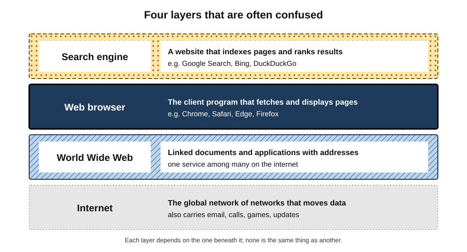
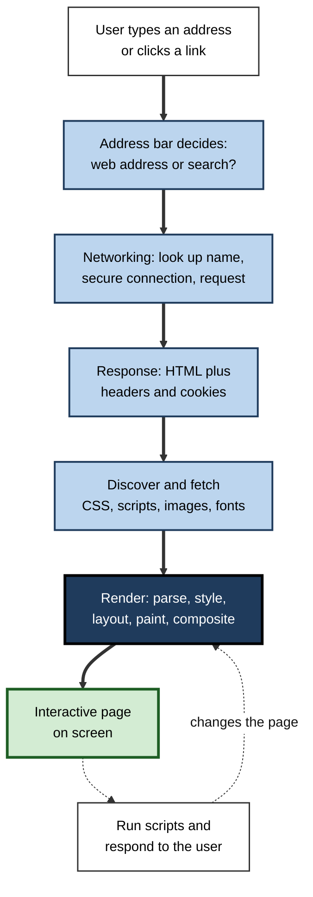
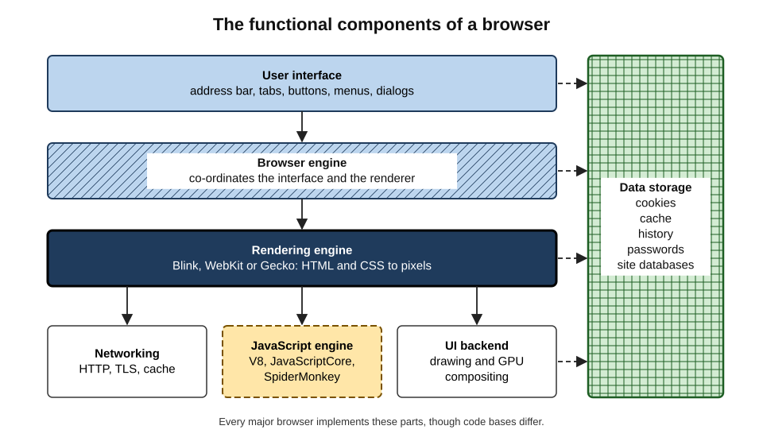
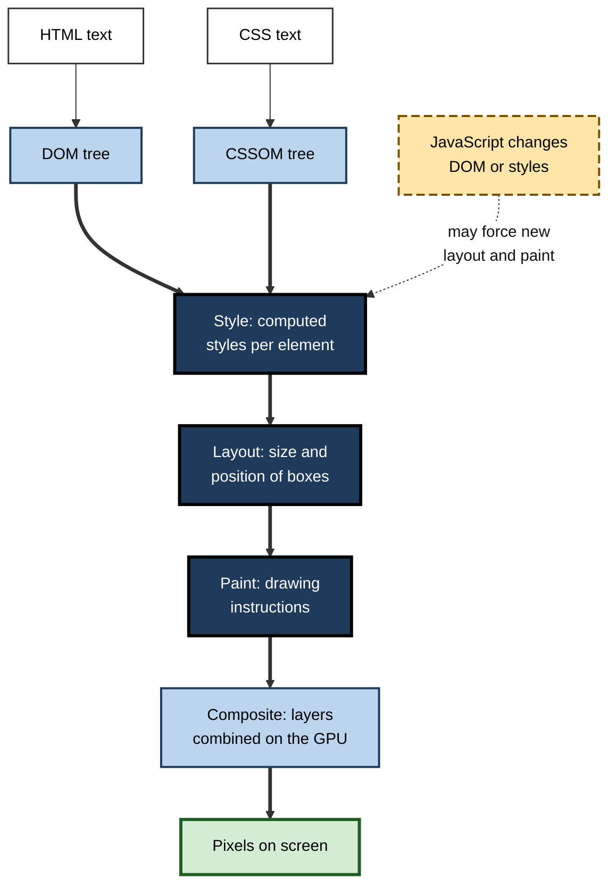
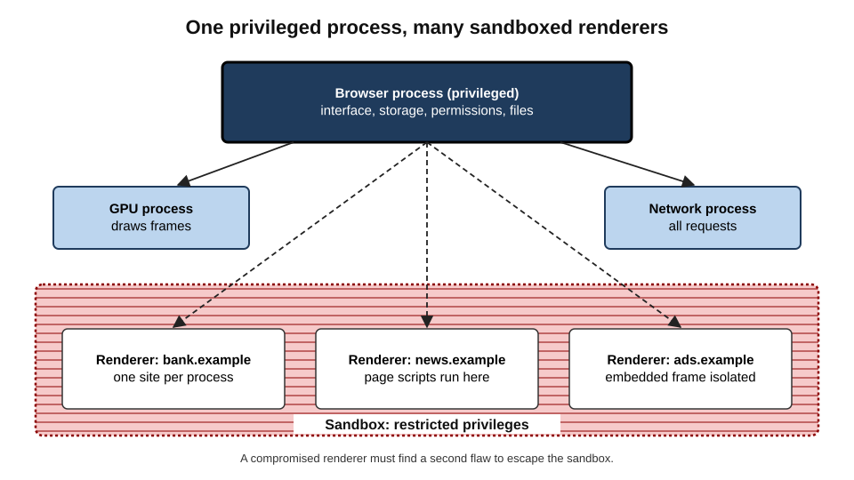
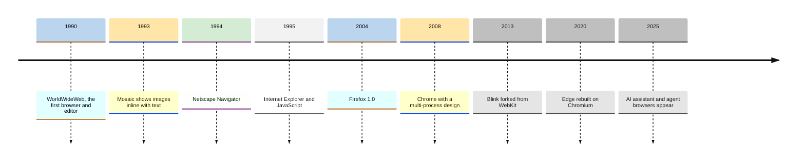

# F.1. What is a Web Browser?

A sales manager opens a dashboard, a nurse checks a drug interaction, a student submits an essay, and a developer tests a new feature — all in the same kind of program. None of them thinks about the dozens of files fetched, the code executed, the security checks passed or the pixels painted in the second before the page appears. That program is the **web browser**, and it has become the most used application on most computers and phones.

> **Definition — Web browser:** a software application that retrieves resources from the World Wide Web and other networks, interprets them according to open web standards, and presents them to the user as interactive pages, while isolating them from one another and from the device.

**Why it matters**

- **It is the universal client.** Email, office suites, banking, customer-relationship systems, learning platforms and AI assistants are now delivered mainly as web applications.
- **It is a security boundary.** The browser runs code written by strangers on every page visited; its defences decide whether that code stays contained.
- **It shapes what people see.** Defaults inside the browser — search engine, home page, warnings, privacy settings — steer the behaviour of billions of users.
- **It is a professional tool.** Knowing how a browser works explains slow pages, broken forms, "it works on my machine" faults and many security incidents.

---

## The Browser in Everyday Work

A browser does far more than "show websites". In a single working day it typically acts as:

- **A document viewer** — reading articles, policies, PDFs and manuals.
- **An application platform** — running spreadsheets, design tools, video meetings and code editors that would once have been installed programs.
- **A communications client** — webmail, chat, calendar and video calls.
- **A transaction terminal** — payments, contracts, tax returns, procurement.
- **An identity wallet** — stored passwords, passkeys, autofill addresses and payment cards.
- **A development and diagnostic tool** — built-in developer tools for inspecting pages and network traffic.

> **Key point:** because so much work now happens inside it, the browser is effectively a **second operating system** layered on top of the first.

### Browser, web, internet and search engine

Four terms are routinely confused, even by experienced users.

- **The internet** — the global network of networks that moves data between machines.
  - The infrastructure; it carries email, video calls and games as well as web pages.
- **The World Wide Web** — a system of linked documents and applications identified by addresses and fetched over the internet.
  - One service running *on* the internet.
- **The web browser** — the program on the user's device that fetches and displays web resources.
  - The *client*; Chrome, Safari, Edge and Firefox are browsers.
- **The search engine** — a web service that indexes pages and returns ranked results for queries.
  - A *website* the browser visits; Google, Bing and DuckDuckGo are search engines.

> **Watch out:** "I use Google to get on the internet" mixes three layers. Google Search is a website, Chrome is a browser, and the internet would still be there if both disappeared. Mistaking the search box for the address bar is also how many users land on fake sites that buy advertisements for brand names.

**Figure 1.** The internet, the web, the browser and the search engine as distinct layers.

---

## What Happens When a Page Opens

### From address to screen

The network journey — name lookup, connection and encryption — is a story of its own; here it is compressed so that attention stays on what the browser itself does.

1. **Input** — the user types an address or a query into the address bar, or clicks a link.
2. **Interpretation** — the browser decides whether the text is a web address or a search, and completes it if necessary.
3. **Fetching** — the networking component resolves the name, opens a secure connection and sends an HTTP request.
4. **Response handling** — the server returns HTML plus headers that describe caching, security rules and cookies.
5. **Discovery** — while reading the HTML, the browser finds further resources (style sheets, scripts, images, fonts) and requests them, often in parallel.
6. **Rendering** — the page is parsed, styled, laid out, painted and composited into pixels.
7. **Interactivity** — scripts run, respond to clicks and keystrokes, and fetch more data as the user works.

**Figure 2.** The main stages a browser passes through to turn an address into an interactive page.

### Worked example (illustrative): why one page feels slow

A project team complains that its internal reporting page "takes forever". The browser's developer tools show the following for one visit.

| Stage | Time | What was happening |
|---|---|---|
| Connection and first byte | 0.4 s | Server produced the HTML quickly |
| HTML parsed, CSS requested | 0.6 s | Two style sheets fetched |
| Blocking script | 2.1 s | A 3 MB analytics bundle downloaded and executed before anything was drawn |
| First content painted | 3.2 s | Header and table skeleton appear |
| Data loaded by script | 5.5 s | Report rows arrive from a slow API |

*Illustrative figures.*

1. The **network and server** account for under half a second — not the problem.
2. A **render-blocking script** delays the first paint by about two seconds.
3. The **data request** only starts after that script finishes, so delays stack.
4. Fixes: load the analytics bundle with `defer`, request report data earlier, and show a skeleton table while data arrives.

> **Remember:** "the internet is slow" is often wrong. Slowness is usually located in **one stage** — server, network, blocking resources, script execution or data fetching — and the browser's own tools reveal which.

> **In practice:** Google's **Core Web Vitals** are widely used thresholds for user experience: **Largest Contentful Paint** within 2.5 seconds, **Interaction to Next Paint** within 200 milliseconds (it replaced First Input Delay in March 2024) and **Cumulative Layout Shift** below 0.1.

---

## Inside the Browser: The Reference Architecture

Every major browser has a different code base, but all share the same functional parts.

### The seven components

- **User interface** — address bar, tabs, buttons, menus and dialogs; everything except the page itself.
  - Historically called the browser's "**chrome**" — the frame around the content (the name Google's browser later borrowed).
- **Browser engine** — the coordinator that passes actions between the interface and the rendering engine.
  - *e.g.* a click on Back tells the engine to load the previous entry in session history.
- **Rendering engine** — parses HTML and CSS and draws the page.
  - **Blink** (Chrome, Edge, Opera, Brave, Samsung Internet), **WebKit** (Safari), **Gecko** (Firefox).
- **JavaScript engine** — compiles and runs page scripts.
  - **V8** (Chromium-based browsers), **JavaScriptCore** (Safari), **SpiderMonkey** (Firefox).
- **Networking** — HTTP requests, connection reuse, encryption, caching and proxy handling.
- **Data storage** — cookies, cache, local storage, databases for web applications, saved passwords and history.
- **UI backend and graphics** — draws widgets and uses the graphics processor to composite layers.

> **Definition — Rendering engine (layout engine):** the component that turns HTML, CSS and images into a laid-out, painted page. It largely determines how faithfully a browser follows web standards.

> **Definition — JavaScript engine:** the component that parses, compiles and executes JavaScript, typically using just-in-time compilation to reach near-native speed for hot code.

**Figure 3.** The functional components common to modern browsers.

> **Key point:** the **engine**, not the brand, decides how a page behaves. Chrome, Edge, Opera and Brave look different but share Blink and V8, so a page that breaks in one usually breaks in all of them — and may work in Safari or Firefox.

### The rendering pipeline

The rendering engine processes a page in a fixed sequence of stages.

1. **Parse HTML → DOM.** The HTML text becomes the **Document Object Model**, a tree of elements that scripts can read and change.
2. **Parse CSS → CSSOM.** Style sheets become a tree of style rules.
3. **Style.** Rules are matched to elements to compute each element's final styles.
4. **Layout (reflow).** The engine computes the size and position of every visible box.
5. **Paint.** Boxes are converted into drawing instructions — text, colours, borders, images.
6. **Composite.** Painted layers are combined, usually on the graphics processor, into the final frame.

> **Definition — Document Object Model (DOM):** the in-memory tree representation of a page that scripts manipulate; changing the DOM is how web applications update what the user sees without reloading.

**Figure 4.** The rendering pipeline from HTML and CSS to pixels.

**Why the pipeline matters in practice**

- **Layout is expensive.** A script that repeatedly changes sizes and then reads positions forces repeated layouts ("layout thrashing") and makes pages stutter.
- **Compositing is cheap.** Animations that only move or fade layers can skip layout and paint, which is why smooth animations favour transforms and opacity.
- **Order matters.** Scripts in the document head without `defer` or `async` pause HTML parsing until they are fetched and run.

> **Watch out:** a page that "looks loaded" may not yet be usable. Paint and interactivity are different moments; heavy scripts can leave a visible page unresponsive for seconds.

---

## How Browsers Keep Pages Apart

### The same-origin policy

> **Definition — Origin:** the combination of scheme, host and port of a web address (for example `https`, `bank.example`, `443`). Two pages share an origin only if all three match.

> **Definition — Same-origin policy:** the rule, introduced by Netscape in 1995, that a script loaded from one origin cannot read data from a different origin unless that origin explicitly allows it.

- **Without it,** any page open in one tab could read the user's webmail or bank account open in another.
- **Controlled exceptions** exist — for example **Cross-Origin Resource Sharing (CORS)** lets a server declare which other origins may read its responses.
- **Cookies follow related but older rules** based on domains rather than origins, which is one reason cookie security has needed repeated repair.

### From one process to many

Early browsers ran everything — every tab, plug-in and the interface — in a **single process**. One faulty page could crash the whole browser, and one exploited bug gave the attacker everything the browser could touch.

- **Google Chrome (2008)** shipped a **multi-process architecture** from its first release:
  - a privileged **browser process** for the interface, storage and network;
  - separate, low-privilege **renderer processes** for web content;
  - a **GPU process** and various **utility processes**.
- **Sandboxing** — renderer processes run with operating-system restrictions so that, even if compromised, they cannot freely read files or install software.
- **Site isolation** — pages from different sites are placed in different renderer processes.
  - Enabled by default in desktop Chrome in 2018, after the **Spectre** processor flaws showed that a script could infer memory belonging to other content in the same process.
  - Firefox followed with its own site-isolation project ("Fission"), enabled by default in 2021.

> **Definition — Sandbox:** an operating-system-enforced restricted environment in which untrusted code runs with minimal privileges, limiting the damage if it is exploited.

**Figure 5.** The multi-process model: privileged browser process, sandboxed renderers per site.

| | Single-process browser (typical before 2008) | Multi-process, site-isolated browser (today) |
|---|---|---|
| Crash in one page | Whole browser closes | Only the affected tab fails |
| Exploited rendering bug | Attacker gains the browser's full privileges | Attacker is trapped in a sandbox; a second bug is needed to escape |
| Cross-site data in memory | Shared | Separated by process |
| Memory use | Lower | Higher — each process has overhead |
| Responsiveness | One busy page freezes everything | Busy pages are contained |

> **Key point:** modern browser security is **defence in depth** — the same-origin policy, sandboxing and site isolation each assume the others may fail.

### Case study: Spectre and the rebuilding of browser isolation

- **Situation:** in January 2018 researchers disclosed **Spectre** and **Meltdown**, flaws in how modern processors speculatively execute instructions.
- **Problem:** a malicious script could, in principle, use precise timing to read memory it should not see — including data from other sites rendered in the **same process**.
- **Actions:**
  1. Browser makers reduced the precision of timers available to scripts and temporarily disabled a shared-memory feature.
  2. Chrome accelerated **site isolation**, enabling it for most desktop users within months.
  3. New opt-in headers were introduced so that sites needing powerful features must first prove they are isolated from cross-origin content.
- **Result:** cross-site data was moved into separate processes, closing the main avenue in browsers.
- **Side effects:** memory use rose noticeably — Google reported an overhead of roughly 10–13 per cent at the time — and some web features became harder to use.
- **Lesson:** a browser's security model must assume **hardware can leak**; isolation by process is now the baseline rather than an optimisation.

---

## Web Standards: Why Pages Work Everywhere

A page written once runs on browsers from different companies on every kind of device because browsers implement **shared open standards**.

### The standards and their keepers

- **HTML and the DOM** — maintained by the **WHATWG** (Web Hypertext Application Technology Working Group, founded 2004 by Apple, Mozilla and Opera) as **living standards**, updated continuously.
- **CSS** — developed by the **World Wide Web Consortium (W3C)**, founded by Tim Berners-Lee in 1994.
- **JavaScript** — standardised as **ECMAScript** by Ecma International's committee **TC39**, with a new edition each year.
- **HTTP and TLS** — specified by the **Internet Engineering Task Force (IETF)**.
- **Accessibility guidelines** — the W3C's Web Content Accessibility Guidelines.

> **Definition — Living standard:** a specification revised continuously as features are agreed and implemented, rather than frozen in numbered versions.

**How a feature reaches users**

1. A browser team or other party proposes a feature and publishes an explainer.
2. It is discussed in a standards group and prototyped behind a flag.
3. Other engines signal support, opposition or neutrality.
4. It ships, often first in one engine, and is tracked by cross-browser test suites.
5. Developers rely on it once it is supported widely enough — a judgement known as **browser support** or **baseline availability**.

> **Watch out:** "standard" does not mean "supported everywhere". A feature can be specified yet missing from one engine for years. Professionals check actual support before relying on a feature.

### Progressive enhancement and graceful degradation

- **Progressive enhancement** — build a basic page that works everywhere, then add richer behaviour where supported.
- **Graceful degradation** — build the rich version, then ensure it fails safely on weaker browsers.
- **Feature detection** — test whether a capability exists (`if ('share' in navigator)`) rather than guessing from the browser's name.

> **Watch out:** the **user-agent string**, which names the browser to servers, is notoriously unreliable — almost every browser's string begins "Mozilla/5.0" for historical compatibility. Sniffing it to decide behaviour causes many "unsupported browser" errors.

---

## A Short History of the Browser

### From hypertext to the graphical web

- **1990 — WorldWideWeb.** Tim Berners-Lee at CERN wrote the first browser, which was also an editor, on a NeXT computer; it was later renamed Nexus.
- **1991 — Line Mode Browser.** A text-only browser that ran on almost any terminal, opening the web to non-NeXT users.
- **1993 — Mosaic.** Marc Andreessen and Eric Bina at the US National Center for Supercomputing Applications released a browser that displayed **images inline with text** and ran on popular systems. Web use grew rapidly.
- **1994 — Netscape Navigator.** Founded by Andreessen and others, Netscape dominated the early commercial web and introduced cookies, JavaScript (1995, created by Brendan Eich) and SSL encryption.
- **1995 — Internet Explorer.** Microsoft licensed Mosaic-derived code and later bundled IE with Windows.

### The browser wars

- **First browser war (1995–c. 2001)** — Netscape against Internet Explorer.
  - Bundling with Windows gave IE a decisive distribution advantage; by the early 2000s it held roughly nine-tenths of usage.
  - The bundling was central to the US antitrust case against Microsoft (*United States v. Microsoft*, decided 2000–2001).
  - Netscape released its code in 1998, founding the **Mozilla** project.
- **Stagnation** — with competition gone, IE6 (2001) went largely unimproved for years, leaving developers with non-standard behaviour and security problems.
- **Second browser war (c. 2004–2012)**
  - **Firefox 1.0 (2004)** from Mozilla offered tabs, pop-up blocking and better security.
  - **Safari (2003)** from Apple, built on the WebKit engine, derived from KDE's KHTML.
  - **Google Chrome (2008)** brought the multi-process design, a fast V8 engine, automatic silent updates and a combined address-and-search bar.
- **Consolidation (2013 onward)**
  - Google forked WebKit into **Blink** in 2013.
  - Microsoft replaced its own Edge engine with Chromium in **January 2020** and retired Internet Explorer in **June 2022**.
  - Most browsers now run one of **three engines**: Blink, WebKit or Gecko.

**Figure 6.** Milestones in the development of the web browser.

> **Key point:** each era's winner gained ground through **distribution and defaults** — bundling, pre-installation, search deals — as much as through technical quality.

---

## Kinds of Browser Beyond the Desktop

Browsers appear in more forms than the familiar desktop window.

- **Mobile browsers** — Safari on iPhone, Chrome and Samsung Internet on Android; touch-first interfaces and stricter power limits.
- **Embedded web views** — browser engines inside other apps.
  - *e.g.* a link opened inside a social-media or messaging app shows a page in an **in-app browser**, which may not share the user's main browser's passwords, settings or protections.
- **Headless browsers** — browsers with no visible window, controlled by code.
  - Used for automated testing, screenshots, scraping and — increasingly — AI agents that operate websites.
- **Text and accessibility-focused browsers** — such as Lynx; screen readers also work through the browser's accessibility tree.
- **Kiosk and locked-down browsers** — for exams, shop terminals and shared devices.
- **Enterprise browsers** — browsers designed for corporate control, with data-loss prevention and policy built in.

> **Watch out:** an **in-app browser** is still a browser running untrusted pages, but it may hide the full address, lack the user's extensions and password manager, and let the host app observe activity. For banking or sign-in, opening the link in the main browser is safer.

> **Definition — Headless browser:** a full browser engine operated programmatically without a graphical interface, used for testing, automation and data collection.

---

## The Browser as a Platform

### What a modern browser can do

Modern browsers expose capabilities once reserved for installed programs:

- **Offline operation and installation** — service workers and web-app manifests let **progressive web apps** work offline and be installed like apps.
- **Near-native computation** — **WebAssembly** (shipped in all major browsers in 2017) runs compiled code from languages such as C++ and Rust.
- **Graphics and machine learning** — WebGL and **WebGPU** give scripts access to the graphics processor.
- **Real-time communication** — **WebRTC** powers browser-based video calls without plug-ins.
- **Device access with permission** — camera, microphone, location, notifications, clipboard, and in some browsers USB and Bluetooth devices.

> **Definition — Progressive web app (PWA):** a web application that uses modern browser features to be installable, work offline and behave like a native app, while still being delivered over the web.

### The end of plug-ins

- **Plug-ins** such as Adobe Flash, Java applets and Microsoft Silverlight once supplied video, animation and rich applications.
- They ran with high privileges outside the browser's sandbox and were a leading source of security exploits.
- Apple's iPhone (2007) never supported Flash; HTML5 video and canvas offered standard replacements.
- Adobe ended Flash support on **31 December 2020**, and browsers removed it.

> **Key point:** the web's shift from plug-ins to **standard, sandboxed features** is one of the clearest security gains in computing history.

### The browser in organisations

- **Standard build** — most organisations choose one or two supported browsers and manage them centrally.
- **Policy control** — administrators set home pages, block risky features, force-install or block extensions and enforce updates.
- **Compatibility management** — legacy internal systems written for retired browsers are run in compatibility modes or rewritten.
- **The browser as endpoint** — security teams increasingly treat the browser, not just the device, as where data loss and attacks occur.

> **In practice:** when an internal web application "only works in one browser", the root cause is usually reliance on a non-standard feature or user-agent sniffing. The durable fix is to make the application standards-compliant, not to mandate a browser.

---

## Browsers and AI

Since 2023 browsers have begun to absorb AI capabilities directly.

- **Built-in assistants** — summarising pages, answering questions about open tabs, drafting text in forms.
- **On-device models** — smaller language models running locally in the browser for privacy and speed.
- **Agentic browsing** — an AI agent that clicks, types and navigates on the user's behalf.
- **AI-first browsers** — products launched in 2025 from AI companies built around a conversational assistant.

> **Watch out:** an AI agent that reads web pages can be manipulated by text hidden in those pages — **prompt injection**. Browser makers acknowledge this is not fully solved, so agents acting while signed in to email or banking carry real risk.

---

## Open Questions

- **Can engine diversity survive?**
  - With nearly all browsers built on Blink or WebKit, one company's engineering choices effectively set web behaviour; whether independent engines can remain viable is unresolved.
- **How should the browser's security model change for AI agents?**
  - The same-origin policy protects sites from each other, but an agent that reads one site and acts on another crosses those boundaries by design.
- **Who should fund browser development?**
  - Most browser development is paid for, directly or indirectly, by search advertising; regulation of search deals may change that.
- **How much should a browser decide for its user?**
  - Stronger defaults protect novices but limit choice; the balance between protection and autonomy keeps shifting.
- **Will the browser remain the main gateway?**
  - AI assistants that answer directly may reduce how often people visit pages at all.

---

## Summary

- A **web browser** fetches web resources, interprets them according to open standards, displays them interactively and isolates them from each other and from the device.
- The **internet** is the network, the **web** is a service on it, the **browser** is the client and a **search engine** is a website — four different things.
- Loading a page runs through input interpretation, fetching, response handling, resource discovery, **rendering** and scripting; slowness lives in one identifiable stage.
- Browsers share a reference architecture: **user interface, browser engine, rendering engine, JavaScript engine, networking, storage, graphics**. The engine — **Blink, WebKit or Gecko** — matters more than the brand.
- The **rendering pipeline** goes DOM and CSSOM → style → layout → paint → composite.
- Security rests on the **same-origin policy**, **sandboxing** and **site isolation**, strengthened after **Spectre** (2018).
- Pages work everywhere because of **open standards** (WHATWG, W3C, TC39, IETF); professionals use feature detection, not user-agent sniffing.
- History: WorldWideWeb (1990) → Mosaic (1993) → Netscape and IE → Firefox (2004) → Chrome (2008) → three-engine consolidation. Distribution and defaults decided each era.
- Browsers now run full applications (PWAs, WebAssembly, WebGPU, WebRTC); plug-ins are gone; AI assistants and agents are the newest layer, with **prompt injection** as their characteristic risk.

---

## Self-Check

1. Define a web browser and explain the role of "isolating" in the definition.
2. Distinguish the internet, the web, a browser and a search engine, with an example of each.
3. List the main steps between typing an address and seeing an interactive page.
4. Name the seven components of the browser reference architecture and say what each does.
5. Which engines do Chrome, Edge, Safari and Firefox use, and why does this matter when a page breaks?
6. Describe the six stages of the rendering pipeline. Why are layout changes more expensive than opacity changes?
7. What is an origin, and what does the same-origin policy prevent?
8. How did the Spectre disclosure change browser architecture, and at what cost?
9. Why is user-agent sniffing unreliable, and what should replace it?
10. Explain how distribution and defaults shaped the outcome of the first browser war.
11. Why can an in-app browser be riskier than the user's main browser?
12. A colleague says, "The intranet is slow because our internet is bad." Using the worked example, explain how to test that claim.
13. An organisation's procurement portal works only in one browser. What is the likely cause and the durable fix?
14. Why is prompt injection a particular concern for AI agents operating inside a browser?

### Answer Key

1. Software that retrieves web resources, interprets them by open standards and presents them interactively. "Isolating" matters because the browser runs untrusted code from every site; it must keep sites apart from one another and from the user's device and files.
2. The internet is the network infrastructure (the links and routers carrying all traffic); the web is a system of linked pages on it (a news site); a browser is the client program (Firefox); a search engine is a website that indexes pages (Bing).
3. Input → interpretation as address or search → name lookup, secure connection and request → response with HTML and headers → discovery and fetching of further resources → rendering → script execution and interactivity.
4. User interface (controls around the page); browser engine (co-ordinates interface and renderer); rendering engine (parses and draws HTML/CSS); JavaScript engine (runs scripts); networking (requests, encryption, caching); data storage (cookies, cache, history, passwords); UI backend and graphics (draws widgets, composites layers).
5. Chrome and Edge use Blink with V8; Safari uses WebKit with JavaScriptCore; Firefox uses Gecko with SpiderMonkey. Browsers sharing an engine usually share bugs and behaviour, so testing in one Blink browser says little about Safari or Firefox.
6. Parse HTML to DOM; parse CSS to CSSOM; compute styles; layout; paint; composite. Layout changes force recalculation of geometry and repainting, whereas opacity or transform changes can often be handled at the compositing stage alone.
7. An origin is scheme + host + port. The policy stops scripts from one origin reading data from another, so a malicious page cannot read a user's webmail or bank pages open elsewhere.
8. Spectre showed scripts might read memory from other content in the same process. Browsers reduced timer precision and moved to site isolation — separate processes per site — at the cost of roughly 10–13 per cent more memory and some feature restrictions.
9. Nearly all browsers claim to be "Mozilla/5.0" and imitate each other for compatibility, so the string misidentifies capabilities. Feature detection — testing whether a capability exists — is reliable.
10. Microsoft bundled Internet Explorer with Windows, so it reached users without their choosing it; technical improvements by Netscape could not overcome that default. Later eras repeated the pattern through pre-installation and search deals.
11. It may hide the full address, lack the user's password manager, extensions and protections, and allow the host app to observe or inject into pages — making phishing harder to detect and sign-ins less safe.
12. Open the developer tools and examine timing per stage. If connection and first byte are fast but blocking scripts or slow data requests dominate, the network is not the cause; the fix lies in the page or its back end.
13. Probable reliance on a non-standard feature or user-agent sniffing. The durable fix is to make the portal standards-compliant and use feature detection, rather than mandating a single browser.
14. The agent treats page text as input to its reasoning; hidden instructions in a page can redirect it to act against the user — for example, reading signed-in email or sending data — crossing the boundaries the same-origin policy normally enforces.

---

## Glossary

| Term | Meaning |
|---|---|
| Blink | The rendering engine of Chrome, Edge, Opera, Brave and other Chromium-based browsers; forked from WebKit in 2013. |
| Browser engine | The component that co-ordinates the user interface and the rendering engine. |
| Chrome (interface) | The browser's frame — tabs, toolbars and menus — as opposed to page content. |
| Compositing | Combining painted layers into the final image, usually on the graphics processor. |
| Core Web Vitals | Google's user-experience measures: loading (LCP), responsiveness (INP) and visual stability (CLS). |
| CORS | Cross-Origin Resource Sharing: a mechanism by which a server permits other origins to read its responses. |
| DOM | Document Object Model: the tree representation of a page that scripts can change. |
| Feature detection | Testing whether a browser supports a capability before using it. |
| Gecko | Mozilla's rendering engine, used by Firefox. |
| Headless browser | A browser controlled by code without a visible window. |
| In-app browser | A browser view embedded inside another application. |
| JavaScript engine | The component that compiles and runs scripts (V8, SpiderMonkey, JavaScriptCore). |
| Layout | Computing the size and position of every box on a page. |
| Living standard | A specification that is continuously updated rather than versioned. |
| Origin | The scheme, host and port of a web address. |
| Plug-in | A historical add-on program (such as Flash) that rendered content outside browser standards. |
| Progressive web app | A web application that can be installed and work offline. |
| Prompt injection | Hidden instructions in content that manipulate an AI system processing it. |
| Rendering engine | The component that turns HTML and CSS into a painted page. |
| Same-origin policy | The rule that scripts from one origin cannot read data from another without permission. |
| Sandbox | A restricted environment that limits what compromised code can do. |
| Site isolation | Placing different sites in different operating-system processes. |
| User-agent string | Text a browser sends to identify itself; unreliable for detecting capabilities. |
| WebAssembly | A compact binary format that runs compiled code at near-native speed in the browser. |
| WebKit | Apple's rendering engine, used by Safari and all iOS browsers outside the EU. |
| WHATWG | The group that maintains the HTML and DOM living standards. |
