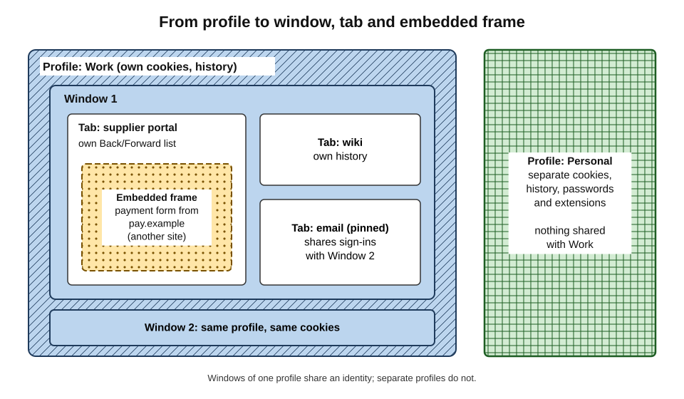
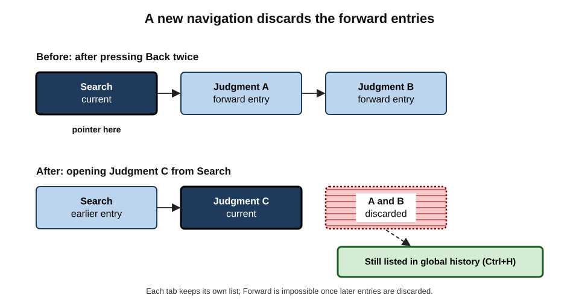
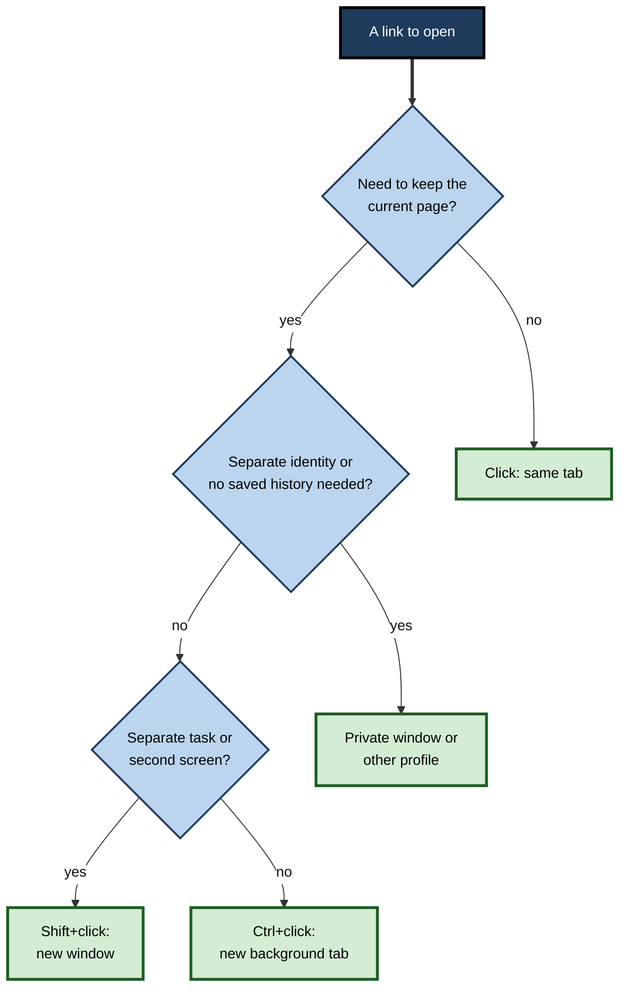
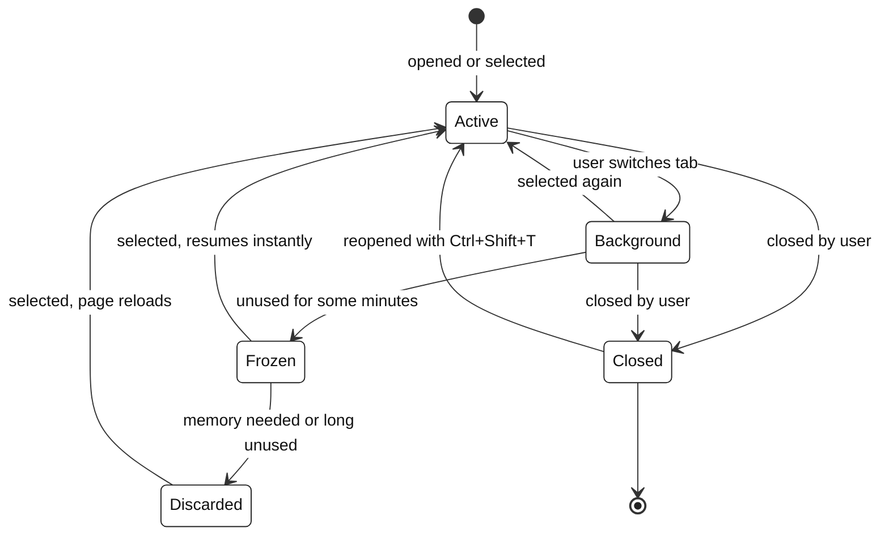
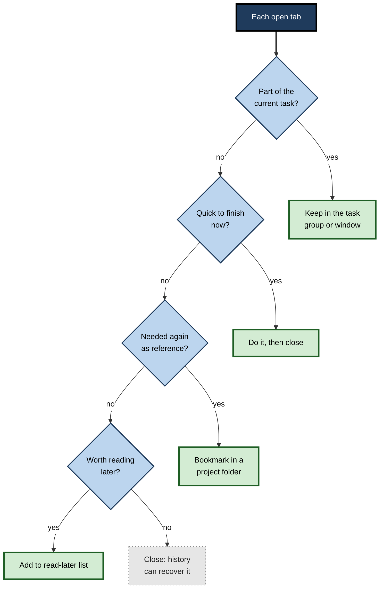

# F.4. Tabs, Windows & Navigation

An analyst preparing a market report has forty tabs open across three windows: sources still to read, reference pages, duplicates and two unsaved web forms. When the browser crashes, the analyst is not sure what was lost. Tabs, windows and the back button are so familiar that few people think about how they work — yet they shape memory use, focus, security and the ability to retrace one's steps.

> **Definition — Navigation (browser):** the process by which a browser moves a tab or window from one page to another — by typed address, link, form submission, script, redirect or history — and records the move so it can be retraced.

**Why it matters**

- **Productivity** — good tab and window habits reduce time lost hunting for pages and re-finding information.
- **Reliability** — understanding history and session restore prevents lost work.
- **Performance** — each open tab consumes memory and power; browsers manage this in ways users can control.
- **Security** — how links open in new tabs, and how history can be manipulated, matter for phishing and privacy.

---

## Windows, Tabs and Frames

### The containment hierarchy

- **Browser profile** — a separate set of history, cookies, passwords, extensions and settings (for example "Work" and "Personal").
- **Window** — a top-level frame on the screen; one profile can have many windows.
- **Tab** — a single page-viewing context within a window, with its **own history**.
- **Frame** — a page embedded inside another page (an `iframe`), such as a payment form, a video player or an advertisement. Frames can come from different sites.

> **Definition — Tab:** an independent browsing context within a window, showing one page at a time and keeping its own back-and-forward history.

> **Definition — Browsing context:** the environment in which a document is displayed — a tab, a pop-up window or a frame — with its own session history and relationship to its opener.

**Figure 1.** The containment hierarchy from profile to window, tab and embedded frame.

> **Key point:** different **windows of the same profile share** cookies and sign-ins; different **profiles do not**. Opening a "new window" does not create a separate identity — opening a new profile or private window does.

### A brief history of tabs

- **Mid-1990s** — early browsers such as InternetWorks and later NetCaptor (1997) experimented with several pages in one window.
- **2000–2002** — Opera popularised multi-page interfaces; the Mozilla suite added tabbed browsing.
- **2003–2006** — Safari (2003), Firefox 1.0 (2004) and Internet Explorer 7 (2006) made tabs standard.
- **2008** — Chrome placed tabs at the very top of the window and gave each its own process.
- **2020s** — tab groups, vertical tabs, tab search, sleeping tabs and split-screen views became common.

---

## Session History and the Back Button

### How history works within a tab

Each tab keeps an ordered list of the pages it has visited, with a pointer to the current one.

- **Back** — moves the pointer one entry earlier.
- **Forward** — moves it one entry later.
- **A new navigation from the middle of the list** — **discards all forward entries** and appends the new page.
- **Long-press or right-click** on Back shows the whole list, allowing a jump several steps at once.

> **Definition — Session history:** the per-tab list of visited entries that Back and Forward move through; distinct from the global browsing history, which records visits across all tabs over time.

### Worked example (illustrative): the disappearing forward page

A solicitor opens a case-law database and navigates as follows in one tab.

| Step | Action | Session history (current in bold) |
|---|---|---|
| 1 | Opens search page | **Search** |
| 2 | Opens judgment A | Search, **Judgment A** |
| 3 | Clicks a cited judgment B | Search, Judgment A, **Judgment B** |
| 4 | Presses Back twice | **Search**, Judgment A, Judgment B |
| 5 | Opens judgment C from the results | Search, **Judgment C** |
| 6 | Presses Forward | Not possible — Judgment A and B entries were discarded |

1. At step 4 the forward entries (A and B) still exist.
2. At step 5 a new navigation from the middle **truncates** the list.
3. Judgment B can still be found in the **global history** (Ctrl+H) — but not with the Forward button.
4. Better practice: open judgments from the results list in **new tabs** (Ctrl+click), keeping the results page intact.

**Figure 2.** A new navigation from the middle of session history discards the forward entries.

> **Remember:** **Back is per tab; History is global.** A page that cannot be reached with Back or Forward is usually still in Ctrl+H.

### When Back does not behave

- **Redirects** — a page that immediately redirects can trap the user: pressing Back returns to the redirecting page, which sends them forward again. Browsers now skip many automatic redirects in history.
- **Form resubmission** — going back to a page produced by submitting a form may trigger "Confirm form resubmission". Repeating a payment or order is a real risk; well-built sites prevent it with a redirect after submission.
- **Single-page applications** — modern web apps change the visible content with scripts. They use the **History API** to add entries so that Back works; poorly built apps either add none (Back leaves the app) or add too many.
- **History manipulation** — some pages insert extra entries so that Back keeps the user on the site. Browsers increasingly ignore entries added without user interaction, and search engines treat this as a spam technique.

> **Definition — History API:** the browser interface (`history.pushState` and related methods) that lets a page add or replace session-history entries without loading a new document.

### Instant Back: the back/forward cache

- Traditionally, pressing Back reloaded the earlier page, which could be slow and lose scroll position or form contents.
- The **back/forward cache** keeps a recently left page **frozen in memory**, so Back restores it instantly.
  - Long used in Firefox and Safari; enabled in Chrome from 2021.
- Pages using certain features (for example, open connections that cannot be paused) may be excluded from the cache.

---

## Opening Links: Same Tab, New Tab, New Window

### The options

- **Click** — opens in the same tab (unless the site specifies otherwise).
- **Ctrl+click or middle-click** — opens in a new background tab.
- **Ctrl+Shift+click** — opens in a new foreground tab.
- **Shift+click** — opens in a new window.
- **Right-click** — menu with new tab, new window, private window, copy link address.
- **Drag a link** to the tab strip — opens it there.

**Figure 3.** Choosing how to open a link.

### Links that open new tabs themselves

- A site can mark a link to open in a new tab (`target="_blank"`).
- Historically, the new page received a reference to the page that opened it, which allowed **reverse tabnabbing**:
  1. The user clicks a link from a trusted site; it opens in a new tab.
  2. The new page silently changes the **original tab** to a fake login page.
  3. The user returns to the original tab and, seeing a "session expired" message, signs in to the fake page.
- Between 2019 and 2021 the major browsers began to treat such links as `noopener` by default, cutting the reference; sites should still set it explicitly.

> **Definition — Reverse tabnabbing:** an attack in which a page opened from a link uses its reference to the opening page to redirect that original tab to a malicious page.

> **Watch out:** a tab the user left on a trusted site can change while they are elsewhere. A sudden "please sign in again" on returning to a tab deserves a glance at the **address bar**.

### Pop-ups

- **Pop-up windows** opened automatically by pages were once a plague of advertising; all browsers block pop-ups not triggered by a click.
- Legitimate uses remain — sign-in windows for "Sign in with…" buttons, payment confirmations — and may need permission for specific sites.

---

## Managing Many Tabs

### Why people keep tabs open

Research on browsing behaviour shows that tabs serve several purposes beyond viewing.

**Study card — Dubroy and Balakrishnan (2010)**

- **Design:** logged tab use by Firefox users and interviewed participants.
- **Results:** tabs were used for **short-term bookmarking**, for **parallel browsing** (comparing pages side by side), and as **reminders** of things to do; tab use varied enormously between people.
- **Conclusion:** tabs are not just a viewing device but a lightweight **task-management** tool.

**Study card — Chang and colleagues, Carnegie Mellon University (2021), "When the Tab Comes Due"**

- **Design:** surveys and interviews with heavy browser users about tab overload.
- **Results:**
  - people kept tabs open as reminders and from fear of losing information, even when the tabs caused stress;
  - participants described feeling overwhelmed, and many reported tabs slowing or crashing the browser;
  - existing tools (bookmarks, history) were felt to be poor at preserving the **context** of a task.
- **Conclusion:** "tab hoarding" is a rational response to weak tools for saving and resuming complex tasks, not simply poor discipline.

> **Key point:** the solution to tab overload is not willpower but a **workflow** that gives each tab somewhere to go — read now, save for later, file as reference, or close.

### Features for organising tabs

- **Pinning** — makes a tab small, permanent and protected from accidental closing; suits email, calendar and chat.
- **Tab groups** — named, coloured collections of tabs that can be collapsed and saved (Chrome and Edge from 2020, Safari from 2021, Firefox from 2025).
- **Vertical tabs** — a tab list down the side, which shows full titles and scales better to many tabs.
- **Tab search** — a list of all open tabs, searchable by title.
- **Muting** — silences a single tab.
- **Duplicate and move** — copy a tab, or drag it to another window.
- **Send to device** — send a tab to the same profile's phone or another computer.
- **Split view** — two tabs side by side in one window, now offered by several browsers.
- **Workspaces and collections** — saved sets of tabs for a project, in Edge, Opera, Vivaldi and others.

### How browsers manage memory

- **Each tab costs resources** — memory for the page and its scripts, and often its own process.
- **Sleeping or discarded tabs** — browsers freeze or unload tabs not viewed for a while.
  - Edge "sleeping tabs" (2021), Chrome "Memory Saver" (2022–2023), Firefox tab unloading when memory is low.
  - A discarded tab reloads when selected; unsaved form contents may be lost.
- **Exceptions** — tabs playing audio, sharing the screen or on an allow-list are kept alive.

**Figure 4.** The life cycle of a tab as the browser manages its resources.

> **Watch out:** "sleeping" tabs reduce memory use but are not a safe place for **unsaved work**. A half-completed form in a discarded tab may be gone when the tab reloads.

### A workflow for tab overload

1. **Triage on a schedule** — at the end of a work block, review the tab strip.
2. **Act or close** — tabs needing two minutes or less are dealt with immediately.
3. **Save to read later** — articles go to a read-later list, not the tab strip.
4. **File references** — pages needed again become bookmarks in a project folder or are saved into project notes.
5. **Group the live task** — tabs for the current task form one named group or window.
6. **Close the rest** — trusting that history and saved items can recover them.

**Figure 5.** A triage routine that gives every open tab a destination.

> **In practice:** many professionals keep one window per **project or client**, with email and calendar pinned in a separate window. Switching window is then switching task, which reduces the temptation to wander between unrelated tabs.

---

## What a Navigation Reveals

Every navigation tells the destination something about where the user came from.

### The referrer

- When a link is followed, the browser normally sends a **Referer** header (the historical misspelling is part of the standard) naming the page the user came from.
- **Uses:** analytics ("visitors arrived from this article"), security checks, and logging.
- **Risks:** if the previous page's address contained private information — a search term, a document identifier, a password-reset token — that information could be passed to the next site.
- **Referrer policy:** sites can limit what is sent; since around 2020–2021 major browsers default to sending only the **origin** (scheme and host) to other sites, not the full path and query.

> **Definition — Referrer:** the address of the page from which a navigation started, sent by the browser to the destination unless a policy restricts it.

### Other signals in a navigation

- **Navigation type** — the browser distinguishes typed addresses, link clicks, reloads, form submissions and history moves; sites can read some of this.
- **User activation** — whether the navigation followed a genuine click or key press; browsers block many actions (pop-ups, full-screen, autoplay with sound) without it.
- **Prefetching and preloading** — browsers and search engines may fetch a page before the click to make it appear instantly; the destination may therefore see a request the user never actually made.

> **Watch out:** search terms in a page address — for example an internal search for a colleague's name or a medical condition — can leak to third parties through referrers and analytics scripts on the results page. Well-designed internal systems strip such terms or use referrer policies.

---

## Windows and Multiple Screens

- **Dragging a tab out** of the strip creates a new window; dragging it into another window's tab strip moves it.
- **Window-snapping** in the operating system places two browser windows side by side for comparison.
- **Multiple monitors** suit one window per task — reference material on one screen, the working document on the other.
- **Picture-in-picture** — a floating video window that stays on top while other work continues.
- **Installed web apps** — progressive web apps open in their own windows without browser controls, appearing like separate programs in the task bar.

> **In practice:** in video calls, sharing a **single tab or window** rather than the whole screen prevents colleagues or clients from glimpsing email notifications, other clients' documents or personal tabs. Browsers offer tab-sharing directly in the sharing dialog.

---

## Windows, Profiles and Private Windows

| | New tab | New window | Private window | Separate profile |
|---|---|---|---|---|
| Shares sign-ins and cookies with other windows | Yes | Yes | No — temporary, separate set | No — permanent, separate set |
| Saves history | Yes | Yes | No (deleted on closing) | Yes, in that profile |
| Extensions | All | All | Only those allowed in private mode | That profile's own |
| Typical use | Another page in the same task | A separate task or second screen | A one-off visit, a shared computer, testing as a signed-out visitor | Keeping work and personal life, or two client accounts, apart |

> **Definition — Browser profile:** a separate user environment within a browser, with its own cookies, history, passwords, extensions and settings, allowing several identities to be used side by side.

> **Watch out:** a private window hides activity from **other users of the same device**. It does not hide activity from the websites visited, the employer's network, the internet provider or anyone monitoring the device.

> **Example:** a consultant who must sign in to two Microsoft 365 tenants — the firm's and a client's — uses one browser profile for each. Both can stay signed in simultaneously, and files cannot be accidentally saved to the wrong tenant.

---

## Navigation Within and Between Pages

### Moving around a page

- **Space / Shift+Space** — page down / up.
- **Home / End** — top / bottom of the page.
- **Tab / Shift+Tab** — move between links, buttons and form fields.
- **Enter** — follow the focused link.
- **Ctrl+F** — find text; most browsers then highlight every match on the scrollbar.

### Linking to a place on a page

- **Fragment identifiers** (`#section-3`) point to a named place on a page.
- **Text fragments** (`#:~:text=exact phrase`), supported in Chromium browsers since 2020 and in Safari, link to and highlight a specific passage, even without a named anchor.
  - Many browsers offer "Copy link to highlight" from the right-click menu.

> **In practice:** when sending a colleague a long policy document, a link to the highlighted clause saves them scrolling and removes ambiguity about which sentence is meant.

### Recovering where one has been

- **Reopen closed tab** (Ctrl+Shift+T) — repeatable, restoring tabs and windows in reverse order of closing, with their session history.
- **Recently closed** — menu list of closed tabs and windows.
- **Session restore** — reopens the previous session at start-up, or after a crash.
- **Global history** (Ctrl+H) — searchable list of visits; in some browsers grouped into "journeys" by topic.
- **Tabs from other devices** — open tabs on synchronised devices.

---

### Case study (illustrative): from 300 tabs to a project workflow

- **Situation:** a strategy consultant routinely ran 250–300 tabs across six windows during client research.
- **Problem:** the laptop slowed during video calls; the browser crashed twice in a month; on one occasion a half-finished expense claim in a discarded tab was lost; finding the right source during client meetings was embarrassing.
- **Diagnosis:**
  1. Tabs were acting as **reminders** (things to read) and as **reference storage** (sources for the report).
  2. There was no trusted place for either, so nothing was ever closed.
  3. Forms in progress were mixed with reading material.
- **Actions:**
  1. One window per client engagement, with tabs for the current task only.
  2. A read-later list for "read later"; a bookmarks folder per engagement for sources, with a one-line note in the title.
  3. Ten-minute end-of-day triage using the routine in Figure 5.
  4. Pinned tabs for email, calendar and timesheets in a separate window.
  5. Forms completed in one sitting, or drafted outside the browser.
- **Result:** typical tab count fell to 20–40; crashes stopped; sources became quicker to cite because each sat in a labelled folder.
- **Side effects / caveats:** the first week felt uncomfortable — the consultant feared losing pages — until history and saved folders proved reliable.
- **Lesson:** tab overload is a **storage problem** disguised as a browser problem; fixing where information goes fixes the tabs.

---

## Navigation, Attention and Work

- **Task switching has a cost.** Moving between unrelated tabs fragments attention; research on "attention residue" (Sophie Leroy, 2009) found that thoughts about an unfinished task persist after switching and reduce performance on the next.
- **Tabs as external memory.** Open tabs offload the effort of remembering what to return to — useful until their number exceeds what can be scanned.
- **Interruption by design.** Notifications, auto-playing video and badge counts in pinned tabs pull attention away; browsers offer per-site controls to silence them.

> **Key point:** tabs and windows are part of a person's **working memory system**. Arranging them by task supports focus; letting them accumulate turns the browser into a source of distraction.

---

## Navigation in an AI-Assisted Browser

- **Assistants that read open tabs** can summarise or compare several pages at once, reducing manual switching.
- **Agents that navigate** open pages, click links and fill forms on the user's behalf, sometimes in a separate visible tab or window.
- **Tab organisation by AI** — some browsers propose tab groups automatically by topic.
- **Risks:** an agent navigating while the user is signed in can be steered by malicious page content; agent activity may be less visible in the user's own history.

> **Watch out:** an AI feature that "reads all open tabs" may send their content — including internal documents open in other tabs — to a cloud service. Organisations need to know whether such features are enabled.

---

## Open Questions

- **What should replace tab hoarding?**
  - Researchers have prototyped task-centred browsers that save the context of a piece of work; none has become mainstream.
- **How should Back behave in single-page and AI-driven applications?**
  - When content changes continuously, what counts as a "page" in history is unclear.
- **How much should the browser manage tabs automatically?**
  - Automatic sleeping, grouping and closing save resources but can surprise users and lose state.
- **How should agent navigation be recorded?**
  - Users and organisations need audit trails of what an AI agent opened and submitted; standards for this are immature.

---

## Summary

- A **profile** contains **windows**, which contain **tabs**, which may contain **frames**; windows of one profile share sign-ins, different profiles do not.
- Each tab keeps its own **session history**; a new navigation from the middle **discards forward entries**; **global history** (Ctrl+H) keeps everything.
- Redirects, form resubmission, single-page apps and history manipulation can make Back misbehave; the **back/forward cache** makes Back instant.
- Links open in the same tab, new tab (Ctrl+click), new window (Shift+click) or private window; `noopener` defaults now block **reverse tabnabbing**.
- Research shows tabs act as **reminders and short-term storage**; tab overload reflects weak tools for saving task context.
- Organising features: pinning, **tab groups**, vertical tabs, tab search, muting, send-to-device, split view, workspaces; browsers **freeze and discard** background tabs, which can lose unsaved forms.
- A **triage routine** — keep, do, bookmark, read later, close — controls tab overload.
- **Private windows** hide activity only from other users of the device; **profiles** separate identities permanently.
- Fragment and **text-fragment** links point to exact passages; Ctrl+Shift+T and session restore recover closed tabs.
- AI assistants and agents add new capabilities and new risks to navigation.

---

## Self-Check

1. Distinguish a profile, a window, a tab and a frame.
2. Explain the difference between session history and global history.
3. Why can the Forward button stop working after the user goes back and clicks a new link?
4. Why might pressing Back on an order confirmation page be risky, and how do well-built sites prevent the problem?
5. What does the back/forward cache do?
6. Describe the reverse tabnabbing attack and how browsers now prevent it.
7. Summarise the findings of the Carnegie Mellon "When the Tab Comes Due" study.
8. What happens to a discarded tab, and what is the risk?
9. Compare a private window and a separate profile for a consultant working with two clients.
10. What is a text-fragment link, and when is it useful?
11. How would you recover a tab closed by mistake an hour ago, and one closed two days ago?
12. A manager complains her laptop is slow during video calls and she has 180 tabs open. Propose a diagnosis and a workflow.
13. Why might an AI feature that reads all open tabs concern an organisation's data-protection officer?

### Answer Key

1. A profile is a separate identity with its own cookies, history and extensions; a window is a top-level frame on screen within a profile; a tab is a browsing context in a window with its own history; a frame is a page embedded inside another page, possibly from another site.
2. Session history is the per-tab list used by Back and Forward; global history records all visits across tabs and time and is searchable with Ctrl+H.
3. A new navigation from the middle of session history discards all later entries, so there is nothing to go forward to. The pages remain in global history.
4. Going back may resubmit the form, repeating a payment or order. Sites redirect to a confirmation page after a successful submission (the "post/redirect/get" pattern) so that Back does not repeat it.
5. It keeps a recently left page frozen in memory so that Back or Forward restores it instantly, with scroll position and state, instead of reloading it.
6. A page opened from a link used its reference to the opener to redirect the original tab to a fake login page. Browsers now treat links that open new tabs as `noopener` by default, removing the reference.
7. Heavy users kept many tabs as reminders and from fear of losing information, felt overwhelmed, reported slowdowns and crashes, and found existing tools poor at saving task context; tab hoarding is a rational response to inadequate tools.
8. Its page is unloaded from memory; selecting the tab reloads it. Unsaved state such as form entries may be lost.
9. A private window gives a temporary separate session, lost on closing; a profile is a permanent separate identity that can stay signed in. For two clients, a profile per client is better: both stay signed in, settings and passwords are separated, and mistakes between tenants are less likely.
10. A link ending in `#:~:text=` that scrolls to and highlights a specific passage. Useful for pointing a colleague to an exact clause in a long document.
11. Ctrl+Shift+T or the Recently closed menu for the recent one (if the session continued); for older tabs, search global history with Ctrl+H.
12. Diagnosis: tabs used as reminders and storage, consuming memory and processor time (check with the browser's task manager). Workflow: group live-task tabs; move reading to a read-later list and references to bookmarks; close the rest after triage; pin communication tools in a separate window; review daily.
13. The feature may send the content of every open tab — possibly including confidential documents or personal data from internal systems — to an external AI service, creating data-protection and confidentiality risks unless governed.

---

## Glossary

| Term | Meaning |
|---|---|
| Back/forward cache | Memory store that keeps recently left pages frozen for instant Back and Forward. |
| Browser profile | A separate browser identity with its own cookies, history, passwords and extensions. |
| Browsing context | An environment displaying a document — a tab, window or frame. |
| Discarded tab | A tab whose page has been unloaded from memory and reloads when selected. |
| Fragment identifier | The part of an address after "#" pointing to a place in a page. |
| Global history | The record of all pages visited across tabs over time. |
| History API | Browser methods allowing pages to add or replace session-history entries. |
| Iframe | A frame embedding one page inside another. |
| Noopener | A link setting that prevents a newly opened page from controlling its opener. |
| Pinned tab | A small, permanent tab protected from accidental closing. |
| Private window | A window whose history, cookies and site data are deleted when closed. |
| Reverse tabnabbing | An attack in which a newly opened page redirects the original tab to a malicious page. |
| Session history | The per-tab list of entries used by Back and Forward. |
| Session restore | Reopening the previous set of windows and tabs at start-up. |
| Tab | An independent browsing context within a window. |
| Tab group | A named collection of tabs that can be collapsed and saved. |
| Tab hoarding | Keeping very many tabs open as reminders or storage. |
| Text fragment | A link extension that highlights a specific passage on a page. |
| Vertical tabs | A tab list arranged down the side of the window. |
