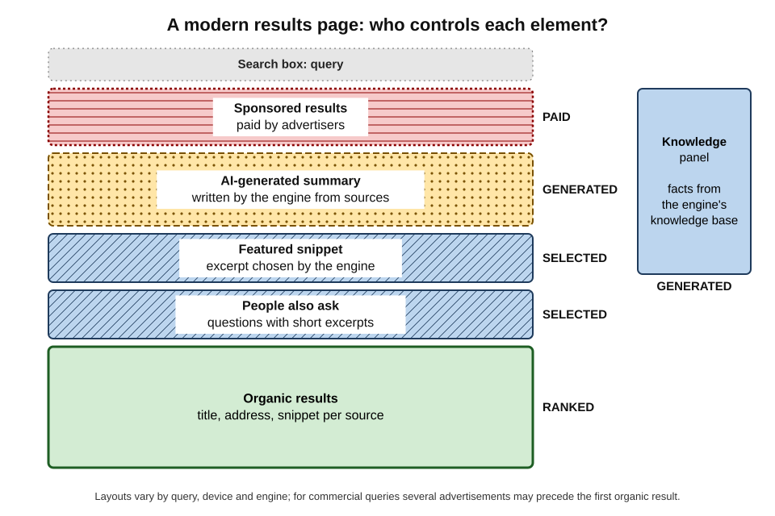
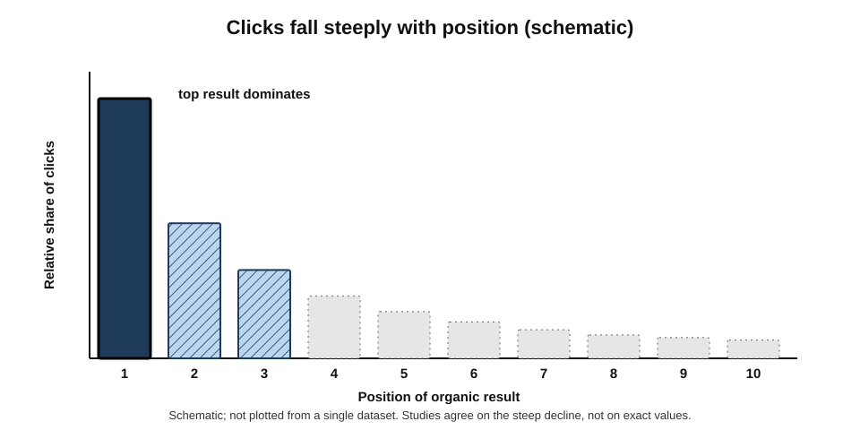
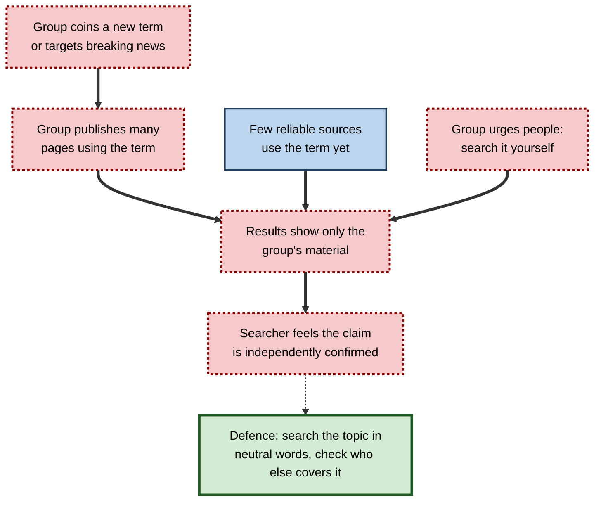
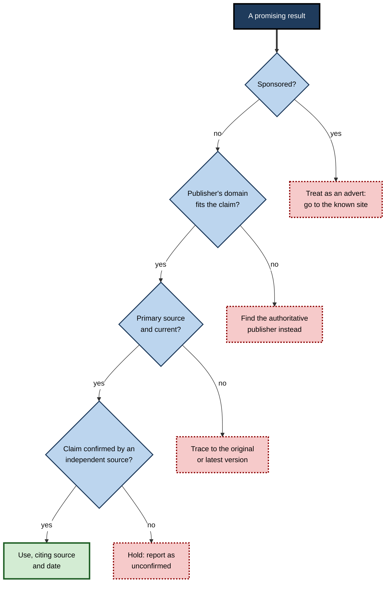
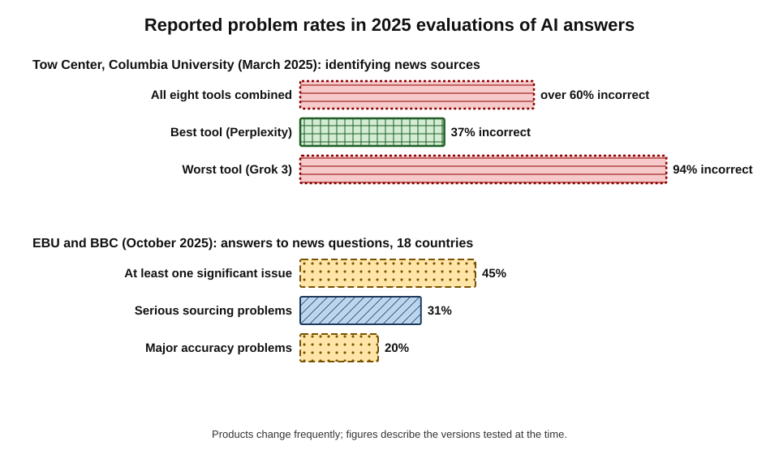
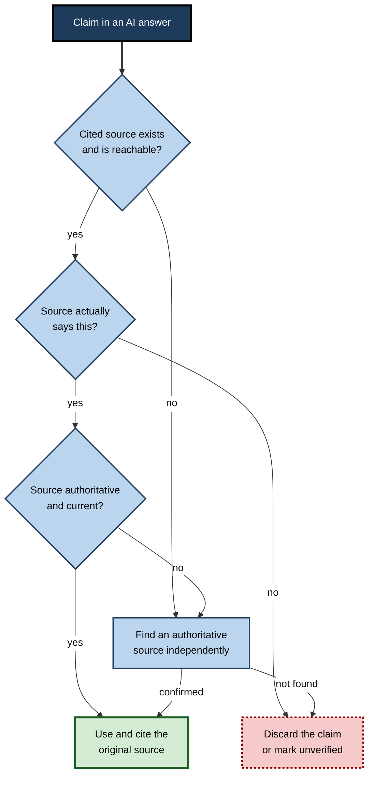

# F.9. Evaluating Search Results

A small-business owner calls the first support number a search shows and grants "remote support" access to a stranger. A junior analyst quotes a statistic from an AI summary that its cited article does not contain. A manager researching a medical condition reads three versions of the same supplement advertisement.

In each case the search worked — it returned results — but the **judgement of the results** failed.

> **Definition — Evaluating search results:** judging, before and after clicking, which results on a page are likely to be relevant, trustworthy and current — distinguishing advertisements from organic results, sources from intermediaries, and generated summaries from the documents they claim to summarise.

**Why it matters**

- **Rank is not truth.** The order of results reflects relevance estimates, optimisation and money as well as quality.
- **Results pages are crowded.** Advertisements, summaries, panels and boxes compete with — and often push down — the organic results.
- **Scams use search.** Fraudsters buy advertisements and optimise pages for brand names, support numbers and downloads.
- **AI answers add a new layer** whose errors are fluent, confident and hard to spot without checking.

---

## Anatomy of a Results Page

### What appears on a modern SERP

- **Sponsored results** — paid advertisements, labelled "Sponsored" or "Ad"; often several above the first organic result for commercial queries.
- **AI-generated summary** — an overview composed by a language model with links to some sources; shown for many informational queries.
- **Featured snippet** — an excerpt from one page presented as a direct answer.
- **Knowledge panel** — facts about an entity (company, person, place) drawn from the engine's knowledge base.
- **"People also ask"** — related questions with expandable short answers.
- **Local pack** — map and business listings for local queries.
- **Shopping, image, video and news carousels**.
- **Forum and discussion results** — threads from community sites, which became markedly more prominent from 2023.
- **Organic results** — the "blue links": title, address and descriptive snippet.

**Figure 1.** The main elements of a modern search results page and how much each depends on payment, automation or the source itself.

> **Definition — Organic result:** a search result ranked by the engine's algorithms, as opposed to one placed by payment.

> **Definition — Featured snippet:** an extract from a web page displayed at the top of results as a direct answer, attributed to that page.

### Reading one organic result

- **Title** — written by the site but sometimes **rewritten by the engine**; since 2021 Google has substituted its own titles in a share of results.
- **Address and site name** — the most informative element: who published this?
- **Date** — when shown, the publication or update date; may be missing or misleading.
- **Snippet** — text chosen by the engine to match the query; may be taken out of context.
- **Extras** — ratings, prices, site links, "more results from this site".

> **Watch out:** a snippet is the engine's **selection**, not the page's conclusion. A page that says "Some claim X; the evidence shows otherwise" may appear with a snippet showing only "X".

### Advertisements versus organic results

| | Sponsored result | Organic result | AI-generated summary |
|---|---|---|---|
| How it gets there | Advertiser pays in an auction | Algorithmic ranking | Language model writes it from retrieved pages |
| Label | "Sponsored" or "Ad" | None | "AI Overview" or similar |
| Who controls the wording | Advertiser | Site (title may be rewritten) | The engine's model |
| Typical risk | Scam lookalikes; biased commercial message | Optimised but low-quality content | Errors, misattribution, missing nuance |
| Check before trusting | The real destination domain | Publisher, date, purpose | The cited sources themselves |

> **Watch out:** for searches such as "[bank] login", "[software] download" or "[airline] customer service", **fraudulent advertisements** imitating the brand have repeatedly appeared above the genuine result. For anything involving credentials, payment or remote access, navigate to the known site directly.

---

## Why Rank Is Trusted Too Much

### Position bias

**Study card — Pan, Hembrooke, Joachims and colleagues (2007), "In Google We Trust"**

- **Design:** university students searched while their eye movements and clicks were recorded. In some conditions, the researchers secretly **reversed or swapped** the order of results.
- **Results:**
  - students looked at and clicked the top results most, even when they were the **less relevant** ones;
  - trust in the engine's ordering outweighed their own reading of the snippets.
- **Conclusion:** users treat **rank as a signal of quality** in its own right.

- **Click distribution** — studies consistently show that the first organic result receives far more clicks than the second, and clicks fall steeply down the page; few users go to a second page.
- **Mobile amplifies it** — fewer results fit on screen, so the top positions dominate even more.

> **Definition — Position bias:** the tendency of users to select higher-ranked results regardless of their actual relevance.

**Figure 2.** Attention and clicks fall steeply with result position.

> **Key point:** because users trust rank, whoever controls rank — engines, optimisers, advertisers — shapes what people believe. Evaluating results means deliberately **resisting** the pull of the first link.

### The search engine manipulation effect

**Study card — Epstein and Robertson (2015)**

- **Design:** in laboratory and online experiments, undecided voters searched for information about candidates in an unfamiliar election; result orderings were biased towards one candidate or the other.
- **Results:** voting preferences shifted towards the candidate favoured by the ordering, and few participants noticed any bias.
- **Conclusion:** the authors argued that biased rankings could influence close elections.
- **Status:** the existence of ranking effects on opinion is well supported, but the **size** of real-world effects — outside experiments, with competing information sources — is **contested**.

> **Watch out:** the claim that a search engine "decides elections" overstates the evidence. The defensible conclusion is that **ranking influences opinion**, especially for unfamiliar topics where people have no prior view.

### Filter bubbles: how strong is personalisation?

- **Eli Pariser (2011)** popularised the "**filter bubble**" — the idea that personalisation shows each person results confirming their views.
- **Evidence for search is weaker than the idea's popularity suggests.**
  - Audits by Aniko Hannak and colleagues (2013) found measurable personalisation in only a minority of Google web results — about one in eight — mostly from location and signed-in status.

**Study card — Robertson, Green, Ruck, Ognyanova, Wilson and Lazer (2023)**

- **Design:** compared the news sources US participants were **shown** in Google results with those they **chose** to click and visit, during the 2018 and 2020 election periods.
- **Results:** partisan differences in what users were **exposed** to by search were small; differences in what they **engaged** with were much larger.
- **Conclusion:** at least for Google search, **user choice** drove partisan news consumption more than algorithmic curation.

> **Key point:** for web search, the bigger risk is less a hidden personal bubble than **shared** biases — everyone seeing the same optimised, commercial or manipulated results — and the user's own choice of what to click.

---

## Low-Quality and Manipulated Results

### Types to recognise

- **Content farms** — sites producing large volumes of cheap articles targeted at popular queries.
- **Affiliate and review spam** — "best ten" lists written to earn commissions, often without testing products.
- **Parasite SEO** — low-quality third-party content hosted on a reputable site to borrow its ranking.
- **AI-generated spam** — mass-produced pages written by language models, sometimes plagiarising or inventing.
- **Scraper and clone sites** — copies of legitimate content wrapped in advertising or malware.
- **SEO poisoning** — malicious pages optimised for trending or brand searches to deliver malware.
- **Fake local listings** — invented businesses or hijacked listings in maps and local packs.

### Data voids

> **Definition — Data void:** a search term for which little reliable content exists, so that the results are easily dominated by whoever creates content for it — often people with an agenda. The concept was set out by Michael Golebiewski and danah boyd in 2018.

- **Typical voids:**
  - breaking news, before reliable reporting exists;
  - new or obscure terms, often coined by a group to steer people to its material;
  - outdated terms that only fringe sources still use;
  - very specific local or niche topics.
- **Exploitation:** a group coins a phrase, seeds content using it, and encourages people to "search for it themselves" — so that searching seems to confirm the claim.

**Figure 3.** How a data void is exploited.

> **Watch out:** "do your own research" by searching a slogan is **not** independent verification if the slogan's creators produced most of what the search returns. Searching the **underlying topic** in neutral terms, and checking what established sources say, breaks the loop.

---

## Judging a Result Quickly

Detailed methods for evaluating sources belong to information literacy more broadly; one widely taught approach, **lateral reading** — leaving a page to see what other sources say about its publisher, as professional fact-checkers do — is particularly efficient for search results. On the results page itself, a few checks take seconds.

### Before clicking

- **Is it an advertisement?** Read the label.
- **Who is the publisher?** Read the domain; recognise official, academic, news, commercial, forum and personal sites.
- **Does the domain fit the claim?** A government rule should come from a government domain; a company's support number from the company's own domain.
- **Is it current?** Look for dates; add a date filter if the topic changes.
- **Is it a primary source or an intermediary?** The regulator's notice or a blog about it?
- **What is the page for?** Selling, informing, persuading, entertaining?

### After clicking

- **Does the page match the snippet?** Is the claim actually there, in context?
- **Who wrote it, and on what basis?** Author, organisation, evidence, references.
- **When was it written or updated?**
- **What do others say about this source?** A quick search of the publisher's name — lateral reading.
- **Can the key fact be found in a second, independent source?**

> **Mnemonic — "AD-PUSH":** **A**d? **D**omain? **P**rimary? **U**p to date? **S**nippet matches? **H**elp from a second source? — six quick checks on any result.

**Figure 4.** A quick triage of a search result before relying on it.

### Worked example (illustrative): triaging a health query

A manager searches "is intermittent fasting safe for people with type 2 diabetes" for a family member.

| Result | What it is | Judgement |
|---|---|---|
| 1. "Sponsored — Reverse diabetes in 30 days" | Advertisement for a paid programme | Skip — commercial, extraordinary claim |
| 2. AI-generated summary with three cited links | Model-written synthesis | Read the cited sources; do not rely on the summary alone |
| 3. National health service page on diabetes and diet | Official primary health guidance | Strong — check the review date |
| 4. "10 amazing benefits of fasting" on a supplement retailer's blog | Commercial content marketing | Weak — conflict of interest |
| 5. A diabetes charity's page on fasting and medication | Reputable specialist organisation | Strong — corroborates result 3 |
| 6. Forum thread of personal experiences | Personal accounts | Useful for questions to ask a clinician, not as evidence |
| 7. A 2023 systematic review in a medical journal | Research evidence | Strong but technical; check whether conclusions are hedged |

1. **Discard** the advertisement and the retailer's blog.
2. **Use** the official and charity pages as the backbone; both warn that fasting can cause dangerous low blood sugar with certain medicines and advise consulting a clinician first.
3. **Check** the AI summary against them — if it omits the medication warning, it is incomplete in a way that matters.
4. **Conclusion:** the answer is "possibly, but only with medical supervision, especially if taking certain medicines" — not the simple "yes" the top of the page implied.

> **Watch out:** for health, money, legal and safety topics, the cost of a wrong answer is high. These are exactly the topics that attract **commercial and manipulative** content, so they need the strictest checks.

---

## Evaluating AI-Generated Answers

AI summaries and answer engines put a fluent synthesis above or instead of the links. Their accuracy has been tested by journalists and researchers.

**Study card — Tow Center for Digital Journalism, Columbia University (March 2025)**

- **Design:** eight AI search tools were each given excerpts from real news articles (1,600 queries in total) and asked to identify the article's headline, publisher, date and address.
- **Results:**
  - collectively, the tools gave **incorrect answers to more than 60 per cent** of queries;
  - the best performer (Perplexity) was wrong on **37 per cent**; the worst (Grok 3) on **94 per cent**;
  - the tools rarely declined to answer, presenting wrong answers with confidence;
  - many citations led to broken links, syndicated copies or the wrong article; premium paid versions were in some respects **more confidently wrong**.
- **Conclusion:** AI search tools were poor at the basic task of correctly attributing information to its source.

**Study card — European Broadcasting Union and BBC (October 2025)**

- **Design:** journalists from 22 public-service media organisations in 18 countries, working in 14 languages, assessed more than 3,000 responses from ChatGPT, Copilot, Gemini and Perplexity to news questions.
- **Results:**
  - **45 per cent** of responses had at least one significant issue;
  - **31 per cent** had serious sourcing problems — missing, misleading or incorrect attribution;
  - **20 per cent** contained major accuracy problems, such as invented details or outdated information;
  - Gemini performed worst on sourcing, with significant problems in about **72 per cent** of its responses.
- **Context:** an earlier BBC study (February 2025) found significant issues in about half of answers about BBC news and found quotations attributed to the BBC that were altered or absent from the cited article.
- **Conclusion:** the problems were systemic across languages, countries and products.

**Figure 5.** Error rates reported in two 2025 evaluations of AI assistants and AI search tools.

> **Watch out:** these studies tested **news** questions and source attribution at particular dates; products change monthly, and performance on other tasks differs. The durable lesson is not a specific error rate but that **fluency is no guide to accuracy** and that citations must be opened.

**Notable failures in AI summaries**

- In **May 2024**, shortly after launch, Google's AI Overviews told some users to add glue to pizza sauce and to eat a small rock daily — drawing on a joke forum post and a satirical article. Google restricted the feature for such queries and said such errors were rare relative to total use.
- Investigations in 2024–2025 reported AI summaries surfacing **scam customer-support numbers** planted on low-quality pages.

### Checking an AI answer

1. **Treat it as a lead,** not a source.
2. **Open the cited sources.** Does each one exist, and does it say what the answer claims?
3. **Check the date** of the information against how fast the topic changes.
4. **Look for omissions** — qualifications, exceptions, warnings, the jurisdiction.
5. **Corroborate key facts** with an authoritative source found independently.
6. **Cite the source, not the AI.**

**Figure 6.** Verifying a claim from an AI-generated answer.

---

### Case study (illustrative): the support number at the top of the page

- **Situation:** the office manager of a twelve-person architecture practice could not sign in to the practice's accounting software and searched for "[software name] support phone number".
- **Problem:** the first result — a sponsored listing using the software's name and logo — gave a phone number. The person who answered said the account was "compromised", asked the manager to install a remote-access tool, and then requested a card payment for "security cleaning".
- **Diagnosis:**
  1. The result was an **advertisement** bought by a scam operation, with a display address resembling the vendor's.
  2. The vendor in fact offered support only through its in-app help centre.
  3. The manager trusted the **top position** and the familiar logo.
- **Actions:**
  1. The practice disconnected the computer, revoked the remote-access tool, changed passwords from a clean device and contacted its bank.
  2. It created bookmarks for every supplier's genuine support page and added them to a shared document.
  3. Staff were shown how to recognise sponsored labels and to find support contacts **inside** the product or on the vendor's own domain.
- **Result:** the card payment was stopped; no client data was found to have been accessed.
- **Side effects / caveats:** the practice lost a day of work rebuilding the affected computer.
- **Lesson:** for support, sign-in and payments, **search is the riskiest route** to a site. The defence is to go to the known source — bookmark, in-app link or typed address — not to the first result.

---

## Evaluating Results in Professional Settings

- **Research and consulting** — prefer primary sources; record the query and date; note which results were excluded and why.
- **Legal and compliance** — confirm the current version of any rule on the issuing body's site; never cite a summary of a law as the law.
- **Healthcare** — use official and professional guidance; treat patient-forum content as experience, not evidence.
- **Procurement and finance** — verify supplier details and bank information through known channels, never only through search.
- **Recruitment and due diligence** — distinguish people with the same name; check dates and sources of adverse information; be aware of legal limits on using online information about candidates.
- **Teams** — share trusted-source lists for common questions so that each person does not rediscover them.

> **In practice:** many organisations maintain an approved list of **authoritative sources** per domain — regulators, standards bodies, statistical offices, professional bodies — so that staff can go straight to them rather than relying on whatever ranks first.

---

## Judging Other Result Types

- **Images and video**
  - Images can be old, from another place, edited or AI-generated; reverse image search reveals earlier appearances.
  - Video results often come from large platforms where anyone can publish; check the uploader and the original source of the footage.
- **Reviews and ratings**
  - Fake and incentivised reviews are widespread; patterns such as many five-star reviews in a short period, vague wording or reviewers with no history are warning signs.
  - Regulators have acted — in 2024 the US Federal Trade Commission finalised a rule banning fake reviews and the buying of reviews.
- **Forum and community results**
  - Valuable for first-hand experience and practical fixes; weak as evidence for general claims; easily astroturfed by marketers.
- **Knowledge panels and quick answers**
  - Drawn from structured data that can contain errors; check important facts at the source.
- **Shopping results**
  - Often paid or affiliate-driven; prices and stock may be out of date.

> **Remember:** every result type has a **typical failure**. Images are re-used, reviews are faked, forums are anecdotal, panels are out of date, and shopping results are paid.

---

## Open Questions

- **Will AI summaries become reliable enough to trust without checking?**
  - Accuracy is improving, but the 2025 evaluations found systemic problems; whether checking can ever be safely skipped for consequential claims is doubtful.
- **How should search engines label and police advertisements?**
  - Scam ads persist despite verification programmes; how much responsibility platforms should bear is debated.
- **How large is the real-world influence of ranking on opinion?**
  - Laboratory effects are strong; field effects with competing sources are harder to measure.
- **Can data voids be filled quickly?**
  - Engines can surface warnings or authoritative content, but deciding what is authoritative during breaking events is contentious.
- **Will people still look at result lists?**
  - If answers replace lists, skills of comparing sources may decline unless deliberately taught.

---

## Summary

- A modern **SERP** mixes **sponsored results**, **AI summaries**, **featured snippets**, **knowledge panels**, "People also ask", local packs, carousels, forum results and **organic results**.
- Read the **label, domain, date and snippet**; titles and snippets are chosen or rewritten by the engine.
- **Position bias** (Pan et al., 2007): users trust rank over their own judgement; clicks fall steeply down the page.
- The **search engine manipulation effect** (Epstein and Robertson, 2015) shows ranking can shift opinion; real-world size is contested.
- **Filter bubbles** in search appear weaker than commonly claimed; Robertson et al. (2023) found **user choice** drove partisan engagement more than exposure.
- Recognise **content farms, affiliate spam, parasite SEO, AI spam, clones, SEO poisoning, fake listings** and **data voids**.
- Quick checks: **AD-PUSH** — ad, domain, primary, up to date, snippet matches, help from a second source; lateral reading is the efficient habit.
- AI answers: Tow Center (2025) found **over 60%** incorrect attribution; EBU/BBC (2025) found **45%** with significant issues. Open the sources; cite them, not the AI.
- For credentials, payments and support, **navigate to known sources** rather than trusting top results.

---

## Self-Check

1. List six elements that can appear on a modern results page.
2. How does a sponsored result differ from an organic one, and why does it matter for "support number" searches?
3. Why might a snippet misrepresent a page?
4. Describe the Pan et al. (2007) study and its conclusion.
5. What is the search engine manipulation effect, and what is contested about it?
6. What did Robertson and colleagues (2023) find about exposure and engagement?
7. Define a data void and give two types.
8. Why is "search it yourself" not independent verification for a newly coined slogan?
9. Apply the AD-PUSH checks to a result titled "New law bans remote work from 2027" on an unfamiliar blog.
10. Summarise the Tow Center (2025) findings on AI search tools.
11. Summarise the EBU/BBC (2025) findings and the main caution in interpreting them.
12. Describe the steps for verifying a claim made in an AI answer.
13. In the health worked example, why was the AI summary insufficient on its own?
14. What lessons does the support-number case offer to a small organisation?

### Answer Key

1. Any six of: sponsored results, AI-generated summary, featured snippet, knowledge panel, "People also ask", local pack, shopping/image/video/news carousels, forum results, organic results.
2. Sponsored results are paid placements controlled by advertisers; organic results are ranked algorithmically. Scammers buy ads using brand names, so the top result for support numbers may be fraudulent.
3. The engine selects text matching the query, which may be out of context — for example a claim the page goes on to refute.
4. Students' eye movements and clicks were recorded while result orders were secretly reversed; they still favoured top results even when less relevant, showing that rank itself is trusted.
5. Biased rankings shifted undecided voters' preferences in experiments without participants noticing. The size of real-world effects, where people have other sources, is contested.
6. Partisan differences in what Google showed users were small; differences in what users chose to click were larger — user choice drove partisan engagement more than algorithmic exposure.
7. A query with little reliable content, so results are easily dominated by motivated creators. Types: breaking news, newly coined terms, outdated terms, niche topics.
8. The slogan's creators may have produced most of the content that appears, so the search reflects their material rather than independent sources.
9. Ad: check label. Domain: an unfamiliar blog, not a government or legal source. Primary: no — find the legislation or official announcement. Up to date: check date. Snippet: check the page actually says this. Help: look for coverage by reputable news or the government; without it, treat as unconfirmed.
10. Eight tools on 1,600 queries were collectively wrong in more than 60% of attempts to identify news articles; Perplexity was wrong 37% of the time and Grok 3 94%; tools rarely declined and many citations were broken or wrong.
11. 45% of 3,000+ responses had a significant issue, 31% serious sourcing problems and 20% major accuracy problems, across 18 countries and 14 languages. Caution: news-specific and time-specific; products change; the lesson is to check sources rather than to rely on a fixed error rate.
12. Treat as a lead; open each cited source; confirm it says what is claimed; check date and authority; look for omitted qualifications; corroborate independently; cite the original.
13. It might omit crucial qualifications — such as the risk of low blood sugar with certain medicines — and could not be relied on without checking against authoritative sources.
14. Don't use search to reach support, sign-in or payment pages; bookmark genuine supplier pages; recognise sponsored labels; never grant remote access to unsolicited "support"; have an incident procedure.

---

## Glossary

| Term | Meaning |
|---|---|
| AI Overview | Google's AI-generated summary shown on results pages. |
| Affiliate spam | Content written mainly to earn commissions on product links. |
| Content farm | A site mass-producing low-cost articles to capture search traffic. |
| Data void | A query with little reliable content, easily dominated by motivated creators. |
| Featured snippet | An extract shown at the top of results as a direct answer. |
| Filter bubble | The idea that personalisation shows people only confirming content. |
| Knowledge panel | A box of facts about an entity drawn from the engine's knowledge base. |
| Lateral reading | Checking what other sources say about a source by leaving its page. |
| Organic result | A result ranked algorithmically rather than by payment. |
| Parasite SEO | Low-quality third-party content hosted on a reputable site to borrow its ranking. |
| Position bias | Users' tendency to select higher-ranked results regardless of relevance. |
| Search engine manipulation effect | Shifts in opinion caused by biased result rankings. |
| SEO poisoning | Optimising malicious pages to rank for popular or brand searches. |
| Snippet | The descriptive text shown under a result's title. |
| Sponsored result | A paid advertisement on a results page. |
