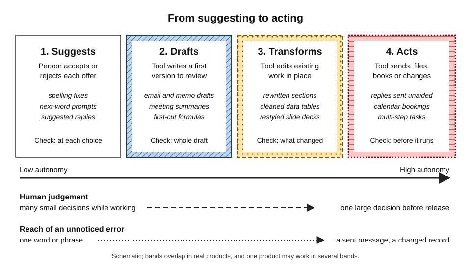
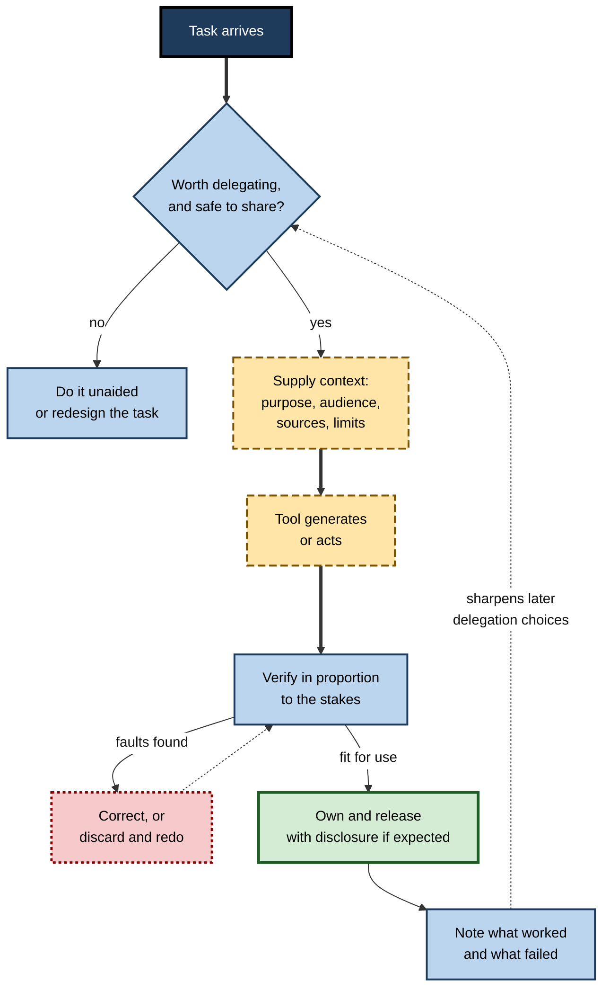
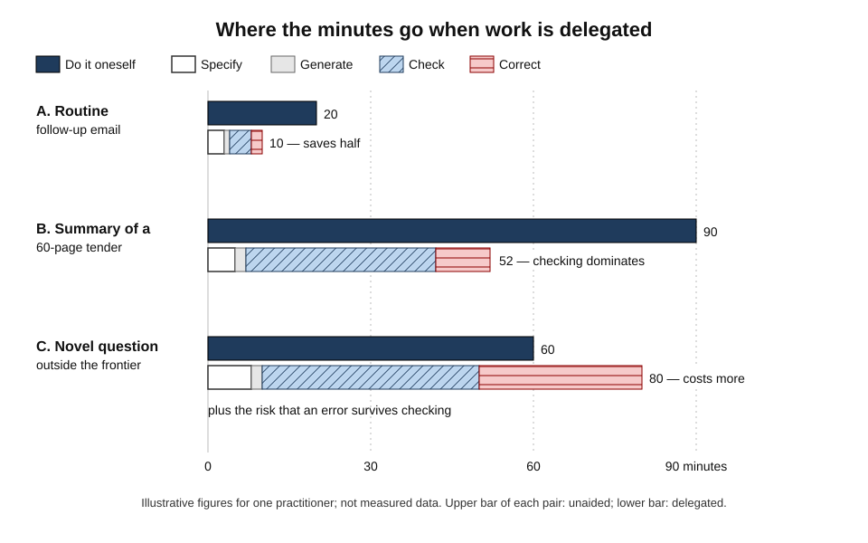
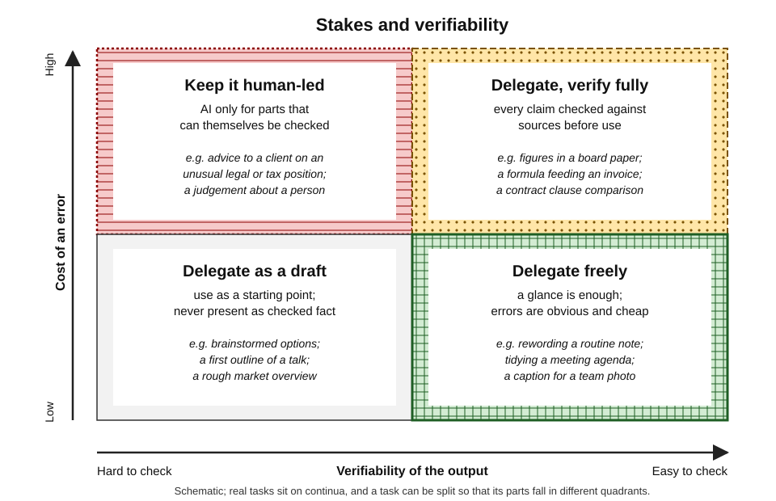
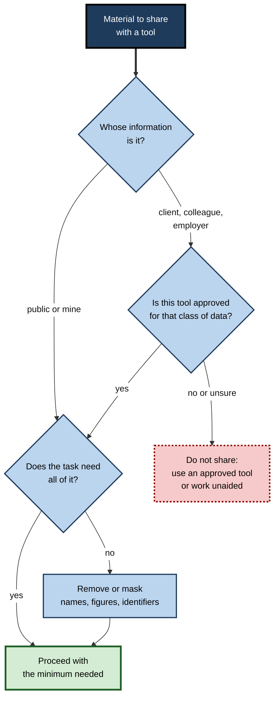
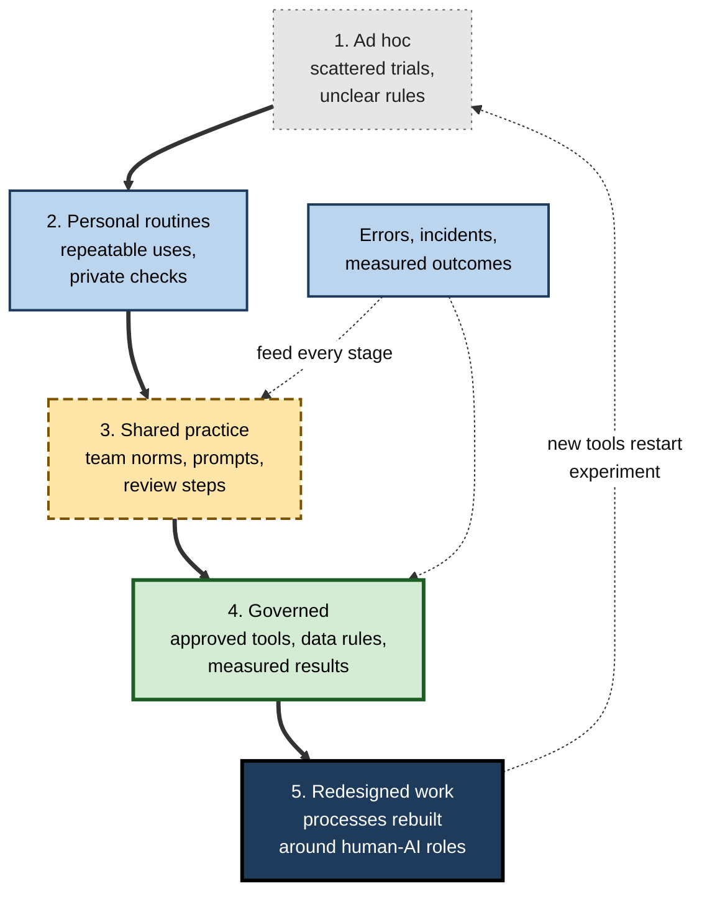

# 1.2.6. AI Tools in Everyday Digital Work

A project manager opens her laptop at half past eight. Before she has typed a word, software has filtered her inbox, offered three one-line replies, summarised a call she missed and suggested a formula for the budget sheet she left open. None of it was asked for, all of it is fluent, and some of it is wrong. Working well now depends less on whether to use these tools than on knowing **what to hand over, what to check and what never to share**.

> **Definition — Everyday AI tools:** AI-driven software and features — standalone assistants, capabilities built into ordinary applications, and agents that act on a person's behalf — used in routine knowledge work to find, draft, transform, analyse and act on information, while a person remains accountable for what is finally used.

**Why it matters**

- **Ubiquity:** AI now arrives inside the word processor, mail client, spreadsheet, meeting tool and search box.
- **Leverage:** used well, it removes hours of routine drafting, searching and reformatting each week.
- **Risk at scale:** used badly, it spreads plausible errors, leaks confidential material and erodes skills.
- **Professional standing:** clients, employers and courts judge the person who signs the work, not the tool.

> **Key point:** competence with everyday AI is not knowledge of products, which change every few months, but **durable judgements** — about delegation, verification, confidentiality and one's own capability.

---

## A New Kind of Everyday Software

### What makes AI tools different

Most software people grew up with is **deterministic**: the same input gives the same output, and a fault is a bug that can be found and fixed. Everyday AI tools behave differently in ways that change how they must be used.

- **Probabilistic output** — the same request can produce different answers on different runs.
- **Plausibility over truth** — models are trained to produce likely-looking text, images or code; fluency is not evidence of correctness.
- **Context dependence** — quality depends on what the tool is given: the request, files, retrieved documents, history and hidden vendor instructions.
- **Silent change** — vendors update models continuously, so last month's behaviour is no guarantee of today's.
- **Uneven competence** — a tool can excel at one task and fail at a similar-looking one.

| | Conventional software | Everyday AI tool |
|---|---|---|
| Same input, same output? | Yes | Not necessarily |
| How it is instructed | Menus, fields, formulas | Ordinary language plus context |
| Typical failure | Visible error or crash | Fluent, confident, wrong output |
| How failures are found | Testing against a specification | Checking each output against sources and purpose |
| Stability over time | Changes at versioned releases | Can change silently between uses |

> **Watch out:** the commonest beginner's error is to treat an assistant as a **search engine or database**. It generates plausible content; even when connected to search or documents, its grounding must still be checked.

### Three ways AI is present in work

- **Standalone assistants** — general-purpose chat tools opened deliberately for a task.
- **Embedded features** — AI inside the applications where work already happens, such as drafting help in a word processor or formula help in a spreadsheet.
- **Agents** — tools that carry out multi-step tasks and take actions: sending, booking, filing, updating records.

| | Standalone assistant | Embedded feature | Agent |
|---|---|---|---|
| What it sees | What the person supplies | The current file, mailbox or workspace | Whatever its permissions reach |
| Typical output | An answer or draft to copy | A change or suggestion in place | Completed actions |
| Main risk | Unvetted data shared; output pasted unchecked | Over-trust because it feels native | Errors acted on before anyone looks |
| Where the human check sits | Before pasting | Before accepting | Before launch and at checkpoints |

The underlying capability is the same across all three; what differs is **where the tool sits** and **how much it does before a person looks**. Choosing among tools — on fit, trust, cost and the ability to leave — is a discipline in its own right.

### From suggesting to acting

The most useful single way to place any tool is by **how much it does before a person decides**.

**Figure 1.** The spectrum of delegation, from tools that suggest to tools that act.

- For tools that **transform in place**, the critical question is *what changed?*; for tools that **act**, judgement must come **before** the action, because afterwards it may be too late.

> **Definition — Human in the loop:** an arrangement in which a person reviews and approves an AI tool's output or proposed action before it takes effect.

> **Definition — Human on the loop:** an arrangement in which the tool acts on its own while a person monitors and can intervene or reverse.

> **Remember:** as autonomy rises, **the number of human decisions falls but the weight of each rises**, and the reach of an unnoticed error grows from a word to a sent message or a changed record.

---

## How Everyday AI Arrived

People carry habits formed with older, narrower tools into a world of general-purpose ones, which is why expectations are muddled.

- **1990s–2000s — invisible AI:** spam filters, spelling correction, search ranking, recommendations — narrow and judged by aggregate accuracy.
- **2010s — predictive assistance:** machine translation, next-word prediction and suggested short replies in email (in Gmail from 2017) — software first *writing* for people, in tiny units.
- **November 2022 — general-purpose chat:** the public release of ChatGPT reached a mass audience within weeks; use outran policy almost everywhere.
- **2023–2024 — embedding:** office, mail, meeting and design suites added AI throughout, with enterprise versions offering contractual data protection.
- **2024–2026 — agents and connectors:** tools began searching an organisation's files, operating applications and completing multi-step tasks; the question shifted from *what does it write?* to *what is it allowed to do?*

> **Key point:** each wave **widened the reach** of the tool — from a word, to a reply, to a document, to an action — while the person's accountability stayed exactly where it was.

---

## Principles That Hold Across Every Tool

Products differ in interface and capability, but the same small set of principles governs good use of all of them. A practitioner who has internalised the principles adapts to a new tool in an afternoon.

> **Mnemonic — SCOPE:** **S**takes set the effort · **C**ontext in, quality out · **O**wnership stays with the person · **P**rotect what is not yours to share · **E**xpertise must be kept.

### Stakes set the effort

- Care should match the **cost of an error** and the **difficulty of detecting one**: a reworded internal note needs a glance; figures in a regulatory return need full verification.
- The same test governs whether to use AI at all.

### Context in, quality out

- Vague requests produce generic output. Good instructions state **purpose**, **audience**, **sources** (and what must not be invented), **constraints** and **what a good result looks like**.
- This is why embedded tools often outperform standalone ones: they already hold the document, thread or dataset — a draft built from the right file, a formula built on the actual columns.

> **Definition — Grounding:** constraining an AI tool's output to specific supplied or retrieved sources, so that its claims can be traced and checked.

### Ownership stays with the person

- Whoever sends, signs, files or acts on the output **owns it**, errors included.
- In 2024 a Canadian tribunal held Air Canada liable for wrong refund advice from its own website chatbot, rejecting the argument that the chatbot was responsible for its own statements.
- Ownership includes **disclosure** wherever clients, employers, publishers or courts expect to know whether AI was used.

> **Watch out:** "the AI got it wrong" is not a defence any profession accepts — at best it explains how a review failed.

### Protect what is not yours to share

- Every prompt, attachment and connected folder is a **flow of information** to a system run by someone else.
- The duty is an old one — keep entrusted information within the circle for which it was shared — applied to a new and very easy channel. The ideas and law of privacy and confidentiality behind it form a substantial subject of their own.

### Expertise must be kept

- Handing over tasks **too early** prevents learning; handing them over **permanently** erodes skills already held.
- Verifying AI output needs the very expertise the tool appears to make unnecessary.

> **Key point:** the five principles are not separate rules but one stance — **the tool proposes, the professional disposes**.

### The everyday working loop

The principles combine into a single loop that recurs whatever the tool or task.

**Figure 2.** The everyday loop of working with an AI tool.

---

## The Economics of Delegation

Using an AI tool is an act of **delegation**, and delegation has never been free. The economics of handing work to others explains why AI's time savings are often smaller than demonstrations suggest — and sometimes negative.

### Old theories, new agent

- **Transaction costs — Ronald Coase, "The Nature of the Firm" (1937):** getting work done through others carries costs of specifying, arranging and checking it; firms exist partly to avoid them.
  - *Applied:* every AI request costs framing, context-giving and review.
- **Agency costs — Michael Jensen and William Meckling (1976):** a principal delegating to an agent whose work cannot be fully observed bears:
  - **monitoring** costs — checking (for AI, verification);
  - **bonding** costs — assurances set up in advance (approved tools, templates, grounded sources);
  - **residual loss** — failures that checking misses (errors that reach a client).

> **Definition — Delegation cost:** the total effort and risk of handing a task to another party — specifying, waiting, checking, correcting and bearing the errors that slip through — compared with doing it oneself.

An AI tool is an unusual agent: it does not shirk, but it **cannot tell when it is wrong**, and fluency disguises its errors — so monitoring and residual loss dominate.

### The arithmetic of a single task

> **Formula — Net time saved by delegating:**
> Net saving = T(self) − [T(specify) + T(generate) + T(check) + T(correct)] − p × C(error)
> where *p* is the probability that an error survives checking and *C(error)* is the cost of such an error, expressed in the same units as time.
>
> *Worked number (illustrative figures):* summarising a 60-page tender unaided takes 90 minutes; delegated, 5 + 2 + 35 + 10 = 52 minutes, a gross saving of 38. A 5% chance that a missed error later costs 300 minutes of rework adds an expected 15 minutes, so the net saving is about 23 minutes — real, but some 40% below the gross figure.

**Figure 3.** Time to do three tasks oneself compared with time to delegate them.

### Worked example (illustrative): three tasks, one decision rule

- **Situation:** an operations analyst considers delegating three tasks in one morning.

| | A. Follow-up email after a routine meeting | B. Summary of a 60-page tender | C. Advice on an unusual contractual question |
|---|---|---|---|
| Unaided time | 20 min | 90 min | 60 min |
| Specify + generate | 4 min | 7 min | 10 min |
| Check | 4 min — reread | 35 min — trace each claim to the tender | 40 min — research the point independently |
| Correct | 2 min | 10 min | 30 min — much of the draft rewritten |
| Delegated total | 10 min | 52 min | 80 min |
| Residual risk | Negligible | Moderate — omissions are hard to spot | High — errors look authoritative |
| Decision | Delegate | Delegate, with full source check | Do unaided; perhaps use AI to find sources |

(Illustrative figures.)

- **Reasoning:** estimate unaided time honestly; estimate **checking** time, which depends on how hard the output is to verify, not how fast it was produced; add correction time, which climbs steeply outside the tool's reliable capability; weigh residual risk by the cost of an error reaching its audience.
- **Conclusion:** the saving is largest where output is **cheap to verify**, and vanishes where verifying means redoing the work.

> **Watch out:** people **misjudge** their own savings. Controlled trials have found participants who felt faster were sometimes slower, because prompting, waiting and correcting go unnoticed. Measured time, not impression, is the guide.

### The asymmetry between producing and checking

- Generation has become almost free; **verification has not** — a ten-page report takes seconds to produce and hours to check.
- **Volume pressure:** cheap drafts multiply, shifting the checking burden to whoever receives them.
- **Verifiability as a design goal:** skilled users ask for claims linked to sources, calculations shown step by step and changes tracked rather than silently applied.

**Figure 4.** How the cost of an error and the ease of checking combine to decide how a task is delegated.

> **In practice:** experts rarely delegate a whole task. They **split** it so that each part lands in a favourable quadrant — AI finds candidate sources (easy to check by opening them), the person judges what they mean (hard to check, high stakes).

### Augmentation and automation in actual use

> **Definition — Augmentation:** use of AI in which the person stays engaged — iterating, questioning, learning — and the tool extends what they can do.

> **Definition — Automation:** use of AI in which the tool completes a task with little human involvement beyond the request and, at most, a final review.

**Study card — Anthropic Economic Index (2025)**

- **Design:** privacy-preserving analysis of millions of conversations with one company's AI assistant, classified by task and by pattern of human–AI interaction.
- **Results:**
  - February 2025: **augmentation** somewhat more common than automation — roughly 57% to 43%.
  - September 2025: **directive** conversations, handing over a whole task with minimal interaction, had risen from 27% to 39% in about nine months; automation (about 49%) had overtaken augmentation (about 47%).
  - Business use through the programming interface was around three-quarters automation.
- **Conclusion:** as trust grows, users hand over larger units of work — from *checking a helper* to *auditing a contractor*.
- **Limits:** one provider's users, not representative of all workers; classification itself automated.

> **Key point:** larger units of delegation raise monitoring cost and residual loss per task. Productivity gains are real in many settings but are **net figures**, and evidence on their size remains mixed.

---

## Verification as a Standing Duty

### Why the duty never lapses

A **standing duty** applies every time, however reliable the tool has been so far. Verification is one because of **variability** (right yesterday, wrong today), **silent change**, **fluency** (errors sound as confident as truths) and **accountability**. The practice of planning checks, correcting and signing off is a discipline of its own; what follows concerns why the duty is psychologically hard to keep.

### The ironies of automation

**Study card — Lisanne Bainbridge, "Ironies of Automation" (1983)**

- **Context:** an analysis, in the journal *Automatica*, of automated control in process plants and aircraft.
- **Argument:**
  - Designers automate what they can, leaving people the tasks that **could not be automated** — usually the hardest.
  - People are poor at **monitoring** for rare failures over long periods.
  - Skills **degrade** without practice, yet the operator must take over exactly when things go wrong.
  - The more reliable the automation, the less practice, and the harder the takeover.
- **Conclusion:** automation turns the human role into a more demanding one while undermining the conditions for performing it.
- **Relevance today:** the reviewer of an AI-drafted analysis is the "operator", asked to catch rare, well-disguised errors in output that is usually fine.

> **Definition — Automation bias:** the tendency to favour suggestions from automated systems and to under-weight contradictory information, including one's own judgement.

> **Definition — Automation complacency:** reduced vigilance in monitoring an automated system that has usually performed well.

### Trust that matches reliability

- **Under-reliance** — redoing work the tool did well; costs time.
- **Over-reliance** — accepting output with a glance; costs errors in clients' hands.
- **Calibrated reliance** — trusting a tool as far as evidence *for this task* supports, sustained by continued spot-checks.

**Study card — Microsoft Research and Carnegie Mellon University survey (CHI 2025)**

- **Design:** **319 knowledge workers** described **936** real uses of generative AI at work and how much critical thinking each involved.
- **Results:**
  - Greater **confidence in the AI** went with **less** critical thinking; greater **self-confidence** with **more**.
  - Effort shifted from gathering information to **verifying** it, from solving problems to **integrating** responses, and from doing tasks to **stewarding** them.
- **Conclusion:** thinking moves to checking and integrating — if the person stays confident enough to question the tool.
- **Limits:** self-reported and cross-sectional; associations, not causes.

> **Remember:** the moment a tool has been right ten times in a row is the moment checking feels least necessary — and the moment a surviving error does most damage.

### Case study: the Deloitte Australia welfare-compliance report (2025)

- **Situation:** Deloitte Australia was engaged by the Department of Employment and Workplace Relations, for about A$440,000, to review the framework and IT system enforcing compliance obligations in the welfare system.
- **Problem:** the report, published in July 2025, was found by a University of Sydney researcher to cite academic works that did not exist and to contain a fabricated quotation attributed to a Federal Court judgment.
- **Actions:**
  1. A revised version corrected the references and quotation.
  2. It disclosed that the method had used a generative AI tool chain based on a large language model — not stated originally.
  3. Deloitte agreed to repay the final instalment of its fee; the department was reported to have said the substance of the review was unaffected.
- **Result:** wide public criticism and renewed questions about AI in publicly funded consultancy work.
- **Lesson:** the failure was not using AI but the **absence of proportionate verification** — citations are cheap to check and costly to get wrong — and of the **disclosure** that would have prompted readers to check.

---

## Confidentiality as a Standing Duty

### Where information goes

Every use of an AI tool moves information, often invisibly:

- **into the prompt and attached files** — often far more than the task needs;
- **through connectors** — mailboxes, drives and chats the tool may search;
- **into memory, logs and, depending on terms, training** — consumer versions have often used inputs to improve models unless users opt out; enterprise versions typically exclude this by contract;
- **out to others** — outputs that quote or reveal what went in.

> **Example — Samsung Electronics (2023):** in April 2023 engineers in the semiconductor business were reported to have entered confidential source code and an internal meeting transcript into a public chatbot in at least three incidents within a few weeks. In May the company restricted generative AI tools on company devices and networks. The engineers wanted to work faster, not to leak — which is why confidentiality must be built into routine.

### Matching data to tool

| | Consumer tool, personal account | Enterprise tool, organisation's contract | Local or on-device tool |
|---|---|---|---|
| Who controls data use | Vendor's consumer terms | Contract with the organisation | The user or organisation |
| Typical retention and training | May retain; may train unless opted out | Usually no training on customer data; retention set by contract | Stays on the device |
| Suitable for | Public or personal, non-sensitive material | Internal and much confidential material, within policy | Sensitive material, subject to device security |
| Main risk | Data leaving the organisation's control | Over-broad permissions inside the organisation | Weaker models; device loss |

(Typical patterns; actual terms vary by vendor and contract and must be checked.)

**Figure 5.** Deciding whether material may be given to an AI tool.

> **Definition — Data minimisation:** sharing or processing only the information strictly needed for a purpose.

> **Definition — Shadow AI:** use of AI tools for work outside the organisation's approved tools, policies or awareness.

> **Watch out:** **approval of a tool is not approval of every use.** An enterprise assistant cleared for internal documents may still be the wrong place for health data, privileged legal advice or material under a client's specific confidentiality terms.

- **Old duties, new channel:** in 2024 the American Bar Association's formal ethics opinion on generative AI reminded lawyers that duties of **competence, confidentiality, client communication and reasonable fees** all apply to its use.
- **Content can attack the tool:** documents, pages and emails can carry hidden instructions an AI tool may follow — more dangerous the more the tool can read and do.

> **Key point:** confidentiality failures with AI are rarely malicious. They are **convenience failures**, prevented by habits and defaults rather than warnings alone.

---

## Capability, Memory and Offloading

Every tool that thinks on a person's behalf changes what that person needs to remember and practise. The change can be wise or damaging.

> **Definition — Cognitive offloading:** the use of physical action or external tools to reduce the mental demands of a task — for example, writing a note rather than remembering, or asking a tool rather than working something out (Evan Risko and Sam Gilbert, 2016).

**Study card — Sparrow, Liu and Wegner, "Google effects on memory" (2011)**

- **Design:** four experiments, in *Science*, on how expecting future access to information affects memory.
- **Results:** participants who believed statements would be saved on a computer **recalled them less well**, and remembered **where** information was stored better than the information itself.
- **Conclusion:** people treat external stores as part of their memory system.
- **Status:** a 2018 project replicating social-science experiments from *Science* and *Nature* **failed to replicate** one of its key effects; offloading in general is well supported, but these specific findings need caution.

> **Watch out:** "AI makes people stupid" overstates the evidence. Offloading can **free attention**, as calculators did. The risk lies in offloading what a person **still needs to learn** or **must be able to do unaided** when the tool fails.

- **Healthy offloading** — mastered, checkable tasks: formatting, routine summaries, reference look-ups.
- **Harmful offloading** — judgement-building tasks: framing a problem, weighing evidence, constructing an argument.
- **Protective practices:** attempt hard tasks unaided first and then compare; ask the tool to **critique** rather than produce; keep some recurring work AI-free; restate AI output in one's own words before using it.

> **Key point:** the most valuable thing a professional brings to AI-assisted work is the ability to **know when the tool is wrong**. That ability is built only by doing the work — and lost by never doing it.

---

## Maturity of Practice

Individuals and organisations move from scattered experiments to a settled, governed and improving way of working. Recognising the stages helps diagnose what is missing.

**Figure 6.** Stages in the maturity of everyday AI practice.

- **Ad hoc** — curiosity-driven trials, invisible to the organisation; checking is accidental.
- **Personal routines** — recurring uses and private checks; quality depends on the individual. Turning such uses into stable habits with built-in judgement is a craft in itself.
- **Shared practice** — a team agrees suitable tasks, shares instructions and builds review into its workflow.
- **Governed** — approved tools, classified data, review by risk, outcomes measured rather than enthusiasm.
- **Redesigned work** — processes, roles and quality controls rebuilt around deliberate human and AI roles.

| Dimension | Early practice | Mature practice |
|---|---|---|
| Task choice | Whatever the tool is offered for | Tasks chosen by stakes, verifiability and learning needs |
| Verification | Glance when it seems odd | Proportionate checks built into the workflow |
| Confidentiality | Depends on individual caution | Data classes mapped to approved tools; minimisation by default |
| Capability | Skills allowed to drift | Deliberate unaided practice; juniors given real learning tasks |
| Learning from use | Anecdotes | Errors and savings recorded and reviewed |

> **Watch out:** maturity is **not** the same as volume of use. A team that uses AI for everything without review is less mature than one that uses it for a few well-chosen tasks with sound checks.

> **In practice:** stages are not climbed once. Each new capability — an agent that can send mail, a connector to the client drive — sends practice partly **back to the ad hoc stage** for that capability.

### Case study (illustrative): a small practice grows up

- **Situation:** a twelve-person landscape architecture practice whose staff began using public chat and image tools on their own initiative.
- **Problem:** within a year the partners found client site surveys pasted into personal accounts, a planning statement sent with two non-existent policy references, and juniors with polished concept text who struggled to explain design decisions to clients.
- **Diagnosis:** practice stuck between ad hoc and personal routines — useful habits, nothing shared, governed or checked.
- **Actions:**
  1. One enterprise assistant within the existing office suite, with contractual exclusion of training on the practice's data; personal accounts barred for client material.
  2. Three data classes — public, internal, client-confidential — with a one-page rule for each.
  3. A second person checks citations and policy references in any external document with AI-drafted content.
  4. Juniors write each design rationale unaided, using the assistant only to tighten wording.
  5. A monthly half-hour review of savings and failures.
- **Result:** routine drafting time fell; no further fabricated references reached clients that year; juniors grew more confident in meetings.
- **Side effects:** some resented the slower check and the loss of favourite tools; two image tools were later approved to curb workarounds.
- **Lesson:** small organisations need **three things decided once** — which tools, which data, which checks — and a habit of learning from use.

### Worked example (illustrative): one task through the principles

- **Situation:** a procurement officer must compare three supplier bids for facilities management and recommend one to a committee.

1. **Protect** — the bids are commercially confidential: only the approved enterprise assistant is used, with suppliers masked as A, B and C.
2. **Stakes** — extracting prices, service levels and exclusions is easy to check, so it is delegated; the recommendation is a high-stakes judgement and stays with the officer.
3. **Context** — the tool receives the evaluation criteria and weights, must give a page reference for every figure, and may not estimate missing values.
4. **Check** — every figure is traced to its page; the exclusions sections are read unaided.
5. **Ownership** — the officer signs the recommendation and notes that AI assisted with extraction.
6. **Expertise** — the officer drafts the reasoning unaided, then asks the tool to find its weaknesses.

- **Conclusion:** the tool takes the laborious but checkable part; the person keeps the judgement-laden, accountable part.

> **Watch out:** the commonest failure here is an **omission** — an exclusion the tool never extracted. Omissions are invisible in the output and are found only by reading the source.

---

## What Distinguishes the Very Best

- **Tasks, not tools** — decomposing work and placing each part where it is cheapest to do well and safest to check.
- **Their own frontier** — known from deliberate trials on representative tasks, not vendor claims.
- **Verifiability by design** — sources, steps and tracked changes requested up front.
- **Confidentiality by default** — minimising, masking and choosing the right tool before the question arises.
- **Protected capability** — hard thinking kept in their own hands; tools used to critique.
- **Plain disclosure** — AI involvement stated where it matters, the result owned entirely.
- **Multiplied practice** — instructions, checks and lessons shared so the team matures.
- **Continual reassessment** — delegation choices revisited whenever a tool gains reach or changes behaviour.

> **Key point:** the best users of everyday AI are not those who use it most, but those whose use is **deliberate, checked, discreet and still anchored in their own expertise**.

---

## Open Questions

- **How large are the net productivity gains?**
  - Controlled studies show large gains on some tasks and losses on others; economy-wide measures so far find modest effects.
- **Can verification keep pace with delegation?**
  - As tools take on larger units of work, human checking may become a formality.
- **How will novices build judgement?**
  - If the routine tasks that trained juniors are delegated, it is unknown which alternatives preserve the learning.
- **Will confidentiality hold as tools gain memory and connectors?**
  - Assistants that remember and search everything a person can see make information flows hard to govern.
- **What will disclosure norms settle into?**
  - Expectations differ across professions and countries, and are changing quickly.

---

## Summary

- **Everyday AI tools** — assistants, embedded features, agents — are **probabilistic**, fluent but not reliably true, **context-dependent** and subject to **silent change**.
- On the **spectrum of delegation** from suggesting to acting, human decisions become fewer and weightier and errors travel further.
- **SCOPE**: stakes set the effort; context in, quality out; ownership stays with the person; protect what is not yours to share; expertise must be kept.
- **Delegation has costs** — transaction costs (Coase) and agency costs (Jensen and Meckling). Net saving = unaided time − (specify + generate + check + correct) − expected cost of surviving errors.
- Generation is nearly free but **verification is not**; split tasks by **stakes and verifiability**. Usage is drifting from **augmentation** towards **automation**.
- **Verification is a standing duty**, made hard by the ironies of automation, automation bias and complacency; the goal is **calibrated reliance** (Deloitte Australia, 2025).
- **Confidentiality is a standing duty**: map data classes to approved tools and minimise; leaks come from convenience (Samsung, 2023).
- **Cognitive offloading** helps with mastered tasks and harms learning; the ability to know when a tool is wrong must be protected.
- Practice **matures** from ad hoc use to redesigned work; maturity is judged by judgement, not volume.

---

## Self-Check

1. Name four ways in which AI tools differ from conventional software, and explain why each matters for use at work.
2. Distinguish standalone assistants, embedded features and agents by what they can see and where the human check sits.
3. State the five principles summarised by SCOPE.
4. Explain how Jensen and Meckling's agency costs apply to delegating a task to an AI tool.
5. Delegating a task takes 4 minutes to specify, 1 to generate, 12 to check and 6 to correct; doing it oneself takes 25 minutes. There is a 10% chance a surviving error costs 40 minutes later. What is the expected net saving?
6. Place each in the stakes–verifiability matrix and say how to handle it: (a) ideas for a team social event; (b) the totals in a client invoice; (c) a recommendation on whether to dismiss an employee.
7. What were Bainbridge's main "ironies", and how do they apply to reviewing AI drafts?
8. What did the 2025 survey of 319 knowledge workers find about confidence and critical thinking, and what are its limits?
9. What went wrong in the Deloitte Australia report, and which two practices would have prevented it?
10. A colleague pastes a whole client contract into a personal chatbot account to get a two-line summary of the termination clause. Identify the failures and what should have happened.
11. A team uses AI for nearly every task but has no shared review steps or data rules. Diagnose its maturity and propose three changes.

### Answer Key

1. Probabilistic output (one good result proves little); plausibility over truth (fluent errors are not flagged by tone); context dependence (quality rests on what is supplied); silent change (past reliability may not hold).
2. Standalone assistants see only what is supplied; the check sits before pasting. Embedded features see the current file, mailbox or workspace; the check sits before accepting. Agents see whatever their permissions reach and act, so the check sits before launch and at checkpoints.
3. Stakes set the effort; context in, quality out; ownership stays with the person; protect what is not yours to share; expertise must be kept.
4. Monitoring is verification effort; bonding is the up-front work of approved tools, templates and grounded sources; residual loss is errors that survive checking. Because AI cannot tell when it is wrong, monitoring and residual loss dominate.
5. Delegated time = 4 + 1 + 12 + 6 = 23 minutes; gross saving = 2 minutes. Expected residual loss = 0.10 × 40 = 4 minutes. Net saving = −2 minutes: not worthwhile unless checking becomes cheaper or the error risk lower.
6. (a) Low cost, easy to check — delegate freely. (b) High cost, easy to check — delegate if useful, then verify every total. (c) High cost, hard to check — keep human-led; AI at most for checkable parts such as summarising documented facts or policy.
7. Automation leaves people the hardest tasks; people monitor poorly for rare failures; skills decay without practice yet are needed most when automation fails. Reviewers of mostly-correct drafts face the same decline in vigilance and practice, so reviews must be structured and skills deliberately kept.
8. Higher confidence in AI went with less critical thinking, higher self-confidence with more; effort shifted to verifying, integrating and stewarding. Self-reported and cross-sectional, so associations rather than causes.
9. A government assurance report contained non-existent references and a fabricated court quotation, and AI use was not disclosed at first. Checking every citation, and disclosing AI use, would have prevented or exposed the errors.
10. Client information went to an unapproved consumer tool; far more was shared than needed; a legally significant clause would be relied on unchecked. Instead: use an approved tool or none; share only the clause, masked if possible; read the clause itself, since it is short and high-stakes.
11. Heavy use without shared checks or rules is ad hoc or personal-routine maturity despite the volume. Changes: agree suitable tasks and add review proportionate to stakes; map data classes to approved tools; record errors and savings and review them monthly.

---

## Glossary

| Term | Meaning |
|---|---|
| Agency costs | Monitoring, bonding and residual-loss costs borne by a principal who delegates to an agent. |
| Agent (AI) | An AI tool that carries out multi-step tasks and takes actions towards a goal. |
| Augmentation | AI use in which the person stays engaged and the tool extends their capability. |
| Automation | AI use in which the tool completes a task with little human involvement. |
| Automation bias | Favouring automated suggestions over contradictory information or one's own judgement. |
| Automation complacency | Reduced vigilance towards an automated system that has usually performed well. |
| Calibrated reliance | Trust in a tool that matches its demonstrated reliability for the task. |
| Cognitive offloading | Using actions or tools to reduce the mental demands of a task. |
| Data minimisation | Sharing or processing only the information strictly needed for a purpose. |
| Delegation cost | The total effort and risk of handing a task to another party compared with doing it oneself. |
| Directive conversation | An AI interaction in which a whole task is handed over with minimal further involvement. |
| Embedded feature | AI capability built into an application where work already happens. |
| Everyday AI tools | Assistants, embedded features and agents used in routine knowledge work under human accountability. |
| Grounding | Constraining AI output to supplied or retrieved sources so that claims can be traced. |
| Human in the loop | A person approves AI output or actions before they take effect. |
| Human on the loop | The tool acts on its own while a person monitors and can intervene. |
| Principal–agent problem | Difficulty arising when one party acts for another whose effort or knowledge cannot be fully observed. |
| Residual loss | The value lost to failures that monitoring does not catch. |
| Shadow AI | Use of AI tools for work outside approved tools, policies or awareness. |
| Standing duty | An obligation that applies on every occasion, regardless of past reliability. |
| Transaction costs | The costs of specifying, arranging and checking work done by another party. |
| Verifiability | How easily an output's correctness can be checked. |
