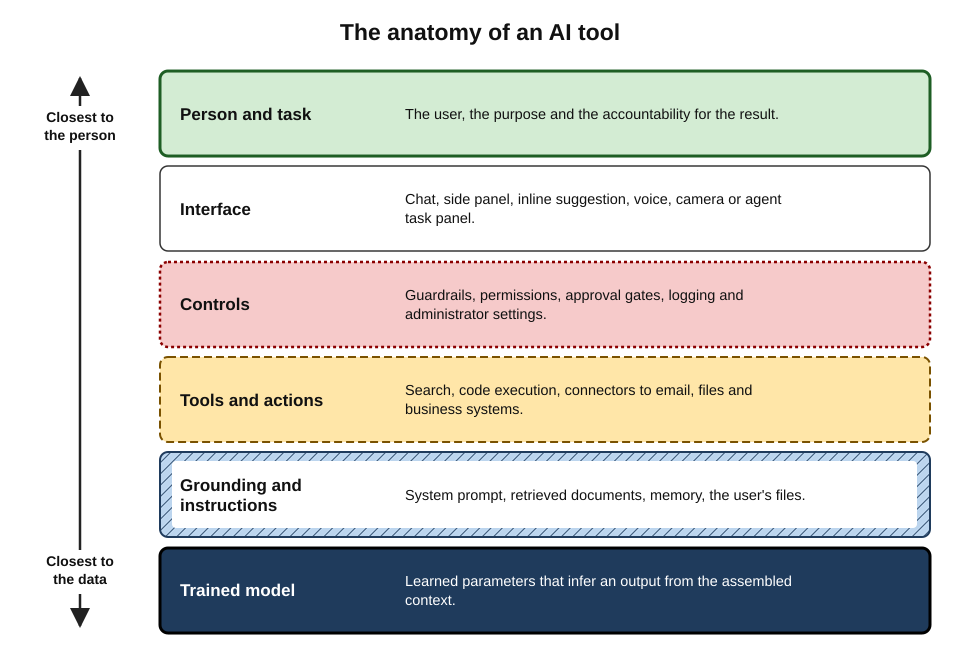
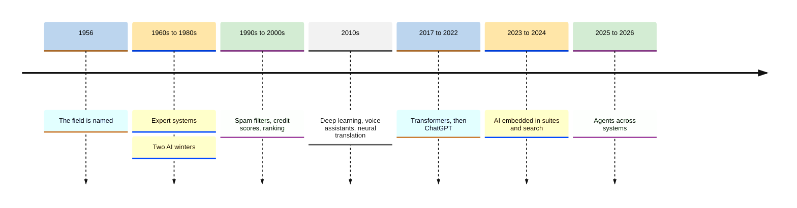
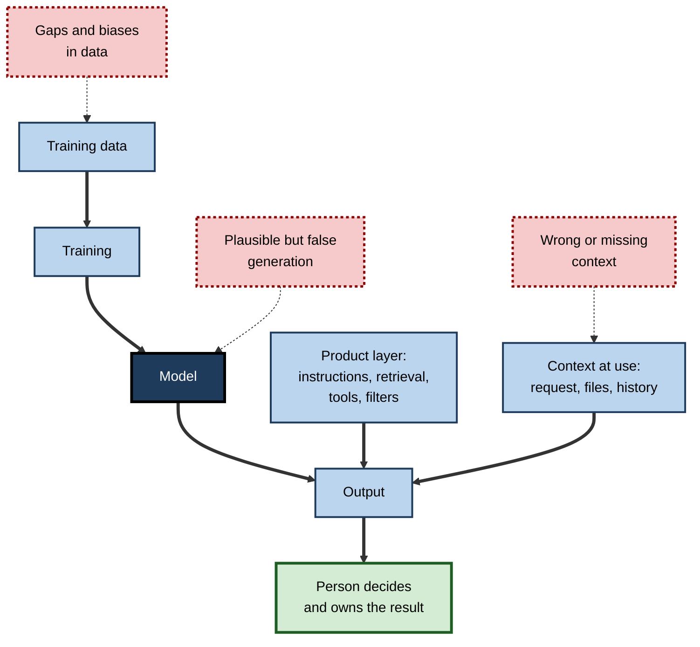
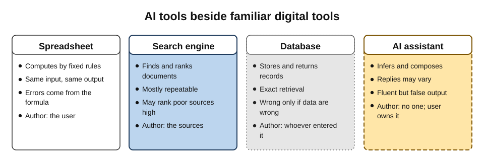
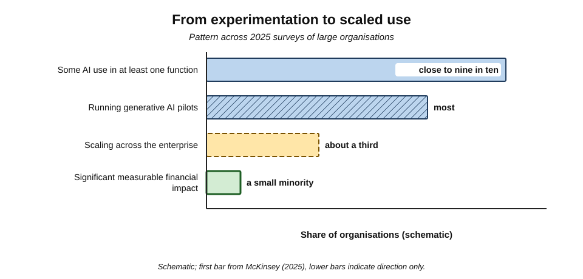
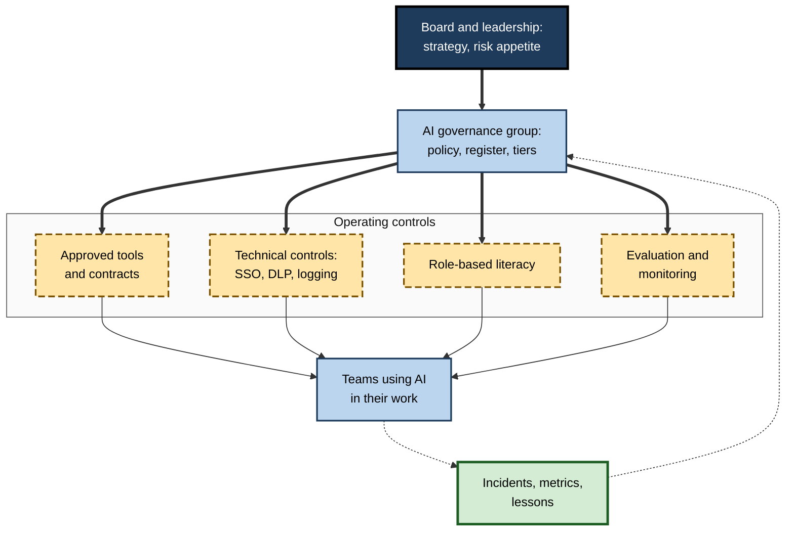

# A. What AI Tools Are

A person who has never knowingly used artificial intelligence has, in fact, used it many times today: when their email filtered out junk, when their phone recognised their face, when a map rerouted them around traffic, when a streaming service suggested the next programme. What changed after 2022 is not that AI arrived, but that it became something people could **talk to, instruct and delegate to** — a general-purpose tool on every desk.

Understanding what these tools are, how they work in outline, what they can and cannot do, and how organisations adopt and govern them is now as basic to working life as understanding email or the web was a generation ago.

> **Definition — AI tool:** software, or a feature within software, whose behaviour is produced mainly by a model that has **learned patterns from data** and that **infers** from new input how to generate an output — a prediction, a classification, a recommendation, a piece of content or an action — rather than following only rules written by people.

**Why the subject matters**

- **Ubiquity.** AI is embedded in office suites, browsers, phones, search engines, customer-service systems and specialist professional software.
- **A new kind of software.** AI tools are usually right and occasionally, unpredictably wrong — demanding a different relationship of trust from calculators or databases.
- **A new kind of work.** Drafting, summarising, analysing, coding and, increasingly, acting across systems can be delegated in part to software.
- **New duties.** Laws, professional rules and employer policies now set expectations for how AI tools are used, and by whom.
- **A durable skill.** Products change every few months; understanding of what AI tools are and how they behave transfers across all of them.

---

## The Scope of the Subject

### What counts as an AI tool

- **The defining feature is inference from learned patterns.**
  - International definitions — the OECD's (revised 2023) and the EU AI Act's (2024) — describe an AI system as one that **infers**, from the input it receives, how to generate outputs that can influence physical or virtual environments, with varying **autonomy** and **adaptiveness**.
- **AI tools are a category of digital tool** distinguished by how they work, not by what they are called; many "smart" products contain no learned model, and many AI features carry no AI label.
- **The category includes visible and invisible tools:**
  - **visible** — chat assistants, image generators, coding assistants, agents;
  - **invisible** — spam filters, fraud scores, recommendation engines, document readers, transcription.

> **Key point:** the subject concerns **all** software whose outputs are inferred from learned patterns. Chat assistants are its most visible members, not its boundaries.

### Five things AI tools do

- **Perceive** — turn sound, images and scans into text and labels.
- **Predict and classify** — assign scores and categories.
- **Recommend and rank** — order options for people.
- **Generate** — produce new text, code, images, audio and video.
- **Act** — carry out steps in other software or the physical world.

> **Definition — Generative AI:** AI that produces new content in response to an instruction, rather than only labelling or ranking existing items.

### The categories of tools people meet at work

- **General-purpose assistants** used directly by individuals.
- **Assistants embedded in office and collaboration suites**, grounded in the user's own documents, mail and meetings.
- **Specialist tools** for coding, writing, translation, meetings, design, search and research.
- **Vertical tools** built for one profession or function — legal, sales, service, HR, finance, clinical.
- **In-house assistants** built by organisations on models accessed through cloud platforms.
- **Agents** that pursue goals across several systems.

The common tools of the workplace now form a recognisable landscape of such categories, whose members change far faster than the categories themselves.

**Figure 1.** The anatomy of an AI tool: the layers between a trained model and the person using it.

---

## From Expert Systems to Agents: A Short History

### Seven decades in outline

- **1956 — the field is named.** The Dartmouth summer workshop, proposed by John McCarthy and colleagues, launched "artificial intelligence" as a research programme.
- **1960s–1980s — rules.** Researchers encoded knowledge as hand-written rules. **Expert systems** found niche commercial use — configuring computers, diagnosing faults — but proved brittle and costly to maintain.
- **Two "AI winters".** Periods of disappointed expectations and reduced funding followed over-promising — roughly the mid-1970s and the late 1980s to early 1990s.
- **1990s–2000s — learning from data.** Statistical methods entered products quietly: handwriting recognition, credit scoring, spam filtering (popularised by Paul Graham's 2002 essay on Bayesian filters), search ranking, recommendations.
- **2010s — deep learning.** Neural networks trained on large datasets transformed image recognition (from about 2012), speech recognition, translation (Google's neural system, 2016) and voice assistants (Siri, 2011; Alexa, 2014).
- **2017 — the transformer.** A new architecture made it practical to train very large language models on vast text collections.
- **30 November 2022 — ChatGPT.** A conversational interface to a large language model reached a mass audience almost overnight; AI became something people instructed in plain language.
- **2023–2024 — embedding.** Assistants appeared inside office suites, email, search, design and coding tools; organisations began licensing approved tools.
- **2025–2026 — agents and integration.** Tools gained the ability to use other software, browse, run code and carry out multi-step tasks, increasingly connected to email, files and business systems.

**Figure 2.** The arrival of AI in everyday tools, including the periods of disappointment.

### Two lessons from the history

- **The AI effect.** Once a capability becomes routine, people stop calling it AI — so much AI in use goes unnoticed and unexamined.
- **Cycles of expectation.** Each wave brought claims that outran results, followed by disillusionment, followed by quieter, durable value.
  - The generative wave has already shown the pattern in miniature: spectacular demonstrations, early disappointments in enterprise pilots, and steady embedding into everyday work.

> **Definition — AI winter:** a period of reduced funding and interest in AI research following unmet expectations.

> **Watch out:** history does not decide whether the present wave will plateau. Generative AI differs from earlier waves in its generality and the speed of its adoption; it also shares their tendency to be over-sold. Both "this changes everything immediately" and "this is another bubble" are claims to test against evidence, not to assume.

---

## How AI Tools Work, in Outline

A user does not need the mathematics. They do need an accurate picture of where an AI tool's behaviour comes from — because that picture predicts how it will fail.

### Three steps from data to output

1. **Training.** A model's internal parameters are adjusted on large amounts of example data until its outputs fit the patterns in the data.
   - For a **large language model (LLM)**, the core task is predicting the next small piece of text (a **token**) across a vast body of writing, followed by further training to follow instructions and behave helpfully.
2. **Productisation.** The model is wrapped in a product: hidden instructions (a **system prompt**), retrieval of documents, tools such as search or code execution, safety filters, an interface and administrative controls.
3. **Use.** At the moment of use, the model receives an assembled **context** — instructions, the request, files, retrieved passages — and produces an output, token by token for generative models.

> **Definition — Large language model (LLM):** a model trained on very large text collections to predict the next token, which can then generate text, answer questions and follow instructions.

> **Definition — Context:** everything the model receives when producing an output, including hidden instructions, the user's request, history, files and retrieved content.

**Figure 3.** Where an AI tool's behaviour — and its errors — come from.

### What the picture predicts

- **Fluency** — models are trained to produce text that fits patterns, so they write well.
- **Fabrication** — where patterns do not determine the right answer, the most plausible-looking answer is still produced: an invented citation, a wrong date, a non-existent policy.
- **Variability** — generation involves sampling, so the same request can yield different replies.
- **Staleness** — a model knows nothing after its training cut-off unless current information is supplied.
- **Bias** — patterns in training data, including historical inequities, can be reproduced.
- **Sensitivity to context** — what the model is given largely determines what it can do; missing or misleading context produces confident errors.
- **Manipulability** — because instructions and content arrive through the same channel, text inside documents or web pages can hijack a tool (**prompt injection**).

This is why generative AI differs so fundamentally from traditional software, whose behaviour is written down line by line and repeats exactly: one is **specified**, the other **learned** and **probabilistic**.

> **Definition — Hallucination (confabulation):** fluent, plausible output that is false or unsupported by the input or by reality.

> **Key point:** the single most useful fact about AI tools is that they are optimised for **plausibility**, not truth. Plausibility and truth usually coincide — and the cases where they diverge are hard to spot precisely because the output still looks right.

---

## What AI Tools Can and Cannot Do

### Strengths and weaknesses

| | AI tools are typically strong at | AI tools are typically weak at |
|---|---|---|
| Language | Drafting, rewriting, summarising, translating, explaining | Guaranteeing that every factual claim is true |
| Knowledge | Widely documented, stable topics | Niche, very recent or local, tacit knowledge |
| Reasoning | Structured problems with familiar patterns; code that can be tested | Long chains where one slip compounds; novel problems unlike training data |
| Calculation | Setting up and explaining calculations; writing code to compute | Long arithmetic done "in the head" without tools |
| Perception | Transcribing speech, reading documents and images | Names, jargon and poor-quality inputs |
| Action | Routine, checkable, reversible steps across systems | Open-ended, high-stakes, irreversible tasks without oversight |
| Judgement | Offering options, arguments and critiques | Owning a decision; weighing values and relationships |

### The jagged frontier

- **Capability is uneven.** Field experiments — such as the 2023 study of 758 consultants by Dell'Acqua and colleagues — found large gains in speed and quality on tasks inside AI's capability and **worse** accuracy on a task of similar apparent difficulty outside it.
- **Benefits concentrate where output is language-heavy, checking is cheap and errors are tolerable**, and fall away where facts must be exact, context is tacit or stakes are high — the core of judging when AI tools help and when they do not.
- **Less experienced users often gain most**, because AI supplies patterns they lack — while being least able to detect its errors.

> **Definition — Jagged technological frontier:** the uneven, hard-to-see boundary between tasks AI performs well and similar-looking tasks it performs poorly.

### Not a search engine, not a database

- **Search engines find and rank existing documents**; generative tools **compose** new text, sometimes from retrieved documents, sometimes from learned patterns alone — so their answers need to be traced to sources rather than taken as sources.
- **Databases return exactly what was stored**; generative models **reconstruct** answers, which is why they can be wrong about facts they have "seen".

**Figure 4.** What AI tools are and are not, compared with familiar digital tools.

> **Watch out:** two opposite misconceptions are equally harmful. "It is just autocomplete" underestimates tools that write working code, pass professional examinations and summarise expertly; "it understands like an expert" overestimates tools that fabricate with complete confidence. Both capability and fallibility are real.

---

## From Assistants to Agents

- **Assistants respond**; the person decides and acts on each step.
- **Agents act**: given a goal, they plan steps, use tools — browsers, email, files, business systems — observe results and continue, pausing for approval where designed to.
- **The shift changes the risk profile:**
  - errors become **actions**, not just words;
  - reliability over many steps **compounds** (at 95% per step, a 20-step task succeeds only about 36% of the time);
  - permissions held by agents become targets for attackers.
- **Standards accelerate integration** — notably the Model Context Protocol (2024) for connecting AI applications to tools and data.
- **Hype accompanies the shift** — industry analysts warned in 2025 of widespread "agent washing" and predicted that many agentic projects would be cancelled for unclear value or weak risk controls.

The distinction between AI assistants and AI agents is therefore less about the model than about **who drives each step and what the software is permitted to do**.

> **Formula — Compound reliability:** probability that every step succeeds = (per-step success rate)^(number of steps). Example: 0.95^20 ≈ **0.36**.

---

## The Landscape in 2026

### Providers and products

- **A few frontier developers** supply most capability — among them OpenAI, Google, Anthropic, Meta, xAI, Microsoft (largely through its partnership with OpenAI), and Chinese and European developers such as DeepSeek, Alibaba and Mistral.
- **General assistants at mass scale** — OpenAI reported around 800 million weekly ChatGPT users in October 2025, with estimates in 2026 near or above a billion; Google reported its Gemini app approaching a billion monthly users in 2026. These are company-reported figures with differing definitions.
- **Open-weight models** — downloadable models that organisations can run on their own infrastructure — narrowed the gap with closed models, notably after DeepSeek's releases in January 2025.
- **Everything is being embedded** — office suites, operating systems, browsers and professional software ship AI features by default.

### Economics

- **AI costs money every time it runs** (inference), unlike traditional software — so free tiers are limited, and providers recover costs through subscriptions, usage-based fees, bundling and, increasingly, advertising.
- **A typical price ladder (2026, US list prices)** — free tiers; budget plans around $5–$10 a month; standard plans around $20; premium plans around $100–$200; business seats around $25–$30.
- **The decisive line is consumer versus business terms**: personal plans, free or paid, may allow providers to train on content by default; business agreements typically exclude it by contract — which is why the difference between free and paid AI tools matters less than the difference between personal and organisational plans.

### Adoption

- **Individuals led.** Microsoft and LinkedIn's 2024 survey found about three-quarters of knowledge workers using generative AI at work — most bringing their own tools.
- **Organisations followed.** McKinsey's global survey published in late 2025 found close to nine in ten organisations using AI in at least one function, but only a minority scaling it across the enterprise.
- **Shadow AI persisted.** Security-industry surveys in 2025–26 found that around half or more of employees used AI tools their employers had not approved.

> **Definition — Shadow AI:** use of AI tools at work without the knowledge or approval of the organisation's IT, security or risk functions.

**Figure 5.** How far organisations had progressed from experimentation to scaled use (schematic).

---

## Landmark Debates

### Do these systems understand?

- **The sceptical view** — Emily Bender, Timnit Gebru and colleagues (2021) described large language models as **"stochastic parrots"**: systems that stitch together linguistic forms from their training data without reference to meaning, and warned of costs including bias, environmental impact and misplaced trust.
- **The capability view** — other researchers point to abilities that appear to require internal models of the world: solving novel problems, writing working programs, passing professional examinations, and evidence that models represent concepts internally.
- **For users**, the debate matters less than its practical consequence: these tools can be **highly capable and fluent while lacking reliable grounding in truth** — so verification is required whichever side is right.

> **Watch out:** this remains an open scientific question. Claims that models "truly understand" or "merely predict words" are both stronger than the evidence warrants.

### Where are the productivity gains?

- **The old paradox** — in 1987 the economist Robert Solow remarked that "you can see the computer age everywhere but in the productivity statistics"; the gains from computing arrived only after organisations redesigned work around it.
- **The new evidence** — controlled studies show large task-level gains (for example, writing tasks completed about 40% faster in Noy and Zhang's 2023 experiment; customer-support agents resolving about 14% more issues per hour, with novices gaining about 34%), but also slowdowns for experts in some settings (a 2025 randomised trial by METR) and close-to-zero effects on earnings and hours in early economy-wide data from Denmark (2025).
- **A contested headline** — a widely cited 2025 report from an MIT-affiliated project claimed that about 95% of enterprise generative-AI pilots produced no measurable profit impact; critics questioned its sample and definitions. The direction — that pilots often fail to scale — is consistent with other surveys; the precise figure is not reliable.

> **Key point:** AI tools deliver value at the level of **tasks** readily; value at the level of **organisations** depends on redesigning workflows, measuring outcomes and managing risk — just as with every earlier general-purpose technology.

### Augmentation or automation?

- **Automation** — using AI to replace human tasks, reducing labour cost.
- **Augmentation** — using AI to extend what people can do, creating new value.
- **Erik Brynjolfsson (2022)** warned of a **"Turing Trap"**: an excessive focus on building machines that imitate and replace humans, rather than ones that complement them, could concentrate wealth and power while forgoing larger gains.
- **In practice**, most workplace deployments mix both; the balance is a design and management choice, not a technological inevitability.

### Open or closed?

- **Closed models** — accessed only through providers' products and APIs; centralised safety controls and accountability.
- **Open-weight models** — downloadable; allow local control of data, customisation and scrutiny, but also unrestricted use, including misuse.
- **The debate** spans innovation, security, competition and sovereignty, with governments and companies taking different positions.

---

## Using AI Tools Well: The Practitioner's Foundations

Skilful use rests less on any product than on a handful of habits. The interface chosen decides which inputs reach the model, so output quality starts with what is actually sent. Work belongs in genuine, approved tools reached through protected accounts, and whatever is entered should be treated as travelling beyond the organisation's walls. Above all, users carry the ordinary professional duties of accuracy, honesty, confidentiality and fairness into every AI-assisted task — supported by a broader literacy about AI that outlasts any single tool.

> **Remember:** an AI tool is **learned, probabilistic and authored by no one**. Its user must bring **judgement, verification and accountability** — and the organisation must supply **approved tools, clear rules and literacy**.

---

## Enterprise Adoption and Governance

### How organisations adopt AI tools

1. **Discovery** — staff experiment, often with personal accounts.
2. **Reaction** — restrictions or bans after early incidents (many in 2023).
3. **Provision** — approved tools under business agreements, often bundled with existing suites.
4. **Pilots** — targeted use cases with measured outcomes.
5. **Scaling** — workflow redesign, integration with internal data, role-based training, monitoring.
6. **Agentic integration** — AI acting across systems, with permissions and oversight.

> **Watch out:** most organisations stall between pilots and scaling. Common causes: use cases chosen for novelty rather than value; no baseline measurement; data not ready; unclear ownership; underestimated costs of review and change; and staff who were never trained.

### The governance operating model

- **An AI register** — every AI system built, bought or embedded, with owner, purpose, data and risk tier.
- **Risk tiering** — light-touch rules for low-stakes uses; review, testing and human oversight for high-stakes ones (decisions about people, regulated advice, safety).
- **Approved tools and an acceptable-use policy** — clear rules by data classification, with a route to request new tools.
- **Contracts** — data processing terms, no training on business data, retention limits, sub-processor transparency, indemnities.
- **Technical controls** — single sign-on, data-loss prevention, extension and app-consent restrictions, logging.
- **Evaluation and monitoring** — test sets for in-house assistants; re-testing after model changes; incident reporting.
- **Literacy** — role-based training; the EU AI Act's AI-literacy duty applied from February 2025 and was softened in 2026 to a duty to support literacy, but the practical need is unchanged.
- **Frameworks** — the US NIST AI Risk Management Framework (Govern, Map, Measure, Manage; 2023, with a generative-AI profile in 2024) and the ISO/IEC 42001 management-system standard (2023).

> **Definition — AI governance:** the structures, policies, roles and processes through which an organisation directs, controls and is held accountable for its use of AI.

**Figure 6.** A governance operating model for AI tools in an organisation.

### Case study: a grounded assistant for financial advisers

- **Situation:** in 2023 the investment bank Morgan Stanley launched an internal assistant for its wealth-management financial advisers, built on OpenAI's GPT-4 and grounded in the firm's own large library of research, procedures and product documents.
- **Approach:**
  1. **Grounding** — answers drawn from curated internal content rather than the open web.
  2. **Evaluation** — the firm built an evaluation framework, with experts grading answers to real advisers' questions before and after changes.
  3. **Data terms** — an enterprise agreement under which the firm's data was not used to train the provider's models.
  4. **Scope** — a research and retrieval aid for advisers, not a tool giving advice directly to clients.
  5. **Extension** — later tools summarised client meetings for advisers to review.
- **Result:** the provider and firm reported very high adoption among adviser teams, with advisers spending less time searching for information.
- **Lesson:** enterprise value came from **grounding, evaluation, contractual protection and clear scope** — the same principles that distinguish professional from casual use at the individual level.

---

## What Distinguishes Expert Users of AI Tools

- **They know the category, not just the brand** — recognising embedded and invisible AI as well as chat assistants.
- **They hold accurate mental models** — learned patterns, probabilistic output, plausibility over truth, context dependence, a training cut-off.
- **They judge task fit before starting** — language-heavy, checkable, tolerant of error — and choose a working pattern (AI first, human first, or no AI).
- **They verify in proportion to the stakes** — opening sources, testing code, recalculating figures, and never treating a citation as evidence until read.
- **They control inputs** — choosing the interface, minimising data, supplying the right context.
- **They use approved tools under business terms** for work, through protected accounts.
- **They delegate actions cautiously** — least privilege, confirmation gates, logs checked rather than self-reports trusted.
- **They own the result** — disclosing AI use where expected and answering for every output adopted.
- **They keep learning** — because the frontier moves with every model release.

> **In practice:** the mark of expertise is not how often someone uses AI, but how reliably they can say **when it should not be used** — and how quickly they catch it when it is wrong.

---

## Open Questions

- **Will "AI tool" remain a distinct category?**
  - If learned models become part of almost all software, attention may shift from "AI or not" to specific capabilities, risks and duties.
- **How reliable can generative tools become?**
  - Grounding, tool use and better training have reduced errors, but whether fabrication can be reduced enough for unsupervised high-stakes use is unresolved.
- **When will task-level gains appear in organisational and economic data?**
  - Early economy-wide evidence shows small effects; whether this reflects lags, measurement or limits is debated.
- **How will agents be governed?**
  - Liability, authentication, permissions and the security of agents acting across systems are largely unsettled in law and practice.
- **How concentrated will capability be?**
  - A few frontier developers supply most tools, while open-weight and regional models push the other way; outcomes affect prices, sovereignty and resilience.
- **What will regulation require?**
  - The EU's 2026 amendments to its AI Act, divergent national approaches and fast technical change leave the long-term rulebook uncertain.

---

## Summary

- An **AI tool** produces outputs by **inferring from learned patterns** — predictions, classifications, recommendations, content or actions — rather than only following hand-written rules; the OECD (2023) and EU AI Act (2024) definitions centre on **inference**, **autonomy** and **adaptiveness**.
- AI tools **perceive, predict and classify, recommend and rank, generate, and act**; they may be **visible or invisible**, **narrow or general-purpose**, **standalone, embedded, platform-based or agentic**.
- History: **expert systems** and two **AI winters**; quiet statistical tools (spam filters, credit scores, ranking); **deep learning**; the **transformer** (2017); **ChatGPT** (November 2022); embedding (2023–24); **agents** (2025–26). The **AI effect** hides older AI from view.
- In outline: **training → productisation → use**; outputs are **fluent, probabilistic and optimised for plausibility**, producing **hallucination**, variability, staleness, bias, context sensitivity and vulnerability to **prompt injection**.
- Capability is a **jagged frontier**: strong on language, drafting, summarising and checkable code; weak on exact facts, novel or tacit knowledge, long unchecked chains and owning decisions. AI tools **compose**, unlike search engines and databases that **retrieve**.
- **Agents** turn errors into actions; reliability **compounds** over steps; standards such as **MCP** speed integration; **agent washing** is common.
- **2026 landscape:** a few frontier developers; mass-scale assistants; strong open-weight models; AI embedded by default; costs incurred per use; **consumer versus business terms** as the decisive line; adoption led by individuals, then organisations, with persistent **shadow AI**.
- **Debates:** understanding versus "stochastic parrots"; the **productivity paradox**; **augmentation versus automation** (the Turing Trap); open versus closed models.
- **Enterprise governance:** AI register, risk tiers, approved tools and policy, contracts, technical controls, evaluation and monitoring, role-based literacy, NIST AI RMF and ISO/IEC 42001.
- Expert users hold **accurate mental models**, judge **task fit**, **verify in proportion**, control **inputs**, use **approved tools**, delegate **cautiously** and **own the result**.

---

## Self-Check

1. Define an AI tool and identify the feature that distinguishes it from conventional software.
2. Name the five things AI tools do, with one workplace example each.
3. Why do many people underestimate how much AI they already use?
4. Outline the history of AI in everyday tools in six milestones, including the AI winters.
5. Describe the three steps from data to output, and explain how each can introduce errors.
6. Why are generative AI tools fluent, and why does fluency not guarantee truth?
7. Give three tasks AI tools are typically strong at and three they are typically weak at.
8. What is the jagged frontier, and what evidence supports it?
9. Explain the difference between AI tools and search engines in one sentence each.
10. How does the move from assistants to agents change the risk profile? Use the compound-reliability formula.
11. Why is "consumer versus business terms" more important than "free versus paid"?
12. Summarise the debate over whether large language models understand, and its practical implication.
13. What is the productivity paradox, and what does current evidence suggest about AI's productivity effects?
14. List six elements of an enterprise AI governance operating model.
15. A chief executive asks, "Should we ban AI tools until the risks are clear?" Advise, drawing on adoption evidence and governance practice.

### Answer Key

1. Software or a feature whose behaviour comes mainly from a model that learned patterns from data and infers outputs for new input. Distinguishing feature: **inference from learned patterns** rather than only hand-written rules.
2. Perceive — meeting transcription; predict and classify — fraud alerts; recommend and rank — suggested documents; generate — drafting a report; act — an agent booking travel.
3. The AI effect: once capabilities become routine (spam filters, face unlock, recommendations) they stop being called AI, so much embedded AI goes unnoticed.
4. Dartmouth names the field (1956); expert systems and two AI winters (1960s–early 1990s); statistical tools such as spam filters and credit scoring (1990s–2000s); deep learning, voice assistants and neural translation (2010s); the transformer (2017) and ChatGPT (2022); embedding in suites (2023–24) and agents (2025–26).
5. Training (data gaps and biases enter); productisation (instructions, retrieval and filters shape behaviour, and can be misconfigured); use (missing or misleading context produces confident errors; generation can fabricate).
6. They are trained to produce text that fits learned patterns, so they write plausibly; where patterns do not determine the correct answer, they still produce plausible text, which may be false.
7. Strong: drafting, summarising, explaining stable topics (also translation, testable code). Weak: guaranteeing factual accuracy, niche or recent facts, long unchecked reasoning chains, owning decisions.
8. The uneven boundary between tasks AI does well and similar-looking tasks it does badly. Dell'Acqua and colleagues (2023) found large gains for consultants inside the frontier and lower accuracy on a task outside it.
9. Search engines retrieve and rank existing documents for the user to judge. AI tools compose new text — sometimes from retrieved sources — which must be traced to sources rather than treated as one.
10. Errors become actions; permissions become attack targets; reliability compounds: at 95% per step, 0.95^20 ≈ 36% for a 20-step task, so chains must be short, checked and recoverable.
11. Personal plans — free or paid — often allow training on content by default and give the employer no contract; business plans exclude training by contract and add data processing terms, administration and audit.
12. Sceptics ("stochastic parrots") argue models manipulate form without meaning; others cite capabilities suggesting internal world models. Either way, tools can be capable and fluent without reliable grounding in truth, so verification is required.
13. Solow's 1987 observation that computers were visible everywhere except in productivity statistics, until work was reorganised. Current evidence: large task-level gains in many experiments, slowdowns in some expert settings, and small economy-wide effects so far — value at scale depends on workflow redesign and measurement.
14. AI register; risk tiering; approved tools and acceptable-use policy; contracts with data protections; technical controls (SSO, DLP, logging); evaluation and monitoring; role-based literacy; reference frameworks such as NIST AI RMF and ISO/IEC 42001 (any six).
15. Bans tend to drive use underground (shadow AI was widespread even where tools were restricted) and forgo real gains. Better: provide approved tools under business terms; set a short, clear policy by data class; tier uses by risk with human oversight for decisions about people; train staff in role-based literacy; monitor, measure and adjust.

---

## Glossary

| Term | Meaning |
|---|---|
| Agent | An AI system that plans and takes actions through tools over multiple steps toward a goal. |
| AI effect | The tendency to stop calling a capability AI once it becomes routine. |
| AI governance | Structures, policies, roles and processes for directing and controlling AI use. |
| AI register | An organisation's inventory of AI systems with owners, purposes, data and risk tiers. |
| AI tool | Software whose behaviour comes mainly from a learned model that infers outputs. |
| AI winter | A period of reduced funding and interest in AI after unmet expectations. |
| Augmentation | Using AI to extend what people can do rather than replace them. |
| Automation bias | Over-reliance on automated suggestions, even when wrong. |
| Context | Everything a model receives when producing an output. |
| Expert system | Early AI that encoded specialist knowledge as hand-written rules. |
| Generative AI | AI that produces new content in response to instructions. |
| Hallucination | Fluent, plausible output that is false or unsupported. |
| Inference | Running a trained model to produce an output; the ongoing cost of AI use. |
| Jagged technological frontier | The uneven boundary between tasks AI does well and similar tasks it does badly. |
| Large language model (LLM) | A model trained on vast text to predict the next token. |
| Model Context Protocol (MCP) | An open standard for connecting AI applications to tools and data. |
| Open-weight model | A model whose trained parameters are published for others to run. |
| Productivity paradox | The lag between adoption of a technology and measured productivity gains. |
| Prompt injection | Crafted text that overrides an AI system's intended instructions. |
| Shadow AI | AI use at work without IT, security or risk approval. |
| Stochastic parrot | A critics' term for language models that recombine text without grounding in meaning. |
| Token | A unit of text a model processes, often a word or part of one. |
| Transformer | The 2017 model architecture underlying modern large language models. |
| Turing Trap | Brynjolfsson's term for over-focusing AI on imitating and replacing humans. |
