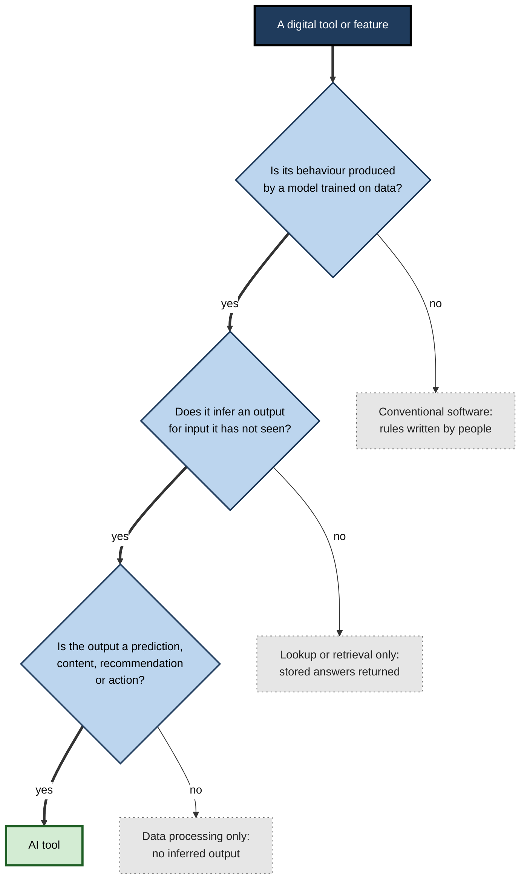
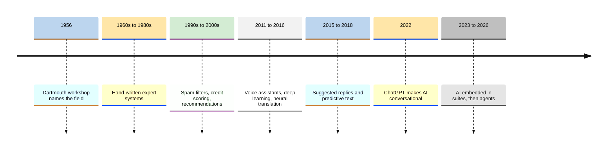
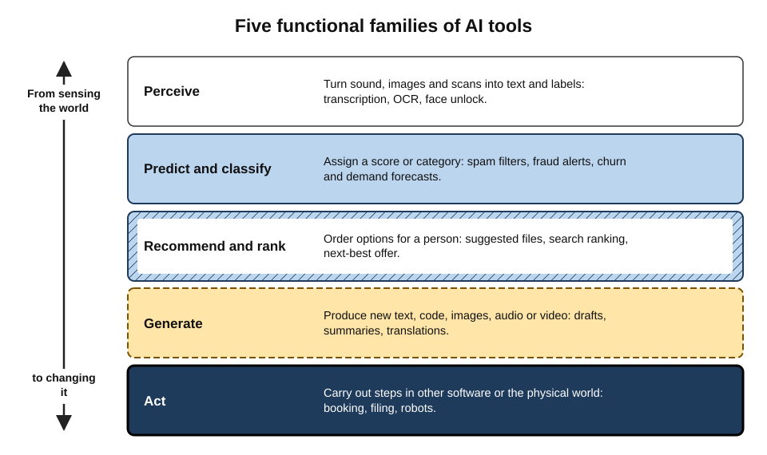
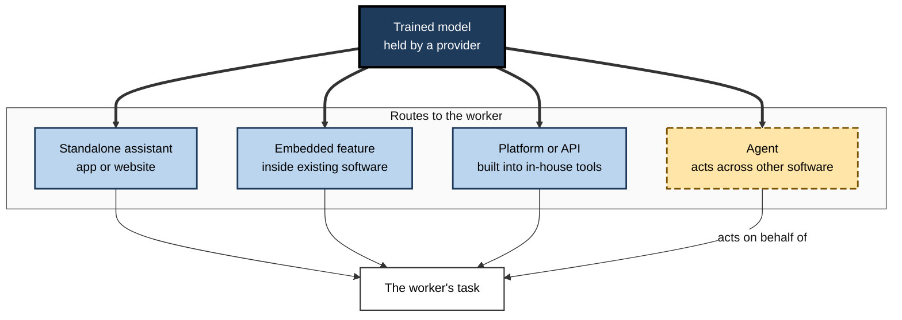
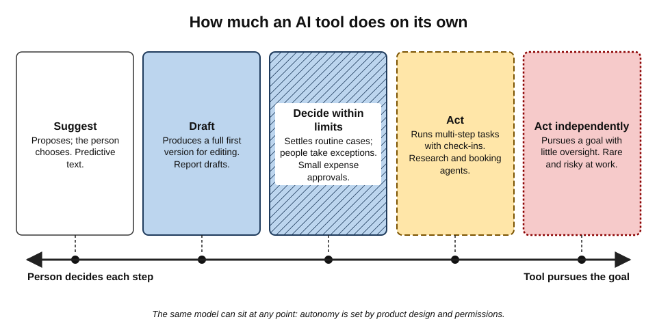
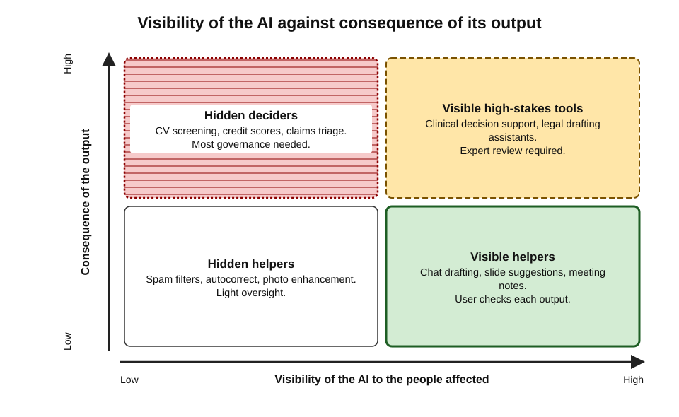

# A.1. AI as a digital tool category

An email arrives and lands in the junk folder without anyone opening it. A phone camera brightens a dark photograph before the shutter sound has finished. A colleague types "summarise this contract in five bullet points" and receives a summary in seconds. All three are **AI tools** at work, yet only the last one looks like "artificial intelligence" to most people. Recognising the whole category — the visible and the invisible — is the first step to using it well.

> **Definition — AI tool:** a piece of software, or a feature inside software, whose behaviour is produced mainly by a model that has **learned patterns from data** and that **infers** from new input how to produce an output — a prediction, a classification, a recommendation, a piece of content or an action — rather than following only rules written in advance by a programmer.

**Why the category matters**

- **It changes how a tool must be trusted.** A calculator is either right or broken; an AI tool is usually right and occasionally, unpredictably wrong.
- **It changes what a user is responsible for.** Outputs from AI tools need checking in proportion to the stakes.
- **It changes how organisations buy, govern and audit software.** Laws such as the European Union's AI Act apply specifically to systems that meet a definition of "AI system".
- **It is already everywhere.** Most professionals used AI tools daily long before they ever opened a chatbot.

---

## What Makes a Tool an AI Tool

### The working definition, part by part

International bodies have converged on a functional definition. The **OECD** (Organisation for Economic Co-operation and Development) revised its definition in **November 2023**, and the **EU AI Act** (in force from August 2024) uses closely similar wording.

> **Definition — AI system (OECD, 2023):** a machine-based system that, for explicit or implicit objectives, **infers**, from the input it receives, how to generate outputs such as predictions, content, recommendations or decisions that can influence physical or virtual environments. AI systems vary in their levels of **autonomy** and **adaptiveness** after deployment.

- **"Machine-based"**
  - Runs on computers — on a phone, a laptop or a remote data centre.
- **"Explicit or implicit objectives"**
  - Some goals are stated (*e.g.* "translate into French"); others are built into training (*e.g.* "produce text a human rater would prefer").
- **"Infers … how to generate outputs"**
  - The heart of the definition. The system works out an answer from patterns it has learned, instead of looking up a pre-written answer or executing a fixed formula.
- **"Predictions, content, recommendations or decisions"**
  - The four broad kinds of output — a useful first map of the whole category.
- **"Influence physical or virtual environments"**
  - Outputs matter: they change what a person reads, decides, buys or does.
- **"Autonomy and adaptiveness"**
  - Some tools only suggest; others act. Some keep learning after deployment; most do not.

> **Key point:** the defining feature of an AI tool is **inference from learned patterns**. A tool that only follows explicit rules — however clever it looks — is conventional software.

### Rules versus learned patterns

- **Rule-based software** — a programmer writes the logic.
  - *e.g.* "If the invoice total exceeds 10,000, route it to a manager."
  - Behaviour is fully specified, repeatable and explainable line by line.
- **Learned-pattern software** — a model is trained on examples and the logic is extracted from them.
  - *e.g.* a fraud model trained on millions of past transactions labelled "fraud" or "genuine".
  - Behaviour is shaped by the data; nobody wrote the rule "flag a purchase like this".
- **Hybrids** — most real products combine both.
  - *e.g.* a chatbot (learned) wrapped in business rules (fixed): "never quote a price; hand over to a human if the customer mentions a complaint".

> **Definition — Model:** the mathematical object produced by training, which maps inputs to outputs. A tool is the product built around one or more models — with an interface, rules, storage and security.

> **Definition — Training:** the process of adjusting a model's internal settings, using large amounts of example data, so that its outputs match the patterns in that data.

**Figure 1.** Deciding whether a digital tool belongs to the AI category.

### What does not make a tool an AI tool

- **Being fast** — a spreadsheet recalculating a million cells is quick, not intelligent.
- **Being automated** — a scheduled email rule automates without inferring.
- **Being "smart" in marketing** — "smart" thermostats or "intelligent" dashboards may contain no learned model at all.
- **Using lots of data** — a database holds data; it does not learn from it.
- **Talking in natural language** — scripted chatbots of the 2010s used fixed decision trees and keyword matching.

> **Watch out:** the label on the box is not evidence. In **March 2024** the US Securities and Exchange Commission fined two investment advisers, Delphia and Global Predictions (penalties of $225,000 and $175,000), for claiming to use AI they did not actually use — the first "**AI-washing**" enforcement actions. In **September 2024** the US Federal Trade Commission's "Operation AI Comply" targeted firms making deceptive AI claims, including DoNotPay's "robot lawyer".

> **Definition — AI-washing:** exaggerating or inventing the role of AI in a product or service to make it more attractive to buyers or investors.

---

## The Hidden History of AI in Everyday Tools

### From laboratory to laptop

- **1955–56 — the name.** John McCarthy coined "artificial intelligence" in the proposal for the **Dartmouth summer workshop** of 1956.
- **1960s–80s — rules.** "Expert systems" encoded specialists' knowledge as hand-written if–then rules.
  - Useful in narrow niches; brittle and expensive to maintain.
- **1990s — learning from data enters products.**
  - Handwriting and postal-code recognition; credit scoring; early recommendation engines.
- **2002 — spam filters.** Paul Graham's essay "A Plan for Spam" popularised **statistical (Bayesian) filtering**, which learned from each user's mail which words signalled junk.
- **2006–2009 — the Netflix Prize.** A public competition to improve film recommendations by 10% made recommender systems famous.
- **2011–2016 — perception and voice.**
  - Apple's Siri (2011) and Amazon's Alexa (2014) brought voice assistants into homes.
  - **Deep learning** transformed image and speech recognition from about 2012.
  - Google Translate switched to a **neural** system in 2016, sharply improving fluency.
- **2015–2018 — suggestions in writing tools.** Smart Reply (2015) and Gmail's Smart Compose (2018) suggested words and short replies.
- **2017 — the transformer.** A new model architecture that later made large language models possible.
- **30 November 2022 — ChatGPT.** A general-purpose conversational tool reached a mass audience almost overnight; AI became something people *talked to* rather than something that worked silently inside other software.
- **2023–2026 — embedding and agents.**
  - AI assistants built into office suites, email, design, coding and search tools.
  - Tools that take multi-step actions on a user's behalf (**agents**) move from demonstrations to mainstream products.

**Figure 2.** How AI moved from hidden features to visible, conversational tools.

### The AI effect

- **Pattern:** once a technique works reliably and becomes ordinary, people stop calling it AI.
  - Spell-checkers, route planners, face unlock and photo search were once research problems.
- **Larry Tesler**, the computer scientist, is credited with the quip that "AI is whatever hasn't been done yet".
- **Consequences for professionals:**
  - People underestimate how much AI already shapes their work (*e.g.* which emails they see, which candidates reach a shortlist).
  - Invisible tools escape scrutiny precisely because nobody thinks of them as AI.

> **Definition — AI effect:** the tendency for a capability to stop being regarded as "real" intelligence once machines can perform it routinely.

> **Key point:** the AI category is much larger than chatbots. Governance, privacy and quality questions apply to the silent features too.

---

## A Map of the Category: What AI Tools Do

The most useful first classification sorts AI tools by the **kind of output** they produce. Five functional families cover nearly every tool in use.

### The five functional families

- **Perceive** — turn raw signals into structured information.
  - *e.g.* speech-to-text in meeting software; optical character recognition (OCR) of scanned invoices; face unlock; reading a photo of a whiteboard.
- **Predict and classify** — assign a label or estimate a number.
  - *e.g.* spam filtering; fraud scores; demand forecasts; predicting which customers will cancel (churn).
- **Recommend and rank** — order options for a person.
  - *e.g.* "people you may know"; suggested documents; search-result ranking; next-best-offer in sales software.
- **Generate** — produce new content.
  - *e.g.* drafting text, summarising, translating, writing code, creating images, slides, audio and video.
- **Act** — carry out steps in other software or the physical world.
  - *e.g.* booking a meeting slot, filing a support ticket, running a sequence of web actions, a warehouse robot picking an item.

> **Mnemonic — "People Prefer Really Good Assistants":** Perceive, Predict, Recommend, Generate, Act.

**Figure 3.** Five functional families of AI tools, from sensing the world to acting in it.

### The families compared

| Family | Typical input | Typical output | Everyday example | Characteristic error |
|---|---|---|---|---|
| Perceive | Audio, images, scans | Text, labels, coordinates | Meeting transcription | Mishearing names and jargon |
| Predict and classify | Records, transactions, text | A score or category | Spam filter | False positives and false negatives |
| Recommend and rank | User history, catalogue | An ordered list | Suggested articles | Narrowing choices; popularity bias |
| Generate | A request plus context | New text, code, images | Drafting an email | Fluent but false content |
| Act | A goal plus permissions | Changes in other systems | Booking travel | Wrong action carried out at speed |

> **Key point:** each family fails in its own characteristic way. Knowing the family tells a user what to check.

### Why generation changed the category

- **Before 2022**, most AI in daily work was **narrow**: one model, one task, usually hidden.
- **Generative tools** are **general-purpose**: one model can draft, translate, summarise, explain, classify and write code, steered by plain-language instructions.
- **Consequences:**
  - The user — not a data scientist — now decides what task the AI performs.
  - The same tool can be used well or badly for hundreds of purposes.
  - Errors take a new form: plausible content that is simply untrue.

> **Definition — Generative AI:** AI that produces new content — text, images, audio, video or code — in response to an instruction, rather than only labelling or ranking existing items.

> **Definition — General-purpose AI model:** a model trained on broad data that can perform a wide range of distinct tasks; the EU AI Act regulates providers of such models as a separate category.

| | Narrow AI tool | General-purpose AI tool |
|---|---|---|
| Scope | One task (*e.g.* detect fraud) | Many tasks, chosen by the user |
| Who sets the task | The developer | The user, in natural language |
| Visibility | Often invisible, built into a workflow | Usually visible, via a chat box or assistant panel |
| How quality is checked | Statistical testing on the single task | Hard to test exhaustively; depends on each use |
| Typical risk | Systematic bias in one decision type | Unpredictable errors across many uses |

---

## Other Ways to Classify AI Tools

A single tool can be described along several independent dimensions. Professionals who buy, approve or audit tools use all of them.

### By form of delivery

- **Standalone assistant** — a dedicated app or website.
  - *e.g.* a general chat assistant used in a browser.
- **Embedded feature** — AI inside software the person already uses.
  - *e.g.* a "summarise thread" button in email; formula suggestions in a spreadsheet.
- **Platform or API** — a model offered to developers to build into their own products.
  - *e.g.* a company's internal help desk built on a commercial model.
- **Agent** — a tool that plans and carries out multi-step tasks using other software.
  - *e.g.* an assistant that researches suppliers, fills a comparison sheet and drafts emails for approval.

> **Definition — API (application programming interface):** a defined way for one program to request services from another; AI providers sell model access through APIs, priced by usage.

**Figure 4.** The same underlying model can reach a worker through four routes.

| | Standalone assistant | Embedded feature | Platform or API | Agent |
|---|---|---|---|---|
| Who chooses it | Often the individual | The software vendor | The organisation's developers | Individual or organisation |
| Access to work data | Only what the user pastes or uploads | The data inside that application | Whatever the developers connect | Whatever permissions it is granted |
| Visibility of AI | High | Medium — a button or panel | Often low — looks like normal software | High while running; actions may be unseen |
| Main governance concern | Unapproved use and data leaving the organisation | Default settings switched on silently | Testing and accountability of the build | Permissions and unintended actions |

### By modality

- **Text** — language in, language out.
- **Code** — a special kind of text with strict rules; outputs can be executed and tested.
- **Image** — recognition (what is in this picture?) and generation (make a picture of…).
- **Audio and speech** — transcription, voice synthesis, translation of speech.
- **Video** — analysis and, increasingly, generation.
- **Structured data** — tables, logs, sensor streams.
- **Multimodal** — mixtures of the above, *e.g.* asking a question about a photographed chart.

> **Definition — Modality:** the form of information a model handles — text, image, audio, video, code or structured data.

### By autonomy

- **Suggest** — the tool proposes; the person decides (*e.g.* predictive text).
- **Draft** — the tool produces a complete first version; the person edits and approves.
- **Decide within limits** — the tool decides routine cases; people handle exceptions (*e.g.* automatic approval of small expense claims).
- **Act** — the tool executes multi-step tasks, checking in only at set points.
- **Act independently** — the tool pursues a goal with little oversight; rare and risky in professional settings.

**Figure 5.** AI tools arranged by how much they do without a person deciding each step.

> **Watch out:** autonomy is a design choice, not a property of the model. The same model may suggest in one product and act in another; the risk lies in the **configuration**, not only in the technology.

### By who controls the model

- **Proprietary (closed) models** — offered by a company, accessed through its products or API.
- **Open-weight models** — the trained model files are published and can be run on an organisation's own computers.
- **On-device models** — small models running on a phone or laptop, so data need not leave the device.
- **Practical consequences:** where data travels, who can change the tool, how long a version stays available, and who is accountable when it goes wrong.

> **Definition — Open-weight model:** a model whose trained parameters are released for others to download and run, though its training data and code may not be.

---

## Worked Example (illustrative): Classifying a Team's Tools

**Situation:** a finance operations team lists the software it uses and must tell its risk function which items count as AI tools.

| Tool or feature | AI tool? | Family | Delivery | Autonomy |
|---|---|---|---|---|
| Spreadsheet with formulas and macros | No — rules written by staff | — | — | — |
| Invoice-scanning service that reads supplier invoices | Yes | Perceive | Embedded | Draft (fields pre-filled for checking) |
| Bank's fraud alerts on corporate cards | Yes | Predict and classify | Embedded (supplier's system) | Decide within limits |
| Email "suggested replies" | Yes | Generate | Embedded | Suggest |
| General chat assistant used to draft variance commentary | Yes | Generate | Standalone | Draft |
| Rule that forwards invoices above a threshold | No — fixed rule | — | — | — |

1. **Apply the test** in Figure 1 to each item: learned model? inference on new input? an output that matters?
2. **Assign a family**, which tells the reviewer what to check (misread fields, false alerts, fluent but wrong commentary).
3. **Record the delivery route**, which tells the reviewer where data goes (supplier systems, the chat provider).
4. **Record the autonomy**, which tells the reviewer who decides.

- **Conclusion:** four of six items are AI tools — three of them invisible to most of the team.

> **Watch out:** teams tend to declare only the chatbot. The fraud model and the invoice reader may carry more risk, because their outputs feed decisions directly and are rarely questioned.

---

## How the Category Differs from Other Tool Categories

### AI tools beside familiar tools

| | Calculator or spreadsheet | Search engine | Database | AI assistant |
|---|---|---|---|---|
| What it does | Computes by fixed rules | Finds and ranks existing documents | Stores and retrieves records exactly | Infers and generates an answer |
| Same input, same output? | Always | Mostly | Always | Not necessarily |
| Can it be "confidently wrong"? | Only through user or rule errors | It can rank poor sources highly | Only if the data are wrong | Yes — fluent errors are characteristic |
| Can it explain its steps? | Fully | Partly | Fully | Only approximately |
| Who is the author of the output? | The user's formula | The original sources | Whoever entered the data | Nobody in particular — the user must own it |

> **Key point:** the AI category is the first major class of everyday software whose outputs are **probabilistic and authored by no one**. That single fact drives most of the practices professionals must adopt.

### Two consequences for every user

- **Calibrated trust.**
  - Not blind trust (accepting everything) and not blanket distrust (rejecting a useful tool).
  - Trust matched to the tool's track record on *this kind of task*.
- **Retained responsibility.**
  - Courts, regulators and employers hold the **person or organisation using the output** accountable, not the tool.

> **Definition — Calibrated trust:** reliance on a tool that matches its actual reliability for the task in hand.

> **Definition — Automation bias:** the tendency to over-rely on automated suggestions, accepting them even when they are wrong or contradicted by other evidence.

---

## The Category in Organisations

### Why organisations classify AI tools

- **Inventory** — an organisation cannot govern what it has not listed.
- **Risk tiering** — a tool that drafts marketing slogans and a tool that screens job applicants are both AI, but carry very different risks.
- **Legal duties** — the EU AI Act sorts systems into tiers:
  - **prohibited** practices (*e.g.* social scoring by public authorities; certain manipulative techniques);
  - **high-risk** uses (*e.g.* recruitment, credit scoring, critical infrastructure), carrying obligations on testing, documentation and human oversight;
  - **transparency** duties (*e.g.* telling people they are talking to a chatbot; labelling some synthetic content);
  - **minimal-risk** uses, with no specific obligations.
- **Procurement** — vendors are increasingly asked whether, where and how their product uses AI.

> **Definition — AI inventory (AI register):** an organisation's list of the AI systems it builds, buys or uses, with their purpose, owner, data and risk level.

**Figure 6.** AI tools placed by how visible the AI is to the people affected and how consequential its outputs are.

- **Low visibility, high consequence** is the quadrant that most needs governance: people affected may never know a model shaped the outcome.

> **In practice:** mature organisations maintain an **AI register**, assign each tool an owner, tier it by consequence, and review embedded vendor features whenever software updates switch on new AI capabilities by default.

### Case study (illustrative): an insurer discovers its AI estate

- **Situation:** a mid-sized insurer believed it used "two AI tools" — a pilot chat assistant and a claims-triage model.
- **Trigger:** a new board-level requirement to report all AI use to the risk committee.
- **Actions:**
  1. Asked every department to list software features that "predict, recommend, generate, read or act".
  2. Asked major software vendors to declare AI features, including ones switched on by default.
  3. Classified each entry by family, delivery route, autonomy and consequence.
- **Findings:**
  - More than forty AI-based features, most embedded in purchased software.
  - A document-reading service extracting medical details from claim forms, with no human sampling of its accuracy.
  - Several staff using personal accounts on public chat assistants to draft customer letters.
- **Result:**
  - High-consequence tools received owners, accuracy testing and human review of samples.
  - An approved assistant with business data protections replaced personal accounts.
  - Vendor contracts gained clauses requiring notice before new AI features were enabled.
- **Lesson:** the category is defined by **how a tool works**, not by what it is called; the riskiest AI is often the AI nobody notices.

---

## Common Misconceptions About the Category

- **"AI means robots."**
  - Almost all workplace AI is software; robotics is a small, specialised part.
- **"AI tools understand like people."**
  - They produce outputs from learned statistical patterns. Whether this amounts to understanding is debated; what matters for users is that they can be fluent without being correct.

> **Watch out:** the opposite claim — "it is just autocomplete, so it cannot do anything useful" — is equally misleading. Systems trained to predict text can reason through many problems, write working code and pass professional examinations; they also fail in ways no human expert would. Both capability and fallibility are real.

- **"An AI tool learns from every conversation in real time."**
  - Most deployed models are **fixed** after training. Some services store conversations and may use them to train *future* versions, depending on settings and plan; that is a data question, not on-the-spot learning.
- **"If it is built into trusted software, it is safe."**
  - Embedded features inherit the vendor's security but still produce probabilistic errors, and may send data to additional providers.
- **"AI is one technology."**
  - It is a family: rule-free statistical models, deep neural networks, large language models, image generators, recommender systems — each with different strengths.

> **Remember:** an AI tool **infers** an output from **learned patterns**; it can be **visible or invisible**, **narrow or general**, **suggesting or acting** — and in every case the **user remains accountable** for what is done with its output.

---

## The Category at the Frontier (2026)

- **Convergence.** General-purpose models are absorbing tasks that once needed separate narrow tools (translation, OCR, classification).
- **Embedding by default.** Office suites, operating systems, browsers and phones ship AI features switched on, making "Are we using AI?" a question about configuration rather than purchase.
- **From answers to actions.** Tools increasingly connect to email, calendars, files and business systems, so their outputs become actions.
- **Scale of use.** ChatGPT alone was reported by OpenAI to have around **800 million weekly users** in October 2025, with independent estimates in 2026 placing it near or above a billion; Google reported its Gemini app in the high hundreds of millions of monthly users during 2026. Figures are company-reported and definitions of "user" differ.
- **Regulatory definitions harden.** As laws attach duties to "AI systems", the boundary of the category becomes a legal as well as a technical question.

---

## Open Questions

- **Where exactly is the boundary of "AI"?**
  - Regulators' definitions centre on inference, but simple statistical models and complex rule systems sit awkwardly near the line; classification disputes are likely as laws are enforced.
- **Will "AI tool" remain a useful category?**
  - If nearly all software embeds learned models, the category may dissolve — as "electric tool" did — leaving only questions about specific capabilities and risks.
- **How should invisible AI be disclosed?**
  - Transparency duties exist for chatbots and some synthetic content; how much people should be told about embedded ranking and scoring is unsettled.
- **Do these systems understand?**
  - Researchers disagree on whether large models build meaningful internal models of the world or rely on shallow patterns; the answer affects how far their reliability can be predicted.

---

## Summary

- An **AI tool** produces outputs by **inferring from learned patterns** rather than following only hand-written rules; the **OECD (2023)** and **EU AI Act** definitions centre on inference, outputs that influence environments, and varying **autonomy** and **adaptiveness**.
- Rules, speed, automation, data volume or chat interfaces do not by themselves make a tool AI; **AI-washing** is a real and prosecuted practice.
- AI entered daily work quietly — spam filters, recommendations, voice assistants, translation, predictive text — long before **ChatGPT (November 2022)** made it conversational; the **AI effect** hides older AI from view.
- Five functional families: **Perceive, Predict and classify, Recommend and rank, Generate, Act** — each with a characteristic error.
- Generative, **general-purpose** tools let users choose the task, multiplying both usefulness and error types.
- Tools are also classified by **delivery** (standalone, embedded, API, agent), **modality**, **autonomy** and **model control** (proprietary, open-weight, on-device).
- AI outputs are **probabilistic and authored by no one**; users need **calibrated trust** and retain **accountability**; **automation bias** is the main human failure.
- Organisations keep an **AI register** and tier tools by consequence; **low-visibility, high-consequence** tools need the most governance.

---

## Self-Check

1. State the OECD definition of an AI system and identify the word that most distinguishes AI from conventional software.
2. Give two examples of tools that appear intelligent but are not AI tools, and explain why.
3. What is AI-washing? Describe one enforcement action against it.
4. Name the five functional families of AI tools and give one workplace example of each.
5. What is the characteristic error of a generative tool, and how does it differ from that of a classifier?
6. Explain the AI effect and why it matters for governance.
7. Distinguish narrow from general-purpose AI tools on three attributes.
8. Describe the four delivery routes for AI and the main governance concern of each.
9. Why is autonomy described as a design choice rather than a property of the model?
10. Compare an AI assistant with a calculator and a search engine on repeatability and authorship of output.
11. What is calibrated trust, and what two failures does it avoid?
12. A colleague says, "We don't use AI — we only use our CRM and email." What questions would reveal hidden AI tools?
13. Why does the low-visibility, high-consequence quadrant need the most governance? Give an example.
14. A vendor update silently enables an AI feature that drafts replies to customers inside the help-desk system. Classify the feature and propose three governance steps.

### Answer Key

1. A machine-based system that, for explicit or implicit objectives, infers from its input how to generate outputs — predictions, content, recommendations or decisions — that can influence physical or virtual environments, with varying autonomy and adaptiveness. The key word is **infers**: output is worked out from learned patterns, not a pre-written rule.
2. A spreadsheet with complex macros (fixed rules written by people); a 2010s scripted chatbot using keyword matching and decision trees (no learned inference); a "smart" thermostat running a fixed schedule.
3. Exaggerating or inventing AI use to attract buyers or investors. In March 2024 the US SEC fined Delphia and Global Predictions for claiming AI capabilities they did not have.
4. Perceive — meeting transcription; Predict/classify — fraud alerts; Recommend/rank — suggested documents; Generate — drafting a report; Act — an assistant booking a meeting.
5. Fluent, plausible content that is false. A classifier's errors are false positives or negatives within a fixed set of labels, measurable statistically; a generator's errors can be novel, look authoritative and vary from run to run.
6. Once AI capabilities become routine, people stop calling them AI. Invisible tools (ranking, scoring, OCR) therefore escape inventories and review, even when they shape important decisions.
7. Scope: one task vs many. Task setter: developer vs user in natural language. Testing: measurable on one task vs hard to test exhaustively. (Also visibility and risk profile.)
8. Standalone — unapproved use and data leaving the organisation; embedded — features enabled by default without review; API/platform — testing and accountability of the in-house build; agent — permissions and unintended actions.
9. The same model can be configured to suggest, draft or act. Risk depends on what the product permits it to do without human approval — a configuration decision.
10. Calculator: same input always gives same output; the user's formula is the author. Search engine: mostly repeatable; authors are the original sources. AI assistant: may vary between runs; no human author — the user must own the output.
11. Reliance that matches the tool's actual reliability for the task; it avoids **over-trust** (automation bias) and **under-trust** (rejecting a useful tool).
12. Does any feature predict, score, rank, recommend, read documents, transcribe, suggest text or take actions? Which vendor features are on by default? Do staff use any assistants on personal accounts? What does the CRM's lead scoring or email's filtering rely on?
13. People affected cannot see or challenge the AI's role, yet outcomes matter. *e.g.* automated CV screening that filters applicants before any human reads them.
14. Generate family, embedded delivery, autonomy at "draft" (or "act" if replies send automatically). Steps: add to the AI register with an owner; require human approval before sending and sample outputs for accuracy and tone; review vendor data terms and contract for notice before future AI features are enabled.

---

## Glossary

| Term | Meaning |
|---|---|
| Agent | An AI tool that plans and carries out multi-step tasks using other software. |
| AI effect | The tendency to stop calling a capability AI once it becomes routine. |
| AI inventory (AI register) | An organisation's list of AI systems in use, with purpose, owner, data and risk. |
| AI system | A machine-based system that infers from input how to generate outputs that influence environments. |
| AI tool | Software or a feature whose behaviour comes mainly from a learned model that infers outputs. |
| AI-washing | Exaggerating or inventing AI use in a product or service. |
| API | A defined interface through which one program requests services from another. |
| Automation bias | Over-reliance on automated suggestions, even when wrong. |
| Autonomy | How far a tool acts without a person deciding each step. |
| Calibrated trust | Reliance that matches a tool's actual reliability for a task. |
| Embedded feature | AI built into software the user already uses. |
| Expert system | Early AI that encoded specialist knowledge as hand-written rules. |
| General-purpose AI model | A model able to perform a wide range of distinct tasks. |
| Generative AI | AI that produces new content in response to instructions. |
| Modality | The form of information a model handles: text, image, audio, video, code, data. |
| Model | The trained mathematical object that maps inputs to outputs. |
| Narrow AI | AI built for one specific task. |
| On-device model | A model that runs locally on a phone or computer. |
| Open-weight model | A model whose trained parameters are published for others to run. |
| Rule-based software | Software whose behaviour is fully specified by rules written by people. |
| Training | Adjusting a model's settings using example data so outputs match its patterns. |
| Transformer | The 2017 model architecture underlying modern large language models. |
