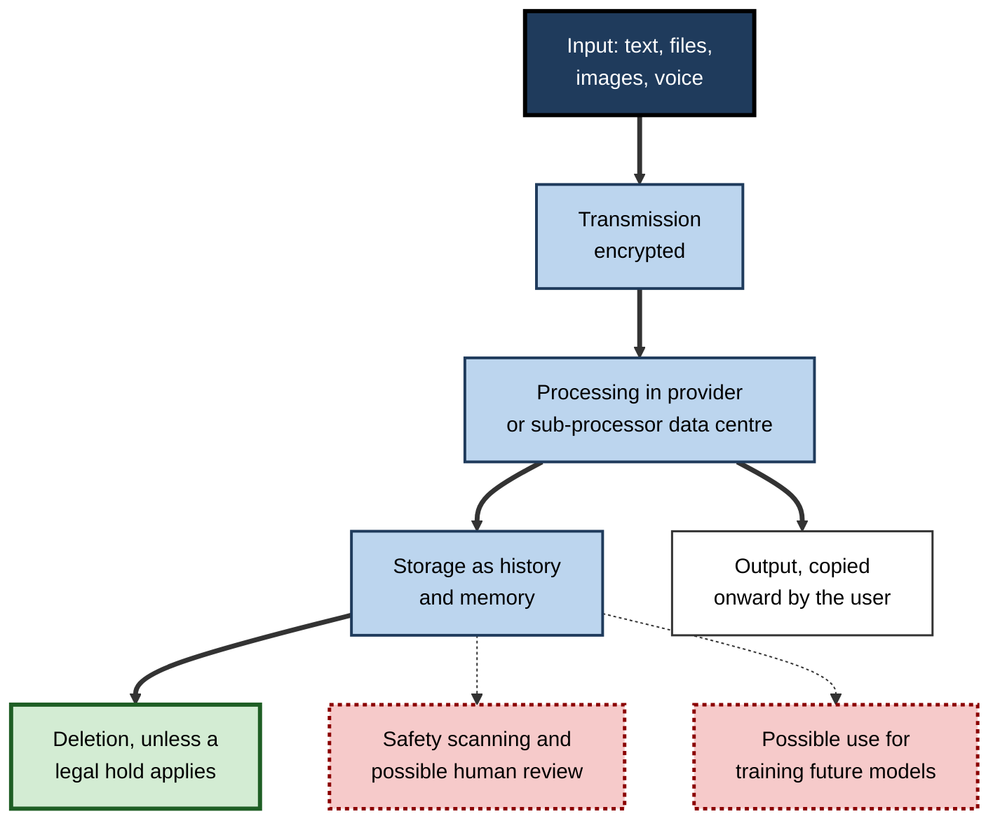
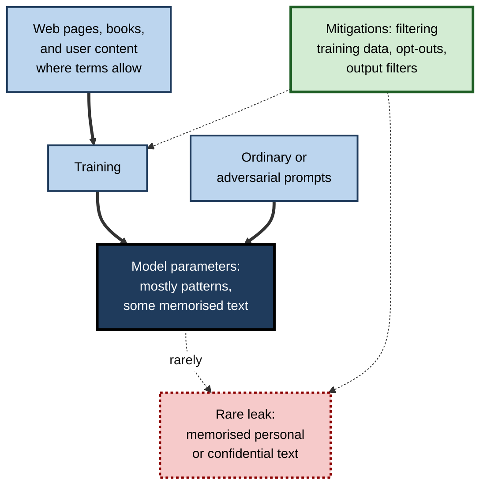
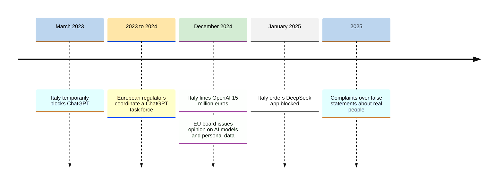
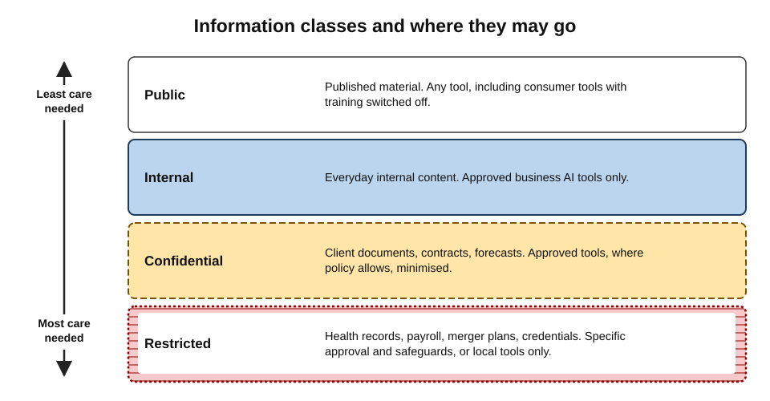
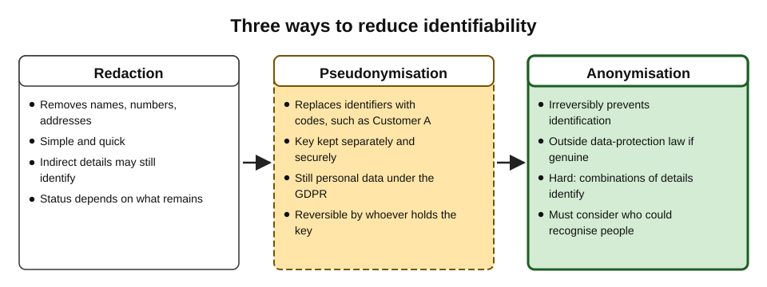
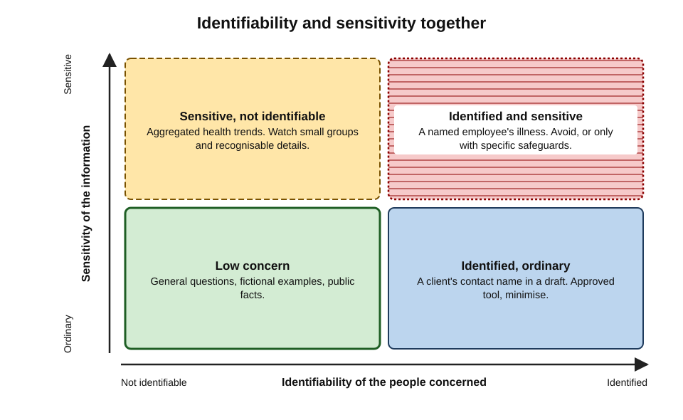

# A.11. Data privacy with AI tools

In the spring of 2023, within weeks of being allowed to use ChatGPT, engineers at Samsung's semiconductor division reportedly pasted confidential source code into it to find bugs, and uploaded a recording of an internal meeting to produce minutes. Nothing was hacked. The data simply left the company — onto servers it did not control, under terms it had not negotiated, possibly into material used to train future models. Within weeks Samsung restricted generative AI tools on company devices.

The episode captures the central privacy fact about AI tools: **whatever is typed, uploaded or connected travels somewhere, is kept for some time, and may be used in ways the user never pictured.**

> **Definition — Data privacy (in the context of AI tools):** the appropriate handling of information about people — and, by extension, of confidential organisational information — when it is entered into, processed by, stored by or generated by AI tools, in line with law, contracts and the reasonable expectations of the people concerned.

> **Definition — Personal data (EU and UK GDPR):** any information relating to an identified or identifiable living person — directly (a name, an identification number) or indirectly (a combination of details that singles someone out).

**Why privacy with AI tools needs special care**

- **Inputs are rich.** People paste whole documents, threads and recordings, not just search terms.
- **Data travels further.** A single request may pass through an application vendor, a model provider and cloud hosts.
- **Retention and training are opaque.** Users rarely know how long data is kept or whether it improves future models.
- **Outputs can contain personal data** — including false or inferred information about real people.
- **Legal duties are strict.** Data-protection laws attach obligations — and substantial fines — to these activities.

---

## The Life of Data in an AI Tool

### From keystroke to deletion

1. **Input** — typed text, pasted documents, uploaded files, images, voice, screen content.
2. **Transmission** — sent over the internet, normally encrypted, to the provider's servers.
3. **Processing** — the model reads the input in the provider's (or a sub-processor's) data centre, possibly in another country.
4. **Storage** — the conversation and files are saved as **history**, often indefinitely until deleted.
5. **Memory** — some tools extract facts ("the user works on Project Atlas") to reuse in later chats.
6. **Safety monitoring** — inputs and outputs may be scanned automatically, and some may be read by **human reviewers**.
7. **Improvement and training** — under some plans and settings, content may be used to train or evaluate future models.
8. **Sharing** — with **sub-processors** (cloud hosts, other model providers behind a reseller), and with authorities where legally compelled.
9. **Output** — replies may themselves contain personal or confidential information and be copied onward.
10. **Deletion** — removal from history, then from back-ups after a period — unless a **legal hold** or other obligation requires preservation.

**Figure 1.** The journey of data entered into an AI tool, and the points where privacy is decided.

> **Key point:** privacy decisions are made **before** the Enter key — in choosing the tool, the plan, the settings and, above all, **what to put in**. After submission, control passes largely to the provider's terms.

### The roles in data-protection law

- **Controller** — the organisation deciding why and how personal data is processed.
  - *e.g.* an employer whose staff use an AI tool on customer data.
- **Processor** — an organisation processing personal data on the controller's behalf and instructions.
  - *e.g.* an AI provider under a business agreement.
- **Sub-processor** — a processor engaged by another processor.
  - *e.g.* the cloud host or model provider behind an AI application.
- **When a provider uses data for its own purposes** — such as training its general models — it may become a **controller** for that use, needing its own lawful basis.

> **Definition — Controller and processor:** under the GDPR, the controller determines the purposes and means of processing personal data; the processor acts on the controller's documented instructions under a contract.

---

## Why Models Can Leak What They Learn

### Memorisation

- **Large models occasionally memorise** parts of their training data verbatim, especially text that appeared many times or is unusual.
- **Study card — Carlini and colleagues (2021):**
  - **Design:** researchers queried a public language model (GPT-2) with many prompts and searched its outputs for verbatim training text.
  - **Result:** they extracted hundreds of memorised sequences, including some individuals' names, phone numbers, email addresses and physical addresses that had appeared on the public web.
  - **Lesson:** training data can sometimes be recovered from a model.
- **Study card — Nasr and colleagues (2023):**
  - **Design:** a simple attack asked a production chat assistant to repeat a single word indefinitely.
  - **Result:** after many repetitions the model sometimes diverged into outputting memorised training text, including personal contact details; the provider subsequently blocked the technique.
  - **Lesson:** even aligned commercial models were not immune to extraction.

> **Definition — Memorisation:** a model's retention of specific training examples closely enough that it can reproduce them, rather than only general patterns.

**Figure 2.** How personal data can move from training material into a model's outputs.

> **Watch out:** the chance that a particular pasted paragraph will later be regurgitated to a stranger is **low** — but not zero, and the consequences of confidential or personal data reappearing can be severe. The decisive protection is not to let such content enter training in the first place: business plans and opt-outs.

### Inference and false information

- **Inference** — models can deduce sensitive attributes (health, sexuality, political views, location) from innocuous details in a conversation or document.
- **Fabrication about real people** — models can generate false statements about identifiable individuals.
  - In **March 2025** the Austrian privacy group noyb filed a complaint with Norway's data-protection authority after ChatGPT falsely described a Norwegian man as having murdered his children — mixing invented crimes with real details of his life.
  - Data-protection law gives people a right to **rectification** of inaccurate personal data — difficult to honour when the inaccuracy is generated rather than stored.

---

## The Legal Framework

### Data-protection principles

The EU and UK General Data Protection Regulation (GDPR) and many laws modelled on it set principles that apply directly to AI use:

- **Lawfulness, fairness and transparency** — a lawful basis for processing; people told how their data is used.
- **Purpose limitation** — data collected for one purpose not reused for incompatible ones.
  - *e.g.* customer complaint data collected to resolve complaints, then pasted into a consumer AI tool that may use it for training.
- **Data minimisation** — only the data necessary for the purpose.
- **Accuracy** — personal data kept accurate; a challenge when AI generates content about people.
- **Storage limitation** — not kept longer than necessary.
- **Integrity and confidentiality** — appropriate security.
- **Accountability** — the controller must be able to demonstrate compliance.

> **Mnemonic — "Lucky People Do Always Save In Accounts":** Lawfulness, Purpose limitation, Data minimisation, Accuracy, Storage limitation, Integrity and confidentiality, Accountability.

- **Special-category data** — health, ethnicity, religion, sexual orientation, biometrics, political opinions, trade-union membership — is subject to stricter conditions.
- **Data protection impact assessment (DPIA)** — required for processing likely to result in high risk to people's rights, which regulators expect for many new AI deployments.
- **International transfers** — sending personal data to providers in other countries requires safeguards.
- **Rights of individuals** — access, rectification, erasure, objection, and protections against solely automated decisions with significant effects.

> **Definition — Data protection impact assessment (DPIA):** a structured assessment, required by the GDPR for high-risk processing, describing the processing, assessing its necessity and risks to individuals, and setting out mitigating measures.

### Beyond Europe

- **India — Digital Personal Data Protection Act (2023)**, with implementing rules adopted in 2025: consent-centred processing, duties for "data fiduciaries", and penalties for breaches.
- **United Kingdom** — UK GDPR and Data Protection Act 2018, overseen by the Information Commissioner's Office, amended by the Data (Use and Access) Act 2025.
- **United States** — no single federal privacy law; sector laws (*e.g.* HIPAA for health information) and a growing number of state laws.
- **Professional confidentiality** — duties to clients and patients apply regardless of privacy law.

### Regulators and AI tools

**Figure 3.** Selected regulatory actions concerning generative AI and personal data.

**Study card — Italy's data-protection authority and ChatGPT (2023–2024)**

- **March 2023:** the Garante temporarily ordered ChatGPT blocked in Italy, citing:
  - no clear legal basis for collecting personal data to train the models;
  - inadequate information to users and to people whose data was used;
  - no age verification for children;
  - a data breach that month, in which a software bug briefly exposed some users' chat titles and, for a small share of subscribers, partial payment details.
- **April 2023:** service resumed after OpenAI added privacy notices, an opt-out from training and age checks.
- **December 2024:** after a full investigation, the Garante fined OpenAI **€15 million** and ordered a public information campaign; OpenAI said it would appeal.
- **Lesson:** regulators apply existing data-protection law vigorously to AI tools, and the obligations reach both training and everyday use.

---

## Confidential Information That Is Not Personal Data

Privacy law protects people; many other duties protect **organisations and clients**.

- **Trade secrets and source code** — protected partly by keeping them secret; disclosure to an outside service can weaken that protection.
- **Client confidentiality** — contractual and professional duties (lawyers, accountants, consultants, doctors).
- **Inside information** — unpublished price-sensitive information about listed companies; sharing it improperly can breach market-abuse rules.
- **Legal privilege** — confidential lawyer–client communications; whether entering them into third-party AI tools risks the confidentiality on which privilege depends is a question lawyers treat with great caution.
- **Security information** — passwords, keys, network details, vulnerability reports.

> **Watch out:** "it is not personal data" does not mean "it is safe to paste". Many of the most damaging AI disclosures involve **business** secrets rather than personal details.

---

## Practical Protection

### Classify before entering

Most organisations classify information; each class maps to permitted tools.

| Classification | Examples | Consumer AI tool | Approved business AI tool | Restricted or local tool only |
|---|---|---|---|---|
| Public | Published reports, public regulations | Permitted | Permitted | Permitted |
| Internal | Internal process notes, general emails | Usually not | Permitted | Permitted |
| Confidential | Client documents, contracts, financial forecasts | Not permitted | Permitted if policy allows | Permitted |
| Restricted | Health records, payroll, merger plans, credentials | Not permitted | Only with specific approval and safeguards | Often required |

**Figure 4.** Information classes and where each may go.

### Minimise, redact, pseudonymise, anonymise

- **Minimise** — include only what the task needs.
  - *e.g.* to improve the structure of a complaint response, the customer's account number is irrelevant.
- **Redact** — remove identifying or sensitive details.
- **Pseudonymise** — replace identifiers with placeholders ("Customer A", "Supplier X"), keeping the key separately.
  - Pseudonymised data is **still personal data** under the GDPR, because it can be re-linked.
- **Anonymise** — remove or alter data so that people can no longer be identified by any reasonably likely means.
  - Truly anonymous data falls outside data-protection law — but genuine anonymisation is hard.
- **Use synthetic examples** — invent realistic but fictional data to illustrate the problem.

> **Definition — Pseudonymisation:** processing personal data so it can no longer be attributed to a specific person without additional information kept separately and securely.

> **Definition — Anonymisation:** irreversibly transforming data so that individuals cannot be identified by any means reasonably likely to be used.

**Study card — Latanya Sweeney (2000)**

- **Finding:** analysing US census data, Sweeney estimated that about **87%** of the US population could be uniquely identified by just three attributes: **five-digit ZIP code, gender and date of birth**.
- **Earlier demonstration (1997):** she identified the medical records of the Governor of Massachusetts in a supposedly anonymised hospital dataset by linking it to a public voter list.
- **Lesson:** removing names is not anonymisation; combinations of ordinary details identify people.

**Figure 5.** Redaction, pseudonymisation and anonymisation compared.

### Worked example (illustrative): preparing a complaint for an AI tool

**Situation:** a customer-service lead wants help drafting a reply to a complaint, using an approved business assistant. Policy requires minimisation even in approved tools.

**Original text (not to be pasted):** "Mrs Priya Nair, account 4471-2290, of 14 Elm Road, Leeds, says her pacemaker check was missed because our technician did not arrive on 3 March; she is 81 and lives alone."

1. **Ask what the task needs:** tone, structure, an apology, next steps — not identity, account or address.
2. **Remove direct identifiers:** name, account number, address.
3. **Consider indirect identifiers and sensitive data:** age, living alone and the pacemaker reveal health and vulnerability; generalise them.
4. **Rewrite:** "An elderly customer with a medical device reports that a scheduled home visit for a device check was missed on a date in March because our technician did not arrive. Draft an empathetic reply that apologises, explains we will reschedule within 48 hours, and offers a direct contact."
5. **Re-insert specifics** in the final reply **outside** the AI tool.

| Detail | Needed for the draft? | Action |
|---|---|---|
| Name | No | Remove; add back in the final letter |
| Account number | No | Remove |
| Address | No | Remove |
| Exact date | No | Generalise to "a date in March" |
| Pacemaker | Partly — it explains urgency | Generalise to "a medical device" |
| Age and living alone | Partly — affects tone | Generalise to "an elderly customer" |

- **Conclusion:** the AI receives everything it needs to write a good reply and nothing that identifies the customer or exposes her health details.

> **Watch out:** even generalised details can identify someone in a small population — "the only customer in a village with a pacemaker". Minimisation must consider **who could recognise** the person from what remains.

### Settings and plan choices

- **Use approved business plans** for work data: no training by default, contractual terms, administrator controls.
- **In any tool, check:**
  - training or "improve the model" setting — off where possible;
  - history — delete conversations that are no longer needed;
  - memory — review and remove stored facts;
  - temporary or incognito chats — for one-off queries where permitted;
  - connected apps — narrow scopes; remove when finished.
- **Enterprise options** include zero or minimal retention arrangements, regional data processing, and encryption keys controlled by the customer.

**Figure 6.** How identifiable and how sensitive information is together determine the care required.

---

## Other People's Data in Everyday Use

Most personal data entered into AI tools at work is not the user's own. Everyday situations where other people's privacy is at stake:

- **Meeting recordings and transcripts** — AI note-takers capture everyone's words, including asides, personal remarks and the views of external guests.
  - Participants should know a recording or transcript is being made; some jurisdictions require consent.
  - Transcripts may be stored by the note-taking service and shared automatically with all invitees.
- **Email threads and chat histories** — summarising a thread sends every sender's messages, including people outside the organisation.
- **CVs and job applications** — uploading candidates' documents to compare them processes their personal data for a purpose they may not expect.
- **Photographs and screenshots** — images of offices, events or screens can capture faces, name badges, whiteboards and other people's messages.
- **Customer and patient records** — the most regulated category, often containing special-category data.
- **Colleagues' performance or conduct** — drafting feedback or investigation notes with AI involves sensitive information about identifiable people.

| Situation | Whose data | Main privacy question | Good practice |
|---|---|---|---|
| AI note-taker in a client meeting | All participants, including the client | Did everyone know, and where will the transcript go? | Announce it; use the approved tool; restrict sharing |
| Summarising a long email thread | Every sender | Is the tool approved for this content? | Use the approved assistant; trim irrelevant personal remarks |
| Comparing job applicants' CVs | Candidates | Is this a fair, disclosed and lawful use? | Follow HR policy; human decision; no consumer tools |
| Screenshot of a dashboard for analysis | Anyone visible on screen | What else is in the frame? | Crop to the relevant area before uploading |

> **Key point:** privacy is owed to **everyone whose information passes through the tool** — colleagues, clients, candidates and bystanders — not only to the person typing.

> **In practice:** a simple courtesy — "This meeting is being transcribed by our approved AI tool; let me know if you would prefer it switched off" — meets most expectations and builds trust with external participants.

---

## Case Study: The Semiconductor Code Leak

- **Situation:** in March 2023 Samsung Electronics allowed engineers in its semiconductor business to use ChatGPT.
- **What happened (as reported in April 2023):**
  - one engineer pasted proprietary source code to check for errors;
  - another pasted code to request optimisation;
  - a third uploaded an internal meeting recording, transcribed, to generate minutes.
- **The risk:** under the consumer terms then in force, inputs could be retained and used to improve models; the company could not retrieve or delete them.
- **Response:**
  - an emergency limit on the size of prompts;
  - in **May 2023**, a ban on generative AI tools on company devices and networks pending security measures;
  - development of internal AI tools.
- **Diagnosis:**
  1. **Access granted before rules** — staff were allowed to use the tool without clear guidance on data.
  2. **Consumer terms for business secrets** — no contract governing retention or training.
  3. **Natural behaviour** — engineers used the tool exactly as it invited them to.
- **Wider effect:** several banks and large companies announced similar restrictions in 2023, later replaced by approved enterprise tools.
- **Lesson:** privacy and confidentiality failures with AI are usually **predictable behaviour meeting the wrong terms**; the remedy is approved tools, clear data rules and training — before access, not after.

---

## The Organisational Picture

- **Policy** — data rules by classification; explicit prohibitions (credentials, special-category data, inside information) in unapproved tools.
- **Contracts** — data processing agreements, sub-processor lists, retention and deletion terms, breach notification, data location.
- **DPIAs** for new AI uses involving personal data.
- **Technical controls** — data-loss prevention on prompts and uploads; sensitivity labels honoured by AI features; logging.
- **Records** — what personal data goes into which AI tools, for what purpose, on what lawful basis.
- **Rights handling** — processes for access and erasure requests that cover AI histories, logs and outputs.
- **Training** — practical examples of what not to paste, and how to minimise.

> **In practice:** privacy teams increasingly publish a one-page **"Can I paste this?"** guide — a short table of data types and tools, with examples — because staff decide in seconds, not after reading a policy.

> **Remember:** before entering anything into an AI tool, ask **"Who is this about, who owns it, where will it go, how long will it stay, and could it train a model?"** Then **minimise** — and use only tools whose **terms** match the data.

---

## Common Misconceptions

- **"Deleting the chat deletes the data."**
  - Deletion from history is followed by removal from back-ups after a period; logs may persist; legal holds can override deletion.
- **"Paid means private."**
  - Personal paid plans often share consumer data terms; business agreements provide the protections.
- **"If I remove names, it is anonymous."**
  - Combinations of ordinary details often identify people; pseudonymised data remains personal data.
- **"The AI provider is responsible for privacy."**
  - The organisation using the tool, as controller, remains responsible for having a lawful basis, minimising data and choosing a compliant processor.

---

## Open Questions

- **Can a model be "anonymous"?**
  - European regulators have said that whether a trained model contains personal data must be assessed case by case, depending on how likely it is that personal data can be extracted; the practical tests are still developing.
- **How can rights be honoured inside models?**
  - Erasing or correcting information about a person within a trained model is technically difficult; "machine unlearning" research is active but immature.
- **Where is the line on training with user data?**
  - Providers' consumer terms have shifted toward using conversations for training with opt-outs; regulators and courts are still testing whether consent and transparency are adequate.
- **How should agents handle personal data?**
  - Agents reading mailboxes and files process far more personal data, about far more people, than chat assistants; principles of minimisation and purpose limitation are hard to apply to open-ended tasks.

---

## Summary

- **Data privacy with AI tools** concerns personal and confidential information that is entered into, processed, stored or generated by AI tools.
- Data passes through **input, transmission, processing, storage, memory, safety review, possible training, sharing with sub-processors, output and deletion**; decisions are made **before** submission.
- Under the GDPR, the using organisation is usually the **controller**, the provider a **processor** (or a controller for its own training use).
- Models can **memorise and leak** training data (Carlini et al., 2021; Nasr et al., 2023), **infer** sensitive attributes and **fabricate** statements about real people.
- Principles — **Lawfulness, Purpose limitation, Data minimisation, Accuracy, Storage limitation, Integrity, Accountability** — apply; **special-category data**, **DPIAs**, transfers and individual rights matter.
- Regulators act: Italy's **2023 block** and **€15 million fine (2024)** on OpenAI; scrutiny of other providers.
- **Confidential business information** — trade secrets, client matters, inside information, privilege — needs equal care.
- Protect by **classifying**, **minimising**, **redacting**, **pseudonymising** or **anonymising** (names alone are not enough — Sweeney), using **business plans** and **privacy settings**.
- The **Samsung case (2023)** shows predictable behaviour meeting the wrong terms; the remedy is approved tools and clear rules before access.

---

## Self-Check

1. Define personal data and give an example of indirect identification.
2. List the stages of data's journey through an AI tool.
3. Explain the controller, processor and sub-processor roles in an AI tool deployment.
4. What did Carlini and colleagues (2021) and Nasr and colleagues (2023) demonstrate?
5. Why is fabrication about real people a data-protection problem?
6. State the seven GDPR principles and apply one to pasting customer data into a consumer tool.
7. When is a DPIA needed, and what does it contain?
8. Why did Italy's regulator block ChatGPT in 2023, and what followed?
9. Name four kinds of confidential information that are not personal data.
10. Distinguish redaction, pseudonymisation and anonymisation, and state the legal status of pseudonymised data.
11. What did Sweeney show, and why does it matter for AI prompts?
12. Minimise this request: "Draft a warning letter to John Smith (employee 55821, Finance) about his absences on 3, 10 and 17 May linked to his depression."
13. Analyse the Samsung case: what were the root causes and the remedy?
14. A manager says, "Our AI provider is GDPR-compliant, so we can put any employee data into it." Respond.

### Answer Key

1. Information relating to an identified or identifiable living person. Indirect: "the only female finance director at our Leeds office" identifies someone without a name.
2. Input; transmission; processing; storage as history; memory; safety scanning and possible human review; possible training use; sharing with sub-processors; output; deletion (subject to legal holds).
3. Controller: the employer deciding to process personal data with the tool. Processor: the AI provider acting on its instructions under contract. Sub-processor: the cloud host or model provider the AI provider engages. Where the provider uses data for its own training, it may act as a controller for that use.
4. Training data can be extracted from models: Carlini et al. recovered memorised sequences including contact details from GPT-2; Nasr et al. made a production assistant emit memorised training text via a repeated-word attack.
5. False statements about identifiable people are inaccurate personal data; people have rights to rectification, and the harm (e.g. false accusations) can be grave — yet generated falsehoods are hard to correct.
6. Lawfulness/fairness/transparency; purpose limitation; data minimisation; accuracy; storage limitation; integrity and confidentiality; accountability. Purpose limitation: complaint data collected to resolve complaints should not be reused where a consumer tool may use it to train models.
7. For processing likely to pose high risk to individuals' rights (many new AI uses involving personal data). It describes the processing, assesses necessity and proportionality, identifies risks and sets out mitigating measures.
8. No clear legal basis for training data, inadequate information, no age verification, and a data breach. Service resumed after changes; in December 2024 OpenAI was fined €15 million and ordered to run an information campaign (appeal announced).
9. Trade secrets and source code; client-confidential matters; inside information; privileged legal communications; security credentials (any four).
10. Redaction: removing details. Pseudonymisation: replacing identifiers with codes, key kept separately — still personal data. Anonymisation: irreversible removal of identifiability — outside data-protection law if genuinely achieved.
11. About 87% of Americans could be identified by ZIP code, gender and date of birth. Removing names from a prompt may leave enough ordinary details to identify someone.
12. "Draft a formal but supportive letter to an employee about a pattern of unauthorised absences on several dates last month, inviting them to a meeting and mentioning available support." Health information (depression) is special-category data and should not be entered; name, employee number, department and dates are unnecessary for drafting.
13. Staff were given access before clear data rules; consumer terms allowed retention and training with no contract; staff used the tool naturally for code and minutes. Remedy: approved enterprise tools, clear data rules and training before access, plus technical controls.
14. Provider compliance does not make every use lawful. The employer, as controller, needs a lawful basis and purpose for each use, must minimise data, may need a DPIA, must handle special-category data with extra conditions, and must ensure contract terms (DPA, retention, sub-processors) fit — so only necessary employee data, for defined purposes, under policy.

---

## Glossary

| Term | Meaning |
|---|---|
| Anonymisation | Irreversibly removing the ability to identify individuals from data. |
| Controller | The organisation deciding the purposes and means of processing personal data. |
| Data minimisation | Using only the personal data necessary for the purpose. |
| Data protection impact assessment (DPIA) | A required assessment of high-risk processing and its mitigations. |
| GDPR | The EU General Data Protection Regulation (and its UK counterpart). |
| Indirect identifier | A detail that, combined with others, can single out a person. |
| Inference | Deducing information, including sensitive attributes, from other data. |
| Legal hold | An obligation to preserve data for litigation or investigation. |
| Memorisation | A model's retention of specific training examples, which it can reproduce. |
| Personal data | Information relating to an identified or identifiable living person. |
| Processor | An organisation processing personal data on a controller's instructions. |
| Pseudonymisation | Replacing identifiers so data cannot be attributed without separately kept information. |
| Purpose limitation | Not reusing data for purposes incompatible with those for which it was collected. |
| Redaction | Removing sensitive or identifying details from content. |
| Special-category data | Sensitive personal data such as health, ethnicity, religion or biometrics. |
| Sub-processor | A processor engaged by another processor. |
| Trade secret | Confidential business information whose value depends on its secrecy. |
