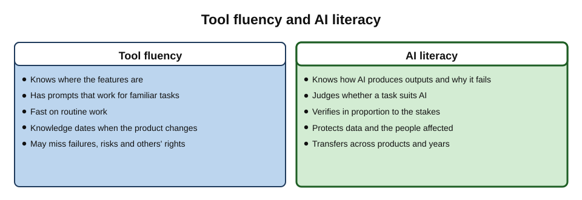
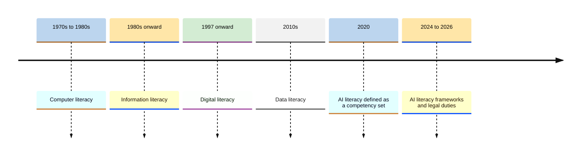
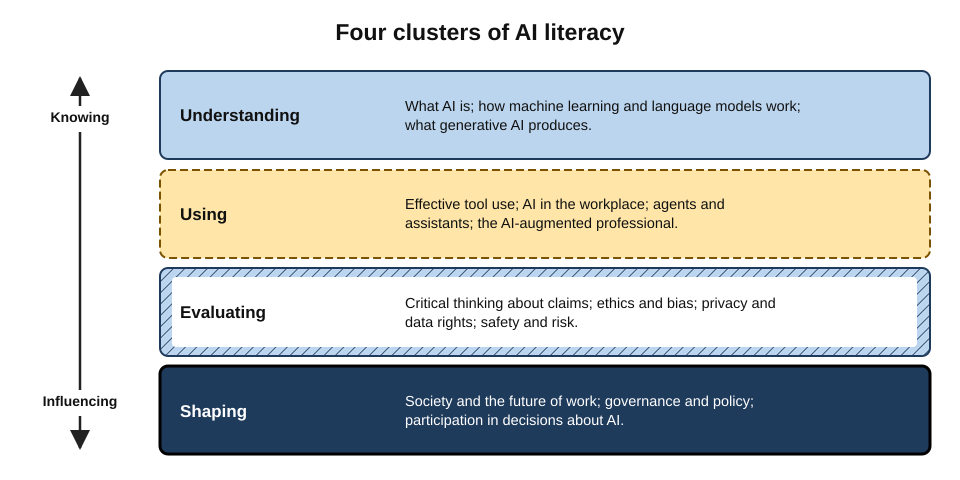
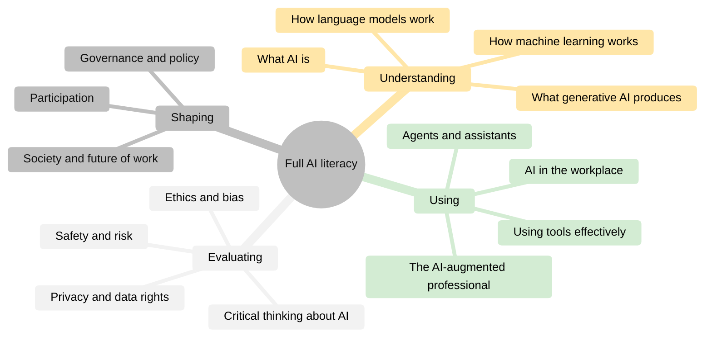
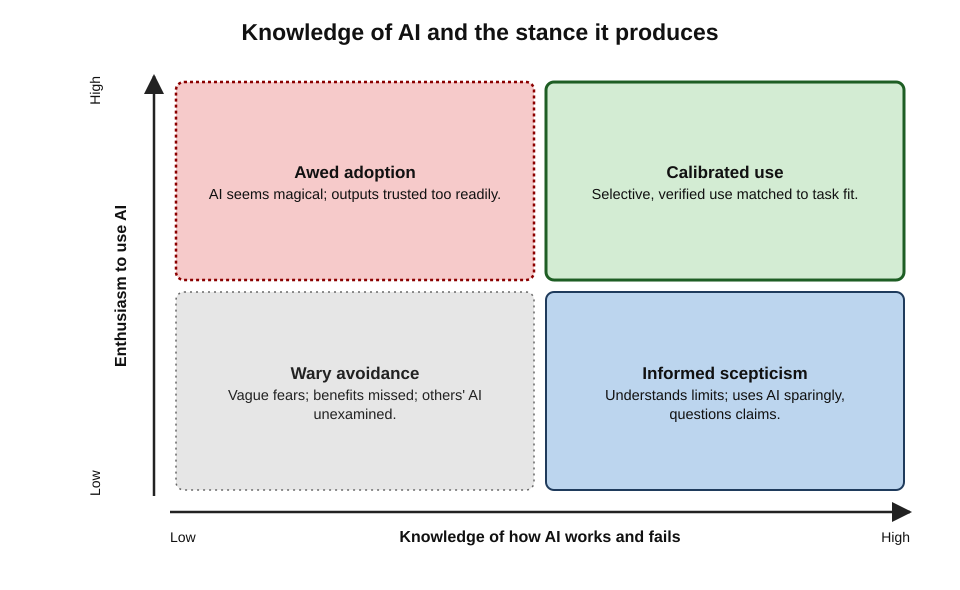
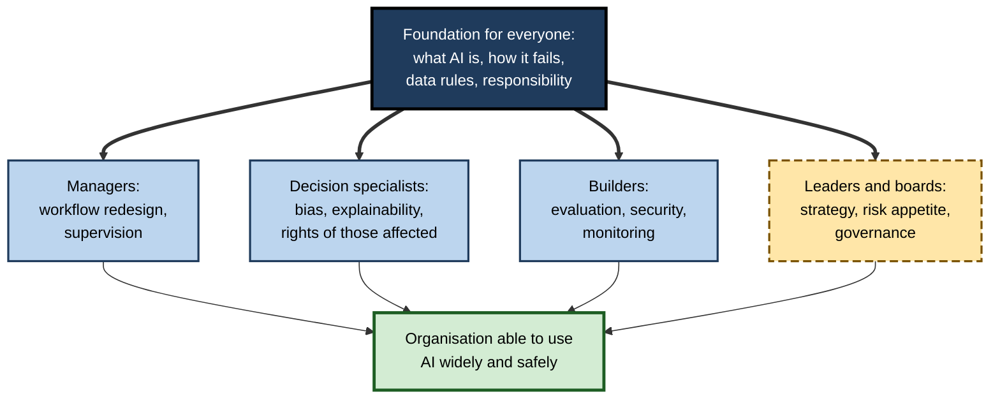

# A.12. Overview — full AI literacy in Section 1.6

Two colleagues use the same assistant every day and are equally quick with it. One can explain why it sometimes invents a source, recognises when a task lies beyond what it does reliably, knows which data must never be entered, can question a vendor's claim of "95% accuracy", and can tell a manager whether an automated decision about a customer is lawful. The other cannot.

Both are fluent **users**; only one is **AI-literate**. As AI moves from novelty to infrastructure, the gap between them becomes a gap in professional capability.

> **Definition — AI literacy (Long and Magerko, 2020):** a set of competencies that enables individuals to **critically evaluate** AI technologies, **communicate and collaborate** effectively with AI, and **use AI as a tool** online, at home and in the workplace.

> **Definition — AI literacy (EU AI Act, 2024):** the skills, knowledge and understanding that allow providers, deployers and affected persons — taking into account their respective rights and obligations — to make an informed deployment of AI systems, and to gain awareness of the opportunities and risks of AI and the possible harm it can cause.

**Why full AI literacy matters**

- **Tools change monthly; understanding lasts.** Knowing how AI works, fails and affects people transfers across products.
- **Judgement depends on understanding.** Calibrated trust, verification and responsible use all require more than button knowledge.
- **AI affects people who never use it.** Customers, candidates, patients and citizens are scored, ranked and served by AI; literate professionals protect them.
- **It is becoming an obligation.** Employers, regulators and professional bodies increasingly expect it.

---

## From Tool Fluency to Literacy

### The difference

- **Tool fluency** — knowing how to operate particular AI products efficiently: where the buttons are, which prompts work, which features exist.
- **AI literacy** — understanding what AI is, how it produces outputs, where it is reliable, what risks it carries, and how to use, question and govern it — independent of any particular product.

> **Definition — Tool fluency:** practical skill in operating specific AI products, without necessarily understanding how they work or when they fail.

| | Tool fluency | AI literacy |
|---|---|---|
| Central question | How do I use this product? | What is this system doing, and should I rely on it? |
| Shelf life | Months — until the product changes | Years — principles transfer across products |
| Typical strength | Speed in familiar tasks | Judgement in unfamiliar ones |
| Typical blind spot | Failure modes, risks, rights of others | None by design — but may lag behind new features |
| Developed by | Practice with a tool | Practice plus conceptual understanding and critical reflection |

**Figure 1.** Tool fluency and AI literacy compared.

> **Key point:** fluency without literacy is fast but fragile; literacy without fluency is wise but slow. Professionals need both — and literacy is what keeps fluency safe as tools change.

### A family of literacies

AI literacy sits within a lineage of "literacies" that each emerged as a technology became part of everyday life.

- **Computer literacy (1970s–1980s)** — operating computers and common software.
- **Information literacy (1980s onward)** — finding, evaluating and using information; promoted by library associations.
- **Digital literacy (from the 1990s)** — popularised by Paul Gilster's *Digital Literacy* (1997) as the ability to understand and use information from many digital sources; later formalised in frameworks such as the European Commission's **DigComp**.
- **Data literacy (2010s)** — reading, working with, analysing and arguing with data.
- **AI literacy (late 2010s onward)** — understanding, using, evaluating and governing AI.
  - **DigComp 2.2 (2022)** added many examples of citizens interacting with AI systems to the EU's digital-competence framework.

**Figure 2.** The lineage of literacies that AI literacy builds on.

---

## What Researchers Mean by AI Literacy

**Study card — Long and Magerko (2020)**

- **Method:** a review of research across computing education, human–computer interaction and learning sciences.
- **Output:** a definition (above) and **17 competencies** with design considerations for teaching them, organised around five questions:
  - **What is AI?** — recognising AI, understanding intelligence, interdisciplinarity, general versus narrow AI;
  - **What can AI do?** — strengths, weaknesses, imagining future AI;
  - **How does AI work?** — representations, decision-making, machine-learning steps, the human role, data literacy, learning from data, critically interpreting data, action and reaction, sensors;
  - **How should AI be used?** — ethics;
  - **How do people perceive AI?** — programmability and anthropomorphism.
- **Significance:** the most widely cited starting point for later frameworks.

**Study card — Ng and colleagues (2021)**

- **Method:** a review of the early literature on teaching AI literacy.
- **Finding:** definitions clustered into four aspects:
  - **know and understand** AI;
  - **use and apply** AI;
  - **evaluate and create** AI;
  - **AI ethics**.
- **Significance:** mapped AI literacy onto familiar educational ladders — from understanding, through application, to evaluation and creation — while insisting that ethics runs throughout.

### International frameworks

- **UNESCO AI competency frameworks (September 2024)** — one for students and one for teachers.
  - The student framework sets out four dimensions — a **human-centred mindset**, the **ethics of AI**, **AI techniques and applications**, and **AI system design** — each developed through three progressions: **understand, apply, create**.
- **OECD and European Commission AI Literacy Framework (draft 2025)** — for primary and secondary education, organised around engaging with AI, creating with AI, managing AI and designing AI.
- **Workplace and professional frameworks** — professional bodies, employers and governments publish role-based expectations, typically distinguishing all staff, managers, specialists and leaders.

> **Watch out:** frameworks differ in emphasis — some foreground technical understanding, others ethics or creativity — and few have been validated against real-world outcomes. They are best treated as **maps of what matters**, not as proven curricula.

---

## The Domains of Full AI Literacy

Across frameworks, full AI literacy for a professional covers four broad clusters, each containing several domains.

**Figure 3.** Four clusters of AI literacy, from understanding to shaping.

### Understanding AI

- **What AI is** — definitions, history, the difference between narrow and general-purpose AI, and how AI differs from conventional software.
- **How machine learning works** — learning from data, training and testing, generalisation and overfitting, why data quality and representativeness matter.
- **How large language models work** — tokens, pre-training, fine-tuning and alignment, next-token generation, context windows, and why these produce both fluency and fabrication.
- **What generative AI can produce** — text, code, images, audio and video, and the characteristic strengths and failures of each.

> **Definition — Overfitting:** when a model learns its training data so specifically — including noise — that it performs poorly on new data.

### Using AI

- **Using AI tools effectively** — specifying tasks, supplying context, iterating, structuring work, verifying outputs.
- **AI in the workplace** — augmentation versus automation, workflow redesign, measuring benefit.
- **Agents and assistants** — delegation, permissions, supervision and the limits of autonomy.
- **Becoming an AI-augmented professional** — integrating AI into one's own expertise without eroding it.

### Evaluating AI

- **Critical thinking about AI** — evaluating claims, benchmarks and demonstrations; distinguishing hype from evidence; recognising anthropomorphism.
- **Ethics and bias** — sources of bias, fairness measures and their trade-offs, accountability and explainability.
- **Privacy and data rights** — how data flows through AI systems, legal rights and duties, minimisation.
- **Safety and risk** — misuse, security threats (including prompt injection), misinformation and deepfakes, systemic risks.

### Shaping AI

- **AI in society and the future of work** — labour-market effects, inequality, education, democratic information, environmental footprint.
- **Governance** — organisational policy, regulation, standards, procurement and oversight.
- **Participation** — contributing to decisions about where and how AI is used in one's organisation, profession and community.

**Figure 4.** The domains that together make up full AI literacy.

| Cluster | Core question | Typical professional capability | Typical failure without it |
|---|---|---|---|
| Understanding | How does it work, and why does it fail? | Explaining hallucination and bias to a client | Treating AI as an oracle or as useless |
| Using | How do I get value from it? | Integrating AI into workflows with checks | Slow adoption, or reckless adoption |
| Evaluating | Should I trust this output, claim or system? | Testing a vendor's claim on real cases | Buying or believing hype |
| Shaping | How should AI be used here, and by whom? | Contributing to policy and oversight | Leaving decisions to vendors or chance |

---

## How Much Knowledge Is Enough?

### Conceptual, not mathematical

- **Most professionals do not need** the mathematics of neural networks or the ability to train models.
- **They do need accurate mental models**, such as:
  - models learn **patterns from data**, so they inherit the data's gaps and biases;
  - language models **generate plausible text**, which is usually but not always true;
  - outputs are **probabilistic** and can vary;
  - models know nothing after their **training cut-off** unless given current information;
  - **context** determines what the model can use;
  - AI systems can be **manipulated** through their inputs.

> **Definition — Mental model:** a person's internal picture of how a system works, which guides their predictions and decisions about it.

> **Watch out:** inaccurate mental models are common and consequential — "it looks things up in a database", "it understands like a person", "it learns from my conversation in real time", "it is just autocomplete". Each leads to predictable errors of over-trust or under-use.

### The literacy paradox

**Study card — Tully, Longoni and Appel (2025)**

- **Question:** are people who know more about AI more eager to use it?
- **Method:** a series of studies across countries, combining large survey data with experiments.
- **Finding:** people with **lower** AI literacy were often **more receptive** to using AI — because they were more likely to perceive it as "magical" and awe-inspiring, particularly for tasks seen as distinctively human — even though they also saw it as less capable and more ethically concerning.
- **Interpretation:** as people learn how AI works, the sense of magic fades; their use becomes more selective.
- **Lesson:** literacy does not simply increase adoption — it **calibrates** it. Organisations should aim for **informed** use, not maximum use.

**Figure 5.** Knowledge of AI and the stance it tends to produce.

### Detecting AI is not a literacy skill people possess

- **Study card — Jakesch, Hancock and Naaman (2023):**
  - **Design:** thousands of participants judged whether self-presentations (such as dating and job profiles) were written by people or by AI.
  - **Result:** accuracy was close to chance; people relied on flawed cues (for example, treating first-person pronouns or mentions of family as signs of human authorship) that AI text could easily display.
  - **Lesson:** literacy means knowing **that** AI content is hard to detect — and relying on provenance, verification and process rather than gut feeling.

---

## AI Literacy at Work

### The legal and organisational push

- **EU AI Act, Article 4** — from **2 February 2025**, providers and deployers of AI systems had to take measures to ensure, to their best extent, a sufficient level of AI literacy of staff and others operating AI systems on their behalf, taking into account their knowledge, experience, education, training and the context of use.
- **Amended in 2026** — the EU's Digital Omnibus package rewrote the duty as taking measures to **support** the development of AI literacy, expressly without guaranteeing any specific level for any individual; enforcement rests with national market-surveillance authorities.
- **Regardless of the precise legal wording**, regulators, insurers, clients and professional bodies increasingly ask organisations to show that people using AI understand it.

> **Watch out:** the 2026 amendment softened the legal wording, but did not remove the practical need. An organisation whose staff misuse AI through ignorance still faces liability under data-protection, consumer, employment and sector law — and the reputational cost.

### Role-based literacy

Different roles need different depth.

| Role | Needs to understand | Needs to be able to do |
|---|---|---|
| All staff | What AI is; how it fails; data rules; responsibility | Use approved tools safely; verify; recognise misuse |
| Managers | Where AI helps or harms in their area; supervision duties | Redesign workflows; review AI-assisted work; set team norms |
| Specialists using AI in decisions (HR, credit, clinical, legal) | Bias, explainability, legal duties for decisions about people | Validate tools; document decisions; handle challenges |
| Technical builders | Model behaviour, evaluation, security, data governance | Build, test, monitor and document AI systems |
| Leaders and boards | Strategic opportunity, systemic risk, regulation | Set direction, risk appetite and governance; ask the right questions |

**Figure 6.** Depth of AI literacy needed by role, building on a common foundation.

### Measuring AI literacy

- **Self-report questionnaires** — several validated scales were published from 2023 onward, asking people to rate their knowledge and skills.
  - Limitation: people tend to **overestimate** their competence, especially novices.
- **Knowledge tests** — questions on how AI works and fails.
- **Performance tasks** — spotting a fabricated citation, minimising a prompt correctly, judging whether a task suits AI, identifying a biased output.
  - The most valid evidence, but costly to design and score.
- **Behavioural indicators at work** — verification rates, policy breaches, incident reports, quality of AI-assisted work.

> **In practice:** effective organisational programmes combine a short foundation for everyone with role-specific modules, assess through realistic tasks rather than attendance, and refresh at least annually because tools and rules change.

---

## How AI Literacy Is Built

### Approaches that work

- **Hands-on use with reflection** — using real tools on real tasks, then examining what went right and wrong.
  - Reflection converts experience into understanding; use alone builds only fluency.
- **Seeing failures deliberately** — tasks designed to make AI fail (a fabricated citation, a subtle data trap, a biased output) build accurate mental models faster than success stories.
- **Explaining to others** — being able to explain why a model hallucinates or why a screening tool may be biased is a strong test of understanding.
- **Case analysis** — examining real incidents (fabricated legal citations, chatbot misstatements, data leaks, biased hiring tools) and diagnosing their causes.
- **Building something small** — configuring a custom assistant, a simple automation or a test set reveals how instructions, data and evaluation interact.
- **Critical reading of claims** — dissecting vendor demonstrations, benchmark announcements and media stories about AI.
- **Communities of practice** — colleagues sharing tested uses, prompts and near-misses spread literacy faster than formal courses.

> **Key point:** AI literacy grows from **use plus understanding plus reflection**. Hours of use without reflection produce confident fluency — the very combination most prone to over-trust.

### What tends not to work

- **Feature tours** — demonstrations of product buttons, which date quickly and teach nothing about failure.
- **One-off awareness sessions** — a single lecture on "AI risks", soon forgotten without practice.
- **Fear-based messaging** — lists of prohibitions without approved alternatives, which drive use underground.
- **Hype-based messaging** — inspirational talks that leave people expecting magic.

| | Effective literacy building | Ineffective literacy building |
|---|---|---|
| Content | How AI works and fails, with real cases | Product features and slogans |
| Method | Practice, deliberate failure, reflection, explanation | Lecture, demonstration, slides |
| Duration | Short foundation plus ongoing refreshers | A single event |
| Tone | Balanced: value and limits | Fearful or euphoric |
| Evidence of success | Better decisions and fewer incidents at work | Attendance and satisfaction scores |

---

## Common Misconceptions About AI Literacy

- **"AI literacy means learning to code."**
  - Coding helps builders; most professionals need conceptual understanding, judgement and safe practice, not programming.
- **"Young people are naturally AI-literate."**
  - Familiarity with apps is fluency; studies of digital literacy have long shown that "digital natives" vary widely in critical evaluation skills, and the same applies to AI.
- **"Prompting skill is AI literacy."**
  - Prompting is one part of using AI; literacy also covers understanding, evaluating and governing.
- **"Once trained, staff are literate."**
  - Tools, risks and rules change every few months; literacy needs refreshing like any professional competence.

---

## Worked Example (illustrative): Planning Literacy for a Mid-Sized Firm

**Situation:** a 600-person professional-services firm rolls out an approved assistant and must show it supports AI literacy.

1. **Map roles and uses.**
   - All 600 staff will have the assistant.
   - 40 HR and recruitment staff use an AI-assisted screening feature.
   - 15 developers build internal AI tools.
   - 12 partners form the leadership.
2. **Define outcomes per role (performance, not attendance).**
   - *All staff:* can identify permitted and prohibited data for the tool; can verify a factual claim; can explain why the tool may fabricate.
   - *HR:* can explain the screening tool's role, its known limits and the human decision step; can respond to a candidate's request for explanation.
   - *Developers:* can design an evaluation set and defend against prompt injection.
   - *Partners:* can set risk appetite and interpret an AI incident report.
3. **Design the programme.**
   - A 60-minute foundation module with realistic exercises.
   - Role modules for HR (half a day), developers (two days), partners (two hours).
   - Short refreshers when tools or policies change.
4. **Assess.**
   - Scenario questions for all staff; a practical exercise for HR; a test build for developers; a tabletop incident exercise for partners.
5. **Monitor.**
   - Track data-policy breaches, verification failures and incidents; review annually.

| Group | Size | Time | Assessment | Key outcome |
|---|---|---|---|---|
| All staff | 600 | 1 hour + refreshers | Scenario questions | Safe, verified everyday use |
| HR and recruitment | 40 | Half a day | Practical exercise | Lawful, fair, explained screening |
| Developers | 15 | Two days | Test build | Secure, evaluated internal tools |
| Partners | 12 | Two hours | Incident exercise | Informed governance and risk appetite |

*Illustrative figures.*

> **Formula — Training load:** total hours = Σ(group size × hours). Example: 600 × 1 + 40 × 4 + 15 × 16 + 12 × 2 = 600 + 160 + 240 + 24 = **1,024 hours**, under 2 hours per person on average.

- **Conclusion:** proportionate, role-based literacy is achievable at modest cost; the investment is small compared with the hours AI use will touch.

---

## Case Study (illustrative): From Ban to Literate Use

- **Situation:** a regional bank banned public AI tools in 2023 after staff were found pasting customer correspondence into a consumer chatbot.
- **Problem by 2024:** surveys showed many staff still used AI on personal phones; productivity gains seen at competitors were not being captured; new hires expected AI tools.
- **Actions:**
  1. Introduced an approved assistant under a business agreement, with data-loss prevention.
  2. Required a short foundation course before access — covering how the tool works, why it errs, data rules and verification.
  3. Added role modules for lending staff (fair-lending duties, explaining decisions) and for the complaints team (accuracy and tone with vulnerable customers).
  4. Created an internal community of practice to share tested uses and near-misses.
- **Results (reported internally after a year):** shadow AI use fell sharply; staff reported time saved on drafting; complaint responses were faster without an increase in upheld complaints; one near-miss — an assistant-drafted letter quoting an outdated fee — was caught by the verification step taught in training.
- **Lesson:** literacy turned AI from a **forbidden risk** into a **managed capability**; the ban had controlled the tool but not the behaviour.

> **Remember:** **AI literacy** = understanding **how AI works and fails**, using it **effectively and safely**, **evaluating** its outputs and claims, and helping to **shape** how it is used — for oneself, one's organisation and the people affected. **Tool fluency** is necessary but never sufficient.

---

## Open Questions

- **What is the minimum literacy every citizen needs?**
  - Frameworks agree on broad domains but differ on depth; how much technical understanding non-specialists need remains debated.
- **Does AI literacy improve real-world outcomes?**
  - Evidence that literacy training reduces errors, misuse or harm at work is still thin; most evaluations measure knowledge or confidence.
- **Can literacy keep pace with the technology?**
  - Agents, multimodal tools and new risks emerge faster than curricula; durable principles must be separated from perishable product knowledge.
- **Who is responsible for it?**
  - Schools, universities, employers, professional bodies and providers all claim a role; obligations such as the EU's have been softened, leaving the balance between duty and encouragement unsettled.
- **How does literacy interact with trust?**
  - Greater literacy can reduce naive enthusiasm (Tully and colleagues) and may increase appropriate scepticism; the right level of trust for different uses is itself a moving target.

---

## Summary

- **AI literacy** (Long and Magerko, 2020) is the competence to **critically evaluate** AI, **communicate and collaborate** with it and **use** it as a tool; the **EU AI Act** defines it as the skills, knowledge and understanding for informed deployment and awareness of opportunities, risks and harms.
- **Tool fluency** (operating products) is distinct from, and fragile without, **AI literacy** (understanding, judging and governing AI).
- AI literacy extends a lineage — **computer, information, digital, data** literacy; DigComp 2.2 (2022) added AI examples.
- Research frameworks: **Long and Magerko's 17 competencies**; **Ng and colleagues' four aspects** (know and understand, use and apply, evaluate and create, ethics); **UNESCO's 2024 frameworks** (human-centred mindset, ethics, techniques and applications, system design; understand → apply → create); the **OECD–EC draft framework (2025)**.
- Full literacy spans four clusters: **Understanding** (what AI is, machine learning, language models, generative outputs), **Using** (effective use, workplace, agents, augmented professional), **Evaluating** (critical thinking, ethics and bias, privacy, safety) and **Shaping** (society, governance, participation).
- Professionals need **accurate mental models**, not mathematics; inaccurate models drive over-trust and under-use.
- **Lower literacy can mean greater receptivity** (Tully et al., 2025): literacy **calibrates** use; people cannot reliably **detect** AI text (Jakesch et al., 2023).
- At work: **EU Article 4** duty from February 2025, **softened in 2026**; **role-based** literacy for all staff, managers, decision specialists, builders and leaders; assess through **realistic tasks**.

---

## Self-Check

1. State Long and Magerko's definition of AI literacy and the EU AI Act's definition, and note one difference in emphasis.
2. Distinguish tool fluency from AI literacy on three attributes.
3. Place AI literacy in its lineage of earlier literacies.
4. Name the five questions around which Long and Magerko organised their competencies.
5. What four aspects did Ng and colleagues identify?
6. Describe the structure of UNESCO's 2024 student framework.
7. Name the four clusters of full AI literacy and two domains in each.
8. List four accurate mental models a professional needs, and one inaccurate model each corrects.
9. What did Tully, Longoni and Appel find, and what does it imply for organisations?
10. What did Jakesch and colleagues show about detecting AI-written text?
11. How did the 2026 amendment change the EU's AI literacy duty, and why does the practical need remain?
12. Outline role-based literacy needs for HR staff using AI-assisted screening.
13. Calculate the training hours for 300 staff × 1 hour, 20 specialists × 6 hours and 8 leaders × 2 hours.
14. A director says, "Everyone uses the assistant daily, so we are AI-literate." Respond.

### Answer Key

1. Long and Magerko: competencies to critically evaluate AI, communicate and collaborate with it, and use it as a tool. EU AI Act: skills, knowledge and understanding for informed deployment and awareness of opportunities, risks and harms. The EU definition emphasises roles, rights, obligations and harms; Long and Magerko emphasise individual critical evaluation and collaboration.
2. Central question (how to operate a product vs whether and how to rely on AI); shelf life (months vs years); strength (speed vs judgement); blind spots (failure modes and others' rights for fluency).
3. Computer literacy (1970s–80s) → information literacy (1980s on) → digital literacy (Gilster, 1997) → data literacy (2010s) → AI literacy (late 2010s on).
4. What is AI? What can AI do? How does AI work? How should AI be used? How do people perceive AI?
5. Know and understand; use and apply; evaluate and create; AI ethics.
6. Four dimensions — human-centred mindset, ethics of AI, AI techniques and applications, AI system design — each developed through three progressions: understand, apply, create.
7. Understanding (what AI is; how language models work). Using (effective tool use; agents and assistants). Evaluating (ethics and bias; privacy). Shaping (society and future of work; governance).
8. Models learn patterns from data (corrects "it is neutral"); language models generate plausible text (corrects "it looks things up"); outputs are probabilistic (corrects "same question, same answer"); knowledge stops at a cut-off (corrects "it knows today's facts"); also, context bounds what it uses; inputs can manipulate it.
9. Lower AI literacy predicted greater receptivity, because less-informed people saw AI as more magical. Organisations should aim for informed, calibrated use rather than maximising adoption, and expect literate staff to be selective.
10. People judged human versus AI authorship at roughly chance level, relying on flawed cues AI could mimic; detection by intuition is unreliable, so provenance and verification matter.
11. It changed the duty from ensuring a sufficient level of AI literacy to taking measures to support its development, without guaranteeing any level. Liability under other laws, client expectations and real risks of misuse remain, so literacy is still needed in practice.
12. Understand the screening tool's role and limits, bias risks and legal duties for decisions about people; be able to perform and document the human decision, validate the tool's outputs, and explain the process to candidates who ask.
13. 300 × 1 + 20 × 6 + 8 × 2 = 300 + 120 + 16 = 436 hours.
14. Daily use shows fluency, not literacy. Literacy requires understanding how and why the tool fails, what data rules apply, when tasks suit AI, how to verify, and the rights of people affected. Assess with realistic tasks (spotting fabricated citations, minimising prompts, judging task fit) and provide role-based training where gaps appear.

---

## Glossary

| Term | Meaning |
|---|---|
| AI literacy | Competencies to understand, use, evaluate and help govern AI. |
| Anthropomorphism | Attributing human qualities such as understanding or intention to AI systems. |
| Article 4 (EU AI Act) | The provision on AI literacy duties of providers and deployers. |
| Data literacy | The ability to read, work with, analyse and argue with data. |
| DigComp | The European Commission's Digital Competence Framework for citizens. |
| Digital literacy | The ability to find, evaluate, use and create information with digital technologies. |
| Information literacy | The ability to find, evaluate and use information effectively. |
| Mental model | A person's internal picture of how a system works. |
| Overfitting | A model learning training data too specifically to generalise. |
| Role-based literacy | AI literacy tailored in depth to a person's role and responsibilities. |
| Tool fluency | Practical skill in operating particular AI products. |
| UNESCO AI competency frameworks | 2024 frameworks setting out AI competencies for students and teachers. |
