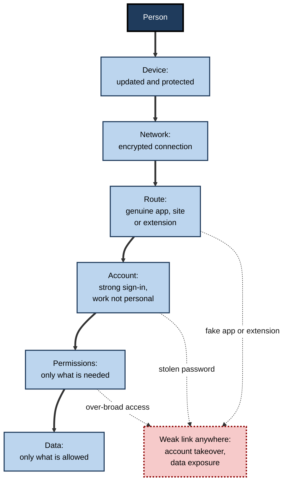
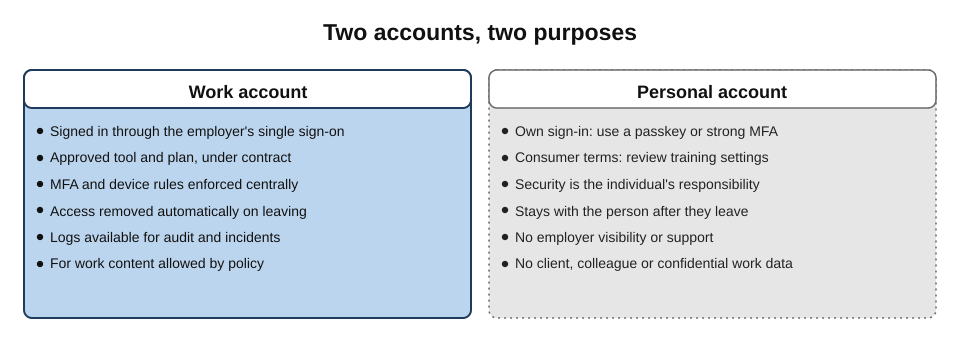
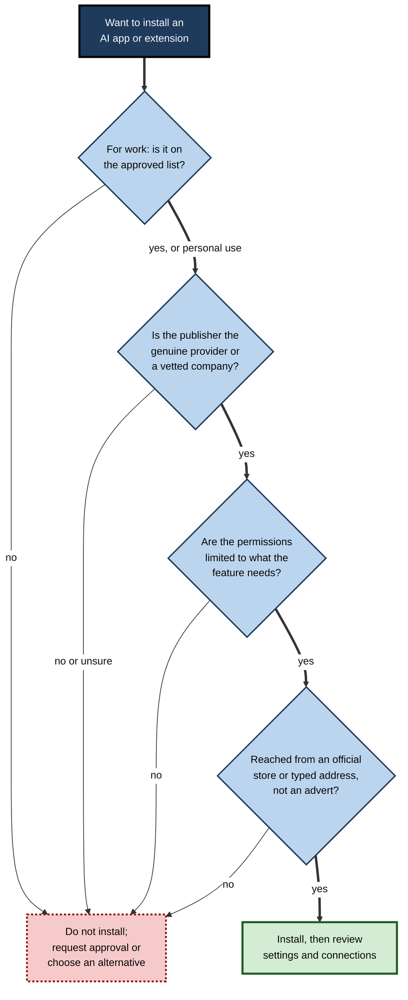
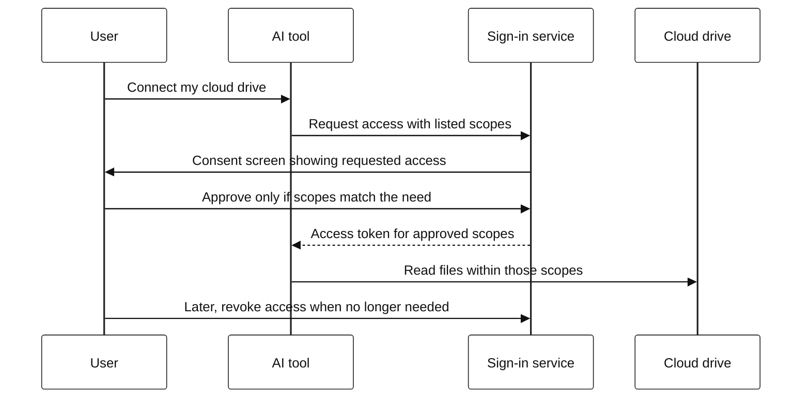
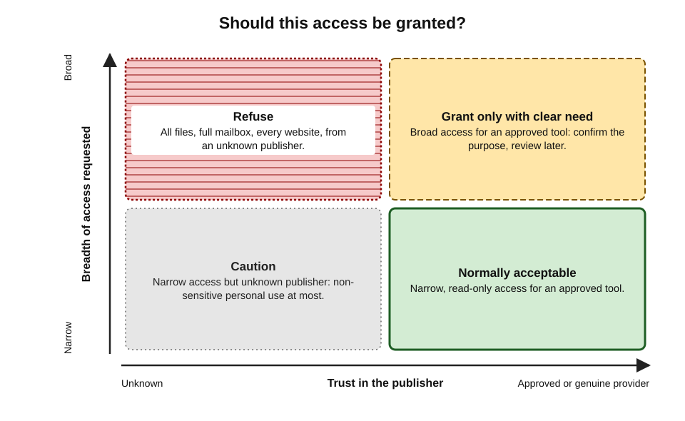
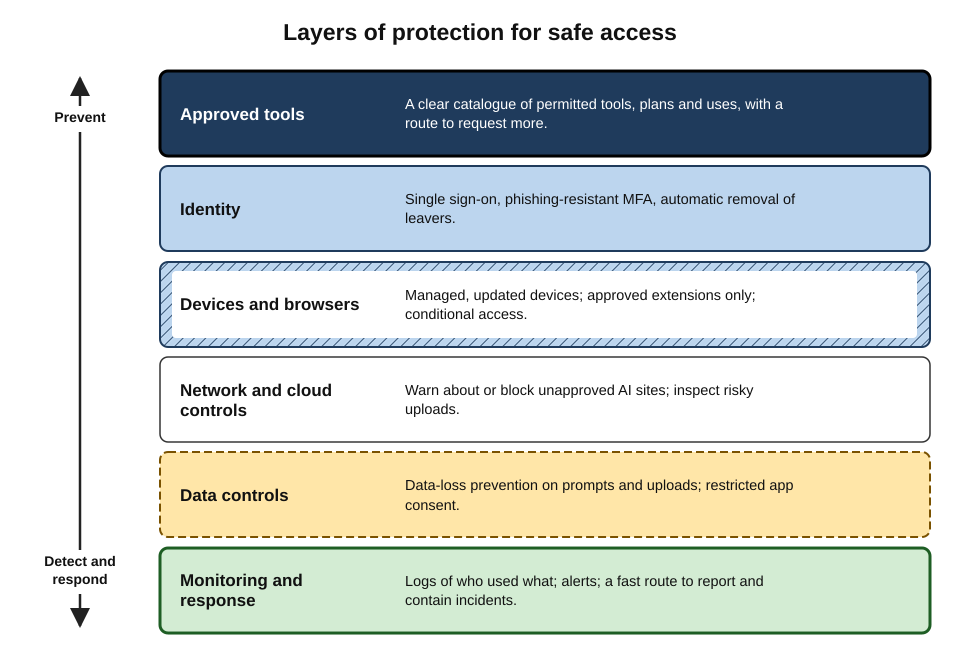

# A.7. Accessing AI tools safely

In March 2023, thousands of people installed a browser extension called "Quick access to Chat GPT", promoted through sponsored posts. It did offer a shortcut to the chatbot — and it also quietly stole their Facebook session data, letting criminals take over business accounts and run fraudulent advertisements. The users had not been careless with AI output. They had simply reached a popular AI tool by an unsafe route.

> **Definition — Safe access to AI tools:** reaching genuine, approved AI tools through trustworthy sources, protected accounts and secure devices, while granting them no more access to data and systems than the task requires.

**Why access deserves attention of its own**

- **AI tools are prime bait.** Their popularity makes fake apps, sites and extensions profitable for criminals.
- **AI accounts are treasure chests.** Conversation histories hold drafts, documents, plans and personal details — often more than a mailbox.
- **AI tools increasingly hold keys.** Connectors give them access to email, files and calendars; a compromised tool can reach all of them.
- **Most incidents begin at the door.** A stolen password, an over-trusted extension or an unapproved account is far more common than an exotic attack on the model itself.

---

## The Access Chain

Every use of an AI tool passes along a chain. Each link can be strong or weak, and an attacker needs only one weak link.

- **The person** — who is using the tool, and are they who they claim to be?
- **The device** — is the laptop or phone updated, protected and managed?
- **The network** — is the connection encrypted and trustworthy?
- **The route** — is this the genuine app, site or extension, or an imitation?
- **The account** — is it protected by strong authentication, and is it a work or personal account?
- **The permissions** — what can the tool see and do: files, mail, calendar, browser contents?
- **The data** — what is actually entered, uploaded or connected?

**Figure 1.** The access chain: every link between a person and their data is a point of control.

> **Key point:** safety in using AI is not only about what the tool says. It is about **who** is using **which** tool, **from where**, with **what** access.

---

## Threats at the Door

### Impostor apps, sites and extensions

- **Fake apps** — apps in official stores or on download sites that copy the name and logo of a famous assistant.
  - Some are harmless wrappers charging subscriptions for a free service; others harvest data or install malware.
- **Look-alike websites** — domains differing by a letter or using a different ending, promoted through search adverts or social media.
- **Malicious browser extensions** — add-ons that promise AI features but read everything the browser shows.
  - The 2023 case above stole session cookies, which let attackers bypass passwords and even two-factor authentication.
  - Legitimate extensions can also be **taken over**: in late 2024 attackers phished developers of several popular Chrome extensions and pushed malicious updates to their existing users.

> **Definition — Session cookie (token):** a small piece of data a website stores in the browser to show that the user is already signed in; anyone who steals it can often use the account without the password.

> **Definition — Browser extension:** a small program added to a web browser to extend its features; depending on its permissions, it may read and change the content of every page the user visits.

### Stolen credentials

- **Info-stealer malware** on personal or poorly protected devices collects saved passwords and cookies and sells them in bulk.
  - The security firm Group-IB reported in **June 2023** that it had found more than **100,000** compromised ChatGPT account credentials in the logs of such malware over the previous year.
- **Why it matters:** an attacker with an AI account can read its **entire conversation history** — every pasted contract, draft strategy and spreadsheet.
- **Password reuse** multiplies the damage: a password leaked from one site opens every account that shares it.

### Phishing that uses AI as the lure

- Emails and messages offering "free premium access", "your AI subscription has expired" or "new AI features — sign in to activate".
- Fake sign-in pages that capture credentials for the employer's own single sign-on.

> **Watch out:** AI also makes phishing itself more convincing — fluent, personalised messages, and in some cases cloned voices and video. In early 2024 an employee of the engineering firm Arup in Hong Kong transferred about US$25 million after a video call in which the "colleagues", including a senior finance officer, were reported to be deepfakes. Verifying unusual requests through a separate, known channel matters more than ever.

### Over-sharing through links and settings

- **Shared conversation links** — many assistants let a user create a public link to a chat.
  - In mid-2025, thousands of ChatGPT conversations whose owners had ticked an option making them "discoverable" appeared in web search results; OpenAI withdrew the option within days.
  - Later in 2025, a very large number of shared Grok conversations were similarly found indexed by search engines.
  - Some exposed conversations contained personal and business details their owners never expected to be public.
- **Default settings** — conversation history, memory and training settings that the user never reviewed.

> **Definition — Shared link:** a URL that gives anyone who has it access to a copy of a conversation or file; if posted or indexed, it becomes effectively public.

### Over-broad permissions and connectors

- **Connectors** — linking an assistant to email, cloud storage or calendars — use a consent screen ("This app wants to read, send and delete your email").
  - Granting broad access to an unvetted third-party AI tool gives that tool's operator — and anyone who compromises it — the same access.
- **Consent phishing** — attackers create apps that ask for access to mailboxes and files, disguised as helpful AI services.

> **Definition — OAuth consent:** the standard process by which a user authorises one application to access their data in another (for example, an AI tool reading a cloud drive) without handing over their password; the requested "scopes" define what access is granted.

### Comparing the threats

| Threat | How it works | Warning signs | Main defence |
|---|---|---|---|
| Impostor app or site | Copies a popular tool's name and look | Unfamiliar publisher, odd domain, aggressive adverts | Use official stores and typed addresses; verify the publisher |
| Malicious extension | Reads page content, steals session cookies | Requests to "read and change all data on all websites" | Install only approved extensions; review permissions |
| Stolen credentials | Info-stealers and reused passwords | Unknown sign-ins, unfamiliar chats in history | Unique passwords, a password manager, phishing-resistant sign-in |
| AI-themed phishing | Fake offers and sign-in pages | Urgency, free upgrades, links to unusual domains | Never sign in from a link; navigate directly |
| Exposed shared links | Public links indexed or forwarded | Chats shared "with anyone with the link" | Avoid sharing links to sensitive chats; review and delete old links |
| Over-broad connectors | Third-party apps granted mailbox or file access | Consent screens asking for wide scopes | Grant minimum scopes; use only approved connectors |

---

## Protecting the Account

### Strong authentication

- **Passwords alone are weak**: they can be guessed, reused, phished or stolen by malware.
- **Multi-factor authentication (MFA)** adds a second proof — something the user has or is.
- **Not all second factors are equal:**

| Method | How it works | Resists phishing? | Notes |
|---|---|---|---|
| Password only | Something the user knows | No | Weakest; never sufficient for work tools |
| SMS code | Code sent by text message | Poorly | Vulnerable to SIM-swap and relay attacks |
| Authenticator app code | Time-based code on the phone | Partly | Better, but codes can be relayed to fake sites |
| Push approval with number matching | Approve on the phone, entering a displayed number | Partly | Resists "approve-spam" fatigue attacks |
| Passkey or security key | Cryptographic key tied to the genuine site | Yes | The strongest common option; cannot be used on a look-alike site |

> **Definition — Passkey:** a sign-in credential based on public-key cryptography, stored on a device or in a password manager, that works only with the genuine website it was created for — so it cannot be phished by a look-alike page.

> **Definition — Multi-factor authentication (MFA):** sign-in requiring two or more independent proofs of identity — such as a password plus a device or a biometric.

### Work accounts and personal accounts

- **Use the employer's approved tool through the employer's sign-in** (single sign-on) for work.
  - The organisation can then enforce MFA, remove access when someone leaves, apply data protections and investigate incidents.
- **Keep personal AI accounts personal.**
  - Mixing work content into a personal account places it outside the employer's control and contracts — and leaves it with the individual after they leave.
- **Do not share accounts.** Shared logins defeat audit trails and usually breach the provider's terms.

> **Definition — Single sign-on (SSO):** a system that lets employees use one organisational identity to sign in to many applications, centralising authentication, access control and removal of access.

**Figure 2.** Work and personal AI accounts kept apart, each with its own protections.

### Housekeeping

- **Review active sessions and devices** in account settings; sign out of those not recognised.
- **Review connected apps** and remove those no longer needed.
- **Review sharing** — delete public links to conversations that are no longer needed.
- **Review history, memory and training settings** after sign-up and after major product updates.
- **Sign out on shared or borrowed devices**, and avoid saving passwords in shared browsers.

---

## Getting the Genuine Tool

### Verifying the route

1. **Start from the source.** Type the provider's address directly or use a bookmark; for work, use the employer's portal or approved app list.
2. **In app stores, check the publisher.** The developer name should be the provider itself; check download numbers, reviews and the publisher's other apps.
3. **Distrust adverts and pop-ups** promising AI features, discounts or "unlimited premium".
4. **Check the address bar** before signing in — exact domain, no extra words or characters.
5. **For extensions, read the permissions** and prefer extensions published by the AI provider or approved by the employer.

**Figure 3.** Checking an AI app or extension before installing it.

### Worked example (illustrative): reading an extension's permissions

**Situation:** an employee finds a free browser extension, "AI Summariser Pro", that promises one-click summaries of any web page and email.

| Requested permission | What it means in practice | Needed for summaries? |
|---|---|---|
| Read and change all your data on all websites | Can see every page — webmail, banking, internal systems — and alter them | Broader than needed; a summary tool needs only the current page when clicked |
| Read your browsing history | Knows every site visited | No |
| Manage your downloads | Can download files silently | No |
| Communicate with cooperating websites | Can send data to outside servers | Possibly — to the publisher's AI service |

1. **Compare scope with purpose:** the permissions far exceed a summarising feature.
2. **Check the publisher:** an unknown company with no privacy policy describing where page content is sent.
3. **Consider the data:** the extension would see internal web applications and webmail, sending content to an unknown server under unknown terms.
4. **Check policy:** not on the employer's approved list.

- **Conclusion:** do not install. The safer route is the approved assistant's own summarising feature, which works under the employer's contract.

> **Watch out:** a well-made, genuinely useful extension can still be dangerous: its ownership can change, it can be sold, or its developer's account can be hijacked and a malicious update pushed automatically to every user.

---

## Permissions: Granting Only What Is Needed

### The principle of least privilege

- **Give each tool the minimum access** to perform its task, for the minimum time.
- **Prefer read-only** where the task only needs reading.
- **Prefer narrow scopes** — one folder, one calendar, one mailbox label — over "all files" or "full mailbox".
- **Remove access** when the task or project ends.

> **Definition — Least privilege:** the security principle that every user, program or process should have only the access rights essential to its legitimate purpose.

### Connecting an assistant to work systems

**Figure 4.** How a connector is authorised, and where the user decides how much access to grant.

- **Read the consent screen.** "View files you open with this app" is very different from "See, edit, create and delete all your files".
- **Check who is asking.** The consent screen names the requesting application and publisher.
- **Organisations often restrict consent**, so that only administrator-approved applications can request access to work data — a strong defence against consent phishing.

**Figure 5.** How far to trust a tool's request for access, by breadth of access and trust in the publisher.

---

## Safe Habits During Use

- **Check before pasting.** Is this content allowed in this tool, under this account?
- **Use temporary or private modes** for sensitive but permitted queries where the tool offers them (they limit history and, often, training).
- **Avoid uploading files from unknown sources** to tools connected to work systems; documents can carry hidden instructions aimed at the AI.
- **Be wary of AI output that asks for action** — "click this link", "run this command", "enter your password" — especially after processing outside content.
- **Treat code and commands from AI cautiously**: read before running, especially anything with administrator rights or that downloads further software.
- **Lock the screen** when away; AI chats are often left open with sensitive content visible.
- **Report anything odd** — unfamiliar conversations in the history, unexpected connected apps, unusual sign-in alerts — to the IT or security team promptly.

> **Mnemonic — "SOAP" before using an AI tool:** **S**ource genuine? **O**wn work account? **A**ccess minimal? **P**olicy permits this data?

> **In practice:** security teams increasingly ask staff to treat an AI assistant like a **new colleague with a key to the office**: welcome, useful — and given only the keys the job requires.

### Mobile, voice and public places

- **Phones carry AI everywhere** — assistant apps, keyboard features, built-in system assistants — and are lost or stolen more often than laptops.
  - Use a screen lock with a strong passcode or biometric, and keep the operating system updated.
  - Use the work profile or managed app that the employer provides for work AI use, where one exists.
- **Keyboard and system features** may send typed text to cloud services for suggestions or rewriting; check what is enabled on a work device.
- **Voice mode** is convenient but audible: a spoken question about a client in a train carriage or café is a disclosure in itself.
- **Screens are visible** — AI side panels often show summaries of email and documents; privacy screens and positioning matter in public.
- **Public Wi-Fi** — modern AI services encrypt traffic, but captive portals and fake hotspots can still be used for phishing; prefer the employer's VPN or a mobile hotspot for sensitive work.

### When things go wrong

- **A device is lost or stolen:**
  1. report it immediately so it can be locked or wiped;
  2. sign out of AI accounts remotely where the provider allows;
  3. change passwords for accounts whose sessions may be open.
- **An account may be compromised** (unfamiliar chats, sign-in alerts, changed settings):
  1. change the password and sign out of all sessions;
  2. check and remove unknown connected apps and shared links;
  3. review what the history contained, and tell the security team if work data was exposed.
- **Someone leaves the organisation:**
  - work AI accounts are disabled through single sign-on;
  - custom assistants, shared projects and connected integrations they owned are reassigned or removed;
  - personal accounts should never have held work material in the first place.

> **Key point:** recovery depends on preparation. Organisations that know **which** AI tools each person uses, **through which** accounts, can contain an incident in minutes; those relying on personal accounts may never know what was exposed.

---

## The Organisational Picture

### Controls that make safe access the easy path

- **An approved-tools catalogue** — a clear list of permitted AI tools, plans and uses, with how to request new ones.
- **Single sign-on and automatic provisioning** — accounts created and removed with employment.
- **Conditional access** — sign-in allowed only from managed, compliant devices or trusted locations for sensitive tools.
- **Managed browsers and extension allow-lists** — only approved extensions can be installed on work devices.
- **Network and cloud security controls** — services that detect, warn about or block traffic to unapproved AI sites (often called secure web gateways or cloud access security brokers).
- **Data-loss prevention (DLP)** — tools that detect and block sensitive data (card numbers, client identifiers, labelled documents) being pasted or uploaded into AI tools.
- **Restricted app consent** — only approved applications may request access to work email and files.
- **Logging and monitoring** — records of who used which tool, for investigation and audit.

> **Definition — Data-loss prevention (DLP):** technology and policy that detect and prevent sensitive information from leaving an organisation through unapproved channels.

> **Definition — Zero trust:** a security approach that grants no automatic trust to users, devices or networks, verifying every access request based on identity, device health and context.

| | Blocking all AI tools | Allowing anything | Approved tools with controls |
|---|---|---|---|
| Staff behaviour | Workarounds on personal devices and accounts | Free choice, including risky tools | Use concentrated in known, protected tools |
| Visibility to the organisation | Low — use goes underground | Low — too many tools to track | High |
| Data protection | Poor in practice | Poor | Strong, by contract and technical control |
| Productivity | Lost | High but unmanaged | High and managed |
| Typical outcome | Shadow AI | Incidents | Sustainable adoption |

> **Watch out:** outright bans tend to drive use underground rather than stop it. Surveys in 2025–26 consistently found many employees using AI tools their employer had not approved, and a substantial share admitting to entering sensitive information. Providing a good approved tool, plus clear rules, is usually more effective than prohibition alone.

**Figure 6.** Layers of protection for safe access to AI tools in an organisation.

### Case study: public links to private conversations

- **Situation:** a popular assistant offered a "share" button that created a link to a copy of a conversation; an optional tick-box made the shared chat discoverable by search engines.
- **What happened (mid-2025):** researchers and journalists found thousands of such chats in search results — including conversations about job applications, health, relationships and work matters, some with names and other identifying details.
- **Response:** the provider removed the discoverability option within days and worked with search engines to remove indexed pages; a similar exposure affecting another assistant's shared chats followed later that year.
- **Diagnosis:**
  1. Users understood "share" as sending to a colleague, not as **publishing**.
  2. The meaning of the tick-box was not obvious under time pressure.
  3. Once a page is indexed or copied, deleting it later may not remove every copy.
- **Lesson:** a link is a door. Before sharing any AI conversation, assume that anyone could eventually read it — and for work material, share within approved tools rather than by public link.

---

## Common Misconceptions

- **"The AI provider is secure, so my account is secure."**
  - Most account compromises come from the user's side — reused passwords, malware, phishing, extensions — not from breaches of the provider.
- **"If it is in the official app store, it is genuine."**
  - Stores remove many impostors, but not all, and not instantly; the publisher name is the key check.
- **"Two-factor authentication makes me safe from phishing."**
  - Codes and push approvals can be relayed through fake pages; stolen session cookies bypass them. Passkeys and security keys resist phishing far better.
- **"A private chat is private."**
  - "Private" may mean hidden from history, not unseen by the provider; check what each mode actually does.

---

## Open Questions

- **How should agents authenticate?**
  - Agents acting for users need credentials; giving an agent a user's full identity is dangerous, and standards for delegated, limited, revocable agent identity are still emerging.
- **Can browser extensions be made safe for AI features?**
  - Broad page access is what makes AI extensions useful and dangerous; browsers are experimenting with narrower, on-demand permissions.
- **Will passkeys become universal?**
  - Adoption grew rapidly from 2023, but many services and users still rely on passwords and codes.
- **How should organisations balance monitoring and privacy?**
  - Logging prompts helps security and compliance but can reveal personal matters employees typed; norms and legal limits differ by country.

---

## Summary

- **Safe access** means genuine tools, protected accounts, secure devices and **least-privilege** permissions — along the whole **access chain**: person, device, network, route, account, permissions, data.
- Key threats: **impostor apps, sites and extensions** (the 2023 Facebook-hijacking extension); **stolen credentials** (over 100,000 ChatGPT logins in malware logs, 2023); **AI-themed phishing** and deepfake fraud; **exposed shared links** (2025 indexing incidents); **over-broad connectors** and consent phishing.
- Protect the account with **phishing-resistant MFA** (passkeys, security keys), unique passwords and a password manager; use **work accounts through SSO** for work and keep personal accounts personal.
- Get the genuine tool: official sources, verified publisher, address-bar checks, permission review — **SOAP**: Source, Own account, Access minimal, Policy.
- Grant **minimum scopes** through OAuth consent, prefer read-only and remove access when done.
- Organisations make safe access easy: **approved catalogue, SSO, conditional access, extension allow-lists, web controls, DLP, restricted consent, logging** — approved tools with controls beat both bans and free-for-all.

---

## Self-Check

1. Define safe access to AI tools and list the links of the access chain.
2. Why are AI accounts especially valuable to attackers?
3. Describe the 2023 "Quick access to Chat GPT" incident and the technique it used.
4. What is a session cookie, and why can stealing one bypass two-factor authentication?
5. What did Group-IB report in 2023, and what does it imply for AI conversation histories?
6. Rank SMS codes, authenticator codes and passkeys by phishing resistance and explain why.
7. Why should work content stay out of personal AI accounts?
8. List five checks before installing an AI app or extension.
9. In the worked example, which permissions were excessive and why?
10. What is OAuth consent, and how should a user read a consent screen?
11. What went wrong in the 2025 shared-link exposures, and what is the lesson?
12. Compare blocking all AI tools with providing approved tools with controls.
13. What is data-loss prevention, and how does it apply to AI tools?
14. A colleague receives an email: "Your company AI licence expires today — sign in here to renew." Advise them, and explain what the security team should do.

### Answer Key

1. Reaching genuine, approved AI tools via trustworthy sources, protected accounts and secure devices, granting minimum access. Chain: person, device, network, route, account, permissions, data.
2. Conversation histories contain pasted documents, plans, code and personal details; connected tools may also open email and files.
3. A promoted Chrome extension provided ChatGPT access while stealing Facebook session cookies, letting attackers hijack business accounts and run fraudulent adverts.
4. Data stored in the browser showing the user is signed in; presenting it lets an attacker act as the logged-in user without needing the password or second factor again.
5. More than 100,000 ChatGPT credentials found in info-stealer malware logs over a year. Anyone using them could read entire conversation histories, so histories must be treated as sensitive and accounts protected.
6. SMS (weakest: SIM-swap, relay) < authenticator codes (can be relayed to fake sites) < passkeys (cryptographically bound to the genuine site, so cannot be used on a look-alike).
7. Personal accounts lie outside the employer's contracts, data protections, audit and control; the content stays with the individual after they leave; consumer terms may allow training.
8. Is it approved for work? Is the publisher genuine? Are permissions limited to need? Was it reached from an official source, not an advert? Are there credible reviews and a clear privacy policy?
9. "Read and change all data on all websites", browsing history and download management — far beyond what summarising the current page on request requires, and exposing webmail and internal systems.
10. The standard process by which a user authorises one app to access data in another without sharing the password. Read which app is asking and exactly which scopes it requests; approve only if they match the need.
11. Users made chats discoverable via a share option, not realising this meant publishing; search engines indexed them. Lesson: treat any shared link as potentially public; share work content only within approved tools.
12. Bans push use to personal devices and accounts (low visibility, poor protection); approved tools with controls concentrate use in protected, contracted, monitored tools while preserving productivity.
13. Technology and policy detecting and preventing sensitive information leaving through unapproved channels; for AI it can block pasting or uploading labelled documents, client identifiers or card numbers into unapproved tools.
14. Do not click; it shows classic phishing signs (urgency, sign-in link). Check licence status by navigating directly to the approved portal or asking IT; report the email. The security team should block the sender and domain, search for other recipients, check for any credential entry and reset affected accounts, and consider restricting sign-in to phishing-resistant methods.

---

## Glossary

| Term | Meaning |
|---|---|
| Access chain | The sequence of person, device, network, route, account, permissions and data in using a tool. |
| Browser extension | An add-on program that extends a browser and may read or change web pages. |
| Conditional access | Rules allowing sign-in only when conditions such as device health or location are met. |
| Connector | A link giving an AI tool access to another service, such as email or files. |
| Consent phishing | Tricking users into granting a malicious app access to their data. |
| Data-loss prevention (DLP) | Controls detecting and preventing sensitive data leaving through unapproved channels. |
| Deepfake | Synthetic audio, image or video realistically imitating a real person. |
| Info-stealer | Malware that collects saved passwords, cookies and other credentials from a device. |
| Least privilege | Granting only the minimum access necessary for a legitimate purpose. |
| Multi-factor authentication (MFA) | Sign-in requiring two or more independent proofs of identity. |
| OAuth consent | Authorising one app to access data in another, with defined scopes, without sharing a password. |
| Passkey | A phishing-resistant, cryptographic sign-in credential bound to the genuine site. |
| Scope | The specific access an application is granted, such as read-only access to one folder. |
| Session cookie | Browser data proving a user is signed in; theft can allow account takeover. |
| Shared link | A URL giving anyone who has it access to a copy of a conversation or file. |
| Single sign-on (SSO) | One organisational identity used to sign in to many applications. |
| Zero trust | A security approach verifying every access request, with no automatic trust. |
