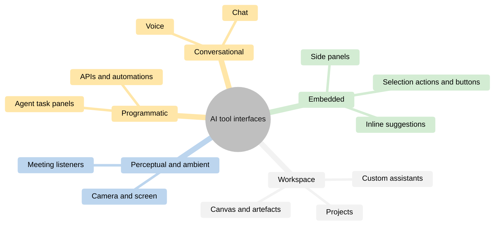
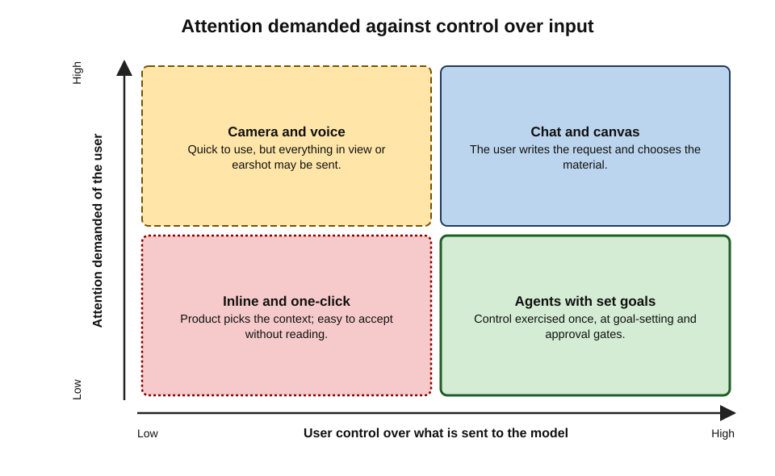
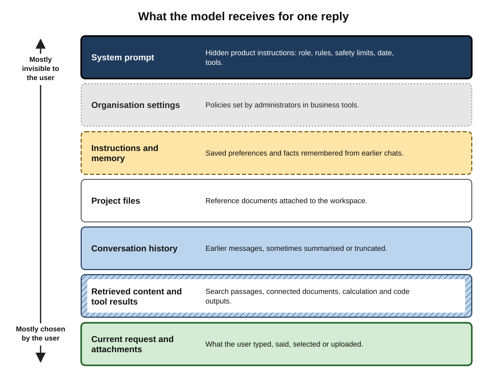
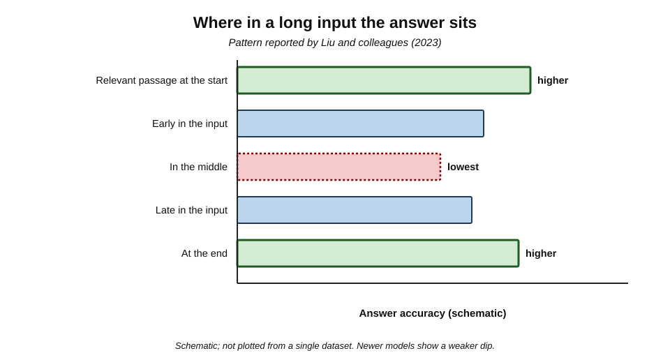
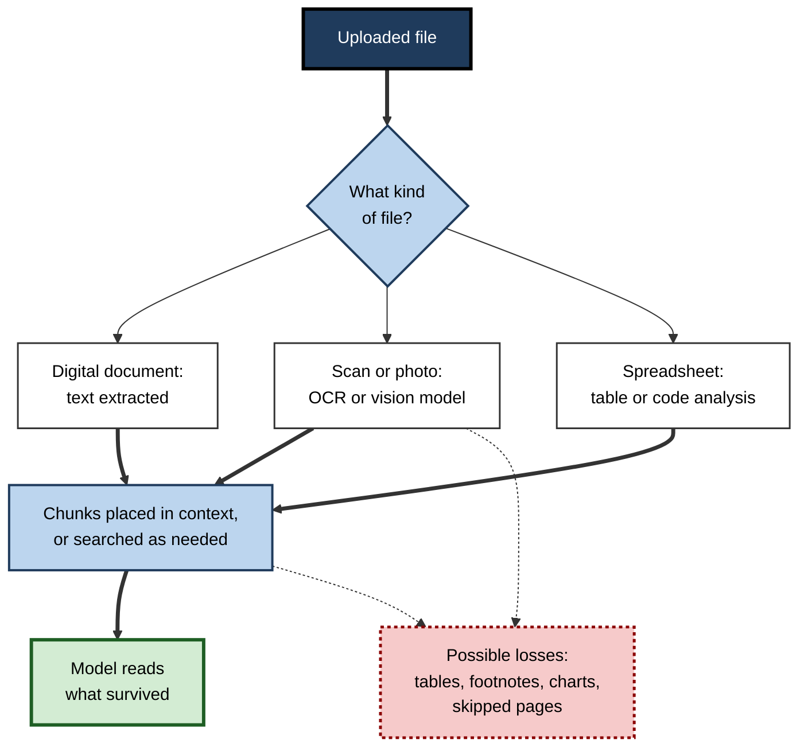
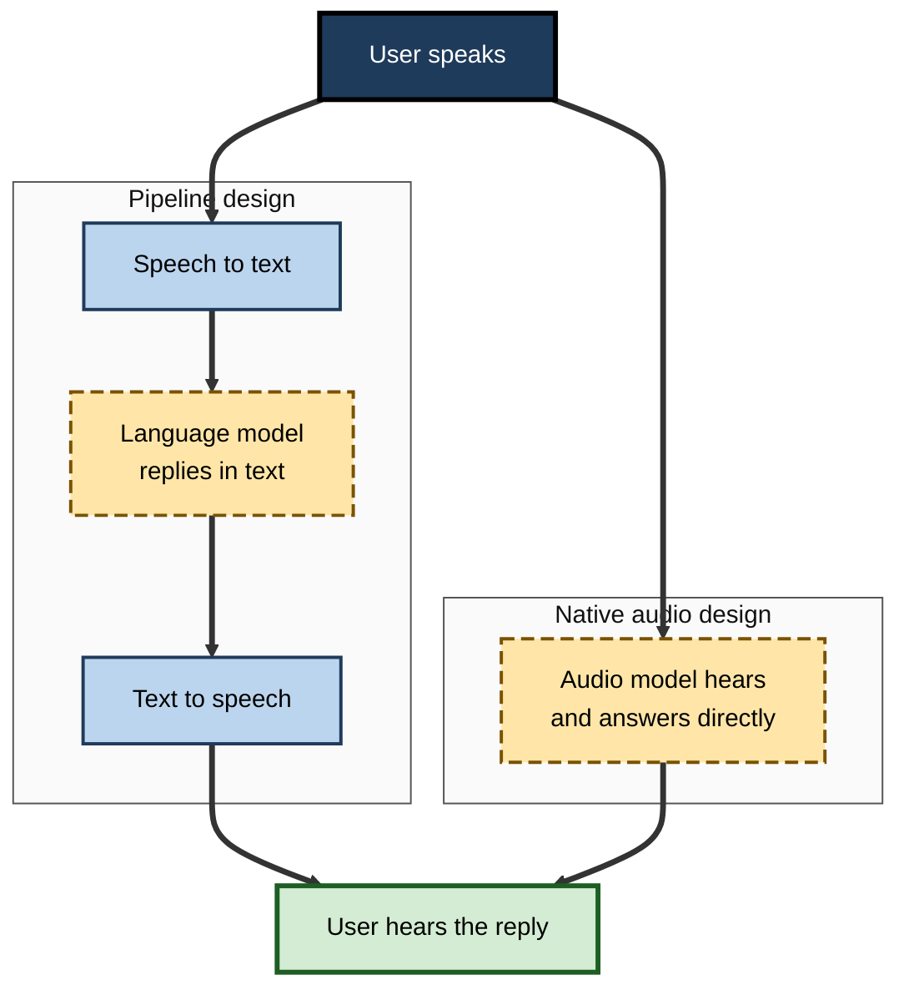

# A.8. AI tool interfaces and inputs

The same AI model can be met in a chat window, as grey "ghost text" finishing a sentence in a document, as a "Summarise" button above an email thread, as a voice answering through earbuds, or as a camera view that explains a warning light on a machine. Each interface invites a different kind of input and gives the user a different degree of control. Knowing what the tool is actually being given — and what it is not — is the difference between steering it and being surprised by it.

> **Definition — AI tool interface:** the means by which a person gives input to an AI tool and receives its output — a chat box, an embedded panel, an inline suggestion, a button, voice, camera, a shared editing canvas or a programmatic connection.

> **Definition — Input (context):** everything the model receives when it produces an output — the user's request, hidden instructions from the product, saved preferences and memories, conversation history, attached files, images or audio, retrieved documents and results from tools.

**Why interfaces and inputs matter**

- **Output quality depends on input.** The model can only use what reaches its context.
- **Much of the input is invisible.** Products add instructions, memories and retrieved content the user never sees.
- **Each interface has its own risks.** A button may send a whole mailbox thread; a screenshot may include a confidential window.
- **Interfaces shape habits.** Inline suggestions encourage acceptance; chat encourages dialogue; agents encourage delegation.

---

## The Main Interfaces

### Conversational interfaces

- **Chat** — a text box and a running conversation; the default since late 2022.
  - Strengths: flexible, iterative, easy to clarify and refine.
  - Weaknesses: the user must know what to ask; long conversations drift and accumulate irrelevant context.
- **Voice** — speaking and listening, on phones, in cars, through smart speakers and earbuds.
  - Strengths: hands-free, fast, accessible to people who find typing or reading difficult.
  - Weaknesses: harder to review; overheard in public; errors in transcription of names and terms.

### Embedded interfaces

- **Side panels** — an assistant docked beside a document, spreadsheet, mailbox or meeting, aware of what is open.
- **Inline suggestions** — predicted text or code shown in light grey, accepted with a key press.
- **Selection actions** — highlight text, then "rewrite", "shorten", "explain", "translate".
- **Buttons and menus** — one-click "summarise thread", "draft reply", "create slides from this document".
- **Slash commands and @-mentions** — typing "/summarise" or "@assistant" inside collaboration tools.

### Workspace and canvas interfaces

- **Canvas or artefact views** — a separate editing surface beside the chat where a document, code file, chart or small application is created and revised together (for example, Anthropic's Artifacts from 2024 and OpenAI's Canvas from late 2024).
- **Projects or workspaces** — folders grouping instructions, reference files and conversations for one piece of work.
- **Custom assistants** — configured versions of a general assistant with fixed instructions and files for a recurring task (*e.g.* "Contract clause checker", "Brand-voice editor").

### Perceptual and ambient interfaces

- **Camera and vision** — pointing a phone at an object, document or scene and asking about it.
- **Screen sharing** — letting the assistant see what is on the screen to guide the user.
- **Ambient listening** — tools that listen to meetings or consultations and produce notes without being addressed directly.

### Programmatic and agent interfaces

- **APIs and automation platforms** — AI steps inside workflows that run without a human typing anything.
- **Agent task panels** — a goal is given; the agent works in the background and reports progress, asking for approval when needed.

**Figure 1.** The main families of AI tool interfaces.

### Interfaces compared

| Interface | User effort | User control over input | Typical risk | Best for |
|---|---|---|---|---|
| Chat | Medium to high | High — the user writes the request | Pasting more than is allowed | Open-ended thinking, drafting, explanation |
| Inline suggestion | Very low | Low — context chosen by the product | Accepting without reading | Routine text and code |
| Button or selection action | Low | Medium — scope set by selection or page | Sending a whole thread or document unintentionally | Quick, repeated transformations |
| Voice | Low | Medium | Mis-transcription; being overheard | Hands-free questions, accessibility |
| Camera or screen | Low | Low to medium — everything in view is sent | Capturing confidential or personal details in frame | Physical-world questions, guidance |
| Agent task panel | Low per step | Low per step; high at goal-setting | Unintended actions | Repeated multi-step tasks |

> **Key point:** interfaces trade **effort for control**. The easier the interface, the more the **product** decides what goes into the model — and the more the user must understand those defaults.

**Figure 2.** Interfaces placed by how much attention they demand and how much control they give over input.

---

## What the Model Actually Receives

### The assembled context

When a user presses Enter, the product assembles a package of inputs. Typically:

1. **System prompt** — the product's hidden instructions: role, rules, tone, safety limits, today's date, available tools.
2. **Organisation settings** — for business tools, policies set by administrators.
3. **Custom instructions and memory** — the user's saved preferences ("I am a UK-based accountant; use British spelling") and facts the tool has remembered from earlier chats.
4. **Project or workspace files** — reference documents attached to the project.
5. **Conversation history** — earlier messages in this chat (sometimes summarised or truncated).
6. **The current request** — what the user just typed, said or selected.
7. **Attachments** — files, images, audio, screenshots.
8. **Retrieved content** — search results or passages from connected documents.
9. **Tool results** — outputs from calculators, code runs or other systems, fed back during the answer.

**Figure 3.** The layers assembled into a model's context for a single reply.

> **Definition — Custom instructions:** standing preferences a user saves so that the tool applies them to every conversation.

> **Definition — Memory (assistant memory):** a feature in which the assistant stores facts and preferences from past conversations and draws on them in later ones.

> **Watch out:** memory is convenient and easy to forget. An assistant that "remembers" a client's name or a personal health detail from months ago may surface it unexpectedly — including in a screen-shared meeting. Review and prune saved memories, and use temporary chats for one-off sensitive questions where policy permits.

### Tokens and the context window

- **Everything is measured in tokens** — pieces of words; in English, roughly three-quarters of a word per token on average.
- **The context window** is the maximum number of tokens the model can consider at once — instructions, history, files and reply together.
  - By 2025–26, leading models offered windows from roughly a hundred thousand to over a million tokens — from a long report to several books' worth of text.
- **When the window fills**, products drop, truncate or summarise older material — often silently.

> **Formula — Estimating tokens:** tokens ≈ words ÷ 0.75. Example: a 30-page report of about 15,000 words ≈ 15,000 ÷ 0.75 = **20,000 tokens**; ten such reports ≈ 200,000 tokens, close to the limit of many tools.

### Long inputs are not read evenly

**Study card — Liu and colleagues, "Lost in the Middle" (2023)**

- **Design:** researchers gave language models long inputs containing many documents, one of which held the answer, and varied **where** that document appeared.
- **Results:**
  - accuracy was highest when the relevant information was near the **beginning** or **end** of the input;
  - accuracy dropped markedly when it sat in the **middle** — sometimes below the accuracy of answering with no documents at all;
  - models with longer context windows were not immune.
- **Conclusion:** a model "having" information in its context does not guarantee it **uses** it.
- **Status:** newer models have improved on such tests, but long-context reliability still varies by model and task.

**Figure 4.** Use of information tends to dip in the middle of very long inputs.

> **In practice:** for long material, experienced users **point** the tool to the relevant section, ask it to quote the passage it relies on, split large jobs into parts, and place the key instruction at the end of the request as well as the start.

---

## Inputs by Modality

### Text

- **Typed or pasted text** — the most controllable input; the user sees exactly what is sent.
- **Formatting** — headings, bullet points and clear separators help the model distinguish instructions from material.
  - *e.g.* "Instructions: … ; Text to edit: …" rather than a single undivided paragraph.

### Files

- **How files become input** depends on the type and the product:
  - **text-based documents** (word-processing files, digital PDFs) — text extracted directly;
  - **scanned documents and images of pages** — read through **optical character recognition (OCR)** or by a vision-capable model;
  - **spreadsheets** — read as tables, or loaded into a code environment for analysis;
  - **slides** — text extracted, sometimes with images of each slide.
- **What can be lost:** tables mangled into lines, footnotes separated from text, charts reduced to captions, handwritten notes misread, pages skipped when a file is very large.

**Figure 5.** How an uploaded file becomes something the model can read.

> **Watch out:** "I uploaded the contract" does not mean "the model read the whole contract accurately". With long or scanned files, ask the tool to confirm the number of pages or sections it processed, and spot-check that it can quote specific clauses.

### Images, camera and screen

- **Vision-capable models** describe, read and reason about images: charts, diagrams, handwriting, photographs, interface screenshots.
- **Everything in the frame is input** — names on a whiteboard, a colleague's face, an open email in the corner of a screenshot.
- **Image text** can contain instructions too: text embedded in an image can act as a hidden prompt.

### Audio and voice

- **Two designs:**
  - a **pipeline** — speech is transcribed to text, the model replies in text, and the reply is converted to speech;
  - **native audio** models that process and produce speech directly, preserving tone and allowing interruption.
- **Practical implications:**
  - names, jargon and accents may be mis-transcribed, changing the request;
  - recording or transcribing other people raises consent and legal questions in many jurisdictions.

**Figure 6.** Two ways a voice assistant can process speech.

### Comparing input types

| Input type | What the user controls | What can go wrong | Good practice |
|---|---|---|---|
| Typed text | Exactly what is sent | Ambiguous requests | Separate instructions from material |
| Uploaded file | Which file | Partial reading; lost tables; hidden text | Confirm coverage; ask for quotations |
| Image or screenshot | The frame | Unintended details captured | Crop before sending |
| Voice | Words spoken | Mis-transcription; others overheard | Check the transcript of key terms |
| Connected data (mail, drive) | Permissions granted | The tool draws on more than intended | Narrow scopes; name the source in the request |

---

## Making Inputs Work

### What a well-formed request contains

A request is itself an input, and its quality shapes the output. Five elements recur in effective requests:

- **Task** — what to produce (*e.g.* "a 150-word summary").
- **Context** — who it is for and why (*e.g.* "for a finance director deciding whether to renew").
- **Material** — the source to work from, clearly marked.
- **Constraints** — length, tone, format, things to avoid, the standard of evidence required.
- **Output format** — bullet points, a table, a draft email, specific headings.

> **Mnemonic — "TC-MCO" ("Two Cats May Catch Owls"):** Task, Context, Material, Constraints, Output format.

### Worked example (illustrative): one request, three interfaces

**Situation:** a project manager needs a summary of a 40-message email thread about a delayed supplier delivery, for a steering-committee update.

1. **Selection action in the mail client** — "Summarise thread".
   - Input: the whole thread, plus the product's hidden instructions.
   - Output: a neutral summary — accurate, but not shaped for the committee, and it includes a side discussion about a colleague's absence.
2. **Side panel with a written request** — "Summarise this thread for a steering committee: the cause of delay, current delivery date, cost impact, and decisions needed. Exclude personnel matters. Five bullet points."
   - Input: the thread plus a precise task, context, constraints and format.
   - Output: focused and usable after a quick check.
3. **Voice request on a phone while walking** — "Summarise the supplier thread."
   - Input: whichever thread the assistant judged to be "the supplier thread", plus a mis-transcribed supplier name.
   - Output: a summary of the wrong thread.

| | Selection action | Side panel with request | Voice on the move |
|---|---|---|---|
| Effort | Lowest | Moderate | Low |
| Control over what is sent | Low | High | Low |
| Fit to purpose | Generic | Tailored | Unreliable |
| Risk | Irrelevant or personal details included | Lowest | Wrong source used |

- **Conclusion:** convenience interfaces are fine for **personal orientation**; outputs that others will rely on deserve an interface where the user controls the **task and the inputs**.

---

## Settings That Shape the Input

Beyond the request itself, a handful of settings silently change what the model receives and how it responds.

- **Model choice** — many tools offer a picker: a fast everyday model, a slower "reasoning" model, sometimes older versions.
  - Some products choose automatically, routing simple questions to cheaper models and hard ones to stronger models.
- **Web access** — on, off or automatic; determines whether current information is retrieved.
- **Connected sources** — which mailboxes, drives or apps the tool may search for this question.
- **Memory and history** — on or off; temporary or "incognito" chats that do not use or update memory.
- **Custom instructions** — standing preferences added to every request.
- **Language and region** — affecting spelling, units, legal assumptions and examples.
- **Creativity or style controls** — in some tools, settings resembling temperature, or presets such as "precise" and "creative".
- **Data controls** — whether content may be used to improve models.

| Setting | Changes what? | Typical default | When to change it |
|---|---|---|---|
| Model choice | Capability, speed, cost | Automatic or fast model | Complex analysis, long documents, hard reasoning |
| Web access | Freshness and sources | Often automatic | Off for confidential drafting; on for current facts |
| Connected sources | Which work data is searched | Varies by tool and organisation | Name the specific source in the request |
| Memory | What past information is reused | Often on in consumer tools | Off or temporary chat for one-off sensitive topics |
| Custom instructions | Tone, format, assumptions in every reply | Empty | Set role, spelling, format preferences once |

> **Watch out:** when an assistant gives a surprising answer, the cause is often a **setting**, not the request — an automatic switch to a smaller model, web access pulling in a dubious page, or an old memory colouring the reply. Checking settings is part of diagnosing poor output.

---

## Inputs at Organisational Scale

### From individual prompts to shared assets

- **Prompt libraries** — collections of tested requests for recurring tasks (*e.g.* "summarise a supplier contract for risk review"), maintained like templates.
- **Custom assistants and agents** — configured once, used by many; their instructions and files become **organisational assets** needing owners.
- **Reference files** — the documents attached to shared assistants decide the quality of every answer; outdated files silently degrade them.
- **Versioning** — changes to shared instructions are recorded and tested before release, as with any other business document or software change.
- **Testing** — a small set of realistic questions with expected answers is re-run whenever instructions, files or the underlying model change.

> **Definition — Prompt library:** a curated, maintained collection of tested requests and instructions for recurring tasks, shared across a team or organisation.

### Governance of shared inputs

- **Ownership** — every shared assistant has a named owner responsible for its instructions and reference files.
- **Access** — who may use, edit and see the configuration; some shared assistants should be visible only to particular teams.
- **Review cycle** — reference files checked against the current policy or product documentation at set intervals.
- **Retirement** — assistants whose owners have left, or whose files are obsolete, are archived rather than left to mislead.

> **In practice:** organisations that scale AI well treat **inputs as products**: a shared assistant is launched, documented, tested, monitored and retired like any other internal service — because its answers are only as current as its instructions and files.

---

## Outputs: What Comes Back

- **Text** — prose, bullet points, tables.
- **Code** — scripts, formulas, queries, sometimes run automatically.
- **Files** — documents, spreadsheets, slide decks, images, generated for download.
- **Voice** — spoken answers.
- **Structured data** — fields filled in a defined format for other software to use.
- **Actions** — in agent interfaces, changes made in other systems.

> **Definition — Structured output:** model output constrained to a defined format (such as named fields) so that conventional software can validate and use it reliably.

> **Key point:** the more an output **looks finished** — a formatted file, a polished slide, a sent email — the less likely people are to check it. Finish quality is not evidence of accuracy.

---

## Accessibility and Inclusion

- **Voice and dictation** help people with motor impairments, dyslexia or repetitive-strain injuries.
- **Image description** helps people who are blind or have low vision.
  - In 2023 the service Be My Eyes, which connects blind and low-vision users with sighted volunteers, added an AI feature ("Be My AI") built on a vision-capable model to describe photographs on request.
- **Simplification and translation** help people working in a second language or with cognitive disabilities.
- **Caution:** descriptions and transcriptions can be wrong in ways the user cannot easily check; for safety-critical information (medication labels, legal documents) human or authoritative confirmation remains important.

> **In practice:** inclusive teams treat AI interfaces as **assistive technology** as well as productivity tools — and check that approved tools work with screen readers and keyboard navigation.

---

## Case Study (illustrative): The Policy Assistant That Read Half the Policy

- **Situation:** an HR team set up a custom assistant to answer employees' questions about a 120-page leave policy, uploading the policy as a PDF.
- **Problem:** in testing, the assistant answered questions about early chapters well but gave generic or wrong answers about parental leave and carry-over rules.
- **Diagnosis:**
  1. Several later chapters had been **scanned** from a printed annex; the text-extraction step returned little readable text.
  2. Tables of entitlements were extracted as jumbled lines.
  3. When content was missing, the model filled the gap with **general knowledge** about typical leave policies, presented in the same confident tone.
- **Actions:**
  1. Replaced scanned pages with a digital, text-based version.
  2. Converted entitlement tables into clearly labelled text.
  3. Instructed the assistant to say "not covered in the policy" when no passage supported an answer, and to quote the clause it relied on.
  4. Built a test set of 40 real employee questions and re-ran it after every change.
- **Result:** accuracy on the test set rose sharply; unsupported answers were replaced by referrals to HR.
- **Lesson:** an assistant's knowledge is bounded by **what its inputs actually contain**; check the input pipeline, not just the answers.

> **Remember:** the model sees **context**, not intentions. Know **which interface** is sending **which inputs**; keep **instructions distinct from material**; confirm long or scanned files were **actually read**; and crop, trim and choose before sending.

---

## Common Misconceptions

- **"The assistant can see my screen and files."**
  - Only what has been shared, uploaded, connected or selected reaches the model; an assistant in one window usually knows nothing about another unless given access.
- **"A longer prompt is always better."**
  - Relevant detail helps; irrelevant material dilutes attention and uses context. Precision beats length.
- **"The chat remembers everything I said earlier."**
  - Very long conversations may be truncated or summarised; key constraints stated at the start can be lost later. Restating them, or starting a fresh chat with a clear brief, often works better.
- **"Voice and camera inputs are casual, so they are low risk."**
  - They often capture more than intended — other people's voices, faces, documents in view — and can carry the same confidentiality obligations as typed text.

> **Watch out:** the hidden layers of context mean two people typing the **same words** can receive **different answers** — because their memories, custom instructions, settings, connected sources or plans differ. When comparing outputs with colleagues, compare settings too.

---

## Open Questions

- **Will chat remain the dominant interface?**
  - Many designers argue that chat is a transitional form and that AI will mostly appear as embedded actions, agents and ambient helpers; others see conversation as a lasting general-purpose interface.
- **How much should products show of the assembled context?**
  - Showing system prompts, memories and retrieved passages increases transparency and control but adds complexity; practice varies.
- **Can long-context reliability be guaranteed?**
  - Windows have grown faster than evidence that models use all of their contents reliably.
- **What are the norms for ambient and camera inputs?**
  - Always-listening and always-seeing tools raise consent, workplace-monitoring and privacy questions that law and etiquette are still settling.

---

## Summary

- An **interface** is how input reaches an AI tool and output returns: **conversational** (chat, voice), **embedded** (side panels, inline suggestions, selection actions, buttons), **workspace** (canvas, projects, custom assistants), **perceptual and ambient** (camera, screen, meeting listeners) and **programmatic** (APIs, agents).
- Interfaces trade **effort for control**: the easier the interface, the more the product decides what is sent.
- The model receives an **assembled context**: system prompt, organisation settings, **custom instructions and memory**, project files, history, the request, attachments, retrieved content and tool results.
- Everything is measured in **tokens** within a **context window** (by 2025–26 up to around a million tokens or more); long inputs are not used evenly — **"Lost in the Middle" (2023)**.
- **Files** are converted (extraction, OCR, vision) and can lose tables, footnotes, charts and pages; **images** send everything in frame; **voice** may be pipelined or native, with transcription and consent issues.
- Effective requests specify **Task, Context, Material, Constraints, Output format**.
- Outputs range from text and code to files, voice, **structured output** and actions; polished outputs still need checking.
- AI interfaces are also **assistive technology** (voice, image description, simplification).
- An assistant is only as good as its **inputs actually received** — the HR policy case.

---

## Self-Check

1. Define "AI tool interface" and "input (context)".
2. Name the five families of interfaces with an example of each.
3. What does "interfaces trade effort for control" mean? Give an example.
4. List the main layers of context assembled for a single reply.
5. What are custom instructions and memory, and what risk does memory create?
6. Estimate the tokens in a 9,000-word document and explain why the estimate matters.
7. Describe the "Lost in the Middle" study and two practical responses to it.
8. How do digital documents, scans and spreadsheets differ in how they become model input?
9. Why can a screenshot be riskier than typed text?
10. Distinguish pipeline and native designs for voice assistants and one implication of each.
11. State the five elements of a well-formed request and apply them to "summarise this report".
12. In the worked example, why did the voice request fail?
13. Analyse the HR policy case: what was wrong with the inputs, and how was it fixed?
14. A colleague says, "I uploaded all 300 pages, so the assistant knows everything in them." Respond.

### Answer Key

1. Interface: the means by which a person gives input to and receives output from an AI tool. Input (context): everything the model receives — request, hidden instructions, preferences, memory, history, files, retrieved content and tool results.
2. Conversational (chat, voice); embedded (side panel, inline suggestions, "summarise" button); workspace (canvas, projects, custom assistants); perceptual and ambient (camera, screen share, meeting listener); programmatic (API automations, agent task panels).
3. Easier interfaces let the product choose what is sent. A one-click "summarise thread" sends the whole thread with hidden instructions; a typed request in a side panel lets the user specify scope and purpose.
4. System prompt; organisation settings; custom instructions and memory; project files; conversation history; the current request; attachments; retrieved content; tool results.
5. Custom instructions are saved standing preferences; memory stores facts from past chats for later use. Memory may surface sensitive or outdated details unexpectedly, including in front of others.
6. 9,000 ÷ 0.75 ≈ 12,000 tokens. It shows how much of the context window the document uses and hence how many such documents, plus history and reply, fit before material is truncated.
7. Models answered best when relevant information was near the start or end of long inputs and worse when it was in the middle. Responses: point the tool to the relevant section or split the job; ask it to quote the passage relied on; repeat key instructions at the end.
8. Digital documents: text extracted directly. Scans: OCR or vision reading, with more errors. Spreadsheets: read as tables or loaded into a code environment for analysis.
9. Everything in the frame is sent — other windows, names, faces, notifications — often unnoticed; images may also contain text acting as instructions.
10. Pipeline: speech-to-text, text model, text-to-speech — transcription errors change the request. Native: the model processes audio directly — more natural and responsive, but still subject to mishearing and to consent issues when others are recorded.
11. Task, Context, Material, Constraints, Output format. *e.g.* "Summarise the attached report (material) for the board deciding on next year's budget (context) as a one-page brief (task) with five bullets and a recommendation (format), using only figures stated in the report and flagging any uncertainty (constraints)."
12. The assistant guessed which thread was meant and mis-transcribed the supplier's name, so the input was the wrong thread; voice gave little control over the source.
13. Scanned pages yielded little text, tables were jumbled, and the model filled gaps with generic knowledge. Fixed by supplying text-based pages, reformatting tables, instructing it to quote clauses and admit gaps, and testing against real questions.
14. Uploading does not guarantee complete or accurate reading: very long files may be truncated or searched selectively, scans may be poorly extracted, and the middle of long inputs is used less reliably. Ask the tool what it processed, request quotations, and split the work by section.

---

## Glossary

| Term | Meaning |
|---|---|
| Canvas (artefact view) | A shared editing surface beside a chat where content is created and revised. |
| Context window | The maximum tokens a model can consider at once. |
| Custom assistant | A configured assistant with fixed instructions and files for a recurring task. |
| Custom instructions | Saved standing preferences applied to every conversation. |
| Inline suggestion | Predicted text or code shown in place, accepted with a key press. |
| Input (context) | Everything the model receives when producing an output. |
| Interface | The means by which input reaches an AI tool and output returns. |
| Memory | A feature storing facts from past chats for use in later ones. |
| Native audio model | A model that processes and produces speech directly. |
| Optical character recognition (OCR) | Converting images of text into machine-readable text. |
| Project (workspace) | A grouping of instructions, files and conversations for one piece of work. |
| Prompt library | A maintained collection of tested requests for recurring tasks. |
| Selection action | An AI command applied to highlighted text or content. |
| Structured output | Model output constrained to a defined format for software to use. |
| System prompt | Hidden instructions the product gives the model. |
| Token | A unit of text a model processes, roughly three-quarters of a word in English. |
| Vision-capable model | A model able to interpret images as input. |
