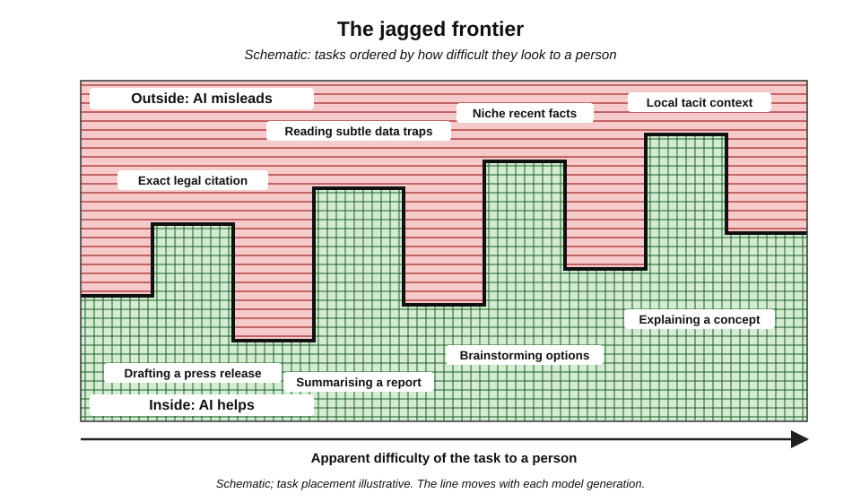
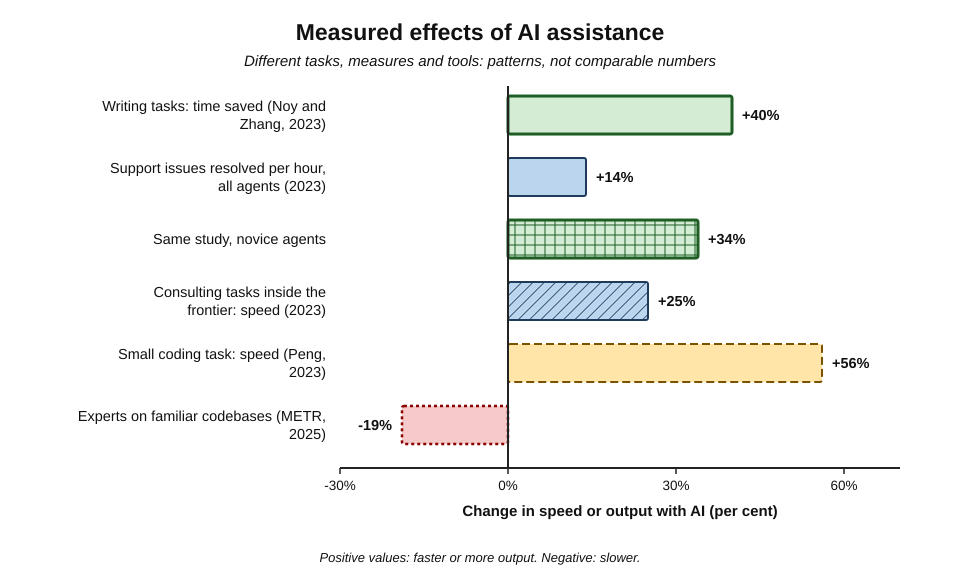
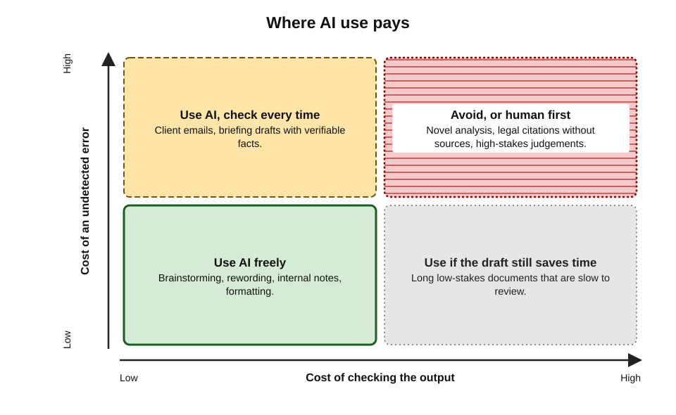
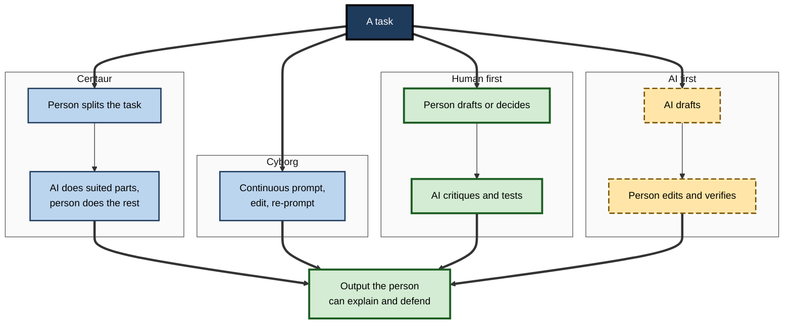
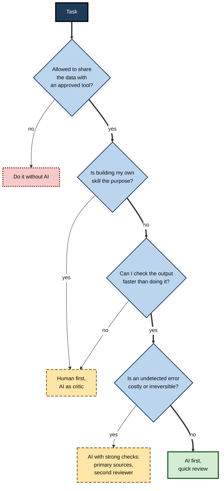

# A.9. When AI tools help vs when they do not

In 2023, several hundred management consultants were given the same AI assistant and two kinds of task. On creative product-development work, those using AI finished more tasks, faster, at markedly higher quality. On a business-analysis problem designed to look easy but needing careful reading of interview notes and figures, consultants with AI were **less** likely to reach the right answer than those without it. Same people, same tool, same week.

Whether AI helps depends less on the tool than on **the task, the user and the way they work together**.

> **Definition — Task–tool fit:** the degree to which a task's characteristics — its inputs, the kind of output needed, how easily results can be checked and what errors cost — match what a particular AI tool does reliably.

> **Definition — Jagged technological frontier (Dell'Acqua and colleagues, 2023):** the uneven, hard-to-see boundary between tasks that current AI performs well and tasks of apparently similar difficulty that it performs poorly.

**Why the question matters**

- **Value is real but uneven.** Strong evidence shows large gains on some tasks and losses on others.
- **The boundary is invisible.** Tasks inside and outside the frontier can look alike; fluent output hides which is which.
- **Errors cost more than time.** A tool that saves an hour but introduces one unnoticed error can be a net loss.
- **Professional judgement is the deciding skill.** Knowing when **not** to use AI is as important as knowing how to use it.

---

## What the Evidence Shows

### Writing and professional documents

**Study card — Noy and Zhang (2023), published in *Science***

- **Design:** 453 college-educated professionals (marketers, grant writers, consultants, data analysts, HR staff and others) completed realistic writing tasks such as press releases and short reports; half were given access to ChatGPT for the second task.
- **Results:**
  - time taken fell by about **40%**;
  - output quality, judged by experienced professionals blind to condition, rose by about **18%**;
  - weaker writers gained most, narrowing the gap between participants;
  - many used the tool to produce a draft they then lightly edited.
- **Caveats:** short, self-contained tasks; no requirement for specialist facts; a one-off experiment rather than long-term work.
- **Lesson:** for well-defined writing tasks that need fluency more than specialist facts, AI can deliver large gains.

### Customer support

**Study card — Brynjolfsson, Li and Raymond (2023; published 2025)**

- **Design:** the staggered introduction of an AI assistant suggesting responses to **5,179** customer-support agents at a software company, tracked through real work data.
- **Results:**
  - on average, agents resolved about **14%** more issues per hour;
  - **novice and lower-skilled** agents improved by about **34%**;
  - the most experienced and skilled agents saw little gain and, on some measures, a slight decline in quality;
  - customers were more polite to agents, and agent turnover fell.
- **Interpretation:** the assistant spread the **tacit practices of the best agents** — learned from their past conversations — to everyone else.
- **Lesson:** AI often helps **novices most**, by giving them access to accumulated expertise.

### Consulting: the jagged frontier

**Study card — Dell'Acqua and colleagues, with Boston Consulting Group (2023)**

- **Design:** 758 consultants were randomly assigned to work with or without GPT-4 on realistic tasks.
  - **Inside the frontier:** 18 creative and analytical product-development tasks.
  - **Outside the frontier:** a business-problem task deliberately chosen so that the AI would give a plausible but wrong answer unless the data were examined carefully.
- **Results inside the frontier:**
  - about **12%** more tasks completed;
  - about **25%** faster;
  - quality more than **40%** higher, as rated by evaluators;
  - lower-performing consultants gained most.
- **Results outside the frontier:**
  - consultants using AI were about **19 percentage points less likely** to produce the correct answer than those without it.
- **Working styles observed:**
  - **centaurs** divided work, handing defined sub-tasks to AI and keeping others;
  - **cyborgs** integrated AI continuously into every step.
- **Lesson:** the same tool can raise quality on one task and lower it on another; users cannot easily tell which side of the frontier a task lies on.

**Figure 1.** The jagged frontier: tasks of similar apparent difficulty fall on opposite sides of what AI does well.

### Software development

**Study card — Peng and colleagues (2023)**

- **Design:** developers were asked to write a small web server in JavaScript; one group had GitHub Copilot.
- **Result:** the Copilot group finished about **56% faster**.
- **Caveat:** a single, well-specified, self-contained task — the kind where code completion excels.

**Study card — METR (2025)**

- **Design:** 16 experienced open-source developers worked on 246 real tasks in large, mature projects they knew well; each task was randomly assigned to "AI allowed" or "AI not allowed", using early-2025 tools.
- **Results:**
  - with AI allowed, tasks took about **19% longer**;
  - developers had **expected** a speed-up of about 24% and, afterwards, **believed** they had been sped up by about 20%.
- **Possible reasons:** time spent prompting, waiting, reviewing and correcting; the developers' deep familiarity with their code; high quality standards.
- **Follow-up:** METR's 2026 update with newer tools suggested a speed-up instead, but with a very wide uncertainty range; METR itself flagged the original result as dated.
- **Lesson:** **perceived** productivity is an unreliable guide; on complex, familiar, high-standard work, AI assistance can slow experts down.

### Economy-wide effects so far

**Study card — Humlum and Vestergaard (2025)**

- **Design:** survey responses on AI chatbot use from about 25,000 workers in 7,000 Danish workplaces in exposed occupations, linked to official records of earnings and hours.
- **Results:**
  - adoption was widespread, and users reported modest time savings — averaging only a few per cent of working hours;
  - effects on earnings and recorded hours were close to **zero** in the period studied.
- **Interpretation:** task-level gains do not automatically become organisation-level or economy-level gains; time saved may be absorbed by new tasks, checking, or simply not captured.

**Figure 2.** Measured effects of AI assistance in selected studies, 2023–2025.

> **Watch out:** headline percentages from different studies are **not comparable** — they measure different things (time, output per hour, quality, correctness), on different tasks, with different tools and people. And the tools have improved since most were run. The durable findings are the **patterns**: large gains on well-matched tasks; smaller or negative effects on poorly matched ones; larger gains for less experienced users; and a persistent gap between perceived and measured benefit.

---

## Why AI Helps Where It Helps

### The task features that predict benefit

- **Language-heavy output** — drafts, summaries, rewrites, translations, explanations, code.
- **A good draft is valuable** — the person can edit faster than write from scratch.
- **Cheap verification** — the output can be checked quickly against the source, a test or the person's own knowledge.
- **Low cost of error** — mistakes are easy to catch and harmless if missed.
- **Well-trodden territory** — the topic is widely represented in the data models were trained on.
- **Context can be supplied** — all needed information fits in the request or attached material.
- **The person has enough expertise to judge** — they can recognise a bad answer.

### The task features that predict harm or waste

- **Exact facts, figures or citations needed** without a reliable source or tool to ground them.
- **Novel, niche or very recent** knowledge, thin in training data.
- **Tacit, local context** — office politics, a client's unspoken priorities, the history behind a decision — not in any document.
- **Expensive verification** — checking takes as long as doing, or needs expertise the user lacks.
- **High cost of error** — legal, financial, medical, safety or reputational consequences.
- **Accountability or relationship at the core** — a condolence message, a performance conversation, a negotiation where trust is the point.
- **Learning is the goal** — when the task exists to build the person's own capability, outsourcing it defeats the purpose.
- **Data constraints** — the material cannot lawfully or contractually be shared with the available tool.

> **Mnemonic — "LDC-WEC" for when AI helps ("Lucky Dogs Chase Wet Easy Cats"):** **L**anguage output, **D**raft valuable, **C**heap to check, **W**ell-trodden topic, **E**rrors cheap, **C**ontext suppliable.

| | AI tends to help | AI tends not to help |
|---|---|---|
| Output | Language, code, structure | Exact facts, figures, citations without grounding |
| Knowledge required | Widely documented | Niche, novel, very recent or tacit |
| Verification | Quick and within the user's expertise | Slow or beyond the user's expertise |
| Cost of an error | Low, easily caught | High, possibly irreversible |
| Human element | Incidental | Central — trust, care, accountability |
| Purpose | Getting the work done | Building the person's own skill |

---

## The Economics of Checking

### Generation is cheap; verification is not

- **AI lowers the cost of producing** text, code and analysis to almost nothing.
- **It does not lower the cost of checking** them — and may raise it, because plausible errors are harder to spot than obvious ones.
- **Net benefit therefore depends on the balance**:

> **Formula — Net benefit of using AI on a task:** net benefit = time saved − time spent prompting and reviewing − (probability of an undetected error × cost of that error). Example: drafting a client email takes 20 minutes manually; with AI, 3 minutes to prompt and 5 to review saves 12 minutes; if there is a 2% chance of an undetected factual slip costing about 60 minutes of repair, the expected cost is 0.02 × 60 = 1.2 minutes, so the net benefit ≈ **10.8 minutes**.

- **The same formula condemns some uses:** if review takes as long as writing, or a single missed error could cost a client relationship, the net benefit can be negative.

**Figure 3.** Where AI use pays, by cost of checking and cost of an error.

> **Key point:** the right question is not "Can AI do this?" but "**Can I check what it produces, faster and more cheaply than doing it myself, given what an error would cost?**"

### Who benefits most

- **Novices** — gain most on average, because AI supplies patterns they have not yet learned.
  - **But** they are least able to spot errors, so their gains are fragile outside the frontier.
- **Experts** — gain less on routine tasks they already do quickly, and may be slowed by checking.
  - **But** they are best able to use AI on hard tasks, because they can judge and correct it.
- **Implication:** organisations should pair novice use with **review by experienced colleagues**, and expect experts to use AI selectively.

> **Watch out:** the "levelling" effect is real but double-edged. If novices rely on AI for the tasks through which they would have built expertise, the pipeline of future experts — the people who can check AI — may weaken. The long-run effect on skill formation is not yet known.

---

## Human Factors That Decide the Outcome

### Over-reliance and automation bias

- **Automation bias** — accepting automated output without sufficient scrutiny — is long documented in aviation, medicine and process control.
- **With generative AI**, fluent and confident output invites the same response.
- **Evidence:** a 2025 survey of 319 knowledge workers by researchers at Microsoft Research and Carnegie Mellon University found that higher confidence in AI was associated with **less** reported critical thinking, while higher confidence in one's own expertise was associated with **more**.
- **Practical signs of over-reliance:**
  - accepting outputs without reading them in full;
  - no longer checking figures and citations;
  - inability to explain or defend the work;
  - discomfort when the tool is unavailable.

> **Definition — Over-reliance:** depending on an AI tool beyond what its actual reliability justifies, so that its errors pass into the work.

### Working patterns

- **Centaur** — the person divides the task, hands well-suited sub-tasks to AI, and does the rest.
- **Cyborg** — the person interleaves AI throughout, prompting, editing and re-prompting continuously.
- **Human first, AI second** — the person drafts or decides, then uses AI to critique, test or improve.
- **AI first, human second** — AI drafts, the person edits and verifies.

**Figure 4.** Four ways of combining human and AI effort on a task.

> **In practice:** "human first" protects independent thinking on judgement-heavy tasks — strategy, diagnosis, assessment — because the person forms a view before seeing the AI's; "AI first" suits routine drafting where speed matters and errors are easy to see.

---

## Worked Example (illustrative): Screening a Week's Tasks

**Situation:** a policy analyst in a government department reviews six upcoming tasks.

| Task | Language output? | Cheap to check? | Error cost | Tacit context? | Verdict |
|---|---|---|---|---|---|
| Summarise a 60-page consultation report already read once | Yes | Yes — familiar with it | Moderate | No | **Use AI**, verify key points against the report |
| Draft a ministerial briefing on a new regulation | Yes | Partly | High | Some | **Use AI for structure and first draft**; facts from primary sources; senior review |
| Find the exact commencement date of a statutory provision | No — a fact | Yes, at the source | High | No | **Go to the legislation**; AI only to locate it |
| Write condolence note to a stakeholder's family | Yes | Yes | High (relationship) | Yes | **Write personally**; AI at most for wording ideas |
| Analyse 3,000 free-text survey comments for themes | Yes | Partly — sample check | Moderate | No | **Use AI** with a coding frame; check a random sample |
| Recommend which of two options to advise | Partly | No | High | Yes | **Human first**: form a view, then use AI to challenge it |

1. **Apply the features** — language output, verification cost, error cost, tacit context.
2. **Choose a pattern** — AI first, human first, centaur, or no AI.
3. **Specify the check** — what will be verified, against what, by whom.

- **Conclusion:** AI is useful in four of six tasks, but in **different roles**; in none is it the final authority.

**Figure 5.** Deciding whether and how to use AI on a task.

---

## Helping and Not Helping Across Professions

The general features play out differently in each field. Snapshots as of 2026:

- **Software engineering**
  - *Helps:* boilerplate code, tests, explaining unfamiliar code, translating between languages, routine bug fixes — all checkable by running the code.
  - *Does not help (or slows):* deep changes in large, idiosyncratic codebases; security-critical logic accepted without review; architecture decisions depending on organisational context.
- **Law**
  - *Helps:* first drafts of standard documents, summarising long bundles, comparing versions, issue-spotting checklists.
  - *Does not help:* citing authorities without checking them; advice on novel points; anything where a fabricated case or misread clause causes harm.
- **Medicine and healthcare**
  - *Helps:* drafting clinical notes from consultations for clinician review; patient-friendly explanations; administrative letters.
  - *Does not help:* unsupervised diagnosis or treatment decisions; rare conditions; any output entering the record unchecked.
- **Finance and accounting**
  - *Helps:* variance commentary, reconciliation explanations, drafting reports from verified figures, formula help.
  - *Does not help:* computing figures directly in a chat without deterministic tools; interpreting new regulations without the primary text.
- **Human resources**
  - *Helps:* job-description drafts, policy summaries, interview-question banks, translating communications.
  - *Does not help:* decisions about individuals — screening, rating, dismissal — where bias, fairness and legal duties demand human judgement and documented reasons.
- **Teaching and training**
  - *Helps:* generating practice questions, varied examples, differentiated explanations, feedback drafts.
  - *Does not help:* when students' own production of work is the point of the exercise.

| Field | Strongest current uses | Where caution is greatest |
|---|---|---|
| Software | Tests, boilerplate, explanation | Security logic, large legacy changes |
| Law | Drafting, summarising, comparing | Citations, novel advice |
| Healthcare | Clinical-note drafting, explanation | Diagnosis, unsupervised decisions |
| Finance | Commentary from verified figures | Direct calculation, new regulations |
| HR | Drafting, summarising policy | Decisions about individuals |
| Education | Practice material, feedback drafts | Replacing the learner's own work |

> **Key point:** across professions, AI is strongest as a **drafter, summariser and explainer under expert review**, and weakest as an **unsupervised source of facts or decider about people**.

### Measuring benefit in one's own work

- **Time a sample of tasks** with and without AI rather than relying on impressions — the METR result shows how far impressions can drift.
- **Count corrections** — how many edits, how many factual fixes, how many complete rewrites.
- **Track errors that escaped** — mistakes found later by colleagues or clients.
- **Notice task drift** — whether the time saved goes into more valuable work or into extra low-value output.
- **Review periodically** — the frontier moves; a task that failed six months ago may now succeed, and vice versa after a model change.

> **In practice:** experienced users keep a short personal list of "tasks where AI earns its keep" and "tasks where it does not", revisiting it whenever their tools change.

---

## Case Study: A Government Report With Invented References

- **Situation:** in 2025 the consulting firm Deloitte delivered a report to the Australian Government's Department of Employment and Workplace Relations reviewing an automated welfare-compliance system, under a contract worth about A$440,000.
- **What was found:** after publication, an academic noticed **citations to papers that did not exist**, references attributed to real scholars who had not written them, and a **fabricated quotation** attributed to a court judgment.
- **Response:**
  - the firm issued a corrected version, adding a disclosure that a generative AI tool had been used in preparing part of the report;
  - it agreed to refund the final contract instalment;
  - the firm and department stated the report's substantive findings were unchanged.
- **Diagnosis:**
  1. **Task outside the frontier** — producing specific scholarly references and legal quotations is exactly where language models fabricate plausibly.
  2. **Verification not proportionate to stakes** — references in a government report were not individually checked against sources.
  3. **Late disclosure** — the client was not told in advance how AI was used.
- **Lesson:** AI helped with drafting but **hurt** where exactness and citation were required; the cost — financial, reputational and to public trust — far exceeded any time saved.

> **Remember:** AI helps most on **language-heavy, draftable, cheaply checked, low-stakes, well-documented** tasks, for users who can **judge the output**. It helps least — and can harm — on **exact, novel, tacit, high-stakes, relationship-centred or learning** tasks. Decide by the **economics of checking**, not by what the tool can produce.

---

## Common Misconceptions

- **"If AI can do the hard task, it can certainly do the easy one."**
  - Capability is jagged: a model that writes a competent market analysis may miscount the words in a sentence or misread a simple table. Difficulty for people is a poor guide to difficulty for AI.
- **"Better models make the question go away."**
  - Each generation moves the frontier, but it remains jagged; new capabilities also tempt users into new tasks just beyond it.
- **"It saved me time, so it helped."**
  - Time saved now may be repaid later in corrections, rework or lost trust; and self-reported savings systematically exceed measured ones.
- **"Experts don't need AI; novices do."**
  - Novices gain more on average, but experts are better placed to use AI safely on demanding work, because they can see when it is wrong.
- **"Refusing to use AI is the safe choice."**
  - Avoidance forgoes well-evidenced gains on suitable tasks and leaves the person less able to judge AI-produced work by others. The professional position is **selective, checked use**.

> **Watch out:** many published "productivity gains" come from vendor studies, short experiments or self-report surveys. Independent, randomised, real-work evidence is far scarcer — and, as the METR and Danish studies show, sometimes points the other way.

---

## Open Questions

- **How fast is the frontier moving?**
  - Each model generation moves some tasks inside the frontier; mapping which, for which users, is continuous work, and published studies age quickly.
- **Why do task-level gains not show up in aggregate statistics?**
  - Explanations include time absorbed by checking and new work, uneven adoption, organisational lag and mismeasurement; evidence is still early.
- **What happens to expertise over time?**
  - If novices rely on AI for formative tasks, the supply of experts able to verify AI may fall; long-term studies are lacking.
- **Can tools signal their own uncertainty usefully?**
  - Confidence indicators could help users know when a task lies outside the frontier, but calibration of such signals remains poor.
- **How should productivity be measured?**
  - Speed, quality, error rates, learning and well-being can move in different directions; no consensus metric exists.

---

## Summary

- Whether AI helps depends on **task–tool fit**, the **user** and the **working pattern**; capability is **jagged** — tasks of similar apparent difficulty fall on opposite sides of the **frontier** (Dell'Acqua et al., 2023).
- Evidence: **writing** time −40%, quality +18% (Noy and Zhang, 2023); **customer support** +14% overall, +34% for novices (Brynjolfsson et al.); **consulting** large gains inside the frontier, 19 points less correct outside; **coding** 56% faster on a small task (Peng et al.) but 19% slower for experts on familiar codebases (METR, 2025); **economy-wide** effects near zero so far (Humlum and Vestergaard, 2025).
- AI helps with **language output, valuable drafts, cheap checking, cheap errors, well-documented topics and suppliable context** (LDC-WEC); it struggles with **exact facts, novel or tacit knowledge, expensive checking, high stakes, relationships and learning goals**.
- **Net benefit = time saved − review time − expected error cost**; generation is cheap, verification is not.
- **Novices gain most but are least able to spot errors**; experts gain less on routine work but use AI best on hard work.
- **Automation bias** and **over-reliance** grow with confidence in AI; choose patterns — **centaur, cyborg, human first, AI first** — deliberately.
- The **Deloitte Australia report (2025)** shows the cost of using AI outside the frontier without proportionate verification.

---

## Self-Check

1. What is the jagged technological frontier, and why is it a problem for users?
2. Summarise the design and results of Noy and Zhang (2023).
3. Why did novice support agents gain more than experienced ones in Brynjolfsson and colleagues' study?
4. What happened to consultants using AI on the task outside the frontier?
5. Contrast the Peng (2023) and METR (2025) coding results and explain why both can be true.
6. What did Humlum and Vestergaard find, and what does it suggest?
7. List six task features that predict AI will help.
8. List six task features that predict AI will not help.
9. Use the net-benefit formula: a task takes 30 minutes manually; with AI, 10 minutes of prompting and review; there is a 10% chance of an undetected error costing 120 minutes. Is AI worth using?
10. Why do novices gain most but face the greatest risk?
11. What is automation bias, and what did the 2025 Microsoft–Carnegie Mellon survey find?
12. Distinguish centaur, cyborg, human-first and AI-first patterns, and say when human-first is preferable.
13. Analyse the Deloitte Australia case using the task features.
14. A manager wants all staff to use AI "for everything" to boost productivity by 30%. Advise them.

### Answer Key

1. The uneven boundary between tasks AI does well and similar-looking tasks it does badly. Users cannot easily tell which side a task is on, and fluent output hides failure.
2. 453 professionals did realistic writing tasks; those with ChatGPT took about 40% less time and produced about 18% higher-quality work, with weaker writers gaining most.
3. The assistant, trained on top agents' conversations, transmitted expert practices; novices lacked them and benefited, while experts already had them.
4. They were about 19 percentage points less likely to reach the correct answer than consultants without AI, because the AI's plausible but wrong analysis was accepted.
5. Peng: a small, well-specified, self-contained task — 56% faster. METR: experienced developers on large, familiar, high-standard codebases — 19% slower. Benefit depends on task type, codebase complexity and expertise; perceived speed-ups can mislead.
6. Despite widespread adoption and some reported time savings, effects on earnings and hours were near zero; task-level gains do not automatically translate into aggregate economic effects.
7. Language-heavy output; drafts valuable; cheap verification; low error cost; well-documented topic; context can be supplied; user able to judge.
8. Exact facts or citations without grounding; novel or niche knowledge; tacit local context; expensive verification; high error cost; relationship or accountability central; learning as purpose; data-sharing constraints (any six).
9. Time saved = 30 − 10 = 20 minutes. Expected error cost = 0.10 × 120 = 12 minutes. Net benefit ≈ 8 minutes — positive but modest; reducing the error probability (better grounding or checks) would improve it, and a higher error cost could make it negative.
10. AI supplies patterns they lack, raising average output, but they lack the expertise to detect errors, especially outside the frontier; and over-reliance may slow their development of expertise.
11. Accepting automated output without sufficient scrutiny. The survey of 319 knowledge workers found higher confidence in AI associated with less critical thinking, and higher self-confidence with more.
12. Centaur: divide tasks between person and AI. Cyborg: interleave AI continuously. Human first: person drafts or decides, AI critiques. AI first: AI drafts, person verifies. Human first is preferable for judgement-heavy decisions, so the person's own view is formed before AI anchors it.
13. Exact citations and legal quotations (outside the frontier); high error cost (a government report); verification was cheap in principle (look up each reference) but not done; disclosure absent. The task demanded exactness and accountability — conditions in which AI harms unless rigorously checked.
14. Evidence shows gains are task-specific and can be negative outside the frontier; perceived gains overstate measured ones. Map tasks by fit and checking cost; target AI where verification is cheap and errors tolerable; require checks proportional to stakes; pilot and measure actual outcomes (quality and errors, not just speed); train staff on when not to use AI.

---

## Glossary

| Term | Meaning |
|---|---|
| AI-first pattern | AI drafts and the person edits and verifies. |
| Automation bias | Accepting automated output without sufficient scrutiny. |
| Centaur | A working style dividing tasks between person and AI. |
| Cyborg | A working style interleaving AI continuously throughout a task. |
| Human-first pattern | The person drafts or decides before using AI to critique. |
| Jagged technological frontier | The uneven boundary between tasks AI does well and similar tasks it does badly. |
| Levelling effect | AI's tendency to raise the performance of less experienced workers most. |
| Net benefit | Time saved minus review time minus expected cost of undetected errors. |
| Over-reliance | Depending on AI beyond what its reliability justifies. |
| Perceived productivity | Users' own estimate of speed gains, often different from measured gains. |
| Tacit knowledge | Know-how and context that is hard to write down or put into a request. |
| Task–tool fit | How well a task's features match what an AI tool does reliably. |
| Verification cost | The time and expertise needed to check an AI output. |
