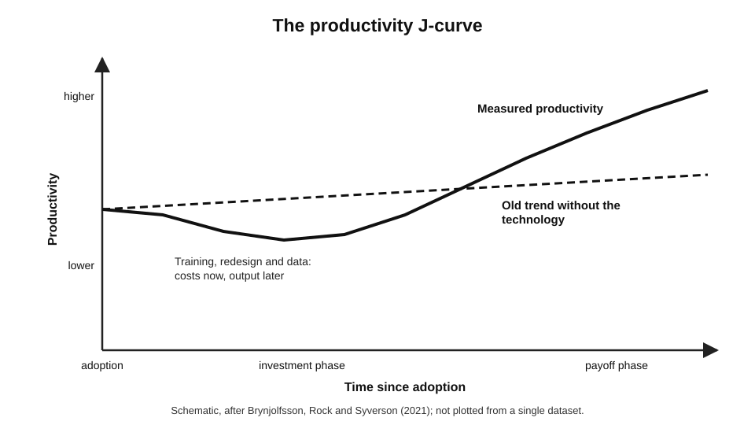
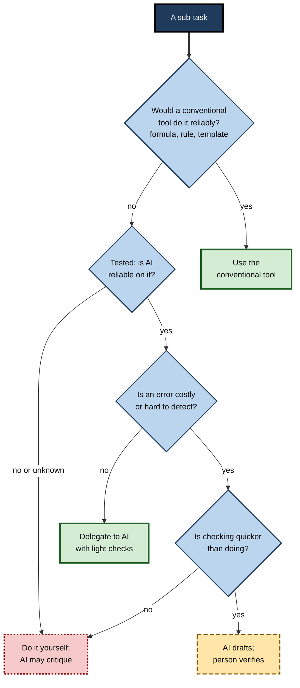
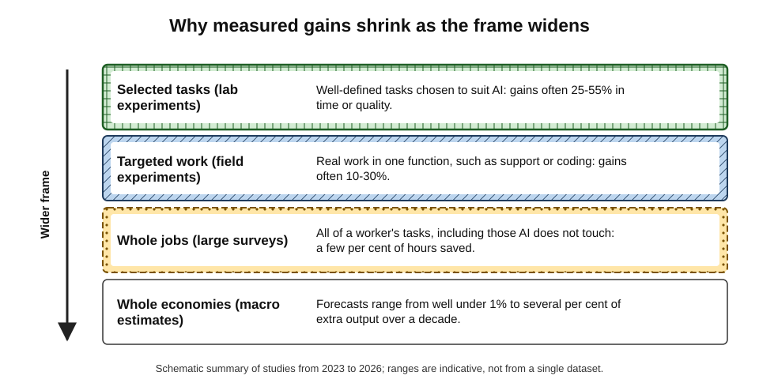
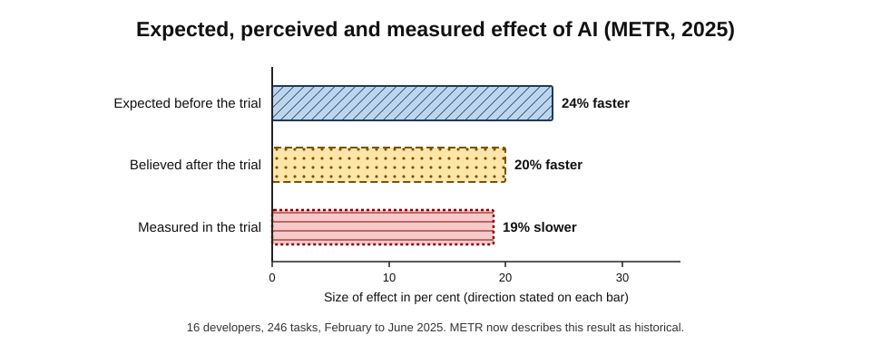
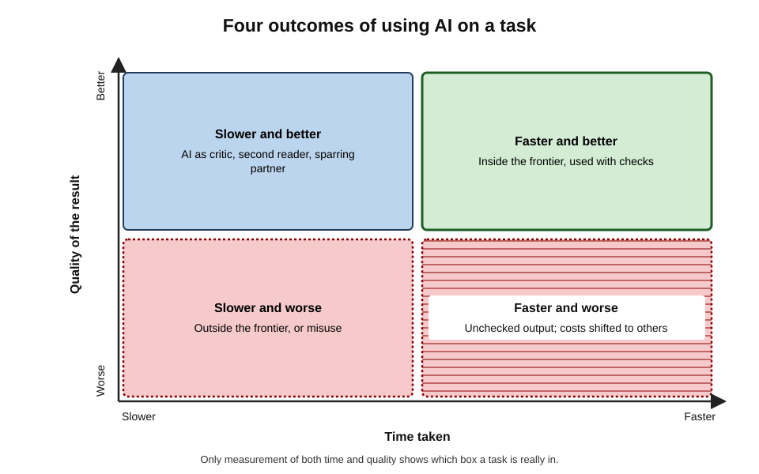
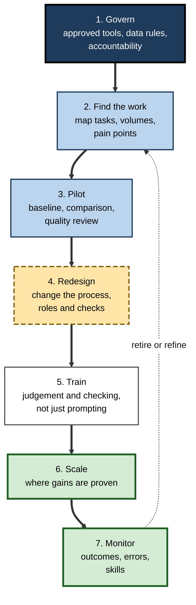

# B. Using AI for Productivity

In the same week, two reports about AI and work appear. In one, professionals using AI finished writing tasks 40% faster and produced better work. In the other, a survey of tens of thousands of workers found that AI saved under 3% of working hours and changed nobody's pay. Both are accurate. The gap between them is the subject here: how AI makes everyday digital work faster and better, why the gains are so uneven, and how to tell real productivity from the feeling of it.

> **Definition — Productivity:** the ratio of valuable output to the inputs — time, effort, money — used to produce it.

> **Definition — AI-assisted productivity:** the change in the quantity, quality or value of work achieved per unit of input when AI tools are used for some of its tasks, after accounting for the time spent directing, checking and correcting them.

**Why it matters**

- Generative AI is the first widely available technology that performs **non-routine cognitive tasks** — drafting, summarising, analysing, coding — that make up much of knowledge work.
- Expectations are enormous, from personal time savings to national growth forecasts; investment decisions, job designs and careers are being shaped by them.
- Gains are real but **uneven**: large on some tasks, absent or negative on others, and often smaller across whole jobs than on the tasks studied.
- The professional skill is not using AI more but using it **where it pays**, checking it **where it matters**, and **measuring** the difference honestly.

---

## What Productivity Means in Knowledge Work

### Output, input and value

> **Formula — Labour productivity:** output ÷ hours worked. Example: a team produces 120 resolved support tickets in 40 hours → 3 tickets per hour. If AI raises this to 3.6 per hour with no loss of quality, productivity has risen by 20%.

- **Manufacturing** productivity is easy to count: units per hour.
- **Knowledge work** is harder:
  - outputs vary in quality and value — a report can be long and useless;
  - much value is **downstream** — a good analysis prevents a bad decision months later;
  - effort is invisible — thinking, reading and checking leave no trace in the output.
- **Peter Drucker (1999)** called raising knowledge-worker productivity the biggest management challenge of the twenty-first century, arguing that it starts with asking **"What is the task?"** rather than how fast it is done.

> **Key point:** for knowledge work, productivity has at least three dimensions — **speed**, **quality** and **value**. AI can raise one while lowering another, so a single measure can mislead.

### Efficiency and effectiveness

- **Efficiency** — doing a task with fewer inputs.
  - *e.g.* drafting a status report in 10 minutes instead of 40.
- **Effectiveness** — doing the right tasks, to the right standard.
  - *e.g.* realising the status report is unread and replacing it with a two-line message to the one person who needs it.

> **Definition — Efficiency:** achieving an output with fewer inputs. **Effectiveness:** achieving the outputs that actually matter.

> **Watch out:** AI makes it cheap to produce more — more emails, more slides, more reports. More output is not more productivity if the extra output is not valuable, or if it consumes other people's time to read.

### The productivity paradox

- **Robert Solow (1987):** "You can see the computer age everywhere but in the productivity statistics."
  - Computers spread through offices in the 1970s and 1980s, yet measured productivity growth stayed low until the mid-1990s.
- **Explanations then, relevant now:**
  - **measurement** — quality improvements and new services are poorly captured;
  - **lags** — organisations needed years to redesign work around the new tools;
  - **redistribution** — some gains went to some firms or workers at others' expense;
  - **mismanagement** — technology added to old processes rather than changing them.

**The productivity J-curve**

- **Erik Brynjolfsson, Daniel Rock and Chad Syverson (2021)** argued that general-purpose technologies require large **intangible investments** — training, process redesign, new data, new roles — that are costs today and produce output later.
- Measured productivity therefore can **dip before it rises**, tracing a J-shape.

**Figure 1.** The productivity J-curve.

> **Definition — General-purpose technology:** a technology that spreads across many sectors, improves over time and enables complementary innovations — such as electricity, computing and, many economists argue, AI.

---

## Tasks, Not Jobs: Decomposing Work for AI

### Why decomposition comes first

- Technology changes **tasks**, not whole jobs: AI drafts the email but does not own the client relationship.
- A job is a bundle of tasks of very different kinds: some well suited to AI, some unsuited, some that AI changes rather than replaces.
- **Productivity gains come task by task.** The first step in using AI productively is to break work into parts that can be judged separately.

> **Definition — Task decomposition:** breaking work into sub-tasks, each with defined inputs, outputs and quality standards, so that each can be assigned to a person, a conventional tool or an AI tool, and checked.

### The jagged frontier

- The experiment with consultants at Boston Consulting Group (Dell'Acqua and colleagues, 2023) found that AI greatly improved performance on tasks inside its capability, and made consultants **more likely to be wrong** on a task of similar apparent difficulty just outside it — the **jagged technological frontier**.
- **Practical consequence:** whether a task is inside the frontier must be learned through **testing on that task**, not inferred from how hard it seems.

### The delegation decision

**Figure 2.** Deciding how to use AI for a sub-task.

- **Conventional tools first** — calculations belong in spreadsheets, fixed rules in workflows, standard wording in templates.
- **Reliability is tested, not assumed** — on this task, with this tool.
- **Consequence and detectability** decide how much checking is needed.
- **Checking cost** decides whether AI is worth using at all: if verifying a draft takes as long as writing it, the gain disappears.

> **Mnemonic — "TRCC":** Tool first, Reliability tested, Consequence weighed, Checking cost counted.

### Patterns of collaboration

- Observers of the consultants distinguished **centaurs**, who divided work between themselves and AI along clear lines, from **cyborgs**, who interleaved AI continuously in every step.
- Repeated, consequential work tends to suit a centaur-like division, where each AI contribution can be checked; exploratory work often suits a cyborg-like flow.
- Designing a **personal workflow** — standing instructions, defined checks and a log of time and errors — turns individual experiments into a reliable practice.

---

## What AI Does in Everyday Work

Across tools and tasks, AI contributes in a small number of fundamental ways. Each has its own typical gain and its own typical failure.

- **Generating** — producing new content from a brief: drafts, ideas, outlines, images, code.
  - *Typical failure:* plausible content not grounded in fact; generic output.
- **Transforming** — changing existing content: shortening, restructuring, changing tone, translating, reformatting.
  - *Typical failure:* subtle changes of meaning; additions and omissions.
- **Condensing and extracting** — summarising, pulling out facts, decisions and actions.
  - *Typical failure:* omission, distortion of emphasis, overgeneralisation.
- **Analysing** — finding patterns in data and text, writing and running code, explaining results.
  - *Typical failure:* correct arithmetic on the wrong question; confident stories about artefacts.
- **Automating** — performing recurring steps without being asked each time.
  - *Typical failure:* silent errors repeated at scale.
- **Acting** — agents that plan and take actions with tools.
  - *Typical failure:* wrong actions taken confidently; manipulation by hidden instructions.

| Mode | Typical gain | Main risk | Usual safeguard |
|---|---|---|---|
| Generating | Large time saving on first drafts | Invented or generic content | Brief precisely; verify facts and commitments |
| Transforming | Moderate time saving; better fit to audience | Meaning drift | Compare with the original on key points |
| Condensing | Large reading-time saving | Omission and distortion | Passage references; read sources when stakes are high |
| Analysing | Access to methods; speed | Wrong question, invisible assumptions | Reconcile totals; read and rerun code |
| Automating | Repeated savings over time | Silent failure at scale | Validation rules, exception queues, logs |
| Acting | Multi-step work done end to end | Consequential errors; security | Least privilege; approvals for irreversible actions |

> **Key point:** the further down the list, the more the safeguards must be **built into the system** rather than left to the person's attention — because the person sees less of each individual output.

- **Everyday applications** — from drafting messages and condensing long documents to organising a working week or producing a first image for a slide — are combinations of these modes; the same principles of briefing, decomposition and checking apply to all of them.

---

## The Evidence on AI and Productivity

### Four levels of evidence

**Figure 3.** Why measured gains shrink as the frame widens.

- **Laboratory experiments** on selected tasks — the largest gains.
  - *e.g.* Noy and Zhang (2023): professionals writing occupational documents with ChatGPT took about 40% less time and produced work graded about 18% better.
- **Field experiments** in real jobs — substantial gains on targeted work.
  - *e.g.* Brynjolfsson, Li and Raymond: customer-support agents with an AI assistant resolved about 14% more issues per hour, with the largest gains for novices.
  - *e.g.* field experiments with nearly 5,000 software developers at three companies found about 26% more completed tasks with an AI coding assistant.
- **Surveys across whole jobs** — modest savings.
  - *e.g.* US workers using generative AI reported saving about 5.4% of work hours (Bick, Blandin and Deming, 2024).
- **Whole economies** — wide, contested forecasts.
  - *e.g.* Daron Acemoglu (2024) estimated total-factor productivity gains of well under 1% over a decade; some investment-bank forecasts in 2023 projected several per cent of extra global output over a similar period.

> **Remember:** a result from one level does not transfer automatically to another. A 40% saving on a task that fills 5% of a job is a 2% saving on the job — before checking time is counted.

### The Danish evidence

**Study card — Humlum and Vestergaard (2025)**

- **Design:** surveys of about **25,000** workers across **7,000** workplaces in **11** occupations highly exposed to AI chatbots (such as accountants, software developers, customer-support staff, teachers and journalists), linked to official records of pay and hours, 2023–2024.
- **Results:**
  - chatbot use was widespread, often encouraged by employers;
  - users reported average time savings of about **2.8%** of work hours;
  - no significant effect on earnings or recorded hours could be detected — effects larger than about 1% were ruled out;
  - AI created **new tasks** for some workers, including checking AI output.
- **Conclusion:** two years after the arrival of chatbots, effects across whole jobs and labour markets were small.
- **Limits:** an early period; self-reported savings; one country with distinctive labour institutions.

### Perception and measurement: the METR trial

**Study card — METR (July 2025): experienced developers on mature projects**

- **Design:** randomised controlled trial with **16** experienced open-source developers completing **246** real tasks on large projects they knew well, February–June 2025; each task was randomly allowed or disallowed AI tools (mainly AI-enabled code editors with frontier models of the time).
- **Results:**
  - with AI allowed, tasks took about **19% longer**;
  - developers had **expected** a 24% speed-up and, afterwards, **believed** they had been about 20% faster.
- **Explanations offered:** time spent prompting, waiting and reviewing; AI output not meeting the projects' standards and unwritten conventions; developers' deep existing expertise leaving little to gain.
- **Update (February 2026):** METR reported that a redesigned follow-up with newer tools gave estimates whose uncertainty ranges included zero — consistent with a speed-up, no effect or a slowdown — and that recruitment had become biased because many developers would no longer work without AI. METR describes the 2025 result as historical rather than a description of current tools.

**Figure 4.** Expected, perceived and measured effect of AI (METR, 2025).

> **Key point:** the most durable lesson of the METR trial is not the slowdown, which was specific to a setting and a moment, but the **perception gap**: people felt substantially faster while being slower. Self-reports of AI productivity cannot be taken at face value.

### Who gains most?

- **The levelling pattern** — in writing, customer support, consulting and coding studies, **less experienced** or lower-performing workers often gained most, because AI carried some of the know-how of top performers.
- **The opposite pattern** — in other settings, stronger performers gained more.
  - *e.g.* in a field experiment with small-business owners in Kenya (Otis and colleagues, 2024), AI business advice improved results for high performers but **worsened** them for low performers, who appeared less able to judge which advice to follow.
- **Expert settings** — where tasks demand deep context and high standards, as in the METR trial, gains may be small or negative.

> **Watch out:** "AI helps novices most" is a frequent finding, not a law. Where using AI well requires judging its output, those with the least judgement may gain least or be harmed.

---

## Measuring Productivity Gains Honestly

### Common errors

- **Trusting self-reports** — people overestimate savings and ignore checking time.
- **Counting the fast part only** — generation is quick; briefing, waiting, verifying and fixing are not.
- **Ignoring quality** — faster but worse work is not a gain.
- **Ignoring other people's time** — polished but empty output shifts effort onto readers; a 2025 US survey found that about 40% of desk workers had received such "workslop" in the previous month, each instance taking close to two hours to deal with.
- **Novelty effects** — early enthusiasm fades; early measurements flatter.
- **Selection** — volunteers for pilots are often the keenest and most skilled users.
- **Goodhart's law** — "when a measure becomes a target, it ceases to be a good measure" (after Charles Goodhart, 1975): counting AI-generated documents rewards producing documents.

**Figure 5.** Four outcomes of using AI on a task.

### A sound measurement design

1. **Define the output and its quality standard** — what counts as a finished, acceptable piece of work.
2. **Measure a baseline** — time and quality before AI.
3. **Compare like with like** — the same kinds of task, ideally with random assignment of AI use.
4. **Measure total time** — including prompting, checking and rework.
5. **Measure quality blind** — reviewers who do not know which work used AI.
6. **Track downstream effects** — errors found later, rework requested by recipients, customer outcomes.
7. **Allow for learning** — measure over weeks, not days.

> **Formula — Net productivity change:** (quality-adjusted output with AI ÷ total input with AI) ÷ (quality-adjusted output without AI ÷ total input without AI) − 1. Example: without AI, 10 acceptable reports take 20 hours (0.5 per hour). With AI, 12 reports take 16 hours, but 2 are sent back as unacceptable, leaving 10 acceptable in 16 hours plus 2 hours of rework (10 ÷ 18 ≈ 0.56 per hour). Net change = 0.56 ÷ 0.5 − 1 ≈ **+11%** — far less than the "12 reports in 16 hours" (+50%) that a naive count suggests.

### Worked example (illustrative): a team pilot

**Situation:** a 30-person policy team pilots an AI assistant for drafting briefing notes and summarising consultation responses for eight weeks.

| Measure | Naive pilot report | Careful pilot report |
|---|---|---|
| Time saved | "Users estimate 5 hours a week each" | Logged: about 1.5 hours a week each, net of checking |
| Quality | "Users satisfied" (85%) | Blind review: briefing quality unchanged; summaries missed minority views in 3 of 20 samples |
| Errors | Not measured | Two factual errors reached senior readers in week 2; none after a checking step was added |
| Who gained | Not measured | Largest net gains for newer staff on summaries; little gain for senior staff on briefings |
| Recommendation | Roll out to all | Roll out for summaries with a minority-view check; keep briefings optional; re-measure in six months |

*Illustrative figures.*

- **Conclusion:** the careful pilot found a real but smaller gain, located where it occurred, and identified the safeguard that made it safe.

> **In practice:** before any organisation-wide decision, ask of a pilot: **compared with what, measured how, including which costs, and judged by whom?**

---

## AI Adoption in Organisations

### How AI actually arrives

- **Bring-your-own AI** — Microsoft and LinkedIn's 2024 Work Trend Index survey found that about 75% of knowledge workers reported using generative AI at work, and that most of those users were bringing their own tools rather than waiting for employer-provided ones.
- **Shadow AI** — use outside approved channels creates confidentiality and quality risks, and hides where value is being created.

> **Definition — Shadow AI:** use of AI tools at work outside the organisation's approved tools, policies or awareness.

### Pilots that do not scale

- Many organisations report widespread experimentation but few measurable financial returns.
  - A 2025 MIT-affiliated report claimed that about 95% of organisations saw no measurable profit-and-loss impact from generative AI pilots.

> **Watch out:** that 95% figure was widely quoted but rests on a limited sample of interviews, surveys and public reports and a narrow definition of success; it has been criticised on methodological grounds. The broader pattern it describes — many pilots, few scaled returns — is consistent with other evidence; its precise size is not established.

- **Why pilots stall:**
  - tools added to unchanged processes;
  - no baseline, so no demonstrable gain;
  - gains spread thinly as minutes per person, never captured as capacity;
  - data, integration and security problems discovered late;
  - no one owns the redesign.

### AI as an amplifier

- The 2025 DORA report on AI-assisted software development concluded that AI acts as an **amplifier**: it magnifies the strengths of well-run organisations and the dysfunctions of struggling ones.
- The same pattern appears beyond software: clear processes, good data, trained people and a culture of review are what turn AI capability into productivity.

### An adoption cycle

**Figure 6.** A cycle for adopting AI in a team or organisation.

- **Govern** — approved tools, rules on which data may be used, and clear accountability for outputs.
- **Find the work** — start from tasks with volume and pain, not from the tool's features.
- **Pilot properly** — baselines, comparisons and blind quality review.
- **Redesign** — the J-curve lesson: value comes from changing the process, not adding a tool to it.
- **Train** — judgement about when to use AI and how to check it matters more than prompt tricks.
- **Scale and monitor** — outcomes, error rates and whether people retain the skills the work needs.

### Case study: two government evaluations

- **Situation:** in late 2024, the UK government ran a cross-government experiment giving about 20,000 civil servants an AI assistant built into their office software for three months; separately, the Department for Business and Trade ran its own evaluation with about 1,000 licences.
- **Cross-government findings (published 2025):** participants **self-reported** saving on average about 26 minutes a day, mainly on drafting, summarising and searching, and most wanted to keep the tool.
- **Departmental findings (published August 2025):**
  - small time savings on many tasks, largest on written tasks;
  - some tasks — scheduling and image creation — took **longer** with the tool;
  - output sometimes needed correction, so gross savings overstated net ones; a share of users reported spotting hallucinations;
  - high satisfaction, but **no evidence** that the tool had improved overall productivity.
- **Diagnosis:** the two evaluations were not contradictory. Self-reported minutes saved on tasks are not the same as measured improvements in the department's output.
- **Lesson:** satisfaction and perceived time savings justify further investigation, not conclusions. Productivity claims need measured outcomes, including the time spent correcting AI output.

---

## Risks to Productivity Itself

- **Deskilling** — tasks delegated before they are mastered may never be learned; the judgement needed to check AI depends on skills built by doing.
- **Homogenisation** — when everyone uses the same tools, outputs converge; distinctive thinking becomes rarer.
- **Over-reliance and automation bias** — accepting outputs unchecked because they are usually right.
- **Error propagation** — a wrong figure in an AI summary becomes a wrong figure in ten documents.
- **Work intensification** — time saved is often filled with more work rather than better work.
- **Confidentiality and verification** — productivity gains disappear if confidential data is exposed or unverified output causes harm; both demand their own disciplines.

> **In practice:** sustainable gains come from **habits** — briefing precisely, checking proportionately, logging honestly and keeping core skills in practice — more than from any single tool.

---

## Open Questions

- **How large will the gains be once organisations redesign work?**
  - Early whole-job effects are small; the J-curve suggests larger gains may follow complementary investment, but this is a forecast, not a finding.
- **Who will capture the gains?**
  - Time saved may become more output, more leisure, higher pay, lower prices or higher profits; early evidence shows little effect on pay.
- **Does AI narrow or widen performance gaps?**
  - Some studies show levelling, others show the strong getting stronger; the conditions that decide which are not fully understood.
- **What happens to skill formation?**
  - If junior tasks are delegated to AI, how future experts acquire judgement is unresolved.
- **How should knowledge-work productivity be measured at all?**
  - Quality, value and downstream effects remain hard to capture; better measures are needed before strong conclusions are possible.
- **How quickly do findings date?**
  - Tools change every few months; results such as METR's 2025 slowdown may not describe current tools, and evidence needs constant renewal.

---

## Summary

- **Productivity** = valuable output ÷ input; in knowledge work it has dimensions of **speed, quality and value**. **AI-assisted productivity** must be counted **after** directing, checking and correcting.
- **Efficiency** is not **effectiveness**: more output is not more productivity if it is not valuable or costs others time.
- **Solow's paradox** and the **productivity J-curve**: general-purpose technologies need intangible investment before measured gains appear.
- AI changes **tasks, not jobs**; **task decomposition** and the **jagged frontier** mean reliability must be tested task by task. Delegate with **TRCC**: Tool first, Reliability tested, Consequence weighed, Checking cost counted.
- AI's modes — **generating, transforming, condensing, analysing, automating, acting** — each have typical gains, failures and safeguards; the more autonomous the mode, the more safeguards must be built in.
- Evidence shrinks as the frame widens: large gains on **selected tasks**, substantial in **field experiments**, a few per cent across **whole jobs** (about 2.8% in Denmark; about 5.4% among US users), contested at **economy** level.
- **METR (2025)**: experienced developers 19% slower yet believed they were 20% faster; a 2026 follow-up was inconclusive. The lasting lesson is the **perception gap**.
- Gains are **uneven**: often largest for novices, but sometimes largest for the strong; experts in deep-context work may gain little.
- **Measure honestly**: baselines, comparisons, total time, blind quality review, downstream effects, quality-adjusted net productivity.
- Organisations: **bring-your-own AI** and **shadow AI**; many pilots, few scaled returns; AI is an **amplifier**; adopt through govern → find → pilot → redesign → train → scale → monitor.

---

## Self-Check

1. Define productivity and AI-assisted productivity, and explain why checking time belongs in the definition.
2. Why is knowledge-work productivity harder to measure than manufacturing productivity?
3. Distinguish efficiency and effectiveness with an AI example where one rises and the other falls.
4. What was Solow's productivity paradox, and what four explanations apply to AI today?
5. Explain the productivity J-curve.
6. Why must work be decomposed into tasks before AI can be used productively?
7. Apply TRCC to the task "prepare the monthly sales figures and commentary".
8. Name the six modes of AI help and give the main risk and safeguard for two of them.
9. Explain why gains measured in laboratory experiments shrink at the level of whole jobs and economies.
10. Summarise Humlum and Vestergaard (2025) and its limits.
11. Describe the METR (2025) trial, its result, its 2026 follow-up and its most durable lesson.
12. Give one study where novices gained most and one where stronger performers gained more, and explain the difference.
13. List five errors in measuring AI productivity.
14. Calculate net productivity change: without AI, 8 acceptable analyses take 32 hours; with AI, 10 analyses take 25 hours, of which 2 are unacceptable and 3 hours of rework follow.
15. Why do many AI pilots fail to scale, and what does "AI as an amplifier" imply?
16. A chief executive cites a survey showing staff "save 30 minutes a day" with AI and proposes reducing headcount by 6%. Advise, using the evidence and measurement principles.

### Answer Key

1. Productivity is valuable output per unit of input. AI-assisted productivity is the change in quantity, quality or value per input when AI is used, after accounting for directing, checking and correcting — because those costs are real inputs that can cancel the gain.
2. Outputs vary in quality and value, much value appears downstream, and effort such as thinking and checking is invisible.
3. Efficiency: fewer inputs for an output. Effectiveness: producing the outputs that matter. AI may make weekly reports far quicker (efficiency up) while multiplying reports nobody reads (effectiveness down).
4. Computers were everywhere except in productivity statistics. Explanations: mismeasurement, lags while work is redesigned, redistribution of gains, and mismanagement — adding technology to unchanged processes.
5. General-purpose technologies require intangible investments — training, redesign, data — that cost now and pay later, so measured productivity dips before rising above the old trend.
6. Jobs bundle tasks that differ in AI suitability; gains, risks and checks occur at task level, and the jagged frontier means suitability must be tested task by task.
7. Tool first: figures and changes in the spreadsheet. Reliability tested: test AI commentary on past months. Consequence: commentary goes to managers — errors costly, so verify. Checking cost: if verifying figures and explanations is quicker than writing, AI drafts and a person checks; otherwise write it.
8. Generating, transforming, condensing, analysing, automating, acting. Condensing: risk omission and distortion — safeguard passage references and reading sources for high stakes. Automating: risk silent errors at scale — safeguard validation rules, exception queues and logs.
9. Experiments choose tasks suited to AI; jobs include many tasks AI does not help, plus new checking tasks; economies add adoption lags, uneven use and redistribution.
10. 25,000 Danish workers in 11 exposed occupations: about 2.8% of hours saved, no detectable effect on pay or hours, new tasks created. Limits: early period, self-reported savings, one country.
11. 16 experienced developers, 246 real tasks on mature projects, randomised AI access (2025): tasks took about 19% longer; they expected 24% faster and believed 20% faster. The 2026 redesigned follow-up was inconclusive, with recruitment bias. Lesson: self-perceived productivity can be wrong in direction.
12. Customer support (Brynjolfsson et al.): novices gained most because AI spread top agents' know-how. Kenyan entrepreneurs (Otis et al., 2024): high performers gained and low performers lost, because using AI advice well required judging which advice to follow.
13. Trusting self-reports; counting only generation time; ignoring quality; ignoring recipients' time; novelty effects; volunteer selection; Goodhart's law.
14. Without: 8 ÷ 32 = 0.25 per hour. With: 8 acceptable ÷ (25 + 3) = 0.286 per hour. Change = 0.286 ÷ 0.25 − 1 ≈ +14%.
15. Tools are added to unchanged processes, there are no baselines, gains are scattered minutes never captured, data and security problems arrive late, and no one owns redesign. "Amplifier" means AI magnifies existing organisational strengths and weaknesses — process, data and culture determine the result.
16. Self-reported savings overstate measured ones and exclude checking time; 30 minutes is spread across tasks and people and may not translate into capacity; quality and downstream effects are unmeasured; the DBT evaluation found time savings without productivity improvement. Advise measured pilots with baselines and quality review, identifying where real capacity is created, redesigning those processes, and deciding on staffing only on measured, sustained gains — while considering skill pipelines and the value of redeploying capacity.

---

## Glossary

| Term | Meaning |
|---|---|
| AI-assisted productivity | Change in output quantity, quality or value per input when AI is used, net of directing, checking and correcting. |
| Bring-your-own AI | Employees using their own AI tools at work. |
| Centaur working | Dividing work between person and AI along clear lines. |
| Cyborg working | Integrating AI continuously within each step of work. |
| Effectiveness | Achieving the outputs that actually matter. |
| Efficiency | Achieving an output with fewer inputs. |
| General-purpose technology | A technology spreading across sectors and enabling complementary innovation. |
| Goodhart's law | When a measure becomes a target, it ceases to be a good measure. |
| Jagged technological frontier | The irregular boundary between tasks AI does well and similar tasks it does badly. |
| Labour productivity | Output divided by hours worked. |
| Perception gap | The difference between felt and measured productivity effects of a tool. |
| Productivity | Valuable output divided by the inputs used to produce it. |
| Productivity J-curve | Measured productivity dipping before rising after adoption of a general-purpose technology. |
| Productivity paradox | Widespread technology adoption without visible gains in productivity statistics. |
| Shadow AI | AI use outside approved tools, policies or awareness. |
| Task decomposition | Breaking work into sub-tasks that can be assigned and checked separately. |
| TRCC | Tool first, Reliability tested, Consequence weighed, Checking cost counted. |
| Workslop | Polished-looking AI output lacking substance, shifting effort to recipients. |
