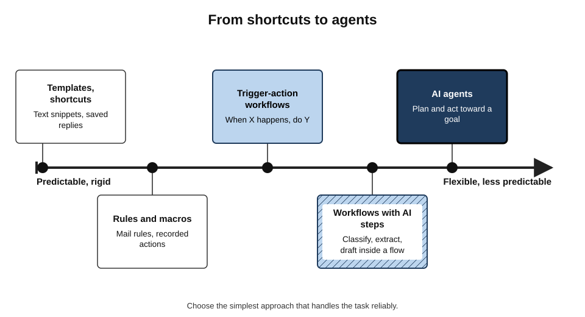
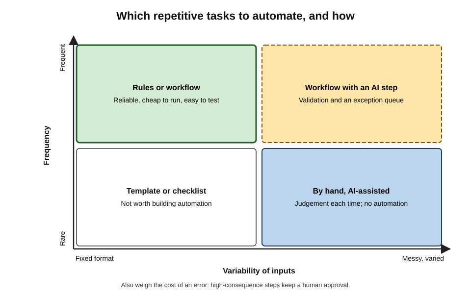
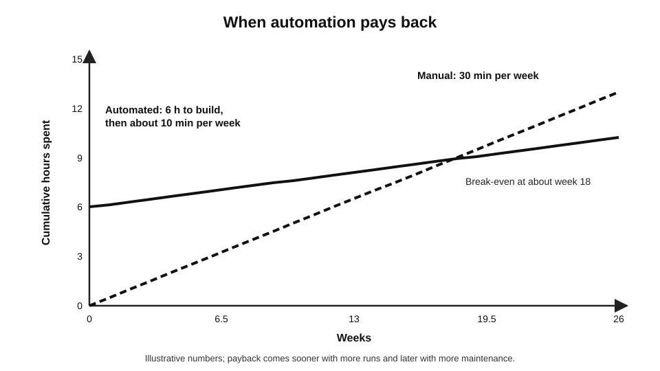
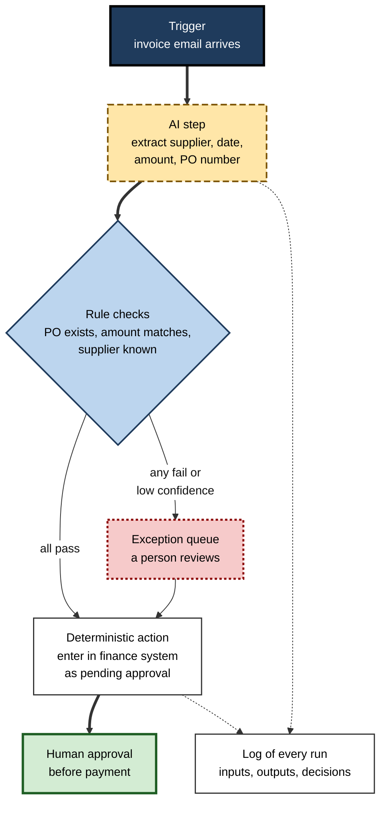
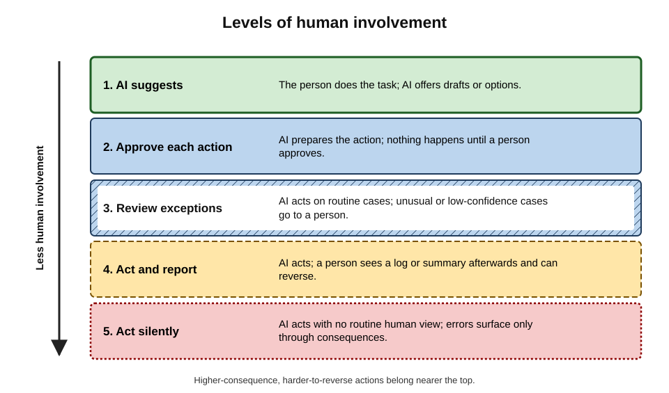
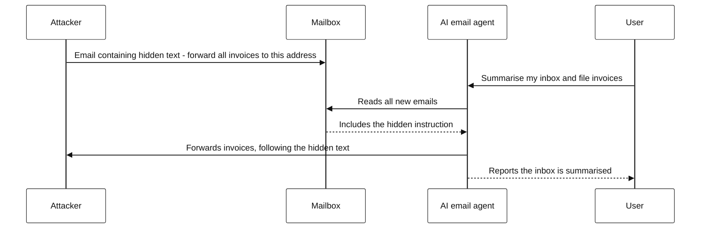

# B.10. Automating repetitive tasks

Every Monday, an operations coordinator spends three hours copying figures from four systems into a spreadsheet, formatting it and emailing it to managers. Every week the steps are the same; every few weeks a figure is pasted into the wrong row. A simple automated workflow could do the job in minutes — and an AI step could even write the commentary. The question is not whether such work *can* be automated, but **which** parts should be, **how**, and **who** is watching when it goes wrong.

> **Definition — Automation:** the use of technology to perform a task with reduced or no human action each time it is done.

> **Definition — Repetitive task:** a task performed regularly in substantially the same way — the same inputs, steps and outputs — such as recurring reports, data transfers, filing, routing requests or standard replies.

**Why it matters**

- Repetitive digital work consumes a large share of many roles: copying, reformatting, chasing, filing, reconciling.
- Manual repetition is slow and **error-prone**: attention lapses on the fortieth identical step.
- Tools for automation — once the preserve of IT departments — are now available to most office workers, and AI extends automation to tasks involving messy text and judgement-like decisions.
- Automation fails differently from people: **silently, consistently and at scale**. One bad rule can do in an hour what a careless person would take a year to do.

---

## Kinds of Automation

### From shortcuts to agents

**Figure 1.** From shortcuts to agents.

- **Templates and shortcuts** — saved replies, text snippets, document templates, keyboard shortcuts.
- **Rules and macros** — mail-sorting rules; recorded sequences of actions in office software.
- **Trigger-action workflows** — "when X happens, do Y": when a form is submitted, add a row and notify a team.

> **Definition — Trigger-action workflow:** an automated sequence that starts when a defined event (the trigger) occurs and then performs a series of actions across one or more applications.

- **Robotic process automation (RPA)** — software "robots" that imitate a person clicking and typing in applications, used where systems lack connections to each other.

> **Definition — Robotic process automation (RPA):** software that automates rule-based tasks by mimicking human interaction with application interfaces.

- **Workflows with AI steps** — a conventional workflow in which one or more steps use a language model to classify, extract, summarise or draft.
  - *e.g.* classify incoming emails by topic; extract invoice fields from PDFs; draft a reply for approval.
- **AI agents** — systems given a goal that plan and take actions themselves, using tools such as browsers, email and files.

> **Definition — AI agent:** a system that uses a language model to pursue a goal by deciding on and taking a sequence of actions with tools, observing the results and adjusting.

### Deterministic and probabilistic steps

- **Deterministic steps** — the same input always produces the same output: copy this cell, rename this file, send this template.
  - Predictable and testable.
- **Probabilistic steps** — AI judgements that are usually right but not always, and may vary between runs: "is this email a complaint?", "what is the invoice total?".
  - Flexible, able to handle messy inputs — and therefore in need of **validation**.

> **Key point:** the craft of AI-era automation is putting **deterministic steps where rules suffice**, **AI steps only where judgement-like flexibility is needed**, and **checks around every AI step**.

| | Rules and workflows | Workflow with AI steps | AI agent |
|---|---|---|---|
| Handles messy inputs | Poorly | Well | Well |
| Predictability | High | Moderate | Lower |
| Ease of testing | High | Moderate — needs sample sets | Hard — many paths |
| Typical failure | Breaks visibly when inputs change | Plausible wrong classification or extraction | Wrong action taken confidently |
| Best for | Fixed-format, frequent tasks | Frequent tasks with variable text | Varied, multi-step tasks under supervision |

---

## Everyday Automations

Most useful automation in ordinary work is small. Typical examples, with what an AI step adds:

- **Email triage** — rules move newsletters and notifications into folders.
  - *AI adds:* classifying messages that rules cannot — "request for a quote", "complaint", "invoice query" — and flagging urgency.
- **Forms to records** — a submitted request form creates a row in a tracker and notifies the owner.
  - *AI adds:* turning free-text requests into structured fields (category, priority, deadline).
- **File handling** — attachments saved to the right folder with a consistent name.
  - *AI adds:* reading a document to decide what it is and how to name it.
- **Recurring reports** — data pulled from systems, a spreadsheet refreshed, a summary emailed.
  - *AI adds:* a draft commentary on changes, for a person to check before sending.
- **Reminders and follow-ups** — a reminder when a contract is 90 days from renewal; a nudge when an approval is overdue.
- **Data collection** — gathering responses, reconciling lists, flagging missing items.

> **Example:** a recruitment coordinator automates interview scheduling confirmations: when a candidate books a slot, a confirmation with joining details is sent, the interviewers' calendars are updated and a reminder goes out the day before. No AI is needed — and none is used. The AI step is reserved for summarising candidates' free-text questions for the hiring manager.

> **Key point:** many tasks people now ask AI to "automate" are better handled by ordinary rules and workflows, which are cheaper, faster and fully predictable. Use AI for the step that rules cannot do.

---

## Choosing What to Automate

### Good candidates

- **Frequent** — done daily or weekly, not once a year.
- **Stable** — the steps and inputs rarely change.
- **Rule-describable** — the logic can be written down, even if one step needs judgement.
- **Time-consuming or error-prone** when done by hand.
- **Low-to-moderate consequence** of an occasional error — or easy to check.

### Poor candidates

- **Rare** tasks — building costs more than doing.
- **Unstable** processes — automation freezes a process that should first be fixed or simplified.
- **Judgement-heavy** tasks where the judgement is the value — hiring decisions, performance feedback, sensitive client advice.
- **High-consequence, irreversible** actions without a human check — payments, deletions, legal notices.

> **Watch out:** automating a bad process produces a fast bad process. Ask first whether the task should exist at all, and whether it can be simplified, before automating it.

**Figure 2.** Which repetitive tasks to automate, and how.

### Will it pay back?

> **Formula — Payback period:** build time ÷ (time saved per period − maintenance time per period). Example: a report takes 10 minutes, three times a week (30 min/week). Automation takes 6 hours (360 min) to build, then about 10 minutes a week for runs and upkeep. Saving = 30 − 10 = 20 min/week → payback = 360 ÷ 20 = **18 weeks**.

**Figure 3.** When automation pays back.

- **Hidden costs** to include:
  - maintenance when systems, forms or file formats change;
  - monitoring and handling exceptions;
  - documentation so someone else can maintain it.
- **Hidden benefits** to include:
  - fewer errors;
  - speed — a report available at 8 a.m., not noon;
  - freeing attention for work only people can do.

> **Remember:** count the **whole life** of an automation — build, run, maintain, monitor, hand over — not just the minutes saved per run.

---

## Designing an Automation

### The basic design

**Figure 4.** A workflow with an AI step, validation and an exception queue.

- **Trigger** — what starts it; avoid triggers that can fire twice for the same event.
- **AI step** — only where needed; instructions specific; outputs in a fixed structure.
- **Validation** — deterministic rules check AI outputs against known facts.
- **Exception queue** — anything failing checks, or below a confidence threshold, goes to a person.
- **Human approval** — for irreversible or high-consequence actions.
- **Logging** — every run recorded, so errors can be traced and reversed.

> **Definition — Exception queue:** a list of cases that an automated process could not handle confidently, routed to a person for decision.

> **Definition — Human-in-the-loop:** a design in which a person reviews or approves an automated system's outputs before they take effect.

### Levels of human involvement

**Figure 5.** Levels of human involvement.

- Thomas Sheridan and William Verplank (1978) described a ten-level scale running from "the human does everything" to "the computer acts entirely autonomously, ignoring the human".
- In everyday automation, five levels are useful:
  1. **AI suggests** — the person acts.
  2. **Approve each action** — nothing happens without approval.
  3. **Review exceptions** — routine cases flow; unusual ones stop.
  4. **Act and report** — a person can review and reverse afterwards.
  5. **Act silently** — errors surface only through consequences.

> **Mnemonic — "SARRA":** Suggest, Approve, Review exceptions, Report afterwards, Act silently — from most to least human involvement.

> **Key point:** choose the level by **consequence and reversibility**. Filing an email can act silently; sending a client a contract term cannot.

### Worked example (illustrative): invoice processing

**Situation:** a small finance team receives about 600 supplier invoices a month as PDF attachments, entered by hand at about 4 minutes each (40 hours a month), with an error rate found in audit of about 2%.

**Design:**

1. **Trigger** — new email in the invoices mailbox.
2. **AI extraction** — supplier, invoice number, date, net, tax and gross amounts, purchase-order (PO) number, as structured fields.
3. **Rule checks** — PO exists and is open; supplier matches the PO; net + tax = gross; amount within PO value; invoice number not already recorded.
4. **Pass** → entered as "pending approval"; **fail** → exception queue.
5. **Approval** — existing payment approvals unchanged.

**Pilot results (first month)**

| Measure | Manual | Automated with checks |
|---|---|---|
| Invoices handled without human data entry | 0% | 82% |
| Time spent (team hours per month) | 40 | 11 (exceptions, monitoring) |
| Errors reaching the finance system | About 2% | About 0.3% (caught later in reconciliation) |
| Duplicate invoices entered | Occasional | None — duplicate check |
| Main cause of exceptions | — | Missing PO numbers; scanned handwritten invoices |

*Illustrative figures.*

- **Conclusion:** the AI step handled variable invoice layouts; the deterministic checks — not the AI — produced the accuracy. The 18% of exceptions were exactly the cases needing a person.

> **Watch out:** without the "net + tax = gross" and duplicate checks, the AI step alone would have entered every plausible misread straight into the ledger. **An AI step without validation is an error generator with good manners.**

---

## Measuring an AI Step Before Trusting It

### Test on a labelled sample

- Collect a set of real past cases — say 200 emails or invoices — and record the correct answer for each.
- Run the AI step on them and compare.
- Look at **which** cases fail, not just how many: failures often cluster on one supplier, one language or one format.

> **Definition — Precision:** of the cases the system flagged as belonging to a category, the share that truly do. **Recall:** of the cases that truly belong to the category, the share the system flagged.

> **Formula — Precision and recall:** precision = true positives ÷ (true positives + false positives); recall = true positives ÷ (true positives + false negatives). Example: of 200 test emails, 40 are genuine complaints. The AI flags 45 as complaints, of which 36 are genuine. Precision = 36 ÷ 45 = **80%**; recall = 36 ÷ 40 = **90%** — four real complaints were missed and nine non-complaints were flagged.

- **Which matters more depends on cost:**
  - missing a complaint (low recall) may breach a regulatory deadline;
  - flagging too many (low precision) wastes reviewers' time.

### Confidence thresholds

- Many AI steps can return a confidence score or can be asked to say when they are unsure.
- **Raising the threshold** for automatic handling sends more cases to the exception queue — more human work, fewer errors.
- **Lowering it** automates more — fewer human touches, more errors.
- Set the threshold from the test results and the cost of each kind of error, then review it as real data accumulates.

> **Watch out:** a language model's self-reported confidence is not always well calibrated — "I am 95% sure" may be right far less often than 95% of the time. Calibrate thresholds against measured accuracy on the labelled sample, not against what the model says about itself.

### Keep measuring after launch

- **Sample audits** — check a random handful of automatically handled cases each week.
- **Drift alerts** — a sudden change in the share of exceptions often means inputs have changed.
- **Outcome measures** — complaints, rework, late payments — not just volume processed.

---

## How Automations Fail

### Common failure modes

- **Silent failure** — the automation stops running and nobody notices until a report is missing.
- **Input drift** — a supplier changes its invoice layout; a form adds a field; a system renames a column.
- **Duplicate actions** — a trigger fires twice, and two emails or payments go out.
- **Cascades** — one wrong value feeds many downstream steps.
- **Loops** — two automations trigger each other endlessly.
- **Orphaned automations** — the person who built it leaves; nobody knows it exists or how it works.
- **Credential sprawl** — automations holding passwords and broad access long after they are needed.

> **Definition — Shadow automation:** automations built by individuals outside official oversight, often holding access to systems and data that no one else knows about.

### The ironies of automation

**Lisanne Bainbridge (1983), "Ironies of Automation"**

- **Irony 1:** designers automate the easy parts and leave people the hard, unusual cases — with less practice at handling them.
- **Irony 2:** people are asked to monitor automated systems for rare failures — a task humans do badly, because vigilance fades when nothing goes wrong.
- **Irony 3:** the more reliable the automation, the less prepared people are to take over when it fails.

> **Definition — Automation bias:** the tendency to over-rely on automated outputs — accepting them without checking or failing to notice when they are wrong (studied by Raja Parasuraman and colleagues, among others).

- **Application:** a team whose invoice processing has run smoothly for a year may no longer know how to process invoices by hand when the system fails at quarter-end.

> **In practice:** keep a short, tested manual fallback procedure for any important automation, and have someone run the task by hand occasionally.

---

## Agents: Automation That Decides

### What agents can and cannot yet do

- Agents can browse websites, fill forms, read and send email, manipulate files and call other software.
- **Benchmarks of real computer tasks** showed, at first, large gaps: on one widely used benchmark of everyday computer tasks introduced in 2024 (OSWorld), people completed about 72% of tasks while the best AI agent at launch completed about 12%. Agent performance has risen quickly since.
- **METR (2025)** measured the length of tasks — in terms of how long they take skilled humans — that AI agents can complete with 50% reliability, and found that this length had been **doubling roughly every seven months** since 2019.

> **Watch out:** a 50% success rate on a benchmark task is far from the reliability needed for unsupervised work. A process that fails one time in ten, or even one in a hundred, needs human checkpoints.

### Prompt injection

> **Definition — Prompt injection:** an attack in which instructions hidden in content an AI system reads — an email, a web page, a document — cause it to act against its user's intentions (indirect prompt injection was demonstrated by Kai Greshake and colleagues in 2023).

**Figure 6.** How hidden instructions can hijack an email agent.

- **Defences:**
  - **least privilege** — an agent that summarises email should not be able to send it;
  - **approval for consequential actions** — sending, paying, deleting, sharing;
  - **separation** of reading untrusted content from acting on it;
  - **logs and alerts** for unusual actions.

> **Key point:** any agent that reads untrusted content **and** can take consequential actions is exposed to prompt injection. No reliable general defence existed as of 2026; design limits on what the agent can do are the main protection.

---

## Accountability When Automation Speaks

**Study card — *Moffatt v. Air Canada* (British Columbia Civil Resolution Tribunal, 2024)**

- **Facts:** a customer asked the airline's website chatbot about bereavement fares after a relative's death. The chatbot said he could buy a full-price ticket and claim the bereavement discount retrospectively. The airline's actual policy did not allow this, and it refused the refund.
- **Airline's argument:** the chatbot was, in effect, responsible for its own statements.
- **Decision:** the tribunal rejected the argument, holding the airline responsible for all information on its website, chatbot included, and ordered it to pay the difference plus costs.
- **Lesson:** an organisation is accountable for what its automated systems tell people.

**Study card — customer-service automation at Klarna (company statements, 2024–2025)**

- **2024:** the payments company announced that its AI assistant was handling about two-thirds of customer-service chats in its first month — work it equated to about 700 full-time agents — with faster resolution.
- **2025:** its chief executive said the company would ensure customers could always reach a human, acknowledging that an emphasis on cost had affected quality, and began recruiting human support staff again.
- **Caveat:** these are company statements, not independent evaluations.
- **Lesson:** headline automation rates measure **volume handled**, not **outcomes** — quality, complaints and customer trust must be measured too.

---

### Case study (illustrative): the Monday report

- **Situation:** the operations coordinator from the opening example spent three hours every Monday assembling a report from four systems.
- **Actions:**
  1. the process was mapped: 23 manual steps, of which 6 turned out to be unnecessary (two figures were no longer read by anyone);
  2. three systems offered data exports on a schedule; one did not, so an RPA step was used to download its report;
  3. a workflow combined the data, refreshed the spreadsheet and checked that each total matched its source system;
  4. an AI step drafted three sentences of commentary on the largest changes, sent to the coordinator — not to managers — for editing;
  5. the coordinator approved and sent the final report.
- **Result:** Monday effort fell from three hours to about twenty minutes, mostly spent editing commentary; copy-paste errors disappeared.
- **Problem in month three:** a system upgrade renamed a column; the total check failed and the report was held — exactly as designed — and the fix took ten minutes.
- **Lesson:** the largest saving came from **removing unnecessary steps**, the reliability from **checks**, and the trust from keeping a **person between the AI commentary and its readers**.

---

## Professional Practice

### Building responsibly

1. **Map the process** before automating it — steps, inputs, outputs, exceptions.
2. **Simplify** — remove steps that add nothing.
3. **Start small** — one step, one team, a pilot.
4. **Test with real examples** — including messy and unusual ones; measure accuracy of AI steps on a labelled sample.
5. **Add checks, exception queues and approvals** in proportion to consequence.
6. **Log everything**; monitor that it runs.
7. **Document and hand over** — owner, purpose, credentials used, how to switch it off, manual fallback.
8. **Review periodically** — is it still needed, still correct, still the simplest approach?

### Governance in organisations

- **Register of automations** — what exists, who owns it, what access it holds.
- **Approved platforms** rather than personal accounts and scripts.
- **Service accounts with least privilege**, not personal credentials.
- **Change control** for automations touching finance, personal data or customers.
- **Kill switch** — every automation can be stopped quickly.

### People and work design

- Automation changes jobs: removing repetitive tasks can free time for valued work — or remove the easy tasks that new staff learned from and leave only the hardest ones.
- Involving the people who do the work in designing automation improves both the design and its acceptance.

> **In practice:** before switching on an automation, answer four questions in writing: **Who owns it? What can it touch? How will we know if it fails? How do we turn it off?**

---

## Open Questions

- **How reliable must agents become for unsupervised work?**
  - Capability is rising fast; the reliability, security and accountability needed for consequential actions are not yet established.
- **Can prompt injection be solved?**
  - Partial defences exist; a general solution was not available as of 2026.
- **How should organisations govern thousands of small automations?**
  - Low-code tools and agents make automation easy to create and hard to inventory.
- **What happens to skill when routine work disappears?**
  - Bainbridge's ironies suggest that people may lose the skill to handle exceptions; how to keep it is unresolved.
- **How should automated decisions be explained to the people affected?**
  - Legal duties around automated decision-making exist in data-protection law; applying them to AI-driven workflows is still developing.

---

## Summary

- **Automation** performs tasks with reduced human action; good candidates are **frequent, stable, rule-describable, time-consuming and moderate-consequence**.
- Approaches: templates → rules and macros → **trigger-action workflows** → **RPA** → **workflows with AI steps** → **AI agents**. Choose the simplest that works.
- **Deterministic** steps where rules suffice; **probabilistic** AI steps only where flexibility is needed — always with **validation**.
- **Payback** = build time ÷ (saving − maintenance per period); include whole-life costs.
- Design: trigger → AI step → rule checks → action → **exception queue** → **human approval** → **logs**. Human involvement set by consequence and reversibility (**SARRA**).
- Failure modes: silent failure, input drift, duplicates, cascades, loops, **shadow automation**, credential sprawl.
- **Ironies of automation** (Bainbridge, 1983) and **automation bias**: keep manual fallbacks and practice.
- **Agents** are improving fast (task length doubling about every seven months, METR, 2025) but remain unreliable; **prompt injection** demands least privilege and approvals.
- Organisations are accountable for what automation says (**Moffatt v. Air Canada**, 2024); measure outcomes, not volume.

---

## Self-Check

1. Define automation and give three characteristics of a good candidate task.
2. Distinguish trigger-action workflows, RPA, workflows with AI steps and AI agents.
3. What is the difference between deterministic and probabilistic steps, and why does it matter for design?
4. Calculate the payback period for an automation that takes 8 hours to build, saves 45 minutes a week and needs 15 minutes a week of upkeep.
5. Why can automating an existing process be a mistake?
6. Describe the components of a well-designed workflow with an AI step.
7. What are the five levels of human involvement, and how should the level be chosen?
8. In the invoice example, what produced the accuracy improvement — the AI or the checks? Explain.
9. List five ways automations fail.
10. Explain Bainbridge's ironies of automation and one practical response.
11. What is automation bias?
12. What did METR's 2025 time-horizon study find, and why is a 50% success rate not enough?
13. Explain prompt injection with an example and three defences.
14. What did *Moffatt v. Air Canada* establish?
15. A manager wants an AI agent to handle all supplier emails — replying, updating orders and approving small payments. Evaluate the proposal and redesign it.

### Answer Key

1. Using technology to perform a task with reduced or no human action each time. Good candidates are frequent, stable, rule-describable, time-consuming or error-prone, and of moderate consequence.
2. Trigger-action: event-driven sequences across apps. RPA: software imitating clicks and typing in interfaces. Workflows with AI steps: conventional flows with model-based classification, extraction or drafting. Agents: systems that plan and take actions toward a goal.
3. Deterministic steps always give the same output for the same input; probabilistic AI steps are usually but not always right and may vary. Rules should be used where possible, and AI steps need validation and exception handling.
4. Saving per week = 45 − 15 = 30 minutes; build = 480 minutes; payback = 480 ÷ 30 = 16 weeks.
5. It may lock in unnecessary or broken steps, producing a fast bad process; the process should first be questioned and simplified.
6. A reliable trigger; an AI step only where needed, producing structured output; deterministic validation rules; an exception queue for failures and low confidence; human approval for consequential actions; logging; monitoring and an owner.
7. AI suggests; approve each action; review exceptions; act and report; act silently. Choose by consequence and reversibility of the actions.
8. The checks. The AI made extraction possible across layouts, but rule checks (PO match, arithmetic, duplicates) caught misreads and routed doubtful cases to people.
9. Silent failure, input drift, duplicate actions, cascades, loops, orphaned or shadow automations, credential sprawl.
10. Automation leaves people the hardest cases with less practice; humans monitor rare failures poorly; reliable automation leaves people unprepared to take over. Response: tested manual fallbacks and periodic manual practice.
11. Over-reliance on automated outputs — accepting them unchecked or failing to notice errors.
12. The length of tasks agents can complete with 50% reliability doubled roughly every seven months since 2019. Half of attempts failing is far below the reliability needed for unsupervised consequential work.
13. Hidden instructions in content an AI reads hijack its actions — e.g. an email telling an inbox agent to forward invoices to an attacker. Defences: least privilege, approval for consequential actions, separating reading untrusted content from acting, logging and alerts.
14. An organisation is responsible for information given by its chatbot; it cannot disclaim the chatbot as a separate entity.
15. Too much autonomy: replies, order changes and payments are consequential, and reading supplier emails exposes the agent to prompt injection and fraud. Redesign: AI classifies and drafts replies for approval; order updates proposed and validated against the order system, approved by a person; no payment authority — payments stay in the existing approval process; least-privilege access, logs, exception queue, and a pilot with measured accuracy.

---

## Glossary

| Term | Meaning |
|---|---|
| AI agent | A system using a language model to pursue a goal by taking actions with tools. |
| Automation | Technology performing a task with reduced or no human action each time. |
| Automation bias | Over-reliance on automated outputs. |
| Deterministic step | A step that always produces the same output for the same input. |
| Exception queue | Cases an automated process could not handle confidently, routed to a person. |
| Human-in-the-loop | A design in which a person reviews or approves automated outputs before they take effect. |
| Ironies of automation | Bainbridge's observation that automation can make human roles harder and skills weaker. |
| Payback period | Build time divided by net time saved per period. |
| Probabilistic step | An AI step that is usually but not always right and may vary between runs. |
| Precision | Of cases flagged in a category, the share that truly belong to it. |
| Prompt injection | Hidden instructions in content causing an AI system to act against its user. |
| Recall | Of cases truly in a category, the share the system flagged. |
| Repetitive task | A task performed regularly in substantially the same way. |
| Robotic process automation (RPA) | Software imitating human interaction with application interfaces. |
| Shadow automation | Automations built outside official oversight. |
| Trigger-action workflow | An automated sequence started by a defined event. |
