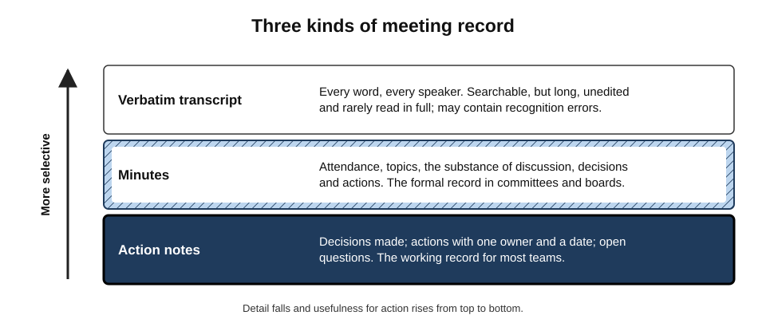
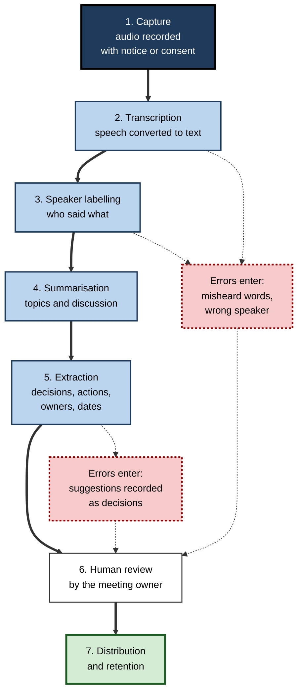
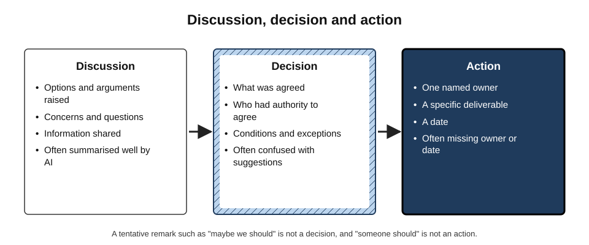
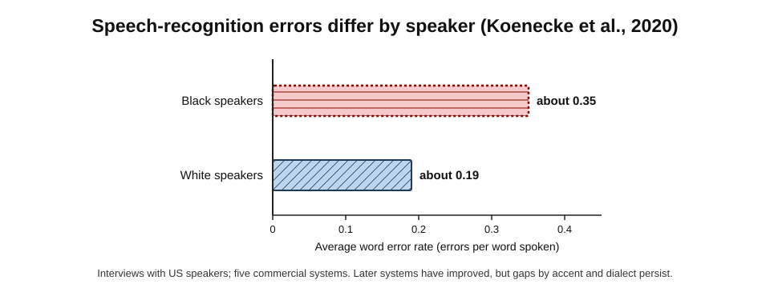
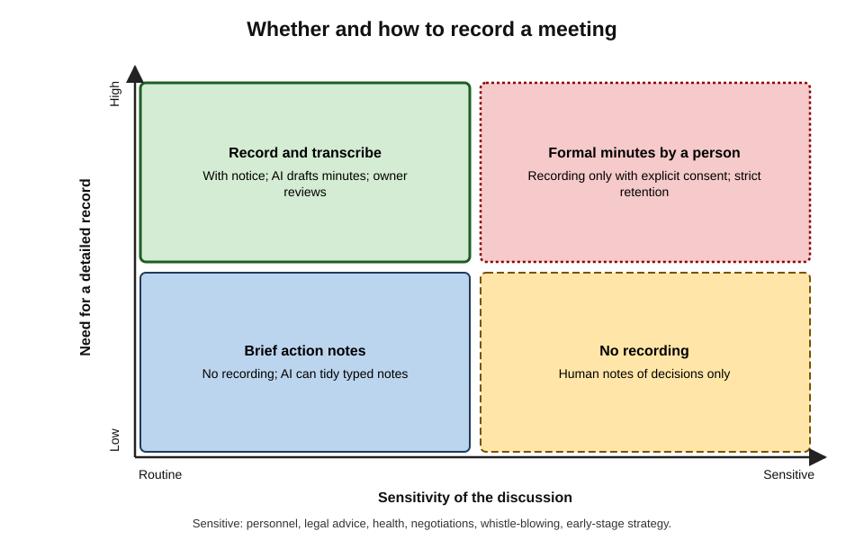
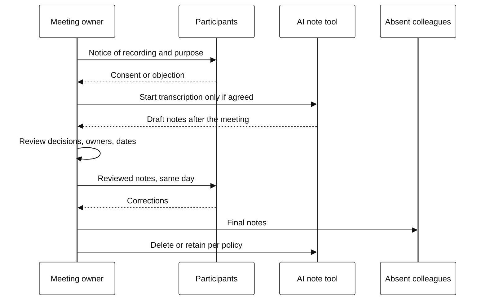

# B.3. Generating meeting notes

An hour-long project meeting ends. Within a minute, every participant receives an AI summary: topics, "key decisions" and six action items. Two weeks later the team finds that one "decision" was only a suggestion, the most important action had no owner, and a client's objection was credited to the wrong person. Automatic notes are a genuine gift of time — provided someone still decides what the meeting actually **agreed**.

> **Definition — Meeting notes:** a written record of a meeting that captures, at a chosen level of detail, what was discussed, what was decided and what each person committed to do.

> **Definition — AI-generated meeting notes:** meeting notes produced by software that transcribes speech, identifies speakers and uses a language model to summarise discussion and extract decisions and actions, for a human to review and distribute.

**Why it matters**

- Meetings consume a large share of professional time; their value is realised only if decisions and actions survive the end of the meeting.
- Human note-taking is costly: the note-taker participates less, and notes are often late, partial or never written.
- AI notes remove most of that cost — and add new risks: transcription errors, misattribution, confusion of discussion with decision, and recording people who did not expect it.
- The record of a meeting can become evidence: of agreements, of advice given, of what an organisation knew and when.

---

## What a Meeting Record Is For

### The functions of notes

- **Memory** — participants forget most of a meeting within days; the record preserves it.
- **Coordination** — actions with owners and dates turn talk into work.
- **Accountability** — a record of who agreed to what.
- **Communication** — informs people who were absent.
- **Governance and evidence** — boards, committees and regulated bodies must keep minutes; records may be disclosed in disputes or under freedom-of-information law.

> **Key point:** the most valuable part of most meeting records is not the summary of discussion but the short list of **decisions and actions**. A record that summarises everything but makes actions unclear has failed at its main job.

### Three kinds of record

**Figure 1.** Three kinds of meeting record.

- **Verbatim transcript** — every word, attributed to speakers.
  - Searchable and complete, but long, unedited and seldom read.
  - Contains recognition errors and every half-formed remark.
- **Minutes** — attendance, the substance of discussion, decisions and actions.
  - The formal record for boards, committees and public bodies; usually approved at the next meeting.
- **Action notes** — decisions, actions with owners and dates, open questions.
  - The working record for most teams.

> **Definition — Minutes:** the formal, approved record of a meeting, summarising discussion and recording decisions and actions; in many organisations a legal or governance requirement.

> **Remember:** a transcript is **raw material**, not a record. The record is what the meeting agreed.

---

## How AI Meeting Notes Are Made

### The pipeline

**Figure 2.** From speech to distributed notes.

### Transcription

> **Definition — Automatic speech recognition (ASR):** technology that converts spoken language into text.

- Modern systems use neural networks trained on very large amounts of recorded speech.
- Accuracy depends on audio quality, microphones, overlapping speech, accents, technical vocabulary and names.
- **Measuring accuracy:**

> **Formula — Word error rate (WER):** (substitutions + deletions + insertions) ÷ number of words actually spoken. Example: in a 1,000-word stretch with 30 wrong words, 12 missing words and 8 added words, WER = (30 + 12 + 8) ÷ 1,000 = **0.05**, or 5%.

- **A 5% error rate sounds small but is not:** in an hour-long meeting of about 9,000 words, it means roughly 450 errors — and errors cluster on exactly the words that matter: names, numbers, product terms and negations.
  - *e.g.* "we **can't** ship on Friday" transcribed as "we **can** ship on Friday".

### Speaker labelling

> **Definition — Speaker diarisation:** the process of segmenting audio by speaker — determining "who spoke when".

- In video-meeting platforms, speakers are often identified from their connection, which is reliable for one person per device.
- In a meeting room with one shared microphone, the system must separate voices acoustically — far less reliable.
- **Misattribution matters:** a client's objection credited to a team member, or a manager's instruction credited to a junior colleague, changes the record's meaning.

### Summarisation and extraction

- A language model reads the transcript and produces:
  - a topic-by-topic summary of discussion;
  - a list of "decisions";
  - a list of "action items", ideally with owners and dates.
- **Discussion** is summarised relatively well — it is what most of the transcript contains.
- **Decisions and actions** are harder, because spoken agreement is often implicit, tentative or scattered across the meeting.

---

## The Hard Part: Discussion, Decision, Action

**Figure 3.** Discussion, decision and action.

### Why machines confuse them

- **Spoken decisions are rarely explicit.** People say "OK, let's go with that", "fine", "sounds sensible", or simply move on.
- **Suggestions sound like decisions.** "We should probably move the launch" may be a proposal later rejected.
- **Decisions are revised mid-meeting.** An early agreement may be overturned twenty minutes later; a summary may report both, or only the first.
- **Authority is invisible in text.** Whether the person speaking was entitled to decide is not in the transcript.
- **Actions lack owners.** "Someone needs to check with legal" produces an action with no owner — or the model guesses one.

> **Definition — Action item:** a specific task arising from a meeting, with **one** named owner and a due date.

> **Watch out:** an AI system may "helpfully" assign an owner to an unowned action — usually the last person who spoke on the topic. A guessed owner is worse than a blank, because it looks settled.

### Writing decisions and actions well

- **Decision format:** what was decided, by whom (or by what body), with any conditions.
  - *e.g.* "Decision: launch moves to 14 May, conditional on security sign-off by 30 April (agreed by the product director)."
- **Action format:** owner — verb — deliverable — date.
  - *e.g.* "Priya — send revised timeline to the client — by Thursday 18 April."
- **Open questions:** listed separately, with who will resolve them.

> **Mnemonic — "ODD":** every action needs an **O**wner, a **D**eliverable and a **D**ate.

> **In practice:** the most effective safeguard is human, not technical — the chair spends the final three minutes reading back decisions and actions aloud. The AI record then captures an explicit, confirmed list instead of guessing from scattered talk.

---

## Worked Example (illustrative): From Transcript to Action Notes

**Situation:** a 45-minute meeting between a software team and a client's operations manager about a delayed data migration.

**Transcript fragments (simplified)**

- Client (Anna): "If the cut-over moves past the 20th we lose the quarter-end window."
- Team lead (Raj): "Understood. We could maybe do a partial migration first."
- Engineer (Li): "Partial is possible if we freeze the schema by Monday."
- Anna: "Let me check with finance whether partial works for them."
- Raj: "Someone should also talk to the security team about the test data."
- Later, Raj: "OK, so we're aiming for the 18th, full migration, if the schema freeze holds."

**AI first-pass notes and the reviewed version**

| Item | AI first pass | Reviewed by meeting owner |
|---|---|---|
| Decision | "Team agreed to do a partial migration first" | No decision on partial; aim is **full migration on the 18th**, conditional on schema freeze |
| Action 1 | "Raj to check with finance" | **Anna** — confirm with finance whether partial migration is acceptable — by Wednesday |
| Action 2 | "Li to talk to security team" | **Raj** (agreed in read-back) — agree test-data approach with security — by Friday |
| Action 3 | (missing) | **Li** — freeze schema — by Monday |
| Risk | (missing) | Cut-over after the 20th misses client's quarter-end window |

- **Errors found:**
  1. an early suggestion recorded as a decision, while the later, real position was missed;
  2. an action attributed to the wrong person (Raj instead of Anna);
  3. an unowned action ("someone should") assigned by guess to Li;
  4. a dependency stated as a condition (schema freeze) not turned into an action;
  5. the client's key constraint omitted.
- **Conclusion:** the AI pass saved most of the writing; the five-minute review corrected the record's meaning.

> **Watch out:** reviewed notes should be sent quickly — ideally the same day. Unreviewed AI notes circulate first, and people act on whatever arrives first.

---

## Shaping the Notes

### Instructions that improve AI notes

Most meeting tools accept instructions or templates, and transcripts can be summarised again with a better request.

- **Supply names and terms** — a short list of participants' names, client names, product names and acronyms.
  - Recognition and summarisation errors fall sharply on words the system has been told to expect.
- **Specify the template** — the sections wanted, in order.
  - *e.g.* "Decisions / Actions (owner, deliverable, date) / Open questions / Risks raised / Points of disagreement."
- **Ask for disagreements explicitly** — summaries tend to smooth conflict into consensus.
  - *e.g.* "List any point on which participants disagreed and who held each view."
- **Ask for evidence** — a timestamp or short quotation for each decision, so the owner can check it in the transcript.
- **Ask for what was left open** — "Which questions were raised but not resolved?"
- **Forbid guessing** — "If an action has no clear owner or date, write UNASSIGNED rather than inferring one."

> **In practice:** the instruction "write UNASSIGNED rather than guessing" converts the most dangerous silent error — the invented owner — into a visible gap that the chair must close.

### What to capture in different meetings

- **Stand-ups and status meetings** — blockers, changes to plan, actions; discussion summaries add little.
- **Client and supplier calls** — commitments by **each side**, requirements stated, concerns raised, agreed next steps; send a reviewed follow-up quickly, since it becomes the shared record.
- **Decision meetings** — options considered, the decision, its rationale and dissent; the rationale is what later readers most need and AI summaries most often omit.
- **Workshops and brainstorming** — ideas generated and themes, not who said what; often better captured from boards and sticky notes than from audio.
- **Interviews (recruitment, research)** — consent is essential; for recruitment, structured scoring by interviewers should not be replaced by an AI summary, which may weight fluent speakers more favourably.
- **Incident calls** — a timeline of events and decisions with times; AI can draft the timeline from the transcript, but the incident lead confirms it.
- **Formal boards and committees** — resolutions, declarations of interest, votes; drafted by the secretary, approved by the body.

> **Key point:** the template should follow the **purpose of the meeting**. A single generic "summary" for every meeting type records the least useful material for most of them.

### Summaries for people who were absent

- Absent colleagues read AI summaries as if they were the meeting; nuance, tone and the strength of disagreement are lost.
- A short human-written line on top — "the real issue was budget; the client is unhappy" — often conveys more than the full summary.
- For decisions that affect absent people, they should hear of them directly from a person, not only through notes.

---

## Accuracy, Fairness and Hallucination

### Unequal accuracy

**Study card — Koenecke and colleagues (2020), *Proceedings of the National Academy of Sciences***

- **Design:** five commercial speech-recognition systems transcribed interviews with white and Black speakers in the United States.
- **Results:** average word error rate was about **0.35** for Black speakers and about **0.19** for white speakers, across all five systems.
- **Conclusion:** speech recognition was markedly less accurate for some groups of speakers, mainly because of differences in dialect and pronunciation represented in training data.

**Figure 4.** Speech-recognition errors differ by speaker (Koenecke et al., 2020).

- **Implications for meeting notes:**
  - contributions from people with less-represented accents, second-language speakers and people with speech differences may be transcribed less accurately;
  - their points may therefore be summarised less faithfully — or dropped;
  - the record can quietly under-represent some voices.

> **Watch out:** systems have improved substantially since 2019, but gaps by accent, dialect and speech condition persist in more recent evaluations. Accuracy for the actual people in the actual meetings is what matters.

### Transcription hallucination

**Study card — Koenecke and colleagues (2024), "Careless Whisper"**

- **Design:** analysis of transcriptions produced by a widely used open speech-recognition model from audio of speakers with and without aphasia (a language disorder).
- **Findings:**
  - in a small but real share of transcriptions — around 1% — the model **invented whole phrases or sentences** never spoken;
  - a substantial fraction of these inventions contained harmful content, such as violence or false medical information;
  - hallucinations were more common where speech had longer pauses, as with speakers with aphasia.
- **Conclusion:** generative transcription can add, not merely mis-hear — a failure older systems rarely showed.

> **Key point:** a transcript is not automatically neutral evidence. Where accuracy matters — disputes, clinical records, investigations — the audio, not the transcript, is the primary record, and important passages should be checked against it.

---

## Recording, Consent and Candour

### Consent and notice

- **Data-protection law:** in the UK and EU, recordings and transcripts of identifiable people are personal data; organisations need a lawful basis, must tell participants, and must limit retention and use.
- **Recording law:** many jurisdictions regulate recording conversations; in the United States, a minority of states — including California — require the consent of **all** parties.
- **External participants:** clients, candidates and members of the public may not expect or accept recording; ask explicitly.
- **Employment:** recordings used later in performance or disciplinary matters raise fairness and legal questions.

**Figure 5.** Whether and how to record a meeting.

### Candour and the chilling effect

- People speak differently when every word is transcribed.
  - Fewer half-formed ideas; less admission of uncertainty; more guarded language.
- **Meetings that depend on candour** — retrospectives, incident reviews, brainstorming, sensitive personnel discussions — may lose their value if recorded.
- **Psychological safety** — a team climate in which people feel safe to raise problems and admit errors — can be weakened by permanent records of every remark.

> **In practice:** many teams adopt a simple rule: **record working meetings, not thinking meetings**. Status updates, planning and client calls (with consent) are recorded; retrospectives and early-stage discussions are not, and a person writes decisions only.

### Records as evidence

- Transcripts and AI notes are **records**: they may be disclosed in litigation, regulatory investigations or, for public bodies, freedom-of-information requests.
- An inaccurate AI summary that is never corrected may later be treated as what was said.
- **Legal advice** discussed in a recorded meeting may raise questions about privilege; legal teams often prohibit recording such discussions.

**Figure 6.** Consent, review and distribution of AI notes.

---

## What the Evidence Shows About Time Saved

- **UK Government Copilot Experiment (late 2024):** about 20,000 civil servants across a dozen organisations used an AI assistant built into their office software for three months; participants **self-reported** saving on average around 26 minutes a day, with meeting summaries and transcription among the most valued uses.
- **Department for Business and Trade evaluation (published August 2025):** the department found time savings on written tasks, including summarising, but **no evidence of improved overall productivity**; some tasks — scheduling and image creation — took longer with the tool than without, and a share of users reported spotting hallucinations.
- **Ambient clinical scribes:** health systems that deployed AI tools to listen to consultations and draft clinical notes from 2023 onward reported reduced documentation time and positive feedback from clinicians and patients; early randomised evaluations reported more modest gains than many vendor claims, and occasional errors requiring correction.

> **Watch out:** self-reported time savings are systematically less reliable than measured ones; people tend to overestimate the time a tool saves. "Minutes saved" also ignores review time and the cost of errors that reach the record.

> **Key point:** the honest measure of AI meeting notes is not "time saved writing notes" but "**are decisions and actions captured correctly and acted on?**" — measured, for example, by the share of actions completed on time and the number of corrections requested.

### Comparing ways of taking notes

| | Human note-taker | AI notes, unreviewed | AI draft, human-reviewed |
|---|---|---|---|
| Cost in attention | High — note-taker participates less | Very low | Low — a few minutes after the meeting |
| Completeness of discussion | Partial, selective | High | High |
| Accuracy of decisions and owners | Good if note-taker is senior and engaged | Unreliable | Good |
| Timeliness | Often late | Immediate | Same day |
| Effect on candour | Small | Can be large if recorded | Can be large if recorded |
| Risk of invented content | Very low | Real | Low after review |

### Measuring note quality

> **Formula — Action capture rate:** actions correctly recorded (right task, owner and date) ÷ actions actually agreed. Example: a meeting agrees 8 actions; the notes record 7, of which 2 have the wrong owner → 5 ÷ 8 = **62.5%**.

- **How to estimate it:** for a sample of meetings, the chair lists the actions agreed from memory and the read-back, then compares them with the notes.
- **Companion measures:**
  - **correction rate** — corrections requested per set of notes;
  - **on-time completion** — the share of recorded actions completed by their date;
  - **review time** — minutes spent correcting drafts.
- **Interpretation:** a tool that saves twenty minutes of writing but drops the action capture rate from 95% to 65% has made the team less productive, not more.

> **Remember:** count what the meeting **produced** — decisions recorded correctly and actions completed — not the minutes of writing avoided.

---

## Professional Practice

### A sound personal method

1. **Decide the record type** before the meeting: action notes, minutes or transcript.
2. **Give notice and seek consent** where recording; offer to switch it off.
3. **State decisions and actions aloud** during the meeting — "So the decision is…", "Priya, can you own that by Thursday?"
4. **Read back** decisions and actions in the final minutes.
5. **Review the AI draft** against memory and, for disputed points, the transcript or audio.
6. **Distribute reviewed notes the same day**, with corrections invited.
7. **Retain or delete** according to policy; do not keep transcripts "just in case".

### Notes without recording

- AI can turn a person's rough typed notes into clean action notes — no audio, no transcript, no consent issue.
- This is often the best option for sensitive meetings: the human decides what is recorded; the AI only tidies.

### Organisational practice

- **Policies** on which meetings may be recorded, who may start transcription, retention periods and access.
- **Default settings** matter: tools that start transcription automatically for every meeting create large stores of sensitive records.
- **Formal minutes** for boards and committees remain the responsibility of a named secretary; AI drafts are inputs, not minutes.
- **Accessibility:** live captions and transcripts help deaf and hard-of-hearing colleagues and second-language speakers — a strong reason to transcribe, balanced against candour and privacy.

### Case study (illustrative): automatic summaries in a product team

- **Situation:** a 25-person product team switched on automatic AI summaries for all meetings.
- **First six weeks:**
  - note-taking effort fell to almost nothing, and absent colleagues caught up more easily;
  - but three missed deadlines traced to actions with no owner or a wrongly guessed owner;
  - retrospectives became noticeably quieter; two engineers said they no longer raised problems "on the record".
- **Diagnosis:**
  1. unreviewed summaries were being treated as the record;
  2. spoken agreements were vague, so extraction guessed;
  3. recording candour-dependent meetings had a chilling effect.
- **Actions:**
  1. each meeting owner reviews and sends notes within the day;
  2. chairs read back decisions and actions before closing;
  3. retrospectives and incident reviews are no longer recorded — a facilitator writes actions only;
  4. transcripts auto-delete after 30 days.
- **Result:** missed-owner problems stopped; retrospective participation recovered; time savings were largely kept.
- **Lesson:** AI notes work best when the meeting is run so that decisions are **explicit**, and when some meetings are deliberately left unrecorded.

---

## Open Questions

- **How should AI notes be governed as records?**
  - Organisations are still working out retention, access and evidential status for large volumes of transcripts.
- **How much does recording change behaviour in meetings?**
  - The chilling effect is widely reported but has little rigorous measurement in workplaces.
- **Can extraction of decisions become reliable?**
  - Implicit and revised agreement is hard to infer from text alone; explicit meeting practices may matter more than better models.
- **Will accuracy gaps between speakers close?**
  - Improvements are real, but performance for under-represented accents and speech conditions continues to lag.
- **What is the true productivity gain?**
  - Most evidence is self-reported; measured effects on decisions executed and work completed are scarce.

---

## Summary

- **Meeting notes** record discussion, decisions and actions; their main value lies in **decisions and actions** that survive the meeting.
- Three record types: **verbatim transcript** (raw material), **minutes** (formal record), **action notes** (working record).
- AI notes follow a pipeline: capture → **transcription (ASR)** → **speaker diarisation** → summarisation → extraction → **human review** → distribution and retention.
- **WER** = (substitutions + deletions + insertions) ÷ words spoken; small rates still mean many errors, clustered on names, numbers and negations.
- The hard part is separating **discussion, decision and action**; models confuse suggestions with decisions and guess owners. Actions need **ODD**: Owner, Deliverable, Date.
- Accuracy is **unequal across speakers** (Koenecke et al., 2020), and generative transcription can **invent** phrases (Koenecke et al., 2024).
- Recording requires **notice and consent**, raises data-protection and evidential issues, and can **chill candour**; record working meetings, not thinking meetings.
- Time-saving evidence is mostly **self-reported**; measure correct capture and completion of actions instead.
- Practice: state and read back decisions aloud, review the draft, send the same day, retain per policy.

---

## Self-Check

1. Define meeting notes and name four functions they serve.
2. Distinguish a verbatim transcript, minutes and action notes, and say when each is appropriate.
3. Calculate the WER for a 2,000-word passage with 40 substitutions, 30 deletions and 10 insertions, and explain why the figure understates the practical risk.
4. What is speaker diarisation, and why is it less reliable in a meeting room than in a video call?
5. Give three reasons language models confuse discussion with decisions.
6. Why is a guessed action owner worse than a blank?
7. What does "ODD" stand for? Rewrite "someone should update the risk register" as a proper action.
8. Summarise Koenecke et al. (2020) and its implications for whose contributions are recorded faithfully.
9. What kind of error did the "Careless Whisper" study identify, and why is it new?
10. Name three legal or governance issues raised by recording meetings.
11. What is the chilling effect, and which kinds of meeting are most affected?
12. Why are self-reported time savings from AI note tools unreliable, and what better measure would you use?
13. A board secretary proposes replacing formal minutes with AI summaries. Advise.
14. Design a meeting-notes policy for a 200-person consultancy that works with confidential client material.

### Answer Key

1. A record of what was discussed, decided and committed to. Functions: memory, coordination, accountability, communication to absentees, governance and evidence.
2. Transcript: every word — raw material for checking or searching. Minutes: formal summary of discussion, decisions and actions — boards, committees, public bodies. Action notes: decisions, actions, open questions — most working meetings.
3. (40 + 30 + 10) ÷ 2,000 = 0.04 (4%). It understates risk because errors cluster on names, numbers, technical terms and negations, which carry the meeting's meaning.
4. Segmenting audio by who spoke when. On video calls, each speaker usually has their own connection; in a room, voices share one microphone and must be separated acoustically.
5. Spoken decisions are implicit; suggestions sound like decisions; decisions are revised later in the meeting; authority to decide is not visible in text.
6. A blank signals that ownership is unresolved; a guessed owner looks settled, so nobody follows up and the wrongly named person may not know they own it.
7. Owner, Deliverable, Date. "Marcus — update the risk register with the three new migration risks — by Friday 26 April."
8. Five commercial systems had average WER about 0.35 for Black speakers and 0.19 for white speakers. Contributions from speakers with under-represented dialects or accents may be transcribed and summarised less faithfully, under-representing them in the record.
9. Generative transcription sometimes invented whole phrases never spoken, some harmful. Older systems mis-heard words; these models can add content, so a transcript cannot be assumed to contain only what was said.
10. Data protection (lawful basis, transparency, retention); consent law for recording (all-party consent in some jurisdictions); disclosure in litigation or freedom-of-information requests; privilege for legal advice; use in employment matters.
11. People speak more guardedly when recorded — fewer tentative ideas, admissions or criticisms. Most affected: retrospectives, incident reviews, brainstorming, personnel and sensitive strategy discussions.
12. People overestimate time saved and ignore review and error costs. Better: measured outcomes — share of actions captured correctly, actions completed on time, corrections requested, time spent on review.
13. Advise against replacement. Formal minutes are a governance record approved by the board, with a named responsible secretary. AI can draft from notes or a transcript, but the secretary must write and verify decisions, resolutions and conflicts of interest; recording board discussions raises privilege, candour and disclosure concerns and needs explicit policy.
14. Record only with notice and consent of all participants, never for client-confidential or legal-advice discussions unless the client agrees; approved tools only; meeting owner reviews and sends notes the same day; read-back of decisions and actions; no recording of retrospectives or personnel matters; transcripts deleted after a short fixed period; access limited to participants; AI tidying of human notes as the default for sensitive meetings; periodic audit of action completion and corrections.

---

## Glossary

| Term | Meaning |
|---|---|
| Action capture rate | Actions correctly recorded divided by actions actually agreed. |
| Action item | A task arising from a meeting with one named owner and a due date. |
| Action notes | A working record listing decisions, actions and open questions. |
| AI-generated meeting notes | Notes produced by transcription, speaker labelling and summarisation software, reviewed by a person. |
| Automatic speech recognition (ASR) | Technology converting spoken language into text. |
| Chilling effect | Reduced candour caused by awareness of being recorded. |
| Correction rate | Corrections requested per set of meeting notes. |
| Decision | A conclusion reached by people with authority to reach it, possibly with conditions. |
| Meeting notes | A record of what a meeting discussed, decided and committed to. |
| Minutes | The formal, approved record of a meeting. |
| ODD | Owner, Deliverable, Date — the three elements of an action. |
| Psychological safety | A team climate in which people feel safe to raise problems and admit errors. |
| Read-back | Restating decisions and actions aloud at the end of a meeting for confirmation. |
| Speaker diarisation | Determining who spoke when in a recording. |
| Transcription hallucination | Text in a transcript that was never spoken. |
| Verbatim transcript | A word-for-word written record of speech. |
| Word error rate (WER) | (Substitutions + deletions + insertions) ÷ words spoken. |
