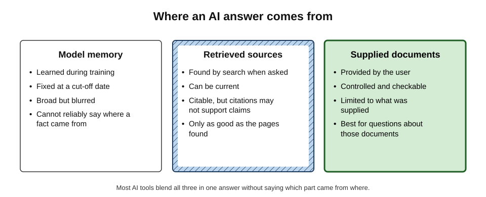
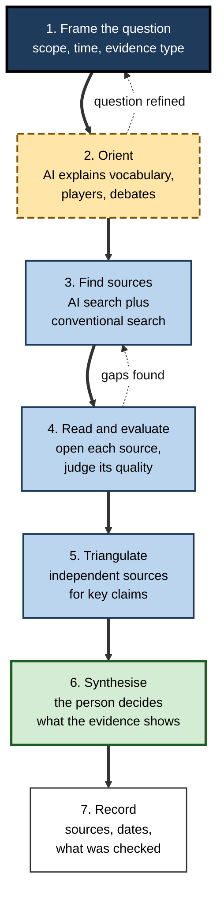
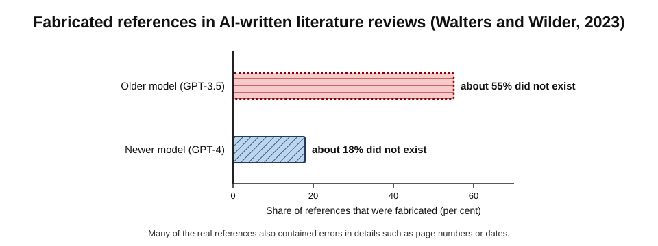
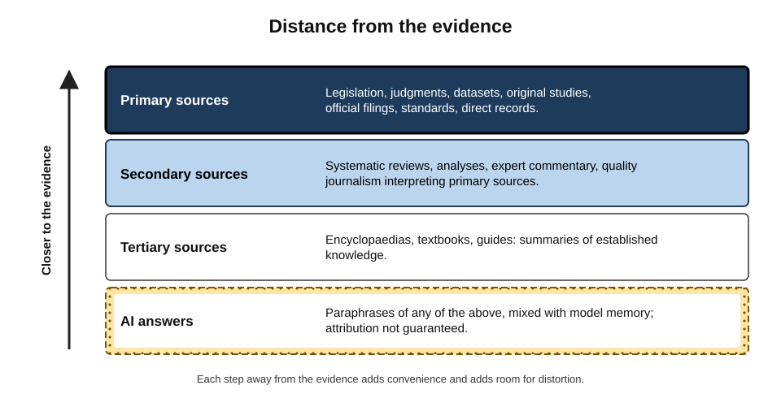
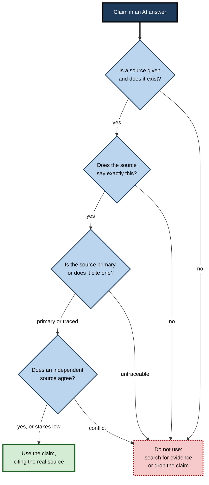
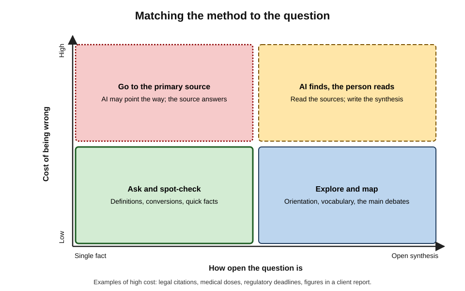

# B.4. Research and information lookup

An analyst asks an AI assistant for the size of the European market for industrial heat pumps. In seconds it gives a confident figure, a growth rate and a neat citation to a trade publication. The publication is real. The article is real. Neither the figure nor the growth rate appears in it. AI has made finding information astonishingly fast — and has made it easier than ever to hold an answer without knowing where it came from.

> **Definition — Information lookup:** finding a specific fact, figure, definition or reference needed for a task.

> **Definition — AI-assisted research:** using AI tools to frame questions, find and read sources, extract information and synthesise findings, while the person remains responsible for judging the evidence.

**Why it matters**

- Much professional work begins with a question: what does the regulation require, what did the competitor announce, what does the research say?
- AI tools can compress hours of searching and reading into minutes.
- They also produce **answers without evidence trails**, invented references and confident errors — which flow into reports, advice and decisions under the professional's name.
- Research skill is shifting from *finding* information to *judging* it: framing the question, tracing claims and deciding what to trust.

---

## Kinds of Questions

Different questions call for different methods; most failures of AI-assisted research come from treating every question as a lookup.

- **Fact lookup** — one checkable answer.
  - *e.g.* "What is the VAT registration threshold in the UK this tax year?"
- **Explanation** — how or why something works.
  - *e.g.* "How does a carbon border adjustment mechanism work?"
- **Orientation** — the shape of an unfamiliar field: vocabulary, main players, key debates.
  - *e.g.* "What are the main approaches to warehouse automation?"
- **Comparison** — options against criteria.
  - *e.g.* "How do the three main cloud providers price data egress?"
- **Synthesis** — what the evidence as a whole shows.
  - *e.g.* "What does research say about four-day working weeks and productivity?"
- **Current events** — what has happened recently.
  - *e.g.* "What did the central bank announce yesterday?"
- **Internal knowledge** — what the organisation itself knows.
  - *e.g.* "What did we agree with this client in last year's contract?"

> **Key point:** AI tools are strongest at **orientation and explanation**, useful for **comparison and synthesis** when grounded in sources, and least trustworthy for **precise facts and current events** answered from memory.

---

## Where an AI Answer Comes From

**Figure 1.** Where an AI answer comes from.

### Model memory

> **Definition — Parametric knowledge:** information absorbed into a model's internal parameters during training, which it draws on without consulting any source.

> **Definition — Knowledge cut-off:** the date after which a model's training data contains no information.

- Broad and fast, but **blurred**: the model stores patterns, not documents, and cannot reliably say where a fact came from.
- **Stale** after the cut-off: rates, rules, prices, people's roles and recent events may be wrong.
- **Weakest on the rare and the precise**: obscure facts, exact figures, citations, recent changes.

### Retrieved sources

> **Definition — Retrieval-augmented generation (RAG):** a technique in which a system first retrieves relevant documents — from the web or a document store — and then generates an answer using them (described by Patrick Lewis and colleagues, 2020).

- **Strengths:** current information, links to sources, answers grounded in text that can be checked.
- **Weaknesses:**
  - only as good as what was retrieved — a weak or biased set of pages produces a weak answer;
  - the model may still blend in memory, or cite a source that does not support the specific claim.

> **Definition — Grounding:** tying each claim in an AI answer to specific passages in identifiable sources.

### Supplied documents

- The user provides the documents — a policy, a dataset, a set of papers.
- Best for questions **about those documents**; the risk shifts from invention to omission and misreading.

> **Watch out:** a citation next to a sentence shows that a source was **retrieved**, not that it **supports** the sentence. Checking means opening the source and finding the passage.

---

## Framing a Researchable Question

### From vague to researchable

- **Vague:** "What's happening with heat pumps?"
- **Researchable:** "What was the installed base and annual sales of industrial heat pumps in the EU in 2023 and 2024, according to industry associations or official statistics, and how do estimates differ?"

**Elements of a researchable question**

- **Scope** — the exact thing being asked about, with definitions.
- **Place and time** — jurisdiction, market, period.
- **Kind of evidence wanted** — official statistics, peer-reviewed studies, regulatory texts, company filings.
- **Disagreement** — ask how sources differ, not just for one answer.
- **Use** — what decision the answer will inform, which sets the standard of evidence.

> **Example:** evidence-based medicine structures clinical questions with **PICO** — Population, Intervention, Comparison, Outcome — so that searches find relevant studies. The same discipline helps any professional question: "For mid-sized UK retailers (population), does self-checkout (intervention) compared with staffed tills (comparison) change shrinkage rates (outcome)?"

### Asking well

- **Ask for sources and their type** — "cite primary sources where possible, and say which claims rest on secondary reports".
- **Ask for uncertainty** — "say where evidence is weak, conflicting or missing".
- **Avoid leading questions.** "Why does remote work reduce productivity?" presupposes the answer; "What does evidence show about remote work and productivity?" does not.
- **Ask for the opposing case** — "What is the strongest evidence against this?"

> **Definition — Sycophancy:** the tendency of language models to agree with, flatter or tailor answers to the views a user appears to hold (documented by Mrinank Sharma and colleagues, 2023, among others).

---

## The Research Loop

**Figure 2.** The AI-assisted research loop.

### The theory behind the loop

- **Information foraging theory** — Peter Pirolli and Stuart Card (1999) modelled information seeking on how animals forage for food.
  - Searchers follow **information scent** — cues suggesting that a path leads to valuable information.
  - They weigh the gain from a source against the cost of reaching and reading it.
- **AI's effect:** it cuts foraging costs dramatically, delivering a ready-made answer.
  - But it also removes the trail: the searcher no longer sees the sources, their disagreements or their quality.

> **Definition — Information scent:** the cues — titles, snippets, links — that suggest how likely a path is to lead to the information sought.

> **Key point:** AI is best used to **shorten the path to sources**, not to replace them. The answer is a lead; the source is the evidence.

---

## How AI Lookups Go Wrong

### Fabricated references

**Study card — Walters and Wilder (2023), *Scientific Reports***

- **Design:** two versions of ChatGPT were asked to write short literature reviews on a range of topics, with references.
- **Results:**
  - about **55%** of references from the older model (GPT-3.5) and about **18%** from the newer model (GPT-4) **did not exist**;
  - many real references contained errors — wrong years, pages or journals.
- **Conclusion:** references generated from model memory must be treated as unverified until found.

**Figure 3.** Fabricated references in AI-written literature reviews (Walters and Wilder, 2023).

> **Watch out:** newer models and search-connected tools fabricate references far less often — but not never. A plausible author list, journal and year are exactly what a fabrication looks like.

### Citations that do not support the claim

**Study card — Tow Center for Digital Journalism (March 2025)**

- **Design:** eight AI search tools were given excerpts from real news articles and asked to identify the original article, publisher, date and link — 1,600 queries in all.
- **Results:**
  - collectively, the tools answered **more than 60%** of queries incorrectly;
  - they rarely declined to answer, preferring confident wrong answers;
  - several premium versions were more confidently wrong than free ones;
  - links frequently led to syndicated copies, wrong articles or pages that did not exist.
- **Conclusion:** even search-connected tools often mis-attribute; an attached link is not proof of provenance.

### Specialist tools are not immune

**Study card — Magesh and colleagues, Stanford (2024)**

- **Design:** leading AI legal-research tools from established legal publishers — marketed as reducing or avoiding hallucination by grounding answers in legal databases — were tested on a large set of legal queries.
- **Results:** the tools gave incorrect or unsupported answers on roughly **17% to 33%** of queries, depending on the tool — better than a general chatbot, but far from error-free.
- **Conclusion:** retrieval reduces but does not eliminate hallucination, even in professional products built on authoritative sources.

### Other failure types

- **Stale facts** — tax thresholds, interest rates, office holders, product specifications.
- **False precision** — a single figure where sources disagree widely.
  - *e.g.* market-size estimates often vary by a factor of two or more depending on definitions.
- **Consensus flattening** — a contested question presented as settled.
- **Source laundering** — AI answers citing web pages that were themselves AI-generated, so an unsupported claim acquires an apparent source.
- **Leading-question bias** — sycophantic answers that confirm the premise.
- **Plausible nonsense from overviews** — in May 2024, an AI search summary widely shared online advised adding glue to pizza sauce, drawn from a joke forum post: retrieval found a source, but not a sensible one.

> **Mnemonic — "FACTS-L":** Fabricated references, Attribution errors, Cut-off staleness, Too-precise figures, Sycophancy, Laundered sources — what to suspect in every AI lookup.

---

## Judging Sources

### Distance from the evidence

**Figure 4.** Distance from the evidence.

> **Definition — Primary source:** the original evidence — legislation, a judgment, a dataset, an original study, an official filing, a direct record.

> **Definition — Secondary source:** a work that interprets or analyses primary sources — a review, an analysis, quality journalism.

- **Rule of thumb:** go as close to the primary source as the stakes demand.
  - A blog post quoting a statistic → find the report → find the table.
- An AI answer is, at best, a **tertiary-plus** source: a paraphrase of other sources mixed with model memory.

### Lateral reading

**Study card — Wineburg and McGrew (2017–2019)**

- **Design:** Stanford researchers compared how professional fact-checkers, historians and university students evaluated unfamiliar websites.
- **Findings:**
  - historians and students read **vertically** — staying on the page, judging its design, "About" page and tone;
  - fact-checkers read **laterally** — quickly leaving the page to see what other sources said about the site and its claims;
  - fact-checkers reached accurate judgements faster and more often.
- **Conclusion:** judging a source means checking what **others** say about it, not how credible it looks.

> **Definition — Lateral reading:** evaluating a source by leaving it to investigate who is behind it and what independent sources say about it and its claims.

**The SIFT routine (Mike Caulfield)**

1. **Stop** — notice the urge to accept or share; ask what is known about the source.
2. **Investigate the source** — who produced it, with what expertise and interests?
3. **Find better coverage** — what do trusted sources say about the claim?
4. **Trace claims** to their original context — quotations, figures and images back to where they began.

### Tracing a claim

**Figure 5.** Tracing a claim from an AI answer to its evidence.

> **Remember:** cite the **source**, never the AI. If the source cannot be found, the claim has no evidence behind it.

---

## Matching the Method to the Question

**Figure 6.** Matching the method to the question.

- **Single fact, low cost** — ask, and spot-check if anything looks odd.
- **Synthesis, low cost** — use AI freely to explore and map a field.
- **Single fact, high cost** — go to the authoritative primary source; AI may point the way.
  - *e.g.* a legal citation, a drug dose, a filing deadline, a regulatory threshold.
- **Synthesis, high cost** — use AI to find and sort sources; read the key ones; write the synthesis oneself.

| | Conventional search | AI answer from memory | AI answer with retrieval |
|---|---|---|---|
| Speed to an answer | Slower — reading required | Fastest | Fast |
| Currency | Current | Fixed at cut-off | Current |
| Evidence trail | Visible — the pages themselves | None | Links, not always supporting |
| Typical error | Missing a good source | Invented or stale facts | Mis-attribution, weak sources |
| Best for | Precise facts, primary sources | Explanations, orientation | Recent topics, finding sources |

> **In practice:** experienced researchers use AI and conventional search **together** — AI to learn the vocabulary and find candidate sources, conventional search and direct reading to confirm them.

---

## Worked Example (illustrative): Sizing a Market

**Situation:** a strategy consultant must give a client an estimate of the EU market for industrial heat pumps for a board paper next week.

**Step 1 — the naive lookup**

- Prompt: "How big is the EU industrial heat pump market?"
- Answer: a single figure in euros, a compound annual growth rate and a citation to a trade publication.

**Step 2 — tracing**

1. **Does the source exist?** Yes — the article is real.
2. **Does it say this?** No — it discusses the market qualitatively and quotes a different figure for all heat pumps, residential included.
3. **Where might the figure come from?** A search finds several market-research press releases giving widely different estimates, each with its own definition of "industrial".

**Step 3 — reframing the question**

- "List published estimates of the EU industrial heat pump market since 2022, with the publisher, definition used, year and figure; note where definitions differ."
- AI, with retrieval, produces a list of candidate sources; the consultant opens each.

**Step 4 — the result**

| | Naive AI answer | Traced estimate |
|---|---|---|
| Figure | One precise number | A range across four sources |
| Definition | Unstated | Stated for each source |
| Sources | One, not supporting the figure | Four, each opened and checked |
| Confidence | Implied high | Explicitly moderate; definitions differ |
| Use in board paper | Unsafe | Safe, with caveats |

- **Conclusion:** the honest answer is a **range with definitions**, not a number. AI made finding the sources faster; it could not make the evidence more certain than it is.

> **Watch out:** a precise figure for a loosely defined quantity is a sign of false precision. Ask, "Precise according to whom, and measured how?"

---

## Case Study: The Brief That Cited Cases That Did Not Exist

- **Situation:** in 2023, in *Mata v. Avianca*, a personal-injury case in a US federal court in New York, lawyers filed a brief opposing the airline's motion to dismiss.
- **Problem:** the brief cited six judicial decisions — complete with names, quotations and citations — that did not exist. They had been generated by ChatGPT.
- **What happened:**
  1. a lawyer used the chatbot for legal research, believing it to be a kind of search engine;
  2. when he asked it whether the cases were real, it assured him they were;
  3. opposing counsel and the court could not find the cases;
  4. the judge imposed a **$5,000** fine on the lawyers and their firm and required them to notify the judges falsely named as authors of the fake opinions.
- **Diagnosis:**
  - a generative model was used as a database;
  - the tool was asked to verify itself;
  - no one checked the citations in a legal database before filing.
- **Aftermath:** courts in several countries issued guidance or orders on AI use in filings, and similar incidents continued to be reported in later years.
- **Lesson:** **verification must be independent of the tool that produced the claim.** Asking a model whether its own answer is true is not a check.

---

## Professional Practice

### Research habits that scale

- **A research log** — question, date, tools used, sources found, what was checked and how.
- **Citation hygiene** — every claim in a deliverable cites a source the author has opened.
- **Date-stamping** — "as of October 2026" for any fact that changes.
- **Separate finding from concluding** — AI can list what sources say; the professional writes what the evidence shows.

### Internal knowledge

- Organisations increasingly connect AI assistants to their own documents — policies, past proposals, contracts, wikis.
- **Benefits:** institutional knowledge becomes searchable in plain language.
- **Risks:**
  - out-of-date documents retrieved alongside current ones;
  - answers drawn from documents the user should not see, if permissions are badly configured;
  - confident answers when the relevant document is missing from the store.

### Deep-research tools

- Agentic "deep research" features browse many sources over several minutes and produce long, referenced reports.
- **Useful for** first-pass literature scans and landscape reviews.
- **Risks:** length disguises weak sourcing; dozens of citations make checking costly, so they are often not checked.
- **Practice:** treat the report as a **reading list with commentary**; check every claim that will be used.

### Authoritative sources by field

Knowing where the authoritative answer lives is the expert's advantage; AI can suggest candidates, but the professional should know the destination.

- **Law** — legislation databases, official law reports, court websites, regulator handbooks.
  - The test: the text of the statute or judgment itself, in its current, in-force version.
- **Medicine and health** — clinical guidelines from national bodies, product information for medicines, systematic reviews.
  - The test: the current guideline or summary of product characteristics, not a paraphrase.
- **Finance and accounting** — company filings with regulators, audited accounts, accounting standards, central-bank and statistical-office releases.
  - The test: the filed document and the specific table or note.
- **Tax and payroll** — the tax authority's own guidance and rates pages, dated for the relevant tax year.
- **Engineering and technology** — standards bodies, official product documentation, release notes, security advisories.
  - The test: documentation for the exact version in use.
- **Markets and industry** — official statistics, industry-association data and company disclosures before commercial market-research press releases.
- **Science** — peer-reviewed papers and, where possible, systematic reviews and meta-analyses rather than single studies.

> **Watch out:** documentation and rules are versioned. An AI answer that is correct for last year's tax rates, an older software release or a superseded guideline is wrong for today's decision. Ask, "Correct as of when, and for which version?"

### Triangulation in practice

> **Definition — Triangulation:** confirming a claim through two or more independent sources, ideally of different kinds, so that one source's error is unlikely to be repeated in the others.

- **Independent** means not copying each other — two news stories quoting the same press release are one source, not two.
- **Different kinds** — a statistic confirmed by both an official dataset and an academic analysis is stronger than one confirmed by two blogs.
- **When sources disagree**, report the disagreement and the reason (definitions, dates, methods) rather than choosing the convenient figure.

### Confidentiality of questions

- Questions reveal intentions — a search about a takeover target, a medical condition or a legal dispute can itself be sensitive. Approved tools and anonymised phrasing apply to queries as well as documents.

---

## Research Skill in the Age of Answers

- **Speed and over-reliance.** Experiments comparing AI chat with conventional search for everyday decisions have found that AI users finish faster with fewer queries, but follow the AI more readily when it is wrong.
- **The illusion of explanatory depth.** Leonid Rozenblit and Frank Keil (2002) showed that people overestimate how well they understand how things work until asked to explain them. A fluent AI explanation can deepen this illusion.
- **Skill that remains essential:**
  - framing questions;
  - knowing which sources are authoritative in a field;
  - reading primary sources;
  - judging the strength of evidence;
  - recognising when an answer is too neat.

> **In practice:** when learning a new field, ask AI for an explanation, then **explain it back without the tool** and check the explanation against a primary source. The gap between the two shows what has actually been understood.

---

## Open Questions

- **Can retrieval-based tools become reliably faithful to their sources?**
  - Error rates have fallen, but independent evaluations in 2024–2025 still found substantial attribution and accuracy errors.
- **What happens to the information ecosystem when AI answers replace visits to sources?**
  - If fewer people visit original publishers, the incentive to produce reliable primary content may weaken.
- **How should AI-generated web content be handled?**
  - As more pages are machine-written, source laundering may grow; detection and provenance standards are immature.
- **Which research skills should professionals keep, and which can be delegated?**
  - There is little evidence yet on how heavy AI use affects long-term research capability.
- **How should liability be shared?**
  - When professional AI tools give wrong answers, the balance of responsibility between vendor and user is unsettled.

---

## Summary

- **Information lookup** finds specific facts; **AI-assisted research** frames, finds, reads and synthesises — with the person judging the evidence.
- Question types — fact, explanation, orientation, comparison, synthesis, current events, internal — call for different methods; AI is strongest at orientation and explanation.
- Answers come from **model memory** (blurred, stale after the **knowledge cut-off**), **retrieved sources** (RAG; current but not always supportive) and **supplied documents**.
- Frame **researchable questions**: scope, place and time, evidence type, disagreement, use. Avoid leading questions; beware **sycophancy**.
- The research loop: frame → orient → find → read and evaluate → triangulate → synthesise → record. **Information foraging** explains AI's appeal and its cost: the trail disappears.
- Failure modes: fabricated references (**Walters and Wilder, 2023**), mis-attribution (**Tow Center, 2025**: over 60% wrong), errors even in specialist legal tools (**Stanford, 2024**: about 17–33%), staleness, false precision, consensus flattening, source laundering.
- Judge sources by **distance from the evidence**; use **lateral reading** and **SIFT**; trace every claim; **cite the source, never the AI**.
- *Mata v. Avianca* (2023): fabricated cases in a court filing — verification must be **independent** of the tool.
- Practice: research logs, citation hygiene, date-stamping, care with internal knowledge stores and deep-research reports.

---

## Self-Check

1. Distinguish information lookup from AI-assisted research.
2. Name the seven kinds of question and say which AI handles best and worst.
3. Explain parametric knowledge and the knowledge cut-off, with an example of a fact likely to be wrong because of each.
4. What is retrieval-augmented generation, and why does it reduce but not eliminate errors?
5. Rewrite "What's the deal with AI regulation?" as a researchable question.
6. What is sycophancy, and how should questions be phrased to limit it?
7. Explain information foraging theory and what AI changes about foraging.
8. Summarise the findings of Walters and Wilder (2023) and the Tow Center (2025).
9. What does the Stanford study of legal research tools show about grounding?
10. Distinguish primary, secondary and tertiary sources, and place an AI answer among them.
11. What is lateral reading, and what did Wineburg and McGrew find?
12. Describe the steps of SIFT.
13. Analyse *Mata v. Avianca*: what went wrong at each stage and what would have prevented it?
14. A colleague's report states "the global market for X will reach $48.3 billion by 2030", sourced to an AI assistant. Explain what is wrong and how to fix it.
15. Design a research method for a team producing a policy briefing on a contested topic in five days, using AI tools responsibly.

### Answer Key

1. Lookup finds a specific fact or reference; AI-assisted research covers framing, finding, reading, extracting and synthesising, with the person responsible for judging evidence.
2. Fact lookup, explanation, orientation, comparison, synthesis, current events, internal knowledge. Best: orientation and explanation. Worst from memory: precise facts and current events.
3. Parametric knowledge is information stored in model parameters from training — blurred, so a rare figure may be misremembered. The cut-off is the end date of training data — a tax threshold changed since then will be wrong.
4. The system retrieves documents and generates an answer from them. It reduces errors by grounding in current text, but the retrieved set may be weak and the model may still blend memory or mis-cite.
5. E.g. "What obligations does the EU AI Act place on employers using AI in recruitment, from what dates, according to the regulation's text and official guidance?"
6. The tendency to agree with or tailor answers to a user's apparent views. Ask neutrally, avoid presupposing answers, request the strongest opposing evidence.
7. Searchers follow information scent and weigh gains against costs, like foraging animals. AI cuts the cost by delivering an answer but removes visibility of sources, disagreements and quality.
8. Walters and Wilder: about 55% (GPT-3.5) and 18% (GPT-4) of generated references did not exist. Tow Center: eight AI search tools mis-identified news sources in over 60% of 1,600 queries, rarely declining to answer.
9. Even tools grounded in authoritative legal databases gave incorrect or unsupported answers on roughly 17–33% of queries; grounding helps but is not a guarantee.
10. Primary: original evidence. Secondary: interpretation of primary sources. Tertiary: summaries of established knowledge. AI answers paraphrase all of these mixed with memory, with no guaranteed attribution — further from the evidence than any of them.
11. Leaving a source to see what independent sources say about it. Fact-checkers who read laterally judged sites faster and more accurately than historians and students who read vertically.
12. Stop; Investigate the source; Find better coverage; Trace claims to their original context.
13. A generative chatbot was used as a legal database; the lawyer asked the tool to confirm its own output; no one checked citations in a legal database; the brief was filed. Prevention: use proper legal databases, check every citation independently, understand the tool's nature.
14. The AI is not a source; the figure's origin, definition and date are unknown; the precision is spurious. Trace the figure to a published estimate, state the publisher, definition and date, compare with other estimates and report a range with caveats.
15. Day 1: frame questions and sub-questions; AI for orientation and vocabulary. Days 1–2: AI and conventional search to list sources across positions; research log. Days 2–3: read key primary and secondary sources; lateral reading on unfamiliar sources. Day 4: triangulate key claims; human-written synthesis noting disagreement and evidence strength. Day 5: citation check (every claim to an opened source), date-stamps, peer review by a colleague who checks a sample of claims.

---

## Glossary

| Term | Meaning |
|---|---|
| AI-assisted research | Using AI to frame, find, read and synthesise information while a person judges the evidence. |
| False precision | A precise figure given where evidence supports only a range. |
| Grounding | Tying each claim in an answer to specific passages in identifiable sources. |
| Information foraging theory | A model of information seeking as a trade-off between expected gain and cost. |
| Information lookup | Finding a specific fact, figure, definition or reference. |
| Information scent | Cues suggesting how likely a path is to lead to the information sought. |
| Knowledge cut-off | The date after which a model's training data contains no information. |
| Lateral reading | Evaluating a source by checking what independent sources say about it. |
| Parametric knowledge | Information stored in a model's parameters during training. |
| PICO | Population, Intervention, Comparison, Outcome — a structure for research questions. |
| Primary source | Original evidence such as legislation, data, original studies or official records. |
| Retrieval-augmented generation (RAG) | Retrieving documents first, then generating an answer from them. |
| Secondary source | A work interpreting or analysing primary sources. |
| SIFT | Stop, Investigate the source, Find better coverage, Trace claims. |
| Source laundering | An unsupported claim gaining apparent support from AI-generated pages that repeat it. |
| Sycophancy | A model's tendency to agree with or tailor answers to a user's apparent views. |
| Tertiary source | A summary of established knowledge, such as an encyclopaedia or textbook. |
| Triangulation | Confirming a claim through two or more independent sources of different kinds. |
