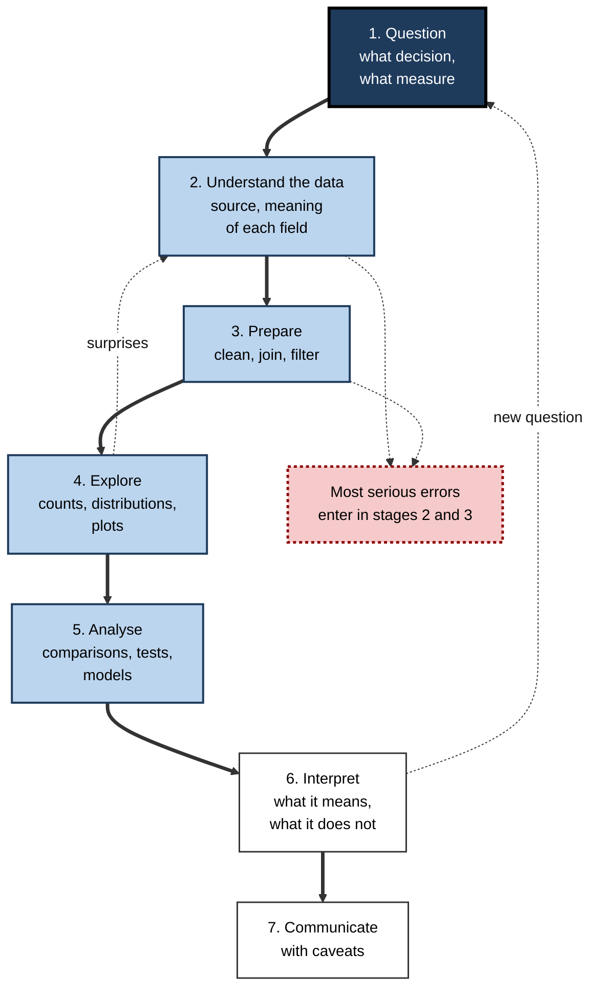
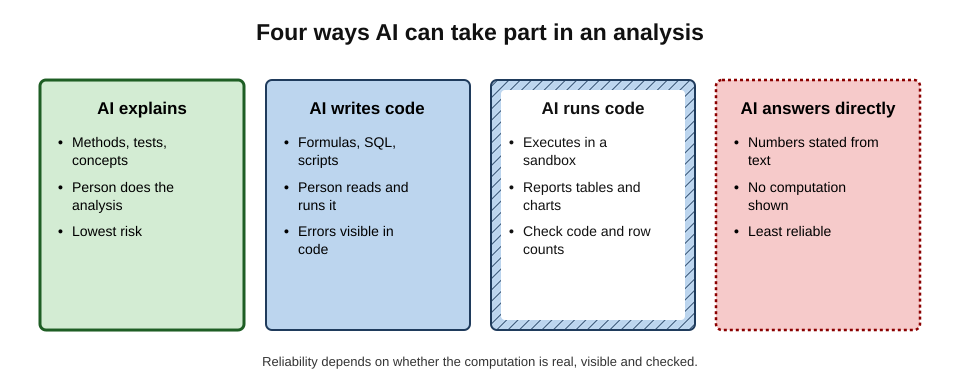
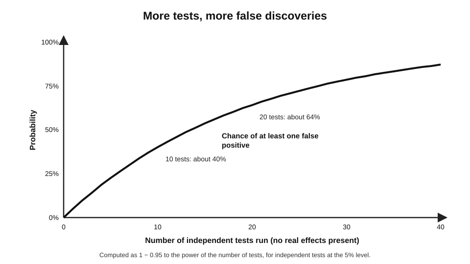
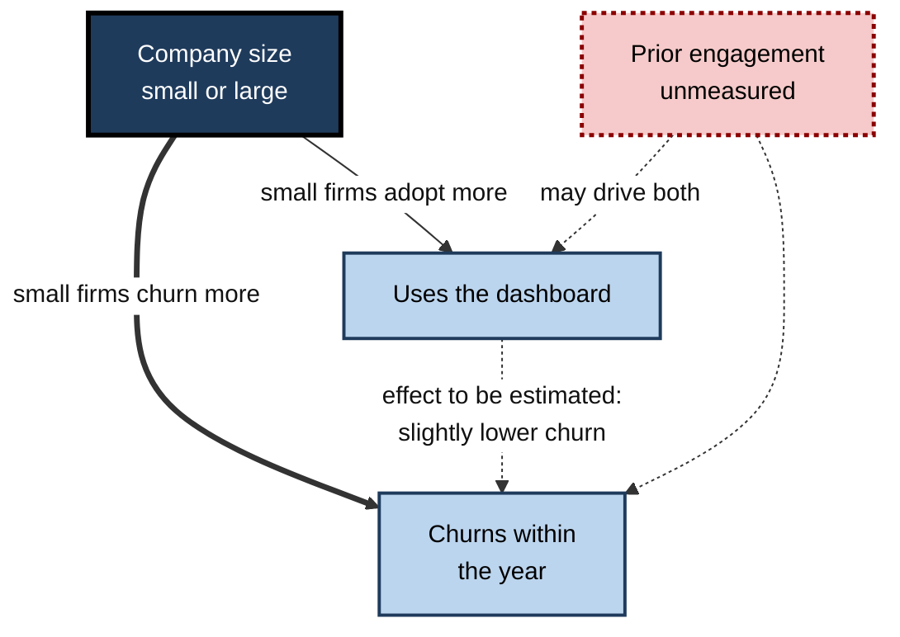
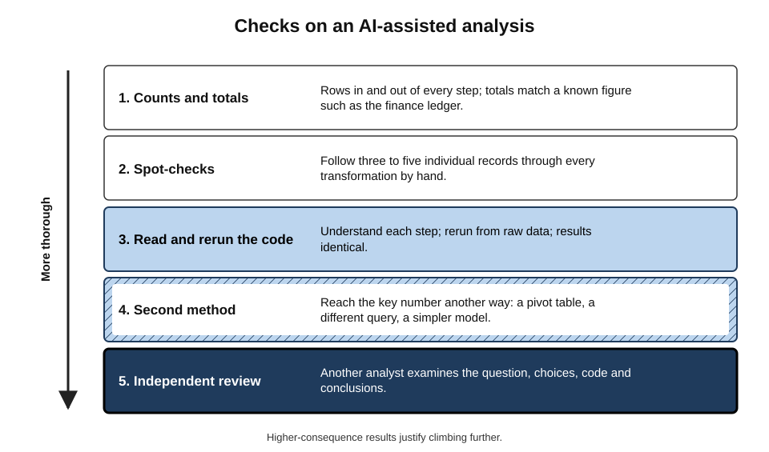
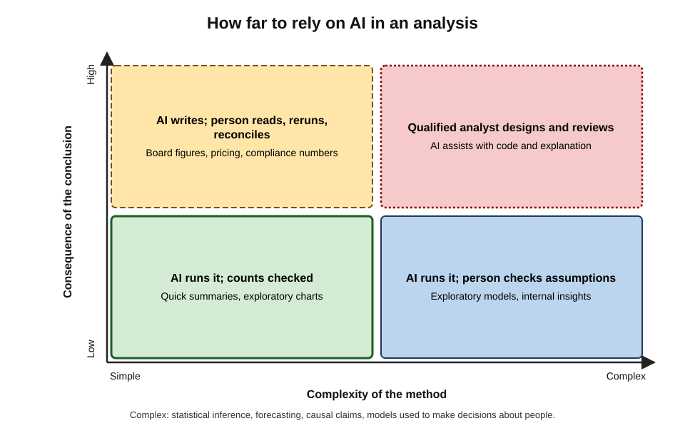

# B.6. Data analysis with AI assistance

A marketing analyst uploads two spreadsheets — orders and customers — and asks an AI assistant why revenue fell last quarter. Within a minute it has merged the files, drawn four charts and written a fluent explanation pointing to a decline in repeat purchases. Revenue in its analysis is also 30% higher than the finance team's figure, because the merge duplicated every order for customers with two addresses. The explanation was confident, the charts were attractive, and the numbers were wrong from the first step.

> **Definition — Data analysis:** the process of inspecting, cleaning, transforming and modelling data to answer questions, discover patterns and support decisions.

> **Definition — AI-assisted data analysis:** data analysis in which an AI model explains methods, writes formulas, queries or code, runs computations or interprets results, while a person remains responsible for the question, the checks and the conclusions.

**Why it matters**

- Data questions are everywhere in professional work: sales trends, customer churn, staff turnover, budgets, service performance, survey results.
- AI tools lower the barrier dramatically: people who cannot write code can now run analyses that once needed a specialist.
- Analysis errors are **silent**: a wrong number looks exactly like a right one, and a chart makes it look authoritative.
- Speed changes the risk: when analyses are nearly free, it becomes easy to run dozens until one gives the answer someone wanted.

---

## The Shape of an Analysis

### From question to conclusion

**Figure 1.** The stages of a data analysis.

- **Question** — what decision depends on the answer, and which measure answers it.
  - *e.g.* "Has the new pricing reduced churn among small-business customers?" — not "analyse churn".
- **Understand the data** — where it came from, what each field means, what is missing.
  - *e.g.* does "revenue" include tax? refunds? cancelled orders?
- **Prepare** — cleaning, joining tables, filtering, deriving new fields.
- **Explore** — counts, distributions and plots before any modelling.
- **Analyse** — comparisons, statistical tests, models.
- **Interpret** — what the result means for the decision, and what it cannot show.
- **Communicate** — the finding, its uncertainty and its limits.

> **Key point:** AI accelerates every stage, but the stages where most serious errors arise — **understanding the data and preparing it** — are the ones least visible in a polished final chart.

### Always look at the data

> **Example — Anscombe's quartet (Francis Anscombe, 1973):** four small datasets with almost identical means, variances, correlations and regression lines — yet, when plotted, one is a straight line, one a curve, one a line with a single outlier and one a vertical cluster with one extreme point. Summary statistics alone can describe very different realities.

> **Remember:** **plot before you summarise**, and check counts before you trust totals.

---

## How AI Takes Part

**Figure 2.** Four ways AI can take part in an analysis.

### Explaining

- Concepts and methods: "What is the difference between median and mean income here?", "Which test compares two proportions?"
- Interpretation help: "What does a 95% confidence interval of 2% to 9% mean?"
- **Risk:** low — the person still does and checks the analysis — though explanations can be wrong in detail.

### Writing formulas, queries and code

- Spreadsheet formulas, SQL queries, Python or R scripts.
- The person reads, runs and checks the result.
- **Strength:** the logic is **visible** — errors can be found by reading the code.

> **Definition — Text-to-SQL:** translating a natural-language question into a database query.

- On realistic text-to-SQL benchmarks with messy, real-world databases (such as BIRD, introduced in 2023), the best systems have improved quickly but remained below the accuracy of expert human data engineers.
- **Typical errors:** wrong join keys, missing filters (cancelled orders, test accounts), wrong date boundaries, misunderstood column meanings.

### Running code

> **Definition — Code execution (in an AI assistant):** the assistant writes code and runs it in a secure sandbox, returning tables, charts and results.

- Lets non-programmers analyse uploaded files in plain language.
- **Strength:** computations are real, not guessed.
- **Risk:** the code may be correct Python and still answer the wrong question — and many users never look at it.

### Answering directly

- The model reads data as text and states numbers without running any computation.
- **Unreliable:** language models generate text token by token and are not calculators; totals, averages and counts produced this way can be wrong, especially for large tables.

> **Watch out:** an assistant that "reads" a spreadsheet and announces "average order value is £84.20" may not have computed anything. Ask for the code, or check that a computation tool was actually used.

| | Explaining | Writing code | Running code | Answering directly |
|---|---|---|---|---|
| Who computes | Person | Person's tools | Sandbox | Nobody — text prediction |
| Visibility of logic | Person's own | Full | Full if shown | None |
| Skill needed | Moderate | Enough to read code | Low to start | None |
| Main risk | Wrong explanation | Subtle logic errors | Wrong question, unread code | Invented numbers |
| Suitable for decisions | Yes, with care | Yes, after checks | Yes, after checks | No |

---

## Where Analyses Go Wrong

### Data preparation errors

- **Join explosions** — merging tables on a key that is not unique duplicates rows.
  - *e.g.* customers with two addresses doubling their orders, as in the opening example.
- **Silent filters** — records excluded by a condition nobody noticed.
- **Mis-typed fields** — dates read as text, numbers with commas read as strings, leading zeros dropped from codes.
- **Missing data handled badly** — blanks treated as zeros, or rows with any blank dropped.
- **Definitions** — "active customer", "revenue" and "churn" defined differently from the organisation's standard.

> **Definition — Join explosion:** an unintended multiplication of rows when tables are merged on a key that matches more than one row in one of the tables.

> **In practice:** after every join, compare the row count with what should be there. If 10,000 orders become 13,000 rows, something has duplicated.

### Errors long predate AI

**Study card — Herndon, Ash and Pollin (2013) on Reinhart and Rogoff (2010)**

- **Background:** an influential 2010 economics paper reported that countries with public debt above 90% of GDP had sharply lower average growth — and was widely cited in debates about austerity.
- **Re-analysis:** a graduate student, Thomas Herndon, with colleagues, obtained the original spreadsheet and found:
  - a formula range that left out several countries;
  - selective exclusion of some data;
  - an unconventional weighting of country averages.
- **Result:** with corrections, average growth for high-debt countries was modestly positive rather than negative, and the dramatic threshold largely disappeared.
- **Lesson:** small mechanical errors in analysis can carry enormous consequences — and are found only when someone **reruns the analysis from the raw data**.

### Statistical traps

- **Simpson's paradox** — a trend in every subgroup reverses when groups are combined.
  - Classic case: in 1973 graduate admissions at the University of California, Berkeley, men were admitted at a higher overall rate than women — yet within most departments, women were admitted at equal or higher rates. Women had applied more often to the most competitive departments (Bickel, Hammel and O'Connell, 1975).
- **Correlation is not causation** — customers who use a feature may stay longer because engaged customers use more features.
- **Regression to the mean** — extreme results tend to be followed by less extreme ones, so "improvement" after intervening on the worst performers may be chance.
- **Survivorship bias** — analysing only the cases that survived (current customers, successful projects).
- **Small samples** — a 20% rise based on ten cases is mostly noise.

> **Definition — Simpson's paradox:** a pattern in which an association present in each subgroup of data reverses or disappears when the subgroups are combined.

### Many analyses, one answer wanted

> **Definition — Garden of forking paths (Andrew Gelman and Eric Loken, 2013):** the many reasonable choices an analyst can make — which data to include, how to define variables, which test to use — each of which could lead to a different result, so that a "significant" finding may reflect the path taken rather than a real effect.

**Study card — Simmons, Nelson and Simonsohn (2011), "False-Positive Psychology"**

- **Design:** simulations and a deliberately absurd experiment.
- **Finding:** combining a few common, individually defensible flexibilities — choosing among outcome measures, adding observations, including a covariate, dropping a condition — raised the chance of finding a "significant" effect where none existed from 5% to about **60%**.
- **Lesson:** flexibility plus a desire for a result manufactures false findings.

> **Formula — Chance of at least one false positive:** 1 − (1 − α)^k, for k independent tests at significance level α. Example: 20 tests at α = 0.05 → 1 − 0.95^20 ≈ **0.64**, a 64% chance of at least one spurious "significant" result.

**Figure 3.** More tests, more false discoveries.

> **Watch out:** AI makes forking paths almost free. "Try it by region", "now by month", "now excluding the outliers" — twenty requests in ten minutes is twenty tests. The one that "works" is likely to be noise unless the analysis was planned in advance or the finding is confirmed on fresh data.

**Study card — Silberzahn and colleagues (2018), "Many Analysts, One Data Set"**

- **Design:** 29 teams of analysts were given the same dataset and the same question: are football referees more likely to give red cards to players with darker skin tones?
- **Results:**
  - about two-thirds of teams found a statistically significant positive effect; about one-third did not;
  - estimated effects ranged from slightly negative to nearly three times the odds;
  - the differences came from reasonable choices of method and variables, not from mistakes.
- **Lesson:** analytical choices matter as much as data; a single analysis — human or AI — is one path through the garden.

---

## Worked Example (illustrative): Does the New Dashboard Reduce Churn?

**Situation:** a software company launched a reporting dashboard last year. A product manager asks an AI assistant, with the customer file uploaded, whether dashboard users churn less.

**Step 1 — the AI's first answer:** "Dashboard users churned at **12%** versus **7.2%** for non-users. The dashboard appears to be associated with higher churn."

**Step 2 — ask for the breakdown by company size**

| Segment | Dashboard users: churned / total | Rate | Non-users: churned / total | Rate |
|---|---|---|---|---|
| Small firms | 45 / 300 | 15% | 18 / 100 | 18% |
| Large firms | 3 / 100 | 3% | 25 / 500 | 5% |
| All firms | 48 / 400 | **12%** | 43 / 600 | **7.2%** |

*Illustrative figures.*

**Step 3 — interpret**

1. Within **both** segments, dashboard users churn **less**.
2. Overall, users churn **more** — because small firms, which churn much more in general, adopted the dashboard far more often.
3. This is **Simpson's paradox**: the combined figure reflects who adopted the dashboard, not what the dashboard does.

**Figure 4.** Company size as a confounder of dashboard use and churn.

> **Definition — Confounder:** a variable that influences both the supposed cause and the outcome, creating a misleading association between them.

**Step 4 — limits**

- Even the segment comparison does not prove the dashboard **causes** lower churn: customers who adopt new features may already be more engaged.
- A stronger test: a planned comparison — for example, offering the dashboard to a random half of new customers — or at least controlling for prior engagement.

- **Conclusion:** the first AI answer was arithmetically correct and substantively misleading. Asking "broken down by what?" and "what else differs between these groups?" turned a wrong conclusion into a cautious, defensible one.

> **Watch out:** the AI did not make an arithmetic error; it answered the question asked. **Choosing the comparisons** — and distrusting a single aggregate — is the analyst's job.

---

## Checking an AI-Assisted Analysis

**Figure 5.** Checks on an AI-assisted analysis.

1. **Counts and totals** — rows in and out of every step; key totals reconciled with a trusted figure (the finance ledger, the HR system).
2. **Spot-checks** — follow a few individual records through every transformation.
3. **Read and rerun the code** — understand each step; rerun from the raw data; get the same numbers.
4. **Second method** — reach the key figure another way: a pivot table, a different query, a simpler model.
5. **Independent review** — another analyst examines question, choices, code and conclusions.

**Study card — Gu and colleagues (2024): how analysts verify AI analyses**

- **Design:** observation of data analysts using an AI assistant that wrote and ran analysis code.
- **Findings:**
  - analysts verified mainly by inspecting the code and intermediate outputs, and by comparing results with their own expectations;
  - verifying was demanding — particularly for steps where the assistant made implicit choices (filters, definitions) not stated in its explanation;
  - analysts with less programming experience found the code hard to check.
- **Lesson:** AI-generated analyses need **readable steps and explicit assumptions** to be checkable — worth requesting every time.

> **In practice:** ask the assistant to "list every assumption, filter and definition you applied, and the row count after each step". This turns hidden choices into a checklist the analyst can confirm or reject.

> **Mnemonic — "CSR-SI":** Counts, Spot-checks, Rerun, Second method, Independent review.

---

## Matching Reliance to Stakes

**Figure 6.** How far to rely on AI in an analysis.

- **Simple method, low consequence** — exploratory summaries and charts: AI can run the analysis; check counts.
- **Complex method, low consequence** — exploratory models: AI runs; the person checks assumptions.
- **Simple method, high consequence** — board figures, prices, compliance numbers: AI writes code; the person reads, reruns and reconciles with trusted totals.
- **Complex method, high consequence** — forecasts, causal claims, models used to make decisions about people: a qualified analyst designs and reviews; AI assists.

### Decisions about people

- Analyses used for hiring, promotion, pay, credit, insurance or benefits carry legal and ethical obligations — non-discrimination, explainability and, under data-protection law, rules on automated decision-making.
- AI-assisted analysis in these areas requires documented methods, bias checks and review by people with the relevant expertise.

---

## Communicating Results Honestly

### Four strengths of claim

Analyses support claims of different strength, and AI-written narratives routinely slide from weaker to stronger ones.

- **Descriptive** — what happened. "Churn was 9% last quarter."
- **Associational** — what goes with what. "Customers who use the dashboard churn less."
- **Causal** — what produces what. "The dashboard reduces churn."
- **Predictive** — what will happen. "Churn will fall to 7% next quarter."

| Claim type | Evidence normally needed | Typical AI-narrative overreach |
|---|---|---|
| Descriptive | Correct data and definitions | Rarely overreaches, but definitions may be wrong |
| Associational | Fair comparison, adequate sample, uncertainty | Stated as if causal: "drives", "leads to" |
| Causal | Randomised comparison, or strong design controlling confounders | Asserted from a single correlation |
| Predictive | A model validated on data it was not built on | A trend line extended without uncertainty |

> **Watch out:** verbs carry the claim. "Is associated with", "drives", "causes" and "will" are four different claims. Read every verb in an AI-written interpretation and downgrade any that the evidence does not support.

### Charts and uncertainty

- **Truncated axes** — a bar chart whose axis starts at 95% makes a one-point difference look enormous; AI charting tools often choose axes automatically.
- **Missing uncertainty** — a difference between two survey percentages means little without a margin of error; ask for confidence intervals.
- **Cherry-picked periods** — a trend can be made to rise or fall by choosing the start date.
- **Too many decimals** — "satisfaction rose 3.47%" from a sample of 200 implies precision that does not exist.

> **In practice:** before sharing an AI-generated chart, check four things: axis start, period shown, sample size and whether uncertainty is displayed. Then write the one-sentence takeaway yourself, with the correct strength of claim.

---

## Data Handling and Reproducibility

### Handling the data itself

- **Approved tools** — uploading customer, employee or financial data to an unapproved AI service may breach confidentiality and data-protection obligations.
- **Minimisation** — remove names and identifiers not needed for the question.
- **Synthetic or sample data** — for getting code right, a small fake dataset with the same columns often suffices; the real data is then processed in an approved environment.

### Reproducibility

> **Definition — Reproducibility:** the ability to obtain the same results from the same data by rerunning the same analysis steps.

- **Save the code**, not just the chart: a chart pasted from a chat cannot be rerun or audited.
- **Record decisions** — filters, definitions, exclusions and why.
- **Version the data** — which extract, from which system, on which date.
- **Plan before testing** — for consequential questions, write down the main comparison in advance, so exploratory findings are labelled as such.

> **Key point:** an analysis that cannot be rerun cannot be checked; an analysis that cannot be checked should not support a consequential decision.

---

## Case Study (illustrative): The Regional Sales Insight

- **Situation:** a regional sales director asked an AI assistant, with a year of sales data uploaded, "Which regions are underperforming and why?"
- **What happened:**
  1. the assistant produced a ranking, flagging the North-East as worst, with a narrative about "declining customer engagement";
  2. the director drafted a performance-improvement plan for the regional team;
  3. before it was issued, a finance analyst noticed that the North-East's revenue in the analysis was half the ledger figure.
- **Diagnosis:**
  - two large North-East accounts were billed through a head-office entity coded to another region;
  - the assistant had no way to know this; the narrative about "engagement" was a plausible story fitted to a data artefact;
  - no one had reconciled totals with finance.
- **Actions:**
  1. regional totals reconciled with the ledger before any ranking;
  2. account-to-region mapping corrected at source;
  3. the "why" question reframed as hypotheses to test with the regional managers, not conclusions to announce.
- **Result:** corrected, the North-East ranked third of seven; the plan was withdrawn, and a team was spared an unjustified intervention.
- **Lesson:** AI can produce an **explanation** for any pattern, including a false one. Reconciliation comes before ranking, and the "why" needs people who know the business.

---

## Skills That Still Matter

- **Asking good questions** — specific, decision-linked, with a defined measure.
- **Understanding data generation** — how the data was recorded, by whom, and what it leaves out.
- **Statistical judgement** — knowing when a difference is noise, when a comparison is unfair, when causation is unsupported.
- **Reading code** — enough to follow what an AI-written analysis actually did.
- **Scepticism about stories** — fluent narratives attached to numbers are cheap; evidence is not.

> **In practice:** novices gain most speed from AI in analysis — and are least equipped to catch its errors. Pairing AI use with basic statistics training and a review step for consequential work captures the speed without the hidden risk.

---

## Open Questions

- **Can AI reliably flag its own analytical assumptions?**
  - Models can be asked to list assumptions, but whether they list the ones that matter is not well established.
- **Will easy analysis increase false findings in organisations?**
  - The forking-paths problem suggests so; there is little direct measurement in business settings.
- **How much statistical skill do non-specialists need?**
  - As AI lowers the technical barrier, the minimum judgement needed to use it safely is debated.
- **How should AI-assisted analyses be audited?**
  - Standards for documenting AI involvement in consequential analyses are still emerging.
- **Will text-to-SQL become reliable on real enterprise data?**
  - Benchmark accuracy is rising, but real databases with poor documentation remain hard.

---

## Summary

- **Data analysis** moves from question → understanding data → preparation → exploration → analysis → interpretation → communication; most serious errors enter in **understanding and preparation**.
- **Plot before summarising** (Anscombe's quartet); check counts before trusting totals.
- AI can **explain**, **write code**, **run code** or **answer directly**; only real, visible, checked computation is reliable — never accept numbers stated without computation.
- Common errors: **join explosions**, silent filters, mis-typed fields, mishandled blanks, non-standard definitions. Mechanical errors predate AI (**Reinhart–Rogoff**, corrected by Herndon et al., 2013).
- Statistical traps: **Simpson's paradox**, correlation versus causation, regression to the mean, survivorship, small samples.
- **Forking paths**: flexibility manufactures false positives (Simmons et al., 2011: about 60%); 1 − 0.95^20 ≈ 64%. AI makes forking paths free. **Many analysts, one data set** (Silberzahn et al., 2018) shows choices matter.
- Checks: **Counts, Spot-checks, Rerun, Second method, Independent review**; ask for every assumption and row count.
- Match reliance to method complexity and consequence; decisions about people need extra safeguards.
- Handle data in approved tools; minimise; save code and decisions for **reproducibility**.

---

## Self-Check

1. Define AI-assisted data analysis and name the person's three retained responsibilities.
2. List the seven stages of an analysis and say where most serious errors enter.
3. What does Anscombe's quartet demonstrate?
4. Compare the four ways AI can take part in an analysis on who computes and the main risk.
5. Why should numbers an AI "reads" from a table without running code not be trusted?
6. What is a join explosion, and how is it detected?
7. Summarise the Reinhart–Rogoff spreadsheet episode and its lesson.
8. Explain Simpson's paradox using the Berkeley admissions case.
9. What is the garden of forking paths, and why does AI make it worse?
10. Calculate the chance of at least one false positive when running 10 independent tests at the 5% level.
11. What did the "Many Analysts, One Data Set" project show?
12. Describe the five checks on an AI-assisted analysis.
13. In the dashboard example, explain why the aggregate result misled and what further evidence would support a causal claim.
14. A colleague presents an AI-generated chart showing that staff who work from home have lower performance ratings, and proposes ending home working. List the questions you would ask before accepting the finding.
15. Design a policy for AI-assisted analysis in a finance department that produces monthly management accounts and ad-hoc analyses.

### Answer Key

1. Analysis in which AI explains, writes or runs code or interprets results, with a person responsible for the question, the checks and the conclusions.
2. Question, understanding data, preparation, exploration, analysis, interpretation, communication. Most serious errors enter in understanding the data and preparing it.
3. Datasets with nearly identical summary statistics can look completely different when plotted; summaries alone can mislead.
4. Explaining: person computes; risk — wrong explanation. Writing code: person's tools compute; subtle logic errors. Running code: sandbox computes; wrong question or unread code. Answering directly: nothing is computed; invented numbers.
5. Language models generate text by prediction and are not calculators; without executed code, totals and averages may simply be plausible-looking text.
6. Unintended row multiplication when joining on a non-unique key. Detected by comparing row counts before and after the join and reconciling totals.
7. A spreadsheet behind an influential paper on debt and growth omitted countries through a formula range, excluded some data and used unusual weighting. Corrected, the dramatic effect largely vanished. Lesson: rerun analyses from raw data; small mechanical errors matter.
8. Men were admitted at a higher overall rate, but within most departments women did equally well or better; women applied more to competitive departments, so the aggregate reflected application patterns, not departmental bias.
9. The many defensible analytical choices, each leading to different results, so a "significant" finding may reflect the path chosen. AI makes trying many paths almost free, multiplying chances of spurious findings.
10. 1 − 0.95^10 ≈ 1 − 0.60 = 0.40, about 40%.
11. 29 teams analysing the same data on the same question reached different conclusions — about two-thirds significant, one-third not — because of reasonable analytic choices.
12. Counts and totals reconciled; spot-checks of individual records; reading and rerunning code; a second method for key numbers; independent review by another analyst.
13. Small firms churn more and adopted the dashboard more, so combined figures showed users churning more though they churned less in each segment. Causal support: randomised offering of the dashboard, or controls for prior engagement and other differences, ideally on fresh data.
14. How were ratings and home-working status measured, and for which period? Are the groups comparable (roles, seniority, managers, tenure)? Is there Simpson's paradox by team or role? Could managers rate remote staff lower because of visibility bias? Sample sizes and uncertainty? Was this one of many cuts tried? Do other measures of output agree? Has HR or a qualified analyst reviewed it, given that it affects decisions about people?
15. Management accounts: produced by established, reconciled processes; AI may help write or explain formulas and commentary, but figures come from the ledger and are reviewed. Ad-hoc analyses: approved tools only; data minimised; code saved; counts reconciled with the ledger; assumptions listed; second-method check for any figure going to the board; peer review above a materiality threshold; exploratory results labelled; extra review for analyses affecting people.

---

## Glossary

| Term | Meaning |
|---|---|
| AI-assisted data analysis | Analysis in which AI explains, writes or runs code or interprets results, under human responsibility. |
| Anscombe's quartet | Four datasets with near-identical statistics but very different plots. |
| Code execution | An assistant writing and running code in a sandbox to compute real results. |
| Confounder | A variable influencing both a supposed cause and the outcome. |
| Correlation | A statistical association between two variables, which need not be causal. |
| Data analysis | Inspecting, cleaning, transforming and modelling data to answer questions. |
| False positive | A result that appears significant when no real effect exists. |
| Garden of forking paths | The many analytic choices that can each lead to different results. |
| Join explosion | Unintended row multiplication when merging tables on a non-unique key. |
| Reconciliation | Checking that totals agree with a trusted independent figure. |
| Regression to the mean | The tendency of extreme results to be followed by less extreme ones. |
| Reproducibility | Obtaining the same results by rerunning the same steps on the same data. |
| Significance level (α) | The accepted probability of a false positive in a single test, often 5%. |
| Simpson's paradox | An association in every subgroup that reverses when groups are combined. |
| Survivorship bias | Drawing conclusions only from cases that survived a selection process. |
| Text-to-SQL | Translating a natural-language question into a database query. |
