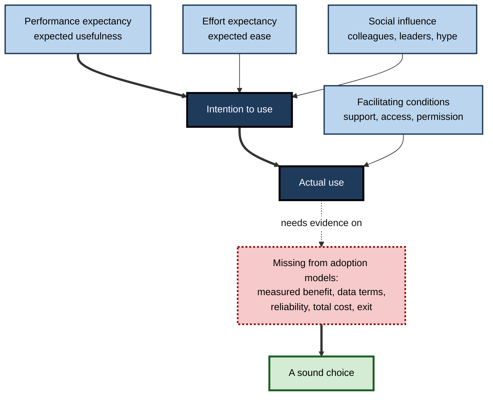
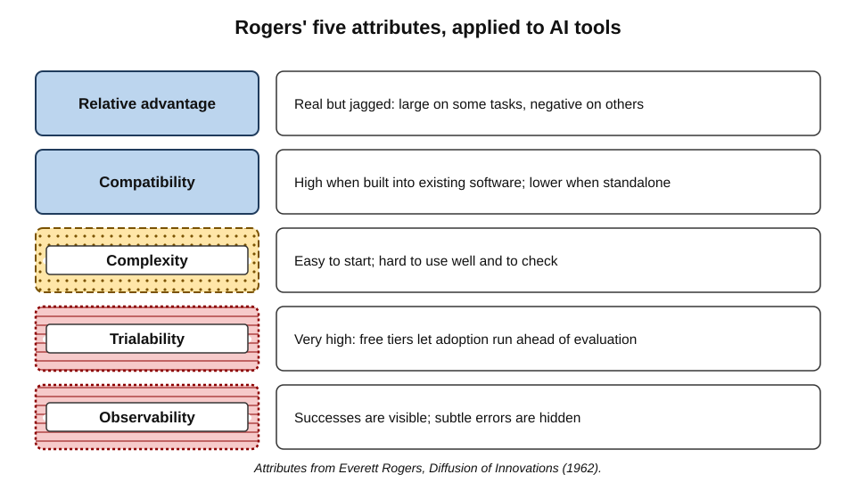
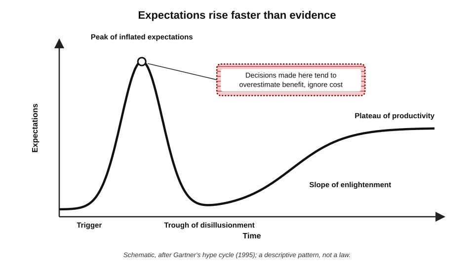
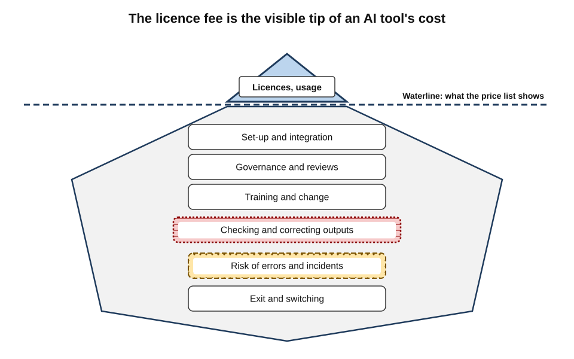
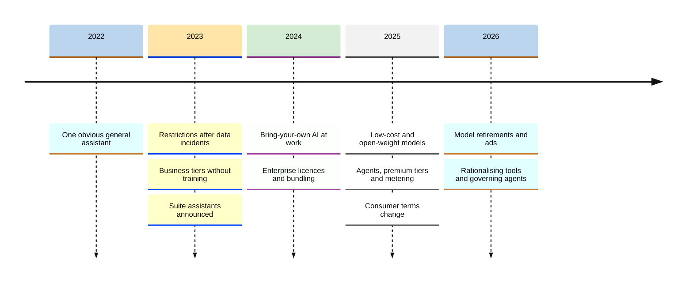
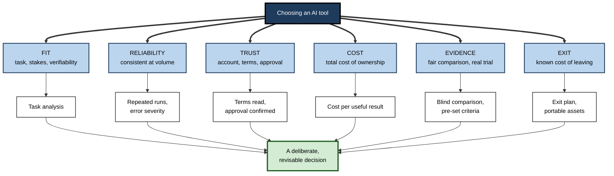
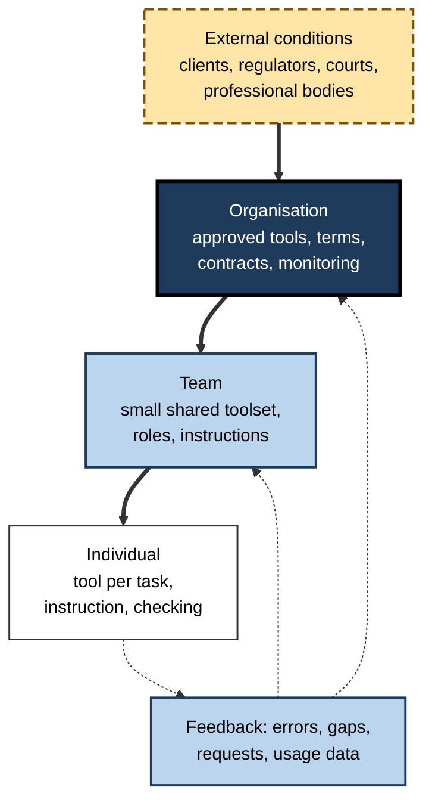

# C. Choosing the Right AI Tool

In 2023 a professional wanting AI help had perhaps two or three serious options. By 2026 the same professional faces assistants from half a dozen laboratories, AI inside every suite and browser, thousands of specialised products and weekly releases.

**Choosing well** has become a professional skill — one that decides whether AI saves time or wastes it, protects data or leaks it, builds capability or erodes it.

> **Definition — AI tool selection:** the disciplined process of deciding which AI tools to use, for which tasks, under which terms and at what cost — and of revising those decisions as tools, needs and evidence change.

**Why the choice matters**

- **Value** — the same task can be done well, badly or harmfully depending on the tool and how it is used.
- **Risk** — the choice of tool and account decides what happens to the data put into it.
- **Cost** — subscriptions, seats and usage charges are only the visible part of what a tool costs.
- **Commitment** — tools accumulate history, configuration and integration; early choices constrain later ones.
- **Accountability** — the professional, not the tool, answers for the work.

---

## Choosing Technology: What Was Known Before AI

AI tool selection is new; technology selection is not. Several decades of research describe how people and organisations adopt tools — and where they go wrong.

### Why people adopt tools

**The Technology Acceptance Model — Fred Davis (1989)**

- **Claim:** people's intention to use a technology depends mainly on two beliefs:
  - **perceived usefulness** — will it help me do my job better?
  - **perceived ease of use** — will it be free of effort?
- **Finding:** usefulness was the stronger predictor; people will tolerate difficulty for a genuinely useful tool, but not use an easy, useless one.

**The Unified Theory of Acceptance and Use of Technology — Venkatesh and colleagues (2003)**

- **Integrated eight earlier models** into four determinants of use:
  - **performance expectancy** — expected benefit;
  - **effort expectancy** — expected ease;
  - **social influence** — what important others think and do;
  - **facilitating conditions** — support, infrastructure and permission.
- **Finding:** together these explained a large share of the variation in people's intention to use workplace systems in the original studies.

> **Key point:** adoption research explains why people **do** take up tools — usefulness, ease, social pressure, support. It does not say whether they **should**. With AI, perceived usefulness can be badly miscalibrated, and social influence can spread tools faster than evidence.

**Figure 1.** What drives the adoption of a workplace technology, and what adoption models leave out.

### How innovations spread

**Everett Rogers, *Diffusion of Innovations* (1962)**

- **Five attributes** of an innovation predict how fast it spreads:
  - **relative advantage** — how much better it is than what it replaces;
  - **compatibility** — how well it fits existing values, practices and systems;
  - **complexity** — how hard it is to understand and use;
  - **trialability** — how easily it can be tried on a small scale;
  - **observability** — how visible its results are to others.
- **Applied to AI tools:**
  - relative advantage is **real but jagged** — large on some tasks, negative on others;
  - compatibility depends on where the tool sits — built into existing software or standing alone;
  - trialability is **very high** — free tiers make trying effortless, which speeds adoption **ahead of evaluation**;
  - observability is **misleading** — impressive outputs are visible, subtle errors are not.

**Figure 2.** Rogers' five attributes of innovations, and how AI tools score on each.

> **Watch out:** the ease of trying AI tools is usually treated as an unmixed good. Diffusion research suggests a cost: when trialability is high and observability favours visible successes over hidden failures, tools spread faster than understanding of their limits.

### Hype and disappointment

- **The hype cycle** — introduced by the research firm Gartner in 1995 — describes a common pattern in how expectations of a technology evolve:
  - a **trigger**, then a **peak of inflated expectations**;
  - a **trough of disillusionment** as limits and costs appear;
  - a **slope of enlightenment** and a **plateau of productivity** as realistic uses settle.
- **Generative AI** followed the early part of this pattern closely: soaring expectations from late 2022, followed in 2024–25 by widespread reports of pilots failing to show measurable returns; Gartner's own analysis in 2025 placed generative AI as entering the trough.

> **Watch out:** the hype cycle is a **descriptive heuristic**, not a law — many technologies never follow it, and its timing cannot be predicted. Its value for tool selection is as a warning: **decisions made at the peak tend to overestimate benefits and ignore costs**.

**Figure 3.** The hype cycle: why decisions made at the peak of expectations are prone to disappointment.

### Total cost of ownership

- **The idea** — popularised by Gartner for personal computers in the late 1980s — that the purchase price of technology is a small part of its full cost.
- **For AI tools,** the full cost includes:
  - **licences and usage charges** — the visible price;
  - **set-up and integration** — configuration, connectors, single sign-on, data preparation;
  - **governance** — security review, legal review, data-protection assessment, monitoring;
  - **training and change** — learning to instruct and check the tool;
  - **checking and correction** — staff time spent verifying and fixing outputs;
  - **risk** — expected cost of errors and incidents;
  - **exit** — the cost of eventually leaving.

> **Definition — Total cost of ownership (TCO):** the full cost of acquiring, using, governing and eventually retiring a technology over its life, not only its purchase price.

**Figure 4.** The visible price of an AI tool and the larger costs beneath it.

---

## How the Problem of Choice Arrived, 2022–2026

The task of choosing AI tools changed shape almost every year.

- **Late 2022 — one obvious tool.** The public release of ChatGPT in November 2022 made a general assistant available to anyone; for most people "choosing" meant deciding whether to try it.
- **2023 — restriction and the first business terms.** Large organisations restricted public assistants after early incidents of confidential material being pasted into them; providers responded with business tiers excluding customer content from training; office-suite assistants were announced; major providers offered copyright indemnities to business customers.
- **2024 — bring-your-own and bundling.** Surveys found most workplace AI users bringing their own tools; organisations licensed enterprise assistants; suite providers began folding AI into standard plans; specialised products multiplied.
- **2025 — abundance and repricing.** Capable low-cost and open-weight models (notably from DeepSeek in January) widened the field; agents and research modes arrived; providers introduced premium tiers, usage caps and metering; a major provider changed its consumer data terms; public critiques questioned the reliability of crowd leaderboards.
- **2026 — churn and consolidation.** Widely used models were retired on providers' timetables; advertising entered some free tiers; EU rules were partly deferred and softened; organisations focused on rationalising tools, measuring value and governing agents.

**Figure 5.** How the problem of choosing AI tools changed, 2022–2026.

> **Key point:** each year moved the hard part of choosing — from **whether** to use AI, to **which account**, to **which of many tools**, to **how many tools, at what total cost, with what exit**. Methods that survive this churn focus on questions rather than products.

---

## Why Choosing AI Tools Is Harder

Several features make AI tools harder to choose than most earlier software.

- **Generality hides limits** — a chat box accepts any request, giving no signal of which tasks it handles badly.
- **Jagged capability** — tools excel at some tasks and fail at similar-looking ones; the boundary is invisible without testing.
- **Fluent error** — wrong answers look exactly like right ones.
- **Probabilistic output** — the same request can produce different results; one good trial proves little.
- **Rapid change** — models, features, prices and terms change monthly; a careful evaluation dates quickly.
- **Opaque terms** — what happens to data depends on the account type, settings and documents few people read.
- **Consumerisation** — powerful tools reach employees directly, before organisations have assessed them.
- **Embedded everywhere** — AI arrives inside existing software, often switched on by default.
- **Self-reported benefit is unreliable** — controlled studies have found people's sense of AI's help to be badly wrong, sometimes in the wrong direction.

> **Key point:** the combination of **invisible limits**, **fluent error** and **rapid change** means that intuition — the usual basis for choosing everyday tools — is an unusually poor guide for AI. Method has to take its place.

---

## The Core Questions

A sound choice of AI tool answers six questions. Each is simple to state and demanding to answer well.

1. **Fit** — does the tool's capability match the specific task, including its stakes and how easily errors can be detected?
2. **Reliability** — does it perform acceptably not once but consistently, on realistic inputs, at the volume needed?
3. **Trust** — do the account type, data terms, security and approval status permit the data the task involves?
4. **Cost** — does the value delivered exceed the total cost of ownership, including checking time and risk?
5. **Evidence** — is the judgement based on a fair comparison and a proper trial, rather than impressions or rankings?
6. **Exit** — is the commitment deliberate, with the cost of leaving known and the most portable assets kept portable?

> **Mnemonic — "Fit, Reliability, Trust, Cost, Evidence, Exit" — "Fresh Rolls Taste Crisp Every Evening":** the six questions of AI tool selection.

**Figure 6.** The six questions of AI tool selection and the evidence each requires.

### Fit and reliability

- **Fit is task-specific.** A tool is never good or bad in general; it is suited or unsuited to a task at a level of risk. Whether a broad general assistant or a narrow specialised product serves a task better depends on whether the task needs authoritative domain sources and workflows, or breadth.
- **Reliability is separate from capability.** A tool that succeeds nine times in ten is impressive in a demonstration and troublesome in a process run a thousand times a week.

> **Formula — Reliability at volume:** expected errors = volume × error rate. Illustrative example: 1,000 documents a month at a 3% error rate produce about **30 errors** a month — each needing to be caught.

### Trust

- **Account type** decides most of the data question — consumer and business tiers of the same brand can have opposite defaults on training and retention.
- **Workplace approval** encodes checks no individual can make alone — security, legal, privacy and risk.
- **Professional obligations** to clients, regulators and the people whose data is involved come first; a tool's terms can permit a use without making it lawful or appropriate for the user.

> **Watch out:** the most frequent serious error in AI tool choice is not picking a weak tool; it is putting the wrong **data** into the right tool under the wrong **account**.

### Cost

> **Formula — Annual total cost of ownership (simplified):** licences and usage + set-up (spread over expected life) + governance + training + checking and correction time + risk allowance + exit allowance.

- **The largest hidden cost** in many evaluations is **checking time** — the minutes spent verifying each output.
- **Value must be measured against the best alternative,** not against doing nothing.

### Evidence

- **Public rankings** are coarse filters; **own-task comparisons** decide between strong candidates.
- **Trials** should be designed, not improvised — with success criteria set in advance and quality judged blind.
- **Self-report is optimistic** — perceived savings routinely exceed measured ones.

### Exit

- **Lock-in accumulates** through ordinary use — history, configurations, integrations.
- **Deliberate commitment** — with a priced exit, short initial terms and portable assets — is different from accidental entrapment.
- **Stopping is part of choosing** — tools that no longer earn their place should be retired cleanly, not left to renew.

---

## Worked Example (illustrative): The Total Cost of a Team Assistant

*Names, organisations and numbers in this example are illustrative figures.*

**Situation:** a 40-person operations department evaluates an enterprise AI assistant at £25 per user per month. Staff time is valued at £40 an hour. The department plans for a two-year life.

**Step 1 — list annual costs**

| Cost element | Basis | Annual cost |
|---|---|---|
| Licences | 40 × £25 × 12 | £12,000 |
| Set-up and integration | £6,000 one-off, spread over 2 years | £3,000 |
| Governance (reviews, monitoring) | 30 hours of specialist time | £1,200 |
| Training | 40 people × 3 hours | £4,800 |
| Checking and correction | 40 people × 1 hour a month × 12 | £19,200 |
| Risk allowance | Estimated expected cost of errors | £2,000 |
| Exit allowance | £4,000 estimated, spread over 2 years | £2,000 |
| **Total** | | **£44,200** |

**Step 2 — estimate benefit from the trial**

- Measured **gross** time saved on AI-assisted tasks (before checking, which is costed separately above): 4 hours per person per month.
- 40 × 4 × 12 × £40 = **£76,800** a year.

**Step 3 — compare**

- Net annual value = £76,800 − £44,200 = **£32,600**.
- **Licences are only 27% of total cost**; checking time is the largest single element.

**Step 4 — sensitivity**

- If measured gross savings were 2 hours rather than 4: benefit £38,400 − cost £44,200 = **−£5,800**. The decision depends critically on the **measured** saving.
- If checking time could be halved through better grounding and templates: cost falls by £9,600.

> **Watch out:** checking time must be counted **exactly once**. Because it appears here as a cost, the benefit must be the **gross** saving; if a trial reports savings already **net** of checking, the checking line must be removed. Ignoring checking overstates value; counting it twice understates it.

> **Key point:** for most AI tools, the licence fee is the **smallest decision variable**. Measured time saved, checking time and risk dominate the economics.

---

## Who Chooses

### Levels of decision

- **The individual** — chooses which approved tool to use for each task, how to instruct it and how to check it.
- **The team** — agrees a small set of tools with defined roles, shared instructions and known failure modes.
- **The organisation** — decides which tools are approved, under which terms and for which data; negotiates contracts; monitors risk and cost.
- **Beyond the organisation** — clients, regulators, courts and professional bodies set conditions on AI use in their domains.

**Figure 7.** Decisions about AI tools at four levels, from organisation to individual task.

### Centralised or devolved?

| | Centralised choice | Devolved choice |
|---|---|---|
| Who decides | A central IT, security or AI governance function | Teams and individuals |
| Strengths | Consistent terms, negotiating power, controlled risk | Fit to local needs, speed, experimentation |
| Weaknesses | Slow; may miss local needs; pushes people to shadow tools | Sprawl, duplicated cost, uneven data protection |
| Works best for | Data terms, security, contracts, high-risk uses | Choice among approved tools for specific tasks |

> **In practice:** most mature organisations by 2025–26 settled on a hybrid: **central approval** of tools, accounts and data rules, with **devolved choice** among approved tools — supported by a fast route to request new ones.

---

## The State of the Market, as of October 2026

- **General assistants** — a small number of laboratories (in the United States, OpenAI, Google, Anthropic and xAI) contested the frontier of capability, with leading positions on public rankings changing hands repeatedly; Chinese laboratories and open-weight models followed closely and far more cheaply.
- **Suite assistants** — Microsoft and Google had embedded AI across their office suites, increasingly bundled into standard business plans rather than sold separately; Microsoft's organisational Copilot remained a paid add-on with a lower-priced version for smaller organisations.
- **Specialised tools** — a large, volatile market in legal, medical, financial, sales, design and coding tools, many built on licensed frontier models; some consolidated or failed as general assistants absorbed their features.
- **Pricing** — mainstream individual plans clustered around US$20 a month, premium plans at several times that, per-seat business plans, and growing use of metered and credit-based pricing for agents.
- **Terms** — business tiers generally excluded customer content from training; consumer terms varied and changed, with at least one major provider moving to opt-in choices with much longer retention for those allowing training.
- **Regulation** — the EU AI Act's literacy duty and general-purpose AI rules applied, while high-risk obligations were deferred to 2027–28; data-protection regimes, including India's Digital Personal Data Protection Act with rules notified in late 2025, shaped approved uses.
- **Adoption** — AI use at work was widespread, with surveys consistently finding substantial use of unapproved tools alongside organisational deployments.

> **Watch out:** every line above will age within months. The structural features — a few frontier laboratories, suite embedding, a churning specialist market, tiered pricing with metering, consumer–business term divergence, phased regulation — are more durable than any named leader or price.

---

## Debates in AI Tool Selection

- **Build or buy?**
  - Building on models through cloud platforms offers control and integration; buying finished products offers speed and maintenance by others. Evidence on which succeeds more often is mostly from vendors and consultancies and is contested.
- **One platform or best of breed?**
  - A single platform simplifies governance and training but deepens dependence; best-of-breed tools fit tasks better but multiply vendors and switching.
- **Open-weight or proprietary?**
  - Open-weight models offer control, privacy and lower running costs at scale; proprietary frontier models usually offer the highest capability and the least operational burden.
- **Ban, permit or provide?**
  - Bans push use underground; unrestricted permission risks data; providing capable approved tools with clear rules is the prevailing practitioner view, though rarely evaluated rigorously.
- **Standardise or explore?**
  - Standard sets build shared skill and control; exploration finds better tools. Most organisations allow exploration through bounded trials rather than open experimentation.

> **Key point:** these are not questions with universal answers. They are **trade-offs** whose right resolution depends on an organisation's size, data sensitivity, regulatory environment and capacity to govern.

---

## Case Study (illustrative): An Engineering Firm Learns to Choose

- **Situation:** a 1,200-person engineering consultancy entered 2024 with no AI policy. Staff used a mix of free consumer assistants, a few paid personal subscriptions and the AI features that had appeared in its office suite.
- **Problems that surfaced:**
  - project documents containing client design data had been pasted into consumer assistants;
  - three teams had bought overlapping writing and meeting tools on cards;
  - a bid team's AI-drafted technical claims contained a misquoted standard, caught by a client reviewer;
  - partners disagreed over whether AI should be banned or encouraged.
- **What the firm did:**
  1. **Set the questions before the tools** — adopted a short decision standard: fit to task, reliability, data terms and approval, total cost, evidence from trials, and exit.
  2. **Classified its data** and decided which classes could go into which kinds of tool.
  3. **Approved a small set** — an enterprise general assistant under business terms, the suite's built-in assistant, a meeting assistant with consent rules, and a coding assistant for its software group.
  4. **Trialled before scaling** — four-week trials on real project tasks, with blind quality review and pre-set criteria, including a zero-tolerance rule for misquoted standards in client documents.
  5. **Priced the whole cost** — licences turned out to be about a third of total cost; checking time was the largest element.
  6. **Kept exits open** — one-year contracts, data-return clauses, a shared library of instructions held outside any tool.
  7. **Created a request route** with a two-week target for low-risk tools.
  8. **Retired what failed** — two tools were dropped after a year, one because the suite assistant had absorbed its job.
- **Result (eighteen months):** reported AI use rose while unapproved use fell; no repeat of the client-data incidents; time savings measured in trials were smaller than staff had estimated but real; quality incidents in bids fell after a citation-checking rule was attached to the approved assistant.
- **Lesson:** the firm did not find the "best AI tool". It built a **way of choosing** — questions, data rules, trials, total cost, exits and retirement — that kept working as the tools changed.

> **Remember:** in a market that changes monthly, the durable asset is not a list of tools but a **method for choosing and re-choosing** them.

---

## The Professional Standard

What distinguishes an expert chooser of AI tools from an enthusiastic one:

- **Starts from the task,** not the tool or the leaderboard.
- **Distinguishes capability from reliability** and demands evidence of the latter for repeated work.
- **Checks the account and the terms** before the first upload.
- **Knows what is approved** — and requests rather than works around.
- **Counts the whole cost,** especially checking time.
- **Trials with method** — criteria first, blind quality review, real tasks, enough time.
- **Keeps a small, documented toolset** with known failure modes.
- **Commits deliberately** and keeps the means of leaving.
- **Stops what no longer earns its place.**
- **Expects to repeat the exercise,** because the tools will change.

---

## Open Questions

- **Can selection keep pace with change?**
  - Evaluations that take weeks may be outdated by model updates within months; lighter, continuous methods of evaluation are still being developed.
- **Will the choice simplify?**
  - If suite assistants and a few general platforms absorb most tasks, choice may narrow to configuration within one ecosystem — raising concerns about concentration and lock-in.
- **How should benefit be measured?**
  - Self-reported savings are known to be optimistic; affordable objective measures for everyday knowledge work remain scarce.
- **Who bears the risk of AI tools' errors?**
  - Vendor contracts generally leave responsibility with the user; how law, regulation and professional standards will allocate it is unsettled.
- **What will agents change?**
  - When tools act rather than advise, selection must judge permissions and failure consequences, not just output quality — practices for this are immature.
- **Does good selection protect skills?**
  - Choosing tools that raise output while preserving the user's own capability is an aim few selection methods yet address.

---

## Summary

- **AI tool selection** is the disciplined process of deciding which tools to use, for which tasks, under which terms and at what cost — and revising those decisions over time.
- Earlier research still applies: **TAM** (usefulness and ease), **UTAUT** (performance and effort expectancy, social influence, facilitating conditions), **Rogers' diffusion attributes**, the **hype cycle** and **total cost of ownership** — but adoption models explain uptake, not wisdom.
- AI tools are harder to choose because of **hidden limits, jagged capability, fluent error, probabilistic output, rapid change, opaque terms, consumerisation, embedding and unreliable self-report**.
- Six questions: **Fit, Reliability, Trust, Cost, Evidence, Exit**.
- **TCO** includes licences, set-up, governance, training, **checking time**, risk and exit; licences are often the smallest element.
- Decisions sit at four levels — **external conditions, organisation, team, individual** — with most organisations combining **central approval** and **devolved choice**.
- **As of October 2026:** a few frontier laboratories, suite embedding, a churning specialist market, tiered and increasingly metered pricing, diverging consumer and business terms, phased regulation — all subject to rapid change.
- Debates — **build or buy, platform or best of breed, open or proprietary, ban or provide, standardise or explore** — are trade-offs, not universal answers.
- The durable asset is a **method for choosing and re-choosing**.

---

## Self-Check

1. Define AI tool selection and give five reasons it matters.
2. State the two beliefs at the centre of the Technology Acceptance Model, and which was stronger.
3. Name the four determinants in UTAUT.
4. Apply Rogers' five attributes to AI tools, explaining why high trialability is a mixed blessing.
5. Describe the hype cycle and explain its relevance and its limits for tool decisions.
6. List seven components of the total cost of ownership of an AI tool.
7. Give six reasons AI tools are harder to choose than earlier software.
8. State the six core questions of AI tool selection.
9. A process handles 2,500 items a month at a 2% error rate. How many errors are expected, and what does that imply?
10. In the worked example, what happens to net value if checking time doubles, and what does that show?
11. Describe the four levels at which AI tool decisions are made.
12. Compare centralised and devolved choice and describe the common hybrid.
13. Why must any description of the AI market be dated, and which features are more durable?
14. Choose one debate in AI tool selection and set out both sides.
15. A director asks you to "find the best AI tool for the company". Explain why the request is framed wrongly and propose what to deliver instead.

### Answer Key

1. The disciplined process of deciding which AI tools to use, for which tasks, under which terms and cost, and revising those decisions. It matters for value, risk, cost, commitment and accountability.
2. Perceived usefulness and perceived ease of use; usefulness was the stronger predictor.
3. Performance expectancy, effort expectancy, social influence, facilitating conditions.
4. Relative advantage — real but jagged; compatibility — depends on embedding; complexity — low to start, high to use well; trialability — very high; observability — favours visible successes over hidden errors. High trialability speeds adoption ahead of evaluation, especially when failures are hard to see.
5. Trigger, peak of inflated expectations, trough of disillusionment, slope of enlightenment, plateau of productivity. It warns that decisions at the peak overestimate benefit; but it is descriptive, not predictive, and many technologies do not follow it.
6. Licences and usage, set-up and integration, governance, training and change, checking and correction, risk, exit.
7. Any six: generality hides limits; jagged capability; fluent error; probabilistic output; rapid change; opaque terms; consumerisation; embedding by default; unreliable self-report.
8. Fit, Reliability, Trust, Cost, Evidence, Exit.
9. 2,500 × 0.02 = 50 errors a month. Even a seemingly reliable tool generates many errors at volume, so a checking or validation step is essential.
10. Checking rises from £19,200 to £38,400, total cost to £63,400, net value to £13,400 — still positive but much smaller; checking time is a decisive variable.
11. External conditions (clients, regulators, courts, professional bodies); organisation (approval, terms, contracts); team (shared toolset and practices); individual (tool per task, instruction, checking).
12. Centralised: consistency, negotiating power, controlled risk, but slow and prone to shadow use. Devolved: local fit and speed, but sprawl and uneven protection. Hybrid: central approval of tools, accounts and data rules; devolved choice among approved tools; fast request route.
13. Leaders, prices and terms change within months. More durable: few frontier laboratories, suite embedding, churning specialist market, tiered and metered pricing, consumer–business term divergence, phased regulation.
14. *e.g.* One platform or best of breed — one platform simplifies governance and training but deepens dependence; best of breed fits tasks better but multiplies vendors, cost and switching.
15. There is no best tool in general — only tools fitted to tasks, data and risk. Deliver instead: a task and data inventory; data rules; a small approved set with roles; trial results on real tasks; total-cost estimates; exit terms; a request route; and a schedule for review.

---

## Glossary

| Term | Meaning |
|---|---|
| AI tool selection | Deciding which AI tools to use, for which tasks, under which terms and cost, and revising those decisions. |
| Compatibility | Rogers' attribute: how well an innovation fits existing practices and systems. |
| Consumerisation | Powerful technology reaching individual employees directly, ahead of organisational assessment. |
| Devolved choice | Tool decisions made by teams and individuals rather than centrally. |
| Diffusion of innovations | Rogers' theory of how new ideas and technologies spread. |
| Effort expectancy | Expected ease of using a technology (UTAUT). |
| Facilitating conditions | Support, infrastructure and permission enabling technology use (UTAUT). |
| Hype cycle | A descriptive pattern of inflated expectations, disillusionment and eventual productive use. |
| Observability | Rogers' attribute: how visible an innovation's results are to others. |
| Perceived ease of use | Belief that a technology will be free of effort (TAM). |
| Perceived usefulness | Belief that a technology will improve one's work (TAM). |
| Performance expectancy | Expected benefit from using a technology (UTAUT). |
| Relative advantage | Rogers' attribute: how much better an innovation is than what it replaces. |
| Social influence | The effect of others' views and behaviour on technology use (UTAUT). |
| Technology Acceptance Model | Davis's model linking usefulness and ease of use to technology adoption. |
| Total cost of ownership | The full cost of acquiring, using, governing and retiring a technology. |
| Trialability | Rogers' attribute: how easily an innovation can be tried on a small scale. |
| UTAUT | The Unified Theory of Acceptance and Use of Technology (Venkatesh and colleagues, 2003). |
