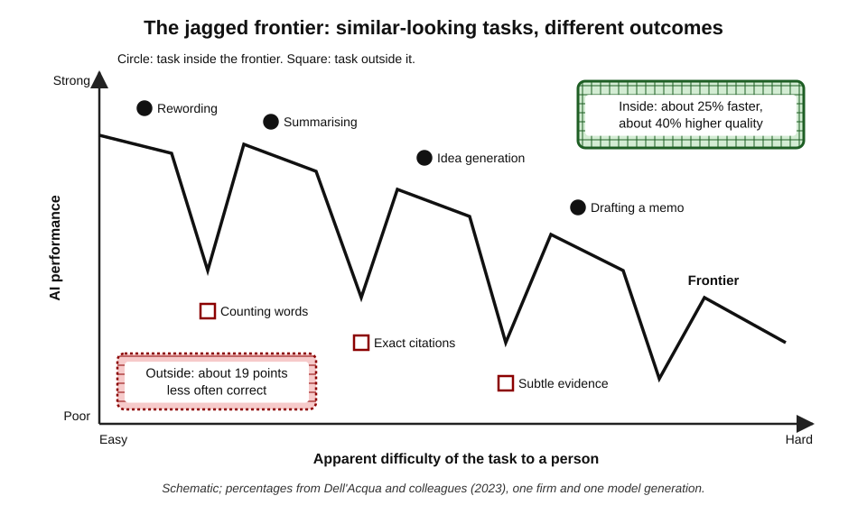
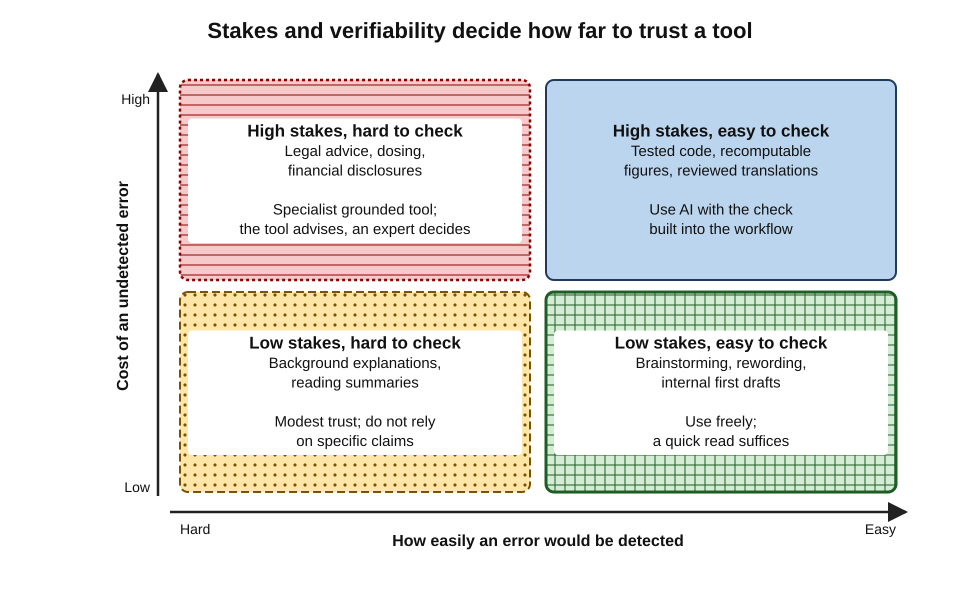
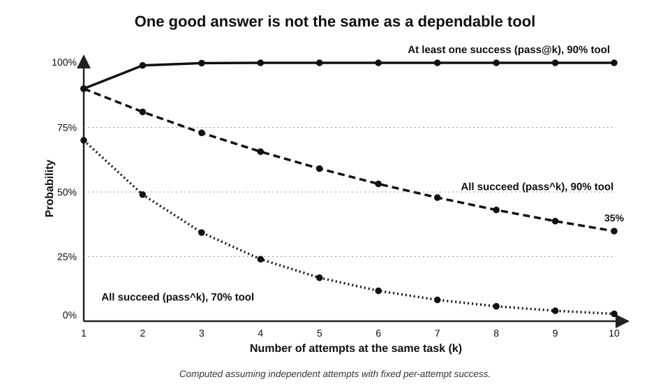
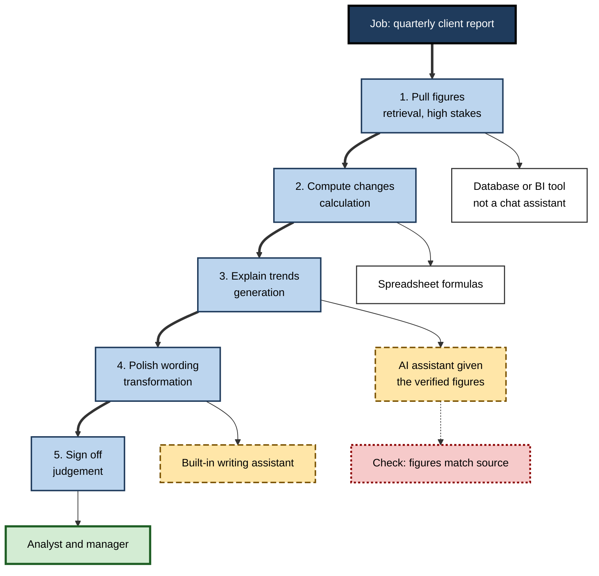
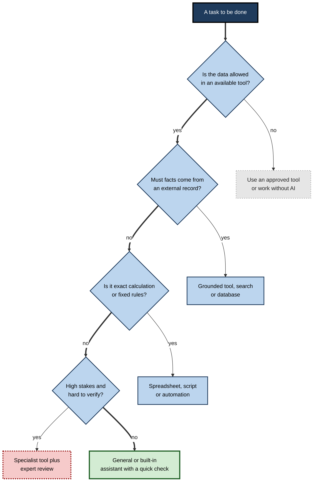

# C.1. Matching tool to task

A marketing analyst asks a chat assistant to tidy a messy paragraph and gets a polished version in seconds. The same afternoon she asks it for last quarter's regional sales figures and receives a confident table of numbers that exist nowhere in the company's systems. The tool did not change between the two requests; the **task** did. The first task suited the tool; the second needed a tool connected to the real data — or no AI at all.

> **Definition — Tool–task matching:** choosing the tool, and the way of using it, whose capabilities, reliability, data access and cost fit the specific demands of a task — including the cost of getting it wrong.

**Why matching matters**

- The same AI tool can be excellent on one task and harmful on a task that looks similar.
- Most visible AI failures at work are **mismatches**, not broken tools: a fluent text generator used as a database, a search engine, a calculator or a lawyer.
- Matching decides whether time is saved or merely moved into checking and repair.
- A professional who matches well uses fewer tools, trusts them appropriately and can explain the choice to a manager, client or auditor.

---

## The Idea of Fit

### Task–technology fit

- **Origin:** Dale Goodhue and Ronald Thompson (1995) proposed that technology improves individual performance only when its functions **fit the tasks** people actually perform.
  - Fit, not mere availability or enthusiasm, predicted both use and performance gains in their survey of employees across two organisations.
  - The theory predates generative AI but applies to it directly.
- **Three ingredients:**
  - **Task characteristics** — what the work demands (novelty, interdependence, precision, sensitivity).
  - **Technology characteristics** — what the tool can and cannot do, reliably.
  - **Individual characteristics** — the user's skill, including skill at checking the tool's output.
- **The claim:** performance rises when the three align; a powerful tool misaligned with the task can lower performance.

> **Definition — Task–technology fit:** the degree to which a technology's functions match the requirements of a task and the abilities of the person using it.

> **Key point:** the question is never "Is this AI tool good?" but "Is this tool good **for this task, in these hands, at this level of risk**?"

### Why AI makes fit harder to judge

- **Generality hides limits.** A chat assistant accepts any request, so nothing in the interface signals that a task is outside its competence.
- **Fluency masks error.** Outputs are grammatical and confident whether right or wrong.
- **Capability is uneven.** Tasks of similar apparent difficulty can fall on opposite sides of what the tool does well.
- **Capability moves.** A model update can make a previously unsuitable task suitable — or quietly change behaviour on a task that used to work.

> **Watch out:** a common novice belief is that a tool which handles a hard task must also handle an easier one. AI capability does not follow human intuitions about difficulty — a model that drafts a competent legal memo may still miscount the words in a sentence.

---

## The Jagged Frontier

**Study card — Dell'Acqua and colleagues (2023), with Boston Consulting Group**

- **Design:** 758 consultants were randomly assigned to work with or without GPT-4 on realistic consulting tasks.
  - One set of tasks was chosen to sit **inside** the model's capabilities (creative product ideas, market segmentation, persuasive writing).
  - Another task was designed to sit just **outside** them (a business-problem analysis whose correct answer depended on subtle evidence in interview notes and spreadsheets).
- **Results inside the frontier:**
  - consultants using AI completed about **12% more tasks**, roughly **25% faster**, with output rated around **40% higher in quality**;
  - the lowest performers gained most.
- **Results outside the frontier:**
  - consultants using AI were about **19 percentage points less likely** to reach the correct answer than those working without it;
  - the AI's persuasive but wrong analysis was adopted rather than checked.
- **Conclusion:** the boundary of AI competence is **jagged** — irregular and invisible from the outside — and the same tool both helps and harms depending on which side of it a task falls.

> **Definition — Jagged frontier:** the irregular boundary between tasks an AI system performs well and tasks of similar apparent difficulty that it performs badly.

**Two working styles observed in the study**

- **Centaurs** — divided the work: handed suitable sub-tasks to the AI, kept others for themselves.
- **Cyborgs** — interleaved closely with the AI throughout, steering and correcting at every step.
- Both styles worked; what failed was **uncritical delegation** of a task outside the frontier.

> **Watch out:** the study used one model generation (GPT-4 in 2023) and one firm's consultants. The exact percentages will not transfer to other tools, tasks or years. The durable finding is structural: **performance depends on whether the task lies inside the frontier, and users cannot see the frontier without testing**.

**Figure 1.** How the same tool helps inside its competence and harms outside it.

---

## Anatomy of a Task

Before choosing a tool, the task itself must be described. Seven properties do most of the work.

### The seven properties

- **Input** — what the tool must receive.
  - Text, numbers, images, audio, files, live data, or the user's own systems.
  - *e.g.* a scanned contract (needs document reading); a database (needs a connection, not a chat box).
- **Output** — what must come back.
  - Prose, a table, code, a chart, a decision, an action taken in another system.
- **Stakes** — the cost of an error.
  - Embarrassment, rework, financial loss, legal liability, harm to a person.
- **Verifiability** — how cheaply and reliably a wrong answer can be detected.
  - Code that fails its tests is easy to catch; a subtly wrong regulatory interpretation is not.
- **Grounding need** — whether the answer must come from specific, authoritative sources.
  - Company figures, current prices, the text of a statute, a patient's record.
- **Sensitivity** — what data the task exposes.
  - Public, internal, confidential or legally protected information.
- **Frequency** — how often the task recurs.
  - One-off tasks rarely justify a new tool; daily tasks justify careful set-up.

> **Mnemonic — "I Only Send Very Good Sensible Files":** Input, Output, Stakes, Verifiability, Grounding, Sensitivity, Frequency.

### Generation, transformation and retrieval

- **Generation** — producing something new from instructions.
  - *e.g.* a first draft, ten slogan options, test cases.
  - Generally strong in current assistants; quality is a matter of judgement.
- **Transformation** — changing material the user supplies.
  - *e.g.* summarising, translating, reformatting, changing tone, extracting fields.
  - Usually strongest of all, because the facts are present in the input.
- **Retrieval** — producing facts that must be correct and current.
  - *e.g.* "What did our client pay last year?" "What does section 14 of the Act say?"
  - **Weakest** for a model working from memory alone; reliable only when the tool is grounded in an authoritative source.

> **Key point:** a language model working without a source is a **generator**, not a **record**. Any task whose value lies in factual correctness needs either grounding (search, documents, databases) or a non-AI tool.

| | Generation | Transformation | Retrieval of facts |
|---|---|---|---|
| Typical request | "Draft a proposal outline" | "Summarise these minutes" | "List our top ten customers by revenue" |
| Where the truth lives | In the user's judgement | In the supplied input | In an external record |
| Main failure | Bland or off-brief output | Omission or distortion | Invented facts presented confidently |
| Best tool type | General assistant | General or built-in assistant | Grounded tool, search, database or spreadsheet |
| Checking effort | Read and judge | Compare with source | Verify every fact against the record |

---

## Stakes and Verifiability

### The two questions that decide most matches

- **How bad is an undetected error?** (stakes)
- **How easily would an error be detected?** (verifiability)
- Together they determine how much the tool may be trusted and how much checking is needed.

**The four regions**

- **Low stakes, easy to check** — brainstorming, rewording, first drafts of internal notes.
  - Use AI freely; a quick read suffices.
- **High stakes, easy to check** — code with good tests, calculations that can be recomputed, translations a fluent colleague will review.
  - Use AI, but build the check into the workflow.
- **Low stakes, hard to check** — background reading summaries, general explanations.
  - Use AI with modest trust; avoid relying on specific claims.
- **High stakes, hard to check** — legal advice, medical dosing, financial disclosures, safety decisions.
  - Use only grounded, approved, specialist tools — or none — with expert review.

**Figure 2.** Stakes and verifiability together decide how an AI tool should be used.

> **Remember:** **high stakes + hard to verify = the tool advises, a qualified person decides.**

### Expected cost of error

> **Formula — Expected cost of an error:** probability of an undetected error × cost if it occurs. Illustrative example: a tool wrong 5% of the time, with a checking step that catches 80% of errors, leaves 0.05 × 0.20 = 1% undetected. If an undetected error costs ₹50,000 in rework and penalties, the expected cost is ₹500 per use — compared with the value of the time saved.

- **Lowering the probability** — better tool, better grounding, clearer instructions.
- **Raising detection** — tests, second reviewers, source comparison, recomputation.
- **Lowering the cost** — keep AI out of the final step; use it upstream where errors are cheap.

> **In practice:** experienced teams move AI **upstream** in high-stakes work — research scoping, first drafts, option generation — and keep the last, consequential step human and verified.

---

## Capability Versus Reliability

### Two different properties

- **Capability** — whether a tool *can* do a task at least some of the time.
- **Reliability** — whether it does the task correctly *every* time, across ordinary variation in inputs.
- Demonstrations, social-media examples and marketing show capability. Daily work requires reliability.

> **Definition — Reliability (of an AI tool):** the proportion of attempts on a realistic range of inputs that produce an acceptable result without human repair.

### Pass@k and pass^k

**Study card — τ-bench (Yao and colleagues at Sierra, 2024)**

- **Design:** AI agents handled simulated customer-service conversations (airline and retail) requiring them to follow policies and use tools correctly; each task was attempted several times.
- **New measure:** **pass^k** — the probability that the agent succeeds on **all** of k attempts at the same task — alongside the familiar **pass@k** (succeeds on **at least one** of k attempts).
- **Finding:** the strongest agent tested succeeded on roughly six in ten retail tasks at a single attempt, but on fewer than a quarter of them consistently across eight attempts.
- **Conclusion:** single-run scores **overstate** how dependable a tool will be when a task is repeated many times.

> **Formula — Consistency over repetitions:** if a tool succeeds on a task with probability p each time, independently, the chance it succeeds on all of k repetitions is p^k, while the chance at least one of k attempts succeeds is 1 − (1 − p)^k. Illustrative example: p = 0.9 gives a 90% single success but only 0.9^10 ≈ **35%** chance of ten successes in a row.

**Figure 3.** Single-attempt capability compared with reliability over repeated use.

- **Implication for choosing:**
  - **Occasional, supervised tasks** can tolerate a capable but inconsistent tool — a human picks the good attempt.
  - **Repeated, unsupervised tasks** need reliability — a 90% tool processing 1,000 invoices produces about 100 errors.
- **Where reliability comes from:**
  - grounding in authoritative data;
  - narrower, well-specified tasks;
  - structured outputs (forms, fixed fields) rather than free text;
  - validation rules after the AI step;
  - in some cases, a non-AI tool.

> **Watch out:** "it worked when I tried it" is a capability claim from a sample of one. A tool's suitability for a recurring task is established only by trying it on **many** realistic inputs.

---

## When the Right Tool Is Not AI

Not every task should go to a generative AI tool. Older, deterministic tools often win.

- **Calculation** — spreadsheets, calculators and code compute exactly; language models predict text and can slip on arithmetic unless they run code.
- **Lookup of records** — databases, search within the organisation's systems, the official source document.
- **Repeated rule-based processing** — macros, scripts, workflow automation, form validation.
  - Deterministic: the same input always gives the same output.
- **Current facts** — a search engine or the publisher's own page, rather than a model's memory.
- **Judgement that must be owned** — performance ratings, disciplinary decisions, clinical decisions; AI may inform but not decide.
- **Tasks that build a skill the person needs** — a trainee writing their first analyses may need to do the thinking unaided.

> **Definition — Deterministic tool:** software that always produces the same output from the same input, following explicit rules.

> **Key point:** the best match is sometimes a **combination** — AI to draft a spreadsheet formula, the spreadsheet to compute; AI to suggest search terms, the database to retrieve.

---

## Decomposing Tasks Before Matching

Real work rarely arrives as a single task. Matching improves sharply when a job is split into steps and each step matched separately.

### How decomposition works

1. **List the steps** of the job as it is actually done.
2. **Classify each step** — generation, transformation, retrieval, calculation, judgement.
3. **Rate each step** for stakes, verifiability and sensitivity.
4. **Assign a tool** — AI tool, non-AI tool or person — to each step.
5. **Place checks** at the hand-offs, especially where AI output feeds a high-stakes step.

**Figure 4.** Decomposing a client report into steps, each matched to a different tool.

> **Example (illustrative):** a recruiter's shortlisting job decomposes into reading CVs (transformation — AI can extract fields), comparing against criteria (judgement with legal sensitivity — human), drafting interview invitations (generation — AI) and scheduling (deterministic — calendar tool).

---

## A Method for Matching

### Five questions in order

1. **What exactly is the task, and what does a good result look like?**
   - Write it in one sentence with a success criterion.
2. **Where does the truth come from?**
   - The user's judgement, the supplied material, or an external record.
3. **What happens if the output is wrong and nobody notices?**
   - Name the worst plausible consequence.
4. **What data must the tool see, and is that tool permitted to see it?**
   - Data classification and approval come before capability.
5. **Which available tool meets these demands at the lowest total effort, including checking?**
   - Effort includes set-up, prompting, verification and rework, not just generation time.

> **Mnemonic — "What, Where, Worst, Whose, Which":** the five matching questions.

**Figure 5.** A decision path for matching a task to a tool.

### Matching modalities

- **Text in, text out** — general assistants, built-in writing assistants.
- **Documents in** — tools that accept files and preserve tables and layout; check that the tool actually reads the whole file rather than a truncated part.
- **Images in or out** — multimodal assistants, design tools; image generation carries its own licensing questions.
- **Audio in** — transcription and meeting tools; accuracy varies with accents, jargon and audio quality.
- **Live systems** — tools with approved connectors to email, files, CRM or code repositories.
- **Actions** — agent features that act in other systems; the highest need for permission controls and review.

> **Watch out:** a tool that "accepts" a 200-page PDF may silently process only part of it or lose the tables. Matching a document task includes confirming how much of the document the tool actually used.

---

## Worked Example (illustrative): Matching a Week of Tasks

*Names, organisations and numbers in this example are illustrative figures.*

**Situation:** an operations analyst at a logistics firm has six recurring tasks. The firm has approved a suite-embedded assistant (inside its office software), an enterprise chat assistant, and its existing spreadsheet and business-intelligence tools.

| Task | Type | Stakes / verifiability | Matched tool | Check |
|---|---|---|---|---|
| Weekly delivery-delay figures | Retrieval and calculation | High / easy if sourced | BI dashboard and spreadsheet | Reconcile totals with source |
| Explaining the week's delays to managers | Generation from verified figures | Medium / moderate | Enterprise chat assistant, given the figures | Read for unsupported claims |
| Summarising carrier emails | Transformation | Low / easy | Suite-embedded assistant | Skim originals for omissions |
| Drafting a new carrier-contract clause | Generation, legal effect | High / hard | Legal team; AI only for a first outline | Legal review |
| Cleaning 3,000 address records | Repeated transformation | Medium / easy at scale with rules | Spreadsheet rules or script, AI to write the formula | Sample 50 rows |
| Brainstorming ideas to cut delays | Generation | Low / judgement | Any approved assistant | Analyst judgement |

**Steps the analyst followed**

1. **Classified** each task by type before thinking about tools.
2. **Separated** the factual core (figures, contract terms) from the language around it.
3. **Gave AI the language work**, fed with verified material.
4. **Kept calculation deterministic**, using AI only to write and explain formulas.
5. **Sent the contract clause** to the people accountable for it.

- **Result:** AI used on four of six tasks, but on none in a way that let an invented fact reach a decision.

> **Watch out:** the tempting shortcut — asking one assistant "write my weekly delay report" — merges retrieval, calculation and explanation into one opaque step, so an invented figure can travel straight into a manager's decision.

---

## Matching at the Level of the Organisation

### Why organisations care

- **Scale** turns small mismatch rates into many errors.
- **Liability** — the organisation answers for what its tools tell customers.
- **Consistency** — staff should match similar tasks to similar tools, so results are comparable and auditable.

**Study card — Brynjolfsson, Li and Raymond (2023)**

- **Setting:** a generative AI assistant was introduced in stages to about 5,000 customer-support agents at a software firm.
- **Findings:**
  - productivity (issues resolved per hour) rose by about **14%** on average;
  - **novice and lower-skilled** agents gained most — around a third — while the most skilled gained little;
  - customer sentiment improved and staff attrition fell.
- **Interpretation:** the assistant diffused the practices of top agents; the task (handling common support conversations with suggested responses) was well inside the tool's competence, and the agent remained in the loop.
- **Lesson for matching:** the gains came from a narrow, well-fitted task with a human checking each suggestion — not from general deployment across every task.

### Task inventories and use-case registers

- **Task inventory** — a list of the recurring tasks in a role or team, each classified by type, stakes and sensitivity.
- **Use-case register** — a list of approved AI uses, each naming the task, the approved tool, the data allowed and the required check.
- **Benefits:**
  - staff do not rediscover the frontier alone;
  - risky matches are identified once and blocked;
  - successful matches spread.

> **In practice:** mature organisations describe AI permissions at the level of **use cases** ("summarising internal meeting notes with the suite assistant: approved; drafting customer-facing legal terms: prohibited") rather than at the level of tools alone.

---

## Case Study: The Brief Built on Invented Cases

- **Situation:** in 2023 lawyers representing a passenger suing the airline Avianca in a New York federal court (*Mata v. Avianca*) needed precedents to oppose a motion to dismiss.
- **Mismatch:** one lawyer used a general chat assistant as a **legal research database** — a retrieval task with high stakes and an authoritative record (published case law).
- **What happened:**
  - the assistant produced several plausible-sounding but **non-existent** court decisions, with invented quotations and citations;
  - asked whether the cases were real, it said they were;
  - the brief was filed; opposing counsel and the judge could not find the cases.
- **Result:** in June 2023 the court sanctioned the lawyers and their firm, imposing a fine and requiring them to notify the judges falsely named as authors of the invented opinions.
- **Diagnosis:**
  - task type: retrieval of facts that must exist in a record;
  - stakes: professional and legal;
  - verifiability: easy — every citation could have been checked in a legal database in minutes;
  - the right match: a legal research service grounded in real case law, with every citation verified.
- **Lesson:** the failure was not that AI was used, but that a **generator was matched to a retrieval task** and the cheap verification step was skipped.

> **Key point:** the most damaging mismatches combine three features — a **retrieval** task, **high stakes**, and a **skipped check** that would have been easy.

---

## Mastery: How Experts Match

- **They test the frontier deliberately.** Before relying on a tool for a recurring task, they try it on hard and unusual cases, not only typical ones.
- **They re-test after updates.** A model change can move the frontier in either direction.
- **They separate "content" from "form."** Facts come from records; AI shapes the language.
- **They value reliability over brilliance** for repeated work, and brilliance over reliability for one-off ideation.
- **They count checking time.** A tool that saves ten minutes of drafting but adds fifteen minutes of verification is a poor match.
- **They match to their own expertise.** AI output is safest where the user could spot an error; a novice using AI far outside their own competence cannot verify it.
- **They keep a non-AI fallback** for every critical task.

> **Watch out:** using AI where one cannot judge the output reverses the logic of the jagged-frontier finding. Lower performers gained most **inside** the frontier, but every user is exposed **outside** it — and inexperienced users are least able to tell where they are.

> **Remember:** match the **task**, not the **job title**; match **each step**, not the whole job; and match to **reliability at the volume required**, not to a single impressive demonstration.

---

## Open Questions

- **Can the frontier be mapped in advance?**
  - Benchmarks describe average performance on test sets; whether a specific workplace task lies inside the frontier still usually requires trying it.
- **Will improving models make matching unnecessary?**
  - Each generation widens the frontier, but reliability on high-stakes retrieval and judgement tasks improves more slowly than fluency, and errors become harder to spot as outputs improve.
- **How should reliability be measured for open-ended tasks?**
  - Pass^k suits tasks with a clear right answer; for drafting and analysis, "acceptable" depends on reviewers who may disagree.
- **Who should own matching decisions?**
  - Individual judgement, team norms and central use-case registers each have advantages; the right balance is unsettled.
- **Does matching to novices' benefit trade off against their learning?**
  - Assistance that raises novice output may also reduce the practice through which novices become experts; the long-run effect is not yet known.

---

## Summary

- **Tool–task matching** means choosing the tool whose capability, reliability, data access and cost fit a task — including the cost of error.
- **Task–technology fit** (Goodhue and Thompson, 1995): performance improves only when tool, task and user align.
- The **jagged frontier** (Dell'Acqua and colleagues, 2023): AI raised speed and quality inside its competence and lowered accuracy outside it; the boundary is invisible without testing.
- Describe a task by **Input, Output, Stakes, Verifiability, Grounding, Sensitivity, Frequency**.
- **Generation** and **transformation** suit AI well; **retrieval of facts** needs grounding or a non-AI tool.
- **Stakes × verifiability** sets how freely AI may be used; high stakes and hard verification require specialist tools and expert decision.
- **Capability ≠ reliability**: pass^k falls quickly as repetitions rise; recurring unsupervised tasks need reliable tools.
- Deterministic tools often beat AI for calculation, record lookup and rule-based processing; combinations are common.
- **Decompose** jobs into steps and match each step; place checks at hand-offs.
- Organisations match through task inventories and **use-case registers**.
- *Mata v. Avianca* shows the classic mismatch: a generator used for high-stakes retrieval with the easy check skipped.

---

## Self-Check

1. Define tool–task matching and explain why "Is this tool good?" is the wrong question.
2. State the three ingredients of task–technology fit.
3. Describe the design and main findings of the 2023 jagged-frontier study.
4. What were "centaurs" and "cyborgs", and what behaviour actually caused harm?
5. List the seven properties used to describe a task.
6. Why are transformation tasks usually safer for AI than retrieval tasks?
7. Place each in the stakes–verifiability grid: rewording an internal memo; computing payroll deductions; drafting a disclosure in an annual report.
8. A tool succeeds 95% of the time on a task. What is the chance it succeeds on 20 consecutive repetitions, and what does that imply?
9. Distinguish capability from reliability, with a workplace example.
10. Give three tasks where a deterministic tool should be preferred, and explain why.
11. Decompose "prepare a board paper on supplier risk" into steps and assign a tool to each.
12. A tool is wrong 10% of the time; review catches half of errors; an undetected error costs £2,000. Compute the expected cost per use.
13. What went wrong in *Mata v. Avianca*, expressed in terms of task type, stakes and verifiability?
14. A junior analyst wants to use an AI tool to write a statistical analysis method they do not understand. Assess the match and propose a safer approach.

### Answer Key

1. Choosing the tool whose capability, reliability, data access and cost fit the task's demands, including the cost of error. Tools are not good or bad in general — the same tool can be excellent on one task and harmful on a similar-looking one.
2. Task characteristics, technology characteristics and individual characteristics (including the user's ability to check output).
3. 758 BCG consultants were randomised to work with or without GPT-4. Inside the frontier, AI users completed about 12% more tasks, about 25% faster, with about 40% higher-rated quality; outside it, they were about 19 percentage points less likely to be correct.
4. Centaurs divided tasks between themselves and the AI; cyborgs interleaved closely throughout. Both could succeed. Harm came from uncritical delegation of a task outside the frontier.
5. Input, output, stakes, verifiability, grounding need, sensitivity, frequency.
6. In transformation the facts are present in the input, so the tool reshapes rather than recalls; errors can be found by comparing with the source. Retrieval asks the model to produce facts from memory, where it may invent them fluently.
7. Rewording a memo: low stakes, easy to check. Payroll deductions: high stakes, easy to check if recomputed — but better done deterministically. Annual-report disclosure: high stakes, hard to check — specialist tools and expert decision.
8. 0.95^20 ≈ 0.36, so about a 36% chance of twenty straight successes. A seemingly reliable tool will produce errors regularly at volume, so recurring tasks need validation steps or a more reliable method.
9. Capability: the tool can do the task at least some of the time. Reliability: it does it acceptably across realistic repeated inputs. *e.g.* an assistant that extracts invoice fields correctly in a demonstration but mislabels one in ten in production.
10. Totalling expenses (exact arithmetic); finding a customer's contract value (record lookup); applying a discount rule to every order (fixed rules). Deterministic tools give the same correct output every time and are auditable.
11. *e.g.* gather supplier data (procurement system); compute exposure metrics (spreadsheet); scan news on suppliers (grounded search tool with citations); draft narrative (AI assistant fed verified data); recommend mitigations (analyst judgement, AI for options); approve (risk lead). Checks at the data-to-draft and draft-to-approval hand-offs.
12. Undetected error probability = 0.10 × 0.50 = 0.05; expected cost = 0.05 × £2,000 = £100 per use. Worth it only if the time saved is worth more than £100 and the residual risk is acceptable.
13. A retrieval task (precedents must exist in the published record), high stakes (court filing), easy verification (citations checkable in minutes) — but a generator was used and the check skipped.
14. Poor match: the analyst cannot verify a method they do not understand, so errors would pass unnoticed into results. Safer: use AI to explain the method and suggest learning material within the session, have a statistician review the approach, test the method on data with a known answer, and keep the analysis reproducible in code.

---

## Glossary

| Term | Meaning |
|---|---|
| Capability | Whether a tool can perform a task at least some of the time. |
| Centaur working style | Dividing a job so that some sub-tasks go to the AI and others stay with the person. |
| Cyborg working style | Working in close, continuous interleaving with an AI tool, steering at each step. |
| Decomposition | Splitting a job into steps so that each can be matched to a suitable tool. |
| Deterministic tool | Software that always gives the same output for the same input. |
| Expected cost of error | Probability of an undetected error multiplied by its cost. |
| Generation task | Producing new material from instructions. |
| Grounding | Supplying a tool with authoritative sources so that answers come from them. |
| Jagged frontier | The irregular boundary between tasks AI does well and similar-looking tasks it does badly. |
| Pass@k | Probability that at least one of k attempts succeeds. |
| Pass^k | Probability that all of k attempts succeed. |
| Reliability | Proportion of realistic attempts producing an acceptable result without repair. |
| Retrieval task | Producing facts that must match an external record. |
| Stakes | The cost of an error reaching use. |
| Task–technology fit | The match between a technology's functions, a task's demands and the user's abilities. |
| Tool–task matching | Choosing the tool and method of use that fit a task's demands and risks. |
| Transformation task | Changing material the user supplies — summarising, translating, reformatting. |
| Use-case register | An organisation's list of approved AI uses, with tool, data allowed and required checks. |
| Verifiability | How cheaply and reliably an error can be detected. |
