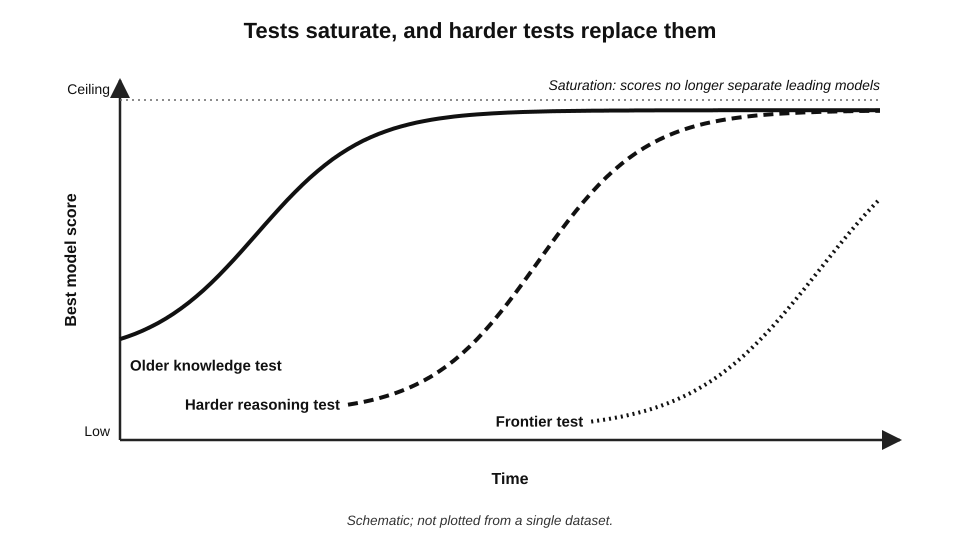
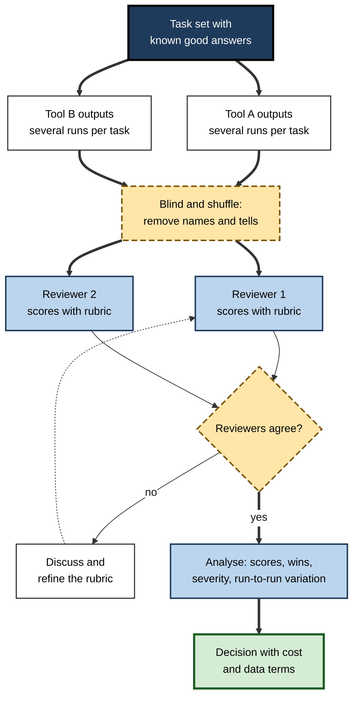
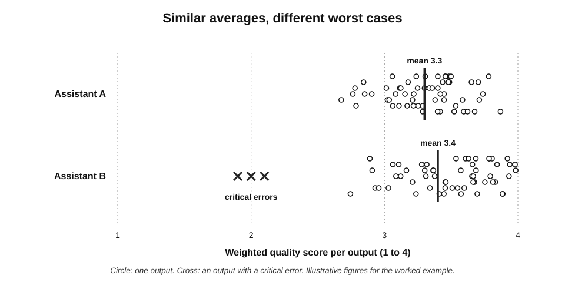
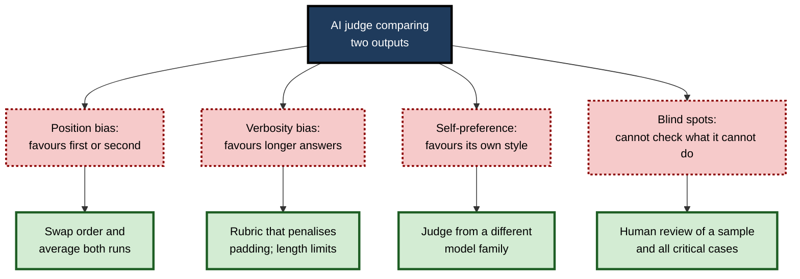
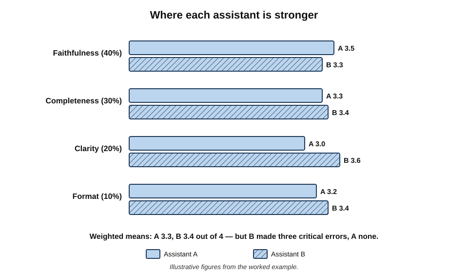

# C.10. Comparing output quality

Two AI assistants are asked to summarise the same forty-page supplier contract. Both summaries are fluent, well organised and about the same length. A quick read suggests they are equally good. A lawyer comparing them line by line finds that one omitted the clause allowing the supplier to terminate on thirty days' notice — the single most important commercial term in the document. Comparing AI output by **impression** finds the polish; comparing it by **method** finds the omission.

> **Definition — Output quality comparison:** the systematic assessment of two or more AI tools' (or models') outputs on the same tasks, against defined criteria, so that differences in usefulness and risk can be measured rather than guessed.

**Why method matters**

- **Fluency hides differences** — modern AI outputs are almost always well written, so surface impressions converge while substance diverges.
- **Public rankings answer a different question** — they measure average performance on someone else's tasks.
- **Outputs vary between runs** — a single comparison may reflect luck.
- **Errors differ in kind** — two tools with the same number of errors may differ greatly in how serious those errors are.

---

## What "Quality" Means

### The dimensions

- **Correctness** — facts, figures, reasoning and code are right.
- **Faithfulness** — when working from a source, the output says only what the source supports.
- **Completeness** — nothing important is missing.
- **Relevance** — the output answers the question actually asked.
- **Clarity** — easy to follow, well structured.
- **Fit** — tone, style, length and format suit the audience and purpose.
- **Compliance** — instructions and constraints followed (word limits, required sections, banned content).
- **Safety and appropriateness** — no harmful, biased or confidential content.
- **Consistency** — similar quality across repeated runs and similar inputs.

> **Mnemonic — "Clever Foxes Can Run Clearly For Clean Safe Courses":** Correctness, Faithfulness, Completeness, Relevance, Clarity, Fit, Compliance, Safety, Consistency.

> **Definition — Faithfulness (groundedness):** the degree to which an output's claims are supported by the source material it was given.

> **Key point:** the dimensions that matter most depend on the task. For a contract summary, **faithfulness and completeness** dominate; for marketing copy, **fit and clarity**; for code, **correctness**. A comparison should weight dimensions by the task, not treat them equally.

### Why fluency misleads

- **Readers judge quality partly by fluency** — well-formatted, confident text is rated as more accurate.
- **AI outputs are uniformly fluent** — so fluency no longer discriminates between good and bad answers.
- **Length and formatting attract preference** — longer, bulleted answers are often preferred even when shorter ones are more accurate.

> **Watch out:** a common misconception is that the "better-sounding" answer is the better answer. With AI, polish is nearly free; **substance must be checked separately**.

---

## Public Benchmarks

### What they are

> **Definition — Benchmark:** a fixed set of test tasks with known answers or scoring rules, used to compare AI models under the same conditions.

- **Knowledge and reasoning tests** — *e.g.* MMLU (2020), multiple-choice questions across dozens of academic subjects; GPQA (2023), difficult graduate-level science questions designed to resist simple web lookup.
- **Software tests** — *e.g.* SWE-bench (2023), real issues from open-source code repositories that a model must fix so that tests pass.
- **Frontier tests** — *e.g.* Humanity's Last Exam (2025), a collection of very hard expert-written questions across many fields, created because earlier tests had become too easy.
- **Agent tests** — tasks requiring multi-step use of tools, browsers or simulated environments.

### Their limits

- **Saturation** — leading models approach the maximum score, so the test no longer separates them.
  - MMLU went from a demanding test in 2020 to near-ceiling for frontier models within a few years.
- **Contamination** — test questions leak into training data, inflating scores.
- **Goodhart's law** — when a measure becomes a target, it ceases to be a good measure; developers can optimise for benchmark scores rather than real usefulness.
- **Narrowness** — a test of multiple-choice science says little about drafting a sensitive email.
- **Reporting differences** — vendors report scores under different settings (number of attempts, tools allowed, prompting methods), so published numbers are not always comparable.

> **Definition — Benchmark contamination:** the presence of test questions or answers in a model's training data, which inflates its benchmark score without reflecting genuine capability.

> **Definition — Goodhart's law:** the observation, attributed to the economist Charles Goodhart, that a measure used as a target loses its value as a measure.

**Figure 1.** How benchmarks saturate: scores rise towards the ceiling and new, harder tests replace them.

> **In practice:** experienced evaluators read benchmark results as **coarse filters** — useful for excluding clearly weaker models, not for choosing between strong ones for a particular job.

---

## Crowd Leaderboards

### How they work

- **Chatbot Arena** (launched 2023 by researchers at the Large Model Systems Organisation, later run as **LMArena**) asks visitors to put a question to two anonymous models, read both answers and vote for the better one.
- **Votes are combined** into ratings using methods developed for chess and sport (Elo-style or Bradley–Terry models), producing a ranked leaderboard.
- **Strength:** large numbers of real, varied questions; blind comparison; human judgement.

> **Definition — Pairwise preference rating:** ranking items by many head-to-head comparisons, each recording which of two was preferred, combined statistically into a rating for each item.

### The critique

**Study card — Singh and colleagues (2025), "The Leaderboard Illusion"**

- **Authors:** researchers from Cohere Labs and several universities, including Stanford and Princeton.
- **Data:** an audit of the arena drawing on around two million comparisons, 42 providers and more than 240 models from January 2024 to April 2025.
- **Findings:**
  - some large providers privately tested **many variants** of their models before public release and published only the best-scoring — in one case, **27** private variants before a single public release;
  - a few providers received a disproportionate share of the arena's comparison data — estimated at around **a fifth each** for two of the largest — while dozens of open-weight models together received under a third;
  - access to arena data could be used to tune models towards arena preferences, improving rank without equivalent gains elsewhere.
- **Conclusion:** selective disclosure and unequal access can **distort** the leaderboard.
- **Response:** the arena's operators disputed parts of the analysis and described policy changes; debate about the size of the distortion continued.

> **Example:** in April 2025 Meta's Llama 4 Maverick reached a high arena rank using an "experimental" version tuned for conversation, which differed from the version released to the public; after criticism, the arena updated its policies on which versions could be listed.

> **Watch out:** crowd leaderboards also reward **style** — longer, more formatted, more agreeable answers — which the arena later tried to correct with "style control" adjustments. A top arena rank shows that many visitors preferred a model's answers to their own questions; it does not show that the model is best for **any particular professional task**.

---

## Reading Vendors' Quality Claims

Announcements of new models and products routinely claim to be "best" or "state of the art". The claims can be read critically with a few questions.

- **Best at what?** Which benchmarks, and are they relevant to the intended work?
- **Under what settings?** Number of attempts, tools allowed, extended reasoning time, special prompting — settings often differ between a vendor's chart and ordinary use.
- **Compared with which versions?** Competitors' older models are sometimes the comparison point.
- **Measured by whom?** Vendor-run results versus independent replication.
- **At what cost and speed?** Top scores may come from the slowest, most expensive configuration.
- **On which product?** A model's benchmark result may not describe the assistant or tier the user will actually get.

> **Remember:** a vendor chart answers "how did our best configuration do on tests we chose?" The buyer's question is "how will the version we can afford do on **our** work?"

---

## A Dated Picture of the Model Landscape

As of **October 2026**, and with the strong caveat that rankings change within weeks:

- **The frontier was contested by a small number of laboratories** — OpenAI, Google, Anthropic and xAI in the United States — whose leading models traded top positions on public benchmarks and leaderboards repeatedly through 2025–26.
- **Chinese laboratories** — including DeepSeek, Alibaba's Qwen team, Moonshot AI and Zhipu — released highly capable models, many with open weights, typically close behind the frontier and far cheaper to use.
- **Open-weight models** generally trailed the best proprietary models by months rather than years.
- **Differences among the leading models** on everyday professional tasks — drafting, summarising, explaining — were often smaller than differences between how well they were **configured, grounded and checked**.
- **Specialisation persisted at the margins** — some models were preferred for coding, some for long documents, some for speed or cost, some for particular languages.

> **Watch out:** any specific ranking written down is out of date by the time it is read. A comparison that matters should be run **at the time of the decision, on the user's own tasks**, and repeated when models change.

| | Public benchmarks | Crowd leaderboards | Own evaluation on real tasks |
|---|---|---|---|
| Who chooses the tasks | Test designers | Anonymous visitors | The organisation or user |
| Relevance to a specific job | Low to moderate | Low to moderate | High |
| Vulnerability to gaming | Contamination, optimisation | Selective disclosure, style tuning | Low, if the set is kept private |
| Cost to obtain | Free to read | Free to read | Hours to days of work |
| Best use | Screening out weak models | Gauging general preference | Choosing between strong candidates |

---

## Comparing Quality Oneself

### The method

1. **Choose the tasks** — a set of real tasks, including hard and edge cases, with known good answers where possible.
2. **Define the criteria** — the quality dimensions that matter, weighted for the task.
3. **Write a rubric** — what each score level looks like for each criterion.
4. **Generate outputs** — the same instructions to each tool; several runs per task where outputs vary.
5. **Blind the outputs** — remove tool names and formatting tells; shuffle order.
6. **Rate** — by two or more qualified reviewers, independently.
7. **Check agreement** — where reviewers disagree, discuss and refine the rubric.
8. **Analyse** — average scores, pairwise wins, error counts by severity, variation across runs.
9. **Decide** — in light of cost, data terms and the importance of the worst errors.

**Figure 2.** A blind comparison of two tools' outputs on the same tasks.

### Writing a rubric

- **Analytic rubric** — separate scores for each criterion (*e.g.* faithfulness 1–4, completeness 1–4, clarity 1–4).
  - More diagnostic; slower to apply.
- **Holistic rubric** — one overall score with descriptions of each level.
  - Faster; hides which aspect failed.
- **Anchors** — each score level described concretely.
  - *e.g.* Completeness 4: "all material terms present"; 3: "one minor term missing"; 2: "one material term missing"; 1: "several material terms missing".
- **Critical-error flag** — a separate yes/no for any error that would cause serious harm, regardless of the score.

> **Definition — Rubric:** a scoring guide that defines criteria and describes what each level of performance looks like for each criterion.

### Agreement between reviewers

> **Formula — Cohen's kappa:** κ = (observed agreement − chance agreement) ÷ (1 − chance agreement). Illustrative example: two reviewers make the same pass/fail judgement on 85 of 100 outputs (observed agreement 0.85); if each passes about half the outputs, chance agreement is about 0.50. κ = (0.85 − 0.50) ÷ (1 − 0.50) = **0.70** — substantial agreement. A kappa near 0 means agreement no better than chance.

- **Low agreement** signals a vague rubric or a genuinely subjective criterion; fix the rubric before trusting the results.
- **Jacob Cohen (1960)** introduced the statistic to correct raw agreement for agreement expected by chance.

### Variation between runs

- **Most AI tools are not deterministic** — the same request can produce different outputs each time.
- **Run each task several times** — three to five runs show whether quality is stable.
- **Compare distributions,** not single outputs: a tool with a slightly lower average but no bad runs may be preferable for important work.

**Figure 3.** Quality scores across repeated runs of the same tasks for two tools.

> **Key point:** for professional use, the **worst plausible output** often matters more than the average. A comparison should report both.

---

## Comparing Quality by Kind of Task

Different tasks call for different measures. Choosing the right measure is half of a fair comparison.

- **Extraction** (pulling names, dates, amounts or clauses from documents) — count what was found and what was missed.
  - **Precision** — of the items the tool extracted, how many were correct.
  - **Recall** — of the items that should have been extracted, how many the tool found.
- **Summarising** — faithfulness (no unsupported claims) and completeness (no missing essentials), checked against the source.
- **Drafting** — fit to audience and purpose, rated blind against a rubric; edit distance to an acceptable final version is a useful proxy.
- **Research with citations** — the share of citations that exist, and the share that actually support the claim made.
- **Code** — whether tests pass, plus review for security, readability and maintainability.
- **Translation** — accuracy of meaning and terminology, judged by fluent reviewers; automatic scores are rough guides only.
- **Classification and triage** — agreement with expert labels, with attention to costly misclassifications.

> **Formula — Precision and recall:** precision = correct items extracted ÷ all items extracted; recall = correct items extracted ÷ all items that should have been extracted. Illustrative example: a tool extracts 50 contract dates, of which 45 are correct, from documents containing 60 dates. Precision = 45 ÷ 50 = **90%**; recall = 45 ÷ 60 = **75%** — accurate when it answers, but it misses a quarter of the dates.

> **Definition — Edit distance (as a quality proxy):** how much a reviewer must change an output to make it acceptable; less editing suggests higher usable quality.

> **Watch out:** a tool with high precision and low recall looks trustworthy because what it says is right — while silently leaving out much of what matters. For tasks where omissions are costly, **recall must be measured explicitly**.

### Quality per unit of cost

- **Raw quality** is only part of the decision; a slightly better tool at several times the price may be the wrong choice.

> **Formula — Cost-adjusted quality:** usable outputs per month ÷ monthly cost, or quality score ÷ cost per task. Illustrative example: tool X produces 180 usable summaries for £30 (6 per pound); tool Y produces 200 for £90 (about 2.2 per pound). Y is better; X is far better value — unless Y's extra 20 summaries are the hard cases that matter most.

### A quick comparison for individuals

- **Pick five tasks** from real work, with one known answer and one hard case.
- **Give identical instructions** to each tool being compared.
- **Run the hard case three times** in each.
- **Hide which output came from which tool** — paste them into a document in random order before reading.
- **Score each** on the two or three criteria that matter most for the task.
- **Check the facts** in the hard case against the source.
- **Note the worst output** from each tool, not only the best.

> **In practice:** even this half-hour version catches the commonest mistakes — preferring the more polished output, judging on a single run, and missing a confident error in the hard case.

---

## Using AI to Judge AI

### LLM-as-judge

> **Definition — LLM-as-judge:** using a language model to evaluate or compare outputs, typically against a rubric or by choosing the better of two answers.

**Study card — Zheng and colleagues (2023)**

- **Setting:** researchers behind Chatbot Arena tested whether a strong model (GPT-4) could stand in for human judges in comparing chatbot answers.
- **Finding:** the model's judgements agreed with human experts' preferences at a rate **comparable to the agreement between human experts themselves** — over 80% on the comparisons studied.
- **Biases identified:**
  - **position bias** — favouring the answer presented first (or second);
  - **verbosity bias** — favouring longer answers;
  - **self-enhancement bias** — favouring answers in the style of the judge's own model family;
  - limited ability to grade mathematics and reasoning it could not itself perform reliably.
- **Conclusion:** AI judges are useful for scaling comparisons, provided their biases are controlled.

**Figure 4.** Biases of AI judges and how evaluators counter them.

> **In practice:** organisations evaluating at scale commonly use AI judges for **first-pass scoring** of many outputs, then have humans review a sample, all disagreements and every output flagged as possibly critical — and periodically check that the AI judge still agrees with human reviewers.

> **Watch out:** an AI judge that shares the weaknesses of the tools being judged will miss the same errors. Faithfulness to a source, in particular, should be checked against the source, not against another model's opinion.

---

## Worked Example (illustrative): Two Assistants for a Policy Team

*Names, organisations and numbers in this example are illustrative figures.*

**Situation:** a public-policy team of eight will choose between two approved assistants for summarising consultation responses. It builds a set of 20 real past responses with summaries approved by senior staff.

**Design**

- **Criteria and weights:** faithfulness 40%, completeness 30%, clarity 20%, format compliance 10%.
- **Rubric:** analytic, 1–4 per criterion, with anchors; plus a critical-error flag for any invented or reversed position.
- **Runs:** three per task per tool — 60 outputs each.
- **Reviewers:** two senior analysts, blind to tool.

**Results**

| | Assistant A | Assistant B |
|---|---|---|
| Weighted mean score (out of 4) | 3.3 | 3.4 |
| Pairwise preference (blind, per task) | Preferred on 8 of 20 | Preferred on 12 of 20 |
| Lowest single-run score | 2.6 | 1.9 |
| Critical errors (invented or reversed positions) | 0 of 60 | 3 of 60 |
| Reviewer agreement on critical-error flag (kappa) | 0.78 | 0.78 |

**Interpretation**

1. **Averages and preferences** slightly favour B — but 12 of 20 is weak evidence of a real difference.
2. **Worst case** clearly favours A — B's lowest run is much worse.
3. **Critical errors** decide it: B misrepresented a respondent's position three times in 60 runs; in public consultation, misrepresenting a respondent is a serious failure.
4. **Agreement** between reviewers is substantial, so the critical-error finding is trustworthy.

**Decision:** Assistant A, with B retained for drafting tasks where its slightly better clarity matters and errors are easily caught.

> **Formula — Critical-error rate:** critical errors ÷ outputs. Assistant B: 3 ÷ 60 = **5%** — at the team's volume of about 400 summaries a quarter, roughly **20** misrepresented positions a quarter if unchecked.

> **Watch out:** if the team had compared one run per task on averages alone, B would have won — and the critical-error pattern would have surfaced only in published work.

---

## Case Study: Summaries That Rewrote the News

- **Situation:** in late 2024 Apple introduced AI-generated summaries of notifications on its devices, including notifications from news apps, condensing several headlines into a single line.
- **What happened:** in December 2024 the BBC complained that a summary had falsely stated, under the BBC's name, that a man charged in a high-profile murder case had shot himself. Other news organisations reported further false or distorted summaries in the following weeks.
- **Quality failure:**
  - **faithfulness** — the summaries asserted things the source headlines did not say;
  - **fit** — compression of several headlines into one line encouraged distortion;
  - **attribution** — errors appeared under trusted publishers' names.
- **Response:** in January 2025 Apple paused AI summaries for news and entertainment apps, pending improvements, and later restored them with clearer labelling and changes to the feature.
- **Diagnosis:**
  - the feature had been judged on its general usefulness, but the decisive quality dimension for news — **faithfulness under extreme compression** — produced rare but highly visible errors at enormous volume;
  - a low error rate multiplied by very many notifications yields many errors.
- **Lesson:** quality must be evaluated on the **dimension that matters most for the specific use**, at the **volume** of real use, with special attention to the **worst outputs**.

> **Key point:** a tool can be good "on average" and unacceptable for a particular use. Comparisons must be **task-specific** and **tail-aware**.

---

## Mastery: How Expert Evaluators Compare

- **They start from the task,** not the leaderboard.
- **They weight the criteria** by what failure would cost.
- **They blind and shuffle** outputs and use at least two reviewers.
- **They run each task several times** and report the worst case alongside the average.
- **They count critical errors separately** and give them a veto.
- **They use AI judges with controls** — order swapping, different model families, human sampling.
- **They keep the task set private** so it cannot leak into training or be optimised against.
- **They re-run the comparison** when models, prompts or configurations change.

> **Remember:** **own tasks, weighted criteria, blind review, several runs, worst case counted, re-run after change.**

**Figure 5.** Weighted rubric scores for the two assistants in the worked example, by criterion.

---

## Open Questions

- **Can public evaluation keep up?**
  - New benchmarks saturate within months; it is unclear whether any fixed test can track frontier capability for long.
- **How much do leaderboards distort development?**
  - The 2025 critique of crowd rankings and the responses to it leave the size of the distortion disputed.
- **Can AI judges be trusted for high-stakes evaluation?**
  - Agreement with humans is high on average, but systematic biases and shared blind spots remain.
- **How should open-ended quality be measured?**
  - For analysis, advice and creative work, expert reviewers disagree; reliable, affordable measures are still being developed.
- **Will quality differences between leading models matter less over time?**
  - If models converge, quality may depend more on grounding, configuration and checking — shifting comparison from models to whole workflows.

---

## Summary

- **Comparing output quality** means assessing tools on the same tasks against defined criteria; impressions find polish, methods find omissions.
- Quality dimensions: **correctness, faithfulness, completeness, relevance, clarity, fit, compliance, safety, consistency** — weighted by task.
- **Fluency misleads**: AI output is uniformly polished; longer, formatted answers attract unjustified preference.
- **Benchmarks** (MMLU, GPQA, SWE-bench, Humanity's Last Exam) screen models but **saturate**, suffer **contamination** and invite **Goodhart's law**.
- **Crowd leaderboards** use blind pairwise votes; "The Leaderboard Illusion" (2025) showed **selective disclosure and unequal data access** can distort them; style also biases votes.
- **Dated picture (October 2026):** a few US labs contest the frontier; Chinese and open-weight models close behind; rankings change within weeks; configuration and grounding often matter more than model choice for everyday tasks.
- **Own evaluation:** real tasks, weighted rubric with anchors, blind review by two or more reviewers, **Cohen's kappa** for agreement, several runs, worst-case reporting, critical-error veto.
- **LLM-as-judge** agrees with humans about as often as humans agree with each other, but shows **position, verbosity and self-preference biases**; control them and sample with humans.
- The 2024–25 **news-summary** episode shows tools can be acceptable on average and unacceptable for a specific use at volume.

---

## Self-Check

1. Define output quality comparison and explain why impressions are unreliable for AI output.
2. List the nine quality dimensions and say which matter most for a contract summary.
3. What is benchmark saturation, and why does it happen?
4. Explain contamination and Goodhart's law with reference to AI benchmarks.
5. How does a crowd leaderboard produce its rankings?
6. Summarise the main findings of "The Leaderboard Illusion".
7. Why should any written ranking of AI models be treated as provisional?
8. Describe the nine steps of an own-task comparison.
9. Distinguish analytic and holistic rubrics and give an example of an anchor.
10. Two reviewers agree on 90 of 100 judgements; chance agreement is 0.6. Compute Cohen's kappa and interpret it.
11. Why run each task several times, and what should be reported?
12. What did Zheng and colleagues find about AI judges, and what biases did they identify?
13. In the policy-team example, why was Assistant A chosen despite lower averages and fewer pairwise wins?
14. A manager proposes choosing the team's assistant by its rank on a public leaderboard. Explain the risks and propose a better method.

### Answer Key

1. Systematic assessment of tools' outputs on the same tasks against defined criteria. Impressions are unreliable because AI output is uniformly fluent, so polish no longer signals substance.
2. Correctness, faithfulness, completeness, relevance, clarity, fit, compliance, safety, consistency. For a contract summary: faithfulness and completeness.
3. Leading models approach the maximum score, so the test no longer separates them; it happens as models improve, as developers optimise for well-known tests, and as test items leak into training data.
4. Contamination: test items in training data inflate scores. Goodhart's law: once a benchmark becomes a target, optimising for it detaches the score from genuine capability.
5. Visitors compare two anonymous models' answers to their own question and vote; many votes are combined statistically (Elo-style or Bradley–Terry) into ratings.
6. Some providers privately tested many variants (27 in one case) and published only the best; a few providers received a large share of comparison data while many open models received little; these can distort rankings.
7. Leading positions change within weeks as new models are released, and rankings measure general preference, not fitness for a specific task.
8. Choose tasks; define criteria; write a rubric; generate outputs (several runs); blind and shuffle; rate with two or more reviewers; check agreement; analyse (scores, wins, severity, variation); decide with cost and data terms.
9. Analytic: separate scores per criterion; holistic: one overall score. Anchor example: "Completeness 2 — one material term missing".
10. κ = (0.90 − 0.60) ÷ (1 − 0.60) = 0.30 ÷ 0.40 = 0.75 — substantial agreement.
11. Outputs vary between runs; a single run may reflect luck. Report the average, the spread and the worst case.
12. A strong model's judgements agreed with experts about as often as experts agreed with each other (over 80%). Biases: position, verbosity, self-enhancement; weakness on reasoning it could not perform.
13. B's averages and wins were only slightly better (12 of 20 is weak evidence), but its worst runs were much worse and it made three critical errors misrepresenting respondents; A made none.
14. Leaderboards reflect general preferences on others' questions, can be distorted by selective testing and style, and change quickly. Better: build a private set of the team's real tasks, weight criteria, compare blind with several runs and two reviewers, count critical errors, and consider cost and data terms.

---

## Glossary

| Term | Meaning |
|---|---|
| Analytic rubric | A rubric scoring each criterion separately. |
| Anchor | A concrete description of what a score level looks like. |
| Benchmark | A fixed test set with known answers for comparing models. |
| Benchmark contamination | Test items present in training data, inflating scores. |
| Cohen's kappa | A measure of agreement between two raters corrected for chance. |
| Critical error | An error serious enough to veto a tool for a use regardless of averages. |
| Crowd leaderboard | A ranking built from many anonymous pairwise votes between models. |
| Faithfulness | The extent to which an output's claims are supported by its source. |
| Goodhart's law | A measure used as a target ceases to be a good measure. |
| Holistic rubric | A rubric giving one overall score with level descriptions. |
| LLM-as-judge | Using a language model to evaluate or compare outputs. |
| Pairwise preference rating | Ranking from many head-to-head comparisons. |
| Position bias | A judge's tendency to favour an answer because of its order. |
| Rubric | A scoring guide defining criteria and performance levels. |
| Saturation | A benchmark's loss of discriminating power as scores approach the ceiling. |
| Verbosity bias | A judge's tendency to favour longer answers. |
