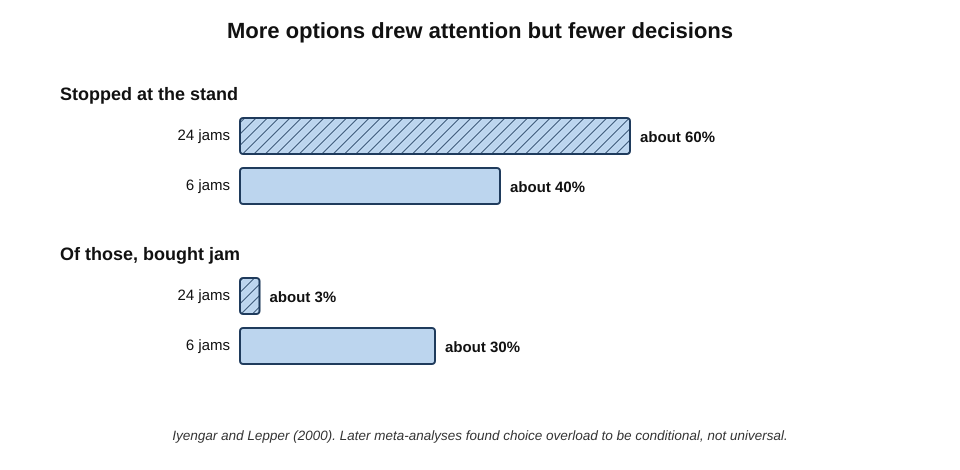
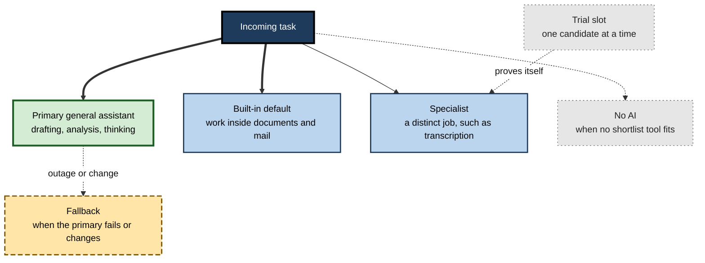
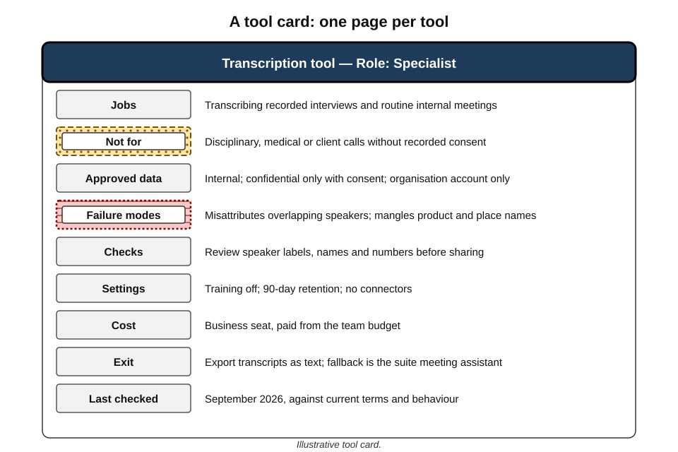
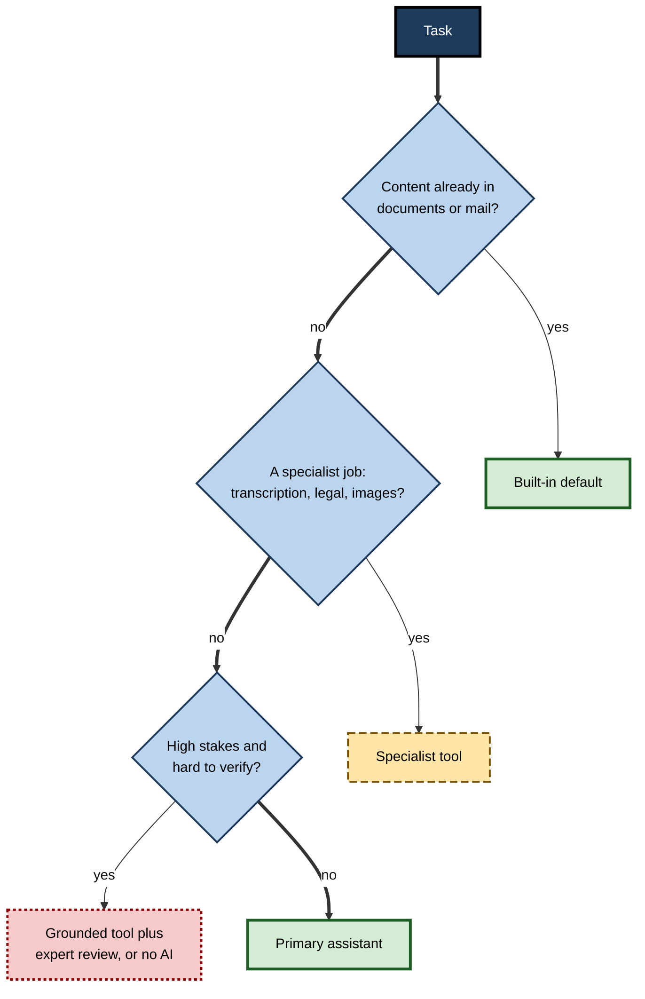
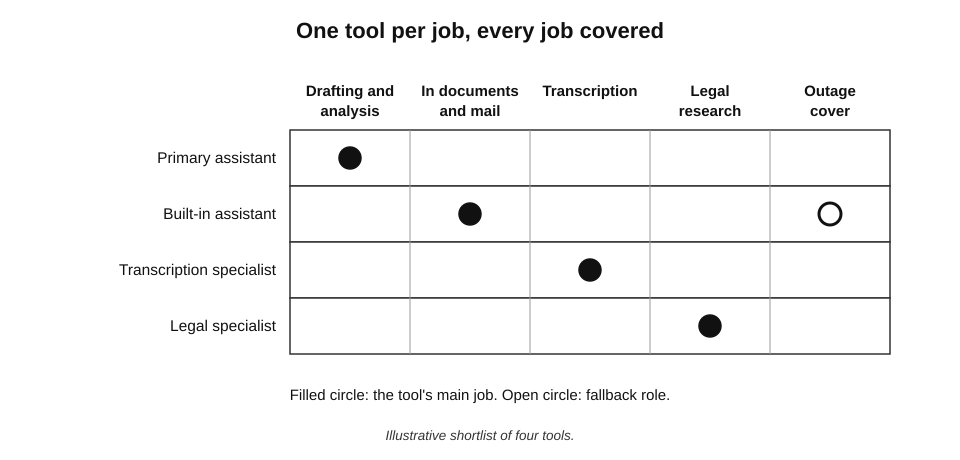

# C.11. Keeping a shortlist that works

A consultant receives three requests before lunch: tidy a client email, analyse a 90-page regulatory report, and transcribe an interview recorded on her phone. A colleague facing the same requests opens four tools, compares outputs and wonders which is allowed for client material. She does not deliberate. She has a **shortlist** — four tools, each with a known job, known limits and known rules — and routes each task in seconds. The difference is not talent; it is a small, deliberate set of tools that she knows deeply.

> **Definition — Tool shortlist:** a small, deliberately chosen set of AI tools, each with a defined role, known strengths and failure modes, approved data uses and a clear routing rule, maintained so that everyday work can be matched to a tool quickly and safely.

**Why a shortlist matters**

- **Speed** — routing a task takes seconds, not a fresh comparison every time.
- **Depth** — skill with a few tools grows; skill spread across many stays shallow.
- **Safety** — data rules are known for each tool in advance.
- **Consistency** — similar tasks are done the same way, so quality and checking are predictable.
- **Resilience** — a planned fallback exists when a tool fails, changes or disappears.

---

## Why Small Sets Work

### Consideration sets

- **Marketing research** has long observed that buyers do not choose among all available products; they choose among a small **consideration set**.
  - John Howard and Jagdish Sheth (1969) called it the **evoked set** — the few brands a buyer actively considers.
  - John Hauser and Birger Wernerfelt (1990) explained its smallness economically: each option considered costs time and effort to evaluate, so people stop adding options when the expected gain from one more falls below its cost.
- **Applied to AI tools:** a professional's shortlist is a consideration set, kept small because every additional tool costs attention to learn, track and govern.

> **Definition — Consideration set:** the small group of options a person actively considers when making a choice, out of all those available.

### Satisficing

- **Herbert Simon (1955–56)** argued that people with limited time, information and attention do not search for the best possible option; they **satisfice** — choose the first option that meets an acceptable standard.
- **Bounded rationality** — the recognition that real decision-makers face limits, so good decisions depend on good **procedures**, not exhaustive search.
- **Implication:** in a market where new tools appear weekly, seeking the single best tool for every task is impossible; a shortlist of **good-enough, well-understood** tools is the rational response.

> **Definition — Satisficing:** choosing an option that meets a defined threshold of acceptability, rather than searching for the optimum.

**Study card — Schwartz and colleagues (2002), maximisers and satisficers**

- **Method:** surveys of several hundred people measured a tendency to **maximise** (always seek the best option) against a tendency to **satisfice**, alongside measures of well-being and decision satisfaction.
- **Findings:**
  - people scoring high on maximising reported **less satisfaction** with their choices, more regret and more social comparison;
  - they also tended to report lower happiness and optimism.
- **Limits:** the findings are **correlational** — they show an association, not that maximising causes dissatisfaction — and the measurement scale has been debated and revised.
- **Relevance:** a habit of re-evaluating every new AI tool in search of the best is costly in time and, on this evidence, may not even feel better.

> **Definition — Maximising:** a decision style of seeking the best possible option, typically by extensive search and comparison.

### Choice overload — and its limits

**Study card — Iyengar and Lepper (2000), the jam study**

- **Design:** in an upmarket grocery store, a tasting stand displayed either **24** or **6** varieties of jam on alternating occasions.
- **Results:**
  - the larger display attracted more passers-by to stop (about 60% against 40%);
  - but among those who stopped, far more bought jam after seeing the small display (about **30%**) than the large one (about **3%**).
- **Conclusion:** more choice can reduce the likelihood of choosing at all — **choice overload**.

**Study card — Scheibehenne, Greifeneder and Todd (2010), meta-analysis**

- **Method:** combined the results of about 50 experiments on choice overload.
- **Finding:** the **average** effect of a larger choice set on satisfaction or willingness to choose was close to **zero** — but results varied widely, with some studies showing strong overload and others showing that more choice helped.
- **Follow-up — Chernev, Böckenholt and Goodman (2015):** another meta-analysis found that overload appears reliably under particular conditions: **complex options**, **difficult decisions**, **uncertain preferences** and a goal of **minimising effort**.

> **Watch out:** the jam study is often quoted as proof that "more choice is always worse". The evidence does not support that. Choice overload is **conditional** — and the conditions it needs (complex options, hard comparisons, unclear preferences) describe choosing among AI tools rather well.

**Figure 1.** The jam study's result: more options attracted attention but led to fewer purchases.

> **Key point:** a shortlist is not about having fewer options in the world; it is about having **fewer decisions to make each day**, so attention goes to the work rather than to the tools.

---

## The Structure of a Good Shortlist

### Roles, not brands

A working shortlist is organised by **role**. Each role has one tool assigned to it.

- **Primary general assistant** — the main tool for drafting, analysis, explanation and thinking work.
  - Used daily; learned deeply; on an approved account.
- **Built-in default** — the assistant inside the software where most content lives (documents, email, meetings).
  - Used for work in place.
- **Specialist or specialists** — one or two tools for distinct jobs the others do poorly.
  - *e.g.* a legal research tool; a transcription tool; a licensed image tool; a coding assistant.
- **Fallback** — an alternative for when the primary fails, is unavailable or changes badly.
  - Tested occasionally so it works when needed.
- **Trial slot** — at most one tool under evaluation at a time.
  - Enters the shortlist only by displacing or adding a role through a proper trial.

> **Mnemonic — "Please Bring Some Fresh Tea":** Primary, Built-in, Specialist, Fallback, Trial.

**Figure 2.** The roles in a working shortlist and how tasks flow to them.

### How many tools?

- **Most professionals need three to five.**
  - Fewer, and distinct jobs go unserved — driving improvised use of unapproved tools.
  - More, and the costs of sprawl return: switching, shallow skill, scattered data.
- **Specialist-heavy roles** — lawyers, designers, developers, researchers — may need one or two more.
- **The test:** every tool on the list must serve a job **no other tool on the list serves as well**.

| | Too few tools | A working shortlist | Too many tools |
|---|---|---|---|
| Coverage of distinct jobs | Gaps filled by improvisation | Each job has a known tool | Several tools per job |
| Depth of skill | Deep but narrow | Deep across the main jobs | Shallow everywhere |
| Data safety | Pressure to use unapproved tools | Rules known per tool | Rules hard to remember |
| Time choosing | Little, but poor fits | Seconds per task | Frequent comparison |
| Resilience | Single point of failure | Planned fallback | Accidental redundancy |

---

## The Tool Card

Each tool on the shortlist is documented in a short **tool card** — for oneself, and for a team.

- **Role** — primary, built-in, specialist, fallback.
- **Jobs** — what it is used for, specifically.
- **Not for** — tasks it does badly or must not be used for.
- **Approved data** — which classes of data, under which account.
- **Known failure modes** — how it tends to go wrong (*e.g.* "skips tables in PDFs"; "invents citations when asked for sources without search on").
- **Checks required** — what must be verified before using its output.
- **Settings** — training off, history settings, connectors permitted.
- **Cost and tier** — and who pays.
- **Exit** — how to export work and what the fallback is.
- **Last checked** — date the card was reviewed against current terms and behaviour.

**Figure 3.** An example tool card for a specialist transcription tool.

> **In practice:** the **"known failure modes"** line is the most valuable part of a tool card. It turns hard-won experience — the time the tool silently dropped half a document — into a check everyone performs.

---

## Routing Rules

A shortlist works when the route from task to tool is automatic.

### Writing routing rules

- **Route by content location** — content inside the suite → built-in default.
- **Route by data class** — confidential client material → only tools approved for it.
- **Route by job** — transcription → specialist; legal research → specialist with citations.
- **Route by stakes** — high-stakes, hard-to-verify work → grounded tool plus review, or no AI.
- **Route by failure** — primary unavailable → fallback, for permitted data only.

**Figure 4.** Routing everyday tasks through a shortlist.

> **Example (illustrative) — routing in practice:** a project manager's rules read: "Status emails and meeting follow-ups → built-in assistant in the mail client. Risk analysis and plans → primary assistant, with project data pasted only from the approved workspace. Supplier contract questions → legal team, not AI. Outage → fallback assistant, internal data only." Four lines cover nearly every request she meets in a week.

### When no rule fits

- **New kinds of task** will appear that the rules do not cover.
- **Default to the primary assistant** only if the data is permitted and the stakes are low.
- **Otherwise, pause** — check approval and data rules, or do the task without AI.
- **Then add a rule,** so the next occurrence is routine.

> **Remember:** the routing rules matter more than the tool names. When a tool is replaced, the rules stay; only the name in the role changes.

---

## Getting On and Off the List

### Entry criteria

- **Fills a distinct job** or clearly beats the incumbent in a role.
- **Has passed a proper trial** on real tasks, including hard cases.
- **Is approved** for the intended data under the intended account.
- **Has a known exit** — work can be exported; a fallback exists.
- **Has an owner** — someone keeps its card current.

### Exit signals

- **The role disappears** — the built-in default now does the job well enough.
- **A better tool passes a trial** for the same role.
- **Terms, prices or approval change** for the worse.
- **Quality drifts** after a model change and does not recover.

> **Key point:** a shortlist is a set of **roles with current holders**. Holders change; roles are stable. Detailed decisions on when to drop a tool follow their own discipline, but the shortlist makes them visible.

### The one-trial rule

- **Only one candidate tool on trial at a time** per person or team.
- **Each trial has an end date** and a decision.
- **Prevents** the slow accumulation of half-adopted tools that turns a shortlist back into sprawl.

> **Watch out:** the pull of novelty is strongest for capable, curious professionals. Without a rule, a shortlist of four becomes a shortlist of four plus six "I'm just trying it" tools within a few months.

---

## Shortlists for Teams

### Why a shared shortlist helps

- **Shared skill** — colleagues learn the same tools and help one another.
- **Shared prompts and templates** — reusable instructions accumulate in one place.
- **Shared checks** — known failure modes become team practice.
- **Easier onboarding** — new joiners are productive faster.
- **Comparable work** — outputs produced the same way can be reviewed the same way.

### Building a team shortlist

1. **List the team's recurring jobs.**
2. **Assign a role and a tool** to each job, from the organisation's approved tools.
3. **Write tool cards** — with the team's own failure modes and checks.
4. **Write routing rules** — one page.
5. **Name owners** for each tool card.
6. **Agree the trial rule** — how a new tool is proposed and tested.
7. **Store everything together** — in the team's shared space, outside any single tool.

> **In practice:** the most effective team shortlists fit on **one page**: a table of roles, tools, jobs, data rules and owners, with routing rules beneath. If it does not fit on a page, it is probably not a shortlist.

---

## Resilience: Planning for Failure

- **Outages happen.** Several widely used AI assistants suffered multi-hour outages during 2024–25, some caused by failures at shared infrastructure providers that took down many services at once.
- **Models change.** A provider's model update can alter output style or quality overnight.
- **Terms and approval change.** A tool can become unusable for certain data at short notice.
- **The fallback must be real:**
  - approved for the data it will receive;
  - tried recently on the main tasks;
  - with the team's key instructions available outside the primary tool.

> **Example (illustrative):** during a half-day outage of its primary assistant, a team with a tested fallback and a shared prompt library carried on with minor inconvenience. A neighbouring team without one either waited or — worse — pasted client material into personal accounts of other tools.

> **Watch out:** a fallback that has never been tried is a hope, not a plan. The usual failure is discovering, mid-outage, that the fallback is not approved for the data or that nobody remembers how to use it.

---

## Shortlists at Different Stages of Experience

- **Beginners** — the smallest shortlist works best.
  - One primary assistant on an approved account, plus the built-in default.
  - Effort goes into learning to instruct clearly and to **check** output, not into comparing tools.
- **Established practitioners** — add specialists for the distinct jobs their work demands.
  - A developer adds a coding assistant; a lawyer a research service; a designer a licensed image tool.
  - Failure modes are known from experience and written down.
- **Experts and heavy users** — maintain a fallback, track model changes, run a trial slot.
  - Often the people colleagues ask which tool to use; their tool cards become the team's.
- **Team leads and managers** — own the **team** shortlist.
  - Decide roles, keep the one-page guide current, sponsor trials, remove tools that no longer earn their place.

> **Key point:** the shortlist grows with responsibility, but slowly. Experts do not use more tools than beginners so much as they use the **same few tools far more skilfully** — with a few specialists added for genuinely distinct work.

---

## Common Shortlist Mistakes

- **Listing brands without roles** — "we use X, Y and Z" with no rule for which is for what.
- **No exclusions** — the list says where AI is used but not where it must not be.
- **Personal accounts on the list** — a tool counted as "ours" that is really one person's consumer subscription.
- **Untested fallback** — named but never tried.
- **Stale cards** — tool cards written once and never updated after model or term changes.
- **Hidden trials** — several tools "just being tried" outside the trial slot.
- **A shortlist in one person's head** — when that person leaves, the team loses its routing knowledge.
- **Following leaderboards instead of work** — changing tools whenever a new model tops a public ranking.

> **Watch out:** the commonest failure is not choosing badly but **failing to write the shortlist down**. An unwritten shortlist cannot be shared, checked against policy or handed over — it is a personal habit, not a working tool.

### Work and personal shortlists

- **Keep them separate.** A personal shortlist for home use may include tools that are not approved for work.
- **Same tool, different accounts** — where a tool appears on both, the work shortlist names the **organisational account** explicitly.
- **No cross-traffic** — work material does not travel to personal tools, and personal accounts do not appear on the work list.

---

## Worked Example (illustrative): A Shortlist for an HR Business Partner

*Names, organisations and numbers in this example are illustrative figures.*

**Situation:** an HR business partner supports 400 employees. Her organisation's approved tools include an enterprise assistant, the office suite's assistant, an approved meeting assistant and a specialist employment-law research service.

**Step 1 — list recurring jobs**

- Drafting policies, communications and guidance.
- Summarising long consultation and survey results.
- Notes from meetings (including sensitive ones).
- Checking employment-law points.
- Analysing anonymised survey data.

**Step 2 — assign roles**

| Role | Tool | Jobs | Data allowed | Not for |
|---|---|---|---|---|
| Primary | Enterprise assistant | Drafting, summarising, analysis of anonymised data | Internal, confidential | Decisions about individuals; legal conclusions |
| Built-in | Suite assistant | Email, documents in place | Internal, confidential | Restricted HR case files |
| Specialist | Employment-law research service | Checking legal points, with citations | Public legal questions; no personal data | Advice without solicitor review on contested matters |
| Specialist | Approved meeting assistant | Notes for routine meetings | Internal | Disciplinary, grievance or medical meetings |
| Fallback | Suite assistant's chat feature | Drafting if primary is down | Internal | Anything needing the primary's analysis tools |

**Step 3 — write the routing rules**

1. Sensitive case meetings (disciplinary, grievance, medical) → **no AI recording**; handwritten or typed notes.
2. Legal points → **specialist**, then read the cited sources; contested matters → solicitor.
3. Content in documents or mail → **built-in**.
4. Everything else → **primary**.

**Step 4 — record failure modes and checks**

- Primary: occasionally overstates survey trends → check every figure against the data.
- Meeting assistant: misattributes speakers when people talk over one another → review attribution before circulating.
- Legal service: citations can be real but not on point → read each cited section.

> **Watch out:** the most important line in this shortlist is a rule **against** using a tool — no AI recording of sensitive case meetings. A good shortlist defines where AI is excluded as clearly as where it is used.

---

## Case Study (illustrative): A Data Team Simplifies

- **Situation:** a twelve-person analytics team at a retailer used AI tools heavily but inconsistently. An informal survey counted eleven tools in regular use; analysts often re-did each other's work because no one trusted outputs from unfamiliar tools.
- **Problem:** time lost choosing and re-checking; inconsistent results; two incidents of customer data pasted into unapproved tools.
- **Actions:**
  1. listed six recurring jobs: writing queries, explaining results, drafting reports, documenting code, analysing text feedback, preparing slides;
  2. built a **shortlist of four**: the enterprise assistant (primary), a coding assistant approved for the code repository (specialist), the suite assistant (built-in), and the enterprise assistant's alternative model setting as fallback;
  3. wrote one-page routing rules and tool cards, including failure modes collected from the team;
  4. created a shared library of tested instructions for the six jobs;
  5. adopted a one-trial rule with a monthly slot to propose a candidate.
- **Result (six months):**
  - analysts reported spending less time choosing tools and more confidence in colleagues' outputs;
  - review time for AI-assisted queries fell, because reviewers knew the typical failure modes;
  - no further incidents of customer data in unapproved tools;
  - one candidate tool trialled and rejected; one adopted, replacing the coding specialist.
- **Lesson:** the value came less from the four tools than from the **shared roles, rules, cards and library** around them.

> **Key point:** a shortlist's power is **social** as much as technical — shared tools make shared standards possible.

---

## From Organisational Catalogue to Personal Shortlist

Large organisations publish an approved-tool catalogue that may list dozens of AI tools and features. A catalogue is not a shortlist.

- **The catalogue answers** "what may I use?"
- **The shortlist answers** "what do I use, for what, and how?"
- **Moving from one to the other:**
  1. filter the catalogue to tools approved for the data classes the role handles;
  2. map the remaining tools to the role's recurring jobs;
  3. pick one holder per role, preferring tools colleagues also use;
  4. write the routing rules and failure modes;
  5. note the catalogue entries deliberately **not** chosen, and why.

> **In practice:** organisations increasingly publish **role-based starter shortlists** — "for finance analysts", "for client-facing consultants" — derived from the catalogue. They cut onboarding time and reduce the pull towards unapproved tools, because the approved route is already worked out.

### Keeping it current

- **Events that should trigger a quick check:** a model change in a shortlist tool; a change in terms or approval; a new built-in capability that may absorb a role; a repeated failure.
- **The light-touch check:** re-run a few known tasks; update the tool card's failure modes and "last checked" date.
- **A fuller periodic review** of the whole toolset follows its own routine; the shortlist simply makes that review fast, because roles, cards and rules are already written down.

> **Remember:** a catalogue lists what is **allowed**; a shortlist records what **works** — and is short enough to be remembered.

---

## Mastery: How Experienced Professionals Keep Shortlists

- **They organise by role** and change holders without changing roles.
- **They keep it small** — every tool must earn its place by serving a distinct job.
- **They document failure modes** and treat them as checks.
- **They write routing rules,** including where AI is excluded.
- **They maintain a real fallback.**
- **They trial one candidate at a time,** with an end date.
- **They keep instructions and prompts outside the tools,** so roles can change hands cheaply.
- **They share the list** with their team and keep it on one page.

> **Remember:** **roles, cards, rules, fallback, one trial at a time — on one page.**

**Figure 5.** How a shortlist covers a professional's distinct jobs, with one tool per role.

---

## Open Questions

- **What is the optimal size of a shortlist?**
  - Consideration-set theory explains why sets are small, but evidence on the ideal number of AI tools for different roles is lacking.
- **When does choice overload really apply to tools?**
  - The meta-analytic evidence says overload is conditional; whether AI tool choice reliably meets those conditions has not been tested directly.
- **Will built-in assistants absorb most roles?**
  - If suite assistants become capable enough, shortlists may shrink to one or two tools plus specialists.
- **How should shortlists adapt to agents?**
  - Agents that chain several tools blur the idea of one tool per role.
- **How much does shared tooling improve team quality?**
  - Practitioners report clear benefits; rigorous comparisons of teams with and without shared shortlists are rare.

---

## Summary

- A **shortlist** is a small set of tools with defined **roles**, known strengths and **failure modes**, approved data uses and **routing rules**.
- Small sets are rational: **consideration sets** stay small because evaluation is costly (Hauser and Wernerfelt, 1990); **satisficing** (Simon) suits fast-moving markets.
- **Choice overload** (Iyengar and Lepper, 2000) is real but **conditional**: meta-analyses found an average effect near zero, with overload under complexity, difficulty, uncertain preferences and effort-minimising goals.
- Roles: **Primary, Built-in, Specialist, Fallback, Trial** — usually **three to five** tools; each must serve a distinct job best.
- A **tool card** records role, jobs, not-for, approved data, failure modes, checks, settings, cost, exit and date checked.
- **Routing rules** route by content location, data class, job, stakes and failure — including where AI is **excluded**.
- **Entry** requires a distinct job, a trial, approval, an exit and an owner; the **one-trial rule** prevents regrowth.
- **Team shortlists** share skill, prompts, checks and standards — ideally on **one page**.
- **Fallbacks** must be approved and recently tried; outages and model changes are routine.

---

## Self-Check

1. Define a tool shortlist and give four reasons for keeping one.
2. What is a consideration set, and why do Hauser and Wernerfelt say it stays small?
3. Explain satisficing and why it suits AI tool choice.
4. Describe the jam study and its findings.
5. What did the 2010 meta-analysis find, and what conditions did the 2015 meta-analysis identify?
6. Name the five roles in a shortlist.
7. What is the test every tool on a shortlist must pass?
8. List the elements of a tool card and say which is often most valuable.
9. Give five bases for routing rules.
10. State four entry criteria for a new tool.
11. What is the one-trial rule, and what does it prevent?
12. Why must a fallback be tested in advance?
13. In the HR example, why is a rule against using AI the most important line?
14. A colleague has fourteen AI tools and says she uses "whichever feels right". Propose how she should build a shortlist.

### Answer Key

1. A small set of tools with defined roles, known strengths and failure modes, approved data uses and routing rules. Reasons: speed, depth of skill, safety, consistency, resilience.
2. The few options a person actively considers. It stays small because each extra option costs effort to evaluate; people stop adding options when the expected gain falls below that cost.
3. Choosing the first option meeting an acceptable standard rather than searching for the best. With new tools weekly, exhaustive search is impossible; good-enough, well-understood tools are the rational choice.
4. A tasting stand showed 24 or 6 jams. More people stopped at the larger display (about 60% versus 40%), but about 30% of those at the small display bought jam versus about 3% at the large one.
5. Across about 50 experiments the average overload effect was near zero, with wide variation. Overload appears with complex options, difficult decisions, uncertain preferences and effort-minimising goals.
6. Primary, Built-in, Specialist, Fallback, Trial.
7. It must serve a job no other tool on the list serves as well.
8. Role, jobs, not-for, approved data, known failure modes, checks required, settings, cost and tier, exit, last-checked date. Most valuable: known failure modes.
9. Content location, data class, job, stakes, failure (outage).
10. Fills a distinct job or beats the incumbent; passed a proper trial; approved for the intended data and account; known exit; has an owner.
11. Only one candidate on trial at a time, with an end date and decision; prevents half-adopted tools accumulating into sprawl.
12. Otherwise, during an outage, it may prove unapproved for the data or unfamiliar, pushing people to improvise with unapproved tools.
13. Sensitive case meetings involve highly sensitive personal data and fairness obligations; excluding AI recording prevents the most serious potential harm, and a shortlist must define exclusions as clearly as uses.
14. List her recurring jobs; assign one approved tool per role (primary, built-in, specialists, fallback); retire the rest; write tool cards with failure modes and routing rules; keep prompts outside the tools; adopt a one-trial rule.

---

## Glossary

| Term | Meaning |
|---|---|
| Bounded rationality | Decision-making under limits of time, information and attention. |
| Choice overload | Reduced willingness or satisfaction in choosing when options are many, under certain conditions. |
| Consideration set | The few options a person actively considers. |
| Evoked set | Howard and Sheth's term for the brands a buyer actively considers. |
| Fallback | A tested, approved alternative used when the primary tool fails or changes. |
| Failure mode | A characteristic way in which a tool tends to go wrong. |
| One-trial rule | Only one candidate tool on trial at a time, with an end date. |
| Primary assistant | The main general tool in a shortlist, used and learned most deeply. |
| Role | A defined job slot in a shortlist, held by one tool at a time. |
| Routing rule | A rule sending a type of task to a particular tool, or to no AI. |
| Satisficing | Choosing an acceptable option rather than searching for the best. |
| Tool card | A short record of a tool's role, uses, limits, data rules, checks and exit. |
| Tool shortlist | A small, deliberate set of tools with roles, rules and known limits. |
| Trial slot | A single place for a candidate tool under evaluation. |
