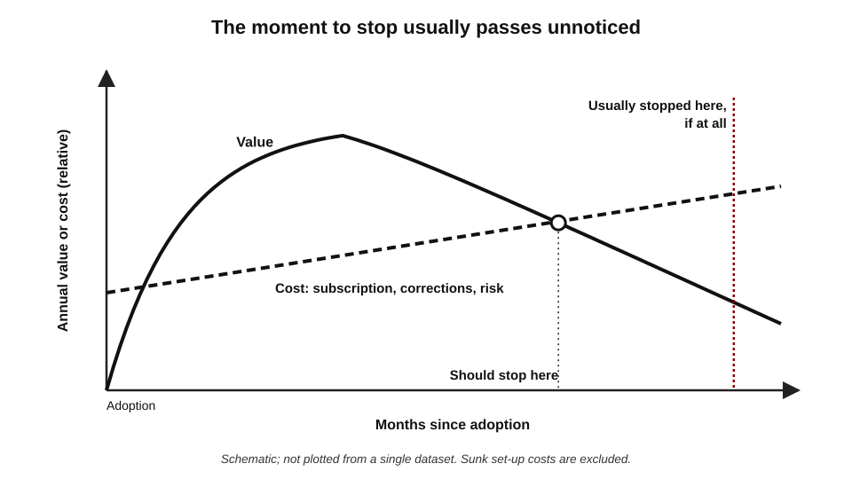
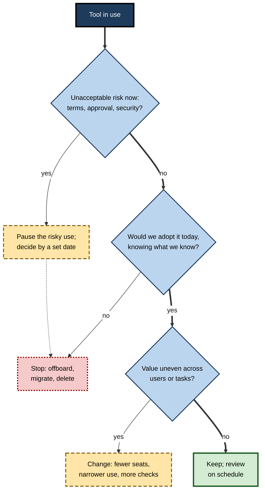
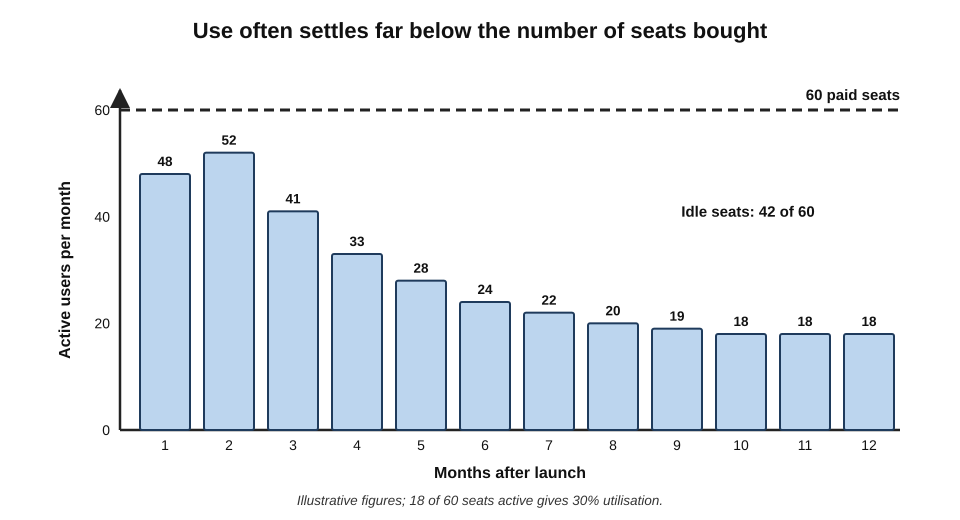
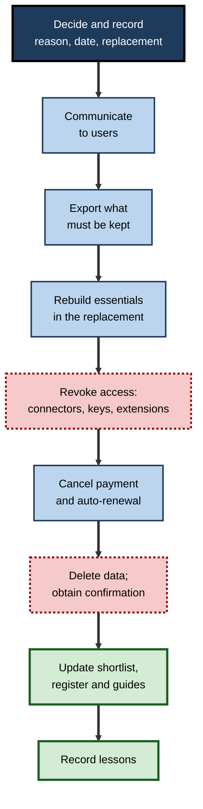
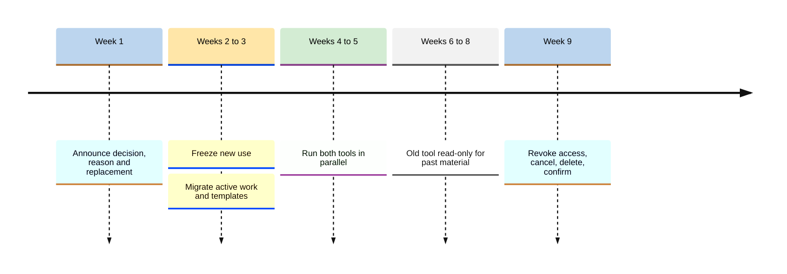

# C.12. Deciding what to stop using

A finance team still pays for a meeting assistant that assigns action items to the wrong people about once a week. Everyone corrects the notes by hand; nobody proposes dropping it, because the team spent a month configuring it and its champion is the head of department. Across the office, a forgotten writing-tool subscription renews for a third year. Adopting AI tools gets attention. **Stopping** them rarely does — and that is where much of the waste and risk accumulates.

> **Definition — Decommissioning (an AI tool):** the deliberate decision to stop using a tool, or a particular use of a tool, followed by an orderly exit — migrating what is needed, revoking access, cancelling payment and deleting data held by the provider.

**Why stopping matters**

- **Costs continue** — subscriptions, seats and usage charges run whether or not the tool helps.
- **Risks continue** — data held by the vendor, connectors with access, accounts that outlive their owners.
- **Attention is consumed** — weak tools still take time to use, correct and maintain.
- **Better options are blocked** — a role filled by a mediocre tool is not available to a better one.
- **Quality suffers** — tools that drift in quality keep producing errors that people learn to tolerate.

---

## Why Stopping Is Hard

### The sunk-cost effect

**Study card — Arkes and Blumer (1985)**

- **Field experiment:** buyers of season tickets for a university theatre were randomly given one of three prices — full price, a small discount or a large discount.
- **Finding:** in the first half of the season, those who had paid **full price** attended **more** plays than those who received discounts — although the tickets, plays and seats were identical.
- **Laboratory scenarios:** people asked to imagine having paid for two ski trips that clashed often chose the more expensive trip even when told they would enjoy the cheaper one more.
- **Conclusion:** people let **past, unrecoverable investment** drive present choices — the **sunk-cost effect**.

> **Definition — Sunk cost:** a cost already incurred that cannot be recovered whatever is decided now; rationally, it should not affect a forward-looking decision.

> **Example (illustrative):** "We spent three months building custom assistants on this platform" is a sunk cost. The forward-looking question is only: *from now on, does this tool deliver more than the alternatives, after the cost of switching?*

### Escalation of commitment

**Study card — Staw (1976), "Knee-deep in the big muddy"**

- **Design:** business students played the role of a corporate executive allocating research funds to one of two divisions; they then learned the results of the investment and allocated a second round of funds.
- **Finding:** students who had **personally made** the initial choice, and were told it had **failed**, allocated **more** money to the failing division than students who had not made the original decision.
- **Conclusion:** personal responsibility for a losing decision increases commitment to it — **escalation of commitment** — partly to justify the original choice.

> **Definition — Escalation of commitment:** continuing or increasing investment in a course of action despite evidence that it is failing, especially when one is responsible for having started it.

### Other forces that keep tools alive

- **Status quo bias** — the current tool is the default; changing requires effort and a decision.
- **Endowment effect** — people value what they already have more than equivalent things they do not.
  - Kahneman, Knetsch and Thaler (1990) found that people given a coffee mug demanded roughly twice as much to sell it as others were willing to pay for the same mug.
- **The IKEA effect** — Norton, Mochon and Ariely (2012) found people value things they have built themselves more highly.
  - Custom assistants, prompt libraries and automations built in a tool make it feel more valuable than its current performance justifies.
- **Champion identity** — the person who introduced a tool may feel that dropping it reflects on them.
- **Invisibility** — a tool nobody uses generates no complaints; its subscription simply renews.

> **Mnemonic — "Some Elephants Stay In Comfort Indefinitely":** Sunk cost, Escalation, Status quo, IKEA effect, Champion identity, Invisibility — the six forces that keep tools alive.

> **Watch out:** these forces act on **organisations** as well as individuals. Procurement cycles, annual contracts and the visibility of adoption announcements all reward starting tools; almost nothing rewards stopping them.

---

## Signals That a Tool Should Be Reviewed

### Usage signals

- **Low or falling use** — few active users; seats idle for months.
- **Workarounds** — people consistently fix, redo or bypass its outputs.
- **Duplication** — another tool on the shortlist now does the same job.

### Value signals

- **No measurable benefit** — time, quality or error rates no better than without it.
- **Superseded** — a built-in assistant or the primary tool has caught up.
- **Quality drift** — performance has declined after model changes and not recovered.

### Risk and governance signals

- **Terms changed** — new training, retention or sharing terms incompatible with the data used.
- **Approval withdrawn or narrowed** — the organisation no longer permits the use.
- **Security concerns** — an incident, a failed audit, or unexplained data access.
- **Vendor instability** — financial trouble, acquisition, strategy change, unclear future.
- **Model retirement** — the model the workflow depends on is being withdrawn.

### Human signals

- **Skill erosion** — users can no longer do a task they need to be able to do without the tool.
- **Over-reliance** — outputs accepted without the checks the work requires.

> **Key point:** the most reliable signal is the simplest — **would the tool be adopted today, knowing what is now known?** If not, it should be reviewed, whatever has been invested in it.

**Figure 1.** A tool's value and cost over time: the point at which it should be stopped often passes unnoticed.

---

## Kill Criteria: Deciding in Advance

### The idea

- **Annie Duke, *Quit* (2022)**, a former professional poker player writing on decision-making, argued that people quit too late because the decision is made under the influence of sunk costs and hope.
- **Her remedy: kill criteria** — conditions, set in advance, under which a course of action will be stopped.
  - Best expressed as a **state and a date**: "If by this date we have not reached this state, we stop."
- **Why it works:** the decision is made when judgement is clear, before investment and identity accumulate.

> **Definition — Kill criteria:** conditions agreed in advance which, if met, trigger stopping a project, tool or use, regardless of what has been invested.

### Kill criteria for AI tools

- **Adoption:** "If fewer than half the licensed users use it monthly after three months, we cut seats to actual users."
- **Benefit:** "If the net time saved per task is under five minutes at the six-month review, we stop."
- **Quality:** "If a critical error reaches a client, we suspend the use pending review."
- **Terms:** "If the provider changes terms to allow training on business content, we stop using it for confidential data immediately."
- **Supersession:** "If the built-in assistant passes our golden set for this job, we retire the specialist at renewal."

> **In practice:** the best time to write kill criteria is **at adoption**, alongside the trial's success criteria — the same meeting that decides to start should decide what would make it stop.

---

## Making the Decision

### Keep, change, pause or stop

- **Keep** — value clearly exceeds cost and risk; no warning signals.
- **Change** — keep the tool but change how it is used: fewer seats, narrower data, different tasks, better checks.
- **Pause** — suspend a use while a problem is investigated, with a date for decision.
- **Stop** — retire the tool or the specific use.

| | Keep | Change | Pause | Stop |
|---|---|---|---|---|
| When | Value well above cost; no red flags | Value real but uneven across users or tasks | A serious concern needs investigation | Value below cost, or an unacceptable risk |
| Typical action | Continue; review on schedule | Reclaim seats; restrict tasks; add checks | Suspend use; set a decision date | Offboard; migrate; delete data |
| Reversibility | — | High | High | Lower |
| Common mistake | Keeping by default without review | Changing nothing but the name | Pausing indefinitely | Stopping without migrating needed work |

**Figure 2.** A decision path for reviewing a tool already in use.

### Who should make the call

- **Not only the champion** — the person who introduced a tool is the least neutral judge of whether to stop it.
- **Not only the budget holder** — cost alone misses quality and risk.
- **A small review** — a user, the tool's owner, someone from security or privacy, and the budget holder — applying the pre-agreed criteria.
- **An independent voice** — even one colleague with no stake in the original decision counters escalation effectively.

### The arithmetic

> **Formula — Forward-looking value of keeping a tool:** expected annual benefit − (annual cost + annual cost of checks and corrections + risk allowance). Sunk costs are **excluded**. Illustrative example: benefit £9,000; subscription £6,000; corrections £4,000 of staff time; risk allowance £1,000 → 9,000 − 11,000 = **−£2,000** a year. Stop, or change how it is used — regardless of the £20,000 spent setting it up.

> **Formula — Licence utilisation:** active users in the period ÷ paid seats. Illustrative example: 18 active of 60 seats = **30%**; reclaiming 40 seats at £300 a year saves £12,000 while leaving room for growth.

**Figure 3.** Active use of a newly licensed tool often decays after the launch peak, leaving many idle seats.

> **Watch out:** low use is not always a reason to stop. A tool used rarely but for a critical task — a specialist legal check before major filings — may be worth keeping at low utilisation. Judge by **value**, not by frequency alone.

---

## Stopping a Use, Not Only a Tool

Many good decisions stop a **use** while keeping the tool.

- **Narrowing tasks** — keep the meeting assistant for internal meetings; stop it for client calls.
- **Narrowing data** — keep the assistant for public material; stop it for confidential work after a terms change.
- **Narrowing users** — keep the specialist for the six people who use it weekly; remove the other forty seats.
- **Removing features** — keep the tool; switch off connectors or agents that add risk without enough value.

> **Key point:** "stop" is usually more precise than a verdict on a product. The question is **which uses, by whom, with which data** have stopped earning their place.

---

## Offboarding: Stopping Properly

A tool abandoned without an orderly exit leaves data, access and payments behind.

1. **Decide and record** — the reason, the date, the replacement (if any).
2. **Communicate** — tell users what is changing, when, and what to use instead.
3. **Identify what must be kept** — outputs, templates, instructions, transcripts that have ongoing value or record-keeping obligations.
4. **Export** — move needed material into the organisation's own systems in standard formats.
5. **Rebuild essentials elsewhere** — instructions and templates recreated in the replacement tool.
6. **Revoke access** — connectors, OAuth grants, API keys, integrations, browser extensions, shared links.
7. **Cancel payment** — subscriptions, auto-renewals, cards on file; check contractual notice periods.
8. **Delete data** — delete accounts and content; request and record the provider's confirmation of deletion where the contract allows.
9. **Update records** — shortlist, tool cards, approved-tool register, routing rules, onboarding guides.
10. **Review** — what was learned for future adoption decisions.

**Figure 4.** The steps of an orderly exit from an AI tool.

> **Mnemonic — "Do Clever Engineers Rebuild, Revoke, Cancel, Delete, Update, Learn?":** Decide, Communicate, Export, Rebuild, Revoke, Cancel, Delete, Update, Learn.

> **Watch out:** the most commonly missed step is **revoking access**. Cancelling a subscription does not necessarily remove a connector's permission to read a mailbox or drive; an abandoned integration can retain access for years.

### Records that must survive the stop

- **AI outputs can be business records** — advice given to a client, a summary relied on for a decision, a transcript of a meeting.
- **Record-keeping rules may require them to be kept** for years, in regulated sectors especially (financial services, healthcare, public bodies, legal practice).
- **Legal holds override deletion** — if litigation or an investigation is pending, relevant material in the tool may have to be preserved, not deleted.
- **Practice:**
  - check with records or legal colleagues before deleting a tool that held material relied on in decisions;
  - export required records into the organisation's own record-keeping systems first;
  - only then close the account and request deletion.

> **Definition — Business record:** information created or received in the course of business and kept as evidence of activities or decisions, often subject to retention rules.

> **Remember:** **export what must be kept, preserve what is on hold, then delete the rest** — in that order.

### Retiring a tool others depend on

When a tool is woven into a team's work, stopping it abruptly causes disruption and lost work. A **staged retirement** spreads the change.

- **Announce** — the decision, the reason, the replacement and the dates.
- **Freeze new use** — no new projects, assistants or integrations on the retiring tool.
- **Migrate** — move active work, templates and instructions; rebuild essential automations elsewhere.
- **Run in parallel** — a short period in which both tools are available, so problems surface while the old tool can still be consulted.
- **Read-only** — the old tool kept only for retrieving past material.
- **Close** — revoke, cancel, delete and confirm.

**Figure 5.** The stages of a staged retirement of a widely used tool.

> **In practice:** the length of each stage scales with dependence — days for a little-used writing tool, months for a platform carrying automations and team knowledge.

### When a stop should be reversed

- **New evidence** — the replacement fails on tasks the old tool handled; the problem that triggered the stop is fixed.
- **Changed circumstances** — new terms, a new model, a new need.
- **The test:** the same forward-looking question used to stop — would we adopt it today? — applied honestly in reverse.

> **Watch out:** reversing a stop is not a failure of the original decision if the evidence has changed. What should be avoided is **drifting back** — individuals quietly resuming use without a decision, which recreates the original problem without its controls.

---

## Stopping at Organisational Scale

### Why many AI initiatives are stopped

- **Industry forecasts** — in mid-2025 the research firm Gartner predicted that over 40% of "agentic AI" projects would be cancelled by the end of 2027, citing escalating costs, unclear business value and inadequate risk controls.
- **Pilot attrition** — a widely discussed 2025 report from an MIT-affiliated initiative claimed that the large majority of enterprise generative-AI pilots it examined — around 95% — had produced no measurable effect on profit and loss.

> **Watch out:** the 2025 "95% of pilots" figure attracted strong criticism over its definitions, sample and methods, and should not be quoted as a precise measure. The defensible conclusion is narrower: **many AI pilots do not reach measurable value**, and organisations need clear criteria to stop those that will not.

### Healthy stopping

- **Stopping is a sign of good management,** not failure — provided lessons are captured.
- **Portfolio thinking** — a set of trials expects several to be stopped; success is measured across the portfolio.
- **Stopping early is cheaper** — before seats multiply, data accumulates and workflows depend on the tool.

> **In practice:** organisations that handle AI well report **stopped** tools and uses alongside adopted ones in their governance reviews, with short notes on why — making stopping a normal, visible outcome.

---

## Stopping for Individuals

Individual professionals accumulate tools and subscriptions just as organisations do.

### A personal stop review

- **List every AI subscription and account** — including free accounts holding past work, browser extensions and apps on the phone.
- **For each, ask:**
  - Did I use it in the last month for something that mattered?
  - Does another tool I keep do the same job?
  - Do its current terms still suit the data I put in?
  - Would I sign up today?
- **Stop what fails** — export anything worth keeping, delete the account and its history, cancel the payment, remove extensions.

> **Example (illustrative):** a freelance editor finds she pays for two assistants and a grammar tool, and holds free accounts on four others. One assistant and the grammar tool cover all her work; she exports two useful prompt collections, deletes five accounts and saves the cost of a second subscription — and five companies no longer hold copies of her clients' drafts.

### Stopping a use to protect a skill

- **Some uses should stop even when the tool works well** — when relying on it erodes a skill the person needs to keep.
  - *e.g.* a junior analyst who has never written a query unaided; a trainee writer whose first drafts are always generated.
- **The decision is about the use, not the tool** — continue to use AI for other tasks; do selected tasks unaided on purpose.

> **Key point:** individual stopping decisions are mostly about **subscriptions, data and habits**. The same discipline applies — ignore sunk cost, ask the forward-looking question, exit cleanly.

---

## Worked Example (illustrative): A Team Reviews Five Tools

*Names, organisations and numbers in this example are illustrative figures.*

**Situation:** a 30-person marketing and communications department reviews its AI tools at contract renewal. Time is valued at £45 an hour.

| Tool | Seats | Active monthly users | Annual cost | Estimated annual benefit | Signals |
|---|---|---|---|---|---|
| Enterprise assistant | 30 | 27 | £9,000 | High — daily drafting and analysis | None |
| Writing tool | 30 | 6 | £5,400 | Low — duplicates enterprise assistant | Duplication; idle seats |
| Image generator | 8 | 7 | £2,400 | Moderate — campaign concepts | Terms update pending |
| Meeting assistant | 30 | 22 | £3,600 | Moderate, but 1 hour a week of corrections across the team | Workarounds; misattributed actions |
| Social-media scheduler with AI | 5 | 1 | £1,500 | Negligible — replaced by platform features | Superseded |

**Decisions**

1. **Enterprise assistant — keep.** 90% utilisation; high value.
2. **Writing tool — stop.** Benefit duplicated; saves **£5,400**. Export the six users' templates into the enterprise assistant first.
3. **Image generator — keep, with a condition.** Review the pending terms update before renewal; kill criterion: stop for client work if commercial-use rights narrow.
4. **Meeting assistant — change.** Corrections cost about 1 hour a week × 52 × £45 = **£2,340** a year. Restrict to internal meetings where speaker attribution matters less; trial the suite's built-in meeting assistant on the golden set; decide in three months.
5. **Scheduler — stop.** Superseded; saves **£1,500**; revoke its access to the organisation's social accounts.

> **Formula — Annual saving from stops:** £5,400 + £1,500 = **£6,900**, plus fewer vendors and connectors — before any change to the meeting assistant.

> **Watch out:** the writing tool's champion objected that "the six users love it". The forward-looking question was whether those six would lose anything the enterprise assistant could not provide; a two-week test showed they would not, and the decision held.

---

## Case Study: Rebalancing After an AI-First Push

- **Situation:** in 2024 the Swedish payments company Klarna announced that its AI customer-service assistant was handling around two-thirds of customer chats in its first month, doing — the company said — the equivalent work of hundreds of full-time agents, and projected large profit improvements.
- **What followed:** in 2025 Klarna's chief executive said publicly that the company's focus on cost had led to **lower quality** in some customer service, and that the company would ensure customers could always reach a human; Klarna began recruiting human customer-service staff again under a more flexible model.
- **What was stopped:** not the AI assistant itself, but the **extent of its use** — an AI-only approach to customer service was rebalanced towards a mixed model.
- **Diagnosis:**
  - the initial evaluation emphasised **volume and cost**;
  - quality and customer experience became visible only over time;
  - the decision to change course required senior leaders to revise a highly public commitment.
- **Lesson:** stopping or narrowing a use can be the right decision **even after public success claims**, and is easier when the original decision included **quality criteria and review points**.

> **Watch out:** accounts of this episode come largely from company statements and press interviews, and the balance of AI and human service at Klarna continued to evolve. The case illustrates the decision pattern — scale back a use when quality evidence demands it — rather than a settled verdict on the tool.

---

## Mastery: How Experienced Professionals Stop

- **They write kill criteria at adoption.**
- **They ask the forward-looking question** — would we adopt this today? — and ignore sunk costs.
- **They separate tool from use** and stop precisely.
- **They pause before they stop** when evidence is unclear, with a decision date.
- **They offboard properly** — export, revoke, cancel, delete, update.
- **They make stopping visible and normal** — reporting stops alongside starts.
- **They watch their own escalation** — especially for tools they championed.

> **Remember:** **decide in advance, ignore what is spent, stop the use not just the tool, and exit cleanly.**

---

## Open Questions

- **How should value be measured for stopping decisions?**
  - Many AI benefits — better drafts, faster thinking — are hard to quantify; decisions often fall back on usage, which is a weak proxy for value.
- **How can organisations counter escalation for flagship AI projects?**
  - Public commitments to AI strategies create strong pressure to continue; governance mechanisms that make stopping safe are still developing.
- **When does stopping cost skills?**
  - Users who relied on a tool may have lost practice in the task; returning to manual work can be slower than expected.
- **What happens to data after stopping?**
  - Deletion confirmations from AI providers are often limited; verifying that content has gone from backups and training pipelines is difficult.
- **How should individuals manage tools they personally championed?**
  - The research on escalation suggests that independent review helps; how to arrange that in small teams is an open practical question.

---

## Summary

- **Decommissioning** is a deliberate decision to stop a tool or use, followed by an orderly exit.
- Stopping is hard because of **sunk costs** (Arkes and Blumer, 1985), **escalation of commitment** (Staw, 1976), **status quo bias**, the **endowment** and **IKEA effects**, **champion identity** and **invisibility**.
- Review signals: **usage** (low use, workarounds, duplication), **value** (no measurable benefit, superseded, quality drift), **risk** (terms, approval, security, vendor instability, model retirement) and **human** (skill erosion, over-reliance).
- The key question: **would we adopt it today, knowing what we know?**
- **Kill criteria** — a state and a date, set at adoption — make stopping a planned decision (Duke, 2022).
- Options: **keep, change, pause, stop**; compute forward-looking value **excluding sunk costs**; track **licence utilisation** but judge by value.
- Often the right move is to **stop a use** rather than a tool.
- **Offboard properly:** decide, communicate, export, rebuild, revoke access, cancel payment, delete data, update records, learn — and never forget to **revoke connectors**.
- Many AI initiatives are stopped; contested headline figures aside, **healthy stopping** is part of good management.
- The Klarna episode shows a use being **rebalanced** after quality concerns despite earlier public success claims.

---

## Self-Check

1. Define decommissioning and explain why stopping deserves as much attention as adopting.
2. Describe the Arkes and Blumer theatre-ticket experiment and its conclusion.
3. What did Staw's 1976 study show about escalation of commitment?
4. Explain the endowment and IKEA effects and how they apply to AI tools.
5. List the six forces that keep tools alive.
6. Give two signals in each of the usage, value, risk and human categories.
7. What is the single most useful question for deciding whether to keep a tool?
8. What are kill criteria, and why should they be set at adoption?
9. Write two kill criteria for a newly adopted meeting assistant.
10. A tool cost £25,000 to set up. It delivers £7,000 a year of benefit and costs £5,000 a year plus £3,000 of corrections. Should it be kept?
11. Why can low utilisation be an insufficient reason to stop a tool?
12. List the ten steps of offboarding and identify the most commonly missed one.
13. What does the "95% of pilots" debate teach about using headline statistics?
14. Your team's champion insists on keeping a tool that a review shows is duplicated by the primary assistant. How would you handle the decision?

### Answer Key

1. A deliberate decision to stop a tool or use, followed by an orderly exit. Without it, costs, risks, attention and blocked opportunities accumulate unseen.
2. Theatre season-ticket buyers were randomly given full price or discounts; full-price buyers attended more plays in the first half of the season, showing that sunk costs influenced behaviour.
3. Students who had personally made a failing investment decision allocated more additional funds to it than those who had not — personal responsibility increased commitment to a losing course.
4. Endowment: valuing what one owns more than equivalent items one does not own. IKEA effect: valuing what one has built more highly. Custom assistants and libraries built in a tool make it feel more valuable than its performance warrants.
5. Sunk cost, escalation of commitment, status quo bias, IKEA effect, champion identity, invisibility.
6. *e.g.* Usage: idle seats; workarounds. Value: no measurable benefit; superseded by a built-in tool. Risk: adverse terms change; vendor instability. Human: skill erosion; over-reliance.
7. Would we adopt it today, knowing what we now know?
8. Conditions agreed in advance that trigger stopping; set at adoption, before investment and identity bias judgement.
9. *e.g.* "If action items are misattributed in more than one meeting in twenty at the three-month review, we stop using it for meetings with external parties." "If fewer than half of licensed users use it monthly by month four, we cut seats to active users."
10. Forward-looking value = 7,000 − (5,000 + 3,000) = −£1,000 a year. The £25,000 is sunk. Stop or change how it is used.
11. A rarely used tool may serve a critical task whose value is high; frequency is not value.
12. Decide and record; communicate; identify what to keep; export; rebuild essentials; revoke access; cancel payment; delete data and obtain confirmation; update records; review lessons. Most often missed: revoking access (connectors, keys, extensions).
13. Striking figures can rest on contested definitions and methods; use them for direction, not precision, and rely on one's own criteria and evidence.
14. Separate the decision from the person: apply pre-agreed criteria; ask the forward-looking question; test whether the tool's users would lose anything by moving to the primary assistant; consider an independent reviewer; if duplicated, migrate templates and stop, acknowledging the champion's earlier contribution.

---

## Glossary

| Term | Meaning |
|---|---|
| Champion identity | Personal association with a tool that makes its sponsor reluctant to drop it. |
| Decommissioning | Deliberately stopping a tool or use and exiting in an orderly way. |
| Endowment effect | Valuing something more because one already has it. |
| Escalation of commitment | Increasing investment in a failing course, especially one started oneself. |
| IKEA effect | Valuing things more highly because one built them oneself. |
| Kill criteria | Conditions agreed in advance that trigger stopping. |
| Licence harvesting | Reclaiming unused paid seats. |
| Licence utilisation | Active users divided by paid seats. |
| Offboarding | The orderly exit from a tool: export, revoke, cancel, delete, update. |
| Pause | Temporarily suspending a use while a concern is investigated. |
| Quality drift | A decline in a tool's output quality over time, often after model changes. |
| Sunk cost | An unrecoverable past cost that should not affect forward-looking decisions. |
| Supersession | Replacement of a tool's role by another tool that now does the job as well. |
