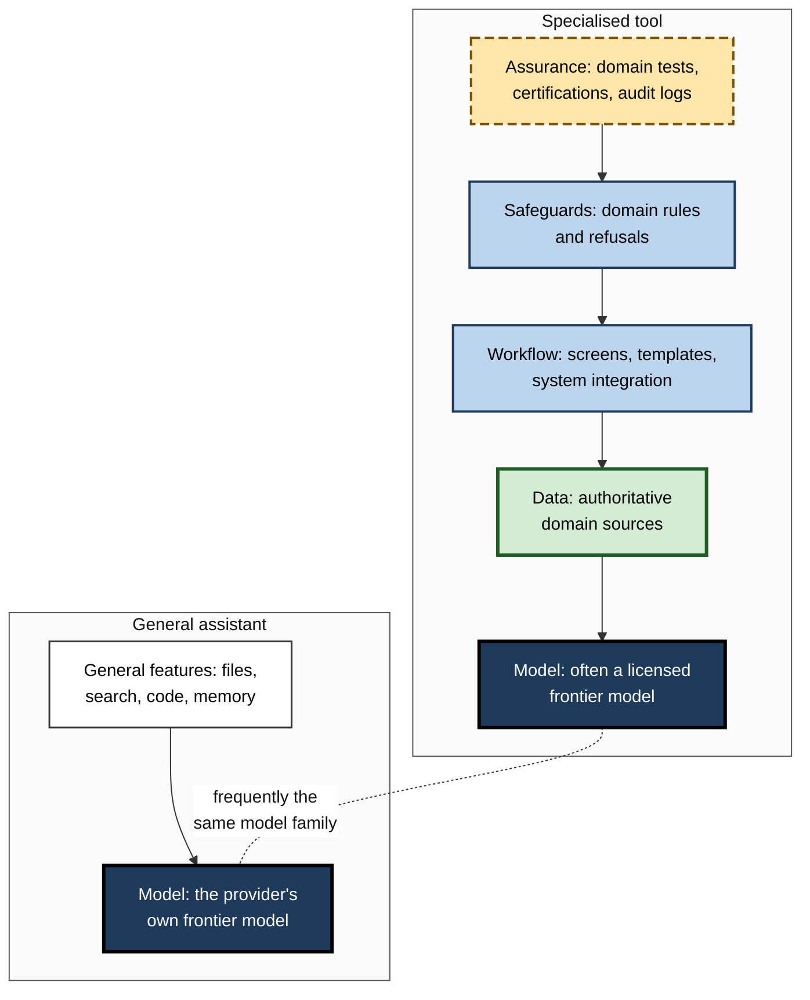
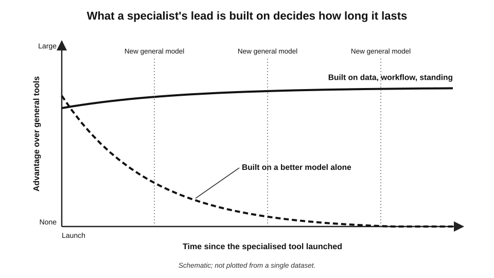
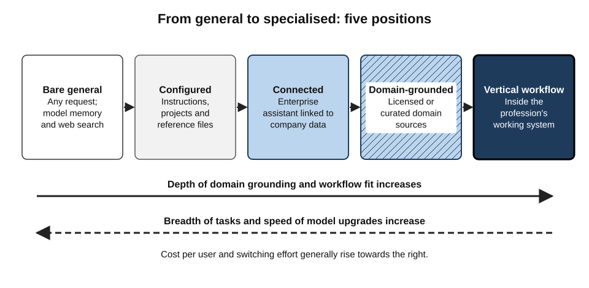
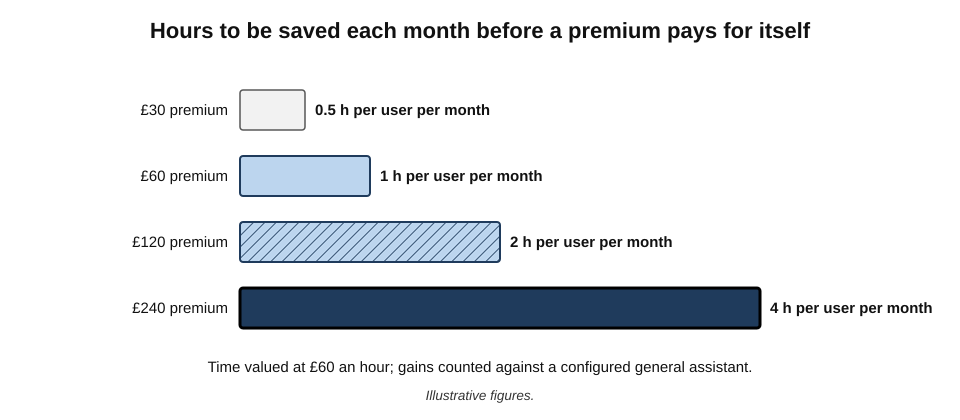
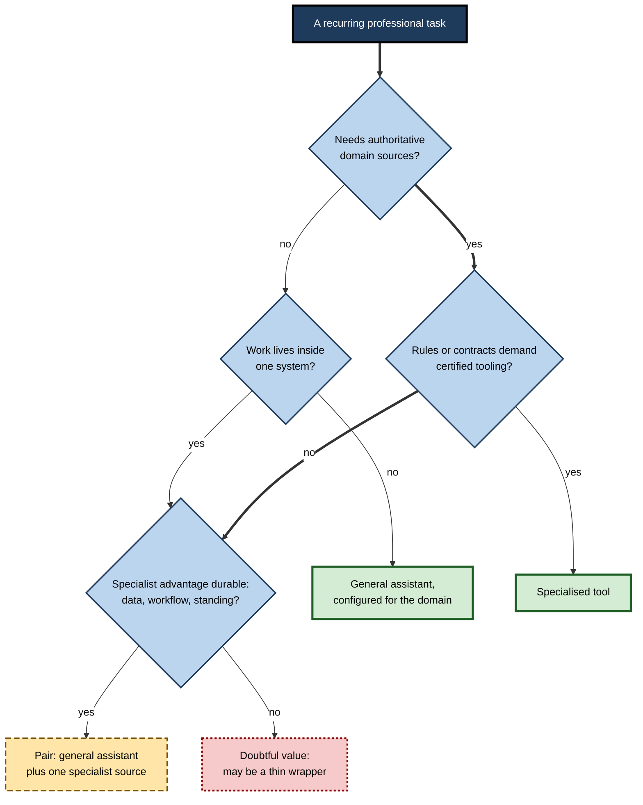

# C.2. General assistants versus specialised tools

A tax adviser asks a general chat assistant about a new capital-gains rule and gets a fluent, broadly sensible answer. A professional tax research service gives a narrower answer, tied to the legislation, the official guidance and the firm's subscribed commentary, with every source shown. The general tool knows a little about everything; the specialised tool knows its field's **records**, **formats** and **workflows**. Choosing between them is one of the most frequent and most expensive decisions in workplace AI.

> **Definition — General-purpose assistant:** an AI tool designed to accept almost any request in natural language, across subjects and formats, built on a broadly trained model and not tied to one profession's data or workflow.

> **Definition — Specialised AI tool:** an AI tool designed for one domain or function — such as law, tax, medicine, sales, software or design — that adds domain data, workflows, safeguards or integrations to an underlying model.

**Why the distinction matters**

- **Cost** — specialised tools frequently cost several times more per user than general assistants.
- **Risk** — in regulated professions, the source of an answer can matter as much as the answer.
- **Durability** — some specialised tools are overtaken when general assistants add the same feature; others become more valuable over time.
- **Workload** — a specialised tool that sits inside the system where the work is done can remove steps that a general assistant adds.

---

## What Each Kind of Tool Is Made Of

### The layers of an AI product

Most specialised tools are not built on a separate kind of intelligence. They are usually **layers** added to a model — often the same frontier model available in general assistants.

- **The model** — the underlying language model.
  - Frequently licensed from a major laboratory; sometimes adapted (fine-tuned) to the domain; occasionally trained from scratch.
- **The data layer** — the sources the tool draws on at the moment of use.
  - *e.g.* case law, statutes, clinical guidelines, a firm's precedent bank, a company's CRM records.
- **The workflow layer** — the screens, templates and steps built around the work.
  - *e.g.* a contract-review screen that compares a draft with the firm's standard positions clause by clause.
- **The safeguard layer** — domain-specific rules and checks.
  - *e.g.* refusing to give dosing advice without patient weight; flagging unsupported citations.
- **The assurance layer** — evidence and promises around the product.
  - Domain evaluations, regulatory certifications, contractual commitments, audit logs.

> **Definition — Wrapper:** a product whose main value is an interface placed around another company's model, adding little proprietary data, workflow or assurance.

**Figure 1.** The layers that distinguish a specialised tool from a general assistant.

> **Key point:** when a specialised tool and a general assistant use the **same model**, the difference between them lies entirely in the layers above it. Evaluating a specialised tool therefore means evaluating its **data, workflow, safeguards and assurance**, not its "intelligence".

### What general assistants bring

- **Breadth** — one tool for drafting, analysis, explanation, translation, coding and brainstorming.
- **Speed of improvement** — the providers of general assistants are usually the laboratories that build the models, so new capabilities appear there first.
- **Low cost per capability** — a standard paid subscription costs about the same as a monthly software licence; specialised professional tools often cost far more.
- **One interface to learn** — skills, prompts and habits carry across tasks.
- **Configurability** — projects, custom instructions, uploaded reference files and custom assistants let a user narrow a general tool towards a domain.

### What specialised tools bring

- **Authoritative grounding** — answers drawn from curated, current, licensed sources.
- **Citations that can be followed** — to the exact paragraph of the statute, guideline or record.
- **Domain formats** — clinical notes in the expected structure; contract mark-ups; financial statements.
- **Workflow position** — the tool sits where the work happens, inside the case-management, CRM, design or code system.
- **Domain safeguards and evaluations** — tested against the field's own failure modes.
- **Contractual and regulatory fit** — terms written for confidential professional data; certifications the profession expects.

| | General-purpose assistant | Specialised tool |
|---|---|---|
| Range of tasks | Very wide | Narrow, deep |
| Source of facts | Model memory, web search or files the user supplies | Curated domain sources and the organisation's own records |
| Speed of capability upgrades | Fastest — usually first with new models | Depends on the vendor's update cycle |
| Typical cost per user | Low to moderate | Moderate to high |
| Fit with professional workflow | Copy and paste between systems | Inside or connected to the system of record |
| Evidence of domain accuracy | General benchmarks | Domain evaluations, if the vendor publishes them |
| Main risk | Plausible but unsupported answers in specialist matters | Paying a premium for a thin layer that general tools soon match |

---

## Specialisation Across Professions

The pattern — a model plus domain layers — repeats across fields, but what the specialist adds differs.

- **Law** — research tools grounded in case law and legislation; contract-review tools that compare drafts with a firm's standard positions.
  - *Adds:* licensed legal content, citation trails, clause libraries.
  - *Still needs:* reading every cited authority.
- **Healthcare** — "ambient" clinical scribes that listen to a consultation and draft the clinical note; clinical decision-support tools.
  - *Adds:* medical vocabulary, note structures, connection to the electronic health record, contracts suited to patient data.
  - *Still needs:* clinician review of every note; local approval under health-data rules.
- **Software development** — coding assistants inside the editor and code repository.
  - *Adds:* awareness of the whole codebase, the ability to run tests, integration with review and deployment.
  - *Still needs:* code review and tests; attention to security flaws in generated code.
- **Sales and customer service** — assistants inside CRM and helpdesk systems.
  - *Adds:* the customer's history, product catalogues, approved response libraries, logging of every interaction.
  - *Still needs:* checks on promises made to customers.
- **Finance and accounting** — tools for reconciliation, audit sampling, financial research and tax.
  - *Adds:* connection to ledgers and market data, regulatory content, audit trails.
  - *Still needs:* recomputation of any figure that matters.
- **Design and media** — image, video and layout tools inside design suites.
  - *Adds:* brand assets, editable layers, licensing terms for commercial use of generated images.
  - *Still needs:* checks on likeness, trademarks and brand rules.
- **Human resources** — screening, policy question-answering and learning tools.
  - *Adds:* the organisation's policies, job architecture and employee records.
  - *Still needs:* fairness review; in many jurisdictions, legal limits on automated decisions about people.

> **Key point:** across professions, the specialist's value is highest where the work depends on **records the general tool cannot see** and **systems the general tool cannot act in**.

### Signs of a thin wrapper

- The vendor cannot say which model it uses, or says only "the best available".
- There is no proprietary or licensed data source, only "our prompts".
- The product's main feature is one that general assistants already offer (file upload, summarising, rewriting).
- There is no integration with the system where the work is done.
- Evaluation evidence consists of testimonials rather than tests.
- The price is justified by comparison with a person's salary rather than with a general assistant.

> **Watch out:** a thin wrapper is not always a bad purchase — a well-designed interface can save real time for a team that would never configure a general tool. But the buyer should know that they are paying for **convenience**, not for unique capability, and should keep contracts short.

---

## The Generalist's Long-Run Advantage

### The bitter lesson

- **Richard Sutton (2019), "The Bitter Lesson":** across seven decades of AI research, general methods that scale with computation and data have repeatedly overtaken methods built on hand-crafted domain knowledge.
  - Chess, Go, speech recognition and computer vision all followed the pattern.
- **Implication for tool choice:** a specialised tool whose advantage rests mainly on a **cleverer model** is vulnerable — the next general model may match it.

**Study card — BloombergGPT (Wu and colleagues, 2023)**

- **What was built:** Bloomberg trained a language model of about 50 billion parameters on a very large corpus of financial data combined with general text.
- **Initial result:** it outperformed general models of similar size on financial language tasks while remaining competent on general tasks.
- **What followed:** independent evaluations later in 2023 found that general frontier models such as GPT-4, which had not been trained specifically for finance, matched or exceeded it on many of the same financial tasks.
- **Lesson:** a domain-specific **model** gave a lead that a larger general model eroded within months; the durable assets were Bloomberg's **data and distribution**, not the model itself.

> **Watch out:** this does not mean specialised tools are always worse. It means that specialisation based on the **model alone** tends to be short-lived, while specialisation based on **data, workflow and assurance** can last.

### Why some specialisation lasts

- **Proprietary or licensed data** — a general model cannot cite a commercial legal database or a hospital's own records it has never seen.
- **Position in the workflow** — the tool is already where the work is done.
- **Regulatory standing** — certifications and contracts take years to obtain.
- **Domain evaluation** — the vendor knows the field's failure modes and tests for them.
- **Liability and accountability** — the vendor stands behind the tool's use in a defined professional context.

**Figure 2.** How a specialised tool's advantage evolves, depending on what it is built on.

> **Mnemonic — "Data, Desk, Docket, Diligence, Duty":** the five durable sources of specialist advantage — proprietary **data**, a place at the user's **desk** (workflow), regulatory **docket** (standing), domain **diligence** (evaluation) and accepted **duty** (liability).

---

## Specialist Does Not Mean Infallible

**Study card — Magesh and colleagues (2024), Stanford University**

- **Question:** do AI legal research tools built on curated legal databases avoid the invented citations that general chat assistants produce?
- **Design:** researchers posed over 200 legal research questions to leading commercial legal AI products and to a general-purpose model, and checked every answer against the law.
- **Earlier context:** a previous study by the same group (Dahl and colleagues, 2024) had found that general chat models answered a majority of specific, verifiable questions about US federal court cases incorrectly.
- **Findings:**
  - the specialised legal tools hallucinated **substantially less** than the general model;
  - but they still produced incorrect or misgrounded answers on roughly **one in six to one in three** queries, depending on the product;
  - a common failure was a correct-looking citation to a real case that **did not support** the proposition claimed.
- **Conclusion:** grounding in authoritative sources reduces but does not remove error; vendor claims of "hallucination-free" research were not borne out.

> **Definition — Misgrounding:** citing a real source that does not actually support the statement made.

> **Watch out:** vendors' error rates are contested — at least one vendor disputed the study's method, and products are updated frequently. The durable lesson is that **a citation must be read, not merely seen**. A specialised tool shifts the checking task from "does this case exist?" to "does this case say what is claimed?" — it does not remove it.

> **Key point:** specialised tools share the **underlying weaknesses** of the models they are built on. Their safeguards narrow the failure modes; the professional's review remains the final safeguard.

---

## The Middle Ground

The choice is rarely binary. Several arrangements sit between a bare general assistant and a dedicated vertical product.

- **Configured general assistant** — custom instructions, a project with uploaded reference documents, or a custom assistant built by the user.
  - Cheap and fast; grounded only in what the user supplies; quality depends on the user's set-up.
- **Enterprise general assistant with connectors** — a general assistant licensed by the organisation and connected to its document stores, email and business systems.
  - Grounded in the organisation's own data; still general in its behaviour and safeguards.
- **Domain-grounded tool** — a specialised product whose distinguishing feature is its licensed or curated source collection.
- **Vertical workflow product** — a tool embedded in a profession's working system with domain-specific screens and checks.
- **Specialist capabilities inside general tools** — connectors and plug-ins that let a general assistant call a specialised data source.
  - Increasingly common since open connection standards spread from 2024–25, blurring the boundary.

**Figure 3.** The spectrum from general to specialised tools.

> **In practice:** many professionals settle on a **pairing** — a general assistant for language and thinking work, and one specialised tool for the domain's authoritative sources — rather than a specialised tool for every task.

---

## The Economics of the Premium

A specialised tool must earn its extra cost on the **specific tasks it improves**, not on the whole job.

> **Formula — Break-even hours for a specialist premium:** extra cost per user per month ÷ value of one hour of the user's time = hours that must be saved (or errors avoided) each month. Illustrative example: a premium of £120 per user per month, for a professional whose time is valued at £60 an hour, breaks even at 120 ÷ 60 = **2 hours** saved per user per month on the tasks the specialist covers.

- **Count only incremental gains** — hours saved compared with the configured general assistant, not compared with working without AI.
- **Count avoided errors** — one prevented mis-citation in a filed document may be worth more than months of saved hours.
- **Count adoption** — a licence used twice a month saves nothing; specialist seats are often bought for whole teams and used by a few.
- **Count switching costs** — learning a second interface, maintaining two sets of instructions and templates.

**Figure 4.** Hours that must be saved each month to justify different specialist premiums, for time valued at £60 an hour.

> **In practice:** buyers commonly license specialised tools for the **subset of people** whose work concentrates on the specialist's tasks, then expand only if measured use and benefit justify it.

---

## Choosing Between Them

### The decisive questions

1. **Does the task depend on authoritative domain sources?**
   - If yes, a tool grounded in those sources usually wins, or the general assistant must be connected to them.
2. **Does the work happen inside a particular system?**
   - If the work lives in a CRM, a case-management system or a code repository, a tool inside it removes copy-and-paste steps and their risks.
3. **What do the profession's rules and the client's contracts require?**
   - Some contracts and regulators expect particular certifications, data locations or audit trails.
4. **How much of the work is general?**
   - If most tasks are drafting, summarising and explaining, a general assistant covers them; a specialist covers only a slice.
5. **What is the specialist's durable advantage?**
   - Data, workflow, standing, evaluation or liability — or just a model and an interface?
6. **What is the price gap, and what does it buy?**
   - Compare cost per user against hours saved and errors avoided in the specific tasks the specialist covers.

**Figure 5.** Deciding between a general assistant and a specialised tool.

### Questions to put to a specialised vendor

- **Which model or models does the product use, and who decides when they change?**
- **What sources does it draw on, how current are they, and can every claim be traced to one?**
- **What evaluation has been done on this domain's tasks, by whom, and are the results available?**
- **What happens to our data — retention, training, location, sub-processors?**
- **What does the product do that a general assistant with our own documents cannot?**
- **If the underlying model provider launches a similar feature, what remains distinctive?**

> **Remember:** a specialised vendor should be able to name its **model**, its **sources**, its **evaluations** and its **difference** in one conversation. Vagueness on any of the four is a warning sign.

---

## Worked Example (illustrative): A Tax Team Weighs Its Options

*Names, organisations and numbers in this example are illustrative figures.*

**Situation:** a 12-person tax team at a mid-sized accountancy firm already has an enterprise general assistant licensed firm-wide. A tax research vendor offers a specialised AI tool at a price well above the general licence per user per year. The team lead scores both against the team's own tasks.

**Step 1 — weight the criteria by the team's real work**

| Criterion | Weight | General assistant (score 1–5) | Specialised tax tool (score 1–5) |
|---|---|---|---|
| Accuracy on tax-law questions, with sources | 30% | 2 | 4 |
| Drafting client letters and memos | 20% | 5 | 3 |
| Fit with research workflow (citations, updates) | 20% | 2 | 5 |
| Breadth across other tasks | 10% | 5 | 1 |
| Data terms suitable for client data | 10% | 4 | 4 |
| Cost | 10% | 5 | 2 |

**Step 2 — compute weighted scores**

> **Formula — Weighted score:** Σ (weight × score). General assistant: 0.3×2 + 0.2×5 + 0.2×2 + 0.1×5 + 0.1×4 + 0.1×5 = 0.6 + 1.0 + 0.4 + 0.5 + 0.4 + 0.5 = **3.4**. Specialised tool: 0.3×4 + 0.2×3 + 0.2×5 + 0.1×1 + 0.1×4 + 0.1×2 = 1.2 + 0.6 + 1.0 + 0.1 + 0.4 + 0.2 = **3.5**.

**Step 3 — interpret**

- The totals are almost tied, which signals that **neither tool alone** fits the team's mix of work.
- The specialist wins clearly on the two research criteria; the general assistant wins on drafting, breadth and cost.
- **Decision:** buy specialised-tool licences for the **six** members who do most technical research; keep the general assistant for everyone; use the specialist's citations as the input to general-assistant drafting.

**Step 4 — check the result**

- Trial both on twenty real past questions with known answers before committing.
- Revisit after a year: has the general assistant gained connectors to the same sources?

> **Watch out:** weighted scores look precise but rest on judgement. Small changes in weights can flip the result, so a **near-tie** should prompt a mixed solution or a real trial, not a decision by decimal point.

---

## Case Study: A Global Law Firm Adopts a Specialised Assistant

- **Situation:** in February 2023 the international law firm Allen & Overy announced a firm-wide deployment of Harvey, a legal AI assistant built on OpenAI's models and adapted for legal work.
- **Trial:** before the announcement, around 3,500 lawyers across the firm's offices had tested it, putting tens of thousands of queries to it during a pilot.
- **What the specialised layer provided:**
  - legal-task workflows (contract analysis, due diligence, research memos, drafting);
  - adaptation to legal language and the firm's own work product;
  - security and confidentiality arrangements negotiated for a law firm's client data;
  - a vendor focused on legal practice and its regulators' concerns.
- **What it did not change:**
  - the firm stated that output must be **reviewed by a lawyer** — the tool was an assistant, not an adviser;
  - the underlying model's tendencies remained, so verification stayed mandatory.
- **What followed in the market:**
  - other large firms and professional-services networks adopted the same or rival specialised tools;
  - general assistants simultaneously added enterprise data terms, document handling and connectors, narrowing part of the gap;
  - specialised legal vendors increasingly competed on **workflow, firm-data integration and legal content partnerships** rather than on the model.
- **Lesson:** the specialised tool was chosen for its **workflow, data arrangements and professional fit**, built on a general model. Its durable value depended on those layers continuing to outrun what general assistants offered.

> **In practice:** large firms commonly run **both**: a general assistant for everyday language work across the whole organisation, and specialised tools for the practice areas whose sources and workflows justify the premium.

---

## Mastery: How Experienced Buyers Judge

- **They look past the model.** "Built on the latest model" is not a differentiator when every competitor can license the same one.
- **They ask what the vendor owns.** Proprietary data, workflow position, certifications and domain evaluations are hard to copy; prompts and interfaces are not.
- **They test on their own hard cases.** Vendor demonstrations use favourable examples; a team's past difficult questions reveal the real gap.
- **They price the specialist against the configured generalist,** not against the bare general assistant — a general tool with the team's own documents attached is the true alternative.
- **They plan for convergence.** Contracts of one year rather than three, with the right to reduce seats, preserve the option to switch when general tools catch up.
- **They keep the human checking step regardless.** Specialised tools change the nature of verification rather than removing it.

> **Watch out:** professionals sometimes trust a specialised tool **more** than its evidence justifies precisely because it is specialised. A legal, medical or financial label on the box is a claim about design, not a guarantee of accuracy.

---

## Open Questions

- **Will general assistants absorb most specialised tools?**
  - Connectors to licensed sources and enterprise data are narrowing the gap; whether specialised vendors survive mainly as data providers inside general tools is unresolved.
- **How should domain accuracy be compared fairly?**
  - Published domain evaluations are few, often vendor-run, and quickly outdated by product updates.
- **Does specialisation improve safety or only appearance?**
  - Domain safeguards reduce some errors, but users' greater trust may offset the gain; the net effect is not well measured.
- **Who is accountable when a specialised tool errs?**
  - Vendor contracts usually place responsibility on the professional; how courts and regulators will apportion it is still developing.
- **Will domain-trained models return?**
  - Smaller models trained on specialised data are cheaper to run and may suit private deployment; whether they regain an accuracy lead is an open technical question.

---

## Summary

- **General assistants** handle almost any request; **specialised tools** add domain data, workflow, safeguards and assurance to a model — often the same model.
- Evaluate a specialised tool by its **layers above the model**: data, workflow, safeguards, assurance.
- General tools offer **breadth, fast upgrades, low cost and one interface**; specialists offer **authoritative grounding, followable citations, domain formats, workflow position and regulatory fit**.
- **The bitter lesson** (Sutton, 2019) and the **BloombergGPT** episode show that model-based specialisation erodes quickly; specialisation based on **data, workflow, standing, evaluation and liability** lasts.
- **Specialist is not infallible:** legal research tools hallucinated less than a general model but still erred on roughly one in six to one in three queries; **misgrounding** remains.
- A **middle ground** — configured or connected general assistants — often competes with specialists.
- Decide by asking about sources, system location, rules, share of general work, durable advantage and price gap; ask vendors to name **model, sources, evaluations and difference**.
- A **near-tie** in weighted scoring usually points to a pairing, confirmed by a trial.
- Large organisations commonly run **both** kinds of tool.

---

## Self-Check

1. Define a general-purpose assistant and a specialised AI tool.
2. Name the five layers of an AI product and say which usually distinguish a specialised tool.
3. What is a "wrapper", and why is it a risky purchase?
4. Summarise "The Bitter Lesson" and its implication for specialised AI tools.
5. What happened with BloombergGPT, and what was the durable lesson?
6. What did the 2024 study of legal research tools find, and what is misgrounding?
7. List five durable sources of specialist advantage.
8. Describe three arrangements in the middle ground between general and specialised tools.
9. Give six questions to put to a specialised vendor.
10. Recompute the tax team's weighted scores if accuracy on tax-law questions is weighted 40% and cost 0%. Which tool wins?
11. Why might a near-tie in weighted scoring lead to a mixed solution?
12. In the Allen & Overy case, what did the specialised layer provide and what did it not change?
13. A sales team is offered a specialised "AI sales email" tool that uses a frontier model, has no CRM connection and costs five times the general assistant. Assess it.
14. Why might professionals over-trust specialised tools, and how should a team counter this?

### Answer Key

1. A general assistant accepts almost any natural-language request across subjects, built on a broadly trained model and not tied to one profession. A specialised tool serves one domain or function, adding domain data, workflow, safeguards or integrations to a model.
2. Model, data, workflow, safeguards, assurance. The upper four usually distinguish a specialised tool, because the model is often licensed from the same laboratories.
3. A product whose value is mainly an interface around someone else's model. It is risky because a general assistant can add the same feature quickly, leaving the buyer paying a premium for little.
4. General methods that scale with computation and data have repeatedly beaten hand-crafted domain approaches. Specialised tools whose edge is a cleverer model are vulnerable to the next general model.
5. Bloomberg trained a finance-focused model that beat similar-sized general models on finance tasks; larger general models soon matched or exceeded it. The durable assets were data and distribution, not the model.
6. Specialised legal tools hallucinated substantially less than a general model but still erred on roughly one in six to one in three queries. Misgrounding is citing a real source that does not support the claim.
7. Proprietary data, workflow position, regulatory standing, domain evaluation, liability and accountability.
8. Any three of: configured general assistant (instructions, projects, files); enterprise assistant with connectors; domain-grounded tool; vertical workflow product; specialist data sources connected into a general assistant.
9. Which model, and who controls changes? What sources, how current, traceable? What domain evaluations, by whom? What data terms? What can it do that a general assistant with our documents cannot? What remains distinctive if the model provider adds the feature?
10. Remaining weights: accuracy 40%, drafting 20%, workflow 20%, breadth 10%, data 10% (total 100%). General: 0.8 + 1.0 + 0.4 + 0.5 + 0.4 = 3.1. Specialist: 1.6 + 0.6 + 1.0 + 0.1 + 0.4 = 3.7. The specialist wins — showing how sensitive the result is to weights.
11. A near-tie means each tool is strong on different criteria; the team's work is mixed, so allocating each tool to the tasks it wins usually beats choosing one.
12. It provided legal workflows, legal adaptation, negotiated confidentiality and security, and a legal-focused vendor. It did not remove the need for lawyer review or the underlying model's tendencies.
13. It looks like a wrapper: same model as general assistants, no proprietary data or workflow position, high price. A configured general assistant would likely do as well; at most, trial it against the general tool on real emails.
14. The domain label signals design intent, which is mistaken for proven accuracy. Counter by testing on the team's hard cases, requiring citation reading, and keeping mandatory review regardless of tool.

---

## Glossary

| Term | Meaning |
|---|---|
| Assurance layer | Evaluations, certifications, contracts and logs that support trust in a tool. |
| Bitter lesson | Sutton's observation that general, scalable AI methods overtake hand-crafted domain approaches. |
| Configured general assistant | A general assistant narrowed by instructions, projects or uploaded reference files. |
| Connector | A link that lets an AI tool read from or act in another system or data source. |
| Data layer | The sources a tool draws on at the moment of use. |
| Domain evaluation | Testing an AI tool on the tasks and failure modes of a particular field. |
| Fine-tuning | Further training of a model on specialised examples to adapt its behaviour. |
| Frontier model | One of the most capable general models available at a given time. |
| General-purpose assistant | An AI tool that accepts almost any request across subjects and formats. |
| Misgrounding | Citing a real source that does not support the statement made. |
| Specialised AI tool | An AI tool built for one domain, adding data, workflow, safeguards or integrations to a model. |
| Vertical workflow product | A specialised tool embedded in a profession's working system. |
| Weighted scoring | Rating options on criteria multiplied by importance weights and summed. |
| Workflow layer | The screens, templates and steps built around a particular kind of work. |
| Wrapper | A product adding little beyond an interface around another company's model. |
