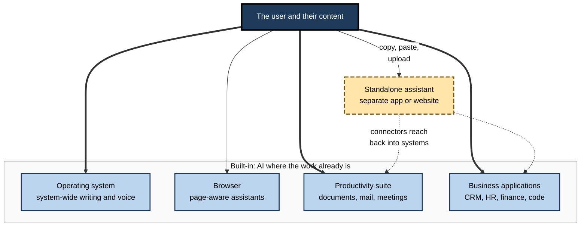
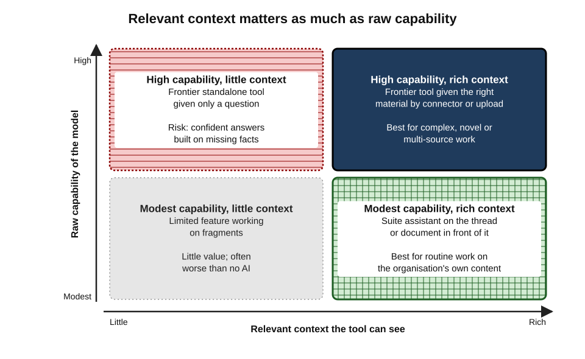
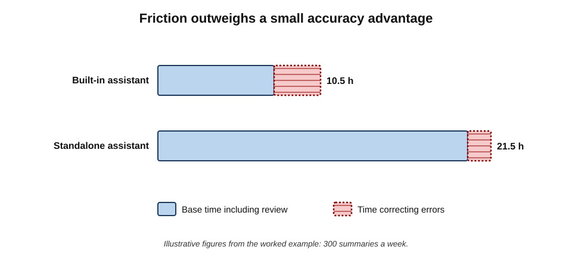
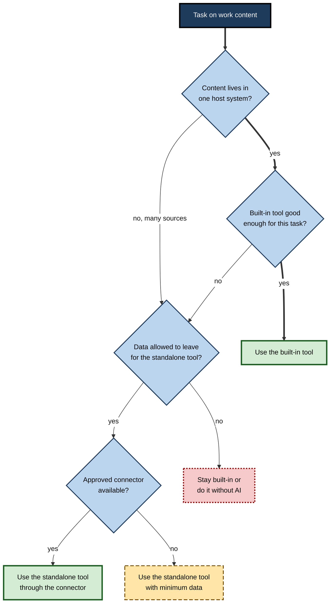
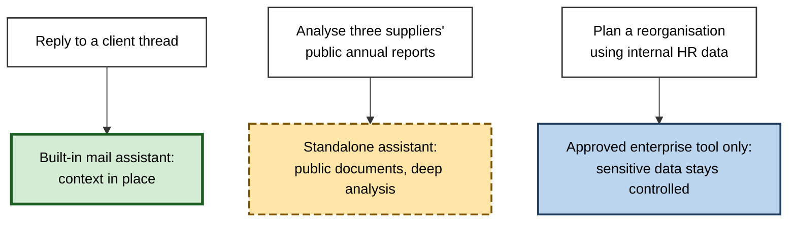

# C.3. Built-in versus standalone tools

A project manager needs a summary of a long email thread. She can press the assistant button inside her email program, which already sees the thread, or copy the thread into a separate chat assistant in another browser tab. The first route takes one click and keeps the data where it is; the second takes several steps, moves the data elsewhere, and may give a better answer. Every day, millions of such small choices decide whether AI at work is **convenient and contained** or **capable but scattered**.

> **Definition — Built-in AI tool:** an AI feature embedded in software people already use — an office suite, email client, operating system, browser, CRM or design program — that works on the content and context inside that software.

> **Definition — Standalone AI tool:** an AI tool used as a separate application or website, to which the user brings content by typing, pasting, uploading or connecting.

**Why the choice matters**

- **Context** — built-in tools see the document, thread or record; standalone tools see only what they are given.
- **Data movement** — standalone use usually moves content out of its home system; built-in use usually does not.
- **Capability** — standalone assistants often reach new model capabilities first; built-in features may lag or be narrower.
- **Cost** — built-in AI is increasingly bundled into software subscriptions, while standalone tools are separate purchases.
- **Governance** — built-in tools inherit the organisation's existing administration; standalone tools add a new vendor to manage.

---

## Where AI Lives

### The layers of embedding

AI features now appear at almost every layer of the digital workplace.

- **Operating system** — assistants and writing tools available across all applications on a computer or phone.
  - *e.g.* system-wide writing tools, on-device transcription, assistants invoked by a key.
- **Browser** — assistants that read the page being viewed, and AI-first browsers that can navigate and act on websites.
- **Productivity suite** — assistants inside word processors, spreadsheets, presentations, email and meetings.
- **Line-of-business application** — assistants inside CRM, HR, finance, service-desk, design and code systems.
- **Standalone assistant** — a separate chat application or website, possibly with connectors that reach back into the other layers.

**Figure 1.** The layers at which AI tools are offered in the digital workplace.

> **Key point:** the boundary is blurring from both sides. Built-in assistants add general chat; standalone assistants add **connectors** into email, files and business systems. The useful question is less "built-in or standalone?" than "**where does the data sit, and where does the work happen?**"

---

## What Built-in Tools Offer

- **Context without effort**
  - The tool already sees the document, the email thread, the meeting transcript or the customer record.
  - Grounded context reduces invented details, because the facts are present.
- **No copy-and-paste**
  - Fewer steps; fewer chances to paste the wrong thing into the wrong place.
- **Data stays at home**
  - Content is processed under the same vendor agreement that already covers the software.
- **Inherited permissions**
  - The assistant can usually see only what the user is already allowed to open.
- **Existing administration**
  - IT teams switch features on or off, set policies and review logs through consoles they already run.
- **Output lands in place**
  - A drafted reply appears in the reply window; a formula appears in the cell; a slide appears in the deck.
- **Bundled or incremental cost**
  - Increasingly included in the subscription, or sold as an add-on to an existing contract.

> **Definition — Permission inheritance:** the principle that an embedded AI assistant can access only the content the user is already permitted to access in the host system.

> **Watch out:** permission inheritance protects only as well as the permissions themselves. Where folders and sites have been over-shared for years, an embedded assistant makes that hidden exposure **searchable in seconds**. Organisations commonly tidy sharing settings and label confidential content before enabling suite assistants.

---

## What Standalone Tools Offer

- **The capability frontier**
  - The laboratories that build models usually release new capabilities first in their own assistants.
- **Breadth across systems**
  - One tool works on content from anywhere: a PDF from a client, a web page, a spreadsheet, a photo of a whiteboard.
- **Power features**
  - Long-running research modes, code execution, data analysis, custom assistants, extended reasoning.
- **Choice and independence**
  - The user can pick the best assistant for a task, regardless of which office suite the employer uses.
- **A thinking space separate from the document**
  - Exploring an argument or plan without cluttering the working file.

> **Watch out:** a standalone tool sees **only what it is given**. Asked about "the attached contract" that was never attached, or about "our latest figures", it may fill the gap with plausible inventions. Missing context is one of the commonest causes of confident but wrong answers.

| | Built-in tool | Standalone tool |
|---|---|---|
| Context available | The current document, thread, record — and often the user's wider work data | Only what the user supplies or connects |
| Data movement | Usually stays within the host system's agreement | Leaves the host system by paste, upload or connector |
| Capability | Varies; sometimes a step behind the frontier, often narrower | Usually closest to the provider's latest capabilities |
| Steps per task | Few | More — open, paste, prompt, copy back, reformat |
| Governance | Inherits existing administration and logging | A separate vendor, account and policy to manage |
| Cost pattern | Bundled or an add-on per seat | Separate subscription per user |
| Typical weakness | Exposes over-shared data; features switched on by default | Shadow use; data leaves controlled systems; missing context |

---

## The Context–Capability Trade-off

The choice can be pictured on two dimensions: how much **relevant context** the tool has, and how much **raw capability** it brings.

- **High context, moderate capability** — a suite assistant summarising the thread in front of it.
- **Low context, high capability** — a frontier standalone assistant given nothing but a question.
- **High context, high capability** — a frontier assistant given the right material, by connection or upload; or an embedded assistant built on a frontier model.
- **Low context, low capability** — an old or limited feature working on fragments.

**Figure 2.** For most workplace tasks, relevant context matters as much as raw capability.

> **Key point:** for routine tasks on the organisation's own content — summarising, drafting replies, finding what was agreed — **context usually beats capability**. For novel analysis, complex reasoning or work across many sources, capability matters more, provided the context can be supplied safely.

---

## Friction and the Copy-and-Paste Tax

### Counting the steps

- **Built-in route** — select, click the assistant, review, accept.
- **Standalone route** — open the tool, sign in, copy the content, paste, write the instruction, wait, copy the answer, return, paste, reformat, remove stray formatting.
- Each step costs seconds; across hundreds of uses a week in a team, the difference becomes hours.

> **Definition — Copy-and-paste tax:** the time, errors and data exposure created by moving content manually between a work system and a separate AI tool.

### Worked example (illustrative): summarising client email threads

*Names, organisations and numbers in this example are illustrative figures.*

**Situation:** a 20-person account team summarises about 15 client email threads each per week. Two routes are timed on a sample of real threads.

| | Built-in assistant | Standalone assistant |
|---|---|---|
| Steps per summary | 4 | 11 |
| Median time per summary (including review) | 1.5 minutes | 4 minutes |
| Summaries needing correction | 2 in 10 | 1 in 10 |
| Time to correct one summary | 3 minutes | 3 minutes |

**Step 1 — expected time per summary**

> **Formula — Expected time per task:** base time + (correction rate × correction time). Built-in: 1.5 + (0.2 × 3) = **2.1 minutes**. Standalone: 4 + (0.1 × 3) = **4.3 minutes**.

**Step 2 — scale to the team**

- 20 people × 15 summaries = 300 summaries a week.
- Built-in: 300 × 2.1 = 630 minutes ≈ **10.5 hours**.
- Standalone: 300 × 4.3 = 1,290 minutes ≈ **21.5 hours**.

**Step 3 — interpret**

- The standalone tool is **more accurate** on this sample but still **slower** once friction is counted.
- The built-in route wins on time and keeps client data within the existing email agreement.
- The standalone route might win for the hardest threads, where accuracy matters most.

**Figure 3.** Weekly team hours for the two routes in the worked example.

> **Watch out:** timings like these are specific to one team, one tool version and one task. The method — count steps, time a real sample, include correction — transfers; the numbers do not.

---

## Defaults, Bundles and the Pull of the Built-in

### The power of defaults

**Study card — Madrian and Shea (2001)**

- **Setting:** a large US company changed its retirement-savings plan so that new employees were **enrolled automatically** unless they opted out, instead of having to opt in.
- **Finding:** participation among new employees rose dramatically — from roughly a third under opt-in to the large majority under automatic enrolment — and most stayed with the **default contribution rate and fund**, even when it was not the best choice for them.
- **Conclusion:** defaults shape behaviour powerfully, because choosing otherwise requires effort, attention and a sense that the default is not recommended.

> **Definition — Status quo bias (Samuelson and Zeckhauser, 1988):** a tendency to prefer the current or default option, beyond what its merits justify.

- **Implication for AI tools:**
  - The assistant that appears inside the program already open will be used most, whether or not it is best for the task.
  - Defaults favour built-in tools — which is often good (data stays home) but can lock in a weaker tool through inertia rather than choice.

### Bundling

- **What happened:** from 2024–25 the major office-suite providers moved AI from separately priced add-ons towards inclusion in standard plans.
  - In January 2025 Google folded its Gemini features into Workspace business plans, alongside a modest rise in per-seat prices.
  - In the same month Microsoft added Copilot features to consumer Microsoft 365 Personal and Family plans, also with a price rise; organisational Microsoft 365 Copilot remained a paid add-on, with a lower-priced business version for smaller organisations by 2026.
- **Effects of bundling:**
  - the marginal cost of the built-in assistant appears to be zero, though the bundle price has risen;
  - the standalone tool must justify a **separate** budget line;
  - organisations may pay for AI they do not use.

> **Definition — Bundling:** selling several products together for one price, so that the cost of each component is no longer visible separately.

> **Example — an earlier precedent:** Microsoft's inclusion of Teams in its Office suites drew a complaint from Slack to the European Commission in 2020. Microsoft began selling the suites without Teams in 2023–24, and in 2025 the Commission accepted Microsoft's commitments to keep them available separately. The episode shows how a bundled "free" tool can displace a standalone rival regardless of which is better — a dynamic now repeating with AI assistants.

> **Key point:** a bundled assistant is not free — its cost sits inside the subscription. The real choice is whether the bundled tool, used well, does enough of the work to make an extra standalone purchase unnecessary.

---

## Risks Particular to Each Route

### Built-in risks

- **Over-exposure of existing data** — the assistant surfaces content nobody realised was accessible.
- **Features switched on by default** — new AI functions arrive through routine updates, sometimes before policy has caught up.
- **Ambient capture** — operating-system or meeting features that record or index activity continuously.
  - *e.g.* in 2024 Microsoft's Recall feature, which captured periodic snapshots of a PC's screen to make past activity searchable, was criticised by security researchers; Microsoft delayed it and made it opt-in before release.
- **Weaker capability unnoticed** — users assume the button in their software is "the AI" and never learn that a better tool exists for harder tasks.
- **Lock-in through convenience** — the deeper the assistant is woven into one suite, the harder it is to change suites.

### Standalone risks

- **Data leaving controlled systems** — pasted client documents may fall under consumer terms with weaker protections.
- **Shadow use** — staff choosing their own tools on personal accounts outside the organisation's knowledge.
- **Missing context** — confident answers built on gaps.
- **Fragmented records** — useful prompts, drafts and conversations scattered across personal accounts.

### Browser and agent risks

- **AI browsers and page-aware assistants** read the web pages a user visits and can act on them.
- **Prompt injection** — instructions hidden in a web page or document can redirect an assistant that reads it.
  - A risk for any tool that reads untrusted content, but sharper when the tool can click, fill forms or send messages.

> **Definition — Prompt injection:** an attack in which text inside content processed by an AI tool contains instructions that override or subvert the user's intended instructions.

> **Watch out:** a tool's position in the software stack changes **what it can see and do** — and therefore what a failure costs. An assistant that can read every open tab, or act in a logged-in email account, needs more caution than one that only rewrites a selected paragraph.

---

## Choosing Between Them

### Questions that decide the route

1. **Where does the content already live?**
   - If it is in the host system and the task concerns it, start with the built-in tool.
2. **Does the task need capability beyond what the built-in tool offers?**
   - Complex reasoning, long research, data analysis, novel drafting may justify a standalone tool.
3. **Is the data permitted to leave the host system for this tool?**
   - Check the organisation's rules and the standalone tool's terms before pasting.
4. **How often is the task repeated?**
   - Frequent tasks magnify friction; a slightly weaker but frictionless built-in tool may win.
5. **Is there a connected option?**
   - An approved standalone assistant with an approved connector can combine capability with context, and avoid copy-and-paste.

**Figure 4.** A decision path for choosing between built-in and standalone AI tools.

> **Remember:** **built-in by default for work on the content in front of you; standalone by exception for capability you genuinely need — and only for data allowed to travel.**

---

## Evaluating Each Kind of Tool

The two routes call for different questions, because their weaknesses lie in different places.

### Questions for a built-in tool

- **Which model powers it, and does that change?**
  - Suite vendors may route requests to different models, sometimes their own, sometimes a partner's, and change the mix without notice to users.
- **What can it reach?**
  - Only the open document, or the user's entire mailbox, drive, chat history and calendar?
- **What does it do with what it reaches?**
  - Is content processed only for the request, or indexed, stored, or used to improve the service?
- **Can it be scoped or switched off?**
  - By user, by group, by feature, by sensitivity label.
- **What is logged and for how long?**
  - Prompts and responses may become records subject to retention policies, legal holds and disclosure requests.
- **How do new features arrive?**
  - Through routine updates, often enabled by default; an organisation needs a way to review them before staff meet them.

### Questions for a standalone tool

- **Is there a business or enterprise tier,** with organisational accounts rather than personal ones?
- **Does it support single sign-on** and central removal of accounts when people leave?
- **Do the business terms exclude training on customer content** and set a clear retention period?
- **Are connectors available and approved,** so that pasting can be avoided?
- **Can work be exported** — conversations, custom assistants, project files — if the organisation changes tool?
- **Is usage visible to administrators,** so that cost and risk can be managed?

> **Definition — Single sign-on (SSO):** an arrangement in which staff log in to many applications with one organisational identity, so that access can be granted and withdrawn centrally.

> **Mnemonic — "Model, Reach, Retain, Switch, Log, Update":** the six questions for a built-in tool.

> **In practice:** a standalone tool used on **personal accounts** cannot be governed — the organisation cannot see it, configure it or remove access when someone leaves. Moving standalone use onto organisational accounts is usually the first step in bringing it under control.

---

## The Organisation's View

### Why organisations often favour built-in first

- **One vendor, one contract** — data terms already negotiated.
- **Administration and audit** — existing consoles, logs and retention rules extend to the assistant.
- **Training scale** — staff learn one assistant inside tools they already use.
- **Lower shadow-use pressure** — when a capable tool is one click away, fewer people paste data into personal accounts.

### Why they add standalone tools anyway

- **Capability gaps** — some roles (analysts, developers, researchers) need frontier capabilities.
- **Multi-system work** — tasks that cross several systems are awkward inside any one suite.
- **Vendor concentration risk** — relying on one suite provider for all AI increases dependence on its pricing and roadmap.

> **In practice:** a common enterprise pattern by 2025–26 was a **"suite assistant for everyone, standalone assistant for some"** — the embedded assistant licensed widely or bundled, with an enterprise standalone assistant licensed for roles whose work justified it.

### Same brand, different products

- **One name often covers several products** with different capabilities and terms.
  - *e.g.* Microsoft's free consumer Copilot differs from the paid Microsoft 365 Copilot licensed by organisations; Google's Gemini app differs from Gemini inside a Workspace business account; a consumer ChatGPT account differs from an organisation's ChatGPT Business or Enterprise workspace.
- **What differs between them:**
  - whether the tool can see organisational data;
  - whether content may be used to train models;
  - who administers the account and can see its logs;
  - which contractual protections apply.
- **What decides which applies:** the **account the user is signed in with**, not the brand on the screen.

> **Watch out:** a common and costly confusion is to assume that because the employer licenses "Copilot" or "Gemini", any version of it is approved. A personal account on the same brand, opened in another browser profile, carries **consumer** terms and sits outside the organisation's controls.

> **Remember:** check the **account**, not the logo — organisational sign-in is what turns a familiar brand into an approved built-in or enterprise tool.

### Case study: a government-wide trial of a suite assistant

- **Situation:** from September to December 2024 the UK government ran a cross-government experiment giving about **20,000 civil servants** in a dozen organisations access to Microsoft 365 Copilot inside their existing office software.
- **What was measured:** surveys of time saved, task types, satisfaction, plus case studies.
- **Reported results (published 2025):**
  - participants reported saving an average of around **26 minutes a day**;
  - the largest reported gains were in drafting, summarising and searching existing documents — tasks where the built-in tool had the content in front of it;
  - a large majority said they did not want to give the tool back.
- **Caveats:**
  - time savings were **self-reported**, not measured against a control group;
  - a separate, smaller departmental evaluation reported high satisfaction but did not find clear evidence of productivity improvement;
  - gains depended on training and on the quality of the underlying document estate.
- **Lesson:** built-in assistants shine on **context-rich, routine** tasks inside the suite; their measured value needs measurement methods stronger than self-report, and a tidy information estate to work on.

> **Watch out:** self-reported time savings from AI trials tend to be **optimistic** — people overestimate how much faster they work with a tool they like. Treat them as an upper bound until confirmed by timed or output-based measures.

---

## Mastery: How Experienced Users Combine Routes

- **They default to the built-in tool for in-place work** and know its limits precisely.
- **They move to a standalone tool deliberately**, carrying only the minimum content needed.
- **They supply context explicitly** when using a standalone tool — the document, the definitions, the constraints — rather than assuming the tool knows.
- **They prefer connectors to pasting** where the organisation has approved them.
- **They check what is switched on** — new built-in features in their software after each update, and the data each can reach.
- **They watch for convergence** — when the built-in tool gains a capability, they retire the standalone workaround for that task.

**Figure 5.** How an experienced user routes three kinds of task.

---

## Open Questions

- **Will the distinction survive?**
  - Built-in tools are gaining frontier models and general chat; standalone tools are gaining connectors. The boundary may become a matter of interface rather than capability.
- **Who should own the user's AI context?**
  - If one suite holds all of a person's mail, files, meetings and assistant history, switching providers becomes very hard; whether open standards for context will prevent this is unclear.
- **How should bundled AI be valued?**
  - Organisations struggle to measure whether bundled features justify price rises when they cannot be bought or refused separately.
- **How safe are assistants that act?**
  - Agents built into browsers and operating systems can take actions on the user's behalf; defences against prompt injection remain incomplete.
- **What is the right measure of benefit?**
  - Self-reported time saved, the dominant measure in public trials, is known to be optimistic; affordable objective measures are still being developed.

---

## Summary

- **Built-in tools** work inside existing software on the content in front of the user; **standalone tools** work on what the user brings.
- AI now sits at every layer: **operating system, browser, suite, business application** and standalone assistant — and connectors are blurring the boundary.
- Built-in strengths: **context, no copy-and-paste, data stays home, permission inheritance, existing administration, bundled cost**.
- Standalone strengths: **frontier capability, breadth across systems, power features, independence**.
- For routine work on the organisation's own content, **context usually beats capability**.
- The **copy-and-paste tax** can outweigh a standalone tool's accuracy advantage; count steps, time a real sample, include correction.
- **Defaults and bundling** pull use towards built-in tools — helpful for data control, risky when inertia preserves a weaker tool.
- Built-in risks: **over-shared data, default-on features, ambient capture, convenience lock-in**. Standalone risks: **data leaving, shadow use, missing context, fragmented records**. Acting assistants add **prompt injection**.
- A common pattern: **suite assistant for everyone, standalone for some**, with connectors preferred over pasting.
- Large public trials report substantial **self-reported** savings; objective measures are weaker and scarcer.

---

## Self-Check

1. Define built-in and standalone AI tools, with one example of each.
2. List the five layers at which AI tools are offered.
3. What is permission inheritance, and why can it expose data?
4. Give four strengths of built-in tools and four of standalone tools.
5. Explain the context–capability trade-off and when each dimension matters more.
6. What is the copy-and-paste tax?
7. Recompute the worked example if the built-in tool needed correction on 4 in 10 summaries. Which route is faster?
8. Summarise the Madrian and Shea study and its relevance to AI tools.
9. Why is a bundled AI assistant "not free"?
10. What does the Teams bundling episode illustrate?
11. Name two risks specific to built-in tools and two specific to standalone tools.
12. What is prompt injection, and why is it more serious for assistants that can act?
13. What were the main findings and caveats of the 2024 UK government suite-assistant experiment?
14. A consultant wants to analyse a client's confidential financial model in a personal standalone assistant because the built-in tool "is not clever enough". Advise.

### Answer Key

1. Built-in: an AI feature inside existing software working on its content (*e.g.* an email client's summarise button). Standalone: a separate AI application to which content is brought (*e.g.* a chat assistant website).
2. Operating system, browser, productivity suite, business applications, standalone assistant.
3. The embedded assistant can access only what the user may already open. If permissions are too loose, it makes over-shared confidential content easy to find.
4. Built-in: context, no copy-and-paste, data stays in the host agreement, inherited permissions, existing administration, output in place, bundled cost. Standalone: frontier capability, breadth across systems, power features, independence, a separate thinking space.
5. Context is the relevant material the tool can see; capability is its raw skill. Routine tasks on own content favour context; novel, complex or multi-source analysis favours capability, if context can be safely supplied.
6. The time, errors and data exposure created by moving content manually between systems and a separate AI tool.
7. Built-in: 1.5 + 0.4 × 3 = 2.7 minutes; standalone 4.3 minutes. The built-in route is still faster (810 versus 1,290 minutes a week), though the gap narrows.
8. Automatic enrolment in a retirement plan sharply raised participation, and most people kept the default settings. Similarly, the AI assistant that appears by default will be used most, regardless of whether it is best.
9. Its cost is folded into the subscription price, which has typically risen; the organisation pays whether or not the feature is used.
10. That a bundled tool can displace a standalone rival because of convenience and pricing rather than merit — a dynamic likely to recur with AI assistants.
11. Built-in: over-exposure of existing data; default-on features; ambient capture; convenience lock-in. Standalone: data leaving controlled systems; shadow use; missing context; fragmented records.
12. Hidden instructions in processed content that subvert the user's instructions. An assistant that can click, send or buy can be made to take harmful actions, not merely give a wrong answer.
13. About 20,000 civil servants; self-reported average savings of around 26 minutes a day, especially in drafting, summarising and searching; strong wish to keep the tool. Caveats: self-report, no control group; a smaller evaluation found no clear productivity evidence; gains depended on training and information quality.
14. Do not use a personal account for confidential client data — it may fall under consumer terms and breach client and employer obligations. Check whether an approved enterprise standalone assistant or connector exists; if so, use it with the minimum data necessary; otherwise use the built-in tool for what it can do, or do the analysis without AI, and raise the capability gap through the approval process.

---

## Glossary

| Term | Meaning |
|---|---|
| Ambient capture | Continuous recording or indexing of user activity by a built-in feature. |
| Built-in AI tool | An AI feature embedded in software already in use, working on its content. |
| Bundling | Selling products together so that each component's cost is not separately visible. |
| Connector | An approved link letting an AI tool read from or act in another system. |
| Context | The relevant material an AI tool can see when performing a task. |
| Copy-and-paste tax | Time, errors and exposure created by manually moving content to a separate AI tool. |
| Default | The option that applies unless a person actively chooses otherwise. |
| Over-sharing | Content accessible to more people than intended, often exposed by embedded assistants. |
| Permission inheritance | An embedded assistant seeing only what the user may already access. |
| Prompt injection | Hidden instructions in content that subvert an AI tool's intended behaviour. |
| Shadow use | Use of AI tools outside the organisation's knowledge or approval. |
| Standalone AI tool | A separate AI application to which the user brings content. |
| Status quo bias | Preference for the current or default option beyond its merits. |
| Suite assistant | An AI assistant built into an office and collaboration suite. |
