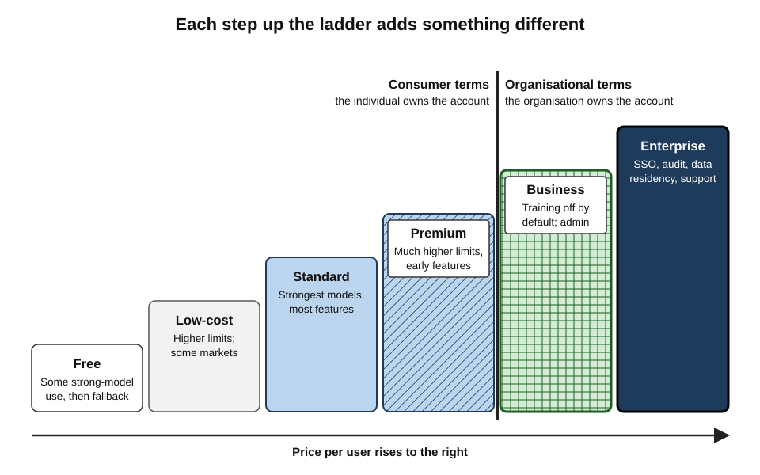
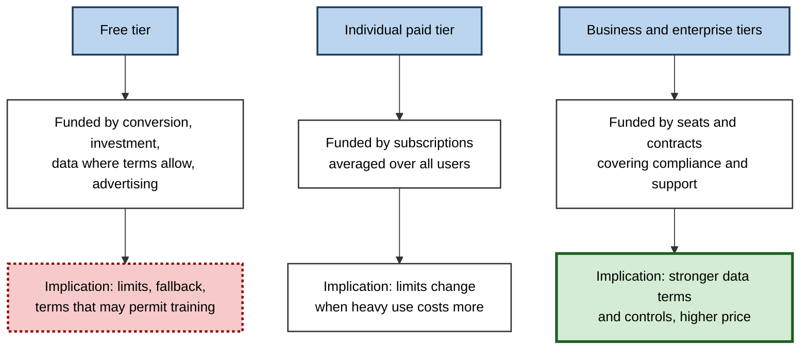
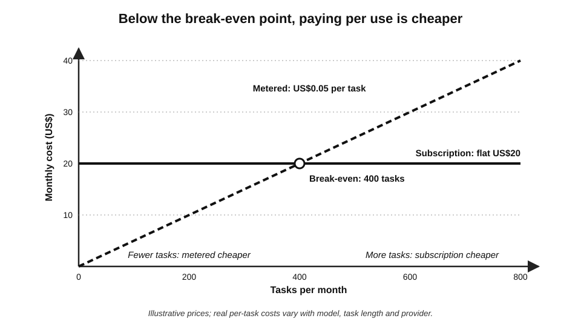
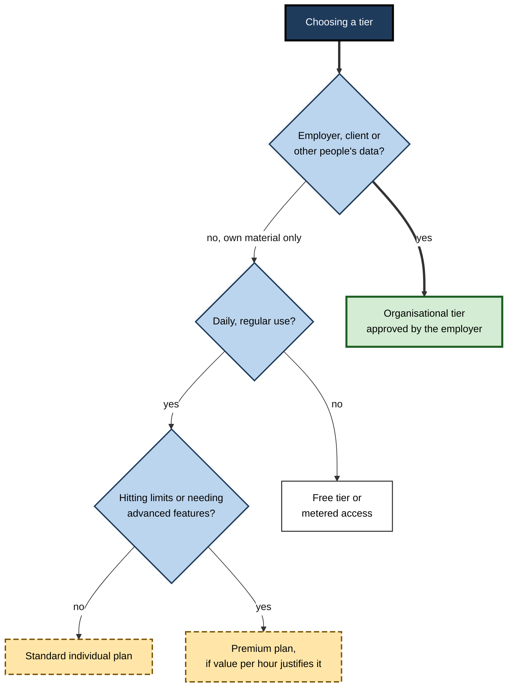
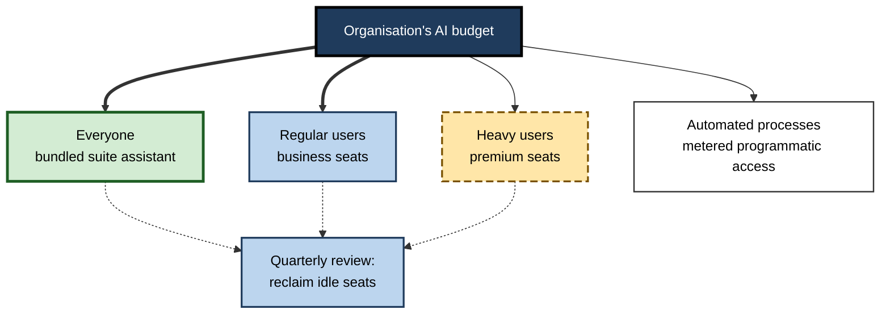

# C.4. Free and paid tiers compared

Two colleagues use the same AI assistant. One pays nothing, hits a limit by mid-afternoon, is switched to a smaller model, and may — under the free plan's terms — be contributing her chats to training data. The other is on her employer's business plan: higher limits, the strongest models, an administrator, and a contract excluding her content from training. The **brand is identical; the product is not**.

> **Definition — Tier:** one of several versions of the same AI product, offered at different prices, that differ in capability, usage limits, features, data terms, administration and support.

**Why tier comparison matters**

- **Cost** — individual subscriptions are modest, but organisational spending on AI seats and usage has grown rapidly; choosing the wrong tier wastes money at scale.
- **Data** — the most important differences between tiers are often not in capability but in **what happens to the user's content**.
- **Capability** — free tiers may give access to the best model only briefly or not at all.
- **Fairness and access** — pricing affects who can use AI at all; regional pricing and promotions change the picture country by country.

---

## What Changes Between Tiers

### The seven dimensions

- **Model access** — which models are available, and how often the strongest can be used.
  - Free tiers usually fall back to smaller or older models after a quota.
- **Usage limits** — messages, files, images, research tasks or compute per hour, day, week or month.
  - Limits are often **dynamic** — adjusted by demand and not always stated precisely.
- **Context and file capacity** — how much text, how many files and how long a document the tool can work with at once.
- **Features** — deep research, agents, code execution, voice, video, custom assistants, connectors.
- **Data terms** — whether content may be used for training, how long it is kept, who can review it.
- **Administration** — organisational accounts, single sign-on, user management, audit logs, retention controls.
- **Assurance and support** — service-level commitments, security certifications, contractual protections such as indemnities, a named support contact.

> **Mnemonic — "My Uncle Charles Finds Data Always Accurate":** Model access, Usage limits, Context capacity, Features, Data terms, Administration, Assurance.

**Figure 1.** What is added at each step up the tier ladder.

### The typical ladder

- **Free** — limited use of capable models, then fallback; consumer terms; no administration.
- **Low-cost** — a cheaper paid tier introduced in some markets, with higher limits than free but fewer features than the standard plan.
- **Standard individual** — the mainstream paid plan; strongest models within limits; most features; still **consumer** terms for an individual.
- **Premium individual** — much higher limits and early access for heavy users, at several times the standard price.
- **Business or team** — per-seat pricing; organisational workspace; content excluded from training by default; administrative controls.
- **Enterprise** — negotiated contracts; advanced security, data residency options, audit, support, sometimes custom pricing based on usage.

> **Key point:** the largest single change in the ladder is **not** between free and paid; it is between **individual (consumer) terms** and **organisational (business) terms**. A paying individual on a standard plan is still, legally, a consumer.

| | Free | Standard individual | Business / team | Enterprise |
|---|---|---|---|---|
| Strongest models | Limited, with fallback | Yes, within limits | Yes, higher limits | Yes, highest limits |
| Training on content | Commonly allowed unless the user opts out | Commonly allowed unless the user opts out | Excluded by default under business terms | Excluded; negotiated |
| Account owner | The individual | The individual | The organisation | The organisation |
| Administration and audit | None | None | User management, basic controls | Single sign-on, audit logs, retention, residency options |
| Support and commitments | Community help | Standard support | Business support | Contracted service levels, indemnities |
| Typical pricing basis | None | Monthly subscription | Per seat per month | Negotiated seats and usage |

> **Watch out:** "commonly allowed unless the user opts out" describes the general pattern in 2025–26; each provider's default differs and changes. In 2025, for example, one major provider moved its consumer plans from not training on chats by default to asking every user to choose, with much longer retention for those who allowed training. The only reliable answer is the **current** terms of the **specific** tier.

---

## How AI Tools Are Priced

### Pricing models

- **Freemium** — a free tier to attract users, with paid tiers for more.
  - Free use is funded by paid users, investors, or — increasingly — advertising.
- **Subscription** — a fixed monthly or annual fee for an individual.
- **Per seat** — a fixed fee per named user per month, usually for organisations, often discounted for annual commitment.
- **Usage-based (metered)** — payment for what is consumed: tokens, requests, minutes of audio, images, compute time.
- **Credits** — a prepaid allowance consumed at different rates by different actions.
- **Outcome-based** — payment per completed result, such as per resolved customer conversation.
  - *e.g.* when Salesforce launched its Agentforce service agents in 2024, it priced them per conversation rather than per seat.
- **Bundled** — AI included within a broader software subscription.

> **Definition — Token:** the unit of text a language model processes — a word, part of a word or a punctuation mark. As a rough rule for English, one token is about three-quarters of a word.

> **Definition — Metered pricing:** charging according to measured consumption rather than a fixed fee.

| | Subscription or seat | Usage-based (tokens, credits) | Outcome-based |
|---|---|---|---|
| Predictability of cost | High | Low to moderate | Moderate |
| Suits | Regular human use | Variable or automated use; developers | Repetitive, well-defined outcomes |
| Main risk to buyer | Paying for unused seats | Bills that spike with heavy use | Disputes over what counts as an outcome |
| Main risk to provider | Heavy users costing more than they pay | Customers rationing use | Paying for failed attempts |

### Why prices and limits keep changing

- **Costs per unit of capability have fallen fast** — the price of a given level of model performance has dropped steeply year on year.
- **But demand per user has risen** — reasoning models, agents and long research tasks consume far more compute per request.
- **Result:** providers reshape tiers often — adding premium plans, introducing weekly limits for the heaviest users, moving features between tiers, and shifting from flat fees towards metering.

> **Watch out:** a flat-fee subscription is a **bet** by the provider on average use. When a provider finds that heavy users cost more than they pay, it changes limits — sometimes with little notice. Plans built around "unlimited" use rarely stay that way.

---

## A Dated Snapshot of Prices

Prices change frequently; the following describes the **pattern as of mid-2026**, in US dollars, for orientation only.

- **Standard individual plans** from the three largest assistant providers — OpenAI's ChatGPT Plus, Anthropic's Claude Pro and Google's AI Pro — converged at about **US$20 a month**.
- **Premium individual plans** — offering many times the standard usage and early features — were priced at roughly **US$100 to US$250 a month**.
- **Low-cost tiers** below the standard plan were offered in some markets, typically under US$10 a month, often with regional pricing.
- **Business and team plans** were generally priced **per seat per month** at or somewhat above the standard individual price, with discounts for annual billing.
- **Suite assistants:** Microsoft 365 Copilot for large organisations was an add-on at about **US$30 per user per month** on annual commitment, with a business version for organisations of up to 300 users at about **US$21**; Google had folded its Gemini features into Workspace business plans in 2025.
- **Programmatic (API) use** was priced per million tokens, with **output** tokens typically costing several times as much as **input** tokens, and prices varying by a factor of a hundred or more between the smallest and largest models.

> **Watch out:** price lists of this kind age in months. Taxes, regional pricing, annual-versus-monthly billing (monthly billing commonly costs around a fifth more) and promotions all change the real figure. The **structure** — a standard tier near one price point, premium tiers several times higher, per-seat business plans and metered programmatic access — has been more stable than the numbers.

### Regional pricing and promotions

- **Regional prices** — some providers price lower in markets such as India, and accept local payment methods.
  - *e.g.* OpenAI introduced a low-cost "Go" tier first in India in August 2025, priced in rupees, and later offered it free for a year to users there in a promotion.
- **Bundled promotions** — telecom operators and device makers in several countries offered premium AI subscriptions free for a period with phone plans or devices.
- **Student and education offers** — free or discounted premium plans for students in some countries.

> **Watch out:** promotional free access is still **free** access in one sense that matters — it is usually a **consumer** account. A professional who receives a premium assistant free with a phone plan has not acquired a business tool, and should not treat it as approved for client or employer data.

### Advertising in free tiers

- **The shift:** AI assistants long avoided advertising, but in early 2026 OpenAI announced it would begin testing advertisements in the free and lowest-priced tiers of ChatGPT in the United States, while keeping higher tiers ad-free.
- **What it changes for the user:**
  - the economic logic of the free tier now includes attention and data for advertising;
  - questions arise about whether answers could be influenced by commercial relationships — providers state they are not, and that ads are labelled and separate.
- **For tier choice:** paying removes ads; it does not by itself change the training or retention terms.

> **Key point:** the old maxim "if the product is free, the user is the product" is too simple, but it points to the right question: **how is this tier paid for, and what does that imply for my data and the answers I see?**

---

## How Each Tier Is Paid For

Every tier is funded somehow, and the funding model shapes what the user receives.

- **Free tiers** are paid for by:
  - **conversion** — a share of free users upgrade, and their subscriptions subsidise the rest;
  - **investment** — providers accept losses to win users while the market forms;
  - **data and feedback** — conversations and ratings, where terms allow, help improve models;
  - **advertising** — newly, in some assistants.
- **Individual paid tiers** are paid for by the subscription itself, averaged across light and heavy users.
- **Business tiers** are paid for by per-seat fees, which also fund administration, compliance and support.
- **Enterprise contracts** are paid for by negotiated fees that price in security reviews, legal terms and dedicated support.

**Figure 2.** How each tier is funded, and what that implies for the user.

> **Key point:** asking **who pays, and how** predicts most of a tier's behaviour — its limits, its data terms, and how likely it is to change.

> **Watch out:** free access subsidised by investment can disappear or shrink abruptly when a provider's strategy changes. Free tiers are best treated as **trials and fallbacks**, not as foundations for important work.

---

## Hidden Limits and Fine Print

- **Fallback models** — after a quota, requests go to a smaller model; output quality drops without obvious warning.
- **Soft caps** — "higher limits" may be unspecified and vary with demand.
- **Weekly or monthly ceilings** — introduced by several providers for heavy users, on top of short-term limits.
- **Feature quotas** — a set number of research reports, video generations or agent runs per month.
- **Context truncation** — long documents may be partly ignored when they exceed the tier's capacity.
- **Commercial-use restrictions** — some free or consumer tiers, especially for image and media tools, restrict commercial use or require attribution.
- **Data retention differences** — temporary or incognito chat modes may still keep content for a period for safety review.

> **Example (illustrative):** an analyst on a free plan uploads a 120-page report and asks for a summary of every chapter. The summary covers chapters 1–6 fluently and omits 7–12 without comment — the file exceeded what the tier processes. On a paid tier with larger capacity, the same request succeeds.

> **In practice:** before relying on a tier for real work, professionals run the **largest realistic task** they will need — the longest document, the busiest day — to find where the limits bite.

---

## Comparing Value: Cost Per Useful Result

The price of a tier means little until it is related to the work it does.

> **Formula — Cost per useful result:** monthly cost ÷ number of results per month that are good enough to use. Illustrative example: a US$20 plan that produces 200 usable drafts a month costs US$0.10 per usable draft; a free plan that produces 40 usable drafts before the limit — and 30 more that need heavy repair — may cost more in **time** than the subscription.

> **Formula — Value of time saved:** hours saved per month × value of an hour − subscription cost. Illustrative example: 3 hours saved × ₹1,000 an hour − ₹2,000 subscription = **₹1,000** net monthly value; at 1 hour saved, the plan loses ₹1,000.

### Subscription versus pay-as-you-go

- **A subscription** suits steady, interactive use.
- **Metered access** suits light or irregular use, or automated processing where volume can be predicted.
- **Break-even:** the point at which metered spending equals the subscription.

**Figure 3.** Monthly cost of a flat subscription compared with metered use as usage rises.

### Worked example (illustrative): choosing a tier for a small consultancy

*Names, organisations and numbers in this example are illustrative figures.*

**Situation:** a five-person consultancy uses AI for drafting proposals, analysing client documents and summarising interviews. All five currently use the free tier of a general assistant on personal accounts.

**Step 1 — identify the binding constraint**

- **Capability:** limits are reached most days by two of the five.
- **Data:** client documents are being uploaded under consumer terms — a breach of several client contracts that require confidentiality and prohibit third-party training on client material.
- **Administration:** if a consultant leaves, their chats with client material leave with them.

**Step 2 — compare candidate tiers**

| Option | Monthly cost (5 people) | Fixes limits? | Fixes data terms? | Fixes administration? |
|---|---|---|---|---|
| Stay on free | 0 | No | No | No |
| Five standard individual plans | 5 × standard price | Yes | No — still consumer terms | No |
| Business plan, five seats | 5 × seat price (slightly higher) | Yes | Yes — training excluded by default | Yes |

**Step 3 — decide**

- The individual plans fix the **least important** problem (limits) and leave the most important (data) unsolved.
- The business plan costs slightly more per seat but is the only option compatible with client contracts.
- **Decision:** business plan; personal accounts closed for client work; past client uploads reviewed and deleted.

> **Watch out:** the most common tier mistake in small firms is **upgrading individuals to paid consumer plans** in the belief that paying makes the tool suitable for client data. Payment changes limits; **the account type** changes the terms.

---

## Choosing a Tier

### The decisive questions

1. **Whose data will go in?**
   - Only the user's own non-sensitive material → individual tiers may suffice.
   - Employer, client or personal data about others → organisational tiers, approved by the employer.
2. **How heavy and how regular is use?**
   - Occasional → free or metered; daily → subscription; heavy → premium or business limits.
3. **Which features are actually needed?**
   - Pay for research modes, agents or long-document capacity only if real tasks need them.
4. **Who must administer it?**
   - If accounts must be controlled, audited or removed, only organisational tiers will do.
5. **What will it cost per useful result, and per hour saved?**

**Figure 4.** A decision path for choosing an AI tier.

> **Remember:** **data decides the account type; usage decides the tier within it; value per hour decides whether to pay more.**

---

## Language and the Hidden Price

**Study card — Petrov and colleagues (2023)**

- **Question:** do language models' tokenisers treat all languages equally?
- **Method:** the same texts, translated into many languages, were split into tokens by the tokenisers of widely used models, and the token counts compared.
- **Finding:** the same content could require **many times more tokens** in some languages than in English — in the most extreme cases, more than ten times as many.
- **Consequences:**
  - higher costs for metered use in those languages;
  - less content fits within a tier's context limit;
  - slower responses.
- **Conclusion:** token-based pricing and limits are not language-neutral; speakers of under-represented languages can pay more for the same service.

> **In practice:** organisations working in several languages should test costs and limits **in each working language** — a tier that is generous in English may be tight for documents in other scripts. Newer tokenisers have narrowed, but not closed, the gap.

---

## Case Study: A Pricing Change Surprises Paying Users

- **Situation:** in mid-2025 the AI coding tool Cursor, popular with professional developers on a flat monthly subscription, changed its main paid plan from a fixed number of fast requests to a usage-based allowance tied to the compute cost of the models used.
- **What users experienced:**
  - heavy users of the most expensive models exhausted the allowance quickly;
  - some incurred unexpected additional charges;
  - many found the new limits hard to understand.
- **Response:** after widespread complaints, the company's chief executive publicly apologised in July 2025 for unclear communication, clarified the plan and offered refunds for unexpected charges.
- **Diagnosis:**
  - a flat price had been sustained while model costs per request rose with more capable "reasoning" models;
  - the shift to metering moved cost risk from provider to user;
  - users had built daily workflows around a pricing assumption that proved temporary.
- **Lesson:** a tier is a **contract that can change**. Professionals and organisations should monitor actual usage, read change notices, prefer plans with clear limits, and avoid building critical work on pricing that seems too generous to last.

> **Key point:** similar re-pricing — premium tiers, weekly caps, credit systems — appeared across many AI products in 2025–26. Tier choice is not a one-off decision but a periodic check.

---

## The Organisation's View of Tiers

- **Seat allocation** — not everyone needs the same tier; heavy users may justify premium seats while occasional users share metered access.
- **Licence utilisation** — paid seats that go unused are pure cost; organisations track active use and reclaim idle seats.
- **Enterprise agreements** — negotiated terms on data residency, retention, audit, indemnity and price protection over the contract term.
- **Consolidation discounts** — a single larger contract may cost less per seat than many small ones.
- **Price-protection clauses** — caps on price rises at renewal; notice periods for changes to limits.

> **Definition — Licence utilisation:** the proportion of paid seats that are actively used over a period.

> **In practice:** by 2025–26, organisational software-spend surveys reported AI tools as among the fastest-growing categories of expensed software — individual staff buying subscriptions on cards and claiming them — which led many organisations to replace scattered individual plans with a smaller number of organisational licences.

**Figure 5.** How an organisation might allocate tiers across different kinds of user.

---

## Mastery: How Experienced Buyers Compare Tiers

- **They read the data terms first,** capability second.
- **They test the limits** with the largest realistic task before committing.
- **They price per useful result,** not per month.
- **They separate account type from payment** — paid consumer is still consumer.
- **They prefer monthly terms while uncertain** and annual terms only once value is proven, accepting the monthly premium as the price of flexibility.
- **They watch for re-pricing** — new caps, credits and premium tiers — and re-check value after each change.
- **They keep a free-tier fallback** for low-risk personal tasks and outages, without confusing it with an approved work tool.

> **Watch out:** "the premium tier is better" is usually true for capability and limits and **irrelevant** for the question that matters most at work — whether the data terms permit the intended use.

### What free tiers are genuinely good for

- **Learning** — getting to know how AI assistants behave before any money or data is committed.
- **Comparison** — trying several providers side by side on the same non-sensitive task.
- **Personal, low-stakes use** — recipes, travel plans, explanations of public topics.
- **Public material** — summarising a published report or drafting a post about public information.
- **Fallback** — continuing low-risk work during another tool's outage.

> **Remember:** free tiers are excellent for **exploring** and poor for **depending**. The moment work involves other people's data, regular reliance or organisational records, the question becomes which organisational tier — not whether to pay.

---

## Open Questions

- **Will advertising reshape free AI assistants?**
  - Whether commercial incentives will influence answers, and how users will be able to tell, is not yet known.
- **Is metered pricing fair to ordinary users?**
  - Usage-based charges align cost with consumption but make bills unpredictable; consumer protection for AI subscriptions is still developing.
- **How will pricing evolve as agents do more work?**
  - Outcome-based and per-task pricing may replace seats; measuring what was really accomplished is difficult.
- **Will price differences entrench a digital divide?**
  - Premium tiers can cost more per month than many people's daily wage in lower-income countries; regional pricing and promotions mitigate but do not remove the gap.
- **Can buyers trust stated limits?**
  - Dynamic, demand-based limits are hard to verify; independent measurement of what each tier delivers is rare.

---

## Summary

- A **tier** is a version of the same product differing in **model access, usage limits, context capacity, features, data terms, administration and assurance**.
- The largest change is between **individual (consumer) terms** and **organisational (business) terms** — paid individual plans are still consumer accounts.
- Pricing models: **freemium, subscription, per seat, metered (tokens, credits), outcome-based, bundled** — each with different predictability and risks.
- **Dated snapshot (mid-2026):** standard individual plans about **US$20 a month**; premium about **US$100–250**; business plans per seat; Microsoft 365 Copilot add-on about **US$30**; API priced per million tokens, output dearer than input. Structure is more stable than numbers.
- Regional pricing, promotions and early-2026 **advertising** in free tiers change the economics; promotional access is still consumer access.
- Watch for **fallback models, soft caps, weekly ceilings, feature quotas, truncation, commercial-use limits**.
- Compare **cost per useful result** and **value of time saved**; find the **break-even** between subscription and metered use.
- **Tokenisation** makes some languages costlier and tighter on limits.
- The **Cursor** re-pricing of 2025 shows that tiers are contracts that change.
- Organisations allocate tiers by user type, track **licence utilisation** and negotiate price protection.

---

## Self-Check

1. Define a tier and name its seven dimensions.
2. Why is the change from individual to organisational terms more important than the change from free to paid?
3. Distinguish subscription, per-seat, metered, credit-based and outcome-based pricing.
4. What is a token, and roughly how does it relate to an English word?
5. Why do providers keep changing limits and tiers?
6. Describe the mid-2026 price pattern for standard, premium and business plans, and explain why such figures must be dated.
7. Why should a free premium subscription from a phone promotion not be used for client data?
8. List five hidden limits that can affect results.
9. A plan costs ₹1,700 a month. A user saves 2 hours a month, valued at ₹600 an hour. Is it worth it? What if she saves 4 hours?
10. Explain the break-even between a subscription and metered use.
11. Summarise the 2023 tokenisation study and its practical consequences.
12. What happened in the Cursor re-pricing episode, and what is the lesson?
13. In the consultancy worked example, why were individual paid plans the wrong answer?
14. A department of 200 has 200 premium seats; monitoring shows 60 used weekly, 50 occasionally, 90 never. Propose a better allocation.

### Answer Key

1. A version of a product at a price point differing in capability, limits, features, data terms, administration and support. Dimensions: model access, usage limits, context capacity, features, data terms, administration, assurance.
2. Because data terms, ownership of the account and administrative control change only at the organisational level. A paying individual remains a consumer, often with training allowed by default and no employer oversight.
3. Subscription: fixed fee for an individual. Per seat: fixed fee per named user, for organisations. Metered: payment per unit consumed. Credits: a prepaid allowance consumed at different rates. Outcome-based: payment per completed result.
4. The unit of text a model processes — a word, part of a word or a symbol; roughly three-quarters of an English word.
5. Unit costs fall but demand per user rises with reasoning models and agents; flat fees become unprofitable for heavy users, so providers add premium tiers, caps, credits and metering.
6. Standard about US$20 a month; premium about US$100–250; business per seat at or slightly above standard; suite add-ons around US$21–30 per user. Prices, regional rates, billing terms and promotions change within months.
7. It is a consumer account, with consumer data terms and no employer control; it is not an approved organisational tool.
8. Any five of: fallback models, soft caps, weekly or monthly ceilings, feature quotas, context truncation, commercial-use restrictions, retention in temporary modes.
9. 2 × 600 − 1,700 = −₹500 — not worth it on time alone. 4 × 600 − 1,700 = ₹700 — worth it, before considering quality.
10. Metered cost rises with use; subscription cost is flat. Below the crossing point metered is cheaper; above it, the subscription is cheaper.
11. Petrov and colleagues found the same content needed many times more tokens in some languages than in English. Metered costs are higher, less content fits within limits and responses are slower for those languages.
12. Cursor moved its paid plan to usage-based allowances; heavy users hit limits and unexpected charges; the CEO apologised and offered refunds. Tiers are contracts that change; monitor usage and avoid building on unsustainably generous pricing.
13. They fixed usage limits but left client data under consumer terms and outside firm control, breaching client contracts; only the business plan addressed the data and administration problems.
14. *e.g.* keep premium seats for the 60 weekly heavy users if usage justifies; move the 50 occasional users to standard business seats or shared metered access; remove the 90 unused seats (relying on the bundled suite assistant); review quarterly.

---

## Glossary

| Term | Meaning |
|---|---|
| Break-even point | The level of use at which two pricing options cost the same. |
| Bundled pricing | AI included within a broader software subscription. |
| Consumer terms | The contract and privacy terms applying to individual accounts, free or paid. |
| Credits | A prepaid allowance consumed at different rates by different actions. |
| Fallback model | A smaller or older model used after a tier's quota for the strongest model is reached. |
| Freemium | A pricing model offering a free tier to attract users to paid tiers. |
| Licence utilisation | The share of paid seats actively used over a period. |
| Metered pricing | Charging according to measured consumption. |
| Outcome-based pricing | Charging per completed result rather than per user or per unit consumed. |
| Per-seat pricing | A fixed fee per named user per period. |
| Price protection | Contract terms limiting price rises or changes to limits during or at renewal. |
| Soft cap | A usage limit that is unspecified or varies with demand. |
| Tier | A version of an AI product at a given price, differing in capability, limits, terms and support. |
| Token | The unit of text a language model processes; about three-quarters of an English word. |
| Tokeniser | The component that splits text into tokens before a model processes it. |
