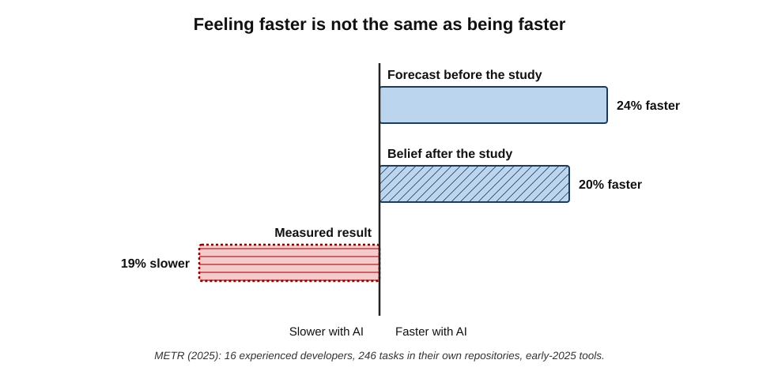
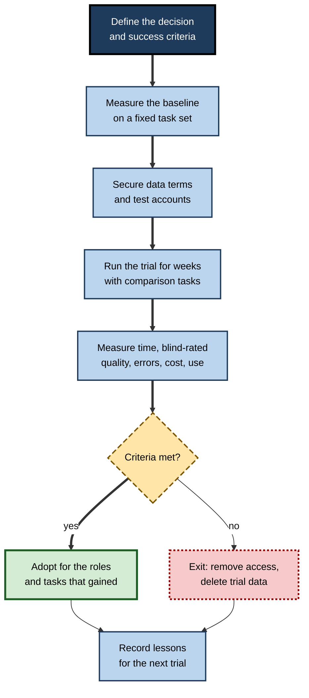
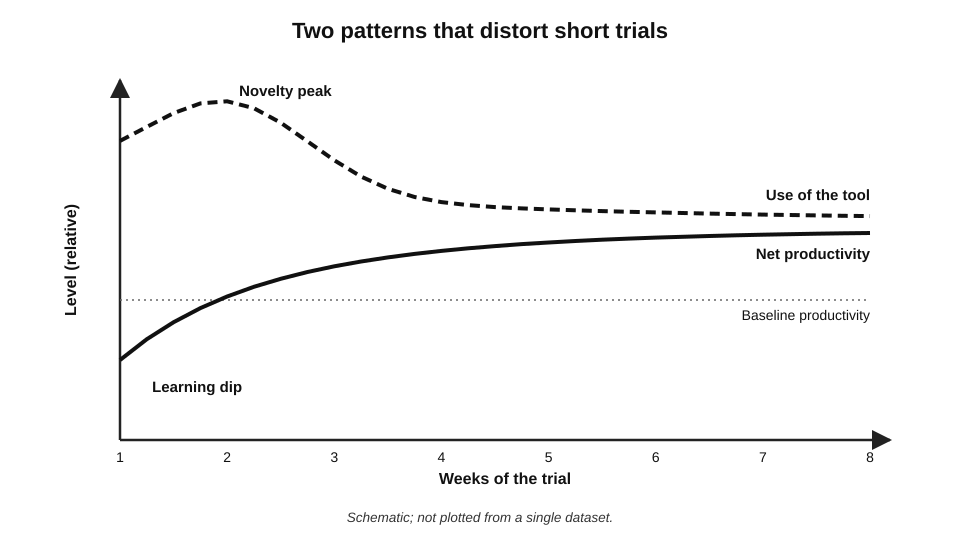
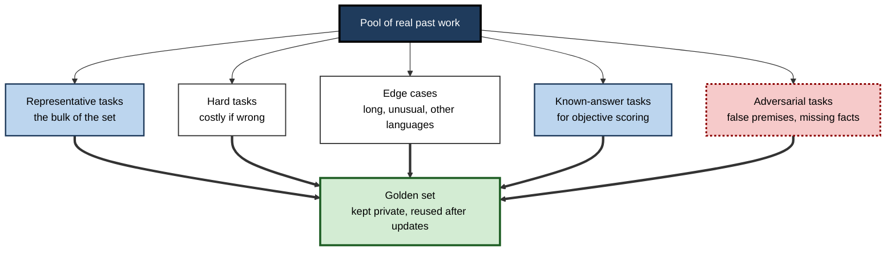
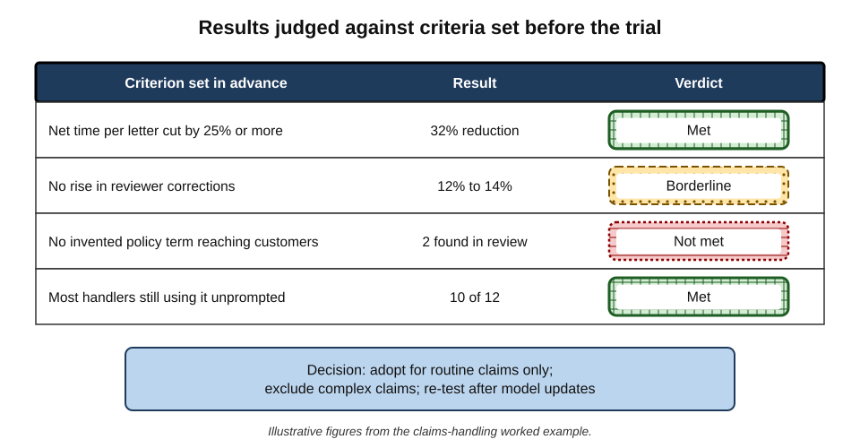

# C.5. Trialling a tool properly

A sales team tries a new AI writing tool for a week. Everyone is impressed; the demonstrations were dazzling; the survey says it "saves loads of time". The firm buys two hundred licences. Six months later, a fifth of the seats are used, nobody can say how much time was saved, and two client emails containing invented product features have had to be retracted. The tool may have been perfectly good. The **trial** was not.

> **Definition — Tool trial (pilot):** a time-limited, deliberately designed period of use, on realistic tasks and under realistic conditions, intended to produce evidence for a decision about whether, where and how to adopt a tool.

**Why trialling well matters**

- **Impressions mislead.** People's sense of how much an AI tool helps them can be badly wrong — even in the wrong direction.
- **Demonstrations are selected.** A vendor's examples, or a colleague's best result, show capability, not reliability.
- **Commitments are sticky.** Once licences are bought and workflows rebuilt, a poor choice is hard to reverse.
- **Risks surface slowly.** Errors, data problems and hidden costs often appear only after weeks of ordinary use.

---

## Demonstration, Trial and Evaluation

- **Demonstration** — a vendor or enthusiast shows what the tool can do.
  - Purpose: interest. Evidence value: low.
- **Proof of concept** — a quick test of whether the tool can do a specific task at all.
  - Purpose: feasibility. Evidence value: capability only.
- **Pilot or trial** — a group uses the tool on real work for weeks, with measurement.
  - Purpose: decision. Evidence value: moderate to high, depending on design.
- **Controlled evaluation** — a trial with a comparison condition (with and without the tool), blind quality rating and pre-set criteria.
  - Purpose: confident decision at scale. Evidence value: highest.

| | Demonstration | Proof of concept | Pilot | Controlled evaluation |
|---|---|---|---|---|
| Tasks | Chosen to impress | One target task | Real, mixed work | Real work plus a fixed task set |
| Who uses it | Presenter | One or two testers | A group of intended users | Users assigned to conditions |
| Comparison | None | None | Before versus after, often informal | With versus without, same tasks |
| Measures | Reactions | Works or fails | Usage, opinions, some timings | Time, blind-rated quality, errors, cost |
| Typical length | An hour | Days | Weeks | Weeks |

> **Key point:** most organisations call a **demonstration followed by a satisfaction survey** a "trial". Decisions made on that basis rest on the weakest evidence available.

---

## Why Feelings About AI Tools Mislead

**Study card — METR (2025): experienced developers and AI coding tools**

- **Design:** 16 experienced open-source software developers worked on 246 real tasks from their own large, mature code repositories.
  - Each task was randomly assigned to **AI allowed** (mainly a popular AI code editor with frontier models of early 2025) or **AI not allowed**.
  - Time to complete each task was recorded from screen recordings and self-reports.
- **Forecast:** before starting, developers expected AI to make them about **24% faster**.
- **Result:** with AI allowed, tasks took about **19% longer** on average.
- **Perception afterwards:** even after the study, developers estimated that AI had made them about **20% faster**.
- **Explanations explored:** time spent prompting, waiting and reviewing; AI suggestions poorly suited to large, familiar codebases with high quality standards; developers' deep existing expertise.
- **Conclusion:** in this setting, **perceived** speed-up and **measured** speed-up pointed in **opposite directions**.

> **Watch out:** the study involved a small number of highly experienced developers on their own familiar projects, with early-2025 tools. It does **not** show that AI slows all developers or all tasks; other studies in other settings have found gains. Its lasting lesson is methodological: **self-reported time savings cannot be trusted without measurement**.

**Figure 1.** Expected, perceived and measured effect of AI tools on task time in the 2025 developer study.

### Biases that inflate trial results

- **Novelty effect** — new tools attract attention and effort, raising early enthusiasm and use, which fade.
- **Selection of enthusiasts** — volunteers for a pilot tend to be those most interested in the tool.
- **Cherry-picked tasks** — testers try tasks they expect to work.
- **Effort substitution** — the effort of prompting and checking is not felt as "work", so time saved is overestimated.
- **Sunk cost and commitment** — once a team has championed a tool, admitting it did not help is uncomfortable.
- **Demand characteristics** — participants sense what the organiser hopes to hear.
- **Survivorship in feedback** — people who stopped using the tool rarely answer the survey.

> **Definition — Novelty effect:** a temporary rise in engagement or performance caused by the newness of a tool or method rather than its lasting merit.

> **Watch out:** the "Hawthorne effect" — the claim that workers at Western Electric's Hawthorne plant in the 1920s–30s improved simply because they were being studied — is widely cited but **contested**; later reanalyses of the original data found the evidence much weaker than the legend. The safer statement is that **being observed and being new can change behaviour**, so a trial must last long enough and measure carefully enough to see past both.

---

## Designing a Trial

### Ten design decisions

1. **The decision** — what will the trial decide? Adopt or not; for whom; for which tasks; at what tier.
2. **The success criteria** — what result would justify adoption, set **before** the trial begins.
3. **The baseline** — how the work is done now, with timings and quality measured on the same tasks.
4. **The task set** — a fixed collection of realistic tasks, including hard and unusual cases.
5. **The participants** — a mix of enthusiasts and sceptics, novices and experts, from the roles that would use the tool.
6. **The comparison** — the same tasks done with and without the tool, or with two candidate tools.
7. **The measures** — time, quality, errors, rework, cost, adoption — and satisfaction last.
8. **The duration** — long enough to pass the learning dip and the novelty peak; typically several weeks.
9. **The data rules** — what data may be used, under which account terms.
10. **The exit** — what happens if the criteria are not met, and how the tool is removed.

> **Mnemonic — "Do Smart Brains Test People Carefully, Measuring Data Every Day":** Decision, Success criteria, Baseline, Task set, Participants, Comparison, Measures, Duration, Exit, Data rules.

**Figure 2.** The stages of a well-designed tool trial.

### Building the task set

- **Representative tasks** — the ordinary work the tool would mostly do.
- **Hard tasks** — the difficult cases where errors would be costly.
- **Edge cases** — unusual formats, long documents, other languages, poor-quality inputs.
- **Known-answer tasks** — past work where the correct result is already known.
  - Allows accuracy to be scored objectively.
- **Adversarial tasks** — inputs designed to tempt the tool into error.
  - *e.g.* a question whose answer is not in the supplied document; a request with a false premise.

> **Definition — Golden set:** a fixed collection of tasks with known correct or approved answers, used to score tools consistently and to re-test them after updates.

> **In practice:** experienced evaluators build a golden set of about twenty to fifty tasks drawn from real past work, keep it private, and reuse it for every tool and every major update — so results are comparable over time.

### Choosing participants

- **Include sceptics** — they find failures that enthusiasts overlook.
- **Include novices and experts** — AI often helps them differently; a tool that helps novices may slow experts, or the reverse.
- **Include the roles that will actually use it** — not only the people who requested it.
- **Brief everyone on the data rules** before the first use.

### Choosing the comparison

- **Before and after** — weakest; changes in workload, season or skill confound the result.
- **With and without, same people** — each person does comparable tasks both ways (a **crossover** design).
- **With and without, different groups** — randomised groups, if numbers allow.
- **Tool A versus tool B** — same tasks, outputs rated blind.

> **Definition — Crossover design:** a trial in which each participant works under both conditions — with and without the tool, or with two tools — on comparable tasks, so each person serves as their own comparison.

---

## What to Measure

### The measures, in order of importance

- **Time to an acceptable result** — including prompting, waiting, reviewing and correcting.
- **Quality** — rated against a rubric, **blind** to which condition produced the work.
- **Error rate and severity** — how often errors occur and how serious they are.
- **Rework downstream** — corrections needed later by colleagues, reviewers or clients.
- **Cost** — licences, usage charges, set-up and support time.
- **Adoption** — how many participants still use the tool in the final week, unprompted.
- **Satisfaction** — useful for adoption planning, not as evidence of benefit.

> **Formula — Net time saved per task:** baseline time − (assisted time + checking time + expected rework time). Illustrative example: baseline 30 minutes; assisted drafting 10 minutes; checking 8 minutes; rework expected on 1 in 5 tasks at 20 minutes (= 4 minutes on average). Net saving = 30 − (10 + 8 + 4) = **8 minutes per task** — far less than the 20 minutes the drafting step alone suggests.

> **Remember:** **time saved is not the time the tool takes; it is the time the whole task takes, including everything done to make the output usable.**

### Grading errors by severity

- **Cosmetic** — formatting, minor style; no effect on meaning.
- **Minor** — an omission or awkward phrasing a reader would notice and discount.
- **Major** — a wrong fact, figure or instruction that would mislead if not caught.
- **Critical** — an error with legal, financial, safety or reputational consequences, such as an invented obligation in a customer letter.

> **Formula — Severity-weighted error score:** Σ (number of errors at each level × weight for that level). Illustrative example with weights 1, 3, 10 and 50: 12 cosmetic, 4 minor, 2 major and 0 critical errors score 12 + 12 + 20 + 0 = **44**; one critical error alone scores 50. Two tools with the same error **count** can differ greatly in **risk**.

> **In practice:** many evaluation teams set a **zero-tolerance criterion** for critical errors on a golden set, alongside averages for time and quality — so a single serious failure triggers a redesign rather than being averaged away.

### Reading results from small trials

- **Small numbers mislead** — with ten participants, one unusually fast or slow person moves the average.
- **Prefer paired comparisons** — the same task done both ways, compared directly.
- **Count wins** — in blind pairwise comparisons, how often was the AI-assisted output preferred?

> **Formula — Counting wins in paired comparisons:** if two options were truly equal, each would win about half of paired comparisons. With 20 comparisons, 15 or more wins for one option would happen by chance only about **2%** of the time (about 4% counting either option). Illustrative example: AI-assisted drafts preferred in 15 of 20 blind comparisons is reasonable evidence of a real quality advantage; 12 of 20 is not.

> **Watch out:** averages hide the distribution. A tool that saves a little time on most tasks but causes one serious error in twenty may be a poor choice for high-stakes work, whatever its average.

---

## The Learning Dip and the Novelty Peak

Two patterns distort short trials in opposite directions.

- **The learning dip** — in the first days, people are slower as they learn how to instruct and check the tool.
  - A very short trial **understates** eventual benefit.
- **The novelty peak** — in the first weeks, attention and enthusiasm are high.
  - A short trial **overstates** sustained use.
- **What follows** — use settles at a level reflecting genuine usefulness; productivity reflects learned skill.

**Figure 3.** Typical patterns of performance and use over the weeks of a trial.

> **Key point:** a trial should run long enough to see **both** curves settle — commonly several weeks, with the most weight given to the final weeks.

> **In practice:** evaluators often report **week-one** and **final-week** figures separately, and treat unprompted use in the final week as the best single indicator of real value.

---

## Data and Terms During a Trial

- **Trial accounts are often consumer accounts.** A free trial signed up for with a work email may carry consumer terms permitting training on content.
- **Use safe data first** — public, synthetic or anonymised material for early testing.
- **Move to real data only under proper terms** — a business trial agreement or data-processing terms in place before confidential material is used.
- **Know where trial data goes after the trial** — how to export results and delete everything else.
- **Check integrations** — granting a trial tool access to email or files may give broad, lasting permissions that outlive the trial.

> **Definition — Synthetic data:** artificially created data that imitates the structure and patterns of real data without containing real people's or clients' information.

> **Watch out:** "it's only a trial" is the moment most data mistakes happen. The vendor's terms apply from the first upload, and a connector authorised for a pilot keeps its access until someone revokes it.

---

## Worked Example (illustrative): Trialling a Drafting Assistant in Claims Handling

*Names, organisations and numbers in this example are illustrative figures.*

**Situation:** an insurer's claims team of 40 handlers writes decision letters to customers. A drafting assistant is proposed. The team lead designs a four-week trial.

**Design**

- **Decision:** adopt for decision letters, or not.
- **Success criteria (set in advance):**
  - net time per letter reduced by at least 25%;
  - no increase in letters needing correction by quality reviewers;
  - no letter containing an invented policy term reaching a customer.
- **Task set:** 40 past claims with approved letters (known answers), including 10 complex or disputed claims.
- **Participants:** 12 handlers — four experienced, four mid-level, four new; including two who doubted the tool.
- **Comparison:** crossover — each handler writes half the letters with the tool and half without, alternating weekly.
- **Measures:** timed drafting and review; blind quality rating by two senior reviewers; error log by severity.
- **Data:** a business trial agreement with training excluded, signed before any claim data was used.

**Results (weeks 3–4)**

| Measure | Without tool | With tool |
|---|---|---|
| Median time per letter, including review | 34 minutes | 23 minutes |
| Letters needing reviewer correction | 12% | 14% |
| Serious errors (wrong policy term or amount) | 0 of 120 | 2 of 120 |
| Blind quality preference (paired) | — | Preferred in 31 of 60 pairs |
| Handlers still using it unprompted in week 4 | — | 10 of 12 |

**Interpretation**

1. **Time:** a reduction of (34 − 23) ÷ 34 ≈ **32%** — meets the time criterion.
2. **Quality:** 31 of 60 is essentially a tie — no quality gain, but no loss.
3. **Corrections:** a small rise, within normal variation for this sample.
4. **Serious errors:** two letters stated a policy term that did not exist — both on complex claims, both caught by the trial's extra review. This **fails** the third criterion.

**Decision**

- **Adopt for routine claims only**, with the assistant restricted to the approved letter templates and the policy wording supplied with each claim.
- **Exclude complex and disputed claims** until a further trial with a grounded configuration.
- **Re-test on the golden set** after any model update.

> **Watch out:** without the pre-set criterion on serious errors, the 32% time saving and enthusiastic adoption would almost certainly have carried the decision — and the two invented policy terms would have reached customers at scale.

---

## Case Study (illustrative): A Trial That Measured the Wrong Thing

- **Situation:** a professional-services firm piloted an AI meeting-summary tool with 50 volunteers for two weeks.
- **What was measured:** a survey at the end of week two.
  - 88% "satisfied or very satisfied"; average self-estimated saving of 40 minutes a day.
- **Decision:** licences purchased for 1,500 staff.
- **What happened next:**
  - active weekly use fell below 30% within three months;
  - several client meetings were summarised with action items assigned to the wrong party;
  - one client objected to being recorded without clear notice.
- **Diagnosis:**
  - **volunteers only** — the most enthusiastic tenth of staff;
  - **two weeks** — inside the novelty peak;
  - **self-report** — no timings, no accuracy checks;
  - **no criteria** — the decision rested on satisfaction;
  - **no data or consent review** — recording rules for client meetings were not considered.
- **Second trial:** three months later, a redesigned four-week trial with mixed participants, a golden set of recorded internal meetings with agreed minutes, blind accuracy scoring and a consent procedure. It found the tool reliable for internal meetings and unreliable for multi-party client calls.
- **Result:** licences reduced to the teams with frequent internal meetings; client-meeting use restricted.
- **Lesson:** the first trial measured **enthusiasm**; the second measured **performance**. Only the second should have informed a purchase.

> **Key point:** satisfaction surveys answer "Will people like it?" They do not answer "Does it work, for whom, on which tasks, at what risk?"

---

## The Quick Personal Trial

Not every trial needs a team and a month. An individual deciding whether a tool deserves a place in their own work can run a disciplined trial in an hour or two.

### A one-hour protocol

1. **Pick five real tasks** from the last month — three typical, one hard, one where the answer is already known.
   - Use public or non-sensitive versions if the tool is not yet approved for work data.
2. **Write down the current method and time** for each, from memory or records.
3. **Run each task in the candidate tool** — and, if possible, in the tool currently used — with the same instructions.
4. **Run the known-answer task three times** to see how much the output varies.
5. **Score each output** on a simple scale: usable as is, usable after light edits, needs heavy repair, wrong.
6. **Note the failure modes** — what kind of error, and would it have been caught?
7. **Estimate net time** — including the editing and checking each output needed.
8. **Decide** — adopt for named tasks, keep watching, or reject — and record why.

> **Example (illustrative):** a policy analyst tests a research assistant on five past briefing questions. Three answers are usable after light edits; the hard question returns a confident summary citing a report that, on checking, says the opposite; the known-answer task gives three noticeably different answers on three runs. **Decision:** adopt for first-pass literature scoping only, never for final claims; re-test in three months.

> **Key point:** the most valuable output of a quick trial is often the **failure note** — the specific way the tool goes wrong — because it tells the user exactly where checking must focus.

### Re-trialling after change

- **Model updates** — providers replace or adjust models frequently; behaviour on familiar tasks can improve or degrade.
- **Tier changes** — a move to a different plan can change the model, limits and features.
- **Configuration changes** — new instructions, connectors or templates alter results.
- **Practice:** re-run the golden set or the personal five tasks after any significant change, and compare with the stored results.

> **Watch out:** a tool that passed a trial is not permanently approved in its behaviour. Several providers have retired or replaced widely used models at short notice; users who had tuned their workflows to an old model's habits found output style and quality shifted overnight.

---

## Trials at Organisational Scale

- **Staged roll-out** — expand from pilot to wider groups in steps, measuring at each step.
- **Champions with evidence** — enthusiasts help others adopt, but their claims are checked against data.
- **Comparable trials** — the same golden set and rubric used for every candidate tool, so decisions are consistent.
- **Trial registers** — a record of which tools were trialled, how, with what results and why they were adopted or rejected.
  - Prevents re-trialling the same tool by different teams.
- **Independent assessment** — someone not invested in the tool reviews the design and results.

**Figure 4.** Building the task set for a trial.

**Figure 5.** A one-page trial scorecard comparing results with criteria set in advance.

---

## Mastery: How Experienced Evaluators Trial

- **They write the criteria before they see the tool perform.**
- **They measure the whole task,** not the AI step.
- **They rate quality blind.**
- **They recruit sceptics** and value their failure reports.
- **They run long enough** to see the novelty fade and skill develop.
- **They separate results by role and task** — a tool can be adopted for some and rejected for others.
- **They secure data terms before real data,** and plan the exit before the start.
- **They re-run the golden set** after model updates, because the tool trialled is not the tool used six months later.

> **Watch out:** a trial is not a ritual to justify a decision already made. If no result could have led to rejection, it was not a trial.

---

## Open Questions

- **How long is long enough?**
  - Learning curves for AI tools vary by task and person; there is little evidence on the minimum trial length for reliable conclusions.
- **How can trials keep pace with model updates?**
  - Tools change monthly; a careful trial can be outdated before it is reported. Golden sets help but do not settle the problem.
- **Why do perceived and measured gains diverge?**
  - The 2025 developer study showed a striking gap; whether it reflects effort that does not feel like work, enjoyment, or something else is unresolved.
- **How should quality be judged for open-ended work?**
  - Blind rating helps, but reviewers disagree, and AI-assisted work may differ in style in ways that reveal its source.
- **What do short trials miss about skills?**
  - Effects on learning and skill retention emerge over months or years and are rarely measured in tool trials.

---

## Summary

- A **trial** is a designed, time-limited period of realistic use producing evidence for a decision; demonstrations and satisfaction surveys are not trials.
- **Feelings mislead:** in METR's 2025 study, experienced developers expected a 24% speed-up, measured a 19% slowdown, and still believed they had been 20% faster.
- Biases: **novelty, enthusiast selection, cherry-picked tasks, effort substitution, sunk cost, demand characteristics, survivorship**. The Hawthorne legend is contested.
- Ten design decisions: **decision, success criteria, baseline, task set, participants, comparison, measures, duration, data rules, exit**.
- Build a private **golden set** of representative, hard, edge, known-answer and adversarial tasks; reuse it after updates.
- Prefer **crossover** or blind **A-versus-B** comparisons over before-and-after.
- Measure **net time** (including checking and rework), **blind-rated quality**, **errors by severity**, **adoption** — satisfaction last.
- Small trials need **paired comparisons** and care with averages.
- Short trials suffer the **learning dip** and the **novelty peak**; weight the final weeks.
- Trial data falls under the vendor's terms **from the first upload**; secure terms and plan the exit first.
- Adopt by **role and task**, not wholesale.

---

## Self-Check

1. Define a tool trial and distinguish it from a demonstration and a proof of concept.
2. Describe the design and findings of the METR 2025 developer study, and its main limitation.
3. List five biases that inflate trial results.
4. Why is the Hawthorne effect a contested example?
5. Name the ten design decisions of a trial.
6. What is a golden set, and what kinds of task should it include?
7. Why include sceptics and both novices and experts?
8. Explain a crossover design and why it is preferred to before-and-after.
9. Baseline 45 minutes; assisted 15; checking 12; rework on 1 in 4 tasks at 24 minutes. What is the net time saved?
10. In blind comparisons, an AI tool's output is preferred in 13 of 20 pairs. Is this strong evidence?
11. Explain the learning dip and the novelty peak, and their implications for trial length.
12. Why is "it's only a trial" a dangerous attitude to data?
13. In the claims-handling example, why was the tool not adopted for all claims despite a 32% time saving?
14. A manager asks you to run a one-week pilot with volunteers and a satisfaction survey. Propose an improved design in five points.

### Answer Key

1. A designed, time-limited period of realistic use, with measurement, to inform a decision. A demonstration shows selected capability; a proof of concept tests whether a single task can be done at all.
2. 16 experienced developers did 246 real tasks randomly assigned to AI-allowed or not. They expected a 24% speed-up; tasks took about 19% longer with AI; afterwards they believed they were 20% faster. Limitation: few, highly experienced developers on familiar codebases with early-2025 tools.
3. Any five: novelty effect, selection of enthusiasts, cherry-picked tasks, effort substitution, sunk cost, demand characteristics, survivorship in feedback.
4. Later reanalyses of the original Hawthorne data found much weaker evidence than the legend claims; the safer claim is simply that observation and novelty can change behaviour.
5. Decision, success criteria, baseline, task set, participants, comparison, measures, duration, data rules, exit.
6. A fixed, private set of tasks with known or approved answers, used to score tools consistently and re-test after updates. Include representative, hard, edge-case, known-answer and adversarial tasks.
7. Sceptics find failures enthusiasts miss; novices and experts are helped differently, so results for one group may not apply to the other.
8. Each participant works both with and without the tool on comparable tasks, acting as their own comparison. Before-and-after is confounded by changes in workload, season and skill.
9. Expected rework = 0.25 × 24 = 6 minutes. Net = 45 − (15 + 12 + 6) = 12 minutes saved per task.
10. No. If both options were equal, 13 or more wins out of 20 would occur by chance fairly often (roughly one time in eight or so); it is weak evidence. More comparisons are needed.
11. The learning dip: early slowness while users learn the tool — understates benefit. The novelty peak: early enthusiasm — overstates sustained use. Trials should run several weeks and weight the final weeks.
12. The vendor's terms apply from the first upload, which may permit training or retention; connectors authorised during a trial keep access until revoked.
13. Two serious errors (invented policy terms) occurred on complex claims, failing a pre-set criterion; the tool was adopted only for routine claims with restrictions.
14. *e.g.* (1) set success criteria in advance; (2) run four to six weeks; (3) mixed participants including sceptics and novices; (4) a golden set with crossover comparison, timed and blind-rated; (5) data terms secured and an exit plan agreed; satisfaction measured last.

---

## Glossary

| Term | Meaning |
|---|---|
| Adversarial task | A trial input designed to tempt a tool into error. |
| Baseline | Measured performance of the current way of working, before the tool. |
| Blind rating | Judging output quality without knowing which condition or tool produced it. |
| Controlled evaluation | A trial with a comparison condition, blind rating and pre-set criteria. |
| Crossover design | Each participant works under both conditions on comparable tasks. |
| Golden set | A fixed set of tasks with known answers, used to score and re-test tools. |
| Learning dip | Early slowness while users learn to use a new tool. |
| Net time saved | Baseline time minus assisted, checking and expected rework time. |
| Novelty effect | A temporary rise in engagement caused by newness rather than merit. |
| Pilot | A time-limited trial of a tool by a group on real work. |
| Proof of concept | A quick test of whether a tool can perform a task at all. |
| Success criteria | Results, set in advance, that would justify adoption. |
| Synthetic data | Artificial data imitating real data without real people's information. |
| Trial register | An organisation's record of trials, designs, results and decisions. |
