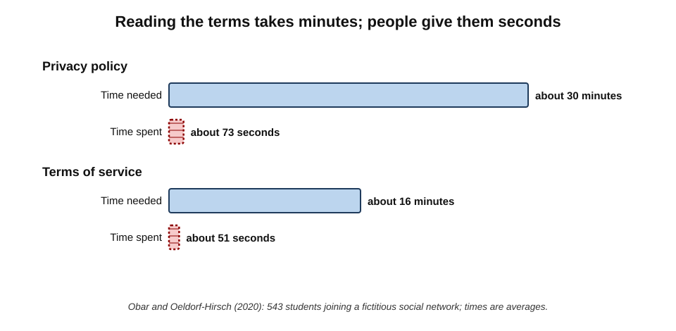
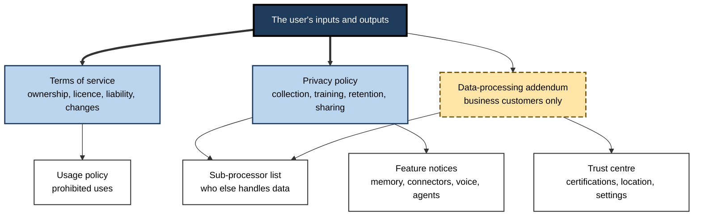
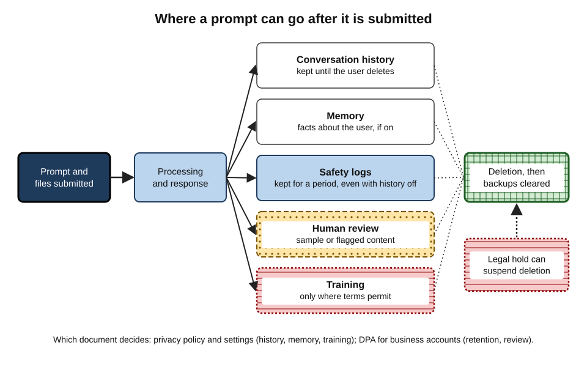
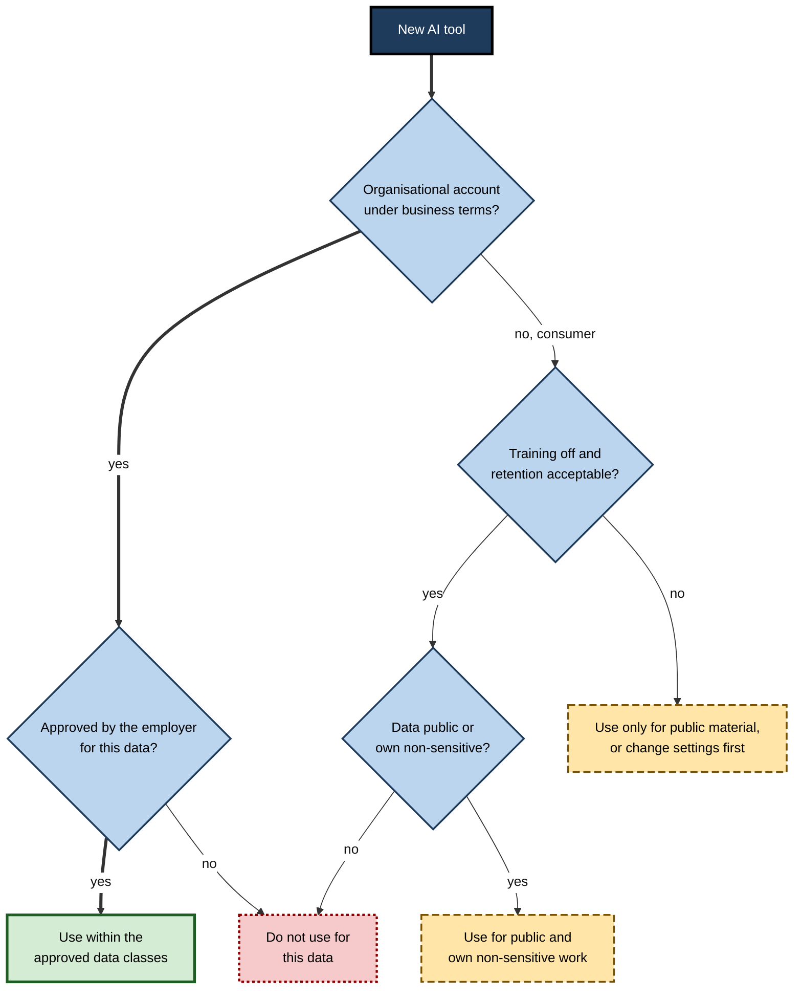
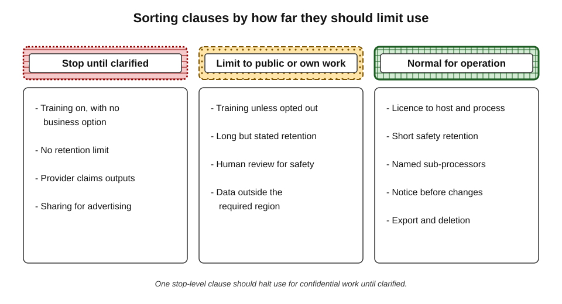

# C.6. Reading privacy terms before use

A freelance designer uploads a client's unreleased brand guidelines to a new AI image tool to generate mock-ups. Weeks later she reads the terms: by uploading, she granted the provider a broad licence to use her content to improve its services, kept for an unspecified period. Nothing has leaked — but her client contract forbade exactly this. The terms were there before the first upload; she simply had not read them. With AI tools, **the terms decide what happens to everything the user types, pastes and uploads**.

> **Definition — Privacy and service terms (of an AI tool):** the set of legal documents — terms of service, privacy policy, data-processing terms, usage policies and supporting security information — that govern what the provider may do with a user's inputs and outputs, and what the user may do with the tool.

**Why reading the terms matters**

- **AI tools receive unusually rich data** — whole documents, code, meeting recordings, personal reflections, client material.
- **Terms differ more than features do** — the same brand can train on content under one plan and not under another.
- **Terms change** — several major providers revised their consumer data terms in 2024–26.
- **Obligations run through the user** — employment contracts, client agreements, professional rules and data-protection law apply to what the user shares, whatever the tool's terms say.

---

## Why People Do Not Read the Terms

**Study card — McDonald and Cranor (2008)**

- **Question:** how long would it take an ordinary internet user to read the privacy policies of the websites they visit?
- **Method:** measured the length of popular sites' privacy policies, estimated reading speed, and combined these with typical browsing patterns.
- **Finding:** reading every policy once would take roughly **200 hours a year** per person — about **76 working days**.
- **Conclusion:** "notice and choice" — the idea that people protect their privacy by reading policies and choosing accordingly — is unrealistic as a general model.

**Study card — Obar and Oeldorf-Hirsch (2020), "The biggest lie on the internet"**

- **Design:** 543 university students were invited to join a fictitious social network, "NameDrop", whose terms contained deliberately outrageous clauses.
- **Findings:**
  - about **three-quarters** skipped the privacy policy entirely, using a "quick join" option;
  - those who opened the documents spent on average about **73 seconds** on a privacy policy that needed roughly half an hour to read, and about **51 seconds** on terms of service needing about a quarter of an hour;
  - around **98%** missed clauses that would share their data with security agencies and require them to give up their first-born child as payment.
- **Conclusion:** consent by click is largely fictional; people agree without reading.

**Figure 1.** Time needed to read a fictitious service's documents compared with time participants actually spent.

> **Key point:** the answer is not to read every word of every policy — few professionals could — but to read **targeted parts** of the terms of the **few tools** that will receive important data, with **specific questions** in mind.

---

## The Documents and What Each Decides

### The document stack

- **Terms of service (terms of use)** — the contract between user and provider.
  - Who owns inputs and outputs; what licence the user grants; permitted and prohibited uses; liability; how terms change.
- **Privacy policy** — how the provider collects, uses, shares and retains personal information.
  - Including whether content is used to train models.
- **Data-processing addendum (DPA)** — for business customers, the contract in which the provider acts on the customer's instructions as a **processor**.
  - Defines purposes, security, sub-processors, international transfers, deletion and audit rights.
- **Usage or acceptable-use policy** — what the tool may not be used for.
- **Sub-processor list** — the other companies (hosting, model providers, support) that may handle the data.
- **Trust or security centre** — security certifications, audit reports, data-location options, retention settings.
- **Product-specific notices** — special terms for features such as memory, connectors, voice or agents.

> **Definition — Data-processing addendum (DPA):** a contract under which a service provider processes personal data only on its business customer's documented instructions, with defined security, confidentiality, sub-processing, transfer and deletion obligations.

> **Definition — Sub-processor:** a third party engaged by a provider to process customer data on its behalf, such as a cloud host or a model provider behind an AI product.

**Figure 2.** The documents that together govern an AI tool's use of data.

### Consumer terms and business terms

| | Consumer terms (free and paid individual plans) | Business terms (team, business, enterprise, API) |
|---|---|---|
| Provider's role | Usually a **controller**, deciding its own purposes | Usually a **processor** acting on the customer's instructions |
| Training on content | Often permitted by default or by user choice; opt-out available | Generally excluded by default |
| Retention | Set by the provider; varies with settings | Set by contract; often configurable |
| Governing document | Terms of service and privacy policy | Business agreement plus DPA |
| Who can change settings | The individual | The organisation's administrator |
| Remedies | Consumer law | Contract, audit and termination rights |

> **Definition — Controller and processor (data-protection law):** a controller decides why and how personal data is processed; a processor processes it on a controller's behalf. Under consumer terms an AI provider is generally a controller of the user's data; under business terms it generally acts as the customer's processor.

---

## The Ten Questions

A professional reading an AI tool's terms is looking for answers to ten questions. Each can usually be found by searching the documents for a few key words.

1. **Training** — may my inputs or outputs be used to train or improve models?
   - *Search:* "train", "improve", "model", "research".
2. **Retention** — how long are prompts, files and outputs kept, including after I delete them?
   - *Search:* "retain", "retention", "delete", "days".
3. **Human review** — may staff or contractors read my conversations, and when?
   - *Search:* "review", "human", "safety", "abuse".
4. **Sharing** — with whom is data shared: affiliates, sub-processors, model providers, advertisers?
   - *Search:* "share", "third part", "sub-processor", "affiliates".
5. **Location** — where is data stored and processed, and how are international transfers handled?
   - *Search:* "location", "region", "transfer", "residency".
6. **Ownership** — who owns my inputs and the outputs?
   - *Search:* "own", "ownership", "output", "content".
7. **Licence** — what rights do I grant the provider over my content?
   - *Search:* "licence"/"license", "grant", "worldwide", "perpetual".
8. **Control** — can I export, delete, turn off history or memory, and opt out of training?
   - *Search:* "export", "opt out", "settings", "memory".
9. **Security** — what certifications, audits and safeguards apply?
   - *Search:* "SOC", "ISO", "encryption", "security".
10. **Change** — how and with what notice can these terms change?
    - *Search:* "change", "modify", "notice", "update".

> **Mnemonic — "Trained, Retained, Read, Shared, Where, Whose, Granted, Controlled, Secured, Changed":** the ten questions.

> **Remember:** the four that matter most for everyday professional use are **training, retention, human review and account type**.

### Legal holds: retention beyond the policy

- **Legal hold** — a court order or litigation duty requiring data to be preserved, overriding normal deletion.
- **Example:** in May 2025, in copyright litigation brought by The New York Times, a US federal court ordered OpenAI to preserve consumer ChatGPT conversation logs that would otherwise have been deleted — including chats users had deleted.
  - Enterprise and certain zero-retention business arrangements were excluded.
  - In autumn 2025 the court approved an end to the ongoing preservation obligation for new conversations, while previously preserved logs remained held for the litigation.
- **Lesson:** "deleted after 30 days" describes normal practice; **courts can suspend it**.

> **Watch out:** retention promises are only as firm as the legal environment allows. Highly sensitive material should not be placed in a consumer AI tool on the assumption that deletion will be immediate and permanent.

---

## The Data Lifecycle in an AI Tool

What happens to a prompt after the user presses enter depends on the terms at each stage.

- **Transmission** — sent to the provider, normally encrypted in transit.
- **Processing** — the model generates a response; files may be stored to enable the conversation.
- **Conversation history** — kept so the user can return to it, until deleted.
- **Memory** — some tools extract facts about the user to personalise future answers.
- **Safety logs** — retained for a period to detect abuse, even when history is off.
- **Human review** — a sample, or flagged content, may be read by trained reviewers.
- **Training** — where permitted, content may be included in datasets for future models.
- **Deletion** — removal from active systems, then from backups after a further period — unless a legal hold applies.

**Figure 3.** Where a prompt can go after it is submitted, and which terms decide each step.

> **Key point:** turning off "history" rarely turns off **everything**. Safety logs, short-term retention and — on some plans — training settings are often separate switches.

> **Definition — Model training on user content:** using users' prompts, files, outputs or feedback as data to train or fine-tune future versions of a model.

### Why training on content matters

- **Memorisation risk** — models can occasionally reproduce fragments of training data.
  - The risk for any single conversation is low, but it is not zero, and it is higher for distinctive text repeated many times.
- **Loss of control** — once content is in a training dataset, it cannot practically be removed from models already trained.
- **Contractual breach** — many client contracts and professional rules forbid allowing third parties to use confidential material in this way, regardless of how small the technical risk is.

> **Watch out:** "the risk of my text reappearing is tiny" may be true technically and irrelevant contractually. The question is usually not *will it leak?* but *am I permitted to share it on these terms?*

---

## A Dated Picture of the Main Providers' Defaults

Terms change; the following describes the **position as of 2025–26**, for orientation.

- **Business and API offerings** of the major assistant providers — OpenAI, Anthropic, Google, Microsoft — generally **excluded customer content from model training by default**, under business agreements and DPAs.
  - Some offered "zero data retention" arrangements for qualifying programmatic customers.
- **Consumer offerings** varied:
  - OpenAI's consumer ChatGPT allowed training on conversations by default, with a setting to opt out and a temporary-chat mode.
  - In August 2025 Anthropic changed its consumer Claude terms — previously no training on chats by default — to ask every consumer user to choose; those who allowed training had their data retained for up to **five years**, while those who declined kept a much shorter standard retention period.
  - Google's consumer Gemini apps linked training and human review to the user's activity settings.
- **Suite assistants** inside business office suites operated under the suite's business terms, generally excluding training on organisational content.

> **Watch out:** these descriptions are simplifications of long documents that change frequently, often with different rules for features (voice, memory, feedback ratings) within the same product. Clicking a "thumbs up or down" on an answer, for example, can submit that conversation for review or training even where training is otherwise off. **The current, specific terms are the only authority.**

---

## Outputs, Ownership and Indemnity

- **Ownership of outputs** — most major providers' terms assign rights in outputs to the user, as far as the law allows.
  - Whether AI-generated material can be protected by copyright at all is a separate legal question; several jurisdictions require meaningful human authorship.
- **Non-exclusivity** — other users may receive similar or identical outputs; terms typically say so.
- **Licence to the provider** — consumer terms may grant the provider rights to use content to operate and improve services.
- **Copyright indemnities** — in 2023 Microsoft, Google and OpenAI announced commitments to defend certain **business** customers against copyright claims arising from outputs, subject to conditions such as using the provider's safety filters.
  - Consumer users are generally **not** covered.

> **Definition — Indemnity:** a contractual promise by one party to cover another's losses from specified claims — here, typically, claims that a tool's output infringed someone's copyright.

> **In practice:** organisations producing published or commercial content with AI favour tiers that carry an output indemnity, read its conditions closely, and keep records showing the conditions were met.

---

## Security Assurances and What They Prove

- **SOC 2 Type II report** — an independent auditor's report on how a provider's controls for security, availability, confidentiality and privacy operated over a period.
- **ISO/IEC 27001** — certification of an information-security management system.
- **ISO/IEC 27701** — an extension for privacy information management.
- **ISO/IEC 42001 (published 2023)** — the first international standard for an **AI management system**, covering how an organisation governs the development and use of AI.
- **What they prove:** that defined management processes exist and were audited.
- **What they do not prove:** that a particular feature is safe, that outputs are accurate, or that data terms suit a particular use.

> **Watch out:** a badge on a trust page is not the same as a current report. Security teams ask for the **report itself**, check its date and scope, and confirm it covers the specific AI product in question rather than the company's other services.

---

## Reading Strategy

### A fifteen-minute method for a new tool

1. **Identify the account type** — consumer or business; personal sign-in or organisational.
2. **Open the privacy policy and the terms** — note their dates.
3. **Search for the ten questions' key words**; copy the relevant sentences into a note.
4. **Check the settings page** — training, history, memory, connectors — and set them before first use.
5. **Find feature-specific terms** for any feature to be used (voice, memory, agents, image generation).
6. **Decide what data may go in** — none, public only, own non-sensitive work, or organisational data (only if approved).
7. **Record the decision and the date** — terms change, and a dated note shows what was relied on.

**Figure 4.** A decision path from reading terms to deciding what data may be used.

### Worked example (illustrative): reading an illustrative clause

*Names, organisations and numbers in this example are illustrative figures.*

**Situation:** a consultant considering a new transcription tool finds the following sentence (an illustrative composite of common wording):

> **Example (illustrative):** "You grant us a worldwide, non-exclusive, royalty-free licence to use, reproduce, modify and create derivative works from Your Content for the purposes of providing, maintaining, developing and improving the Services, including training our machine-learning models, unless you opt out in your account settings. We retain Your Content for as long as your account remains active and for a reasonable period thereafter."

**Step-by-step reading**

| Phrase | What it means | Concern |
|---|---|---|
| "worldwide, non-exclusive, royalty-free licence" | The provider may use the content anywhere, without payment, alongside the user's own rights | Broad by design; normal for operation, significant when combined with training |
| "create derivative works" | The provider may make new material based on the content | Includes transformed or summarised versions |
| "developing and improving the Services, including training" | Content may enter training datasets | Usually incompatible with client confidentiality |
| "unless you opt out" | Training is **on by default** | Must be switched off before first use |
| "for as long as your account remains active and a reasonable period thereafter" | No fixed retention limit | Deletion timing uncertain |

**Conclusion:** unsuitable for client recordings on this consumer plan. Acceptable, after opting out, for transcribing the consultant's own public talks. Ask whether a business plan with a DPA and defined retention exists.

> **Watch out:** "licence" clauses alarm many readers because they sound like a transfer of ownership. A licence to **operate** the service is unavoidable — the provider must copy the content to process it. The words to look for are the **purposes** attached: "improving", "developing" and "training" go beyond operating.

---

## Red Flags in AI Terms

- **Training on by default with no business alternative.**
- **No stated retention period,** or retention "as long as necessary" without limits.
- **Broad licences for "any purpose".**
- **Sharing with "partners" for marketing or advertising.**
- **No sub-processor list,** or an unnamed model provider behind the product.
- **Changes effective immediately without notice.**
- **Ownership of outputs claimed by the provider,** or restrictions on commercial use not mentioned in marketing.
- **Jurisdiction or data location unclear,** especially for regulated data.
- **No way to delete or export.**
- **Terms that contradict the marketing** — "private" on the homepage, training rights in the policy.

> **Key point:** a single red flag may be acceptable for public material; several together, or any one on a tool meant for confidential work, should stop adoption until clarified.

**Figure 5.** Sorting clauses by how much they should limit use.

---

## The Legal Frame in Brief

Reading terms is not only prudent; for personal data it is often a legal duty of the organisation choosing the tool.

- **European Union and United Kingdom (GDPR and UK GDPR)** — organisations must use processors that provide sufficient guarantees, under a written contract; transfers outside the region need a lawful mechanism; high-risk processing may require a data-protection impact assessment.
- **India (Digital Personal Data Protection Act, 2023)** — organisations acting as data fiduciaries must process personal data for lawful purposes with consent or legitimate uses, ensure processors act under contract, and protect data; the implementing rules were notified in November 2025 with phased commencement.
- **EU AI Act** — adds transparency duties for certain AI systems and requires organisations deploying AI to take measures for staff AI literacy (applying since February 2025).
- **Sector rules** — health, financial, legal and public-sector regulators often add requirements on confidentiality, data location and record-keeping.

> **Remember:** an AI tool's terms can **permit** a use without making it **lawful** for the user. The user's own obligations — to employer, client, regulator and the people whose data is involved — come first.

---

## Case Study: Source Code in a Chat Assistant

- **Situation:** in March 2023 Samsung Electronics' semiconductor division allowed engineers to use a public chat assistant for work.
- **What happened:** within weeks, media reports described at least three incidents in which staff entered confidential material:
  - source code from a semiconductor database, pasted in to find a bug;
  - code for identifying defective equipment, submitted for optimisation;
  - a recording of an internal meeting, converted to text and submitted to produce minutes.
- **The terms at the time:** consumer conversations could be used to improve the provider's models unless the user opted out, and were retained for a period on the provider's servers.
- **Response:** in May 2023 Samsung restricted the use of generative AI tools on company devices and networks, while developing internal alternatives.
- **Diagnosis:**
  - staff used the tool for sensible tasks — debugging, optimisation, minutes;
  - nobody had translated the **terms** into **rules about data**;
  - the account type (consumer) did not match the data (trade secrets).
- **Lesson:** the incident was a failure to read and apply terms before use, at both individual and organisational level. The remedy many organisations adopted afterwards was to provide business-tier tools with training excluded, and clear rules on what data may go where.

> **In practice:** after incidents like this became widely known in 2023, many large organisations briefly restricted public AI tools, then moved to approved business-tier tools — evidence that the problem was the **terms and account type**, not AI use as such.

---

## Mastery: How Experienced Professionals Handle Terms

- **They read the terms of the few tools that matter,** not every tool.
- **They check the account, then the settings, then the clauses.**
- **They date their reading** and re-check after notices of change.
- **They map terms to obligations** — client contracts, employer policy, professional rules, data-protection law.
- **They minimise data** — remove names, numbers and identifiers where the task does not need them.
- **They prefer business terms with a DPA** for anything beyond public or personal non-sensitive material.
- **They treat feature-level switches separately** — memory, feedback ratings, connectors and voice may follow different rules.
- **They escalate ambiguity** to privacy or legal colleagues rather than guessing.

> **Watch out:** confidentiality is broader than these terms. Even under excellent business terms, sharing a client's confidential information with any external service may need the client's agreement; that question belongs to the organisation's privacy and confidentiality rules, not to the tool's terms.

---

## Open Questions

- **Can consent by click ever be meaningful?**
  - The evidence that people do not read terms is strong; alternatives — standardised labels, regulated defaults, trusted intermediaries — are proposed but not settled.
- **How long should AI providers keep conversations?**
  - Safety monitoring, litigation and model improvement all push towards longer retention; privacy pushes the other way.
- **What does "training on user data" do to confidentiality in practice?**
  - The real-world rate of memorised fragments surfacing is hard to measure and contested.
- **Will regulators standardise AI data terms?**
  - Data-protection authorities have acted against individual providers; whether common minimum terms will emerge is unclear.
- **How should agents' access be governed?**
  - When tools act in email, files and business systems, the terms governing what they may read and do become more complex than conversation terms alone.

---

## Summary

- **Terms decide what happens** to everything typed, pasted and uploaded into an AI tool.
- People rarely read terms: about **200 hours a year** would be needed to read all privacy policies (McDonald and Cranor, 2008); in the **NameDrop** study, about 98% missed outrageous clauses (Obar and Oeldorf-Hirsch, 2020). The answer is **targeted reading** of the few important tools.
- The document stack: **terms of service, privacy policy, DPA, usage policy, sub-processor list, trust centre, feature notices**.
- **Consumer terms** make the provider a controller and often permit training; **business terms** make it a processor and generally exclude training.
- Ten questions: **training, retention, human review, sharing, location, ownership, licence, control, security, change** — the first three and account type matter most.
- **Legal holds** can override deletion, as the 2025 court order on consumer chat logs showed.
- Turning off history rarely turns off everything; feedback ratings and features may follow separate rules.
- **Dated picture (2025–26):** business and API tiers generally exclude training; consumer defaults vary and change, including a 2025 shift to opt-in choice with five-year retention for those who allow training.
- Outputs: usually owned by the user; **indemnities** generally cover business customers only.
- Certifications (**SOC 2, ISO/IEC 27001, 27701, 42001**) show audited processes, not suitability for a use.
- Terms can permit a use without making it lawful; the user's obligations come first.

---

## Self-Check

1. Name the documents that make up an AI tool's terms and say what each decides.
2. What did McDonald and Cranor (2008) estimate, and what does it imply for "notice and choice"?
3. Describe the NameDrop study and its findings.
4. Distinguish controller and processor, and explain why the distinction changes with account type.
5. List the ten questions and the four that matter most.
6. What is a legal hold, and what did the 2025 court order on chat logs show?
7. Why does turning off conversation history not necessarily stop all retention?
8. Why can training on content be a problem even if leakage is unlikely?
9. Summarise the 2025 change to one provider's consumer terms.
10. What do security certifications prove, and what do they not?
11. Read the illustrative clause in the worked example and identify the two phrases that most limit use for client data.
12. List six red flags in AI terms.
13. In the Samsung case, what was the real failure, and what remedy did organisations adopt?
14. A colleague says: "The tool's terms say we own the outputs and it's encrypted, so we can put client data in." Assess this claim.

### Answer Key

1. Terms of service (contract, ownership, licence, liability, changes); privacy policy (collection, use, training, retention, sharing); DPA (processor obligations for business customers); usage policy (prohibited uses); sub-processor list (who else handles data); trust centre (certifications, location, settings); feature notices (special rules for memory, voice, connectors, agents).
2. About 200 hours a year per person to read the privacy policies of sites visited. Expecting individuals to protect themselves by reading and choosing is unrealistic.
3. 543 students joined a fictitious network; about three-quarters skipped the policy; readers spent about 73 seconds on a 30-minute policy and 51 seconds on 15-minute terms; about 98% missed clauses on sharing data with security agencies and surrendering a first-born child.
4. A controller decides purposes and means; a processor acts on a controller's instructions. Under consumer terms the provider typically controls the data; under business terms it typically processes it for the customer, under a DPA.
5. Training, retention, human review, sharing, location, ownership, licence, control, security, change. Most important: training, retention, human review, and account type.
6. A legal requirement to preserve data that overrides normal deletion. In 2025 a US court required preservation of consumer chat logs, including deleted ones, during litigation — showing that deletion promises can be suspended.
7. Safety logs, short-term retention, feedback submissions and training settings are often separate from the history switch.
8. Content cannot practically be removed from trained models, and contracts or professional rules often forbid third-party use of confidential material regardless of technical risk.
9. Anthropic moved its consumer plans from no training by default to asking each user to choose; those allowing training had data retained for up to five years, while others kept a shorter standard retention.
10. That management processes exist and were independently audited. They do not prove that a specific feature is safe, that outputs are accurate, or that data terms suit a particular use.
11. "including training our machine-learning models, unless you opt out" (training on by default) and "for as long as your account remains active and for a reasonable period thereafter" (no fixed retention).
12. Any six: training on by default with no business option; no stated retention; licences for any purpose; sharing for marketing; no sub-processor list; changes without notice; provider claiming outputs; unclear jurisdiction; no deletion or export; terms contradicting marketing.
13. Staff used a consumer tool for trade-secret data because nobody translated the terms into data rules; the remedy was approved business-tier tools with training excluded, plus clear data rules.
14. Incomplete: output ownership and encryption do not address training, retention, human review, sharing or account type, nor the client's confidentiality terms and employer approval. Check the account type and data terms, confirm employer approval for client data, and check the client contract.

---

## Glossary

| Term | Meaning |
|---|---|
| Account type | Whether a tool is used under consumer (individual) or business (organisational) terms. |
| Controller | The party that decides why and how personal data is processed. |
| Data minimisation | Sharing only the data a task genuinely needs. |
| Data-processing addendum (DPA) | A contract binding a provider to process data only on a business customer's instructions. |
| Human review | Reading of conversations by a provider's staff or contractors, for safety or quality. |
| Indemnity | A promise to cover another party's losses from specified claims. |
| ISO/IEC 42001 | International standard (2023) for an AI management system. |
| Legal hold | A legal duty to preserve data that overrides normal deletion. |
| Licence (to content) | Permission granted to the provider to use the user's content for stated purposes. |
| Model training on user content | Using prompts, files, outputs or feedback to train future models. |
| Privacy policy | The document describing how a provider collects, uses, shares and retains personal information. |
| Processor | A party that processes personal data on a controller's behalf. |
| Retention period | How long a provider keeps content before deletion. |
| SOC 2 Type II | An independent audit report on how a provider's controls operated over a period. |
| Sub-processor | A third party processing customer data on the provider's behalf. |
| Terms of service | The contract between user and provider governing use of the service. |
| Trust centre | A provider's page of security certifications, reports and data settings. |
