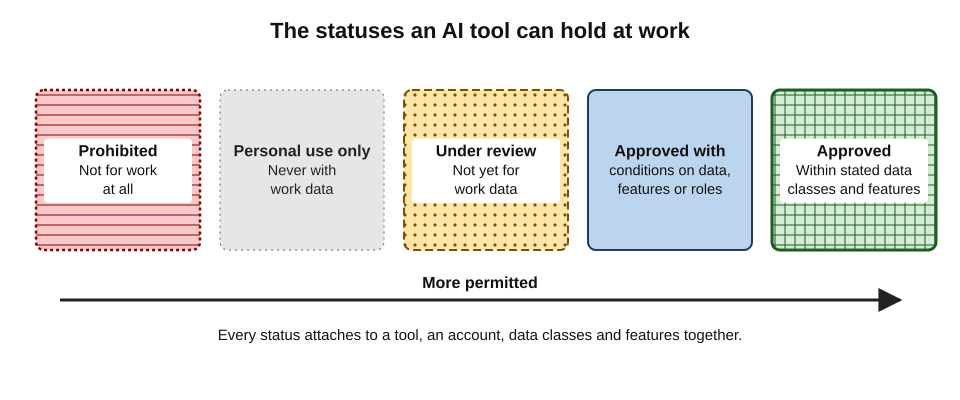
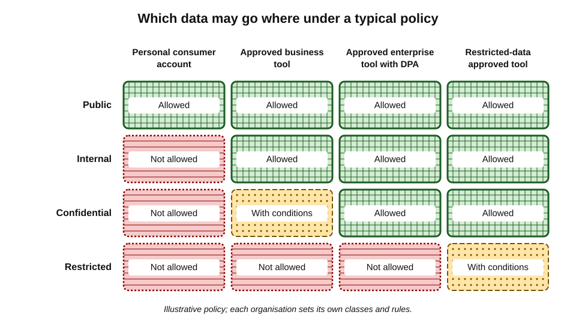
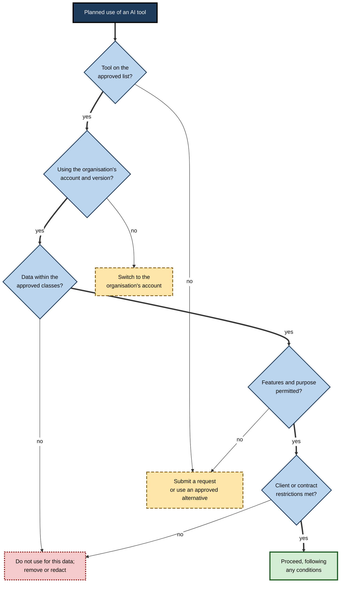
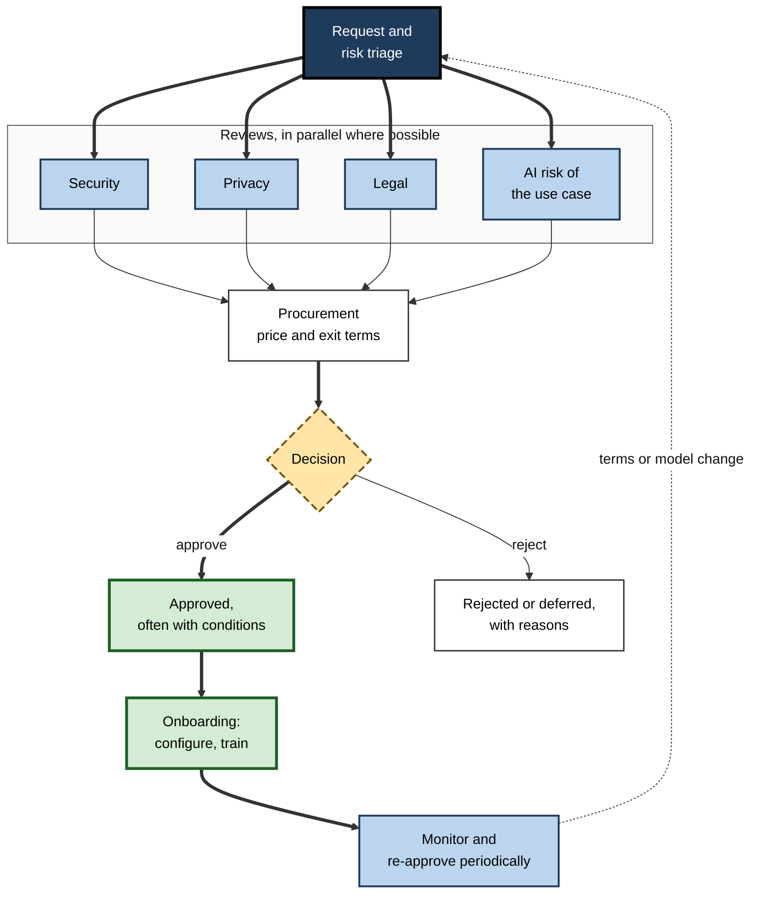
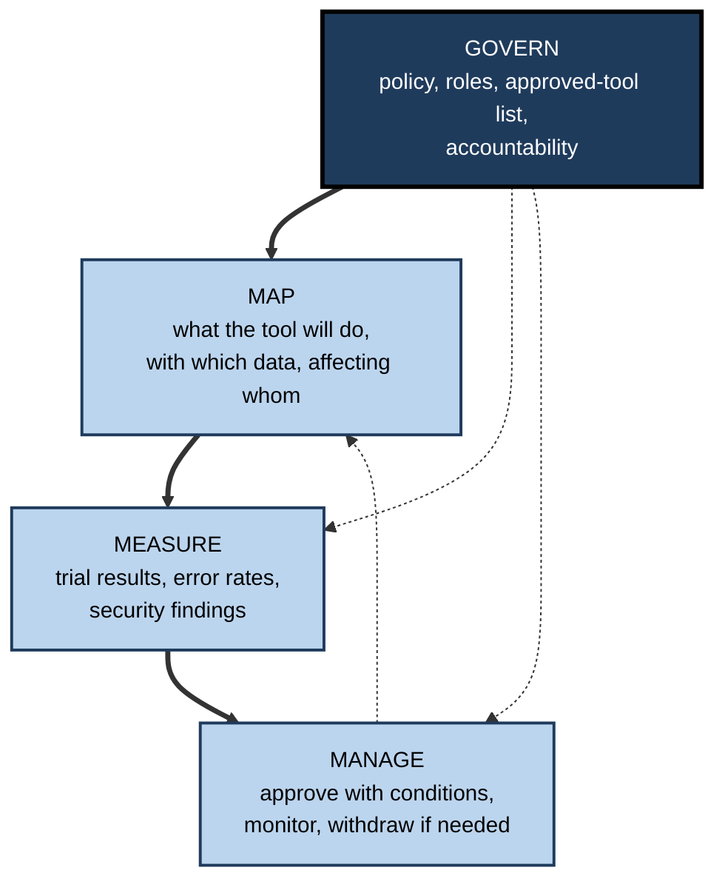

# C.7. Checking workplace approval

A new analyst finds an AI research tool that cuts a day's literature search to an hour. She signs up with her work email, connects it to her work drive "to make it easier", and shares the results with her team. A month later the security team finds the tool can read thousands of files it was never approved to see. She meant only to work well. What she skipped was one question: **is this tool approved, for this data, in this way?**

> **Definition — Workplace approval (of an AI tool):** an organisation's formal decision that a specific tool, under a specific account type and configuration, may be used by specified people for specified purposes and classes of data.

**Why approval matters**

- **The organisation is accountable** for what happens to its data, its clients' data and the personal data of its staff and customers — whichever employee chose the tool.
- **Approval encodes checks an individual cannot make alone** — security testing, contract negotiation, legal review, data-protection assessment.
- **Unapproved use can breach contracts and law** even when nothing goes visibly wrong.
- **Approval is a career matter** — many organisations treat unapproved use with confidential data as a disciplinary issue.

---

## Shadow AI

### What it is and how common it is

> **Definition — Shadow AI:** the use of AI tools at work without the knowledge or approval of the organisation's IT, security, privacy or risk functions.

- **Bring-your-own AI was the norm early on.**
  - Microsoft and LinkedIn's Work Trend Index (May 2024) reported that about three-quarters of surveyed knowledge workers used generative AI at work, and that most of those users — around **78%** — were bringing their own tools rather than using employer-provided ones.
- **It persisted after official tools arrived.**
  - Security-industry surveys in 2025–26 reported that roughly **half or more** of employees still used some AI tool their employer had not approved, with estimates ranging widely by survey and country.
  - Several surveys found **senior staff** at least as likely as junior staff to use unapproved tools.
- **It shows up in spending.**
  - A large software-spend analysis published in 2026 reported that expensed software purchases — bought on personal or corporate cards and claimed back — had risen sharply, with a consumer AI assistant the single most-expensed application.

> **Watch out:** shadow-AI statistics come mostly from **vendor surveys** of variable quality, with definitions of "unapproved" that differ. Precise percentages should not be trusted; the consistent finding is that **unapproved use is widespread, persistent and not confined to junior staff**.

### Why people use unapproved tools

- **The approved tool is weaker** or lacks a needed feature.
- **The approval process is slow** or opaque.
- **People do not know what is approved.**
- **Personal habits carry over** — a tool used at home becomes a tool used at work.
- **Nobody seems to mind** — no visible enforcement.

> **Key point:** shadow AI is usually a symptom of **unmet need plus unclear rules**, not of bad intent. Organisations that reduce it most effectively combine **capable approved tools**, **clear lists** and a **fast request route** — not bans alone.

### Why blanket bans tend to backfire

- **Use moves out of sight** — onto personal phones and home computers, where the organisation sees nothing.
- **The need remains** — the drafting, summarising and analysis work still has to be done.
- **Trust erodes** — staff learn that rules lag behind reality, and stop asking.
- **Learning stalls** — the organisation gains no experience of what works and what fails.

> **Watch out:** bans are sometimes right as a **temporary** measure while tools are assessed, or permanently for specific high-risk tools. As a lasting policy for all AI, they tend to convert visible use into invisible use.

---

## What Approval Actually Covers

Approval is rarely a simple yes or no. It typically specifies five things.

- **The tool** — product and version or tier.
- **The account** — organisational sign-in under business terms, not a personal account of the same brand.
- **The data** — which classes of data may be entered (public, internal, confidential, restricted).
- **The features** — which features are enabled (*e.g.* chat yes; connectors to the drive no; meeting recording only with consent).
- **The people and purposes** — which roles, for which tasks.

> **Mnemonic — "The Approved Data Fits People":** Tool, Account, Data, Features, People and purposes.

### Approval statuses

- **Approved** — may be used within stated data classes and features.
- **Approved with conditions** — usable only for certain data, roles, features or with extra steps (*e.g.* human review of all output sent to clients).
- **Under review** — not yet permitted for work data; sometimes permitted for public material.
- **Prohibited** — not to be used for work at all, often because of data terms, security findings or jurisdictional concerns.
- **Personal use only** — permitted on personal devices for non-work purposes, never with work data.

**Figure 1.** From prohibited to approved: the statuses an AI tool can hold.

### Data classes and tool tiers

Most organisations classify information into a few levels, and approve tools by level.

- **Public** — already published or intended for publication.
- **Internal** — routine business information not meant for outsiders.
- **Confidential** — client material, unreleased financials, contracts, personal data of staff or customers.
- **Restricted** — the most sensitive: health records, trade secrets, legal privilege, security credentials, special-category personal data.

> **Definition — Data classification:** a scheme assigning information to sensitivity levels, each with rules on who may access it and which tools and channels may handle it.

**Figure 2.** Which classes of data may go into which kinds of tool under a typical policy.

> **Remember:** approval attaches to **tool + account + data class + feature** together. "Copilot is approved" is incomplete; "the organisation's Microsoft 365 Copilot, signed in with a work account, approved for internal and confidential data, connectors limited to the user's own files" is an approval.

---

## How to Check, as an Employee

### Where the answer lives

- **The AI or acceptable-use policy** — the organisation's rules on AI use.
- **The approved-tool list or software catalogue** — often on the intranet or in the IT self-service portal.
- **The data-classification guide** — what counts as confidential or restricted.
- **The IT service desk or security team** — for tools not listed.
- **The manager** — for whether a use fits the team's work and client obligations.
- **The client contract or engagement terms** — for client-facing work.

### The questions to ask

1. **Is the tool on the approved list?**
2. **Under which account?** Is it the organisation's version, signed in with a work identity?
3. **For which data classes?** Does the intended data fall within them?
4. **Which features?** Are connectors, recording, memory or agents permitted?
5. **For which purposes?** Are there excluded uses (*e.g.* recruitment decisions, legal advice to clients)?
6. **Are there client or contract restrictions** on AI use for this work?
7. **Are there disclosure requirements** — must AI use be stated to the client, court or reader?

**Figure 3.** How an employee checks whether a planned use of an AI tool is approved.

> **Watch out:** silence is not approval. A tool that is not on a list, has not been blocked by the network and has not been mentioned by anyone is **unreviewed**, not approved.

### Features inside approved tools

- **New features arrive constantly** in approved tools — agents, connectors, recording, memory, image generation.
- **Approval of the tool may not extend to every new feature.**
  - *e.g.* a suite assistant approved for drafting may not be approved for recording client calls or for agents that send email.
- **Connectors deserve special care** — authorising access to a drive or mailbox can grant broad, lasting permissions.

> **Definition — OAuth consent (connector authorisation):** the step in which a user grants an application permission to access an account or data in another service on their behalf; the permission persists until revoked.

> **In practice:** security teams increasingly restrict which applications staff may authorise against work accounts, because a single click of "allow" can give a third-party AI tool read access to an entire mailbox or drive.

---

## Reading an AI Policy

An organisation's AI policy is the primary source of approval rules. A well-written policy answers a predictable set of questions; knowing them makes any policy faster to read.

- **Scope** — which tools, people (employees, contractors, interns) and activities it covers, including personal devices used for work.
- **Principles** — human accountability for outputs, honesty about AI use, respect for confidentiality and rights.
- **Approved tools and how to find the list** — usually a living register rather than a list inside the policy itself.
- **Data rules** — which data classes may be used with which tools; explicit prohibitions (credentials, special-category personal data, client secrets).
- **Prohibited uses** — *e.g.* making final decisions about people, generating content that impersonates others, bypassing security controls.
- **Required practices** — review of outputs before use, disclosure where required, record-keeping for significant uses.
- **Requesting new tools** — the route, the information needed, expected timescales.
- **Incidents** — what to do if data was entered wrongly or a tool behaved unexpectedly, and to whom to report it.
- **Consequences** — how breaches are handled.
- **Review date** — when the policy will be updated.

> **Key point:** the most useful sentences in an AI policy for daily work are usually the **data rules** and the **incident route**. A professional who knows those two can act correctly in most situations.

> **In practice:** if data is entered into an unapproved tool by mistake, the right action is to **stop, record what was shared, and report it promptly** through the incident route. Early reporting allows deletion requests, client notification where required, and lessons for others; concealment turns a mistake into misconduct.

---

## How Organisations Decide

### The approval pipeline

1. **Request and triage** — what tool, what use, what data, how many users; low-risk requests take a fast track.
2. **Security review** — vendor questionnaire, independent audit reports, encryption, access controls, single sign-on, incident history, sub-processors.
3. **Privacy review** — data-processing terms, international transfers, retention, and — for higher-risk uses — a data-protection impact assessment.
4. **Legal review** — terms of service, ownership of outputs, indemnities, liability, compliance with sector rules.
5. **AI-risk review** — what the use case decides or affects; whether it touches people's rights, safety, employment or access to services.
6. **Procurement** — price, licence model, contract length, exit terms.
7. **Decision** — approve, approve with conditions, defer or reject; record the reasons.
8. **Onboarding** — configuration, account provisioning, user guidance, training.
9. **Monitoring and review** — usage, incidents, changes to the vendor's terms or models; periodic re-approval.

**Figure 4.** The stages through which an organisation approves an AI tool.

### Risk-tiered approval

- **Low risk** — public data, low-stakes tasks, reputable vendor: a light, fast review.
- **Medium risk** — internal or confidential data, moderate stakes: full security and privacy review.
- **High risk** — restricted data, decisions about people, regulated activities, agents that act: full review plus ongoing monitoring and human oversight requirements.

> **Key point:** risk-tiered approval lets organisations say **yes quickly** to the many low-risk requests and reserve slow, careful review for the few that warrant it — the main remedy for the slowness that drives shadow AI.

### The governance frameworks behind approval

- **NIST AI Risk Management Framework (US National Institute of Standards and Technology, January 2023)** — four functions:
  - **Govern** — policies, roles, accountability, culture;
  - **Map** — understand the context, uses and potential impacts of an AI system;
  - **Measure** — assess and track risks and performance;
  - **Manage** — prioritise and act on risks, including decisions not to deploy.
  - A **Generative AI Profile** (July 2024) extended it to risks particular to generative tools, such as confabulation and data leakage.
- **ISO/IEC 42001 (2023)** — a certifiable standard for an organisation's AI management system.
- **EU AI Act** — in force from August 2024 with phased obligations:
  - prohibitions on certain practices and a duty on organisations to take measures for staff **AI literacy** applied from February 2025;
  - rules for general-purpose AI models from August 2025;
  - transparency duties for certain AI systems from August 2026;
  - obligations for high-risk systems — including AI used in recruitment and other employment decisions — deferred by a 2026 amending regulation to December 2027 for most standalone high-risk uses.
- **Data-protection law** — GDPR and UK GDPR in Europe; India's Digital Personal Data Protection Act 2023, with implementing rules notified in November 2025; sector regulators' rules.

**Figure 5.** The four functions of the NIST AI Risk Management Framework as they apply to approving tools.

> **Watch out:** the EU's 2026 amendments **softened** the AI-literacy duty from ensuring a sufficient level of staff literacy to taking measures towards it, and **deferred** high-risk obligations — but did not remove them. Commentators disagree about how much the changes reduce practical obligations; organisations operating in the EU still need to know which of their AI uses would count as high-risk.

---

## Approval Beyond the Employer

- **Clients** — engagement letters, outside-counsel guidelines and public-sector contracts increasingly state whether, how and with what disclosure AI may be used on the client's work.
- **Courts** — after the 2023 cases of invented citations, a number of judges in the United States and elsewhere issued standing orders or practice directions requiring lawyers to disclose or certify their use of generative AI in filings.
- **Regulators and professional bodies** — guidance from bar associations, medical councils, accounting bodies and financial regulators sets expectations for supervision and verification.
- **Publishers and academic institutions** — policies on whether AI may be used and how it must be acknowledged.

> **In practice:** a professional working for clients checks **three layers** — the employer's approval, the client's terms, and the profession's rules — before using AI on client work.

---

## Consequences of Unapproved Use

- **For the organisation:**
  - breach of client contracts, with possible claims or loss of the client;
  - data-protection breaches, which may require notification to regulators and affected people;
  - loss of trade secrets or legal privilege;
  - security exposure through unvetted connectors or browser extensions;
  - unbudgeted spending and duplicated tools.
- **For the individual:**
  - disciplinary action under the employment contract or policy;
  - professional-conduct consequences in regulated professions;
  - loss of trust, which often matters more than any formal sanction.
- **For the people whose data was involved:**
  - their information placed under terms they never agreed to, possibly in other jurisdictions.

> **Watch out:** the argument "the output was good and nothing leaked" does not answer the problem. Many obligations are breached at the moment data is **shared**, regardless of outcome.

### Disclosure as part of approval

- **Some approvals carry a duty to disclose** — to clients, readers, courts or examiners — that AI was used and how.
- **Disclosure rules vary**: a short statement in a report; a certification in a court filing; an acknowledgement in an academic paper.
- **Disclosure does not replace approval** — telling a client a tool was used does not make an unapproved tool acceptable.

---

## Making a Good Request

When a needed tool is not approved, a well-framed request is faster than a workaround.

- **The task** — what work, how often, by how many people.
- **The data** — which classes would be involved, and whether the task could be done with less.
- **The alternatives** — why existing approved tools do not suffice, with specific gaps.
- **The tool and tier** — the business or enterprise version, with links to its terms and security documentation obtained from the vendor.
- **The benefit** — estimated time saved or quality gained, ideally from a quick trial on public data.
- **The risks and mitigations** — human review, restricted features, limited users.
- **The trial proposal** — a small, time-boxed pilot with defined measures.

> **Example (illustrative):** "Our five-person research team needs to summarise 30–50 public regulatory consultations a month. The approved suite assistant cannot process documents over 100 pages. We request a four-week pilot of the business tier of a named document-analysis tool, for **public documents only**, with connectors disabled. A quick test on three public consultations saved about 90 minutes each. Vendor security report and data-processing terms attached."

> **Key point:** requests that specify **data class, features and a bounded pilot** are approved far more readily than requests for a tool "for general use".

---

## Small Organisations and Independent Professionals

Where there is no IT department, the professional must perform the approval role personally.

- **Read the terms** of the business tier, especially training, retention and human review.
- **Check client contracts** for restrictions on third-party processing and AI use.
- **Prefer business accounts** with data-processing terms, even for a team of one or two.
- **Keep a short register** — tool, account, approved data classes, date terms were checked.
- **Tell clients** where their contracts or professional rules require it.
- **Revisit** when terms, prices or features change.

> **Watch out:** "there is nobody to ask" does not remove the obligation — it transfers it. A freelance professional is the controller, the security team and the legal department for their own practice.

### Personal devices and blurred boundaries

- **The same assistant may serve home and work** — on the same phone, under different accounts.
- **Typical rules:**
  - work data only in the organisation's account, on managed apps or devices;
  - no photographing of work screens or documents into personal AI apps;
  - no forwarding of work email to personal accounts for AI processing;
  - personal use of AI on personal devices is the individual's own business — until work data enters it.
- **Voice and camera features** — asking a phone assistant about a document on a desk, or a meeting overheard in the room, can move work information into a personal account without any typing.

> **Remember:** the boundary that matters is not the **device** but the **account and the data**. Work data belongs only in accounts the organisation controls and has approved.

---

## Worked Example (illustrative): Three Requests, Three Outcomes

*Names, organisations and numbers in this example are illustrative figures.*

**Situation:** the AI governance group of a 2,000-person engineering consultancy reviews three requests in one week.

| Request | Data | Risk tier | Decision | Conditions |
|---|---|---|---|---|
| Image generator for internal presentation graphics | Public and internal prompts | Low | Approved | Business account; no client logos or likenesses; outputs labelled as AI-generated in client decks |
| Meeting assistant to record and summarise client calls | Confidential client discussions, personal data | Medium–high | Approved with conditions | Recording only with announced consent; summaries reviewed before sharing; data stored in-region; 90-day retention |
| AI tool to rank job applicants' CVs | Applicants' personal data; decisions about people | High | Deferred | Bias testing, human decision-maker, impact assessment and legal review required first |

**What the example shows**

1. **Same organisation, three different answers** — because data and stakes differ, not because one tool is "good".
2. **Conditions do most of the work** — the meeting assistant is usable because of its conditions.
3. **Decisions about people** trigger the most scrutiny, under both data-protection law and AI-specific regulation.

> **Remember:** approval is a decision about a **use**, not just a **product**.

---

## Case Study: From Ban to Approved Platform

- **Situation:** in early 2023 JPMorgan Chase, like several other large banks and companies, restricted employees' use of a public chat assistant at work, citing concerns about third-party software and client information.
- **The underlying need did not disappear:** staff wanted help with drafting, summarising and analysis.
- **What the bank did instead:**
  - built an internal generative-AI platform, reported as **LLM Suite**, giving employees access to large language models from external providers through the bank's own controlled environment;
  - rolled it out during 2024 to a large share of its workforce, reported as reaching hundreds of thousands of employees;
  - kept data within the bank's governed systems and terms, with monitoring.
- **Result:** reported widespread use for writing, summarising and idea generation within approved boundaries — and a single sanctioned route replacing scattered personal accounts.
- **Lesson:** bans buy time; they do not meet the need. Lasting control comes from an **approved, capable alternative** with clear rules on data.

> **Watch out:** details of internal platforms come mainly from company statements and press reports; independent measures of their benefit are scarce. The structural lesson — that capable approved tools reduce shadow use more than prohibition — is widely shared among security and risk practitioners, though rarely measured rigorously.

---

## Mastery: How Experienced Professionals Handle Approval

- **They check before first use,** not after the work is done.
- **They check the account,** not just the brand.
- **They classify the data** before choosing the tool.
- **They treat new features as new approvals** where connectors, recording or agents are involved.
- **They request rather than work around** — with a bounded, evidenced request.
- **They help the system work** — reporting tools colleagues are using, sharing successful approved uses, flagging gaps.
- **They keep records** of what was approved and when, for themselves and their teams.

> **Watch out:** the most common senior-level failure is assuming that seniority implies approval. Policies apply to partners, directors and executives — and their data is often the most sensitive in the organisation.

---

## Open Questions

- **Can approval keep pace with AI releases?**
  - Vendors add features weekly; review processes designed for annual software purchases struggle. Continuous, feature-level approval is an unsolved operational problem.
- **How should approval handle agents?**
  - Tools that act across systems need permissions-based approval — what the tool may do, not just what it may see — and practices are still forming.
- **Does approval reduce shadow AI?**
  - Practitioners believe capable approved tools reduce it, but rigorous evidence is thin and survey data are noisy.
- **How much will regulation drive approval?**
  - The EU's deferral and softening of some obligations in 2026, and divergent approaches elsewhere, leave the regulatory pressure on everyday tools uncertain.
- **Who approves AI use by individuals on their own devices?**
  - The boundary between personal and work use is blurred when the same assistant serves both.

---

## Summary

- **Approval** is a decision that a specific **tool + account + data class + feature** may be used by specified people for specified purposes.
- **Shadow AI** is widespread and persistent — about **78%** of AI users brought their own tools in 2024; 2025–26 surveys suggest around half or more still use unapproved tools — driven by **unmet need and unclear rules**.
- Statuses: **approved, approved with conditions, under review, prohibited, personal use only**. Silence is not approval.
- Data classes — **public, internal, confidential, restricted** — determine which tools may be used.
- Employees check the **policy, approved list, classification guide, service desk, manager and client terms**, asking about tool, account, data, features, purpose, contract and disclosure.
- New **features** and **connectors** may need their own approval; OAuth consent grants lasting access.
- Organisations approve through **triage → security, privacy, legal, AI-risk review → procurement → decision → onboarding → monitoring**, tiered by risk.
- Frameworks: **NIST AI RMF** (Govern, Map, Measure, Manage), **ISO/IEC 42001**, the **EU AI Act** (literacy since 2025; high-risk deferred to 2027–28), data-protection law.
- Beyond the employer: **clients, courts, regulators, professional bodies**.
- A good request specifies **task, data, alternatives, tier, benefit, mitigations, pilot**.
- Bans buy time; **capable approved tools** with clear rules meet the need.

---

## Self-Check

1. Define workplace approval and name its five components.
2. What is shadow AI, and what are its main causes?
3. Why should shadow-AI percentages be treated with caution?
4. List the five approval statuses.
5. Name four data classes and give an example of each.
6. Why is "Copilot is approved" an incomplete statement?
7. List seven questions an employee should ask before using a tool.
8. Why can a connector be riskier than the chat feature of the same tool?
9. Describe the stages of an organisational approval pipeline.
10. What is risk-tiered approval, and how does it reduce shadow AI?
11. State the four functions of the NIST AI RMF.
12. Summarise the EU AI Act's phased obligations as they stood in late 2026.
13. In the worked example, why was the CV-ranking tool deferred?
14. A colleague says: "No one has blocked this tool on the network, so it must be fine for client documents." Respond.

### Answer Key

1. A formal decision that a specific tool, account and configuration may be used by specified people for specified purposes and data. Components: tool, account, data classes, features, people and purposes.
2. Use of AI tools without the knowledge or approval of IT, security, privacy or risk functions. Causes: weaker approved tools, slow approval, unclear lists, personal habits, lack of enforcement.
3. They come mainly from vendor surveys with varying samples and definitions; the reliable finding is directional — widespread, persistent use.
4. Approved; approved with conditions; under review; prohibited; personal use only.
5. Public (a published press release); internal (an internal process guide); confidential (a client contract; staff personal data); restricted (health records, trade secrets, privileged legal advice, credentials).
6. It omits the account type, permitted data classes, enabled features and permitted users and purposes — a personal account of the same brand would not be approved.
7. On the list? Which account? Which data classes? Which features? Which purposes? Client or contract restrictions? Disclosure requirements?
8. Authorising a connector can grant broad, lasting access to a mailbox or drive, beyond what the user intended to share in a single conversation.
9. Request and triage; security, privacy, legal and AI-risk reviews; procurement; decision; onboarding; monitoring and periodic re-approval.
10. Light, fast review for low-risk requests and full review for high-risk ones; quicker yeses remove the delay that pushes people to unapproved tools.
11. Govern, Map, Measure, Manage.
12. In force from August 2024; prohibitions and an AI-literacy duty (softened in 2026 to taking measures) from February 2025; general-purpose AI rules from August 2025; transparency duties from August 2026; most standalone high-risk obligations deferred to December 2027 and product-embedded ones to August 2028.
13. It makes or influences decisions about people using personal data — high risk under data-protection and AI regulation — so bias testing, human decision-making, an impact assessment and legal review were required first.
14. Not being blocked means unreviewed, not approved. Check the approved list, the account type and the permitted data classes; client documents are usually confidential and need an approved tool and possibly client consent; if the tool is needed, submit a request.

---

## Glossary

| Term | Meaning |
|---|---|
| Acceptable-use policy | An organisation's rules on how staff may use technology, including AI tools. |
| AI literacy | The knowledge and skills needed to use AI tools appropriately, which the EU AI Act requires organisations to support. |
| Approved with conditions | Permission limited by data class, feature, role or extra safeguards. |
| Approved-tool list | An organisation's published register of tools and the uses permitted for each. |
| Bring-your-own AI | Staff using AI tools they chose themselves rather than employer-provided ones. |
| Data classification | Assigning information to sensitivity levels with rules for handling. |
| Data-protection impact assessment | A structured assessment of risks to individuals from a planned processing activity. |
| High-risk AI system | Under the EU AI Act, an AI system in listed sensitive uses such as employment decisions. |
| NIST AI RMF | US framework for AI risk management: Govern, Map, Measure, Manage. |
| OAuth consent | A user's grant of lasting access to an account or data for another application. |
| Risk-tiered approval | Review whose depth depends on the risk of the requested use. |
| Shadow AI | AI use at work without the knowledge or approval of the responsible functions. |
| Vendor security questionnaire | A standard set of questions an organisation asks suppliers about their security. |
| Workplace approval | A formal decision permitting a tool, account and configuration for defined uses and data. |
