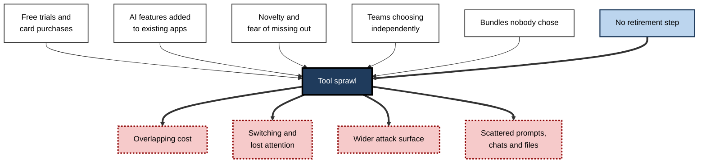
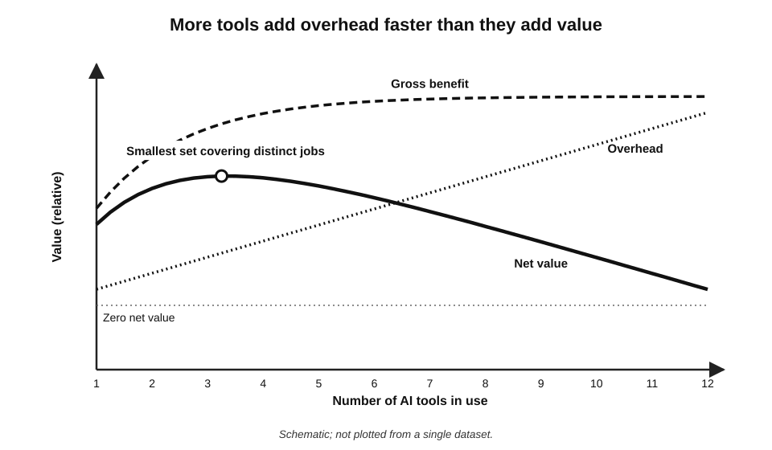
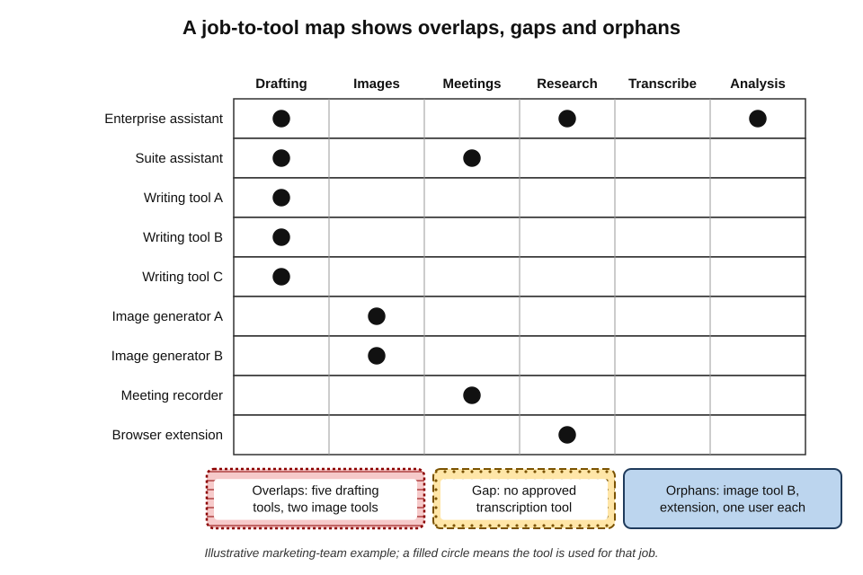
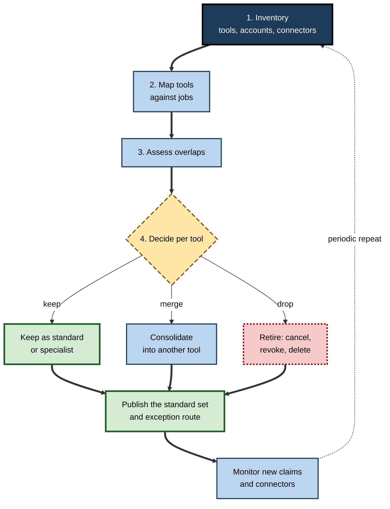
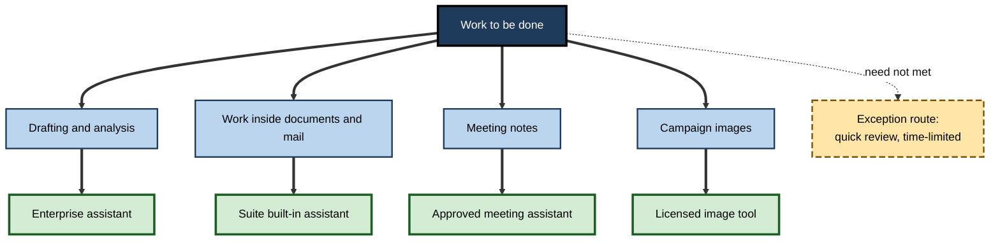

# C.8. Avoiding tool sprawl

A nine-person marketing team lists every AI tool it uses. The count reaches fourteen: two general assistants, three writing tools, two image generators, a meeting recorder, a transcription app, a slide maker, two browser extensions and a "research copilot" one person bought on a card. Three of the writing tools do the same thing. Two people pay personally for subscriptions the firm already licenses. Nobody knows which tools have access to the shared drive. No single purchase was foolish; together they are **sprawl**.

> **Definition — Tool sprawl:** the uncontrolled growth in the number of tools used by a person, team or organisation, beyond what the work requires, producing overlapping functions, scattered data, rising cost and weakened control.

**Why sprawl matters**

- **Money** — overlapping subscriptions and unused seats are pure waste.
- **Attention** — every extra tool adds switching, logging in and remembering where things are.
- **Security** — every tool is another vendor holding data and another set of permissions to manage.
- **Quality** — different tools produce different styles, standards and errors for the same task.
- **Knowledge** — prompts, conversations and custom assistants end up scattered across accounts nobody else can see.

---

## How Sprawl Happens

### The causes

- **Low barriers to entry** — free tiers, trials and card payments let anyone start a tool in minutes.
- **AI added to everything** — almost every existing application has gained AI features, so the number of AI tools grows even when no new product is bought.
- **Novelty and fear of missing out** — a stream of launches invites trying each one.
- **Team autonomy** — teams choose their own tools, so the same need is met differently in each.
- **Vendor bundles** — suites include AI features nobody chose, alongside the standalone tools teams already bought.
- **No retirement** — tools are adopted but rarely removed; trials quietly become subscriptions.
- **Unmet need** — when the approved tool cannot do something, people add another tool rather than ask.

**Figure 1.** How individual reasonable decisions add up to sprawl.

> **Key point:** sprawl is an **emergent** problem — it results from many decisions that each look reasonable. It cannot be prevented by judging tools one at a time; it needs a view of the **whole set**.

### The evidence on scale

- **Software portfolios are large.** An industry analysis of organisational software spending published in 2026 reported that the average organisation it studied used around **300 applications**, at a cost of tens of millions of US dollars a year.
- **AI is the fastest-growing category.** The same analysis reported spending on AI-native applications roughly **doubling** year on year overall, and rising several-fold in the largest organisations.
- **Much arrives outside procurement.** Expensed software purchases — bought on cards and claimed back — rose sharply, and a consumer AI assistant was the single most-expensed application.
- **Turnover is high.** Large enterprises were adding around twenty applications a month even while total application counts stayed roughly flat — suggesting constant churn rather than stable portfolios.

> **Watch out:** these figures come from a software-management vendor analysing its own customers, who are disproportionately large organisations already concerned about software costs. They indicate direction and scale, not precise averages for every organisation.

### Why sprawl persists

- **Benefits are private; costs are shared.**
  - The person who adds a tool gains its convenience at once.
  - The costs — another vendor to assess, another connector to monitor, another subscription in the budget, another place where knowledge hides — fall on the team or organisation, later and diffusely.
- **Adding is easy; removing is hard.**
  - Adopting a tool takes minutes; retiring one requires migrating templates, finding past work, persuading users and cancelling contracts.
- **Nobody owns the whole.**
  - Each tool may have a user or a buyer, but no one is answerable for the total set.
- **Usage is invisible.**
  - Without data on who uses what, idle tools look identical to valuable ones.

> **Definition — Externality:** a cost or benefit of a decision that falls on people other than the decision-maker. Much of the cost of an extra AI tool is an externality borne by colleagues, security teams and budgets.

> **Key point:** because the person adding a tool rarely bears its full cost, sprawl will grow by default. Control requires **making the shared costs visible** — through inventories, owners and simple indicators — and **making the standard route easier than the workaround**.

---

## The Costs of Sprawl

### Money

- **Duplicate subscriptions** — the same capability bought several times by different people.
- **Unused seats** — licences bought for whole teams and used by a few.
- **Personal spending** — staff paying privately for tools the organisation already provides, or that it should provide.
- **Lost bargaining power** — many small contracts cost more per seat than one consolidated agreement.

> **Formula — Annual cost of overlap:** Σ (cost of each tool whose main job is already covered by another tool in use). Illustrative example: a team pays for three writing assistants at £15, £18 and £20 per user per month for 9 users; if one would serve, the overlap costs (£18 + £20) × 9 × 12 = **£4,104 a year** — before counting time.

### Attention

**Study card — Murty, Jaffe and colleagues (Harvard Business Review, 2022)**

- **Method:** tracked the application use of 137 workers in three large companies over several weeks.
- **Finding:** workers switched between applications and websites around **1,200 times a day**.
- **Estimated cost:** re-orienting after each switch added up to roughly **four hours a week** — about 9% of working time.
- **Conclusion:** the cost of switching is small per instance and large in total; adding tools adds switches.

> **Definition — Context switching:** shifting attention from one tool, task or information source to another, with a cost in time and mental effort to reorient.

> **Watch out:** the often-repeated claim that every interruption costs "23 minutes" to recover from comes from field observation of particular office workers and is frequently stretched beyond what the research showed. The defensible conclusion is narrower: **switching has real costs that accumulate**, and the number of tools in a workflow increases the number of switches.

### Security and data

- **Every tool is a vendor** with its own terms, sub-processors and breach risk.
- **Every connector is a door** — authorised access to drives, mailboxes or code repositories that persists until revoked.
- **Browser extensions** with AI features often request permission to read every page the user visits.
- **Offboarding gaps** — when people leave, personal accounts on unmanaged tools leave with them, along with any work content inside.

> **Definition — Attack surface:** the total set of points at which an organisation's systems or data could be accessed or exposed; each additional tool, account and connector enlarges it.

### Quality and consistency

- **Different tools, different outputs** — tone, structure and error patterns vary.
- **Inconsistent standards** — one team's summaries cite sources; another's do not.
- **Harder review** — reviewers must learn the quirks of many tools.

### Knowledge

- **Scattered conversations** — useful analyses buried in personal chat histories.
- **Unshared prompts and assistants** — good practice stays with individuals.
- **Lost work** — when a tool is dropped or an account closed, its history goes too.

| | A small, standard set of tools | A sprawling set of tools |
|---|---|---|
| Cost per capability | Lower; consolidated contracts | Higher; duplicates and idle seats |
| Switching | Few tools per workflow | Many tools, many switches |
| Data exposure | Few vendors, known connectors | Many vendors, unknown connectors |
| Output consistency | Shared standards and templates | Varies by tool and person |
| Shared learning | Prompts and practices pooled | Practices stay with individuals |
| Flexibility | Exceptions by request | Anyone can add anything |

---

## The Value Curve of Tools

The value a person or team gains from AI tools does not rise with the number of tools.

- **The first tool** — large gain over no AI.
- **The second or third** — gains where they cover genuinely different jobs (a general assistant plus a specialist, or plus a built-in tool).
- **Beyond that** — each additional tool covers less new ground and adds fixed costs of learning, switching, paying and governing.
- **Eventually** — net value falls: the portfolio costs more attention and risk than it returns.

**Figure 2.** Net value rises with the first few tools and then falls as overlap and overhead accumulate.

> **Key point:** the right number of tools is the **smallest set that covers the distinct jobs** the work requires — not the largest set anyone might find useful.

---

## Seeing the Whole Set: the Inventory

### Where to look

- **Single sign-on logs** — which applications staff sign into with work identities.
- **Connector and OAuth grants** — which third-party applications have access to email, files and calendars.
- **Expense claims and card statements** — subscriptions bought outside procurement.
- **Network and browser data** — AI websites and extensions in use.
- **Software catalogues and contracts** — what is officially licensed, including bundled AI features.
- **Asking people** — a short survey or team discussion often reveals tools no system shows.

> **In practice:** organisations starting an inventory are routinely surprised by the count — commonly finding several times more AI tools in use than they had approved — because expense claims, extensions and personal accounts are invisible to normal IT records.

### The job-to-tool map

- **List the distinct jobs** the team uses AI for — drafting, summarising, meeting notes, research, image creation, analysis, coding.
- **List the tools** in use.
- **Mark which tool is used for which job,** by how many people.
- **Read the map** for:
  - **overlaps** — several tools on one job;
  - **gaps** — jobs with no approved tool, a driver of shadow use;
  - **orphans** — tools used by one person for one job;
  - **multi-job tools** — tools covering several jobs, candidates to become standards.

**Figure 3.** A job-to-tool map revealing overlaps, gaps and orphans in the marketing team's tools.

---

## Rationalising: From Sprawl to a Standard Set

### The process

1. **Inventory** — find every tool, account, connector and subscription.
2. **Map** — tools against jobs, users and data classes.
3. **Assess** — for each overlap, compare capability, data terms, cost and use.
4. **Decide** — for each tool: keep as standard, keep as specialist, consolidate into another, or retire.
5. **Migrate** — move users, templates, prompts and needed history to the chosen tools.
6. **Retire** — cancel subscriptions, revoke connectors, delete data held by retired vendors.
7. **Set the standard** — publish the standard set and how to request exceptions.
8. **Monitor** — repeat the inventory periodically; watch new expense claims and connectors.

**Figure 4.** The cycle of rationalising a sprawling set of AI tools.

### Standards and exceptions

- **The standard set** — the default tools for each job, approved, configured and supported.
  - Sometimes called the **"paved road"**: the easy, supported route that most people should take.
- **The exception route** — a quick way to request a different tool when the standard genuinely does not fit.
  - Exceptions are recorded, time-limited and reviewed.
- **The balance** — standards without exceptions push people to shadow tools; exceptions without standards recreate sprawl.

> **Definition — Paved road:** a set of standard, supported tools and practices made the easiest option, so that most people choose them by default while exceptions remain possible.

> **Mnemonic — "Find, Fit, Fold, Free, Fix":** Find every tool; Fit tools to jobs; Fold overlaps together; Free the organisation of retired tools; Fix the standard and monitor it.

### Preventing regrowth

- **One in, one out** — a new tool for a job means retiring the old one, or explaining why both are needed.
- **Trial expiry** — trials end automatically unless a decision is made.
- **Card controls** — software purchases routed through a light approval step.
- **Connector controls** — only approved applications may be authorised against work accounts.
- **Owners** — every tool has a named owner responsible for its cost, configuration and retirement.
- **Periodic review** — the inventory repeated at a regular interval.

> **Watch out:** rationalisation is not a one-off clean-up. Because AI features arrive inside existing software every month, a portfolio left alone for a year will sprawl again.

---

## Sprawl Inside Existing Software

A distinctive feature of AI sprawl is that much of it arrives **without any purchase at all**.

- **Feature sprawl** — the office suite, the CRM, the design tool, the video-conferencing service and the browser each add their own assistant.
  - A single employee may have five or six "AI buttons" in the applications open on a normal day, each with different abilities, data access and terms.
- **Overlapping assistants** — the email client, the operating system and the browser may all offer to summarise the same message.
- **Different data reach** — one assistant sees only the open document; another can search the whole drive; a third reads every open tab.
- **Different terms** — each feature runs under its host product's agreement, which may or may not have been reviewed for AI use.

> **Definition — Feature sprawl:** the multiplication of AI features inside software already in use, producing overlapping assistants with differing capabilities, data access and terms.

- **Managing it:**
  - decide which built-in assistant is the **default** for each kind of work;
  - switch off or restrict AI features that duplicate the default and add risk;
  - review new features as they arrive rather than discovering them in use.

> **Watch out:** counting "AI tools bought" understates sprawl badly. An organisation that has purchased only two AI products may have a dozen active AI features — each one able to read work data — inside software bought for other reasons.

---

## Measuring Sprawl

What is measured is managed. A few simple indicators reveal whether a tool set is under control.

- **Tools per job** — how many tools serve each distinct job; more than one or two signals overlap.
- **Licence utilisation** — the share of paid seats used in the last month.
- **Cost per active user** — total spending divided by people who actually use the tool.
- **Share of spend outside procurement** — expensed or card purchases as a fraction of all AI spending.
- **Connectors per user** — third-party applications holding access to each person's email, files or calendar.
- **Unowned tools** — tools in use with no named owner.

> **Formula — Cost per active user:** annual cost ÷ number of people using the tool at least monthly. Illustrative example: 50 seats at £300 a year each (£15,000), used monthly by 18 people, cost £15,000 ÷ 18 ≈ **£833 per active user** — nearly three times the list price per seat.

> **In practice:** a short dashboard of these six indicators, reviewed each quarter, catches regrowth early — long before a full inventory is needed.

**Figure 5.** A paved road: one default tool per job, with a route for justified exceptions.

### Who owns the tool set

- **Tool owners** — responsible for each tool's configuration, cost, users and eventual retirement.
- **A small governance group** — security, privacy, procurement, IT and representatives of the main user groups; decides the standard set and exceptions.
- **Team leads** — know their team's jobs and spot gaps before people fill them with unapproved tools.
- **Every user** — reports tools in use, follows the standard, requests exceptions rather than working around.

> **Key point:** sprawl is prevented less by rules than by **ownership** — when every tool has someone answerable for whether it is still needed, retirement actually happens.

---

## Personal Sprawl

Individuals sprawl too: five chat assistants, three note-takers, several browser extensions, each with a different login and history.

- **Symptoms:**
  - forgetting which tool holds a useful past conversation;
  - paying for overlapping subscriptions;
  - spending time comparing tools instead of doing the work;
  - constant re-learning as each tool changes.
- **Remedies:**
  - **one primary assistant** for general work, learned deeply;
  - **one built-in tool** used where the content lives;
  - **at most one or two specialists** for distinct jobs;
  - **periodic pruning** of accounts, extensions and subscriptions;
  - **one place for reusable prompts** and instructions, independent of any tool.

> **Example (illustrative):** a consultant who had accumulated six AI tools kept one enterprise assistant, the suite's built-in assistant and one approved transcription tool. Within a month she reported finding past work faster and spending less time deciding which tool to open — though she lost one niche feature she occasionally missed.

> **Key point:** depth with a few tools usually beats breadth across many. Skill in instructing, checking and configuring a tool accumulates; it is reset each time a new tool is adopted.

---

## Worked Example (illustrative): Rationalising the Marketing Team

*Names, organisations and numbers in this example are illustrative figures.*

**Situation:** the nine-person marketing team from the opening completes its inventory.

**Step 1 — inventory and annual cost**

| Tool | Job | Users | Annual cost | Data terms |
|---|---|---|---|---|
| Enterprise general assistant (firm-wide) | Drafting, research, analysis | 9 | Paid centrally | Business, training excluded |
| Suite built-in assistant | Drafting in documents, email summaries | 9 | Bundled | Business |
| Writing tool A | Drafting copy | 4 | £720 | Business |
| Writing tool B | Drafting copy | 3 | £648 | Consumer |
| Writing tool C | Drafting copy | 2 | £480 | Consumer |
| Image generator A | Campaign images | 3 | £1,080 | Business, commercial licence |
| Image generator B | Campaign images | 1 | £120 | Consumer, unclear commercial use |
| Meeting recorder | Meeting notes | 2 | £360 | Consumer |
| Other small tools and extensions | Various | 1–2 each | £540 | Mostly consumer |

**Step 2 — find overlaps, gaps and risks**

- **Drafting:** five tools — the enterprise assistant and built-in assistant already cover it.
- **Images:** two tools — one with a commercial licence, one without.
- **Meeting notes:** a consumer recorder used on client calls — a data and consent risk.
- **Gap:** no approved tool for transcription of recorded interviews.

**Step 3 — decide**

- **Retire** writing tools A, B and C — after confirming their templates can be rebuilt in the enterprise assistant.
- **Keep** image generator A as the specialist; **retire** B.
- **Replace** the consumer meeting recorder with the firm's approved meeting assistant.
- **Request** an approved transcription tool to fill the gap.
- **Remove** extensions with broad page-reading permissions.

**Step 4 — the result**

> **Formula — Savings from rationalisation:** £720 + £648 + £480 + £120 + £360 + £540 = **£2,868 a year** in subscriptions, plus reduced switching, three fewer vendors holding consumer-term copies of work, and one consent risk removed.

> **Watch out:** the largest benefit here is not the £2,868. It is ending the use of **consumer-term tools for work data** and a **commercially unlicensed image tool** for campaigns — risks whose cost, if realised, would dwarf the subscription savings.

---

## Case Study (illustrative): A Consultancy Untangles Its AI Tools

- **Situation:** a 300-person consultancy, two years into generative AI, had no central view of AI tools. A security review prompted an inventory.
- **Findings:**
  - more than **forty** AI tools in use across the firm, most bought on cards or used on free tiers;
  - six separate writing assistants and four meeting recorders;
  - several dozen third-party applications holding OAuth access to staff mailboxes or drives, many authorised once during a trial and forgotten;
  - partners paying personally for premium consumer plans and using them with client documents.
- **Actions:**
  1. revoked unapproved connector grants after notice to staff;
  2. published a **standard set**: one enterprise assistant, the suite assistant, one approved meeting assistant, one image tool with a commercial licence, and a coding assistant for the technology practice;
  3. created a **two-day exception route** for other tools with a named reviewer;
  4. reimbursed and closed personal subscriptions used for work;
  5. assigned an owner and an annual review date to every approved tool.
- **Result (first year):**
  - AI tool count fell to under ten approved tools plus a handful of time-limited exceptions;
  - subscription spending fell while use of the standard tools rose;
  - staff reported less confusion about which tool to use;
  - exception requests revealed two genuine gaps, both filled.
- **Side effects:** a minority of staff missed niche tools; two exceptions were later added to the standard set because demand proved broad.
- **Lesson:** rationalisation worked because it paired **removal** with a **capable standard** and a **fast exception route** — not because it imposed a smaller list.

> **In practice:** organisations that cut tools without meeting the need behind them usually see shadow use reappear within months.

---

## Mastery: How Experienced Leaders Manage the Tool Set

- **They manage the portfolio, not just purchases.**
- **They count connectors as tools** — access is the real exposure.
- **They design the paved road** to be easier than the alternatives.
- **They make exceptions fast** and learn from them.
- **They assign owners** with responsibility for retirement as well as adoption.
- **They separate capability from product** — "we need meeting summaries" before "we need product X".
- **They expect regrowth** and schedule the next inventory.

### Agents and the next wave of sprawl

- **Agents multiply identities** — each agent may hold its own credentials, connectors and permissions to act in other systems.
- **Agents are easy to create** — many platforms let any user build an agent or automated workflow in minutes.
- **Agents outlive their creators' attention** — an automation built for a project may keep running, reading and sending long after the project ends.
- **Implication:** the inventory must include **agents and automations**, not only applications, and each must have an owner and an end date.

> **Watch out:** industry analysts in 2025 warned that a large share of early "agentic AI" projects would be abandoned within a few years because of unclear value and rising cost — and abandoned agents that are never switched off are a particularly hazardous form of sprawl.

> **Remember:** **inventory, map, consolidate, retire, standardise, monitor** — and keep the exception route open.

---

## Open Questions

- **What is the right size of an AI tool set?**
  - There is little research on optimal portfolio size for knowledge work; the answer likely depends on how varied the jobs are.
- **Will consolidation into suites reduce sprawl or create dependence?**
  - Fewer tools may mean deeper reliance on one vendor; the trade-off between sprawl and concentration is unresolved.
- **How should built-in AI features be counted?**
  - Every application gaining AI makes "number of AI tools" an unstable measure.
- **Do standard sets slow innovation?**
  - Constraining tools may limit discovery of better ones; how to balance exploration and standardisation is debated.
- **How much does switching really cost?**
  - Measurements exist for application switching generally; specific evidence for AI tool switching is thin.

---

## Summary

- **Tool sprawl** is the uncontrolled growth of tools beyond what work requires, bringing overlap, scattered data, rising cost and weakened control.
- Causes: **low barriers, AI added to everything, novelty, team autonomy, unchosen bundles, no retirement, unmet need**. Sprawl is **emergent**.
- 2026 industry data: AI-native application spending growing fastest, much of it **expensed outside procurement**, with high churn.
- Costs: **money** (duplicates, idle seats), **attention** (around 1,200 application switches a day in one 2022 study), **security** (vendors, connectors, extensions), **quality**, **knowledge**.
- **Net value** rises with the first few distinct tools and then falls.
- **Inventory** from sign-on logs, connector grants, expenses, network data, catalogues and people; build a **job-to-tool map** to find overlaps, gaps and orphans.
- **Rationalise:** inventory, map, assess, decide, migrate, retire, standardise, monitor; provide a **paved road** with a fast **exception route**.
- **Prevent regrowth:** one in, one out; trial expiry; card and connector controls; owners; periodic review.
- **Personal sprawl** is cured by depth with a few tools.

---

## Self-Check

1. Define tool sprawl and explain why it is called emergent.
2. List six causes of sprawl.
3. What did the 2026 software-spend analysis report, and what are its limitations?
4. Summarise the 2022 application-switching study.
5. Why is the "23-minute" interruption figure a weak basis for argument?
6. Calculate the annual overlap cost if a team of 12 pays for two writing tools at £16 and £22 per user per month and only one is needed.
7. Name five places to look when building an inventory of AI tools.
8. What do overlaps, gaps and orphans on a job-to-tool map indicate?
9. Describe the eight steps of rationalisation.
10. What is a paved road, and why does it need an exception route?
11. Give four measures that prevent sprawl from regrowing.
12. Why are connectors counted as part of sprawl?
13. In the marketing worked example, what was the most important benefit, and why?
14. A manager proposes cutting the firm's AI tools from thirty to three overnight with no exceptions. Predict the result and suggest a better plan.

### Answer Key

1. Uncontrolled growth in tools beyond what work needs, with overlap, scattered data, cost and weak control. It is emergent because it arises from many individually reasonable decisions rather than one bad one.
2. Any six: free trials and card payments; AI features added to existing apps; novelty; team autonomy; vendor bundles; no retirement; unmet needs.
3. Around 300 applications per organisation; AI-native application spending roughly doubling (and rising several-fold in the largest organisations); sharp growth in expensed purchases, with a consumer AI assistant the most expensed app. Limitation: vendor data from its own, mostly large, customers.
4. 137 workers in three large companies switched applications about 1,200 times a day; reorientation cost roughly four hours a week, about 9% of working time.
5. It comes from specific field observations and is often generalised beyond what the research showed; the safe claim is that switching costs accumulate.
6. Only one tool is needed, so the cheaper can be dropped or the dearer — the overlap is the cost of the redundant tool. Keeping the £16 tool: overlap = £22 × 12 × 12 = £3,168 a year. (Keeping the £22 tool: £16 × 12 × 12 = £2,304.)
7. Any five: sign-on logs, connector and OAuth grants, expense claims and card statements, network and browser data, software catalogues and contracts, asking people.
8. Overlaps: several tools doing one job (consolidation candidates). Gaps: jobs with no approved tool (shadow-use risk). Orphans: tools used by one person for one job (retirement or exception candidates).
9. Inventory, map, assess, decide, migrate, retire, set the standard, monitor.
10. A set of standard, supported tools made the easiest option. Without an exception route, unmet needs drive people to shadow tools.
11. Any four: one in, one out; trial expiry; card controls; connector controls; named owners; periodic review.
12. Each connector is a lasting grant of access to work data — part of the attack surface even if the tool is rarely used.
13. Ending consumer-term tools for work data and an unlicensed image tool for campaigns, because those risks could cost far more than the subscription savings.
14. Likely shadow use, lost capability and resentment. Better: inventory and map jobs first; consolidate overlaps into a capable standard set; keep justified specialists; open a fast exception route; retire tools in stages with migration; monitor.

---

## Glossary

| Term | Meaning |
|---|---|
| Attack surface | All points at which systems or data could be accessed or exposed. |
| Consolidation | Replacing several overlapping tools with one. |
| Context switching | Moving attention between tools or tasks, with a reorientation cost. |
| Exception route | A process for requesting a tool outside the standard set. |
| Expensed software | Software bought on cards and claimed back, outside formal procurement. |
| Inventory | A complete list of tools, accounts, connectors and subscriptions in use. |
| Job-to-tool map | A grid of work jobs against tools showing which tool serves which job. |
| One in, one out | A rule that adopting a tool for a job means retiring the old one. |
| Orphan tool | A tool used by one person for one job. |
| Overlap | Several tools serving the same job. |
| Paved road | Standard, supported tools made the easiest default. |
| Rationalisation | Reducing a tool set to what the work needs. |
| Standard set | The default approved tools for each job. |
| Tool owner | The person responsible for a tool's cost, configuration and retirement. |
| Tool sprawl | Uncontrolled growth in tools beyond what work requires. |
