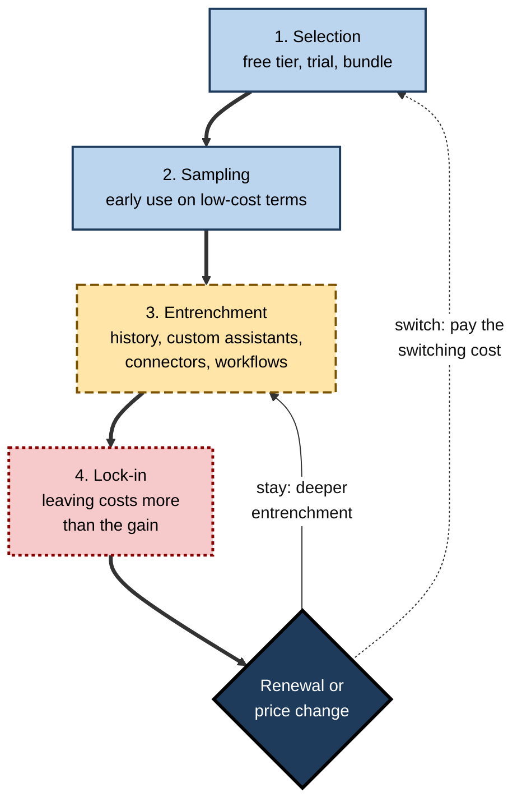
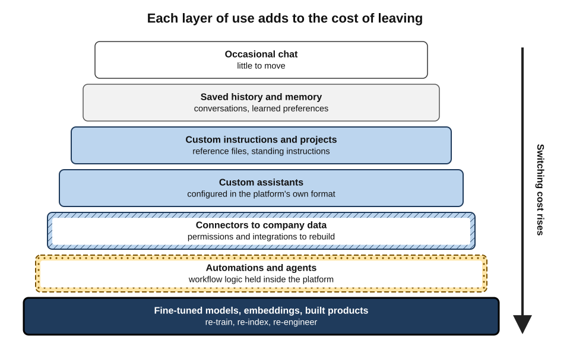
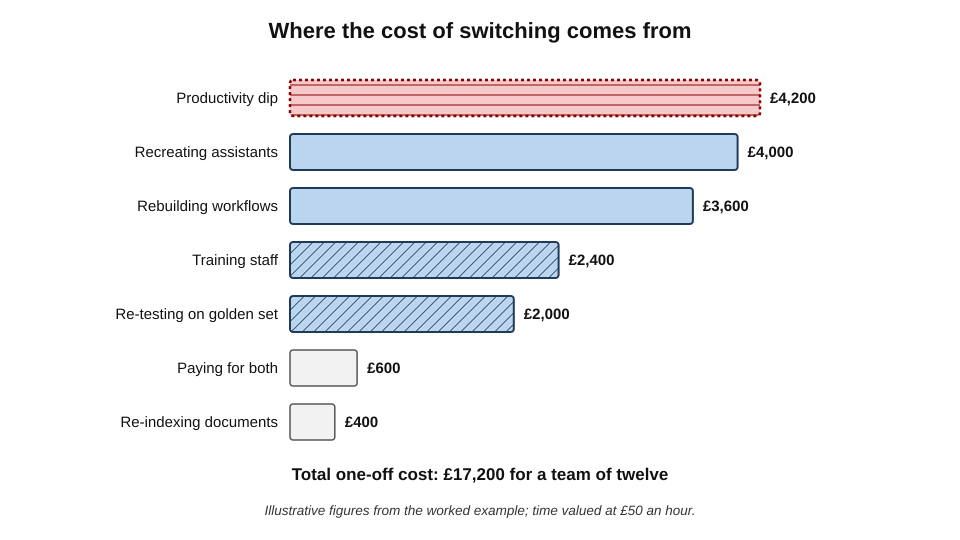
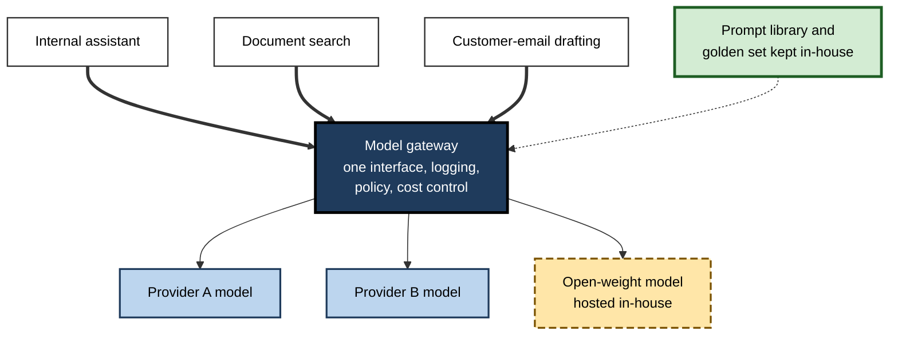
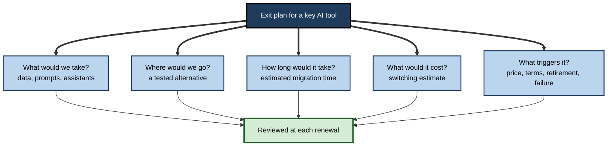

# C.9. Switching costs and lock-in

A research team has spent eighteen months building its work around one AI assistant: forty custom assistants, hundreds of saved project files, a year of conversation history, connectors to its document store and a dozen automated workflows. Then the provider raises the price, changes the usage limits and retires the model the team's prompts were tuned for. A rival tool looks better and cheaper. Moving would mean rebuilding almost everything. The team is not trapped by contract; it is **locked in by its own investment**.

> **Definition — Switching cost:** the total cost — in money, time, effort, risk and lost value — of moving from one tool or supplier to another.

> **Definition — Lock-in:** a situation in which switching costs are high enough that a user or organisation stays with a tool or supplier even when an alternative would otherwise be preferable.

**Why lock-in matters**

- **Pricing power** — a locked-in customer can be charged more, because leaving costs more than paying.
- **Dependence on another's roadmap** — model retirements, feature changes and policy shifts must simply be accepted.
- **Vendor risk** — if the provider fails, is acquired or exits a market, the customer bears the disruption.
- **Lost options** — better tools that appear later cannot be adopted without heavy cost.
- **AI moves fast** — in a market where leading tools change within months, the cost of being unable to move is unusually high.

---

## The Economics of Switching Costs

### Classic theory

- **Paul Klemperer (1987, and later surveys)** showed that when buyers face switching costs, markets behave differently:
  - suppliers compete hard to **win** customers — low introductory prices, free tiers, bundles;
  - then charge more to customers who are **locked in**;
  - the result can be fierce competition for new users and weak competition for existing ones.
- **Carl Shapiro and Hal Varian, *Information Rules* (1999)**, applied this to information technology and described a **lock-in cycle**:
  1. **Brand selection** — the customer chooses a supplier, often attracted by low entry cost.
  2. **Sampling** — the customer tries the product, often on promotional terms.
  3. **Entrenchment** — the customer invests in learning, data, integration and customisation.
  4. **Lock-in** — switching costs now exceed the perceived gain from switching.
  - The cycle repeats at each renewal or replacement decision.

**Figure 1.** The lock-in cycle as it applies to AI tools.

> **Key point:** lock-in is not usually imposed at the moment of purchase. It **accumulates** through everyday investments that are each sensible — saving a conversation, building a custom assistant, connecting a drive.

### Types of switching cost

Klemperer's typology, adapted to AI tools:

- **Learning costs** — the user's skill with one tool: how to instruct it, its quirks, its shortcuts.
- **Data costs** — conversation history, uploaded files, saved projects, memory of the user's preferences.
- **Configuration costs** — custom instructions, custom assistants, templates, prompt libraries tuned to one tool.
- **Integration costs** — connectors, automations, agents and software built on the provider's programming interface.
- **Model-behaviour costs** — prompts, evaluations and workflows tuned to how one model responds.
- **Contractual costs** — annual commitments, minimum spends, prepaid credits that expire, early-termination fees.
- **Organisational costs** — retraining staff, rewriting guidance, re-running approvals, managing change.
- **Uncertainty costs** — the risk that the new tool turns out worse, and the effort of finding out.
- **Psychological costs** — familiarity, attachment and the comfort of the known.

> **Mnemonic — "Learning, Data, Config, Integration, Model, Contract, Organisation, Uncertainty, Psychology" — "Little Dogs Can Indeed Make Coffee On Usual Pots":** the nine switching costs.

---

## Lock-in Particular to AI Tools

### Memory and history

- **Assistants increasingly remember** — preferences, projects, facts about the user and their work.
- **The value of memory compounds** — the longer a tool is used, the better it fits.
- **Memory rarely transfers** — exports, where available, typically produce files of past conversations, not a usable profile another tool can absorb.

> **Watch out:** a tool that "knows you" after a year of use is more useful and harder to leave for the same reason. Personalisation is a benefit and a switching cost at once.

### Custom assistants and projects

- **Custom assistants** — configured with instructions, reference files and sometimes actions — are built inside one platform's format.
- **Moving them** usually means recreating each one manually elsewhere, then re-testing.

### Prompts tuned to one model

- **Prompts are not perfectly portable** — the same instructions can produce different results on another model.
- **Workflows tuned over months** to one model's habits may degrade when moved, even to a stronger model.
- **Evaluation sets help** — a team with a golden set can measure the effect of a move instead of guessing.

### Embeddings and retrieval systems

- **Search over documents** in many AI applications uses **embeddings** — numerical representations of text produced by a particular model.
- **Changing the embedding model** usually means **re-processing the whole document collection**, because embeddings from different models are not compatible.

> **Definition — Embedding:** a list of numbers representing the meaning of a piece of text, produced by a model so that similar meanings have similar numbers; used to search documents by meaning.

### Fine-tuned models

- **A model fine-tuned on an organisation's data** through one provider's service can typically be used only on that provider's platform.
- **Switching** means repeating the fine-tuning elsewhere — if the training data and process were kept.

### Agents and automations

- **Agents and workflows** combine a model, tools, permissions and logic inside one platform.
- **Each automation** is a small piece of software that must be rebuilt and re-tested when moving.

### Shared workspaces and team habits

- **Team workspaces** — shared projects, shared custom assistants and shared conversation spaces make a tool more valuable the more colleagues use it.
- **Network effects inside the organisation** — once most colleagues share prompts, templates and assistants in one tool, anyone using a different tool is cut off from that shared stock.
- **Coordination cost of moving** — a team can switch only together, which requires agreement, timing and training for everyone at once.

> **Definition — Network effect:** an increase in a product's value to each user as more people use it; inside an organisation, shared assistants and templates create a local network effect that strengthens lock-in.

**Figure 2.** The deepening layers of lock-in, from casual chat to products built on a provider's platform.

### Signs that lock-in is deepening

- **"We can't change that — it's how the tool works"** becomes a common answer to process questions.
- **Key work exists only inside the tool** — analyses in chat histories, logic in automations, knowledge in custom assistants.
- **No one has tried the alternative** in the last year.
- **Renewal negotiations** consist of accepting the vendor's offer.
- **Price rises are absorbed** without a comparison.
- **Departing staff take knowledge with them** because it lived in their accounts.

> **In practice:** a simple annual question — *"If we had to leave this tool in ninety days, what would we lose and what would it cost?"* — keeps lock-in visible before it becomes expensive.

---

## When the Provider Changes Things

### Model retirement

- **AI models have short lives.** Providers regularly retire older models from their assistants and programming interfaces.
- **Example — the retirement of GPT-4o:**
  - in August 2025, when OpenAI introduced GPT-5 in ChatGPT, older models were initially removed from the model picker; strong objections from paying users who valued GPT-4o's conversational style led the company to restore it for paid plans and promise notice before future retirements;
  - in January 2026 OpenAI announced that GPT-4o and several other older models would be retired from ChatGPT in mid-February 2026, stating that only a very small share of users still chose GPT-4o daily;
  - API access to some of the same models followed its own, separate deprecation schedule.
- **Lesson:** workflows tuned to a model will need re-tuning when it is retired — on the provider's timetable, not the user's.

> **Definition — Model deprecation:** a provider's announcement that a model will cease to be available after a set date, usually with a recommended replacement.

### Price and limit changes

- **Subscription prices, usage limits and plan structures** change frequently; customers who cannot leave must absorb them.
- **Enterprise renewals** are where lock-in is priced: a customer whose staff, data and integrations depend on a tool negotiates from a weak position.

> **Example — outside AI:** after Broadcom acquired the virtualisation company VMware in 2023, it moved customers to bundled subscriptions; many customers and industry groups reported very large cost increases at renewal. Customers with deeply embedded VMware infrastructure found switching slow and expensive — a reminder that lock-in is priced at the moment of change.

### Provider failure

- **Start-ups fail or are acquired** — and the AI market contains many young companies.
- **Examples:**
  - the Humane AI Pin, a wearable AI device launched in 2024, was discontinued after HP acquired parts of the company in February 2025; the devices lost their core functions within weeks;
  - Builder.ai, a heavily funded AI-assisted software-development company, entered insolvency in May 2025 after its revenue figures were revised sharply downwards, leaving customers to secure their code and data.
- **Lesson:** a tool's financial health is part of its suitability, especially for anything that holds the customer's data or runs their processes.

> **Watch out:** acquisitions are not always failures — but they often change pricing, terms, roadmaps and data practices. A tool chosen for its independence may not stay independent.

---

## Estimating Switching Cost

### The components

**Figure 3.** Typical components of the cost of switching a team from one AI assistant to another.

> **Formula — One-off switching cost:** migration time (data, configurations, integrations) + re-testing time + training time + productivity dip + contract exit costs + overlap period (paying for both). Each time component is valued at the cost of the hours involved.

> **Formula — Switching decision:** switch if (annual gain from the new tool × years expected) − one-off switching cost > 0, after allowing for uncertainty. Illustrative example: annual gain £12,000; expected life 2 years; switching cost £15,000 → 12,000 × 2 − 15,000 = **£9,000** in favour of switching; with a one-year horizon, −£3,000, and staying is better.

### Worked example (illustrative): should the research team move?

*Names, organisations and numbers in this example are illustrative figures.*

**Situation:** the team from the opening — twelve people — considers moving to a rival assistant. Time is valued at £50 an hour.

| Component | Estimate | Cost |
|---|---|---|
| Recreating 40 custom assistants | 40 × 2 hours | £4,000 |
| Re-testing them on the golden set | 40 × 1 hour | £2,000 |
| Rebuilding 12 automated workflows | 12 × 6 hours | £3,600 |
| Re-processing the document index for search | 1 day of an engineer | £400 |
| Training and adjustment for 12 people | 12 × 4 hours | £2,400 |
| Productivity dip (first month) | 5% of 12 × 140 hours | £4,200 |
| Overlap: paying for both for 2 months | 12 × 2 × £25 | £600 |
| **Total one-off cost** | | **£17,200** |

**Gains claimed for the rival**

- Lower price: £8 per user per month less → 12 × 8 × 12 = **£1,152 a year**.
- Better output on the team's golden set: estimated time saving 1 hour per person per month → 12 × 12 × £50 = **£7,200 a year**.
- **Total annual gain ≈ £8,350.**

**Decision**

- Over two years: 2 × 8,350 − 17,200 = **−£500** — roughly break-even.
- Over three years: 3 × 8,350 − 17,200 = **+£7,850** — favourable, if the rival's advantage lasts that long.
- **Conclusion:** a marginal case. The team decides **not to switch now**, but to **reduce future switching costs** — moving its prompt library and assistant instructions into tool-independent documents, and running new workflows through a model-agnostic layer — so that the next decision is cheaper.

> **Watch out:** the largest cost in many switching estimates — the **productivity dip** — is also the most uncertain. Teams commonly underestimate it; a trial on the new tool before committing gives a better estimate.

---

## Reducing Lock-in

### Design for portability

- **Keep prompts and instructions outside the tool** — in a shared document or library that can be pasted into any assistant.
- **Store outputs in standard formats** — documents, spreadsheets and text files in the organisation's own systems, not only in chat histories.
- **Export regularly** — where tools offer exports of conversations and projects, use them.
- **Avoid unnecessary customisation** — every custom assistant and workflow is valuable and sticky; build the ones that earn their keep.
- **Keep golden sets** — a fixed set of tasks with known good outputs makes comparing alternatives fast.

> **Definition — Data portability:** the ability to obtain one's data from a service in a usable format and move it to another service.

### Architect for choice

- **Model-agnostic layers** — organisations building their own AI applications increasingly route requests through a **gateway** that can send them to different models, so the model can be changed without rebuilding the application.
- **Open standards** — common protocols for connecting AI tools to data and tools reduce integration lock-in.
  - *e.g.* the **Model Context Protocol (MCP)**, introduced by Anthropic in November 2024 as an open standard for connecting AI applications to data sources and tools, was adopted during 2025 by other major AI providers and in December 2025 placed under a foundation hosted by the Linux Foundation.
- **Multiple providers where it matters** — for critical processes, tested alternatives that can be switched to quickly.

> **Definition — Model gateway (abstraction layer):** software that sits between an organisation's applications and AI models, presenting one interface while allowing the underlying model or provider to be changed.

**Figure 4.** Applications built against a model gateway can change models without being rebuilt.

### Multi-homing

> **Definition — Multi-homing:** using two or more competing tools or platforms in parallel for the same kind of need, so that dependence on any one is limited.

- **Benefits:**
  - a tested alternative is always available;
  - comparisons happen naturally, keeping vendors honest at renewal;
  - outages and model retirements cause less disruption.
- **Costs:**
  - more subscriptions, more vendors to govern, more skills to maintain — the risks of sprawl;
  - customisations duplicated across tools.
- **Where it is worth it:** critical processes, and roles whose work depends heavily on AI. For most everyday use, a single primary tool plus portable assets is enough.

> **Watch out:** multi-homing and sprawl look alike from the outside. The difference is **intent and limits** — a deliberate second tool for resilience, with an owner, versus an unmanaged accumulation.

### Contract for exit

- **Data return and deletion** — the right to receive all customer data in usable formats, and confirmation of deletion.
- **Termination assistance** — help with migration at the end of the contract.
- **Price protection** — caps on increases at renewal.
- **Notice of material change** — advance notice of model retirements, feature removals and term changes.
- **Short initial terms** — one year rather than three while the market moves quickly.
- **No penalty for reducing seats** — flexibility to scale down.

> **In practice:** procurement teams increasingly treat the **exit clause** as being as important as the price — asking, before signing, "how would we leave, and what would it cost?"

> **In practice:** before signing, experienced buyers ask the vendor directly: *"If we leave in a year, what exactly do we get back, in what format, and how long will it take?"* A clear, specific answer is itself evidence of a lower lock-in risk.

### Law on switching

- **EU Data Act** — applying from September 2025, it requires providers of cloud and similar data-processing services to make switching to another provider possible, with switching charges to be phased out by January 2027.
- **Data-protection rights** — individuals in many jurisdictions have rights to obtain their personal data, including from AI services, though these do not guarantee a usable migration.
- **Competition law** — authorities in several jurisdictions have examined partnerships between large technology companies and AI developers, partly out of concern about concentration and lock-in.

---

## Switching Costs for Individuals

Lock-in is not only an organisational matter. Individual professionals accumulate switching costs too.

- **Personal history** — months of conversations containing drafts, reasoning and research.
- **Personal configuration** — custom instructions, saved prompts, custom assistants, preferences remembered by the tool.
- **Habits and skill** — a feel for how one assistant responds, built through practice.
- **Account tie-ins** — subscriptions bundled with phones, storage plans or other services.

**Keeping personal switching costs low**

- **Keep a personal prompt library** in an ordinary document, not only inside the tool.
- **Save important outputs** to one's own files as they are produced.
- **Write custom instructions in plain language** that would work in any assistant.
- **Try an alternative occasionally** on real tasks, so skills transfer and comparisons stay current.
- **Separate work and personal accounts** — work assets belong in the organisation's accounts, where they survive a change of job.

> **Key point:** for individuals, the most valuable portable asset is **skill in instructing and checking AI**, which transfers across tools. The least portable is accumulated history — which is why important work should never live only in a chat log.

---

## Lock-in Is Not Always Bad

- **Deep integration creates value** — the same investments that make leaving costly make staying productive.
- **Constant switching has its own costs** — every move resets skills and customisations.
- **Deliberate commitment** — choosing one platform and investing deeply can be the right strategy, especially for small organisations.
- **The goal is not zero lock-in** but **chosen lock-in**: commitments made knowingly, with a priced exit and the most portable assets kept portable.

| | Accidental lock-in | Chosen commitment |
|---|---|---|
| How it arises | Through unplanned accumulation of history, assistants and integrations | By a deliberate decision to invest in one platform |
| Knowledge of exit cost | Unknown until a move is considered | Estimated in advance |
| Portable assets | Prompts, instructions and outputs trapped in the tool | Kept outside the tool in standard formats |
| Contract | Standard terms accepted | Exit, data-return and price-protection terms negotiated |
| Response to price rise | Accept, because leaving is unaffordable | Compare, because an exit plan exists |

> **Remember:** **commit deliberately, keep the portable things portable, and know the price of leaving before it is needed.**

**Figure 5.** Planning an exit before it is needed.

---

## Case Study (illustrative): A Firm Discovers Its Exit Cost

- **Situation:** a 150-person professional-services firm had used one AI platform for two years. Staff had built over 300 custom assistants; three client-facing workflows ran on the platform's automation features; the firm's document search used the platform's embeddings.
- **Trigger:** at renewal, the vendor proposed a substantially higher per-seat price and a move to usage-based charges for automations.
- **Discovery:** the firm had no estimate of switching cost. A rapid assessment found:
  - no inventory of the custom assistants — many duplicated, many abandoned;
  - automation logic documented only inside the platform;
  - search would need full re-indexing on any other provider;
  - the contract contained no data-return or termination-assistance terms.
- **Actions:**
  1. negotiated a **one-year** renewal with a smaller price rise, citing a credible plan to leave;
  2. inventoried custom assistants — retired about two-thirds, and moved the instructions of the rest into a shared library;
  3. documented and rebuilt the client-facing workflows on a model gateway;
  4. added data-return, notice and price-protection clauses to the renewed contract;
  5. kept a second assistant under trial, with the firm's golden set, as a tested alternative.
- **Result:** at the following renewal the firm's estimated switching cost had fallen by more than half, and the vendor's offer was markedly better.
- **Lesson:** the firm's negotiating power depended on its **ability to leave**. Lock-in was reduced not by leaving but by **making leaving possible**.

> **Key point:** the cheapest time to reduce lock-in is **before** it is tested — at adoption and at every renewal.

---

## Mastery: How Experienced Buyers Manage Lock-in

- **They price the exit at the entrance** — estimating switching costs before adopting.
- **They separate portable from sticky assets** and keep the portable ones outside the tool.
- **They build only the customisations that earn their keep.**
- **They maintain a tested alternative** for critical uses.
- **They negotiate exit terms** — data return, notice, price protection, short terms.
- **They track model deprecation schedules** and re-test before retirement dates.
- **They watch vendor health** — funding, acquisitions, strategic shifts.
- **They use open standards** where available, so integrations outlive any single provider.

> **Watch out:** the most common lock-in is not to a vendor but to **an individual's personal account** — when the person leaves, the organisation discovers that months of work, prompts and assistants were never its own.

---

## Open Questions

- **Will AI memory become portable?**
  - Personal context — preferences, projects, history — is becoming a major source of lock-in; whether standards for moving it will emerge, or be required by law, is open.
- **Will open standards hold?**
  - Common connection protocols reduced integration lock-in in 2025; whether providers will keep them open as competition intensifies is uncertain.
- **How should model retirement be governed?**
  - Users bear the cost of re-tuning when models are withdrawn; norms on notice periods and long-term availability are still forming.
- **Does commoditisation of models reduce lock-in?**
  - If many models become roughly equivalent, lock-in may shift from the model to the data, memory and workflow layers — possibly making it stronger, not weaker.
- **How should regulators treat AI ecosystems?**
  - Competition authorities are examining partnerships and bundling; the outcome will shape how easily organisations can switch.

---

## Summary

- **Switching cost** is the total cost of moving tools; **lock-in** occurs when it outweighs the gain from moving.
- Theory (**Klemperer**; **Shapiro and Varian**): suppliers compete to win customers, then price to the locked-in; the **lock-in cycle** runs selection → sampling → entrenchment → lock-in.
- Nine switching costs: **learning, data, configuration, integration, model behaviour, contract, organisation, uncertainty, psychology**.
- AI-specific lock-in: **memory, custom assistants, model-tuned prompts, embeddings, fine-tuned models, agents and automations**.
- Providers change things: **model retirement** (GPT-4o restored in 2025, retired from ChatGPT in February 2026), **price and limit changes**, **provider failure** (Humane, Builder.ai in 2025).
- Estimate the **one-off switching cost** and compare with **annual gain × years**; productivity dips are the most uncertain component.
- Reduce lock-in by **portability** (prompts and outputs outside tools, exports, golden sets), **architecture** (model gateways, open standards such as MCP, tested alternatives) and **contracts** (data return, termination assistance, price protection, notice, short terms); the **EU Data Act** adds switching rights for cloud services.
- Lock-in is not always bad: aim for **chosen commitment** with a priced exit, not accidental entrapment.

---

## Self-Check

1. Define switching cost and lock-in.
2. Summarise Klemperer's insight about markets with switching costs.
3. Describe the four stages of Shapiro and Varian's lock-in cycle.
4. Name the nine types of switching cost.
5. Why is AI memory both a benefit and a switching cost?
6. Why does changing an embedding model usually require re-processing documents?
7. What happened with GPT-4o in 2025–26, and what is the lesson for users?
8. What do the Humane and Builder.ai examples show?
9. A move costs £20,000 once and gains £9,000 a year. Over what horizon does it pay off?
10. In the research-team example, why did the team decide not to switch, and what did it do instead?
11. What is a model gateway, and how does it reduce lock-in?
12. List five contract terms that reduce lock-in.
13. Distinguish accidental lock-in from chosen commitment.
14. Your organisation is about to adopt an AI platform for all staff. Propose five measures to keep future switching costs manageable.

### Answer Key

1. Switching cost: the total money, time, effort, risk and lost value of moving to another tool. Lock-in: when that cost is high enough to keep a user with a tool even when an alternative would otherwise be preferred.
2. With switching costs, suppliers compete hard to win customers (low entry prices) and then charge more to locked-in customers; competition for new users is strong, for existing users weak.
3. Selection (choose a supplier), sampling (try it, often cheaply), entrenchment (invest in learning, data, integration), lock-in (switching cost exceeds perceived gain); repeated at renewals.
4. Learning, data, configuration, integration, model behaviour, contract, organisation, uncertainty, psychology.
5. Memory makes the tool fit the user better over time, but it rarely transfers, so the longer it accumulates, the more is lost by leaving.
6. Embeddings from different models are incompatible numerical representations; a new model must recompute them for every document.
7. Older models were removed when GPT-5 launched in August 2025; after user objections GPT-4o was restored for paid plans; it was retired from ChatGPT in February 2026. Users must expect to re-tune workflows on the provider's timetable.
8. Providers can fail or be acquired, leaving devices or services unusable and customers responsible for securing their data; vendor health is part of suitability.
9. 20,000 ÷ 9,000 ≈ 2.2 years — it pays off only if the gain lasts beyond about two years and three months.
10. Two-year net value was about break-even and uncertain. Instead it reduced future switching costs: tool-independent prompt and instruction library, new workflows through a model-agnostic layer.
11. Software between applications and models presenting one interface; models or providers can be changed without rebuilding applications.
12. Any five: data return and deletion; termination assistance; price protection; notice of material changes including model retirement; short initial terms; no penalty for reducing seats.
13. Accidental lock-in accumulates unplanned, with unknown exit costs and trapped assets. Chosen commitment is deliberate, with an estimated exit cost, portable assets kept outside the tool and negotiated exit terms.
14. *e.g.* keep a shared prompt and instruction library outside the platform; store outputs in the organisation's systems; negotiate data-return, notice and price-protection terms with a one-year initial term; maintain a golden set and a tested alternative; use open connection standards and, for built applications, a model gateway; inventory custom assistants and retire unused ones.

---

## Glossary

| Term | Meaning |
|---|---|
| Data portability | The ability to obtain one's data in a usable format and move it elsewhere. |
| Embedding | A numerical representation of text's meaning produced by a particular model. |
| Entrenchment | The stage at which investment in a tool's data, skills and integrations accumulates. |
| Exit plan | A prepared account of how, at what cost and on what triggers a tool would be replaced. |
| Fine-tuned model | A model further trained on an organisation's data, usually tied to one provider's platform. |
| Lock-in | Staying with a tool because switching costs exceed the gain from moving. |
| Lock-in cycle | Selection, sampling, entrenchment and lock-in, repeated at each renewal. |
| Model Context Protocol (MCP) | An open standard for connecting AI applications to data sources and tools. |
| Model deprecation | A provider's announcement that a model will stop being available. |
| Model gateway | Software presenting one interface to applications while allowing the model to be changed. |
| Open standard | A publicly available specification that many providers can implement. |
| Price protection | Contract terms capping price increases. |
| Switching cost | The total cost of moving from one tool or supplier to another. |
| Termination assistance | A supplier's contractual help with migration when a contract ends. |
