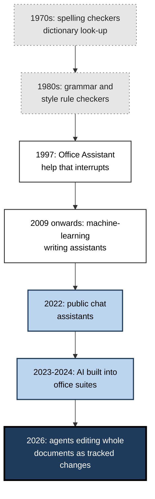
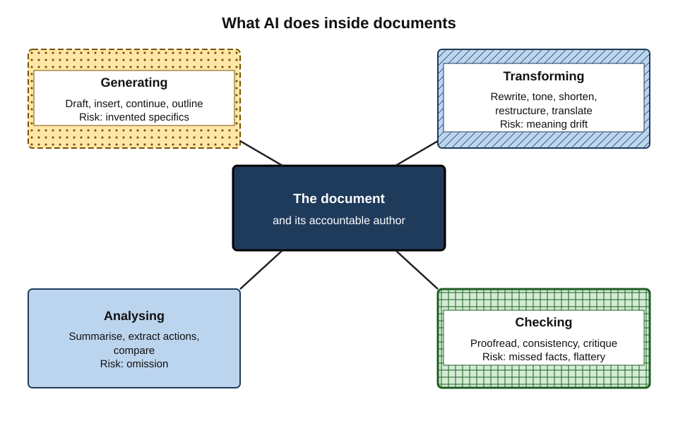
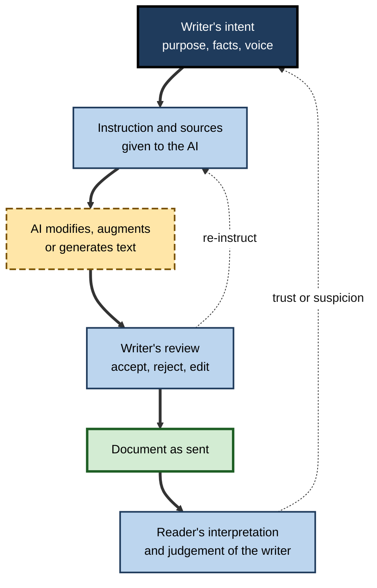
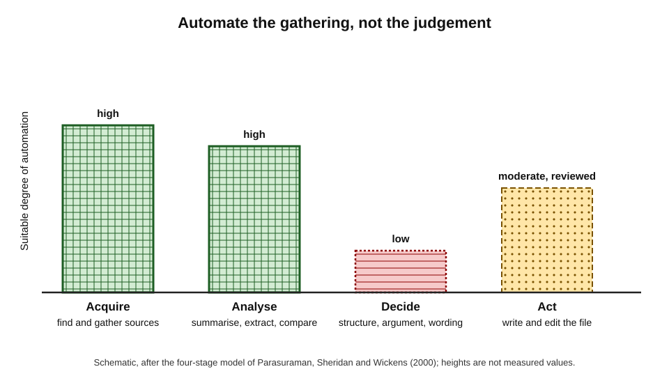
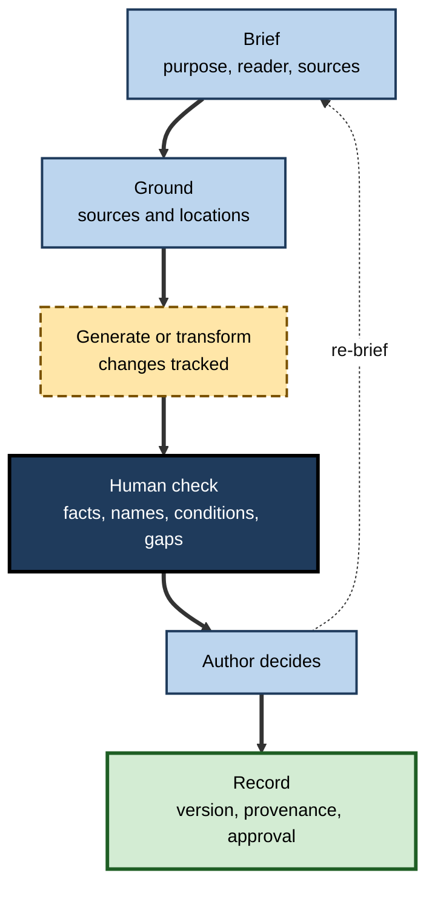
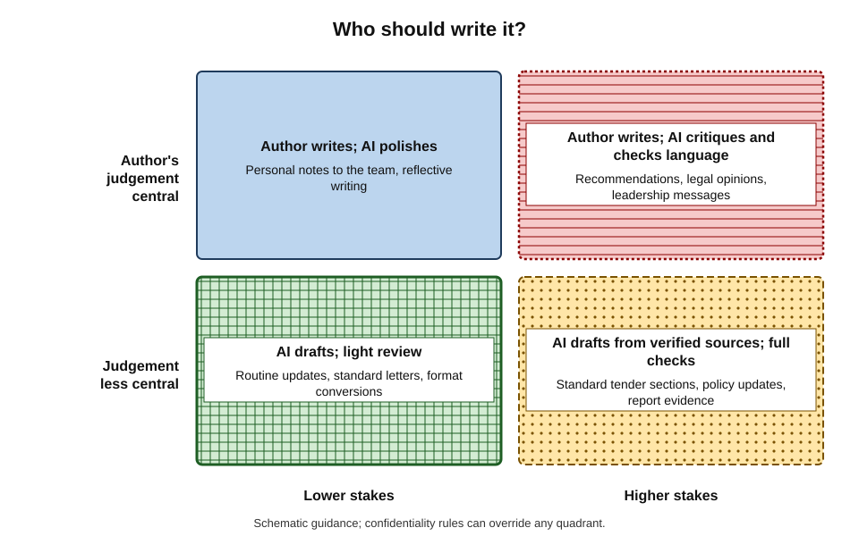

# D. AI in Documents & Writing Tools

For forty years the word processor was a passive instrument: it recorded what a person typed, corrected spelling and kept formatting tidy.

Since 2023 it has become an active participant. It drafts proposals from a sentence of instruction, summarises a two-hundred-page report, rewrites a paragraph for a different reader, translates a contract, flags inconsistent figures and, since 2026, edits whole documents step by step as tracked changes.

Documents are where organisations think, decide, promise and remember. Putting a writing machine inside them changes how professional work is done — and what it means to be the author of it.

> **Definition — AI in documents and writing tools:** generative and analytical AI capabilities embedded in word processors, office suites and writing assistants that compose, transform, analyse and check text inside documents, working with the document's content, structure and surrounding organisational data.

> **Definition — AI-mediated communication:** communication in which an intelligent agent operates on behalf of a person by modifying, augmenting or generating messages to accomplish communication goals (Jeffrey Hancock, Mor Naaman and Karen Levy, 2020).

**Why the subject matters**

- **Documents carry consequences.** Contracts bind, policies govern, reports inform decisions, proposals win or lose work. Errors and distortions in them have real costs.
- **AI is now the default.** The major office suites place AI drafting, rewriting and summarising in front of every user; using documents competently now includes using these features competently.
- **Responsibility does not move.** Whatever produced the words, the person who signs, sends or approves a document is accountable for it.
- **The gains and risks are both large.** Well-used, AI removes drudgery and raises the floor of quality; badly used, it produces fluent error, generic prose and new confidentiality exposures at scale.

---

## From Spellcheck to Co-Author

### A short history of machines in writing

- **1970s — checking.** Early spelling checkers compared words against dictionaries; Ralph Gorin's SPELL program at Stanford (1971) is a frequently cited early example.
- **1980s — style and grammar rules.** Rule-based checkers flagged long sentences, passive voice and known errors; readability formulas from the 1940s were automated.
- **1990s — assistance in the interface.** Word processors added automatic correction and, in 1997, Microsoft Office's animated "Office Assistant" (popularly "Clippy"), which offered help users widely found intrusive — an early lesson in unwanted assistance; it was removed from Office in 2007.
- **2000s–2010s — statistical help.** Predictive text, machine translation and machine-learning writing assistants (Grammarly was founded in 2009) moved from rules to statistics.
- **2020–2022 — generative models.** Large language models showed that machines could compose fluent paragraphs; public chat assistants from late 2022 made this a mass experience.
- **2023–2024 — suite integration.** Microsoft announced Copilot for its 365 suite in March 2023 and made it available to enterprise customers that November; Google introduced generative features in Workspace in 2023 and brought them under the Gemini name in 2024.
- **2025–2026 — agents in documents.** Assistants gained the ability to act across whole documents: Microsoft declared Copilot's Agent Mode generally available in Word, Excel and PowerPoint in April 2026, with word-level tracked changes; Google's 2026 Docs update let Gemini edit across documents with suggestions visible only to the requester until approved.

**Figure 1.** Milestones in the development of AI in writing tools.

> **Key point:** each generation moved the machine **up the writing process** — from checking characters, to judging sentences, to producing text, to restructuring whole documents. The higher it moves, the more of the author's judgement it touches.

### What changed with generative AI

- **From correction to composition** — earlier tools could only flag what a person wrote; generative tools write.
- **From rules to probability** — output is the most plausible text, not a rule-checked correction, so it can be fluent and wrong.
- **From the sentence to the corpus** — enterprise assistants draw on mail, chat and files across the organisation.
- **From suggestion to action** — agentic features carry out multi-step edits rather than proposing single changes.

### What has not changed

- **Documents still exist to serve readers.** Purpose, audience and clarity decide a document's value, whoever or whatever writes the sentences.
- **Authors remain accountable.** No profession or court has accepted "the tool wrote it" as a defence.
- **Sources still decide truth.** A model can phrase a claim; only a source can support it.
- **Structure still carries meaning.** Definitions, conditions and exceptions bind as they always did, and are as easy to lose in a careless rewrite as in a careless summary.
- **Review still catches what writing misses.** The levels of review — argument, facts, language, surface — predate AI and remain the backbone of quality.

> **Key point:** AI changes **who produces text and how fast**; it does not change **what makes a document good or who answers for it**.

---

## What AI Does in Documents

### Four families of capability

- **Generating** — producing new text: drafts, sections, alternatives, outlines.
  - The most visible capability; its quality depends on the brief and the sources supplied, and the techniques of **drafting with a word processor's assistant** centre on planning before generating.
- **Transforming** — changing existing text: rewriting for tone, shortening, simplifying, restructuring, formatting, translating.
  - The defining risk is **meaning drift** — style and content are entangled, so every transformation must be checked against the original.
- **Analysing** — extracting from text: summaries, action points, obligations, key figures, comparisons.
  - Long documents make **omission** the main danger; extracted actions need owners and sources that the text actually states.
- **Checking** — evaluating text: proofreading, consistency, clarity, critique.
  - Strong on language, weak on truth and context, and prone to flattering the author unless asked for critique.

**Figure 2.** Four families of AI capability in documents, around the document and its author.

| Family | Typical features | Main strength | Characteristic failure |
|---|---|---|---|
| Generating | Draft, insert, continue, outline | Speed from a blank page | Invented specifics; generic content |
| Transforming | Rewrite, tone, shorten, restructure, translate | Adapting text to readers | Meaning drift; lost conditions and hedges |
| Analysing | Summarise, extract actions, compare | Navigating large volumes | Omission; invented owners or claims |
| Checking | Proofread, consistency, critique | Catching language errors | Missing facts and names; sycophancy |

### The tools and where they sit

- **Suite assistants** — built into word processors and office suites; see the document directly, respect organisational permissions and labels, and can act on the file.
- **Dedicated writing assistants** — specialised in correction, tone and clarity; often run across many applications.
- **General chat assistants** — flexible and powerful, but outside the document unless connected; content must be copied in and out.
- **Specialist tools** — translation services, contract-review tools, accessibility checkers.

The choice among them belongs to the wider question of choosing tools, but within documents the decisive factors are **context** (what the tool can see), **control** (whether edits are reviewable) and **confidentiality** (which route the content travels).

---

## Frameworks for Thinking About AI in Writing

### AI-mediated communication

**Framework card — Hancock, Naaman and Levy (2020)**

- **Claim:** when AI modifies, augments or generates a person's messages, communication is no longer simply human-to-human; it is **AI-mediated**.
- **Dimensions the framework highlights:**
  - **magnitude** — how much of the message the AI changes;
  - **media type** — text, voice, video;
  - **optimisation goal** — what the AI is trying to achieve (clarity, persuasion, politeness);
  - **autonomy** — whether the person approves each change or the AI acts alone;
  - **role orientation** — whether the AI acts for the sender, the receiver or both.
- **Questions it raises:** how readers judge the sender when they suspect AI involvement; whether senders lose agency over what they say; how language norms change at scale.

**Figure 3.** AI-mediated communication: the AI sits between the writer's intent and the reader's interpretation.

### Levels of automation

- **Thomas Sheridan and William Verplank (1978)** described a scale of automation from the human doing everything to the computer acting entirely alone.
- **Raja Parasuraman, Sheridan and Christopher Wickens (2000)** applied automation to four stages of information processing — **acquiring** information, **analysing** it, **deciding**, and **acting** — each of which can be automated to a different degree.
- **Applied to documents:**
  - acquisition — finding and gathering sources;
  - analysis — summarising and extracting;
  - decision — choosing structure, argument, wording;
  - action — writing and editing the file itself.
- The safest and most productive designs usually automate **acquisition and analysis** heavily, **action** moderately with review, and **decision** least.

**Figure 4.** Degrees of AI involvement across the stages of document work.

> **Watch out:** **automation bias** — over-trusting automated output and failing to notice what it missed — was documented in aviation and medicine long before generative AI. It applies directly to accepting AI drafts, summaries and review suggestions.

### Augmentation and automation

- **Augmentation** — AI extends what the writer can do: more options, faster drafts, better checks, with the writer deciding.
- **Automation** — AI does the task with little human involvement: routine letters, standard sections, format conversion.
- **The professional question** is not "AI or not" but **which parts of which documents** suit augmentation, which suit automation and which should remain manual — a judgement that depends on stakes, voice, confidentiality and the reliability of checks.

---

## Quality and Accountability

### Why fluent text is not reliable text

- Generative models produce **plausible** text. Plausibility and truth usually coincide, but not always — and when they diverge, the error looks exactly like a correct statement.
- The resulting failure types recur across every document task:
  - **invention** — facts, figures, names, citations or owners that no source contains;
  - **omission** — conditions, exceptions, tables or annexes left out;
  - **distortion** — hedges removed, scope widened, obligations strengthened or softened;
  - **homogenisation** — distinctive voice and local idiom replaced by generic phrasing.

**The quality-control loop**

1. **Brief** precisely — purpose, reader, sources, constraints, permission to leave gaps.
2. **Ground** in sources — and require locations or quotations for claims.
3. **Generate or transform** on a defined scope, with changes tracked.
4. **Check** what AI is weak at — facts, names, numbers, conditions, what is missing — by a person.
5. **Decide** as author — accept, reject, rewrite.
6. **Record** — versions, provenance, approvals.

**Figure 5.** The quality-control loop for AI-assisted documents.

> **Mnemonic — "BG-GCDR":** **B**rief, **G**round, **G**enerate, **C**heck, **D**ecide, **R**ecord. In words: *Brief Generously, Generate Cautiously, Decide Responsibly.*

### Accountability and disclosure

- **The author remains responsible.** Courts, regulators, clients and professional bodies consistently treat AI as a tool; the person who submits a document answers for it.
  - In *Mata v. Avianca* (2023), a New York court sanctioned lawyers who filed a brief containing citations invented by a chatbot; the failure was not using AI but **not checking**.
- **Disclosure norms are tightening.** Scholarly publishers bar AI authorship and require disclosure; courts issue practice directions; the EU AI Act's transparency obligations began to apply in August 2026, requiring machine-readable marking of AI output by providers and disclosure of AI-generated text published to inform the public on matters of public interest unless it is under human editorial responsibility.
- **Records make accountability practical.** Tracking which parts of a document were AI-generated and which **versions** were reviewed tells reviewers where to look and lets an organisation explain itself when questioned.

---

## The Evidence

### What experiments show

**Study card — Noy and Zhang (2023), *Science***

- **Design:** several hundred college-educated professionals (marketers, grant writers, consultants, data analysts, HR professionals, managers) completed realistic writing tasks; half were randomly given access to a chat assistant for the second task.
- **Findings:** the AI group finished substantially faster — roughly 40% less time — with output graded about a fifth higher in quality; the gains were largest for weaker writers, compressing the gap between workers.
- **Limits:** short, self-contained tasks without verification demands or organisational context.

- **Field evidence** from consulting and customer support points the same way within suitable tasks — and shows worse results where tasks fall outside the AI's capability, the **jagged frontier**.
- **Population evidence** is more modest: broad studies of workers using chatbots in ordinary jobs have found average time savings of a few per cent of working hours, suggesting that much use is ad hoc rather than built into workflows.

### What the evidence says about writing itself

- **Homogenisation** — experiments find that AI suggestions make individual writing better-rated but collectively more similar, and can pull writers from different cultures towards dominant styles.
- **Influence** — writing with an assistant biased towards one view shifted the opinions participants expressed, and in some measures their attitudes.
- **Reader reactions** — readers who suspect AI authorship of personal messages tend to judge the sender more harshly; norms for routine business documents are less clear.
- **Collective fingerprints** — analysis of biomedical abstracts has detected a sharp post-2023 rise in characteristic "AI vocabulary", implying widespread AI processing of published scientific prose.

> **Key point:** the evidence supports AI as a powerful **assistant** for well-specified document tasks, and warns against it as an unexamined **author** — of facts, of arguments or of voice.

---

## AI in Documents at Organisational Scale

### Data, permissions and attack surfaces

- **Enterprise assistants reach what users can reach.** Long-standing oversharing — files open to "everyone" — becomes visible when an assistant searches on a user's behalf; confidentiality in document tools therefore begins with permissions, labels and data-loss controls.
- **Documents can carry attacks.** Hidden instructions in a file or email can redirect an assistant that reads it; a critical 2025 vulnerability in a major suite assistant showed that data could in principle be exfiltrated without any user click before it was patched.
- **Routes matter.** The same model under an enterprise contract and under a personal consumer account offers very different protections.

### Workflows rather than features

- Organisations that gain most from document AI redesign **recurring workflows** — reports, proposals, policies, minutes — allocating stages to AI and placing human checkpoints where AI is weak.
- They standardise **inputs**: templates with real styles, verified content libraries, term bases, voice sheets and saved briefs.
- They measure **net** effects — time saved after review and rework, errors found late, reader outcomes — rather than impressions.

| Organisational choice | Ad hoc adoption | Designed adoption |
|---|---|---|
| Tool use | Each person experiments | Approved tools for defined tasks |
| Inputs | Whatever is to hand | Templates, verified libraries, briefs |
| Checks | Individual habit | Named checkpoints with owners |
| Confidentiality | Personal judgement | Classification rules, labels, approved routes |
| Records | None | Versions, provenance, approvals |
| Measurement | Anecdote | Net time, rework, late errors |

### Case study (illustrative): rolling out a document assistant

- **Situation:** a professional-services firm of about 1,500 staff licensed its office suite's AI assistant for everyone after a promising pilot.
- **First three months:**
  - usage grew quickly, mainly for drafting emails and summarising documents;
  - two client deliverables contained fabricated references; one contained a previous client's name that AI proofreading had not flagged;
  - an employee found salary data through the assistant, exposing old overshared folders.
- **Response:**
  1. **permissions project** — overshared sites remediated; sensitive libraries labelled and excluded from AI discovery until fixed;
  2. **workflow redesign** for three recurring document types, with checkpoints for facts, names and versions;
  3. **guidance by document type** — where AI may draft, where it may only check, where voice or confidentiality rules limit it;
  4. **training** focused on briefing, grounding, checking and triaging suggestions rather than on features;
  5. **measurement** of net time and late errors for the redesigned workflows.
- **Result after a year:** the redesigned workflows showed clear time savings with fewer client-reported errors; general usage remained high but uneven; no further confidentiality incidents were reported.
- **Lesson:** the assistant delivered value only when the organisation treated it as a change in **how documents are produced**, not as a new button.

### Worked example (illustrative): one document, many capabilities

**Situation:** an operations manager must produce a six-page supplier performance review for the procurement committee from three long supplier reports, a spreadsheet of delivery data and her own notes.

1. **Summarise** each supplier report into a section digest with page references; check two figures per digest against the source.
2. **Extract** each supplier's contractual service obligations, with clause quotations.
3. **Draft** the comparison section from the digests and data, with placeholders where figures are missing.
4. **Write** the recommendation herself.
5. **Restructure** so the recommendation comes first, with an options table.
6. **Review** with a sceptical critique request, then copy-edit with tracked changes and triage each suggestion.
7. **Version** the draft before each AI pass; record which sections were AI-drafted.
8. **Inspect** the file before circulation; it is labelled *Confidential* and sent through the committee portal.

| Stage | AI role | Human role | Time (illustrative) |
|---|---|---|---|
| Summaries and extraction | Digests, obligations with quotations | Spot checks of figures and clauses | 1.5 h |
| Drafting and structure | Comparison section; restructure | Recommendation; outline decisions | 1.5 h |
| Review and finalising | Critique; copy-edit | Fact check; triage; inspection | 1.5 h |
| Total | | | 4.5 h, against an estimated 9 h previously |

*Illustrative figures.*

- **Conclusion:** the time saving came from many small, checked uses — not from one large generation — and the document's judgement remained the manager's.

**Figure 6.** Matching AI's role to a document's stakes and the importance of the author's own judgement.

---

## The Competent Document Professional

### What competence now includes

Using AI well in documents is less a matter of knowing features than of exercising a small set of durable judgements.

- **Briefing** — stating purpose, reader, sources and constraints precisely enough that the tool does not have to guess.
- **Grounding** — choosing and supplying the right sources, and insisting on locations or quotations for claims.
- **Scoping** — applying AI to a defined section or task rather than "the whole document", so that results can be checked.
- **Verifying** — knowing which errors AI makes (invention, omission, distortion) and checking for exactly those.
- **Triaging** — accepting, rejecting or adapting suggestions one by one where meaning is at stake.
- **Protecting** — choosing the right tool route for the content's classification and removing hidden content before sharing.
- **Recording** — keeping versions, provenance and approvals proportionate to the document's stakes.
- **Preserving** — keeping one's own thinking and voice where the reader needs to hear the writer.

> **Mnemonic — "Bright Green Snakes Very Timidly Peek, Rarely Pouncing":** Briefing, Grounding, Scoping, Verifying, Triaging, Protecting, Recording, Preserving.

### From novice to expert use

| | Novice use | Competent use | Expert use |
|---|---|---|---|
| Typical request | "Write a report on X" | Structured brief with sources | Brief, outline and checks designed per document type |
| Checking | Reads for fluency | Checks facts and figures | Checks where AI errs; samples and measures |
| Edits | Accepts in bulk | Triages suggestions | Constrains edits in advance; locks frozen text |
| Confidentiality | Uses whatever is open | Uses approved tools | Classifies, minimises and inspects routinely |
| Records | None | Saves versions | Provenance and disclosure proportionate to stakes |
| Effect on own skill | Dependence | Assistance | Deliberate practice; AI as critic and contrast |

*A descriptive contrast of typical patterns rather than formal levels.*

### Neighbouring territory

Documents are one setting among several. Messages and email raise the same questions of tone and voice in shorter, faster form; meetings add consent and transcription accuracy; spreadsheets add calculation and data integrity; images and slides add rights and visual accuracy. Privacy rules, verification habits and the choice of tools apply across all of them; within documents, the distinctive features are **length, structure, permanence and formal accountability**.

---

## Debates and Tensions

- **Efficiency versus thinking.** Writing is a way of thinking; outsourcing composition may save time while weakening the reasoning that writing develops — especially for novices who have not yet built the skill.
- **Clarity versus voice.** AI raises clarity and correctness for many writers, including second-language writers, but pulls prose towards a common, often Anglo-American, style.
- **Disclosure versus stigma.** Honest disclosure supports trust and accountability, yet readers may judge disclosed AI use harshly, creating incentives to conceal it.
- **Detection versus provenance.** AI-text detectors are unreliable and biased against some writers; recorded provenance is reliable but depends on honest practice.
- **Speed versus review capacity.** Faster drafting moves the bottleneck to reviewers; without more review capacity, errors escape or the gains vanish.
- **Convenience versus confidentiality.** The easiest route — a personal account, a pasted document — is often the least protected.

---

## Open Questions

- **What will authorship mean?**
  - As agents restructure and rewrite whole documents, the boundary between assisting and authoring blurs; law, professional ethics and reader expectations are all adjusting.
- **Will professional writing skill decline or change shape?**
  - Long-term effects of routine AI drafting on how professionals reason and write are largely unmeasured.
- **Can models be made reliably faithful to sources?**
  - Grounding and citation reduce invention but do not eliminate it, particularly for long documents and global claims.
- **How will organisations manage review at scale?**
  - Checking capacity, not generation speed, may become the binding constraint on AI-assisted document work.
- **Will language converge?**
  - Evidence of homogenisation is consistent; whether organisational and cultural voices will erode, or tools will learn to preserve them, is open.
- **Who governs default behaviour?**
  - Tool providers' defaults — tone, length, what to flag — shape millions of documents with little public scrutiny.

---

## Summary

- **AI in documents and writing tools** composes, transforms, analyses and checks text inside documents; it is a form of **AI-mediated communication** (Hancock, Naaman and Levy, 2020).
- Machines moved **up the writing process**: spelling checkers (1970s), grammar rules (1980s), interface assistants (1990s), statistical assistants (2010s), generative models (2022), suite integration (2023–2024) and document agents with tracked changes (2026).
- Four capability families — **generating, transforming, analysing, checking** — each with a characteristic failure: invention, meaning drift, omission, missed facts and sycophancy.
- Decisive factors in choosing a document tool: **context, control, confidentiality**.
- Frameworks: AI-mediated communication; **levels of automation** across acquisition, analysis, decision and action; **augmentation versus automation**; **automation bias**.
- Quality control: **brief, ground, generate, check, decide, record**; the author remains **accountable**, and disclosure norms are tightening (including the EU AI Act from August 2026).
- Evidence: large gains for well-specified writing tasks (Noy and Zhang, 2023), worse results outside the capability frontier, modest population-level effects, and consistent signs of **homogenisation** and **influence**.
- At scale, value comes from **workflows, permissions, standards, records and measurement**, not from features alone.
- Competence now means **briefing, grounding, scoping, verifying, triaging, protecting, recording and preserving**; experts design checks per document type and use AI as critic as well as drafter.
- Within everyday digital work, documents are distinguished by **length, structure, permanence and formal accountability**.
- Central tensions: efficiency and thinking, clarity and voice, disclosure and stigma, detection and provenance, speed and review, convenience and confidentiality.

---

## Self-Check

1. Define AI in documents and writing tools, and AI-mediated communication.
2. Trace the movement of machines "up the writing process" from the 1970s to 2026.
3. Name the four families of AI capability in documents and the characteristic failure of each.
4. What three factors are decisive in choosing a tool for document work, and why?
5. Explain the five dimensions of AI-mediated communication.
6. Apply the four stages of automation to document work and say which stage should be automated least.
7. Distinguish augmentation from automation with a document example of each.
8. Describe the quality-control loop and explain why the check step is assigned to a person.
9. What did *Mata v. Avianca* establish about responsibility?
10. Summarise the Noy and Zhang findings and their limits.
11. Why might population-level productivity effects be smaller than experimental ones?
12. Explain how an enterprise assistant can expose oversharing.
13. In the illustrative rollout case, what four changes turned the assistant into a source of value?
14. List the eight judgements of the competent document professional and contrast novice and expert checking.
15. Choose one of the six tensions and argue how a professional should resolve it for a client-facing report.

### Answer Key

1. Generative and analytical AI embedded in word processors, office suites and writing assistants that composes, transforms, analyses and checks text inside documents. AI-mediated communication is communication in which an intelligent agent modifies, augments or generates messages on a person's behalf to accomplish communication goals.
2. Spelling checkers checked characters (1970s); rule-based tools judged sentences (1980s); interface assistants offered help (1990s); statistical tools predicted and corrected (2000s–2010s); generative models composed text (2022); suites integrated assistants with organisational data (2023–2024); agents restructured whole documents as tracked changes (2026).
3. Generating — invented specifics and generic content; transforming — meaning drift; analysing — omission and invented owners or claims; checking — missed facts and names, sycophancy.
4. Context (what the tool can see determines specificity), control (reviewable, tracked edits make checking possible) and confidentiality (the route determines protection of content).
5. Magnitude of change; media type; optimisation goal; autonomy (approval per change or not); role orientation (acting for sender, receiver or both).
6. Acquisition (gathering sources), analysis (summarising, extracting), decision (structure, argument, wording), action (editing the file). Decision should be automated least.
7. Augmentation: the AI offers alternative openings and the author chooses. Automation: the AI converts a standard data export into a formatted routine letter with light review.
8. Brief, ground, generate or transform with tracking, human check, author decides, record. Checking is human because AI is weakest on facts, names, conditions and omissions — the errors that matter most and that fluent text hides.
9. That lawyers who filed AI-invented citations were responsible for failing to check them; AI use does not shift accountability.
10. Professionals with a chat assistant finished writing tasks roughly 40% faster with output graded about a fifth better, with the largest gains for weaker writers. Limits: short, self-contained tasks without verification or organisational context.
11. Much real use is ad hoc and layered onto unchanged processes; review and rework costs are hidden; many tasks fall outside the frontier; gains concentrate in redesigned workflows.
12. It searches everything a user's account can open; files shared too widely years ago, once hidden by obscurity, now surface in answers.
13. A permissions project; workflow redesign with checkpoints; guidance by document type; training on briefing, grounding, checking and triage (and measurement of net effects).
14. Briefing, grounding, scoping, verifying, triaging, protecting, recording, preserving. A novice reads AI output for fluency; an expert checks specifically for invention, omission and distortion, samples and measures error rates, and designs checks into each document type's workflow.
15. *e.g.* Clarity versus voice: use AI for error correction and clarity on the report's technical sections, keep the recommendation and client-specific judgement in the author's words, apply the firm's voice sheet, and reject edits that replace specifics with generic phrasing.

---

## Glossary

| Term | Meaning |
|---|---|
| Agent mode | An AI feature that carries out multi-step actions inside a document. |
| AI-mediated communication | Communication in which an AI modifies, augments or generates messages for a person. |
| Augmentation | AI extending what a person can do while the person decides. |
| Automation | AI performing a task with little human involvement. |
| Automation bias | Over-reliance on automated output, accepting its errors or missing what it omits. |
| Grounding | Supplying sources and instructing a model to base its output on them. |
| Homogenisation | Convergence of many writers' texts towards similar wording and ideas. |
| Jagged frontier | The uneven boundary between tasks AI performs well and similar tasks it performs badly. |
| Levels of automation | Degrees to which a task, or a stage of it, is performed by a machine rather than a person. |
| Meaning drift | Unintended change in meaning when text is transformed. |
| Oversharing | Documents accessible to more people than need them. |
| Provenance | The record of where a document's content came from and how it was produced. |
| Suite assistant | An AI assistant built into an office suite with access to its documents. |
| Sycophancy | An AI's tendency to tell users what they appear to want to hear. |
| Tracked changes | Recorded proposed edits that can be accepted or rejected individually. |
