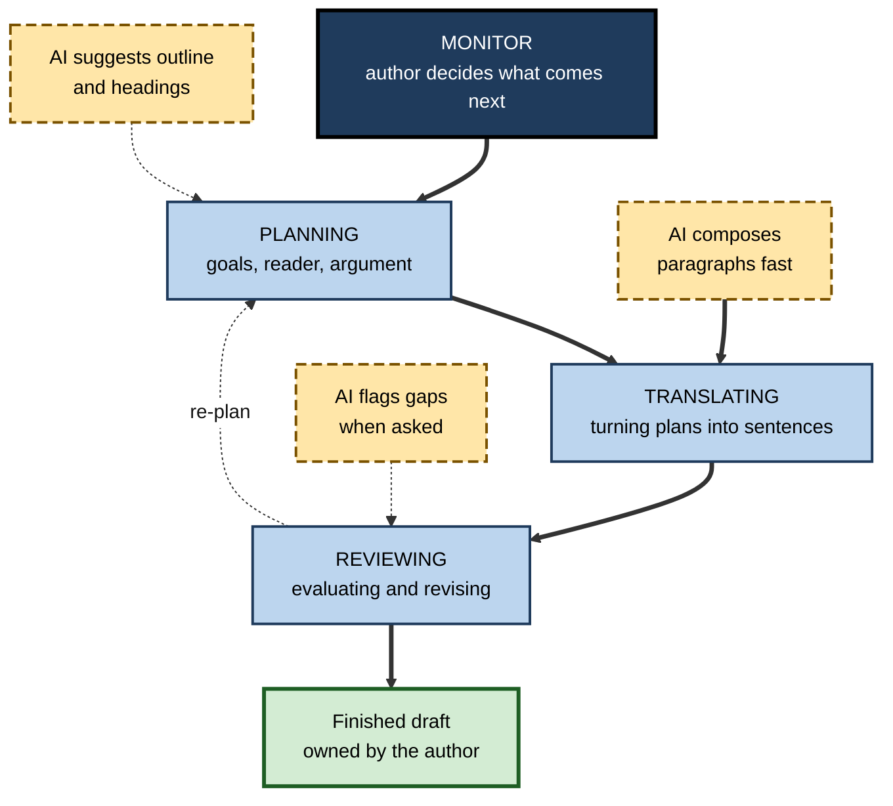
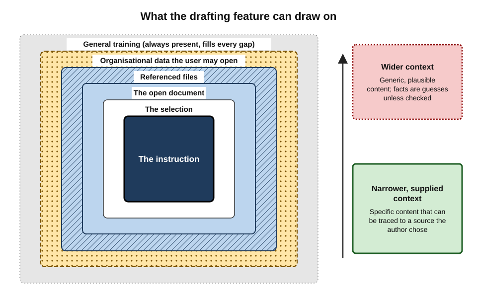
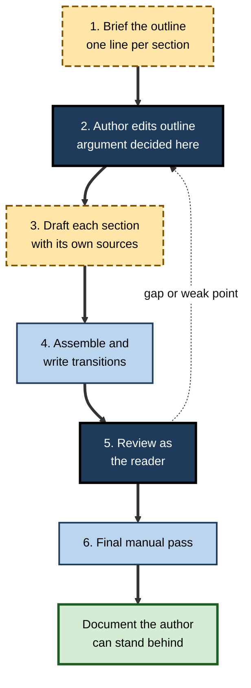
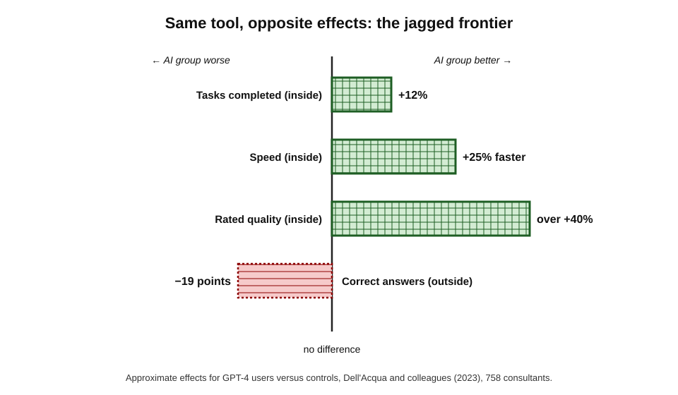
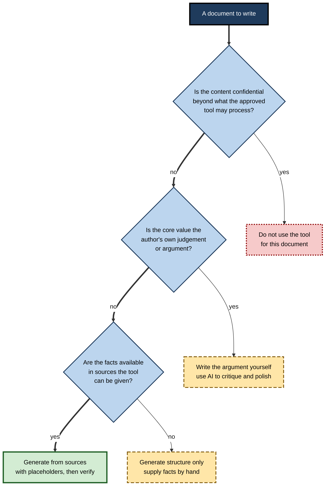
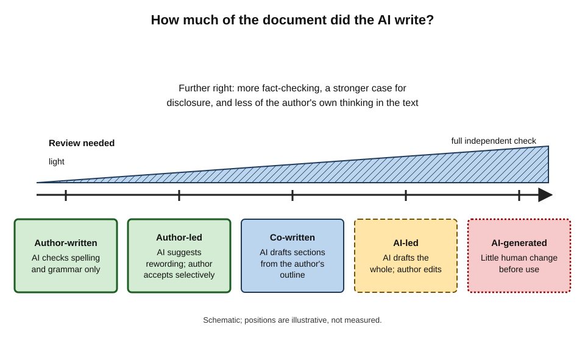

# D.1. Drafting with AI in a word processor

A project manager opens a blank document at four in the afternoon, needing a two-page proposal by the morning. She types one line into the assistant panel of her word processor, points it at last quarter's status report and a client email, and within a minute three headed sections of plausible prose appear on the page. The proposal now *exists*. Whether it is any *good* — accurate, persuasive, hers — depends entirely on what she does next.

> **Definition — AI-assisted drafting:** producing the first or an intermediate version of a document by instructing a generative AI feature, usually built into the word processor, to compose text from a request, an outline or source material, which the human author then directs, checks and revises.

**Why drafting with AI matters**

- **It is the most common use of AI in documents.** Drafting features are the first thing most office suites put in front of users when a blank page opens.
- **It changes where effort goes.** Time moves from producing sentences to briefing, checking and shaping — a different skill set.
- **It moves risk.** A fluent draft can carry invented facts, missing requirements and borrowed assumptions straight into a signed document.
- **It shapes the writer.** Used well, it frees attention for thinking; used badly, it replaces the thinking that writing exists to do.

---

## What Drafting Is

### Writing as a set of mental processes

A draft is not simply typed; it is planned, composed and reviewed, often in loops. The classic account of these processes predates AI by four decades and still explains where AI helps and where it harms.

**Study card — Linda Flower and John Hayes (1981), "A Cognitive Process Theory of Writing"**

- **Method:** writers *thought aloud* while composing; the researchers analysed the recorded protocols.
- **Findings:** writing consists of three main processes under a controlling **monitor**:
  - **planning** — generating ideas, organising them and setting goals;
  - **translating** — turning plans into sentences;
  - **reviewing** — evaluating and revising.
- **Key insight:** the processes are **recursive**, not a straight line — a writer plans, writes a paragraph, reviews it, re-plans.
- **Further insight:** skilled writers set and revise **goals** throughout; weaker writers mostly translate.
- **Significance:** much of the quality of a document is decided during planning and reviewing, not during sentence production.

> **Key point:** AI drafting tools are strongest at **translating** — producing sentences. Planning and reviewing remain the author's responsibility, and they are where most of the value lies.

**Knowledge-telling and knowledge-transforming**

- **Carl Bereiter and Marlene Scardamalia (1987)** distinguished two ways of writing:
  - **knowledge-telling** — writing down what comes to mind on a topic, in the order it comes;
  - **knowledge-transforming** — reshaping what one knows to meet the reader's needs and the document's goals, which often changes the writer's own understanding.
- A language model left to itself produces something close to **knowledge-telling at scale**: fluent, topical, loosely ordered.
- The author's job is to supply the **transforming** — the goals, the argument, the reader.

| Writing process (Flower and Hayes) | What AI can contribute | What the author must still do |
|---|---|---|
| Planning — goals | Little; it can ask questions if instructed | Decide purpose, reader and the decision the document must support |
| Planning — ideas and order | Suggest outlines and headings; list points to consider | Choose, cut and order the points; decide the argument |
| Translating | Produce fluent sentences quickly | Supply facts, specifics and examples the tool cannot know |
| Reviewing | Flag gaps, inconsistency or unclear passages if asked | Judge accuracy, fit with purpose and whether the reader will be persuaded |
| Monitoring | None — it does not know when the document is finished | Decide when the draft meets its goal |

**Figure 1.** The writing process, showing where an AI drafting feature acts and where the author's judgement governs.

---

## What the Drafting Feature Sees

### Built-in assistants and their context

A drafting feature in a word processor differs from a separate chat window mainly in **what it can see and what it can touch**. Both run a large language model; the built-in version is wired into the document.

> **Definition — Context (in AI drafting):** the material the model is given alongside the instruction — the selected text, the open document, any referenced files and, in enterprise tools, permitted organisational data — from which it composes its output.

> **Definition — Grounding:** supplying a model with specific source material and instructing it to base its output on that material rather than on its general training.

**Layers of context, from narrowest to widest**

- **The instruction alone** — the model draws only on its general training.
  - Output is generic; any specific fact it adds is a guess.
- **The selection** — a highlighted passage the request concerns.
  - Typical for "expand this", "continue from here".
- **The open document** — everything already on the page.
  - Lets the tool match headings, terms and tone.
- **Referenced files** — documents the author points to (a report, a meeting transcript, an email).
  - Office assistants commonly let a user reference a small number of files by name in the request.
- **Organisational data** — in enterprise suites, material the user already has permission to open across mail, chat and shared drives.
  - Powerful, and the reason permissions hygiene matters.
- **General training** — always underneath, filling every gap the author leaves.

**Figure 2.** Layers of context available to an in-document drafting feature.

> **Key point:** whatever the author does not supply, the model **fills from general training** — fluently, and without saying so. Specificity has to be put in; it is never created.

### What current tools can do (October 2026)

Office suites have moved quickly from one-shot "write a paragraph" buttons to assistants that act across a whole document.

- **Draft from a prompt** — a request typed in a panel or on a blank line produces paragraphs or a whole document.
- **Draft from files** — the request names source documents, and the draft is built from them.
- **Insert or extend** — add a section, continue a paragraph, write an introduction for existing content.
- **Multi-step document editing** — in 2026 the major suites added agent-style modes.
  - Microsoft announced in April 2026 that Copilot's **Agent Mode** was generally available in Word, Excel and PowerPoint; it can carry out multi-step actions inside a document and show its progress as it works.
  - Copilot in Word gained word-level **tracked changes** and comment handling in early 2026, so AI edits can be accepted or rejected one by one.
  - Google's 2026 Docs update let users prompt Gemini to edit across a document, with suggested edits visible only to the requester until approved, plus options to **match the writing style** and **match the format** of a source document.
- **Language coverage** — features first launched in English are steadily extended to other languages; Google added eleven more languages for Docs features in mid-2026.

> **Watch out:** feature names, limits and availability change every few months and differ by licence, platform and region. The skills — briefing, grounding, checking — outlast any particular button.

### Built-in versus a separate assistant

| | Drafting inside the word processor | Drafting in a separate chat assistant |
|---|---|---|
| Sees the document | Yes, directly | Only what is pasted in |
| Applies house formatting and styles | Usually | No — formatting is lost or must be rebuilt |
| Can reach organisational files | Often, within the user's permissions | Rarely, unless connected |
| Edits can be tracked and reviewed in place | Increasingly yes | No |
| Data handling | Governed by the organisation's suite agreement | Depends on the account type and settings |
| Flexibility and choice of model | Limited to the suite's assistant | Wider |

---

## The Drafting Brief

### Why the instruction decides the draft

A one-line request — "write a proposal for the data migration" — leaves almost every decision to the model. The model will make those decisions using the most typical patterns in its training: a generic structure, generic benefits, generic risks.

> **Definition — Drafting brief:** the instruction that tells the tool what document to produce: its purpose, reader, sources, structure, length and constraints.

**The six parts of a document brief**

- **Purpose** — what the document must achieve.
  - *e.g.* "secure approval for a six-week pilot".
- **Reader** — who will read it and what they already know.
  - *e.g.* "the finance director, who knows the budget but not the technology".
- **Sources** — which files and facts the draft must use, and that it must use *only* those for specifics.
- **Structure** — required sections, order, or the organisation's template.
- **Length and register** — page or word budget; formal or plain.
- **Constraints** — what must not appear, what must be flagged, terms to use or avoid.

> **Mnemonic — PRISSM:** Purpose, Reader, Inputs (sources), Structure, Size and register, Must-nots. A brief missing any of these lets the model decide it.

> **Example — weak and strong brief:**
> *Weak:* "Write a proposal for moving our CRM to the cloud."
> *Strong:* "Draft a two-page proposal asking the finance director to approve a six-week pilot moving the sales team's CRM to the cloud. Use only figures from the attached cost estimate and the IT risk register. Sections: Problem, Proposal, Costs, Risks, Decision needed. Plain, formal British English. Where a fact is missing, insert [TBC: what is needed] rather than inventing it."

### Placeholders instead of inventions

- Language models are built to produce **complete-looking text**. If a fact is missing, they tend to supply a plausible one.
- The defence is to **license gaps** explicitly:
  - instruct the tool to write **[TBC]** or **[CHECK]** wherever a figure, name or date is not in the sources;
  - search for those markers before the document leaves the author's hands.

> **Remember:** "Use only the attached sources for facts; mark anything missing as [TBC]" — the single most protective sentence in a drafting brief.

---

## Ways of Drafting with AI

### Three starting points

| | From a request alone | From an outline | From source documents |
|---|---|---|---|
| Typical use | Routine, low-stakes text; getting unstuck | Structured documents where the author knows the argument | Reports, proposals and briefings built from existing material |
| Who decides the argument | Mostly the model | The author | Shared — the sources constrain the model |
| Main risk | Generic content and invented specifics | Thin paragraphs that pad each heading | Misreading, overstating or omitting source content |
| Checking effort | Moderate — content may be wrong everywhere | Lower — structure is already sound | High for facts — every claim traced to its source |
| Effect on author's thinking | Weakest | Strongest | Moderate |

### Outline-first drafting

For any document longer than a page, the most reliable pattern is to **separate planning from composing**.

1. **Brief the outline.** Ask for a proposed structure with one line per section stating its point, not prose.
2. **Edit the outline yourself.** Cut, reorder and rewrite the points; this is where the argument is decided.
3. **Draft section by section.** Generate each section separately, with its own sources and length.
4. **Assemble and connect.** Write or revise transitions so the sections form one argument.
5. **Review as a reader.** Read the whole draft for accuracy, gaps and persuasiveness.
6. **Finalise in your own hand.** Make the last pass manually, so the author is the last to touch every sentence.

**Figure 3.** Outline-first drafting: the author decides the structure before the tool writes prose.

### Other drafting moves

- **Expand** — turn notes or bullet points into prose.
  - Safest when the notes already contain all the facts.
- **Continue** — extend an existing passage in its own style.
  - Watch for drift away from the point.
- **Fill a template** — complete a standard document (a status report, a policy section) from inputs.
  - The template's structure does much of the quality control.
- **Alternatives** — ask for two or three different openings or framings, then choose or combine.
  - Useful for persuasive documents; prevents anchoring on the first version.
- **Questions first** — ask the tool to list what it would need to know to write the document well.
  - Turns the model into a planning partner rather than a ghostwriter.

> **In practice:** experienced writers often use the tool **before** drafting — to generate questions, objections and missing considerations — and **after** drafting, to critique. They write the middle themselves when the argument matters.

---

## Worked Example (illustrative): A Pilot Proposal

**Situation:** an operations lead must draft a two-page proposal for a finance director to approve a six-week pilot of automated invoice matching. Sources: a vendor quote, last quarter's error statistics and an IT security note.

1. **Brief the outline.** The request asks for five sections, one line each, for a finance reader, using only the three attached files.
2. **Edit the outline.** The tool's outline opens with "Benefits of automation". The author moves "Problem: 4% of invoices need manual rework" first, because the finance director cares about the cost of the status quo.
3. **Draft the Problem section.** The tool writes a paragraph quoting the error rate from the statistics file and adds "industry studies show automation reduces errors by up to 80%".
4. **Catch the invention.** No source contains that figure. The author deletes it and re-prompts: "use only the attached sources; mark gaps [TBC]".
5. **Draft Costs and Risks.** The tool correctly lifts the vendor quote but omits the security note's condition that data must stay in the region. The author adds it.
6. **Review as the reader.** The draft never states the decision required. The author adds a closing line: "Decision needed: approve £18,000 for a six-week pilot starting 1 December."
7. **Final pass.** The author reads every sentence, searches for [TBC], and rewrites the opening paragraph in her own words.

| | First AI draft | Final document |
|---|---|---|
| Opening | Generic benefits of automation | The cost of the current problem, with the real error rate |
| Facts | One invented statistic; one omitted condition | Every figure traceable to a source |
| Decision requested | Absent | Explicit amount, scope and date |
| Time spent | About 2 minutes of generation | About 50 minutes in total, mostly review and restructuring |

*Illustrative figures.*

- **Conclusion:** the tool saved composing time, but the document's value — the right opening, the true facts, the explicit decision — came from the author's planning and review.

> **Watch out:** the invented "up to 80%" figure looked like a citation. Statistics without a named source in the provided material should be treated as **fabricated until traced**.

---

## What the Evidence Shows

### Speed, quality and the jagged frontier

- **Noy and Zhang (2023)** found in a controlled experiment with professional writing tasks that access to a chat assistant cut completion time substantially and raised graded quality, with the largest gains for weaker writers.
- The more instructive study for document work concerns **where** the gains stop.

**Study card — Dell'Acqua and colleagues (2023), "Navigating the Jagged Technological Frontier"**

- **Design:** 758 consultants at Boston Consulting Group were randomly assigned to work with or without GPT-4 on realistic tasks.
  - Some tasks were **inside** the AI's capability frontier (creative product ideas, written analysis, persuasive writing).
  - One task was designed to fall **outside** it: a business problem that required combining interview notes with spreadsheet data, where a plausible but wrong answer was easy to reach.
- **Results — inside the frontier:** consultants with AI completed about 12% more tasks, about 25% faster, with output rated over 40% higher in quality.
- **Results — outside the frontier:** consultants with AI were about 19 percentage points **less** likely to reach the correct answer than those without it.
- **Interpretation:** AI capability is **jagged** — excellent on some tasks, misleading on others of similar apparent difficulty — and users cannot easily see where the edge lies.
- **Status:** a widely cited working paper; the pattern is consistent with later field studies, but exact figures are specific to its tasks.

**Figure 4.** Effects of AI assistance inside and outside the capability frontier in the consultant study.

> **Key point:** fluent drafts are *most dangerous* exactly where the tool is weakest, because the output looks equally confident on both sides of the frontier.

### Anchoring on the first draft

- Once a draft exists, writers tend to **edit it** rather than question it.
  - The structure, emphasis and assumptions of the AI's first version persist into the final document.
- This mirrors **anchoring** in judgement research: an initial value pulls later estimates towards it.
- It also mirrors **automation bias** — the tendency to accept an automated system's output and to under-search for contradicting information.

> **Definition — Automation bias:** over-reliance on automated output, shown both as accepting incorrect suggestions (commission errors) and as failing to notice problems the system did not flag (omission errors).

> **Watch out:** "I changed lots of words" is not the same as "I checked the argument". Heavy line-editing can leave an AI draft's flawed structure untouched.

---

## How AI Drafts Go Wrong

### Content failures

- **Invented specifics** — figures, dates, names, policies or citations that no source contains.
- **Omitted requirements** — a condition in the sources that the draft quietly drops.
- **Overstated claims** — "will eliminate" where the source said "may reduce".
- **Stale or wrong context** — general knowledge that does not apply to this organisation, market or jurisdiction.

### Form failures

- **Generic filler** — sentences that could appear in any document on the topic ("In today's fast-paced business environment…").
- **Padding** — length grows to fill the request; each heading gets a paragraph whether or not it has content.
- **Even emphasis** — every point receives the same weight, so the important one is buried.
- **House-style mismatch** — wrong spelling variety, terms the organisation avoids, or a structure that ignores the template.

### Process failures

- **No brief** — the model decides purpose and reader.
- **No source discipline** — the tool is allowed to mix sources with general knowledge.
- **No last human pass** — text goes out that no person has read in full.
- **Wrong version** — a draft built from an outdated file.

**Figure 5.** Deciding how much of a document to generate and how much to write directly.

---

## Ownership of an AI-Drafted Document

### The accountable author

- A document is judged by the reader, the client, the regulator or the court as the **author's** work, regardless of how it was produced.
- Professional bodies converge on the same rule: the human who signs or sends a document is **responsible for its contents**.
  - In 2023, two New York lawyers were sanctioned after filing a brief containing case citations a chatbot had invented (*Mata v. Avianca*); the court's objection was not to AI use but to the failure to check.
- Whether and how to **disclose** AI involvement depends on the setting; norms are hardening in publishing, academia and regulated sectors, and the EU AI Act's transparency obligations began to apply in August 2026, chiefly to providers and to AI-generated text published to inform the public.

> **Remember:** the tool drafts; the author **answers** for every sentence.

### The share of a document written by AI

AI involvement is a spectrum, not a switch. The closer a document sits to the AI-led end, the heavier the review and the stronger the case for disclosure.

**Figure 6.** A spectrum of AI involvement in a document, with the review it demands.

---

## Drafting at Professional Scale

### Personal practice

- **A brief library** — saved briefs for recurring documents (monthly report, project charter, client summary).
- **Source folders** — the files each document type should be grounded on, kept current.
- **A personal style sheet** — preferred terms, spelling variety, banned phrases — pasted into briefs or set as a standing instruction where the tool allows.
- **A fixed last pass** — the author always makes the final edit manually.

### Team and organisational practice

- **Templates with instructions** — document templates whose sections carry guidance for both human and AI ("state the decision required in one sentence").
- **Approved sources** — clarity about which repositories the drafting assistant may draw on.
- **Review roles** — for high-stakes documents, a second person checks facts against sources, not just prose.
- **Measured adoption** — teams track rework, error rates and reader feedback, not only time saved.

### Case study (illustrative): a bid team adopts in-document drafting

- **Situation:** a mid-sized engineering consultancy wrote about forty tender responses a year. Each took a team of four roughly two weeks, much of it spent re-writing standard sections — company background, health and safety approach, project methodology.
- **Change:** the firm enabled its office suite's drafting assistant and asked bid writers to "use AI for first drafts".
- **First problem (within two months):**
  - drafts were produced faster, but two submissions contained project references the firm had never delivered — the assistant had filled "relevant experience" sections with plausible examples;
  - one tender was marked down for generic methodology text that did not answer the client's specific questions.
- **Diagnosis:**
  - writers were drafting **from requests alone**, so the model filled gaps from general knowledge;
  - the assistant was answering the **section headings**, not the client's evaluation criteria.
- **Actions:**
  1. built a **source library** of verified project case sheets, CVs and policies, and required every draft to reference it;
  2. introduced an **outline step**: each section's outline had to map, line by line, to the client's evaluation criteria before prose was generated;
  3. added a mandatory **[TBC]** rule and a pre-submission search for unresolved markers;
  4. assigned a **fact reviewer** who traced every project reference and figure to the library.
- **Result (over the following year):** preparation time for standard sections fell markedly; no further fabricated references reached a submission; evaluators' scores for responsiveness improved, which the team attributed to the criteria-mapping outline rather than to AI prose.
- **Lesson:** the gain came from **grounding and planning discipline**; the drafting feature merely made that discipline pay off faster.

---

## Drafting and the Writer's Own Skill

### What may be lost

- **Writing is thinking.** Planning and composing force a writer to discover what they actually believe and where the argument is weak; outsourcing composition can skip that discovery.
- **Novices are most exposed.** People who have not yet built drafting skill may gain the most immediate quality — and lose the most practice.
- **Homogenisation.** Drafts built from the same models drift towards the same phrasing and structure, a risk for distinctiveness that grows as AI drafting spreads.

### What may be gained

- **Momentum** — the blank page stops being a barrier; something exists to react to.
- **Breadth** — alternative structures and counter-arguments the writer had not considered.
- **Attention** — routine sections take less effort, freeing time for the parts that need judgement.
- **Access** — writers working in a second language, or with conditions such as dyslexia, can produce documents that represent their thinking more fairly.

> **In practice:** protect the drafting of documents that **build expertise or carry personal judgement** — strategy papers, assessments, reflective writing — by writing the core yourself, and let the tool take routine and repetitive sections.

---

## Open Questions

- **Does routine AI drafting erode writing ability over years?**
  - Short experiments show immediate gains; long-term effects on professional writing skill are largely unmeasured.
- **Where exactly is the frontier for document tasks?**
  - It shifts with every model release and differs by domain, so organisations struggle to keep guidance current.
- **How much should be disclosed, and to whom?**
  - Norms differ between publishing, law, government and ordinary business correspondence, and are still moving.
- **Will agent-style editing change authorship itself?**
  - When a tool restructures and rewrites an entire document in one step, the line between "assisted" and "generated" blurs.
- **Can drafting tools reliably say "I do not know"?**
  - Placeholder behaviour depends on instructions; models still tend to fill gaps when not told otherwise.

---

## Summary

- **AI-assisted drafting** = instructing a generative feature to compose text that the author directs, checks and revises.
- Writing involves **planning, translating and reviewing** under a **monitor** (Flower and Hayes, 1981); AI is strongest at **translating**, while value is decided in planning and reviewing.
- A model left alone produces **knowledge-telling**; the author supplies **knowledge-transforming** — purpose, reader, argument.
- What the tool can see — instruction, selection, document, **referenced files**, organisational data — determines specificity; gaps are filled from **general training**.
- A strong brief covers **PRISSM**: Purpose, Reader, Inputs, Structure, Size and register, Must-nots — and licenses **[TBC] placeholders** instead of inventions.
- **Outline-first drafting** separates planning from composing and keeps the argument with the author.
- Evidence shows large gains **inside the frontier** and worse accuracy **outside it** (Dell'Acqua and colleagues, 2023); **anchoring** and **automation bias** make first drafts sticky.
- Failures are of **content** (invented, omitted, overstated), **form** (generic, padded, flat) and **process** (no brief, no source discipline, no last pass).
- The **author is accountable** for every sentence; disclosure norms vary by setting and are tightening.
- At scale, the gains come from **grounding, templates and review roles**, not from generation alone.

---

## Self-Check

1. Define AI-assisted drafting and explain why the definition places the human as director and checker.
2. Name the three writing processes in Flower and Hayes's model and state which one AI tools perform best.
3. Distinguish knowledge-telling from knowledge-transforming, and explain how the distinction applies to AI drafts.
4. What is grounding, and why does an ungrounded draft tend to contain invented specifics?
5. List the six parts of a drafting brief and give an example of each for a training-budget request.
6. Why does a placeholder instruction such as "[TBC]" protect a document?
7. Describe the outline-first drafting procedure and explain why step 2 matters most.
8. Summarise the findings of the consultant study on the jagged frontier and what they imply for document work.
9. Explain how anchoring and automation bias affect the editing of an AI first draft.
10. Classify each failure as content, form or process: a draft from an outdated file; a paragraph of generic filler; a dropped contractual condition.
11. A colleague says the 2023 court sanctions show lawyers must not use AI. Evaluate the claim.
12. When should a writer deliberately not generate the core of a document?
13. A team's AI-drafted tenders are faster but score lower on responsiveness. Diagnose likely causes and propose three changes.

### Answer Key

1. AI-assisted drafting is producing a version of a document by instructing a generative feature to compose text from a request, outline or sources, which the author then directs, checks and revises. The human is placed as director and checker because the tool cannot know purpose, reader or truth, and because the author remains accountable for the result.
2. Planning, translating and reviewing, coordinated by a monitor. AI tools perform translating — turning plans into sentences — best.
3. Knowledge-telling writes down what comes to mind on a topic; knowledge-transforming reshapes knowledge for a reader and a goal. An unbriefed AI draft resembles knowledge-telling; the author must add the transforming by setting goals, choosing the argument and fitting it to the reader.
4. Grounding is giving the model specific sources and instructing it to base output on them. Without grounding, the model fills every specific detail from general training, producing plausible but invented figures, names and examples.
5. Purpose (approve £5,000 for analytics training); Reader (head of department, budget-focused); Inputs (the course quote and the skills-gap survey only); Structure (Need, Option, Cost, Benefit, Decision); Size and register (one page, formal); Must-nots (no invented outcomes; mark gaps [TBC]).
6. It gives the model permission to leave a gap visible rather than inventing a plausible fact, and gives the author a searchable marker of what still needs checking.
7. Brief an outline, edit it yourself, draft section by section, assemble with transitions, review as the reader, then finish manually. Step 2 matters most because the argument and emphasis are decided there; if the author accepts the AI outline unchanged, the model has decided the document.
8. With GPT-4, consultants did more tasks, faster and at higher rated quality on tasks inside the AI's capability, but were less likely to be correct on a task outside it. For documents, AI drafts can be most convincing precisely where they are wrong, so verification effort should be highest on unfamiliar or data-dependent content.
9. Anchoring makes the first draft's structure and emphasis persist because writers edit rather than rethink; automation bias makes them accept its claims and fail to look for what it left out. The result is a polished version of the AI's assumptions.
10. Outdated file — process; generic filler — form; dropped condition — content.
11. The claim is wrong. The sanctions were for filing unverified, fabricated citations and failing to check them; the duty breached was verification and candour, which applies however a document is produced.
12. When the document's value lies in the writer's own judgement or argument, when writing it builds expertise the writer needs, when it is personal, or when the content is too confidential for the approved tool.
13. Likely causes: drafting from section headings rather than the client's criteria; generic content filling gaps; no mapping of answers to evaluation questions. Changes: an outline step mapping each paragraph to a criterion; grounding in a verified source library; a reviewer scoring drafts against the criteria before submission.

---

## Glossary

| Term | Meaning |
|---|---|
| Agent mode | An AI feature that carries out multi-step actions inside a document rather than producing one block of text. |
| AI-assisted drafting | Producing a version of a document by instructing a generative AI feature, which the author directs, checks and revises. |
| Anchoring | The tendency for an initial version or value to pull later judgements towards it. |
| Automation bias | Over-reliance on automated output, through accepting its errors or missing what it fails to flag. |
| Context | The material given to a model alongside the instruction. |
| Drafting brief | The instruction specifying a document's purpose, reader, sources, structure, size and constraints. |
| Grounding | Supplying source material and instructing a model to base its output on it. |
| Jagged frontier | The uneven boundary between tasks AI performs well and tasks of similar difficulty it performs badly. |
| Knowledge-telling | Writing down what one knows in the order it comes to mind. |
| Knowledge-transforming | Reshaping knowledge to serve a reader and a goal. |
| Monitor | In Flower and Hayes's model, the control process that decides which writing process to engage next. |
| Outline-first drafting | Agreeing and editing a structure before generating any prose. |
| Placeholder | A marker such as [TBC] showing where a fact is missing, used instead of an invented value. |
| Planning | Generating ideas, organising them and setting goals for a text. |
| Reviewing | Evaluating and revising text. |
| Translating | Turning plans into written sentences. |
