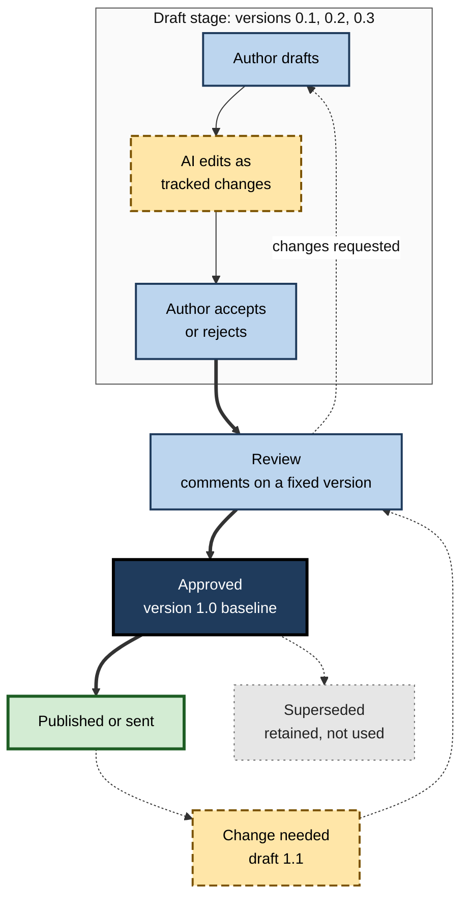
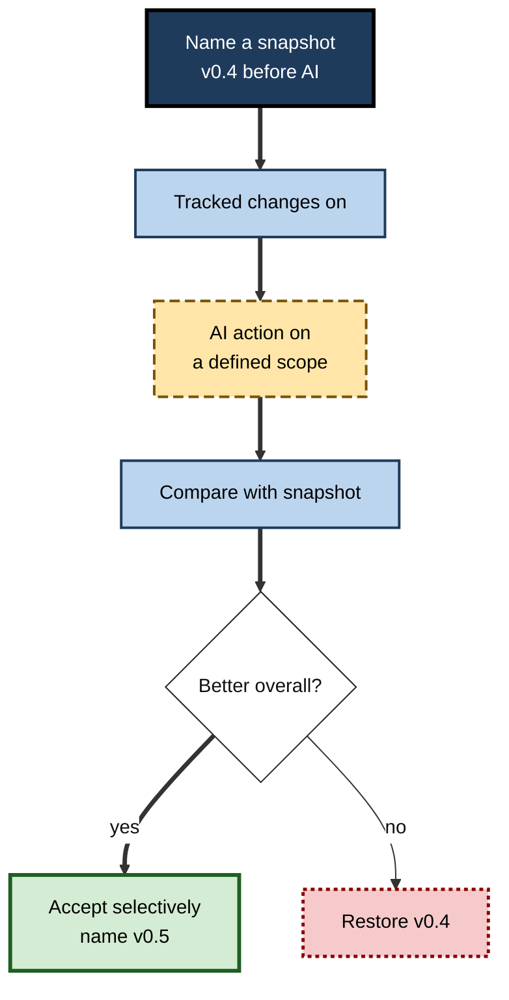
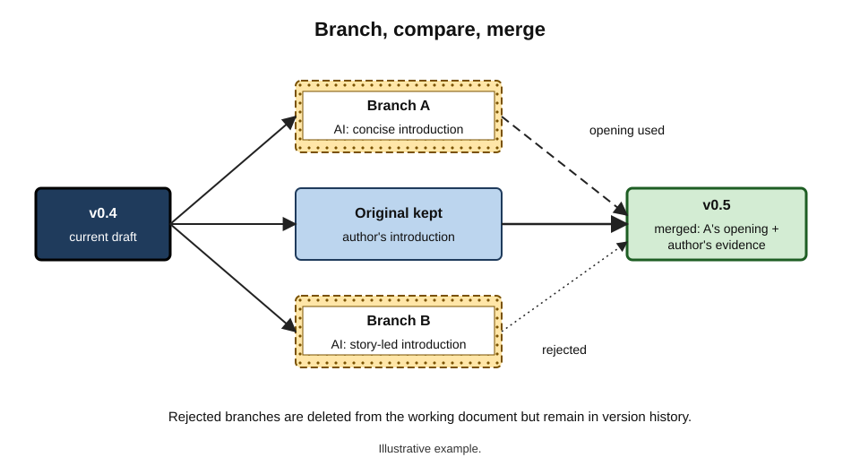
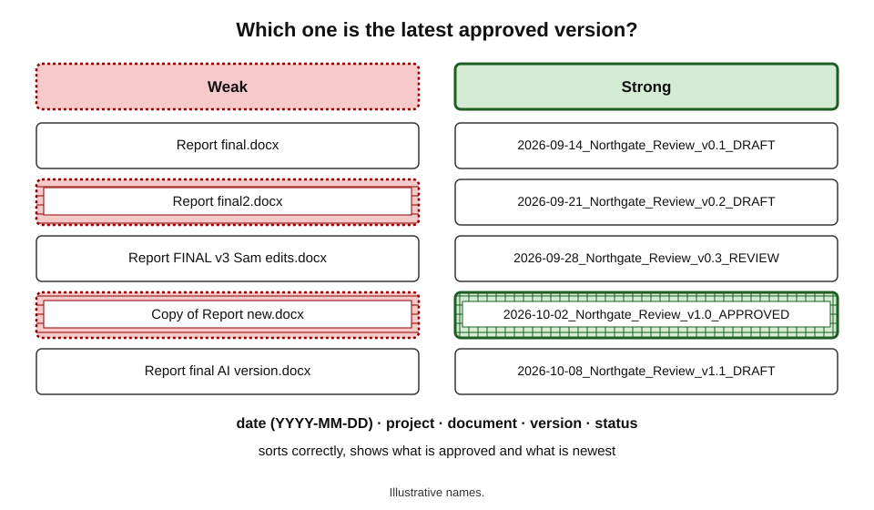
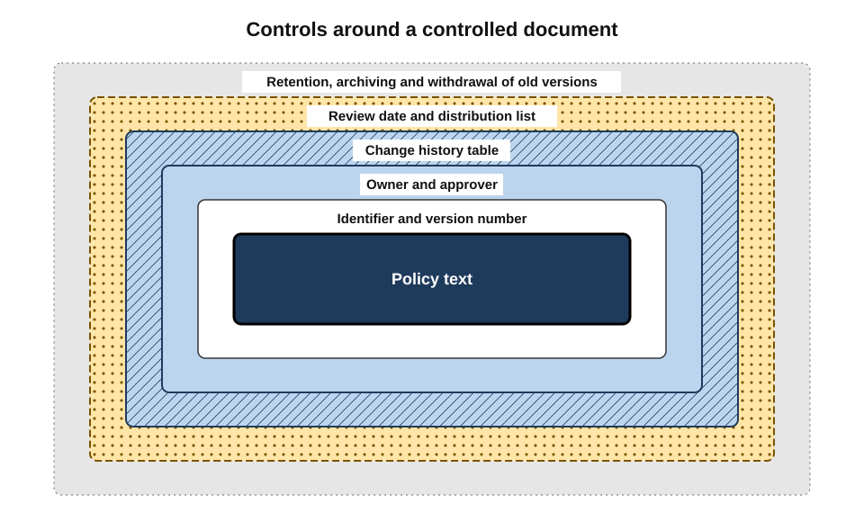

# D.10. Version control and drafts

An analyst asks the assistant to "tighten the whole report". Forty seconds later every section has changed. Most of it reads better; one table has lost a row, a caveat has vanished from the conclusions, and the client's preferred terminology has been replaced throughout. Can the analyst get yesterday's text back — and see exactly what changed? With AI, documents change faster and more widely than ever, so the old discipline of managing **versions** has become one of the most practical AI-era skills.

> **Definition — Version control:** the practice and tools for recording successive states of a document, identifying each one, seeing what changed between them and returning to an earlier state when needed.

> **Definition — Draft:** a working version of a document that is not yet approved for its intended use.

**Why versions matter more with AI**

- **Scale of change** — a single AI request can alter every paragraph; manual edits rarely do.
- **Invisible change** — accepted AI rewrites can remove words without any visible trace unless changes are tracked.
- **Alternatives multiply** — AI makes it cheap to produce several versions of a section, which must be kept apart and compared.
- **Accountability** — knowing which version was reviewed, approved and sent is essential when errors appear.
- **Retention and leakage** — every saved version is also a record that may contain sensitive or superseded content.

---

## Core Concepts

### The vocabulary of versions

- **Version** — an identified state of a document at a point in time.
- **Revision** — a change, or set of changes, that produces a new version.
- **Snapshot** — a saved copy of a version, preserved so it can be restored.
- **Baseline** — an approved version against which later changes are measured.
- **Branch** — a separate line of versions developed in parallel, such as an alternative draft.
- **Merge** — combining changes from two branches into one version.
- **Diff (comparison)** — the list of differences between two versions.
- **Rollback (restore)** — returning to an earlier version.

> **Definition — Single source of truth:** one authoritative location and version of a document that everyone works from, so that copies and duplicates do not diverge.

### The draft–review–approve cycle

**Figure 1.** The life cycle of a controlled document, with AI-assisted drafting inside the draft stage.

### Numbering conventions

| Convention | Example | Meaning | Suits |
|---|---|---|---|
| Draft numbers below 1 | 0.1, 0.2, 0.3 | Working drafts, not approved | Any document before approval |
| Major.minor | 1.0, 1.1, 2.0 | Major = substantive change; minor = small correction | Policies, procedures, reports |
| Date-stamped | 2026-10-08 | State on a given day | Living documents, minutes |
| Status labels | DRAFT, FOR REVIEW, APPROVED | Where the document is in its cycle | Combined with numbers |
| Semantic versioning (from software) | 2.4.1 | Major.minor.patch with defined rules | Technical documentation |

> **Remember:** a version number should tell a reader two things at a glance — **is this approved?** and **is this the latest?**

> **Watch out:** "final", "final2", "FINAL_v3_really" are not versions. The word *final* is a promise that is almost always broken; use numbers and status.

---

## The Tools

### What word processors provide

- **Automatic version history** — cloud-stored documents save versions continuously; earlier states can be viewed and restored.
- **Named versions** — a version can be given a meaningful name ("v0.3 — before AI tighten"), so it can be found later.
- **Tracked changes / suggesting mode** — every insertion and deletion is shown, attributed and individually accepted or rejected.
- **Compare documents** — two files compared, producing a marked-up list of differences.
- **Comments** — discussion attached to passages, preserved across versions until resolved.
- **AI edits as tracked changes** — in 2026, the major suites' assistants increasingly propose edits as tracked changes or as suggestions visible only to the requester until approved, rather than overwriting text.

| | Tracked changes | Version history | Compare documents |
|---|---|---|---|
| What it shows | Each edit since tracking began, with author | Whole states over time | Differences between any two files |
| Granularity | Word level | Whole document | Word level |
| Reverses changes | One by one | Whole document at once | No — shows only |
| Weakness | Lost if accepted in bulk or turned off | Hard to see *what* changed between states | Needs two clean files |
| Best AI-era use | Reviewing AI edits individually | Restoring after a bad AI pass | Checking what an AI rewrite really changed |

### What document management systems add

- **Check-out and check-in** — only one person edits at a time; changes are recorded with a comment.
- **Major and minor versions** — drafts visible only to editors; approved versions published to readers.
- **Approval workflows** — a version becomes approved only after named people sign off.
- **Retention policies** — rules for how long versions are kept and when they are deleted.
- **Audit trails** — who viewed, changed, approved and shared each version.

### Docs as code

- Some technical teams write documents in plain-text formats and manage them with **Git** — the version-control system created by Linus Torvalds in 2005 for software.
- Every change is a recorded **commit** with an author and message; alternatives are **branches**; reviews happen through **pull requests**.
- The approach gives precise history and review, but suits technical writers more than general office work.

---

## Versioning With AI: The Practices

### Snapshot before any large AI action

1. **Save and name a version** — "v0.4 before AI restructure".
2. **Turn on tracked changes**, or confirm the assistant will propose edits as suggestions.
3. **Run the AI action** on a defined scope (a section, not the whole document, where possible).
4. **Compare** the result with the snapshot.
5. **Accept selectively**; restore the snapshot if the result is worse.
6. **Name the outcome** — "v0.5 after AI restructure, reviewed".

**Figure 2.** Before invoking AI on an important document.

> **Mnemonic — "SNAP":** **S**ave a named version, **N**arrow the scope, **A**ct with tracking on, **P**rove the change by comparing.

### Managing AI alternatives

- **Generate alternatives as separate copies or sections** — "Option A intro", "Option B intro" — rather than repeatedly overwriting one passage.
- **Compare deliberately** — read alternatives side by side, choose, then delete the rejected ones from the working document.
- **Keep the original** — the human-written original of a passage stays recoverable until the final version is approved.

**Figure 3.** Branching alternatives from one version and merging the chosen elements.

### Recording AI involvement in the history

- **Name versions after what happened** — "v0.3 AI first draft of section 2", "v0.4 author revision".
- **Leave AI edits attributed** — do not accept AI tracked changes in bulk before a reviewer has seen them, if the reviewer needs to know what the AI changed.
- **Link the history to any provenance record** kept for the document.

### Collaboration and copies

- **One document, shared** — work in one cloud document rather than emailing copies; this keeps one history.
- **Avoid parallel copies** — "my version" and "your version" diverge and must be merged by hand.
- **Watch AI chat copies** — text copied into a separate chat assistant, rewritten there and pasted back bypasses the document's tracked changes and history.
  - Paste back with tracking on, or compare before accepting.

> **Watch out:** the commonest AI-era version failure is **paste-over**: a whole section replaced with text rewritten in a separate chat window, with no tracked changes and no named snapshot. The previous text survives only in automatic history — if the document is cloud-stored at all.

---

## Naming and Organising Files

**Figure 4.** Weak and strong file naming for document versions.

- **Use a consistent pattern** — *date (YYYY-MM-DD)*, *project*, *document*, *version*, *status*.
  - *e.g.* "2026-10-08_Northgate_SupplierReview_v0.4_DRAFT".
- **ISO 8601 dates** (year-month-day) sort correctly and are unambiguous across countries.
- **No personal or vague words** — "final", "new", "latest", "Sam's edits".
- **In cloud suites**, prefer **one file with named versions** over many files.
- **Archive superseded versions** separately so they are not opened by mistake.

> **In practice:** many teams adopt a simple rule — **only the document library's latest approved version is ever sent outside the team**; everything else is a draft by definition.

---

## Common Version Failures

- **Divergent copies** — two people edit separate copies; both sets of changes must be merged by hand, and some are lost.
  - *Fix:* one shared cloud document; check-out where simultaneous editing is unsafe.
- **Reviewing a moving target** — comments refer to text that has since changed.
  - *Fix:* freeze and number the review version.
- **Bulk acceptance** — all tracked changes accepted at once, including AI edits nobody read.
  - *Fix:* triage changes by type; accept bulk only for trivial formatting.
- **Silent regression** — a later AI pass reintroduces an error that an earlier review removed.
  - *Fix:* compare each new version with the last **approved** or **reviewed** version, not only with the previous draft.
- **Sending the wrong file** — an old version, or an internal one with comments.
  - *Fix:* status in the file name; clean external copies; send from the document library, not from downloads or email attachments.
- **Orphaned approvals** — a version is approved, then edited "just slightly" and sent without re-approval.
  - *Fix:* any change after approval creates a new version number and, where required, fresh approval.
- **Lost originals** — the human-written original of a heavily rewritten passage cannot be found when a reviewer asks what the author actually meant.
  - *Fix:* named snapshot before every large AI action.

> **Definition — Silent regression:** the reappearance of an error or unwanted wording in a later version after it had been corrected, often because a later edit was based on an older copy or an AI pass reverted a fix.

> **Remember:** compare against what was **approved**, not just against what came **before**.

### How agents change the picture

- **Many small edits** — agentic assistants may make dozens of changes across a document in one request; tracked changes keep them reviewable, but only if reviewers actually step through them.
- **Edits across documents** — agents that update several files at once (a policy, its summary and an intranet page) require consistent version numbers across the set.
- **Partial completion** — an agent may stop part-way through; the version must be checked for half-applied changes before anyone builds on it.
- **Explanations** — some tools describe what they changed and why; useful as a guide, never as a substitute for the redline.

---

## Document Control in Organisations

### Controlled documents

> **Definition — Controlled document:** a document whose versions, approval, distribution and retention are formally managed — such as a policy, procedure, specification or contract.

- **Quality-management standards** require it.
  - ISO 9001:2015 (clause 7.5, "documented information") requires organisations to identify documents, control changes, approve them for adequacy, ensure the relevant versions are available where needed and prevent unintended use of obsolete ones.
- **Typical controls:**
  - unique identifier and version number on every page;
  - change history table at the start or end of the document;
  - named owner and approver;
  - review date;
  - distribution list and withdrawal of superseded copies.

**Figure 5.** Layers of control for a policy document.

### Hidden history: when versions leak

- **Metadata travels with files** — author names, revision history, comments, tracked changes and hidden text can remain inside a document sent externally.

### Case study: the 2003 dossier and its revision log

- **Situation:** in February 2003 the UK government published a briefing document on Iraq's security apparatus, distributed as a word-processor file.
- **Discovery:** a researcher examined the file's embedded revision log, which listed the user names of the people who had edited it — officials in the Prime Minister's office — and analysts showed that much of the text had been taken from an academic article without attribution.
- **Consequence:** the document became widely known as the "dodgy dossier"; the metadata turned a publication into a public record of its own drafting.
- **Lesson:** the history inside a file is part of what is sent. Before external release, documents are **inspected and cleaned** of comments, tracked changes, revision data and hidden text, or converted to a format that excludes them.

> **Watch out:** AI-era documents can carry extra hidden history — **comments from AI reviewers**, **unaccepted AI suggestions** and **prompts pasted into the document**. Inspect before sending.

---

## Reviewing Versions Well

### What a reviewer needs

A reviewer can only review something that holds still. Much wasted review effort comes from documents that keep changing while comments are being written.

- **A fixed version** — the draft is frozen and numbered for the review period; the author works on a copy or waits.
- **A change summary** — what changed since the last version the reviewer saw, and why.
- **The redline** — tracked changes or a comparison against the previous reviewed version, so the reviewer reads changes, not the whole document again.
- **A deadline and a scope** — "comment on sections 3–5 by Thursday; sections 1–2 are approved".
- **Knowledge of AI involvement** — which sections or edits came from AI, so the reviewer can concentrate verification there.

> **Definition — Redline:** a marked-up version showing insertions and deletions against an earlier version, named after the red lines once drawn by hand.

### Reading a comparison

- **Ignore formatting noise** — most compare features can hide formatting-only changes, leaving content changes visible.
- **Check moves** — text moved from one place to another can appear as a deletion and an insertion; check that nothing was lost in transit.
- **Look for small, decisive edits** — "may" to "must", "30" to "60", a deleted "not". These are the changes most easily missed and most consequential.
- **AI change summaries help, but do not replace the redline.** An assistant can explain what a set of changes means; the mechanical comparison establishes what actually changed.

| Change type | How it appears in a redline | Why it matters | Typical AI-era cause |
|---|---|---|---|
| Wording polish | Many small replacements | Usually low risk | Copy-editing pass |
| Hedge or obligation change | One word replaced | High — changes meaning | Rewriting for confidence or tone |
| Number change | One figure replaced | High | Drafting from a different source or invention |
| Section moved | Deletion and insertion | Medium — check nothing dropped | Restructuring request |
| Section removed | Large deletion | High | Shortening or "tightening" request |

> **In practice:** experienced reviewers scan a redline first for **numbers, modal verbs and negations**, then read the rest. AI rewrites concentrate their risk in exactly those places.

### Change history tables

Controlled documents usually begin or end with a short table that records their evolution.

| Version | Date | Author | Summary of change | Approved by |
|---|---|---|---|---|
| 1.0 | 2025-03-01 | Policy owner | First approved version | Executive committee |
| 1.1 | 2025-09-15 | Policy owner | Contact details updated | Policy owner |
| 2.0 | 2026-04-10 | Policy owner | Rewritten for new hybrid model; AI-assisted first draft | Executive committee |
| 2.1 | 2026-10-08 | Policy owner | Attendance rule added; AI-assisted first pass | Legal and ER |

*Illustrative entries.*

- **Benefits:** readers see at a glance whether a version is current and what changed; auditors see that changes were approved; future editors understand why wording exists.
- **AI involvement** can be noted in the summary column where organisational policy requires it.

---

## Retention, Deletion and Discovery

### Every version is a record

- **Version history accumulates** — cloud documents may hold hundreds of saved states, including text that was later deleted because it was wrong, sensitive or embarrassing.
- **Records management rules** decide how long versions are kept; regulated sectors often have minimum retention periods.
- **Legal holds** — when litigation or investigation is anticipated, organisations must preserve relevant documents and their histories; deleting versions can then be unlawful.
- **Discovery** — in litigation, earlier drafts and their comments can be requested and read by the other side.

> **Watch out:** a draft that included an AI-generated speculation — "the delay was probably caused by the supplier's negligence" — remains in the version history even after deletion from the final text. Write drafts, and instruct AI, as if earlier versions might one day be read by others.

### Balancing retention

- **Keep** approved versions, change histories and the versions that were reviewed or sent.
- **Prune** working drafts according to the organisation's retention schedule, not ad hoc.
- **Separate** speculative analysis and negotiation notes from the document that will be shared, so that what is shared never carries what was only meant for the team.

---

## Versioning the Things That Make Documents

AI-era document work depends on reusable **inputs** — templates, saved briefs, term bases, voice sheets, content libraries. These change too, and need the same discipline.

- **Templates** — version them; record what changed; withdraw superseded templates so nobody drafts from an old structure.
- **Saved briefs and instructions** — a brief that produced good monthly reports may stop working when the tool changes; keep dated versions and note which tool version they were tested with.
- **Content libraries** — verified case studies, CVs, policies; each item carries a date and owner, and stale items are retired.
- **Term bases** — versioned, so translations can be traced to the term list in force at the time.

> **Key point:** when an AI-drafted document goes wrong, the cause is often an **outdated input** — an old template, a stale library entry, a brief written for a previous tool. Versioning inputs makes those causes traceable.

---

## Worked Example (illustrative): Revising a Policy with an AI Agent

**Situation:** a people-operations team must update its 18-page hybrid-working policy (approved version 2.0) to reflect a new office-attendance rule. The team decides to use the suite assistant's agent mode for the first pass.

1. **Baseline.** Version 2.0 is the approved baseline in the document library.
2. **Branch.** The policy owner creates draft 2.1 (DRAFT) as a minor version, visible only to editors.
3. **Snapshot.** Named version "2.1 — before AI pass".
4. **AI action.** The assistant is asked to update all sections affected by the new rule, with edits as tracked changes. It changes 37 passages across nine sections.
5. **Compare.** The owner reviews each change:
   - 29 accepted;
   - 5 rejected — the assistant had also "modernised" wording in the legally reviewed equipment section;
   - 3 adapted.
6. **Consistency check.** A compare of 2.0 against the draft confirms no unintended deletions; one cross-reference to section 7.3 had broken and is fixed.
7. **Review.** The legal and employee-relations reviewers comment on the fixed draft; two more changes follow.
8. **Approve.** Version 2.1 is approved and published; 2.0 is marked superseded; the change history table records: "2.1 — attendance rule added; AI-assisted first pass; reviewed by Legal and ER."

| Step | Without version discipline | With version discipline |
|---|---|---|
| Unwanted AI edits to the equipment section | Merged silently into the policy | Rejected individually |
| Broken cross-reference | Found by staff after publication | Found by compare before review |
| Which version reviewers saw | Unclear — document kept changing | Fixed draft identified by number |
| Rollback if needed | Hard | One click to the snapshot |

*Illustrative figures.*

- **Conclusion:** version discipline turned a powerful, sweeping AI edit into a reviewable set of proposals.

---

## Case Study (illustrative): The Wrong Version Sent

- **Situation:** during a contract negotiation, a commercial manager used an assistant to prepare internal options for concessions, inserted as comments in the working draft. The same file was then sent to the counterparty as "the latest version".
- **What went out:** the AI-generated comments listing the firm's fallback positions, together with unaccepted tracked changes showing a lower price considered earlier.
- **Consequence:** the counterparty negotiated directly to the fallback price.
- **Diagnosis:**
  - internal working and external versions were the **same file**;
  - no document inspection before sending;
  - versions were not labelled with status.
- **Actions:**
  1. separate **internal** and **external** versions, with the external version produced only by "save as clean copy";
  2. mandatory **document inspection** removing comments, tracked changes and hidden text before any external send;
  3. external versions named with status and version number;
  4. AI-generated negotiation analysis kept in a separate internal note, never in the contract file.
- **Lesson:** versions are not only about recovering text; they are about controlling **what each audience sees**.

---

## Open Questions

- **How should history work when AI agents edit continuously?**
  - Version models assume discrete human edits; agents that act across documents in many small steps challenge that assumption.
- **What should be retained, and for how long?**
  - Keeping every version aids accountability but increases storage of sensitive content and legal discovery exposure.
- **Should prompts and AI outputs be part of the record?**
  - Recording the instruction that produced a change would aid accountability, but most tools do not store it with the document.
- **Will branching become normal in office documents?**
  - Software has long used branches; office suites are only beginning to support parallel alternatives within one document.

---

## Summary

- **Version control** records, identifies, compares and restores successive states of a document; a **draft** is any unapproved version.
- AI makes version discipline more important: **large, fast, sometimes invisible** changes; multiple alternatives; accountability; leakage.
- Core concepts: version, revision, **snapshot**, **baseline**, **branch**, **merge**, **diff**, **rollback**, **single source of truth**.
- Use **draft numbers below 1**, **major.minor** numbering and status labels; avoid "final".
- Tools: **version history**, **named versions**, **tracked changes**, **compare**, comments; document management adds check-out, approval workflows, retention and audit trails; technical teams may use **Git**.
- Before large AI actions: **SNAP** — save a named version, narrow the scope, act with tracking on, prove the change by comparing.
- Keep AI alternatives separate; record AI involvement in version names; beware **paste-over** from chat windows.
- Name files with **ISO 8601 dates**, project, document, version and status.
- **Controlled documents** follow standards such as ISO 9001 clause 7.5.
- Hidden history leaks: the 2003 dossier's revision log; inspect and clean documents before external release.
- Reviewers need a **fixed version**, a change summary and a **redline**; scan redlines first for numbers, modal verbs and negations.
- Every version is a **record**: retention schedules, legal holds and discovery apply; write drafts as if they may be read.
- Guard against **silent regression** by comparing with the last approved version; agents add many small, cross-document and partial edits that must be stepped through.
- Version the **inputs** too — templates, briefs, content libraries, term bases.

---

## Self-Check

1. Define version control and draft.
2. Give four reasons why AI makes version discipline more important.
3. Distinguish a snapshot, a baseline and a branch.
4. Compare tracked changes, version history and compare documents, giving the best AI-era use of each.
5. What do the steps of SNAP stand for?
6. What is paste-over, and how is it prevented?
7. Propose a file name for draft 3 of a supplier review for a project called Eastfield, dated 2 March 2027.
8. What does ISO 9001 require of documented information?
9. What happened with the 2003 dossier, and what does it teach?
10. List three kinds of AI-era hidden content to remove before external release.
11. In the policy example, how did version discipline prevent harm?
12. A colleague says "the cloud keeps version history, so naming versions is pointless". Evaluate the claim.
13. Design version rules for a team that drafts client reports with AI.
14. What three things should a reviewer receive with a draft, and where in a redline should they look first?
15. Why should templates and saved briefs be versioned?
16. What is a silent regression, how can an AI pass cause one, and how is it caught?

### Answer Key

1. Version control is the practice and tools for recording, identifying, comparing and restoring successive states of a document. A draft is a working version not yet approved for its intended use.
2. AI changes text at large scale; changes can be invisible if accepted untracked; alternatives multiply; accountability requires knowing which version was reviewed and sent; saved versions can leak sensitive content.
3. A snapshot is a saved copy of a state that can be restored; a baseline is an approved version against which later changes are measured; a branch is a parallel line of versions such as an alternative draft.
4. Tracked changes show each edit by author — reviewing AI edits one by one. Version history stores whole states — restoring after a bad AI pass. Compare lists differences between two files — checking what an AI rewrite really changed.
5. Save a named version; Narrow the scope; Act with tracking on; Prove the change by comparing.
6. Replacing a section with text rewritten in a separate chat window, with no tracked changes or snapshot. Prevent it by snapshotting first and pasting back with tracking on, or comparing before accepting.
7. "2027-03-02_Eastfield_SupplierReview_v0.3_DRAFT".
8. That documents are identified, changes controlled and approved, relevant versions available where needed, and obsolete versions prevented from unintended use.
9. A government document's embedded revision log revealed the officials who edited it, and analysis showed copied academic text; the file's hidden history became public. Inspect and clean metadata, comments and tracked changes before release.
10. Comments from AI reviewers; unaccepted AI suggestions or tracked changes; prompts or AI-generated notes pasted into the document (also revision metadata and hidden text).
11. A named snapshot and tracked changes allowed unwanted AI edits to a legally reviewed section to be rejected individually; a compare found a broken cross-reference; reviewers commented on a fixed, numbered draft; rollback was available.
12. The claim is weak. Automatic history exists only for cloud files, is hard to search, and does not mark which state was reviewed, approved or sent; named versions make key states findable and meaningful.
13. One cloud file per report; named snapshot before any AI action; AI edits as tracked changes, reviewed individually; versions 0.x until approval, then 1.0; status in names; separate clean external copy produced after document inspection; superseded versions archived.
14. A fixed, numbered version; a change summary; a redline against the last reviewed version (plus scope and deadline). Look first at numbers, modal verbs such as may and must, and negations, where small edits change meaning.
15. Because AI drafts reproduce their inputs: an outdated template, brief or library entry produces errors whose cause can be traced and fixed only if inputs are dated and versioned.
16. The reappearance of a corrected error in a later version. An AI pass working from an older copy, or rewriting a corrected passage back towards typical wording, can reintroduce it. It is caught by comparing each new version against the last approved or reviewed version, not only the previous draft.

---

## Glossary

| Term | Meaning |
|---|---|
| Baseline | An approved version against which later changes are measured. |
| Branch | A parallel line of versions, such as an alternative draft. |
| Controlled document | A document whose versions, approval, distribution and retention are formally managed. |
| Diff | The list of differences between two versions. |
| Document inspection | Checking a file for hidden content such as comments, tracked changes and metadata before release. |
| Draft | A version not yet approved for its intended use. |
| Merge | Combining changes from two branches into one version. |
| Metadata | Data about a document, such as authors and revision history, stored inside the file. |
| Legal hold | A requirement to preserve documents and their histories for litigation or investigation. |
| Paste-over | Replacing document text with externally rewritten text, bypassing tracking and history. |
| Redline | A marked-up version showing insertions and deletions against an earlier version. |
| Rollback | Returning to an earlier version. |
| Silent regression | The reappearance of a corrected error in a later version. |
| Single source of truth | One authoritative location and version that everyone works from. |
| Snapshot | A saved copy of a version that can be restored. |
| Version | An identified state of a document at a point in time. |
| Version control | Recording, identifying, comparing and restoring successive document states. |
