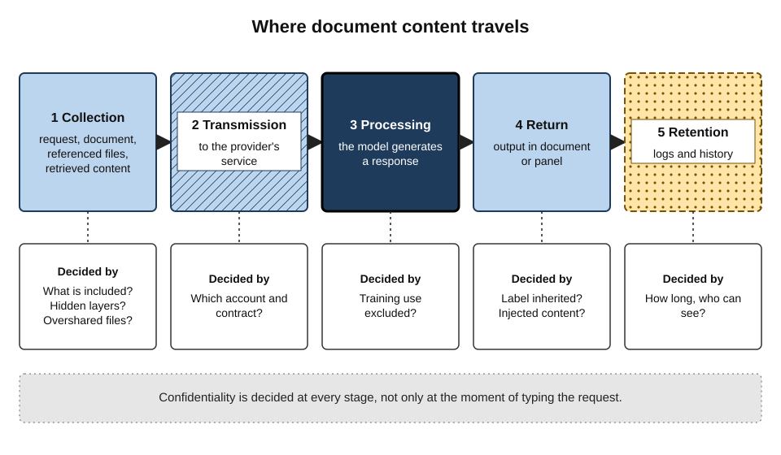
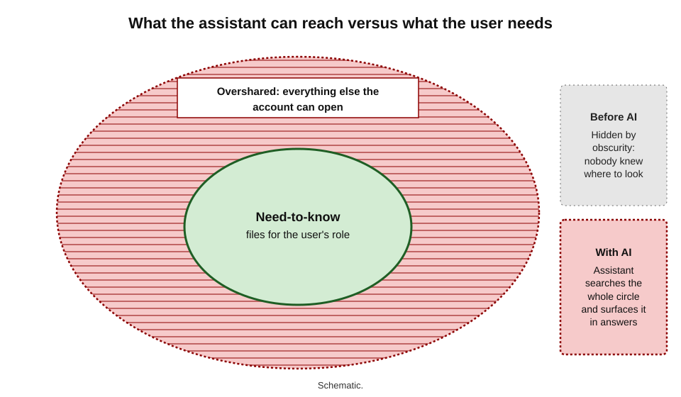
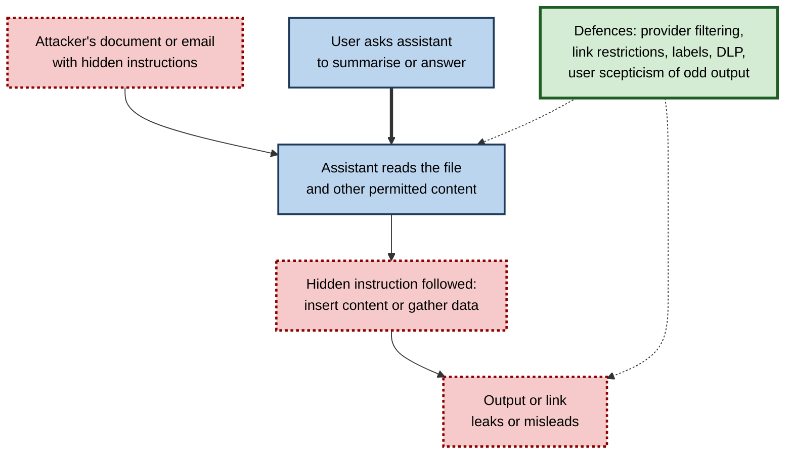
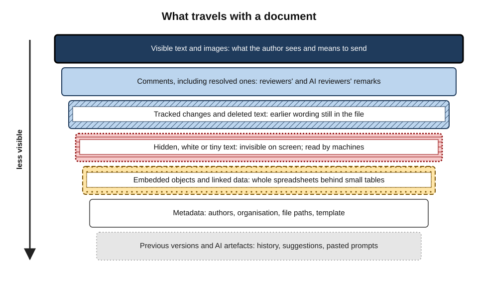
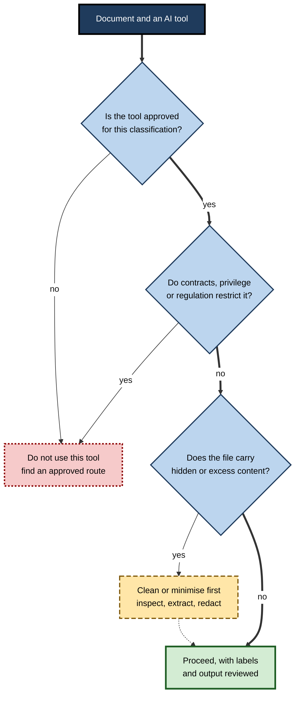

# D.11. Confidentiality in document tools

A junior analyst asks the office assistant to "summarise everything we know about Project Falcon". The summary is excellent — and includes salary figures from a human-resources spreadsheet she did not know she could open, shared years ago with "everyone in the organisation" by mistake. Nothing was hacked. The assistant simply found what her account was already allowed to see. Documents are where organisations keep their most sensitive knowledge, and AI features inside document tools change who can find it, where it travels and what can be done with it.

> **Definition — Confidentiality:** the protection of information from disclosure to people, systems or organisations not authorised to receive it.

> **Definition — In-document AI:** generative AI features built into word processors and office suites that read the open document, referenced files and, in enterprise versions, other organisational content the user has permission to access.

**Why confidentiality in document tools needs its own care**

- **Documents concentrate sensitive content** — contracts, strategy papers, personnel files, legal advice, financial results, client data.
- **AI widens reach** — an assistant can search, combine and summarise across thousands of files in seconds, exposing whatever permissions already allow.
- **Documents carry hidden content** — comments, tracked changes, metadata and hidden text travel to the AI and to recipients.
- **Documents can carry attacks** — hidden instructions in a file can manipulate an assistant that reads it.
- **Copying to outside tools is easy** — and once a document leaves an approved environment, control is lost.

---

## Where Document Content Goes

### The path of an in-document AI request

When a user asks an assistant to draft from, summarise or edit a document, content moves through several stages.

1. **Collection** — the request, the selection or document, referenced files and any retrieved organisational content are assembled.
2. **Transmission** — this bundle is sent to the provider's AI service, usually in the cloud.
3. **Processing** — the model generates a response.
4. **Return** — the output appears in the document or panel.
5. **Retention** — the request and response may be logged for a period, for abuse monitoring, audit or the user's history, depending on the service and contract.

**Figure 1.** The path of an in-document AI request and the points where confidentiality is decided.

### Enterprise and consumer routes for documents

| | Enterprise suite assistant | Consumer AI app with uploaded document |
|---|---|---|
| Who controls access | The organisation's identity and permission systems | The individual's personal account |
| Use of content for model training | Typically excluded by contract for business accounts | Depends on account type and settings; may be on by default |
| Respects document labels and permissions | Designed to | No awareness of organisational labels |
| Audit and retention controls | Available to administrators | Limited or none for the organisation |
| Legal agreement | Organisation's data-processing terms | Individual's consumer terms |

> **Key point:** the same model can be safe or unsafe for a confidential document depending on the **route** — the account, the contract and the controls around it — not the model's name.

> **Watch out:** "it's the same assistant I use at work" is a common error. A personal account of a familiar tool is a different route, under different terms, outside the organisation's controls.

---

## Oversharing: When Permissions Become Visible

### The problem

> **Definition — Oversharing:** documents being accessible to more people than need them, through broad sharing links, inherited permissions or forgotten access.

- Most organisations have years of accumulated oversharing — folders shared with "everyone", links that anyone in the company can open, permissions never removed.
- Before AI, oversharing was partly hidden by **obscurity**: people did not know where to look.
- An enterprise assistant that searches everything a user can access **removes the obscurity**. It does not create the permission problem; it **reveals** it.

**Figure 2.** Permission scope compared with need-to-know: the gap an assistant can expose.

### Organisational controls

- **Permission clean-up** — reviewing and narrowing access on sensitive sites and folders before enabling assistants widely.
- **Sensitivity labels** — tags such as *Confidential* or *Highly Confidential* applied to files; assistants that honour them will not surface or extract content the label forbids for that user.
  - In Microsoft's suite, content Copilot creates from labelled files is designed to inherit the highest sensitivity label among its sources.
- **Exclusion from AI discovery** — administrators can exclude selected sites from the assistant's organisation-wide search while permissions are fixed.
  - This reduces discovery; it does not remove access — a user who can open a file can still ask about it directly.
- **Data loss prevention (DLP) rules** — policies that block labelled or pattern-matched content (card numbers, national identifiers) from being processed or shared.
- **Auditing** — logs of AI interactions for investigation.

> **Definition — Sensitivity label:** a classification tag attached to a document that records its confidentiality level and can enforce protections such as encryption, access restrictions and exclusion from AI processing.

> **In practice:** organisations that roll out document assistants successfully usually treat the rollout as a **permissions project first** — finding and fixing overshared content before switching the assistant on for everyone.

### What the individual can do

- **Label what you create** — apply the right sensitivity label to new documents.
- **Share narrowly** — named people rather than "anyone with the link" or "everyone".
- **Report surprises** — if an assistant surfaces something you should not see, report it; do not use or forward it.
- **Remove stale access** — review sharing on documents you own.

---

## Documents as an Attack Surface

### Prompt injection through documents

> **Definition — Indirect prompt injection:** hiding instructions in content an AI system will read — a document, email or web page — so that the system follows the attacker's instructions instead of, or as well as, the user's.

- **How it works in documents:**
  - an attacker places instructions in a file — in white text, tiny fonts, comments, metadata or alternative text;
  - a user asks their assistant to summarise or act on the file;
  - the assistant reads the hidden instructions as part of its input and may follow them — for example, inserting misleading content, or trying to retrieve and send other data.

### Case study: EchoLeak (2025)

- **What:** in June 2025 security researchers at Aim Security disclosed a vulnerability in Microsoft 365 Copilot, tracked as CVE-2025-32711 and rated critical (CVSS 9.3), which they named **EchoLeak**.
- **How:** an attacker could send an ordinary-looking email containing hidden instructions. Later, when the user asked Copilot a question that caused it to retrieve that email as context, the instructions could make Copilot gather sensitive content from the user's other emails and documents and embed it in a link that sent the data to the attacker — **without the user clicking anything**.
- **Response:** Microsoft fixed the flaw on its servers in its June 2025 update and stated there was no evidence of exploitation in the wild; no customer action was required.
- **Significance:**
  - the first widely publicised **zero-click** data-exfiltration attack on an enterprise AI assistant;
  - showed that any content an assistant reads — including documents and messages from outside — can carry instructions;
  - shifted security thinking from "what can users ask?" to "what can the assistant be made to do by what it reads?".

**Figure 3.** How hidden instructions in a document can redirect an assistant.

**Practical defences for users**

- **Treat external documents as untrusted** — be cautious about asking an assistant to act on files from unknown senders.
- **Read before you act** — if an AI summary contains instructions, links or requests you did not expect, stop.
- **Do not click links in AI output** that you cannot explain.
- **Report odd behaviour** — unexpected content, attempted actions or links — to security teams.

> **Watch out:** prompt injection is not fully solved. Providers filter and restrict, but the underlying weakness — models treating data as instructions — remains an active research problem.

---

## Hidden Content in Documents

### What a document carries beyond its visible text

- **Metadata** — author names, organisation, editing time, file paths, template names.
- **Comments** — including resolved ones, sometimes retained.
- **Tracked changes** — deleted text that remains in the file until changes are accepted or rejected.
- **Hidden text** — formatted as hidden, white-on-white, or tiny.
- **Embedded objects** — spreadsheets inside documents, often with whole datasets behind a small visible table.
- **Previous versions** — in cloud history or in older file formats.
- **AI artefacts** — suggestions, AI-reviewer comments, prompts pasted into the document.

**Figure 4.** The hidden layers of a document that travel with it.

- **Two risks:**
  - **outbound to the AI** — a request that sends a document sends its hidden layers too;
  - **outbound to recipients** — a file sent externally carries everything inside it.
- **Control:** use the word processor's document-inspection feature before sending externally; accept or reject tracked changes; delete comments; break links to embedded data or paste as values; or send a format that excludes these layers.

### Redaction

> **Definition — Redaction:** permanently removing confidential content from a document before it is shared, so that the content cannot be recovered.

- **True redaction** removes the underlying text and data.
- **Fake redaction** only covers it — black boxes drawn over text, highlighted text in black, or white text — leaving it recoverable by copying, searching or removing the shape.

### Case study: a court filing with recoverable redactions (2019)

- **What:** in January 2019, a court filing by lawyers for Paul Manafort in the United States contained passages that had been blacked out visually but not removed.
- **How it was found:** reporters copied the "redacted" text and pasted it into another document, revealing the hidden passages, which disclosed sensitive information about the case.
- **Lesson:** visual covering is not redaction. Proper redaction tools — or AI-assisted redaction followed by verification — must remove the content itself, and the output must be checked by trying to search or copy the redacted area.

| | External guest | A person outside the organisation given access to a shared document. |
| Fake redaction | True redaction |
|---|---|---|
| Method | Black shape or highlight over text | Text and data removed from the file |
| Survives copying or search | Yes — content recoverable | No |
| Metadata and hidden layers | Usually untouched | Removed by a proper process |
| Check | Try to select, search or copy the area | Same check should find nothing |

> **In practice:** AI tools can **find** candidate personal data and confidential terms for redaction quickly, but the removal must use a proper redaction function and the result must be verified by a person.

---

## Shared Documents and Other People's Tools

### When a document has many readers

- **Every collaborator's assistant can read it.** In a shared document, any person with access can ask their own assistant to summarise, extract from or rewrite it — within the limits of their account and the organisation's controls.
- **External guests bring their own tools.** A client, supplier or partner given access to a shared document may use AI tools governed by **their** organisation's policies, not yours.
- **Summaries travel further than documents.** An AI summary of a confidential paper, pasted into a chat channel or email, can reach people who never had access to the paper itself.
- **Suggestions and comments are visible.** Depending on the tool, AI suggestions may be private to the requester until approved (as in Google's 2026 Docs design) or visible to all editors as tracked changes; collaborators should know which.

> **Key point:** sharing a document shares it with **every tool its readers use**. Decide access with that in mind, especially for external collaborators.

### Practical rules for shared documents

- **Share the minimum** — a separate extract for external parties rather than the internal working file.
- **Agree AI use with external collaborators** — contracts and data-sharing agreements increasingly address whether each party may process shared documents with AI tools.
- **Label derived content** — summaries and extracts carry the label of their source.
- **Use view-only or restricted-download settings** where the content is sensitive and editing is unnecessary.
- **Review guest access** when a project ends.

---

## Confidentiality Across the Document Life Cycle

| Stage | Typical AI use | Main confidentiality risk | Control |
|---|---|---|---|
| Drafting | Draft from referenced files and organisational data | Content from overshared or wrong sources enters the draft | Permissions, labels, named sources |
| Collaboration | Summaries, rewrites by many editors | Derived content leaks beyond the original audience | Label inheritance; sharing rules |
| Review | AI critique and proofreading | Reviewers paste content into unapproved tools | Approved tools; clear guidance |
| Translation | Whole-file translation | Uploads to free public services | Approved translation route |
| Distribution | Formatting, versions for audiences | Hidden layers sent to recipients | Document inspection; clean copies |
| Archive | Search and summarise past documents | Old sensitive content resurfacing in answers | Retention rules; exclusion of archives from AI discovery |

*The table describes common patterns rather than any single organisation.*

- **Risk shifts across the life cycle**: early stages risk pulling the wrong content **in**; later stages risk sending hidden content **out**.

> **In practice:** many organisations write their AI document guidance by life-cycle stage — "when drafting…", "before sending…" — because people remember rules attached to moments in their work better than abstract principles.

---

## Personal Data in Documents

### Why documents are full of personal data

- **Obvious cases** — HR files, customer complaints, medical letters, CVs.
- **Less obvious cases** — names and contact details in minutes, signatures, email chains pasted into reports, photographs, comments that identify colleagues.
- **Special categories** — health, ethnicity, religion, sexual orientation, trade-union membership and similar data receive stronger protection under data-protection law in the EU and UK.

### What data-protection law asks of AI use

- **Lawful basis and purpose** — personal data in a document may be processed by an AI tool only for a purpose compatible with why it was collected.
- **Processor contracts** — the AI provider processing data for the organisation must be bound by a data-processing agreement.
- **Data protection impact assessment (DPIA)** — new uses of AI on personal data, especially at scale or involving special categories, often require a formal assessment of risks before rollout.
- **International transfers** — processing in other countries may need transfer safeguards.
- **Individuals' rights** — people may ask what data is held about them, including in AI-generated documents.

> **Definition — Data protection impact assessment (DPIA):** a structured assessment, required for high-risk processing under the GDPR, of how a planned use of personal data affects individuals and how risks will be mitigated.

**Everyday safeguards**

- **Remove what is not needed** — names replaced by roles or initials before an AI summary of case notes.
- **Do not paste special-category data** into any tool not specifically approved for it.
- **Check outputs** — AI summaries can surface personal details in unexpected places, such as a summary of a project folder that quotes a sickness-absence note.

> **Watch out:** an AI-generated document about people — a performance summary, a complaint analysis — is itself **personal data**, with the same protections and rights attached.

---

## Deciding What May Go Into Which Tool

### Classification and permitted AI use

Most organisations classify information into tiers. Each tier implies which AI routes are acceptable.

| Classification | Examples | Typical permitted AI use |
|---|---|---|
| Public | Published reports, marketing copy | Any approved tool, including consumer tools if policy allows |
| Internal | Routine memos, internal procedures | Enterprise suite assistant |
| Confidential | Client deliverables, contracts, financial forecasts | Enterprise assistant only; labels and DLP applied; no consumer tools |
| Highly confidential or regulated | Legal advice, health records, unreleased results, merger plans | Only specifically approved tools and configurations, or none |

**Figure 5.** Deciding whether a document may be processed by a given AI tool.

### Data minimisation

- **Send only what is needed** — the relevant section, not the whole file; anonymised figures, not named individuals.
- **Pseudonymise** — replace names with roles or codes where the task does not need identities.
- **Extract** — copy the needed passage into a clean document rather than sending a file full of comments and history.

> **Remember:** the safest confidential content is the content that **never entered the request**.

> **Mnemonic — "CRISP":** **C**lassify the document, choose the **R**oute, **I**nspect for hidden layers, **S**trip what is not needed, **P**rotect the output with the right label. Five steps before any confidential document meets an AI tool.

### When something has already gone wrong

- **Stop** — do not continue the session or re-send the content.
- **Record** what was sent, to which tool and account, and when.
- **Report** promptly through the organisation's security or data-protection channel; personal-data breaches can carry legal deadlines for notifying regulators (72 hours under the GDPR, where notification is required).
- **Use available controls** — deleting the conversation or file from the service may limit retention, though it may not reverse processing already done.
- **Learn** — most incidents reveal a missing approved route or an unclear rule, which is fixed more effectively than individual blame.

### Professional duties

- **Client confidentiality** — contracts often restrict where client information may be processed and by whom.
- **Legal privilege** — sharing privileged advice with third parties can risk waiving privilege; many firms restrict AI use on privileged material to approved, contractually protected tools.
  - The American Bar Association's Formal Opinion 512 (July 2024) advised lawyers that using generative AI engages their duties of competence and confidentiality, and that **informed client consent** may be needed before inputting client information into tools that could disclose it.
- **Personal data** — data-protection law (such as the GDPR in the European Union and the United Kingdom) requires a lawful basis, purpose limitation and appropriate safeguards, including contracts with processors.
- **Market-sensitive information** — unreleased financial results and deal information carry insider-dealing and disclosure obligations.

---

## Case Study: Source Code and Meeting Notes in a Public Chatbot (2023)

- **What:** in spring 2023, media reported that employees of Samsung's semiconductor business had entered confidential material into a public chatbot within weeks of the company permitting its use — including source code for error-checking and notes from an internal meeting to be turned into minutes.
- **Response:** Samsung restricted the use of generative AI tools on company devices and networks in May 2023, while it developed internal alternatives.
- **Why it mattered:** at the time, consumer chat services could use inputs to improve models by default; material sent was outside the company's control and could not be recalled.
- **Lesson:** the most common confidentiality failure is not an attack — it is a well-meaning employee using an **unapproved route** to get work done faster. Approved, convenient tools and clear rules prevent it better than bans alone.

---

## Worked Example (illustrative): Preparing a Board Paper with AI

**Situation:** a finance manager wants AI help to turn a confidential 25-page forecasting workbook commentary and a draft acquisition memo into a four-page board paper.

1. **Classify.** The acquisition memo is *Highly Confidential*; the forecast commentary is *Confidential*.
2. **Check the route.** Policy allows the enterprise suite assistant for *Confidential*; *Highly Confidential* deal material requires the approved restricted workspace, where the assistant is permitted with logging.
3. **Minimise.** The manager extracts the needed sections into a new document in the restricted workspace; the target company is referred to by its code name.
4. **Inspect.** The acquisition memo contains tracked changes showing an earlier, higher offer price, and comments from the legal team; these are not carried into the extract.
5. **Draft.** The assistant drafts the board paper from the extract; the output inherits the *Highly Confidential* label.
6. **Check output.** The manager confirms the draft contains no content from outside the extract — such as figures pulled from other files.
7. **Share.** The paper goes to the board portal, not by email; the working extract is deleted after approval.

| Risk | Unmanaged route | Managed route |
|---|---|---|
| Deal details processed outside approved controls | Likely | Avoided |
| Earlier offer price in tracked changes sent to AI | Yes | Removed at extraction |
| Target's real name in AI logs | Yes | Code name used |
| Output mislabelled | Possible | Label inherited and checked |

*Illustrative scenario.*

- **Conclusion:** the AI help was the same; confidentiality depended on classification, route, minimisation and inspection.

---

## Open Questions

- **Can prompt injection be solved?**
  - Defences reduce risk, but models still struggle to separate instructions from data reliably; agentic features that act on documents widen the exposure.
- **How should AI-generated summaries be classified?**
  - A summary may reveal sensitive conclusions while omitting the labelled source; inheritance rules help but are not perfect.
- **What does "deletion" mean for AI interactions?**
  - Logs, caches and backups complicate the assurance that sensitive content has been fully removed.
- **Will permissions ever be clean?**
  - Oversharing is a chronic organisational problem; AI makes it urgent, but large estates of documents are hard to remediate.
- **Who is liable when an assistant leaks data?**
  - Responsibility between user, organisation and provider is still being worked out in contracts and law.

---

## Summary

- **Confidentiality** protects information from unauthorised disclosure; **in-document AI** reads the document, referenced files and permitted organisational content.
- An AI request passes through **collection, transmission, processing, return and retention**; the **route** (enterprise or consumer) decides the protections.
- **Oversharing** is exposed by assistants that search everything a user can access; fix permissions, apply **sensitivity labels**, use exclusion and **DLP** controls.
- Documents are an attack surface: **indirect prompt injection** hides instructions in files; **EchoLeak** (2025) showed zero-click data exfiltration via an enterprise assistant.
- Documents carry **hidden layers** — metadata, comments, tracked changes, hidden text, embedded objects, AI artefacts; inspect before sending to AI or outside.
- Sharing a document shares it with **every tool its readers use**; give external parties extracts, agree AI use and label derived content.
- Risks shift across the **life cycle** — wrong content pulled in early, hidden content sent out late.
- Documents are full of **personal data**; data-protection law requires lawful purpose, processor contracts, often a **DPIA**, and minimisation; AI outputs about people are personal data too.
- **Redaction** must remove content; the 2019 court filing showed fake redaction is recoverable.
- Match **classification** to permitted AI routes; minimise, pseudonymise and extract.
- Professional duties — client confidentiality, **privilege**, personal data, market-sensitive information — apply to AI use; ABA Opinion 512 (2024) stresses competence, confidentiality and informed consent.
- The 2023 public-chatbot leak shows the commonest failure is an **unapproved route** used for convenience.

---

## Self-Check

1. Define confidentiality and in-document AI.
2. List the five stages of an in-document AI request.
3. Why can the same model be safe in one route and unsafe in another?
4. What is oversharing, and why does an enterprise assistant make it more dangerous?
5. Describe three organisational controls against oversharing and one limitation of exclusion from AI discovery.
6. Explain indirect prompt injection and how EchoLeak worked.
7. Give four practical defences users can apply against prompt injection.
8. List six kinds of hidden content a document can carry.
9. Distinguish fake from true redaction, and describe how to test a redaction.
10. Match each to a likely permitted AI route: a published annual report; a client contract; patient records.
11. What is data minimisation, and give two ways to apply it with a document?
12. What did ABA Formal Opinion 512 advise?
13. What does the 2023 public-chatbot incident teach about preventing leaks?
14. Why does sharing a document with an external partner raise AI-specific confidentiality questions?
15. When might a DPIA be needed for AI use on documents?
16. A colleague wants to upload a draft merger memo to a personal AI account "just to tidy the wording". Advise them.

### Answer Key

1. Confidentiality is protecting information from disclosure to unauthorised people, systems or organisations. In-document AI is generative AI built into office tools that reads the open document, referenced files and permitted organisational content.
2. Collection, transmission, processing, return, retention.
3. Protections come from the account, contract and controls — training use, permissions, labels, audit, retention — not from the model itself.
4. Documents accessible to more people than need them. Assistants search everything a user can access, removing the obscurity that hid overshared content.
5. Permission clean-up; sensitivity labels honoured by the assistant; exclusion of sensitive sites from AI discovery; DLP rules; auditing. Exclusion reduces discovery but not access: a user with permission can still open and ask about a file directly.
6. Hiding instructions in content an AI reads so it follows them. In EchoLeak, a crafted email with hidden instructions, later retrieved as context by Copilot, could make it gather sensitive data and embed it in a link to the attacker, with no user click.
7. Treat external documents as untrusted; stop if AI output contains unexpected instructions or requests; do not click unexplained links in AI output; report odd behaviour.
8. Metadata, comments, tracked changes, hidden text, embedded objects, previous versions, AI artefacts (any six).
9. Fake redaction covers content visually, leaving it recoverable; true redaction removes the text and data. Test by trying to select, search or copy the redacted area.
10. Annual report — any approved tool; client contract — enterprise assistant only, with labels, subject to the client agreement; patient records — only specifically approved configurations, or none.
11. Sending only what the task needs. Extract the relevant section into a clean document; pseudonymise names; use aggregated rather than individual data.
12. That generative AI use engages lawyers' duties of competence and confidentiality, and that informed client consent may be needed before inputting client information into tools that could disclose it.
13. Leaks often come from well-meaning staff using unapproved routes for convenience; providing approved, convenient tools and clear rules works better than bans alone.
14. The partner's staff may process the document with their own AI tools under their organisation's policies, summaries may travel beyond the original audience, and suggestions or comments may be visible to others. Share extracts, agree AI use contractually and label derived content.
15. When a new AI use involves personal data at scale, special-category data or other high-risk processing — for example, summarising case files or analysing complaints — a DPIA assesses and mitigates the risk before rollout.
16. Do not. It moves highly confidential, possibly market-sensitive material outside the organisation's controls, under consumer terms, possibly into training data and logs. Use the approved restricted route, minimise the content, and inspect the file for hidden layers first.

---

## Glossary

| Term | Meaning |
|---|---|
| Confidentiality | Protection of information from unauthorised disclosure. |
| Data loss prevention (DLP) | Policies that detect and block sensitive content from being processed or shared inappropriately. |
| Data protection impact assessment (DPIA) | A structured assessment of risks to individuals from high-risk processing of personal data. |
| Data minimisation | Sending or processing only the data a task needs. |
| Document inspection | A feature that finds and removes hidden content from a file. |
| External guest | A person outside the organisation given access to a shared document. |
| Fake redaction | Visually covering content without removing it. |
| In-document AI | Generative AI features built into document tools. |
| Indirect prompt injection | Hidden instructions in content an AI reads, causing it to act for an attacker. |
| Oversharing | Documents accessible to more people than need them. |
| Pseudonymisation | Replacing identifying details with codes or roles. |
| Redaction | Permanently removing confidential content before sharing. |
| Sensitivity label | A classification tag on a document that can enforce protections. |
| Zero-click attack | An attack that succeeds without the victim taking any action. |
