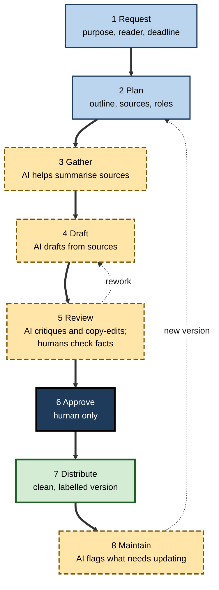
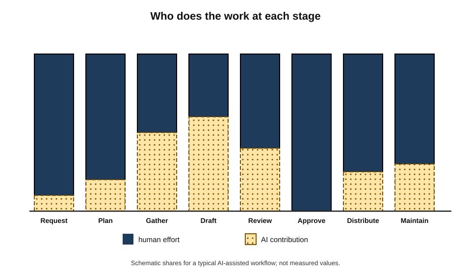
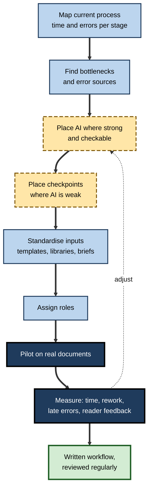
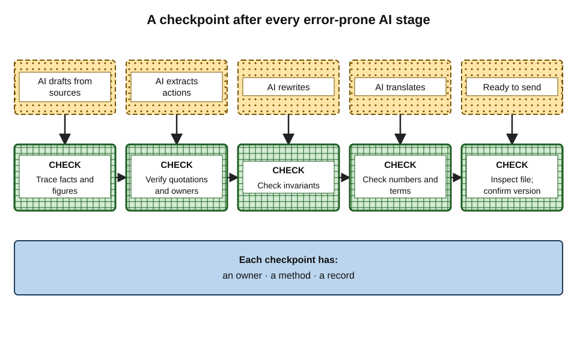
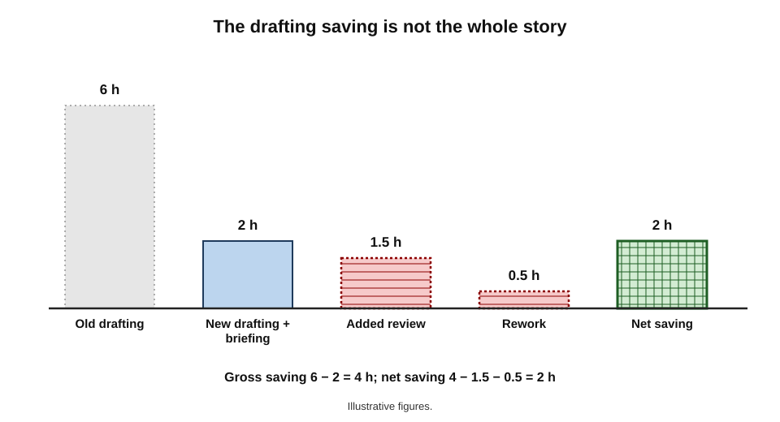
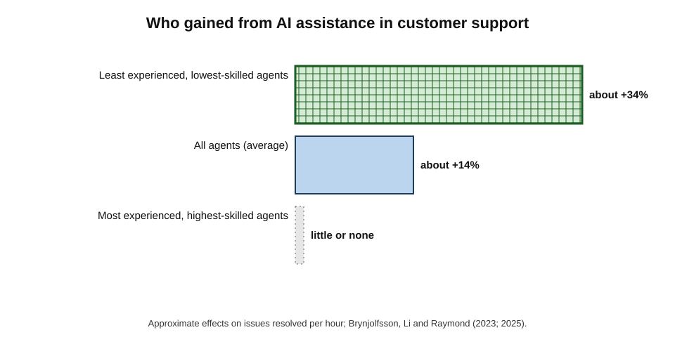

# D.12. Practical document workflows

Two teams have the same AI tools. The first uses them ad hoc: someone drafts with the assistant, someone else rewrites by hand, a reviewer finds invented figures the night before the deadline, and nobody can say whether the tools save time.

The second has a written workflow for each recurring document — where AI drafts, what it is given, who checks what, and when — and measures the result. Six months later the second team produces better documents in less time; the first is debating whether to switch the tools off. The difference is not the technology. It is the **workflow**.

> **Definition — Document workflow:** the defined sequence of stages, roles, tools and checks through which a document moves from request to distribution and maintenance.

> **Definition — AI-assisted document workflow:** a document workflow in which specific stages are deliberately allocated to AI tools, with human checkpoints placed where AI errors are likely and costly.

**Why workflows matter more than tools**

- **Gains come from systems, not features.** Isolated AI use speeds some steps and slows others; a workflow decides whether the whole process improves.
- **Checks must be placed, not hoped for.** AI errors are predictable in kind; a workflow puts checks where they occur.
- **Roles change.** When AI drafts, people shift to briefing, sourcing, reviewing and approving — work that must be assigned.
- **Repetition rewards design.** Most organisational documents recur: monthly reports, proposals, policies, minutes. Designing once pays off many times.

---

## The Document Life Cycle

### Stages

1. **Request** — someone needs a document: purpose, reader, deadline.
2. **Plan** — scope, structure, sources, roles.
3. **Gather** — collect the source material: data, previous documents, notes, interviews.
4. **Draft** — produce a first version.
5. **Review** — substantive, factual, editorial and proofreading checks.
6. **Approve** — the accountable person signs off a specific version.
7. **Distribute** — send, publish or file the approved version.
8. **Maintain** — update, supersede or archive as circumstances change.

**Figure 1.** The document life cycle, with the stages where AI most often contributes.

### Allocating work between people and AI

| Stage | Typical AI contribution | Human responsibility | Checkpoint |
|---|---|---|---|
| Request | Clarifying questions; draft brief | Decide purpose, reader, scope | Brief agreed with requester |
| Plan | Outline options; list of considerations | Choose structure and argument | Outline approved by author |
| Gather | Summarise sources; extract figures and actions | Choose and validate sources | Source list fixed; extracts spot-checked |
| Draft | Draft sections from sources and template | Write judgement-heavy parts | Placeholders resolved; sources traced |
| Review | Critique, consistency, copy-edit, proofread | Facts, names, purpose, what is missing | Fact check signed; suggestions triaged |
| Approve | None | Accountable sign-off | Named version approved |
| Distribute | Format variants; translations | Choose audience and channel; inspect file | Clean version; classification checked |
| Maintain | Flag outdated content; draft updates | Decide changes | Version and change history updated |

**Figure 2.** How the balance between AI and human effort shifts across the life cycle.

> **Key point:** AI contributes most in the **middle** of the life cycle — gathering, drafting, editing. The **ends** — deciding what the document is for, and approving it — remain human.

---

## Common Workflow Patterns

### Report from sources

- **Use:** research summaries, market assessments, investigation reports.
- **Steps:**
  1. author fixes the question and the source set;
  2. AI produces source digests with locations;
  3. author writes the outline and conclusions;
  4. AI drafts the evidence sections from the digests;
  5. second person checks every figure and reference;
  6. AI copy-edits; author makes the final pass.
- **Critical checkpoint:** the fact and reference check (step 5).

### Proposal or tender response from a library

- **Use:** bids, grant applications, client proposals.
- **Steps:**
  1. AI extracts the buyer's requirements and evaluation criteria into a compliance matrix;
  2. team maps each criterion to a section owner;
  3. AI drafts standard sections from a **verified content library** (case studies, CVs, policies);
  4. owners write the client-specific solution and pricing;
  5. AI checks the draft against the compliance matrix for gaps;
  6. bid manager reviews; approver signs.
- **Critical checkpoint:** every claim of experience traced to the library (no invented references).

### Policy or procedure update

- **Use:** updating controlled documents when rules change.
- **Steps:**
  1. snapshot the approved version;
  2. AI identifies passages affected by the change;
  3. AI proposes edits as tracked changes;
  4. owner triages; legal or compliance reviews locked passages;
  5. approval, publication, superseded version withdrawn.
- **Critical checkpoint:** compare against the baseline for unintended changes.

### Recurring status report

- **Use:** weekly or monthly updates to managers, boards or clients.
- **Steps:**
  1. a fixed template with sections and data sources;
  2. AI drafts each section from that period's data and notes;
  3. owner adds judgement — risks, decisions needed, what changed and why;
  4. AI shortens and checks consistency with last period's report;
  5. owner approves and sends.
- **Critical checkpoint:** numbers reconciled to the source system each period.

### From discussion to record

- **Use:** turning meeting notes, interviews or workshops into minutes, decisions and action logs.
- **Steps:** AI drafts a structured record from the notes; participants confirm decisions and owners; the confirmed record becomes the reference.
- **Critical checkpoint:** decisions and owners confirmed by the people involved.

> **In practice:** the most productive teams start with **one recurring document**, design its workflow carefully, measure the result and only then extend the approach.

---

## Designing a Workflow

### The design method

1. **Map the current process.** List stages, people, tools, time spent and common errors for one document type.
2. **Find the bottlenecks and the errors.** Where does time go? Where do mistakes arise?
3. **Place AI deliberately.** Assign AI to stages where it is strong and errors are checkable — drafting from sources, summarising, copy-editing.
4. **Place checkpoints where AI is weak.** Facts, names, numbers, obligations, purpose.
5. **Standardise the inputs.** Templates, briefs, source libraries, style sheets, term bases.
6. **Assign roles.** Who briefs, who drafts, who checks facts, who approves.
7. **Pilot on real documents.** Run the workflow on a few documents alongside the old process.
8. **Measure.** Time per stage, rework, errors found late, reader feedback.
9. **Write it down and review it.** A one-page workflow, revisited every few months as tools change.

**Figure 3.** Designing an AI-assisted workflow.

> **Mnemonic — "MAP-CSR-PMW":** Map, find bottlenecks, place AI; Checkpoints, Standards, Roles; Pilot, Measure, Write down. More simply: **design, test, measure, record**.

### Placing checkpoints

- **Checkpoints belong after the AI stages most likely to err in costly ways:**
  - after drafting from sources — trace facts and figures;
  - after extraction — verify quotations and owners;
  - after rewriting — check invariants;
  - after translation — check numbers and terms;
  - before distribution — inspect the file and confirm the version.
- **A checkpoint needs an owner, a method and a record** — otherwise it is a hope.

**Figure 4.** Checkpoints placed after the AI stages where errors are most likely.

---

## Measuring Whether It Works

### Net time, not gross time

AI's headline benefit — fast generation — is easy to see. The costs — briefing, checking, rework, late errors — are spread out and easy to miss.

> **Formula — Net time saved per document:** net saving = (old drafting time − new drafting and briefing time) − added review time − expected rework time. *Example (illustrative figures):* old drafting 6 h; new drafting and briefing 2 h; added fact-check 1.5 h; rework averages 0.5 h. Net saving = (6 − 2) − 1.5 − 0.5 = **2 hours** per document, not the 4 hours the drafting step alone suggests.

**Figure 5.** Gross drafting saving compared with net saving once review and rework are counted.

**What to measure**

- **Time per stage** — not only total time.
- **Rework** — how often and how much a document goes back.
- **Late errors** — errors found after approval or by the reader.
- **Reader outcomes** — did the document achieve its purpose: decision made, bid won, policy understood?
- **Reviewer load** — whether effort has simply moved to reviewers.

> **Watch out:** self-reported time savings are unreliable. In one 2025 study of experienced software developers, participants using AI tools took longer to complete tasks while believing they had been faster. Measure with timestamps or time logs, not impressions.

### What the evidence shows about who benefits

**Study card — Brynjolfsson, Li and Raymond (2023; published 2025), generative AI at work**

- **Setting:** a staggered introduction of an AI assistant suggesting responses to more than 5,000 customer-support agents at a software company.
- **Findings:**
  - on average, agents resolved about **14% more** issues per hour;
  - the least experienced and lowest-skilled agents improved by about **34%**;
  - the most experienced and highest-skilled saw **little or no** improvement, and some quality measures slightly declined for them;
  - customer sentiment improved and staff attrition fell.
- **Interpretation:** the tool appeared to spread the practices of top performers to newer staff.
- **Relevance to documents:** AI-assisted workflows may help novices most, while experts' value lies in the checks and judgement the workflow assigns them.

**Figure 6.** Productivity gains by worker experience in the customer-support study.

- **Broader evidence is mixed.** A large 2025 study of Danish workers using chatbots, linked to official labour records, found time savings averaging only a few per cent of working hours and no detectable effect on earnings or hours in the first period studied.
- **Interpretation:** gains are real in well-designed tasks and workflows, but **diffuse ad hoc use** produces modest aggregate effects.

> **Key point:** the gap between laboratory gains and workplace averages is largely a **workflow gap** — the difference between tasks designed around AI and AI sprinkled over unchanged processes.

---

## Choosing Which Documents to Redesign First

### Selection criteria

Not every document deserves a designed workflow. The best candidates share four features.

- **Volume** — produced often enough that design effort pays back.
- **Repetition** — similar structure and sources each time.
- **Checkability** — AI output can be verified against clear sources or standards.
- **Manageable stakes** — errors are costly enough to justify checks but not so catastrophic that AI involvement is unwise at first.

> **Formula — A simple prioritisation score:** score each candidate 1–5 on volume, repetition and checkability, multiply, then divide by a 1–5 risk score. *Example (illustrative figures):* monthly client reports — volume 5, repetition 5, checkability 4, risk 2 → (5 × 5 × 4) ÷ 2 = **50**; bespoke strategy papers — volume 2, repetition 1, checkability 2, risk 4 → (2 × 1 × 2) ÷ 4 = **1**. Start with the monthly reports.

| Document type | Volume | Repetition | Checkability | Typical verdict |
|---|---|---|---|---|
| Recurring status reports | High | High | High (data sources) | Redesign first |
| Standard proposals and tenders | Medium | Medium–high | Medium (content library) | Redesign early |
| Policy updates | Low–medium | Medium | High (baseline comparison) | Redesign with strong checkpoints |
| Minutes and action logs | High | High | Medium (participant confirmation) | Redesign early |
| Strategy papers and opinions | Low | Low | Low | Keep author-led; AI for critique only |

> **Watch out:** organisations often start with the most impressive demonstration — a strategy paper drafted in minutes — rather than the most suitable workflow. Impressive demonstrations rarely become reliable processes.

---

## Inputs That Make Workflows Work

### Workflow assets

AI drafts are only as good as what they are given. Designed workflows rest on maintained **assets**.

- **Templates** — structure, real styles and in-section guidance ("state the decision required in one sentence").
- **Saved briefs** — tested instructions for each recurring document, including purpose, reader, sources and constraints.
- **Content libraries** — verified, dated, owned reusable material: case studies, biographies, standard clauses, policy extracts.
- **Term bases and style sheets** — approved terminology, spelling variety, banned phrases.
- **Voice sheets** — for documents where organisational or personal voice matters.
- **Checklists for reviewers** — kept outside the documents themselves, listing the checks each checkpoint must perform.

> **Definition — Workflow asset:** a maintained, reusable input — template, brief, library, term base or review guide — on which an AI-assisted workflow depends.

### Keeping assets alive

- **Owner** — each asset has a named owner.
- **Review cycle** — assets are reviewed on a schedule (quarterly for libraries, at each tool change for briefs).
- **Dating** — every library item carries a "verified on" date; items past their date are not used until re-verified.
- **Version history** — so that a faulty document can be traced to the asset version used.
- **Feedback loop** — reviewers record recurring AI errors, and briefs or templates are updated to prevent them.

> **Key point:** in a mature workflow, most improvements come from **better inputs**, not from better prompting in the moment.

---

## From Personal Habit to Organisational Practice

### Stages of maturity

- **Individual experimentation** — people try AI features on their own documents; gains are personal and unmeasured; risks are invisible.
- **Shared tips** — colleagues swap useful briefs and warnings; quality varies widely.
- **Designed team workflows** — recurring documents have written workflows, assets and checkpoints; results are measured.
- **Organisational standards** — approved tools, classification rules, provenance and disclosure practices, training and periodic review across teams.

**Moving between stages**

- **From experimentation to sharing** — create a place to share briefs and lessons, with a simple quality bar.
- **From sharing to design** — pick one recurring document per team and apply the design method.
- **From design to standards** — consolidate what works into organisation-wide guidance, without forcing one workflow on very different teams.

> **In practice:** organisations that move too quickly to standards write rules nobody follows; those that never move beyond experimentation accumulate unmanaged risk. The design stage — one document, one team, measured — is where most learning happens.

---

## Team Roles in AI-Assisted Workflows

| Role | Responsibility | Typical failure if missing |
|---|---|---|
| Requester | States purpose, reader, deadline | Document answers the wrong question |
| Author (owner) | Brief, outline, judgement sections, final pass | Generic content; nobody owns the argument |
| Source keeper | Maintains verified libraries and data | AI drafts from outdated or unverified material |
| Fact checker | Traces figures, names, references | Invented or wrong facts reach readers |
| Editor | Language, consistency, style, triage of AI suggestions | Bulk-accepted edits change meaning |
| Approver | Signs off a named version | Unclear accountability; wrong version sent |

- **Small teams combine roles** — but the fact checker should not be the person who generated the draft, for anything that matters.
- **Handoffs need artefacts** — an approved outline, a source list, a provenance note, a fact-check record.

> **Remember:** in an AI-assisted workflow, **someone must own every check**. "The AI did it" and "I assumed someone checked" are the two commonest causes of failure.

---

## Workflows for the Individual Professional

Workflow design is not only for teams. A professional working alone — a consultant, a lecturer, a small-business owner — benefits from the same discipline on a smaller scale.

**A personal document workflow**

1. **Before writing** — one line on purpose and reader; the sources gathered in one folder.
2. **Planning** — an outline written by hand or edited from an AI suggestion; the argument decided here.
3. **Drafting** — the core in one's own words; AI drafts routine sections from the sources, with placeholders for missing facts.
4. **Self-review** — a sceptical AI critique, then a personal fact and name check, then a copy-edit with tracked changes.
5. **Final pass** — read aloud or in print; search for placeholders and previous client names.
6. **Before sending** — inspect the file; check the version; confirm the tool route was appropriate for the content.
7. **After sending** — note what went wrong or took too long, and adjust briefs or templates.

**Personal assets worth keeping**

- **A brief library** for the documents written most often.
- **A voice sheet** and a short list of personal error patterns.
- **A source folder per client or project**, kept current.
- **A pre-send routine** — the same few checks every time.

> **Example (illustrative):** an independent consultant who writes a proposal most weeks keeps a proposal template with real styles, a verified library of past project summaries and a saved brief. Proposals that once took a day now take half a day, and she attributes the saving less to AI drafting than to never starting from a blank page or hunting for old case studies.

> **Remember:** a personal workflow is the habits you would want a colleague to follow if they were writing in your name.

---

## Failure Modes of Workflows

- **Review bottleneck** — drafting becomes fast, review does not, and documents pile up at the reviewer; or reviewers skim, and errors escape.
- **Hidden rework** — readers or colleagues fix AI errors downstream; the cost does not appear in the author's time saving.
- **Library decay** — verified source libraries go out of date, and AI drafts faithfully from stale material.
- **Tool sprawl** — each person uses a different assistant, and outputs, data handling and quality diverge.
- **Unrecorded steps** — nobody knows which documents passed which checks.
- **Skill erosion** — newcomers never learn to draft, so they cannot judge drafts.

---

## Worked Example (illustrative): Redesigning a Monthly Client Report

**Situation:** an account team produces a 12-page monthly performance report for each of eight clients. Each report takes an analyst about 10 hours; clients occasionally find inconsistent figures.

1. **Map.** Time per report: gathering data 3 h; drafting commentary 5 h; formatting 1 h; review 1 h. Most errors arise when figures are re-typed into commentary.
2. **Place AI.** Commentary drafted by AI from the month's data export and last month's report; formatting via the template.
3. **Place checkpoints.**
   - every figure in the commentary reconciled to the export by a second analyst;
   - the account manager writes the "What this means for you" section personally.
4. **Standardise.** One template with fixed sections; a brief saved for each client with their priorities and preferred terms.
5. **Pilot** on two clients for two months, alongside the old process.
6. **Measure.**

| Stage | Before (hours) | After (hours) |
|---|---|---|
| Gathering data | 3.0 | 3.0 |
| Drafting commentary | 5.0 | 1.5 (briefing and editing) |
| Formatting | 1.0 | 0.3 |
| Review | 1.0 | 2.0 (includes figure reconciliation) |
| Client-reported errors per quarter (8 clients) | 5 | 1 |
| Total per report | 10.0 | 6.8 |

*Illustrative figures.*

- **Net saving:** 3.2 hours per report, about 26 hours a month across eight clients — less than the 3.5 hours saved on drafting alone suggested, because review grew.
- **Quality:** fewer client-reported errors, attributed mainly to the reconciliation checkpoint.
- **Conclusion:** the workflow, not the drafting feature, delivered both the time saving and the quality improvement.

---

## Case Study (illustrative): A Legal Team's Contract Review Workflow

- **Situation:** an in-house legal team of six reviewed several hundred non-disclosure and supplier agreements a year. Turnaround was slow, and business colleagues bypassed legal review for "standard" contracts.
- **Design:**
  1. a **playbook** — the organisation's standard positions and acceptable fallbacks for each clause type;
  2. an approved AI review tool comparing each incoming contract against the playbook and flagging deviations as comments;
  3. **triage tiers** — contracts with no flagged deviations reviewed by a paralegal; those with deviations by a lawyer;
  4. **locked templates** for the organisation's own paper;
  5. a monthly **sample audit** in which a lawyer fully reviewed a random selection of paralegal-cleared contracts.
- **Early problem:** the audit found two contracts where the tool missed an unusual liability clause phrased in an unfamiliar way; the playbook was extended and the paralegal checklist added a manual read of liability and indemnity clauses.
- **Result:** turnaround for standard agreements fell substantially; business colleagues stopped bypassing legal review; lawyers spent more of their time on negotiations and unusual contracts.
- **Lesson:** the workflow combined **explicit standards** (the playbook), **risk-based routing** and **sampling audits** — the AI tool was one component, not the design.

---

## Open Questions

- **Where will the review bottleneck settle?**
  - As drafting gets faster, organisations must decide how much review to fund; too little invites errors, too much erases the gains.
- **How should workflows adapt to agentic tools?**
  - Agents that carry out several stages at once blur stage boundaries and checkpoint placement.
- **What happens to apprenticeship?**
  - If novices no longer draft, how do they gain the judgement that reviewers need?
- **How can benefits be measured credibly?**
  - Few organisations measure net time, rework and reader outcomes rigorously; self-reports dominate.
- **How should individual and organisational workflows fit together?**
  - Personal habits and team standards can conflict; how much freedom individuals should keep inside designed workflows is unsettled.
- **Will standard workflows emerge across professions?**
  - Professional bodies are beginning to issue guidance; common patterns may become expected practice.

---

## Summary

- A **document workflow** defines stages, roles, tools and checks; an **AI-assisted workflow** allocates stages to AI deliberately, with checkpoints where AI is weak.
- The life cycle runs **request, plan, gather, draft, review, approve, distribute, maintain**; AI contributes most in the middle, people own the ends.
- Common patterns: **report from sources, proposal from a library, policy update, recurring status report, discussion to record** — each with a critical checkpoint.
- Design method: **map, find bottlenecks, place AI, place checkpoints, standardise inputs, assign roles, pilot, measure, write down**.
- Checkpoints need an **owner, a method and a record**.
- Measure **net time** — drafting saving minus added review and rework — plus late errors, reader outcomes and reviewer load; self-reports mislead.
- Evidence: AI assistance raised support agents' productivity about 14% on average and about 34% for novices, little for experts (Brynjolfsson and colleagues); broad ad hoc use shows modest aggregate effects.
- Choose documents to redesign by **volume, repetition, checkability and manageable stakes**; recurring reports first, strategy papers last.
- Workflows rest on maintained **assets** — templates, saved briefs, content libraries, term bases, voice sheets, reviewer guides — each owned, dated and versioned.
- Maturity runs from **individual experimentation** to **shared tips**, **designed team workflows** and **organisational standards**.
- Roles: requester, author, source keeper, fact checker, editor, approver; someone must **own every check**.
- Failure modes: **review bottleneck, hidden rework, library decay, tool sprawl, unrecorded steps, skill erosion**.

---

## Self-Check

1. Define a document workflow and an AI-assisted document workflow.
2. List the eight stages of the document life cycle and identify the two that remain human.
3. For a report from sources, what is the critical checkpoint and why?
4. Describe the proposal-from-library workflow and its main risk.
5. List the nine steps of the workflow design method.
6. What three things does every checkpoint need?
7. Calculate net time saved: old drafting 8 h; new drafting and briefing 3 h; added review 2 h; rework 1 h.
8. Why are self-reported time savings unreliable?
9. Summarise the customer-support study and its implications for document workflows.
10. Why might workplace-wide AI effects be smaller than experimental gains?
11. Name the six workflow roles and the failure that follows when the fact checker is missing.
12. In the monthly-report example, why was the net saving smaller than the drafting saving?
13. Score two candidate documents for redesign: weekly sales update (volume 5, repetition 5, checkability 5, risk 2) and annual strategy (volume 1, repetition 1, checkability 2, risk 5). Which comes first?
14. Name four workflow assets and two practices that keep them reliable.
15. Describe a seven-step personal document workflow for a professional working alone.
16. A manager wants to "roll out AI to every document type at once". Advise them.

### Answer Key

1. A document workflow is the defined sequence of stages, roles, tools and checks a document passes through. An AI-assisted workflow deliberately allocates stages to AI and places human checkpoints where AI errors are likely and costly.
2. Request, plan, gather, draft, review, approve, distribute, maintain. Deciding the purpose (request and plan, at least in substance) and approval remain human.
3. A second person checking every figure and reference, because drafting from sources is where AI invents or misstates specifics, and errors there carry into conclusions.
4. Extract requirements into a compliance matrix, map criteria to owners, draft standard sections from a verified library, write client-specific parts by hand, check against the matrix, review and approve. Main risk: invented experience or references if drafts are not tied to the library.
5. Map the current process; find bottlenecks and errors; place AI; place checkpoints; standardise inputs; assign roles; pilot; measure; write down and review.
6. An owner, a method and a record.
7. (8 − 3) − 2 − 1 = 2 hours.
8. People misjudge their own speed and tend to over-credit tools; one 2025 study found developers slower with AI while believing they were faster. Timestamps or logs are needed.
9. An AI assistant raised issues resolved per hour by about 14% on average and about 34% for novices, with little effect for top performers. Workflows may help novices most, while experts' value lies in judgement and checks.
10. Much use is ad hoc, layered on unchanged processes, with hidden review and rework costs; gains concentrate in well-designed tasks.
11. Requester, author, source keeper, fact checker, editor, approver. Without a fact checker, invented or wrong facts reach readers.
12. Review time doubled because figure reconciliation was added; the saving in drafting was partly spent on checking — which also reduced errors.
13. Weekly update: (5 × 5 × 5) ÷ 2 = 62.5; annual strategy: (1 × 1 × 2) ÷ 5 = 0.4. The weekly update comes first.
14. Templates, saved briefs, content libraries, term bases, voice sheets, reviewer guides (any four); kept reliable by named owners, review cycles, verified-on dates, version history and feedback from reviewers (any two).
15. Purpose and sources first; outline and argument decided by the author; core written in own words with AI drafting routine sections and placeholders; sceptical critique, personal fact and name check and tracked copy-edit; final read aloud and placeholder search; file inspection, version check and route check before sending; a note afterwards to improve briefs and templates.
16. Start with one recurring document type; map, design, pilot and measure; fix checkpoints and standards; then extend gradually, reviewing the workflow as tools change.

---

## Glossary

| Term | Meaning |
|---|---|
| AI-assisted document workflow | A workflow allocating specific stages to AI with human checkpoints where errors are likely. |
| Checkpoint | A defined check, with owner, method and record, at a point in a workflow. |
| Compliance matrix | A table mapping a buyer's requirements to the sections of a response. |
| Content library | A maintained set of verified reusable material, such as case studies and policies. |
| Document life cycle | The stages from request to maintenance through which a document passes. |
| Document workflow | The defined stages, roles, tools and checks a document moves through. |
| Prioritisation score | A rough ranking of documents for workflow redesign by volume, repetition, checkability and risk. |
| Hidden rework | Correction work done downstream that does not appear in the author's time. |
| Net time saved | Drafting time saved minus added review and rework time. |
| Playbook | An organisation's standard positions and fallbacks for reviewing documents such as contracts. |
| Review bottleneck | The build-up of work at reviewers when drafting accelerates. |
| Workflow asset | A maintained, reusable input on which an AI-assisted workflow depends. |
| Triage tier | A routing level deciding who reviews a document based on its risk. |
