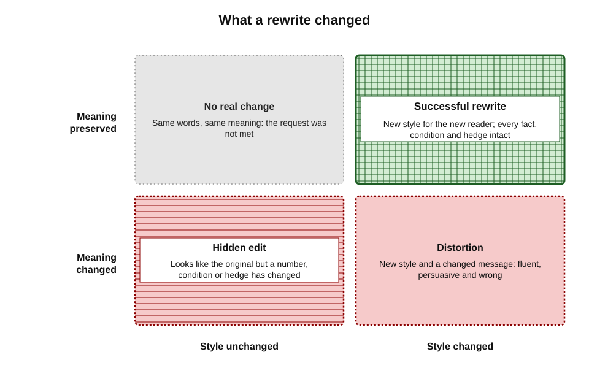
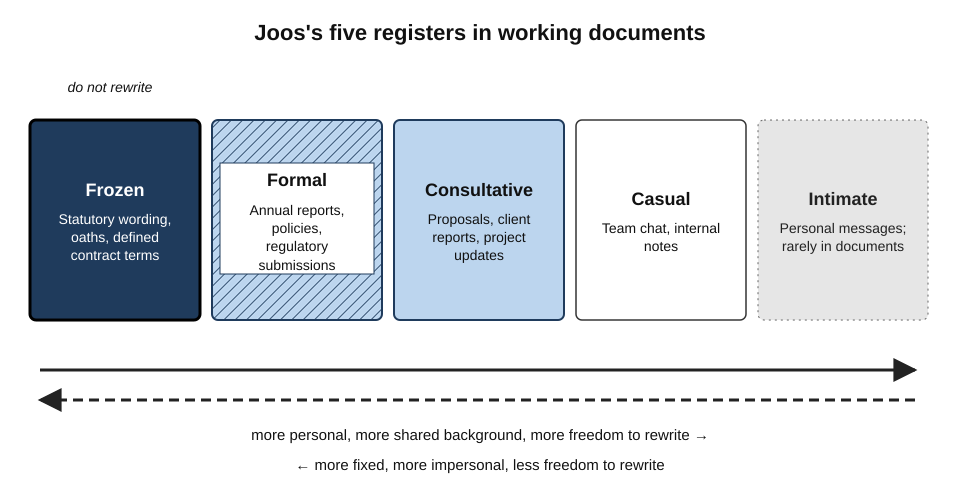
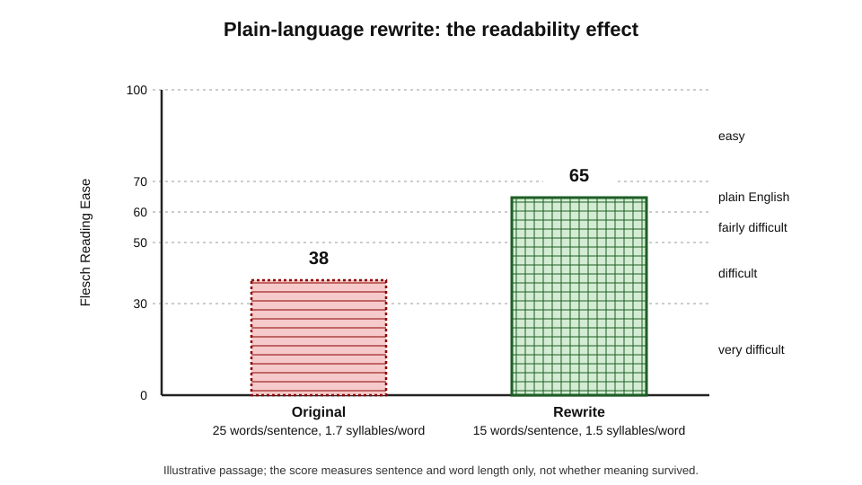
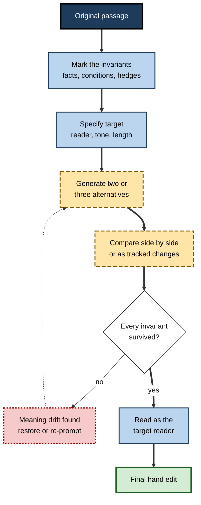
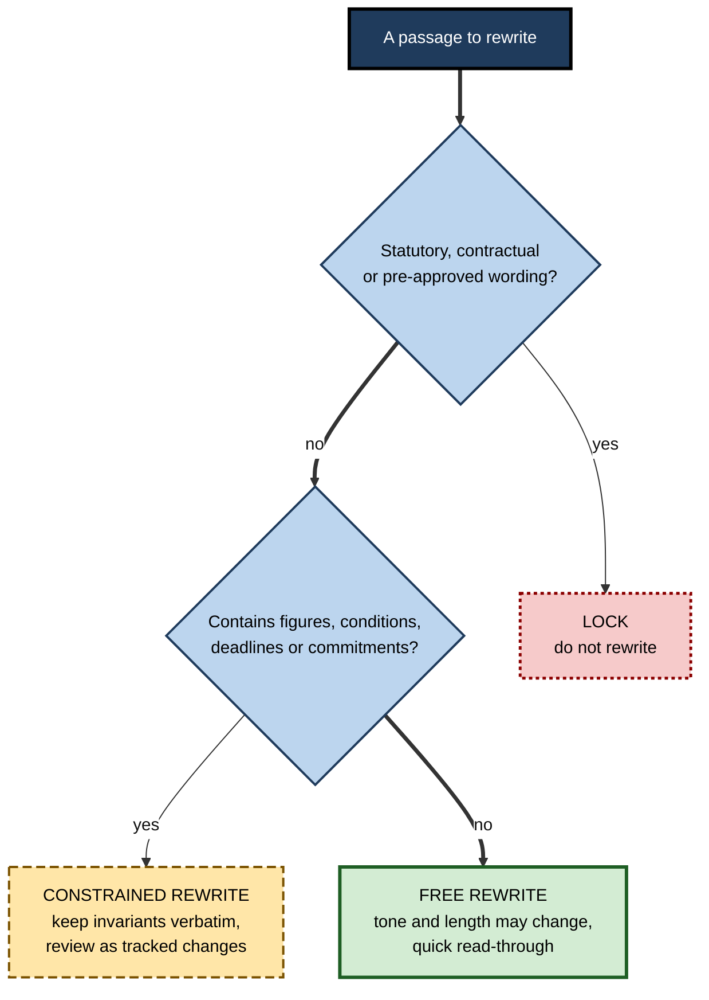
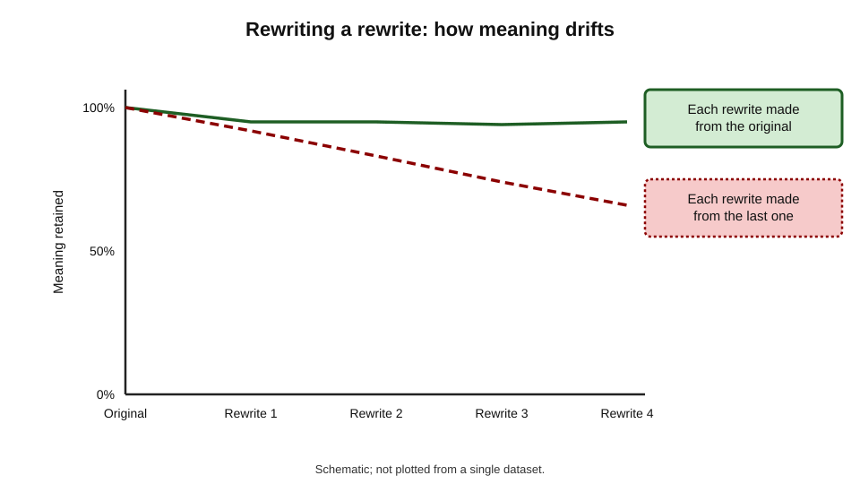

# D.2. Rewriting and tone adjustment

An engineer's incident report says: "Root cause was an expired TLS certificate on the load balancer; MTTR 3h 12m; no data integrity impact observed." The same facts must reach the board, the customers and the regulator. Each reader needs different words, a different length and a different tone — but exactly the same truth. Rewriting is the art of changing everything about a passage *except* what it means.

> **Definition — Rewriting:** producing a new version of an existing text that serves a different reader, purpose or constraint — shorter, plainer, more formal, differently structured — while preserving its meaning.

> **Definition — Tone:** the attitude a text conveys towards its subject and its reader — warm or cold, confident or tentative, direct or indirect, respectful or dismissive.

**Why rewriting with AI matters**

- **It is the AI writing feature people trust most.** Rewording text one has already written feels safe, so it is used often and checked lightly.
- **It is where meaning slips unnoticed.** A smoother sentence can quietly drop a qualification, harden a claim or change who is responsible.
- **Tone carries consequences.** A customer letter that sounds dismissive, or a warning that sounds casual, causes harm even when every fact is correct.
- **Audiences multiply.** One finding must often be written for experts, managers, customers and the public; AI makes producing those versions cheap — and checking them essential.

---

## What Changes and What Must Not

### Style and content

Every rewrite rests on a split between **what is said** and **how it is said**. The split is never perfectly clean, which is why rewriting is a skill rather than a button.

> **Definition — Meaning preservation:** the requirement that a rewrite keeps every claim, quantity, condition, obligation and degree of certainty of the original, unless a change is deliberate and agreed.

**What may change**

- **Length** — compress or expand.
- **Vocabulary** — technical to everyday; jargon to plain words.
- **Sentence structure** — long to short; passive to active.
- **Register and formality** — consultative to formal, or the reverse.
- **Warmth and directness** — how close and how blunt the voice is.
- **Format** — prose to bullets, or a list to a paragraph.
- **Order** — main point first for busy readers.

**What must not change, unless deliberately**

- **Facts and numbers** — values, units, dates, names.
- **Conditions** — "if", "unless", "provided that".
- **Obligations and commitments** — who must do what, by when.
- **Certainty** — "may", "is likely to", "was observed in one case".
- **Attribution** — who said, found or decided something.
- **Scope** — "some customers" must not become "customers".

> **Mnemonic — FACTS-CAS:** Facts, Attribution, Conditions, Time, Scope, Certainty, Agents (who is responsible), Stakes — the invariants to check after every rewrite.

**Figure 1.** Style and meaning in a rewrite: only one quadrant is a successful result.

### Why the split is imperfect

- **Words carry meaning, not just style.**
  - "Terminated" and "let go" describe the same event with different implications.
  - "Error" and "issue" signal different levels of fault.
- **Hedges are content.**
  - The linguist Ken Hyland showed in the late 1990s that hedging in scientific writing encodes the writer's precise degree of commitment to a claim; removing a hedge changes the claim.
- **Tone can be a commitment.**
  - "We will investigate" promises action; "this may be investigated" does not.
- **Research on text style transfer** — the machine-learning field that tries to change style while keeping content — has repeatedly found that the two are entangled: systems that change style strongly tend to lose content, and those that keep content tend to change style weakly.

> **Key point:** a rewrite always risks changing meaning, because in natural language style and meaning are **entangled**. Checking meaning is part of every rewrite, not an optional extra.

---

## The Dimensions of Tone and Register

### Register

> **Definition — Register:** the variety of language suited to a particular situation, relationship and purpose — the difference between a legal notice, a team update and a message to a friend.

**Martin Joos, *The Five Clocks* (1961)** — five registers of English:

- **Frozen** — fixed, ritual language that is not changed.
  - *e.g.* oaths, statutory wording, standard contract clauses.
- **Formal** — one-way, carefully structured, impersonal.
  - *e.g.* annual reports, policy documents, regulatory submissions.
- **Consultative** — the register of working professionals; clear, polite, two-way.
  - *e.g.* proposals, project updates, client reports.
- **Casual** — between colleagues or friends, with shared background.
  - *e.g.* team chat, internal notes.
- **Intimate** — between people very close.
  - Rarely appropriate in documents.

**Figure 2.** Registers from frozen to intimate, with typical documents at each level.

> **Watch out:** frozen language should **not** be rewritten. Statutory wording, defined contract terms and regulated disclaimers mean exactly what they say; "simplifying" them can change legal effect.

### The working dimensions of tone

Tone controls in AI tools usually offer a handful of presets — more formal, more casual, more concise, more confident. Underneath, tone varies along several separate dimensions.

| Dimension | One end | Other end | Typical document need |
|---|---|---|---|
| Formality | Formal, impersonal | Casual, personal | Policies formal; team updates consultative |
| Warmth | Neutral, detached | Warm, empathetic | Customer apologies warm; audit findings neutral |
| Directness | Indirect, softened | Direct, blunt | Risk warnings direct; feedback often softened |
| Confidence | Tentative, hedged | Assertive | Research findings hedged; recommendations assertive |
| Technicality | Expert, specialised | Lay, everyday | Specifications expert; customer notices lay |
| Energy | Measured, calm | Enthusiastic, promotional | Board papers measured; product launch copy energetic |

> **Key point:** "make it more professional" is ambiguous — it might mean more formal, less warm, more confident or less technical. Name the **dimension** and the **direction**.

### Politeness and power

**Study card — Danescu-Niculescu-Mizil and colleagues (2013), "A computational approach to politeness"**

- **Data:** thousands of requests from Wikipedia editors' talk pages and a programming question-and-answer site, rated for politeness by human annotators.
- **Method:** identified linguistic markers of politeness — gratitude, deference, hedges, indirect questions ("Could you…?"), apologies — and trained a classifier on them.
- **Findings:**
  - politeness was signalled by recognisable strategies, consistent with Brown and Levinson's politeness theory;
  - Wikipedia editors who were more polite were more likely to be elected to administrator roles — and their politeness **declined after** election;
  - on the question site, users of higher reputation were less polite.
- **Significance:** tone is not decoration; it tracks power and relationships, and readers notice it.

> **In practice:** when asking an AI to adjust tone, consider the **relationship** — writing upward, downward or to an external party — not just the topic.

---

## Plain Language

### What plain language is

> **Definition — Plain language:** communication whose wording, structure and design are so clear that the intended readers can easily find what they need, understand what they find and use that information.

- This three-part definition — **find, understand, use** — is the basis of the international standard ISO 24495-1, published in 2023.
- Plain language is **not** "dumbing down":
  - technical content can remain technical for technical readers;
  - the test is whether *the intended reader* can act on the text.
- Regulators increasingly expect it.
  - *e.g.* the UK Financial Conduct Authority's Consumer Duty, in force since July 2023, includes a "consumer understanding" outcome requiring firms to communicate in ways customers can understand.

**Typical plain-language moves an AI can apply**

- **Main point first** — the action or answer in the opening sentence.
- **Short sentences** — one idea each.
- **Everyday words** — "use" not "utilise", "start" not "commence".
- **Active voice** — "we will refund you" not "a refund will be issued".
- **Direct address** — "you" for the reader.
- **Headings and lists** — so readers can scan.
- **Defined terms** — technical words explained once, then used consistently.

### Readability formulas

**Rudolf Flesch (1948)** devised a formula that scores text by sentence length and word length.

> **Formula — Flesch Reading Ease:** 206.835 − 1.015 × (words ÷ sentences) − 84.6 × (syllables ÷ words). Higher scores are easier. *Example (illustrative figures):* a passage averaging 25 words per sentence and 1.7 syllables per word scores 206.835 − 25.4 − 143.8 ≈ **37.6** (difficult); cutting to 15 words per sentence and 1.5 syllables per word gives 206.835 − 15.2 − 126.9 ≈ **64.7** (plain English).

> **Formula — Flesch–Kincaid Grade Level:** 0.39 × (words ÷ sentences) + 11.8 × (syllables ÷ words) − 15.59. The result approximates the US school grade needed. *Example (illustrative figures):* 15 words per sentence and 1.5 syllables per word → 5.85 + 17.7 − 15.59 ≈ **grade 8**.

**Figure 3.** The same passage before and after a plain-language rewrite, scored by Flesch Reading Ease.

> **Watch out:** readability formulas count **surface features** only. A short-sentence text can still be confusing, and a formula cannot tell whether meaning survived. Word processors report these scores; treat them as a rough signal, never as proof of clarity.

---

## How AI Rewrites Text

### The mechanism in brief

- A rewrite request is a **conditional generation** task: the model produces a new text conditioned on the original passage plus the instruction.
- The model has no separate store of "the meaning" to protect. It generates what a passage with those properties would typically look like.
- Consequences:
  - **Typical phrasing wins** — distinctive terms are swapped for common ones.
  - **Rare details are at risk** — an unusual condition or number is more likely to be smoothed away.
  - **Instructions pull hard** — "make it more confident" may remove necessary hedges; "make it shorter" may cut a condition.
  - **Positivity drifts in** — models trained to be helpful tend towards agreeable, upbeat phrasing.

### What the features look like

- **Selection-level rewrite** — highlight a passage; choose a preset or type an instruction; review one or more alternatives.
  - Common in all major word processors and writing assistants.
- **Document-level rewrite** — ask the assistant to rewrite a whole document for a new audience.
  - Agent-style modes added in 2026 can restructure, merge and rewrite in a different register across a document, producing **tracked changes** that can be accepted or rejected individually.
- **Tone detection** — writing assistants that label a passage's apparent tone ("confident", "worried", "formal") and suggest changes.
- **Style matching** — features that rewrite new text to match the style of existing text in the document.

> **Remember:** prefer rewrites delivered as **tracked changes or side-by-side alternatives** over silent in-place replacement. What can be compared can be checked.

---

## The Rewrite-and-Verify Method

### The procedure

1. **Mark the invariants.** Before rewriting, note the facts, numbers, conditions, commitments and hedges that must survive.
2. **Specify the target.** Name the reader, the purpose, the dimension and direction of tone, the length and the register.
3. **State the constraints.** Tell the tool what must not change: "keep all figures and conditions exactly; keep the hedges; do not add claims".
4. **Generate alternatives.** Ask for two or three versions to avoid anchoring on one.
5. **Compare.** Read original and rewrite side by side, or use the word processor's compare or tracked-changes view.
6. **Check the invariants.** Tick off each fact, condition, commitment and hedge against the original.
7. **Read as the target reader.** Does it sound right for the relationship and the stakes?
8. **Edit by hand.** Restore anything lost; adjust wording the tool made generic.

**Figure 4.** The rewrite-and-verify loop.

### Worked example (illustrative): an incident paragraph for customers

**Original (engineering report):** "Between 02:10 and 05:22 UTC on 4 March, approximately 18% of API requests in the EU region failed due to an expired TLS certificate on a load balancer. No data integrity impact was observed. Automated certificate renewal will be extended to this tier by 31 March."

**Instruction:** "Rewrite for business customers in plain, warm, professional English, under 80 words."

**AI rewrite:** "On 4 March, some customers experienced a brief service disruption caused by a technical issue, which has now been fully resolved. Your data was completely safe throughout. We have put measures in place to make sure this never happens again, and we apologise for any inconvenience."

| Invariant | Original | AI rewrite | Verdict |
|---|---|---|---|
| Duration | 02:10–05:22 UTC (over three hours) | "brief" | Distorted |
| Scope | About 18% of EU API requests | "some customers" | Vague — region lost |
| Cause | Expired TLS certificate | "a technical issue" | Acceptable simplification if intended |
| Data | "No data integrity impact was **observed**" | "completely safe" | Certainty hardened |
| Commitment | Renewal extended to this tier by 31 March | "this never happens again" | Over-promise; date lost |

**Corrected rewrite:** "On 4 March, between 02:10 and 05:22 UTC, about one in five requests to our EU service failed because a security certificate had expired. We found no sign that any data was affected. By 31 March we will extend automatic certificate renewal to prevent this cause recurring. We are sorry for the disruption."

- **Conclusion:** the AI version was fluent, warm and short — and wrong on four of five invariants. The corrected version keeps the warmth and plainness and restores the truth.

> **Watch out:** "your data was completely safe" and "this will never happen again" are **new claims** with legal and reputational weight. Rewrites that make text more reassuring are the ones most likely to over-promise.

---

## Rewriting for Different Readers

### One finding, several audiences

| Reader | What they need | Register | Typical length | Main risk in an AI rewrite |
|---|---|---|---|---|
| Specialist colleague | Method, data, caveats | Consultative, technical | Full | Over-simplification of terms |
| Senior manager | Implication and decision | Consultative, measured | Short | Losing the uncertainty behind the recommendation |
| Customer | What happened to them, what to do | Plain, warm | Short | Over-reassurance; dropped instructions |
| Regulator | Exact facts, obligations, timeline | Formal | As required | Changed legal meaning; softened admissions |
| Public | Clear account, no jargon | Plain, neutral | Short | Generalisation beyond the evidence |

### Common rewrite tasks

- **Shorten** — cut length while keeping every essential point.
  - Ask for a target length *and* a list of what was removed, so the cut can be reviewed.
- **Simplify** — lower technicality for lay readers.
  - Keep one precise term where precision matters, with a plain explanation.
- **Formalise** — raise the register for official documents.
  - Watch for stiff, inflated wording ("in order to facilitate the utilisation of").
- **Soften** — reduce bluntness in feedback or negative news.
  - Do not soften the substance: the problem and the required action must remain clear.
- **Strengthen** — make a recommendation more assertive.
  - Do not delete hedges that reflect real uncertainty.
- **Neutralise** — remove emotional or loaded wording from a dispute or complaint response.
- **Inclusive language** — replace exclusionary or outdated terms.
  - Check against the organisation's own style guide; AI defaults may follow one region's conventions.

> **Example (illustrative figures):** "This approach is unworkable" (direct) → "This approach is likely to face significant practical difficulties, particularly around staffing" (softened, but the substance — it will not work as planned — is still visible, and the reason is added).

### Worked example (illustrative): softening written feedback

**Situation:** a team lead's written review of a junior analyst's report reads: "Section 3 is wrong. You used last year's prices. Redo the cost table and stop guessing at the discount rates." The lead asks the assistant to "make this more constructive".

**AI rewrite:** "Great work on this report overall! Section 3 could perhaps benefit from a quick look at the pricing data. You might also want to consider revisiting the discount rates if you have time."

| Element | Original | AI rewrite | Better version |
|---|---|---|---|
| The problem | Wrong prices in Section 3 | "could perhaps benefit from a quick look" | "Section 3 uses last year's prices" |
| Required action | Redo the cost table | Optional ("if you have time") | "Please update the cost table with current prices by Thursday" |
| Second issue | Discount rates were guessed | "might want to consider" | "The discount rates need a source — the finance team's rate sheet is the right one" |
| Praise | None | Unearned "Great work overall" | Specific praise only if true: "The structure of Sections 1 and 2 is clear" |
| Tone | Harsh | Vague and sugary | Direct, respectful, specific |

- **Conclusion:** the tool softened the **substance** as well as the tone. The reader of the AI version could reasonably conclude that no change was required.
- **Repair instruction:** "Make this respectful and constructive, but keep both problems explicit and keep the required actions mandatory with the deadline."

> **Watch out:** softening is the rewrite most likely to change **obligations**. After a softening rewrite, check that every required action is still clearly required.

### Deciding what may be rewritten

Not every passage in a document is equally open to rewriting. Mature practice sorts text before any tool touches it.

**Figure 5.** Sorting the passages of a document before an AI rewrite.

- **Locked text** — legal clauses, regulated disclosures, quoted material, defined terms.
- **Constrained text** — anything carrying numbers, conditions, deadlines, responsibilities or hedged findings.
- **Free text** — introductions, explanations, transitions and background, where only style is at stake.

> **In practice:** in long documents, many professionals highlight locked passages before invoking a document-wide rewrite, or rewrite section by section and skip the locked ones entirely.

---

## Failure Modes

### Meaning failures

- **Hedge stripping** — "may" becomes "will"; "in one study" disappears.
- **Scope creep** — "some" becomes "all"; a region or group drops out.
- **Responsibility shift** — "we failed to" becomes "there was a failure"; an apology loses its agent.
- **Invented reassurance** — new claims of safety, completeness or permanence.
- **Lost conditions** — "if the form is received by Friday" vanishes in a shorter version.

### Tone failures

- **Generic corporate voice** — "We value your feedback and are committed to excellence."
- **Over-warmth** — effusive apology where a factual notice was needed, or in a legal context where it may be read as an admission.
- **Tone mismatch with the relationship** — casual wording to a regulator; formal stiffness to a long-standing colleague.
- **Cultural mismatch** — directness or indirectness wrong for the reader's culture.
- **Homogenised style** — every document ends up sounding alike.

### Process failures

- **Silent replacement** — accepting a rewrite in place without comparing.
- **Iterative drift** — rewriting a rewrite several times, each step moving further from the original.
- **Rewriting frozen text** — altering legal, statutory or contractual wording.

**Figure 6.** Iterative drift: each successive rewrite moves meaning further from the original.

> **Remember:** always rewrite **from the original**, not from the previous rewrite. Keep the source version visible until the final text is approved.

---

## Professional Practice

### Organisational voice

- **Style guides** — many organisations have a written voice and tone guide: preferred words, banned phrases, spelling variety, how to address readers.
  - Where tools allow standing instructions or style matching, the guide can be supplied once.
- **Approved templates and phrases** — regulated communications often use pre-approved wording that must not be rewritten.
- **Review by risk** — routine internal rewrites need a quick read; customer, regulatory and legal rewrites need invariant checking by a second person.

### Case study (illustrative): rewriting customer letters for clarity

- **Situation:** a retail bank reviewed several hundred standard customer letters to meet a regulator's expectation that communications be understandable. The task was estimated at many months of specialist time.
- **Approach:** a small team used an AI writing assistant inside the document suite to produce plain-language rewrites of each letter, with readability scores before and after.
- **Early results:** readability scores improved sharply and drafts were produced in days.
- **Problem found in compliance review:**
  - several rewrites changed fee conditions ("unless your balance remains above £1,000" became "if you keep a healthy balance");
  - some removed statutory wording about complaint rights;
  - a few added reassurances ("you will not be charged") not supported by the product terms.
- **Changes:**
  1. each letter's **invariants** — fees, conditions, deadlines, rights, statutory text — were extracted and listed before rewriting;
  2. statutory and regulated passages were **locked** and excluded from rewriting;
  3. the instruction required that conditions and figures be kept verbatim;
  4. rewrites were produced as **tracked changes**, and compliance reviewers checked each invariant against the list;
  5. a sample of rewritten letters was tested with customers for comprehension, not only scored by formula.
- **Result:** the programme finished well ahead of the original estimate; comprehension testing showed customers answered questions about their letters more accurately; no rewritten letter reached customers with a changed condition.
- **Lesson:** AI made rewriting fast; **invariant lists, locked text and comprehension testing** made it safe.

---

## Rewriting and the Writer

- **Skill retention** — writers who always delegate rewording may stop noticing their own wordiness or vagueness.
- **Learning from alternatives** — comparing two or three AI versions with one's own can sharpen judgement about tone.
- **Second-language writers** — rewriting tools can help non-native writers reach an appropriate register; the risk is that their distinctive phrasing is replaced by one region's norms.
- **Voice** — repeated rewriting by the same tool pulls many writers towards one style; protecting a personal or organisational voice requires deliberate choice.

> **In practice:** use AI rewrites to see **options**, then choose and edit. The writer who decides between versions keeps both the skill and the voice.

---

## Open Questions

- **Can tools be made to preserve meaning reliably?**
  - Style and content are entangled; automatic meaning checks are improving but are not dependable for legal or safety-critical text.
- **How should rewrite quality be measured?**
  - Readability formulas are crude; comprehension testing is expensive; automatic similarity scores miss subtle shifts such as hedge removal.
- **Do tone presets carry cultural bias?**
  - Defaults trained mostly on one variety of English may impose its norms of politeness and directness on writers elsewhere.
- **When does an apology become an admission?**
  - Legal systems differ, and AI tone adjustments rarely account for the jurisdiction.
- **What happens to organisational voice at scale?**
  - If every document passes through the same model, distinctive voices may converge.

---

## Summary

- **Rewriting** changes a text for a new reader or purpose while **preserving meaning**; **tone** is the attitude it conveys.
- Style and content are **entangled**: hedges, word choice and voice carry meaning, so every rewrite needs a meaning check.
- The invariants are facts, attribution, conditions, time, scope, certainty, agents and stakes (**FACTS-CAS**).
- **Register** runs from frozen to intimate (Joos, 1961); frozen text must not be rewritten.
- Tone has separate dimensions — **formality, warmth, directness, confidence, technicality, energy**; name the dimension and direction.
- Politeness tracks **power and relationships** (Danescu-Niculescu-Mizil and colleagues, 2013).
- **Plain language** means readers can find, understand and use information (ISO 24495-1, 2023); readability formulas such as **Flesch Reading Ease** measure surface features only.
- AI rewrites favour **typical phrasing**, smooth away rare details and drift towards reassurance.
- The **rewrite-and-verify** method: mark invariants, specify target, constrain, generate alternatives, compare, check, read as the reader, edit by hand.
- Failure modes: **hedge stripping, scope creep, responsibility shift, invented reassurance, lost conditions, iterative drift**.
- At scale: style guides, locked regulated text, tracked-change review and **comprehension testing**.

---

## Self-Check

1. Define rewriting and tone, and explain why meaning preservation is central to both.
2. List the invariants that must be checked after a rewrite.
3. Why is the split between style and content imperfect? Give two examples.
4. Name Joos's five registers and give a document example for three of them.
5. Why should frozen text not be rewritten?
6. "Make this more professional." Explain why this instruction is ambiguous and rewrite it more precisely.
7. What did the 2013 computational study of politeness find about power?
8. State the three-part plain-language test and explain why it is not "dumbing down".
9. Calculate the Flesch Reading Ease for a text averaging 20 words per sentence and 1.6 syllables per word, and explain one limit of the score.
10. Why do AI rewrites tend to remove rare details and add reassurance?
11. Describe the rewrite-and-verify procedure.
12. What is iterative drift, and how is it prevented?
13. A rewrite changes "no data integrity impact was observed" to "your data was completely safe". Analyse the change.
14. A team wants to rewrite all its customer letters with AI in a month. Propose safeguards.

### Answer Key

1. Rewriting produces a new version for a different reader, purpose or constraint while keeping meaning; tone is the attitude conveyed towards subject and reader. Both change how something is said, so the risk in both is that what is said changes too.
2. Facts and numbers, attribution, conditions, time and dates, scope, certainty (hedges), agents and obligations (who does what), and stakes or commitments.
3. Words carry implications ("terminated" versus "let go"); hedges encode degrees of commitment; tone can amount to a promise ("we will investigate"). Changing these alters meaning.
4. Frozen, formal, consultative, casual, intimate. Frozen — statutory wording; formal — annual report; consultative — project update.
5. Its exact wording has fixed legal or ritual effect; paraphrasing it can change rights and obligations.
6. "Professional" might mean more formal, less warm, more confident or less technical. Better: "Raise the formality to suit a client report, keep the warmth neutral, keep all hedges, and keep technical terms with brief explanations."
7. Wikipedia editors who were more polite were more likely to be promoted to administrator, and became less polite after promotion; higher-reputation users on a question site were less polite. Politeness tracks power.
8. Readers can find what they need, understand it and use it. It is judged against the intended reader, so technical content can stay technical for experts.
9. 206.835 − 1.015 × 20 − 84.6 × 1.6 = 206.835 − 20.3 − 135.36 ≈ 51.2 (fairly difficult). It counts sentence and word length only and cannot tell whether meaning or logic is clear.
10. The model generates typical text with the requested properties and has no separate store of meaning; rare details are less typical and get smoothed away, and helpful-assistant training pulls towards agreeable, reassuring phrasing.
11. Mark invariants; specify target reader, tone dimension, length and register; state constraints; generate alternatives; compare side by side; check each invariant; read as the target reader; edit by hand.
12. Successive rewrites of rewrites, each moving further from the original meaning. Prevent it by always rewriting from the original and keeping it visible until approval.
13. Certainty has been hardened (a report that no impact was observed becomes an absolute guarantee) and scope widened ("data integrity" becomes all safety). It is a new claim with legal weight and should be reverted.
14. Extract invariants per letter; lock statutory and regulated text; require verbatim figures and conditions; deliver rewrites as tracked changes; compliance review against invariant lists; comprehension testing with real customers; staged rollout.

---

## Glossary

| Term | Meaning |
|---|---|
| Flesch Reading Ease | A readability score from sentence length and syllables per word; higher is easier. |
| Flesch–Kincaid Grade Level | A readability score expressed as an approximate US school grade. |
| Frozen register | Fixed wording, such as statutory or ritual text, that must not be changed. |
| Hedge | A word or phrase that limits the certainty or scope of a claim. |
| Invariant | Something a rewrite must keep unchanged: a fact, condition, obligation or degree of certainty. |
| Iterative drift | Gradual loss of meaning through rewriting earlier rewrites. |
| Meaning preservation | Keeping every claim, quantity, condition and certainty of the original in a rewrite. |
| Plain language | Writing that intended readers can easily find, understand and use. |
| Register | The variety of language suited to a situation, relationship and purpose. |
| Rewriting | Producing a new version of a text for a different reader, purpose or constraint while keeping its meaning. |
| Style matching | A feature that rewrites text to match the style of other text. |
| Text style transfer | The machine-learning task of changing a text's style while preserving its content. |
| Tone | The attitude a text conveys towards its subject and reader. |
| Tone detection | A feature that labels the apparent tone of a passage. |
