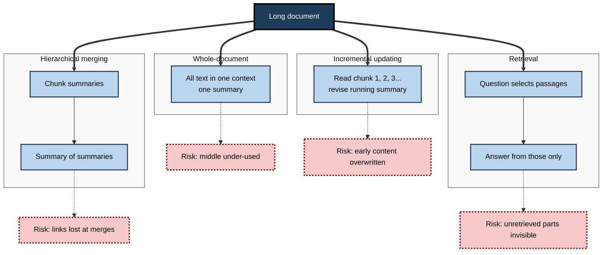
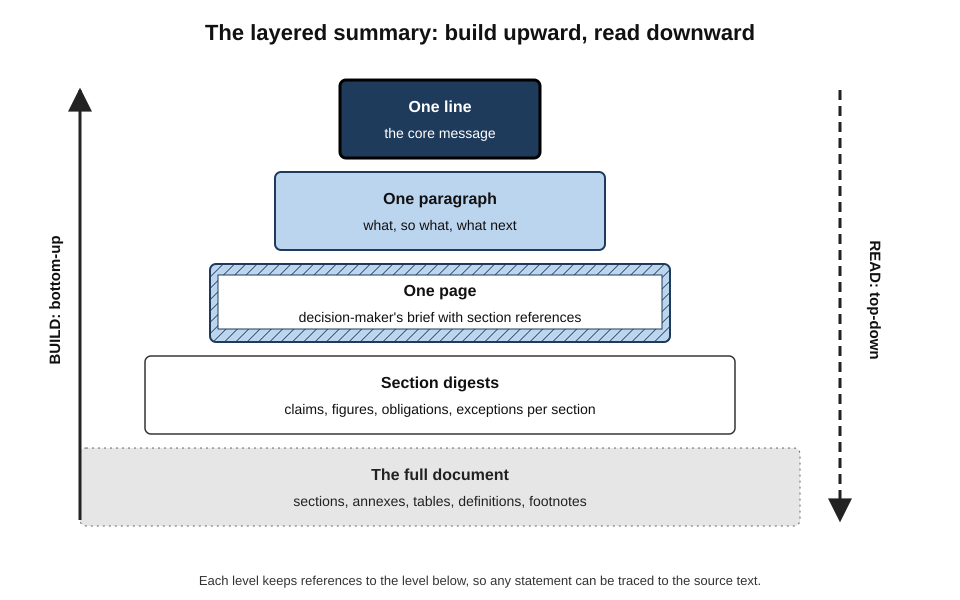
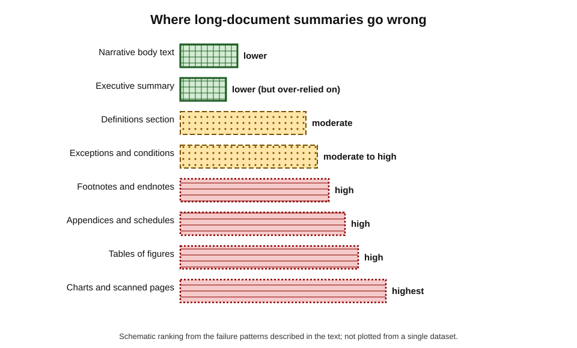
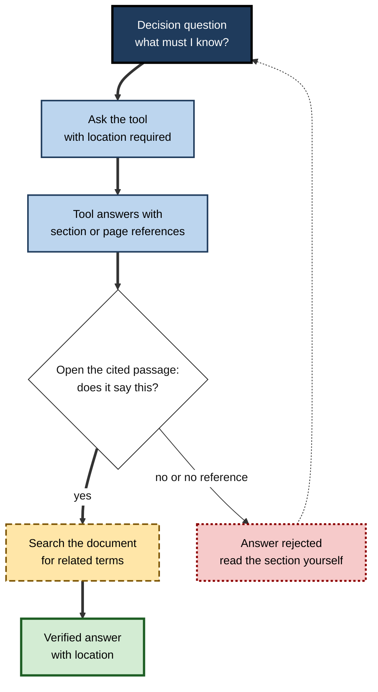
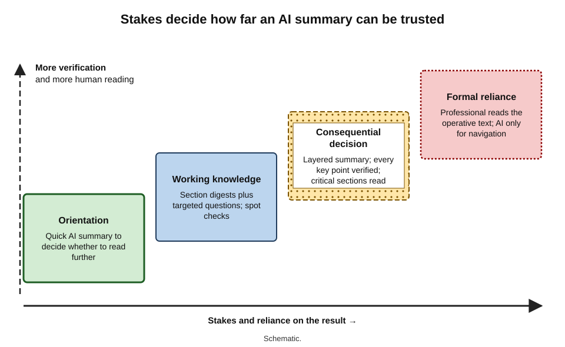
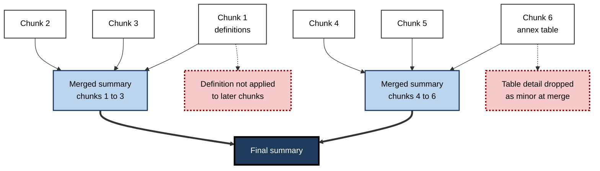

# D.3. Summarising long documents

A 180-page tender pack arrives on Friday afternoon; the bid/no-bid decision is due on Monday. A 240-page regulatory consultation must be digested before a board meeting. A new joiner inherits a 90-page project file. In each case the document is too long to read closely in the time available, and the word processor now offers to "summarise this document" in seconds. Length changes the problem: what works for a two-page memo fails, often silently, for a two-hundred-page report.

> **Definition — Long document:** a document whose length or complexity exceeds what a reader can hold in mind at once and what an AI tool can reliably process in a single pass — typically dozens to hundreds of pages, with sections, appendices, tables, definitions and cross-references.

> **Definition — Context window:** the maximum amount of text, measured in tokens, that a language model can take into account at one time, including the instruction, the document and its own output.

**Why long documents need their own method**

- **Coverage becomes the main risk.** With a short text, the danger is distortion; with a long one, it is **what never made it into the summary at all**.
- **Structure carries meaning.** Definitions in clause 1 change the meaning of clause 40; an appendix overrides the body; a footnote limits a headline claim.
- **Tools behave differently with length.** Some read the whole document; some read pieces and merge; some only retrieve passages that seem relevant to a question.
- **Checking is harder.** A reader cannot verify a summary of a document they have not read without a method for jumping to the source.

---

## What Makes Length Hard

### For the human reader

- **Working memory** holds only a few items at once; long documents demand external aids — notes, outlines, headings.
- **Attention fades** across long texts; skimming finds headings and bold text but misses qualifications buried in paragraphs.
- **Structure helps** — readers navigate by headings, tables of contents and executive summaries.

### For the AI tool

- **Context limits** — a document may exceed what the model can take in at once, forcing the tool to split it.
- **Uneven attention** — even within the window, models do not use all positions equally well.
  - The "lost in the middle" finding (Liu and colleagues, 2023) showed that information placed mid-context was used less reliably than information at the start or end.
- **Format loss** — tables, charts, footnotes, headers, scanned pages and embedded objects may be converted badly or skipped.
- **Cross-reference blindness** — a model summarising section 7 may not apply the definitions in section 1 if they are processed separately.

> **Definition — Token:** the unit of text a language model processes — a whole word, part of a word or a punctuation mark.

> **Formula — Estimating size in tokens:** for English prose, tokens ≈ words × 1.3 (equivalently, one token ≈ 0.75 words). *Example (illustrative figures):* a 150-page report at about 400 words per page has 60,000 words ≈ **78,000 tokens**, before counting tables, the instruction or the summary itself.

> **Watch out:** a large advertised context window does not mean every part of a long document is used equally well. **Fitting** a document in is not the same as **reading** it.

---

## How Tools Summarise Long Documents

### Four strategies

Tools rarely say which strategy they use, but their behaviour reveals it.

- **Whole-document (long-context)** — the entire document is placed in the model's context and summarised in one pass.
  - Best coherence when the document fits; middle sections still at risk.
- **Hierarchical merging (map-reduce)** — the document is split into chunks; each chunk is summarised; the chunk summaries are summarised again.
  - Scales to any length; details and cross-chunk connections can be lost at each merge.
- **Incremental updating (refine)** — the tool reads chunk by chunk, revising a running summary as it goes.
  - Keeps more detail, but early material can be overwritten and the summary can become disjointed.
- **Retrieval (ask the document)** — the tool searches for passages relevant to a question and answers from those.
  - Efficient and checkable for specific questions; it cannot "summarise everything" because it only sees what it retrieved.

> **Definition — Retrieval-augmented generation (RAG):** a technique in which a system first retrieves passages relevant to a query from a store of documents and then generates an answer from those passages.

**Figure 1.** Four strategies AI tools use to summarise a long document.

| Strategy | Handles any length? | Coherence | Detail kept | Checkability | Typical sign in use |
|---|---|---|---|---|---|
| Whole-document | Only within the window | High | Moderate; middle at risk | Moderate | Fast single summary; may refuse very large files |
| Hierarchical merging | Yes | Moderate | Low to moderate | Low unless chunk summaries are shown | Even, generic coverage of every section |
| Incremental updating | Yes | Lower | Higher | Low | Later sections dominate or tone shifts mid-summary |
| Retrieval | Yes | Answer-level only | High for the question asked | High when it cites passages | Answers cite specific paragraphs; "summarise all" is weak |

### What the research shows about book-length text

**Study card — Chang and colleagues (2023), "BooookScore"**

- **Question:** how well can language models summarise texts far longer than their context windows?
- **Method:** compared **hierarchical merging** and **incremental updating** on recently published books (to avoid books the models had memorised), with human annotation of coherence errors.
- **Findings:**
  - both strategies produced coherence errors — omitted context, entities that appear without introduction, contradictions between parts, abrupt shifts;
  - hierarchical merging tended to give **more coherent** summaries, incremental updating **more detailed** ones;
  - stronger models made fewer errors, but none were error-free.
- **Lesson:** the merging strategy is itself a source of error, separate from the model's reading of each chunk.

**Study card — Karpinska and colleagues (2024), "One Thousand and One Pairs" (NoCha)**

- **Question:** do long-context models actually use a whole book when judging claims about it?
- **Method:** pairs of minimally different true and false claims about recently published novels, written by readers; the model had the entire book in its context and had to judge both claims of a pair correctly.
- **Findings:**
  - human readers performed almost perfectly;
  - the best models at the time got only around half of the pairs fully right, and many open models did far worse;
  - claims needing **global reasoning** across the book were harder than claims checkable from one passage.
- **Lesson:** a model can *contain* a whole document in its context and still fail to *understand* it as a whole.

> **Key point:** for long documents, "the AI read it" is not established by the file fitting in. Treat whole-document claims — "the report never mentions X", "overall the author argues Y" — as the **least reliable** kind of summary statement.

> **Watch out:** these studies used novels; reports and contracts differ, and models improve quickly. The direction of the finding — global understanding lags local retrieval — has been consistent, but exact performance figures date fast.

---

## Using Structure: The Layered Summary

### Summarise as the document is built

Long professional documents are already layered: a title, an executive summary, sections, subsections, appendices. A good AI-assisted summary follows that structure rather than flattening it.

> **Definition — Layered summary:** a set of summaries at increasing levels of detail — one line, one paragraph, one page, then section-by-section digests — each traceable to the level below and ultimately to the source text.

**Building a layered summary**

1. **Map the structure.** Use the navigation pane or table of contents; list sections, appendices, tables and definitions. Ask the tool for an outline of the document with page or section references — and check it against the real headings.
2. **Section digests.** Summarise each major section separately, with its section number, key claims, figures and any obligations or exceptions.
3. **Cross-cutting pass.** Ask targeted questions that span sections: definitions, exceptions, dependencies, deadlines, conflicts between body and appendix.
4. **Page summary.** Combine the digests into one page for the decision-maker, keeping section references.
5. **Paragraph and one-liner.** Compress to the core message last, once the detail below it has been checked.

**Figure 2.** A layered summary: each level is built from, and traceable to, the level below.

> **Remember:** build summaries **bottom-up** and read them **top-down**. A one-line summary written first, before the section digests, is a guess.

### The executive summary trap

- Many long documents already contain an **executive summary** written by the author.
- AI tools tend to lean heavily on it — it is dense with summary-like sentences.
- Result: the AI summary repeats the author's own framing, including what the author chose to downplay.
- **Remedy:** ask explicitly for what the body says that the executive summary does **not**: caveats, risks, dissenting data, appendix findings.

> **Example (illustrative):** a vendor's 120-page proposal has an upbeat executive summary. An AI summary of the whole document echoes it. A targeted question — "List every assumption, exclusion and customer dependency in the document, with section numbers" — surfaces fourteen items, three of which would add significant cost.

---

## What Long-Document Summaries Lose

### The parts most often missed

- **Tables and numerical data** — figures in tables are converted unevenly; totals and footnotes to tables are often missed.
- **Charts and images** — content shown only in a chart may not be read at all.
- **Footnotes and endnotes** — where limitations and sources often live.
- **Appendices and schedules** — in contracts and tenders, often where the binding detail is.
- **Definitions** — a defined term ("Business Day", "Material Breach") changes the meaning of every clause that uses it.
- **Exceptions and conditions** — "save that", "except where", "subject to".
- **Scanned pages** — image-only pages need optical character recognition (OCR); errors in OCR become errors in the summary.
- **Tracked changes and comments** — may or may not be included, depending on the tool.

**Figure 3.** Parts of a long document and the relative risk that an AI summary misses or misreads them.

> **Watch out:** an AI summary that does not mention a topic is **not evidence** that the document does not cover it. Absence claims must be checked by searching the document itself.

### Summarising across several long documents

- Comparing three supplier proposals or five years of annual reports multiplies every risk above.
- **Alignment errors** — a figure from document A is attributed to document B.
- **Unequal coverage** — the longest or first document dominates.
- **Remedy:** summarise each document separately to the **same template** (same headings and questions), then compare the templates — rather than asking one prompt to summarise all documents at once.

---

## Question-Led Reading

### Interrogating instead of summarising

For decisions, a general summary is often the wrong product. The reader needs answers to specific questions, with locations.

> **Definition — Question-led reading:** reading a long document by posing specific questions, locating the passages that answer them and checking those passages, rather than relying on a general summary.

**Questions that work well on long documents**

- **Obligations** — "What must we do, by when, and in which clause?"
- **Money** — "List every cost, fee, penalty and payment term with its location."
- **Risk** — "What risks, assumptions or limitations does the document state?"
- **Change** — "What is new compared with the previous version?" — a mechanical compare tool answers this more reliably.
- **Decision** — "What decision is the reader asked to make, and what options are offered?"
- **Absence** — "Does the document address X?" — followed by a manual search to confirm.

**Figure 4.** Question-led reading: ask, locate, verify.

### Citations to locations

- Document-aware assistants increasingly attach **references** — links or numbers that jump to the passage used.
- **Use them every time** for anything that matters: click through, read the passage and its surroundings.
- **Common citation faults:**
  - the passage exists but does not say what the summary claims;
  - the passage is right but its condition, in the next sentence, was dropped;
  - the reference points to the executive summary rather than the operative clause.

> **In practice:** experienced users add "give the section number or page for every point" to every long-document request — and treat any point without a location as unverified.

### Comparing versions

- When the question is "what changed between draft 3 and draft 4?", a **document compare** feature (which mechanically lists insertions and deletions) is more reliable than an AI summary of differences.
- AI can then usefully **explain** the significance of the mechanical changes — "this deletion removes the cap on liability".

| | Mechanical compare tool | AI summary of changes |
|---|---|---|
| Finds every change | Yes | No — may skip small but important edits |
| Explains significance | No | Yes, if prompted |
| Risk | Overwhelming detail | Missed or invented changes |
| Best use | Establish exactly what changed | Interpret the changes the compare tool found |

---

## Preparing a Long Document for Summarising

### Garbage in, summary out

Much of what goes wrong in long-document summaries happens before the model reads a word: the file it receives is not the document a human sees.

> **Definition — Document parsing:** converting a file — a word-processor document, a PDF, a scan — into the plain text and structure a language model can read, including headings, tables and reading order.

**Common file problems and their remedies**

| File situation | What the tool may receive | Effect on the summary | Remedy |
|---|---|---|---|
| Native word-processor file with heading styles | Clean text and structure | Best case | Use as is |
| Text-based PDF | Text, but reading order and tables may scramble | Columns merged, table values misaligned | Check a few pages of extracted text; prefer the source file if available |
| Scanned PDF or photographed pages | Nothing, or OCR output with errors | Missing pages or wrong numbers | Run and check OCR; verify every figure against the image |
| Document with tracked changes and comments | Deleted text, insertions and comments mixed together | Rejected wording summarised as if current | Accept or reject changes, or work from a clean copy |
| Very large file or bundle | Truncated or split content | Later sections silently ignored | Split by section and summarise each; confirm coverage |
| Mixed-language document | Uneven handling of the second language | Sections in one language under-weighted | Summarise each language part separately |

**Preparation steps that pay off**

- **Use the source format** — the original word-processor file rather than a PDF export, where possible.
- **Apply heading styles** — real headings let both the tool and the reader navigate; a document with manual bold "headings" has no machine-readable structure.
- **Settle the version** — summarise the final or clearly labelled current version, with tracked changes resolved.
- **Remove what is not needed** — boilerplate, duplicated annexes and irrelevant appendices dilute attention; but record what was removed.
- **Separate confidential parts** — if parts of the document may not be processed by the tool, exclude them before, not after.
- **Check the size** — if a tool warns that a file is too large or produces a suspiciously short summary, assume content was dropped.

> **Watch out:** a summary that covers chapters 1 to 6 of a ten-chapter document, with no warning, is a classic sign of **silent truncation**. Always compare the summary's coverage with the table of contents.

> **In practice:** for documents that will be summarised repeatedly — a policy manual, a standard contract — invest once in a clean, well-structured master file with proper headings. Every later summary, search and question benefits.

---

## Worked Example (illustrative): A 140-Page Regulatory Consultation

**Situation:** a compliance manager must brief her executive committee on a regulator's 140-page consultation paper within two days. The paper has an executive summary, eight chapters, 46 numbered questions for respondents and three annexes, including a cost–benefit analysis.

1. **Size it.** About 50,000 words ≈ 65,000 tokens — within her tool's window, but long enough that middle chapters and annexes are at risk.
2. **Map the structure.** She asks for an outline with chapter numbers and compares it with the table of contents. The AI outline omits Annex 3 (the cost–benefit analysis, mostly tables).
3. **Section digests.** She summarises each chapter separately: proposals, effective dates, who is in scope.
4. **Cross-cutting questions.**
   - "List every proposal that would apply to firms of our type, with paragraph numbers."
   - "List all proposed implementation dates."
   - "What does Annex 3 estimate as the one-off and ongoing costs for firms like ours?"
5. **Verify.** She clicks every reference. One proposal attributed to firms "of all sizes" in fact applies only above a revenue threshold in a footnote. She corrects it.
6. **Absence check.** The AI says the paper "does not address outsourcing". A keyword search finds two paragraphs on outsourcing in Chapter 6. She adds them.
7. **Page summary and one-liner.** Only now does she write the committee's one-page brief and the headline: "Proposals apply to us from 2028; estimated one-off cost material; response due in 12 weeks."

| | General one-pass AI summary | Layered, question-led summary |
|---|---|---|
| Time | 1 minute plus 20 minutes reading | About 3 hours |
| Annex cost data | Missing | Included with figures and source paragraph |
| Scope threshold | Wrong ("all firms") | Correct, with footnote reference |
| Outsourcing | Reported as absent | Two paragraphs found and summarised |
| Fit for an executive decision | No | Yes |

*Illustrative figures.*

- **Conclusion:** the fast summary was a useful orientation, but three of its statements would have misled the committee. The method — map, digest, question, verify, then compress — produced a brief that could be defended.

---

## Case Study (illustrative): The Missing Table

- **Situation:** a healthcare provider's board received a 210-page external inspection report. A governance officer used the document assistant to produce a two-page summary for board members, most of whom would not read the full report.
- **What happened:**
  - the summary accurately reflected the narrative chapters, which praised leadership and patient experience;
  - it did not mention a ratings table in an appendix that rated one service "requires improvement" on safety, with three required actions and deadlines.
- **How it was caught:** a non-executive director who read the appendix raised it at the meeting; the required actions had not been assigned.
- **Diagnosis:**
  - the appendix table was image-based in the PDF and poorly converted;
  - the summary drew heavily on the report's own executive summary, which mentioned the rating only in passing;
  - nobody checked the summary against the document's structure.
- **Actions:**
  1. a rule that board summaries of external reports include a **structure check** — every chapter and annex listed with a one-line digest;
  2. a mandatory question set: ratings, required actions, deadlines, named responsibilities;
  3. tables and annexes extracted and checked separately, with OCR verified;
  4. summaries labelled with how they were produced and who checked them.
- **Result:** subsequent summaries took longer to prepare but board members reported greater confidence; actions from later reports were assigned at the first meeting.
- **Lesson:** in long documents, the costliest errors are **omissions**, and omissions hide in **tables, annexes and footnotes**.

---

## Professional Practice

### Matching method to stakes

**Figure 5.** Choosing a long-document reading approach by stakes and purpose.

- **Orientation** (deciding whether to read further) — a quick AI summary is reasonable.
- **Working knowledge** (to discuss or act on routine matters) — section digests plus targeted questions, with spot checks.
- **Decisions with consequences** (contracts, regulation, safety, money) — layered summary, question-led reading, every key point verified, and the critical sections read in full by a person.
- **Formal reliance** (advice to clients, legal opinions, audit findings) — the AI summary is a navigation aid only; the professional reads the operative text.

### Team practice

- **Standard question sets** for recurring document types — tenders, leases, inspection reports, research papers.
- **Summary templates** with fixed headings, so summaries of different documents can be compared.
- **Provenance labels** — "AI-assisted summary, checked against sections 1–8 and annexes by [name]".
- **Retention of source links** — summaries keep section references so any reader can verify.

**Figure 6.** Hierarchical merging in detail: where information is lost between levels.

---

## Summaries and Understanding

- **A summary is not reading.** It gives a map of the document, not the understanding that comes from working through its argument.
- **Expertise depends on reading originals.** Professionals who only ever read summaries lose the ability to spot what a summary missed.
- **The original remains authoritative.** When a summary and the document disagree, the document wins — and someone must be able to tell when they disagree.

> **In practice:** use AI summaries to decide **where to read closely**, not to decide **whether reading is necessary**.

---

## Open Questions

- **How well do models really use very long contexts?**
  - Benchmarks show retrieval of single facts improving fast while whole-document reasoning lags; how this applies to business documents is under-studied.
- **Can omissions be detected automatically?**
  - Checking what a summary says is easier than checking what it left out; reliable coverage measures for long documents do not yet exist.
- **Which strategy should a tool use, and should it say?**
  - Users rarely know whether a tool read the whole file, chunks or retrieved passages, yet the answer changes how far to trust the summary.
- **How should complex formats be handled?**
  - Tables, charts and scanned pages remain weak points; improvements in document parsing may matter more than model size.
- **What happens to deep reading at work?**
  - If summaries become the default, the long-term effect on professional reading skill is unknown.

---

## Summary

- A **long document** exceeds what a reader holds in mind and what a tool processes reliably in one pass; the **context window** is measured in **tokens** (≈ 1.3 per English word).
- Length makes **omission** the main risk; structure — definitions, appendices, footnotes — carries meaning.
- Tools use **whole-document**, **hierarchical merging**, **incremental updating** or **retrieval**; each has a characteristic failure.
- Research on book-length text (BooookScore, NoCha) shows that **merging introduces errors** and that **global understanding lags local retrieval**.
- Build a **layered summary** bottom-up: map structure, section digests, cross-cutting questions, page summary, one-liner.
- Beware the **executive summary trap**; ask what the body says that the summary does not.
- Most-missed parts: **tables, charts, footnotes, appendices, definitions, exceptions, scanned pages**.
- **Absence claims** must be checked by searching the document.
- **Question-led reading** — ask, locate, verify — with **location references** for every point.
- Use **mechanical compare** to find changes between versions; use AI to explain them.
- Match the method to the **stakes**; for formal reliance, the professional reads the operative text.

---

## Self-Check

1. Define a long document and a context window, and explain why length changes the main risk of a summary.
2. Estimate the token count of a 200-page report at 350 words per page.
3. Describe the four strategies tools use for long documents and the characteristic risk of each.
4. What did the BooookScore study find about hierarchical merging and incremental updating?
5. What does the NoCha study suggest about long-context models, and what caution applies to its figures?
6. Describe the steps of building a layered summary and explain why the one-liner comes last.
7. What is the executive summary trap and how is it avoided?
8. List six parts of a long document that summaries commonly miss.
9. Why is "the document does not mention X" an unreliable AI claim, and how should it be checked?
10. Describe question-led reading and give three questions suited to a commercial contract.
11. When should a mechanical compare tool be preferred to an AI summary of changes?
12. In the inspection report case, what three factors combined to hide the safety rating?
13. A colleague wants to rely on a one-pass AI summary of a 300-page lease portfolio for a client opinion. Advise them.

### Answer Key

1. A long document exceeds what a reader holds in mind and what a tool processes reliably in one pass. A context window is the maximum number of tokens a model can consider at once. With length, the main risk shifts from distortion of what is summarised to omission of what is never summarised.
2. 200 × 350 = 70,000 words × 1.3 ≈ 91,000 tokens.
3. Whole-document — middle sections under-used; hierarchical merging — details and cross-chunk links lost at merges; incremental updating — early content overwritten, disjointed summary; retrieval — anything not retrieved is invisible, so "summarise everything" is weak.
4. Both strategies produced coherence errors; hierarchical merging tended to be more coherent and incremental updating more detailed; stronger models made fewer errors but none were error-free.
5. Models with an entire novel in context were far below human readers at judging paired true and false claims, especially those needing global reasoning — fitting a document in is not understanding it. The figures date quickly as models improve, and novels differ from business documents.
6. Map structure; section digests; cross-cutting questions; page summary; paragraph and one-liner. The one-liner comes last because it should compress verified detail; written first, it is a guess that biases everything below it.
7. AI summaries lean on the author's own executive summary and repeat its framing. Avoid it by asking what the body, annexes and footnotes say that the executive summary omits — caveats, risks, assumptions.
8. Tables and numerical data, charts, footnotes, appendices and schedules, definitions, exceptions and conditions, scanned pages, tracked changes and comments (any six).
9. The tool may not have read or retrieved the relevant part, so absence in the summary is not absence in the document. Check by keyword and synonym searches in the document itself.
10. Pose specific questions, locate answering passages and verify them. Examples: "What are the termination rights and notice periods, by clause?"; "List every payment obligation and penalty with clause numbers"; "What liability caps and exclusions apply?"
11. Whenever the question is exactly what changed; the compare tool lists every insertion and deletion, whereas AI may skip or invent changes. AI is then used to explain significance.
12. The table was image-based and poorly converted; the summary leaned on the executive summary, which barely mentioned it; and no one checked the summary against the document's structure.
13. A one-pass summary is a navigation aid only. For formal reliance, use a standard question set per lease, verify every point at its clause, read operative clauses in full, check schedules and definitions, and record who checked what. The professional, not the tool, must have read the text relied on.

---

## Glossary

| Term | Meaning |
|---|---|
| Absence claim | A statement that a document does not contain or address something. |
| Context window | The maximum amount of text, in tokens, a model can consider at once. |
| Document compare | A feature that mechanically lists insertions and deletions between two versions. |
| Document parsing | Converting a file into the text and structure a model can read. |
| Executive summary trap | The tendency of AI summaries to repeat the author's own summary and its framing. |
| Hierarchical merging | Summarising chunks separately and then summarising the summaries. |
| Incremental updating | Revising a running summary chunk by chunk through a document. |
| Layered summary | Summaries at increasing detail, each traceable to the level below and to the source. |
| Long document | A document too long or complex to be held in mind or processed reliably in one pass. |
| Optical character recognition (OCR) | Converting images of text into machine-readable text. |
| Question-led reading | Reading by posing specific questions, locating the answers and verifying them. |
| Retrieval-augmented generation (RAG) | Retrieving relevant passages first, then generating an answer from them. |
| Section digest | A summary of one section, with its references, claims, figures and exceptions. |
| Silent truncation | A tool dropping part of a document without warning, often because of size limits. |
| Token | The unit of text a language model processes. |
