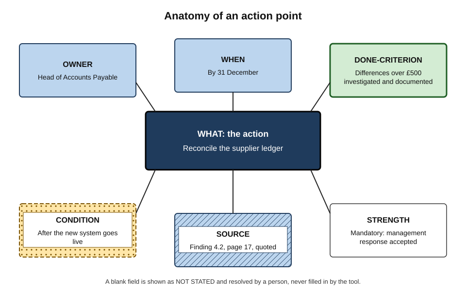
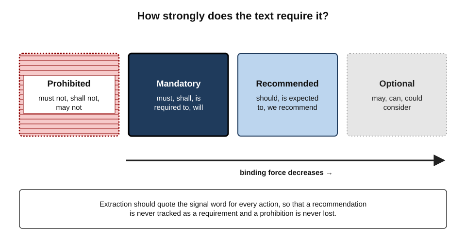
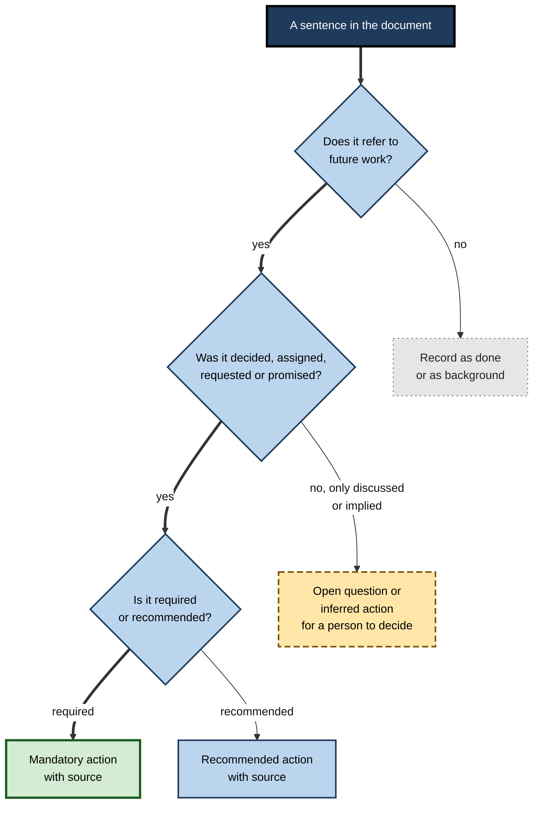
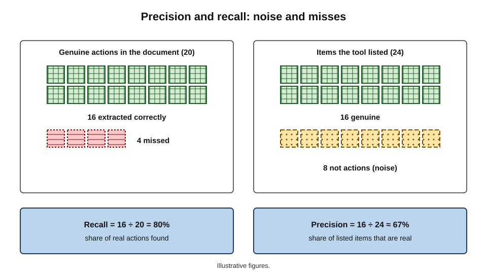
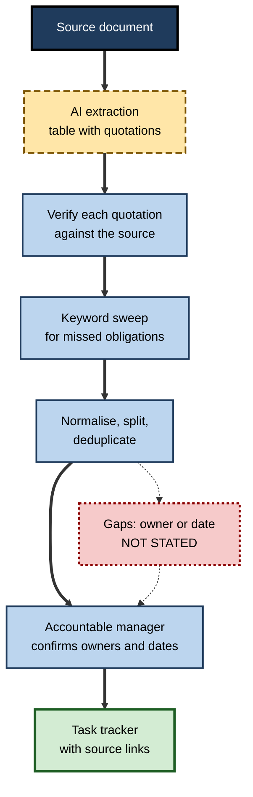
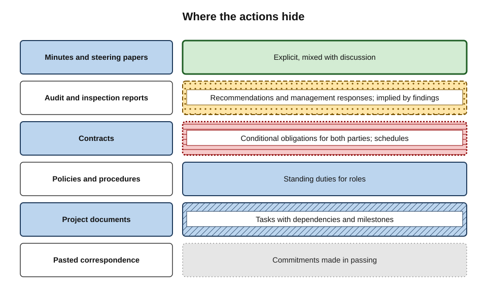

# D.4. Extracting action points

An internal audit report runs to forty pages. Somewhere inside it are eleven things the finance team must do, three of them by the end of the quarter, one of them a regulatory requirement. A project steering paper ends with "next steps" — but the real commitments are scattered through the discussion. A contract obliges both parties to give notice, renew insurance and report incidents within set periods. In each case the document's practical value lies in the **actions** it contains, and those actions are buried in prose.

> **Definition — Action point:** a specific task that a document assigns, requests or commits someone to, with — at least in principle — an owner, an outcome and a time by which it should be done.

> **Definition — Action extraction:** identifying the action points in a text and restating each in a structured, trackable form, linked back to the passage it came from.

**Why extracting actions with AI matters**

- **Documents fail at the hand-off.** Many decisions and recommendations are agreed on paper and never acted upon, because nobody turned them into owned tasks.
- **AI is fast at finding candidate actions.** It can scan a long document and propose a list in seconds.
- **Errors here become operational.** A missed obligation, a wrong owner or an invented deadline turns into a missed regulatory date, a duplicated task or an argument about who agreed to what.
- **The list often replaces the document.** Once an action list exists, people work from it — so its accuracy matters more than the summary's.

---

## What an Action Is

### The anatomy of an action point

A well-formed action point has a small set of parts. Documents rarely state them all; extraction is partly the work of noticing what is missing.

- **Action** — what is to be done, as a verb phrase.
  - *e.g.* "Reconcile the supplier ledger."
- **Owner** — the person or role responsible.
  - *e.g.* "Head of Accounts Payable."
- **Due date** — when it must be done.
  - *e.g.* "By 31 December."
- **Done-criterion** — how completion will be recognised.
  - *e.g.* "Differences above £500 investigated and documented."
- **Dependency or condition** — what it waits on, or when it applies.
  - *e.g.* "After the new system goes live."
- **Source** — where in the document the action comes from.
  - *e.g.* "Finding 4.2, page 17."
- **Priority or obligation strength** — whether it is required, recommended or optional.

**Figure 1.** The parts of a well-formed action point.

> **Mnemonic — "WOW-DCS":** What, Owner, When, Done-criterion, Condition, Source — the six fields every extracted action should carry, with blanks shown openly.

> **Key point:** an action point with no owner or no date is not "nearly complete"; it is a **known gap** that must be resolved by a person, not filled by the tool.

### Language that creates actions

**Speech act theory**

- The philosopher **J. L. Austin** (lectures published 1962) argued that utterances do things as well as say things — promising, ordering, requesting.
- **John Searle (1976)** classified these speech acts; two classes matter most for action extraction:
  - **directives** — attempts to get someone else to act ("Please submit the report by Friday", "The team should review…");
  - **commissives** — the speaker commits themself to act ("We will provide an update", "I'll send the figures").
- Other sentences only **describe** ("The ledger was reconciled in March") or **assess** ("Controls are weak").
  - They may imply an action, but they do not assign one.

**Study card — Cohen, Carvalho and Mitchell (2004), "Learning to Classify Email into 'Speech Acts'"**

- **Question:** can software recognise the acts performed by messages — requests, commitments, proposals, deliveries?
- **Method:** defined a taxonomy of verb–noun pairs (such as *request–meeting*, *commit–data*, *deliver–document*), annotated real email, and trained classifiers.
- **Findings:**
  - requests and commitments could be detected with useful but imperfect accuracy;
  - some acts were much easier to recognise than others, and human annotators themselves sometimes disagreed.
- **Significance:** two decades before large language models, the problem was already recognised as one of interpreting **intent**, not keywords — and human agreement set a ceiling on what "correct" extraction means.

### Obligation strength

Documents signal how binding an action is through modal verbs and set phrases.

- **Mandatory** — *must, shall, is required to, will* (in contracts and policies).
- **Recommended** — *should, is expected to, it is recommended that*.
- **Permitted or optional** — *may, can, could consider*.
- **Prohibited** — *must not, shall not, may not*.

> **Example (illustrative figures):** technical standards often adopt the keywords of an internet engineering convention from 1997 — MUST, SHOULD and MAY in capitals — precisely so that readers and implementers can tell required from recommended behaviour.

**Figure 2.** Signals of obligation strength in document language.

> **Watch out:** AI tools often flatten obligation strength, listing "the team may consider a review" as "Review — team" alongside mandatory actions. Ask for the **strength** of each action, quoted from the text.

---

## Explicit and Implicit Actions

### A spectrum

| Type | Example in a document | Owner stated? | Date stated? | Should the tool list it? |
|---|---|---|---|---|
| Explicit and complete | "The CFO will present the revised budget to the board on 12 May." | Yes | Yes | Yes, as written |
| Explicit, missing parts | "The budget will be revised." | No | No | Yes, with owner and date marked missing |
| Recommendation | "We recommend that access reviews be performed quarterly." | No | Frequency only | Yes, flagged as recommendation |
| Implied by a finding | "Three leavers retained system access." | No | No | Only if asked — labelled as inferred |
| Discussed, not decided | "The group discussed outsourcing payroll." | No | No | No — but may be listed as an open question |
| Already done | "Access was removed on 3 March." | — | Past | No — record as completed, if at all |

> **Definition — Implicit action:** a task that a document implies — usually by stating a problem, finding or gap — without anyone being assigned or committing to it.

**Why the distinction matters**

- **Listing implied actions as agreed actions** creates commitments nobody made.
- **Omitting implied actions** misses the point of documents such as audit reports, where findings imply remediation.
- The right approach is usually to **list them separately**, clearly labelled as *inferred*, for a person to accept or discard.

### Discussed versus decided

- Minutes, steering papers and reports often record discussion, options and opinions alongside decisions.
- AI extraction tends to over-include, turning "it was suggested that marketing might lead" into "Marketing to lead".
- The test is whether the document records **agreement or assignment**.

**Figure 3.** Deciding whether a sentence yields an action point.

---

## How AI Extraction Goes Wrong

### Errors of content

- **Invented owners** — the tool assigns a task to the most likely-sounding role ("IT team") when the document named nobody.
- **Invented dates** — "by end of month" appears where the document gave no deadline.
- **Wrong owner** — a task attributed to the person who *raised* it rather than the person who *took* it.
- **Lost conditions** — "if the pilot succeeds, roll out to all regions" becomes "roll out to all regions".
- **Changed strength** — recommendations listed as requirements, or the reverse.
- **Merged actions** — two different tasks with different owners collapsed into one.
- **Duplicates** — the same action listed once from the body and again from the summary section.
- **Past as future** — completed actions listed as outstanding.

### Errors of coverage

- **Missed actions in tables** — action plans laid out as tables, or obligations in schedules, are often skipped.
- **Missed actions in long documents** — late sections and annexes under-represented.
- **Missed commitments in passing** — "we will, of course, notify you of any changes" is an obligation easily overlooked.

### Measuring extraction quality

Two numbers describe how good an extracted list is.

> **Definition — Precision:** the share of extracted items that are genuine action points.

> **Definition — Recall:** the share of genuine action points in the document that were extracted.

> **Formula — Precision and recall:** precision = correct items extracted ÷ all items extracted; recall = correct items extracted ÷ all genuine items in the document. *Example (illustrative figures):* a document contains 20 actions; the tool lists 24 items, of which 16 are genuine. Precision = 16 ÷ 24 ≈ **67%**; recall = 16 ÷ 20 = **80%**. Eight listed items are noise, and four real actions are missing.

**Figure 4.** Precision and recall in an extracted action list.

- **Which matters more depends on the document.**
  - For **contracts and regulatory findings**, recall matters most — a missed obligation can be costly; extra candidates can be discarded by a reviewer.
  - For **team task lists**, precision matters more — a list cluttered with non-actions is ignored.
- **The prompt shifts the balance.**
  - "List every possible action, including implied ones" raises recall and lowers precision.
  - "List only actions explicitly assigned with an owner" raises precision and lowers recall.

> **Key point:** decide **before** extracting whether missing an action or listing a false one is worse — and instruct the tool accordingly.

---

## The Extraction Method

### The procedure

1. **Define what counts.** Decide whether to include recommendations, implied actions and open questions, and how to label them.
2. **Specify the output.** Request a table: action (verb first), owner, due date, condition, strength, source location and **verbatim quotation**.
3. **Forbid filling gaps.** "If no owner or date is stated, write NOT STATED. Do not infer."
4. **Extract section by section** for long documents, so late sections and tables are not neglected.
5. **Verify against the source.** Check each quotation exists and says what the action claims.
6. **Sweep for misses.** Search the document for obligation words — *must, shall, will, should, required, by [date], responsible* — and compare hits with the list.
7. **Normalise and deduplicate.** Merge duplicates; split compound actions; rewrite each as one verb-first task.
8. **Resolve gaps with people.** Owners and dates marked NOT STATED are settled by the accountable manager, not the tool.
9. **Load into the tracker.** Transfer to the team's task system, keeping the source reference.

**Figure 5.** From document to tracked action: the extraction pipeline.

> **Remember:** every extracted action carries a **quotation and a location**. An action without a source cannot be checked and should not be tracked.

### Writing actions that get done

- **Verb first** — "Update the risk register", not "Risk register".
- **One action per line** — split "review and approve" if different people review and approve.
- **Observable outcome** — "Publish the revised policy on the intranet", not "Look into policy".
- **SMART where possible** — George Doran's 1981 criteria: specific, measurable, assignable, realistic, time-related.
  - Doran's original "A" was **assignable** — someone must own it.
- **One accountable owner** — shared ownership tends to mean no ownership.

> **Definition — RACI:** a responsibility assignment convention listing, for each task, who is **R**esponsible (does the work), **A**ccountable (owns the outcome), **C**onsulted and **I**nformed.

| | Weak extracted action | Well-formed action |
|---|---|---|
| Wording | "Access reviews" | "Perform a quarterly user-access review of the finance system" |
| Owner | "IT" (inferred) | "Finance Systems Manager" (confirmed by the CFO) |
| Date | "ASAP" | "First review completed by 31 January; then quarterly" |
| Done-criterion | None | "Review signed off; leavers' access removed within 5 working days" |
| Diffusion of responsibility | The tendency for each person to assume someone else will act when ownership is shared or unclear. |
| Source | None | "Audit finding 3.1, page 12: 'Three leavers retained access'" |
| Strength | Unstated | "Recommendation — management response: accepted" |

---

## Worked Example (illustrative): Actions from an Audit Report

**Situation:** a 38-page internal audit report on procurement contains seven findings, each with a recommendation and a management response. The finance director asks for an action list for the next team meeting.

1. **Define what counts.** Include every recommendation and every commitment in the management responses; label implied actions separately.
2. **Extract.** The tool returns 14 items in a table with quotations and page numbers.
3. **Verify.**
   - Two items quote the executive summary and duplicate items from the findings — merged.
   - One item, "Procurement to retender the cleaning contract", has no supporting quotation; the report only noted the contract had "not been market-tested since 2019". It is moved to *inferred*.
   - One owner, "Head of Procurement", was invented; the management response named the "Category Manager, Facilities".
4. **Sweep.** Searching for "will" and "by" finds a commitment in a management response table — "we will update the delegation-of-authority matrix by 30 June" — missing from the list. Added.
5. **Normalise.** "Review and approve supplier onboarding procedure" is split into a review action (Category Manager) and an approval action (Finance Director).
6. **Resolve gaps.** Three actions have no due date; the finance director sets them at the meeting.
7. **Load.** Twelve actions go into the team tracker with page references.

| Measure | AI first pass | After verification |
|---|---|---|
| Items listed | 14 | 12 tracked + 1 inferred for decision |
| Genuine actions among them | 10 | 12 |
| Precision | 10 ÷ 14 ≈ 71% | 100% |
| Recall (of 12 genuine) | 10 ÷ 12 ≈ 83% | 100% |
| Invented owners | 1 | 0 |

*Illustrative figures.*

- **Conclusion:** the first pass found most actions quickly; the sweep and verification steps caught the remaining errors in about forty minutes. The missed commitment — inside a table — is typical.

> **Watch out:** the most dangerous error was the **invented owner**: it looked authoritative and would have sent the task to someone who had never agreed to it.

---

## Actions from Different Kinds of Document

- **Minutes and steering papers** — actions are usually explicit but mixed with discussion; separate *decided* from *discussed*.
- **Audit and inspection reports** — actions sit in recommendations and management responses; implied actions follow from findings.
- **Contracts** — obligations for both parties, often conditional and time-bound ("within 30 days of notice"); build an **obligations register** rather than a task list.
- **Policies and procedures** — standing duties ("managers must approve leave within five days") rather than one-off tasks.
- **Project documents** — dependencies matter as much as dates; extract predecessors and successors.
- **Correspondence pasted into a document** — commitments made in passing ("I'll get back to you on that") are easy to miss and easy to misattribute.

> **Definition — Obligations register:** a structured record of every obligation in a contract or regulation — party, duty, trigger, deadline, clause reference — maintained for the life of the agreement.

**Figure 6.** Explicit, recommended and implied actions in different document types.

---

## Why Specific Actions Get Done

### Implementation intentions

The insistence on owners, dates and done-criteria is not bureaucratic tidiness. Research on goal pursuit shows that **specific plans** are carried out far more often than general intentions.

**Study card — Peter Gollwitzer (1999) and Gollwitzer and Sheeran (2006)**

- **Concept:** an **implementation intention** is an if–then plan specifying *when*, *where* and *how* a person will act ("If it is Monday at 9 a.m., then I will reconcile the ledger before opening email").
- **Contrast:** a **goal intention** states only *what* one intends ("I will reconcile the ledger").
- **Evidence:** a 2006 meta-analysis by Gollwitzer and Paschal Sheeran, pooling 94 independent tests, found a medium-to-large average effect of forming implementation intentions on goal attainment.
- **Mechanism:** the plan links a situational cue to an action, so the action is triggered when the cue arrives rather than waiting for a decision.
- **Caveats:** effects vary by task and person, and later work suggests some published effects are inflated by selective publication; the direction of the finding is robust.

> **Key point:** an extracted action with an owner, a date and a trigger is an **organisational implementation intention**. Vague actions ("look into access controls") behave like goal intentions — agreed, and then not done.

### The vague-action problem

- **No owner** — everyone assumes someone else is doing it (a form of **diffusion of responsibility**).
- **No date** — the action is always "next".
- **No done-criterion** — work starts but never finishes, or finishes in a way nobody accepts.
- **No trigger** — conditional actions are forgotten when their condition arrives.

> **In practice:** when an AI-extracted list contains many items with NOT STATED owners or dates, that is not a failure of the tool — it is an accurate diagnosis of the **document**. The meeting, report or contract left work unassigned, and the fix belongs with the people who produced it.

---

## Actions in Shared Documents

### Assigning work inside the document

Collaborative word processors let actions live inside the document itself, not only in a separate tracker.

- **Assigned comments** — mentioning a colleague in a comment and assigning it creates a task linked to that exact passage; the assignee is notified and the comment is resolved when done.
- **Task components** — some suites embed live task lists that synchronise with a task-management app.
- **AI-suggested assignments** — assistants can propose assignments from the text, which a person confirms.

| | Separate task tracker | Assigned comments in the document | Obligations register |
|---|---|---|---|
| Best for | Project and team work across many sources | Edits and checks to the document itself | Contracts and regulatory duties over months or years |
| Link to source | By reference | Direct — attached to the passage | By clause reference and quotation |
| Visibility | Team-wide dashboards | Only to document collaborators | Commercial, legal and operational owners |
| Handles conditional triggers | Partly | Poorly | Yes, by design |
| Risk | Losing the link to the source text | Tasks vanish when the document is archived | Becoming stale if not maintained |

> **Watch out:** assigned comments are excellent for **document tasks** ("check these figures", "approve this clause") but poor for **operational actions** that outlive the document. Operational actions belong in a tracker with dates and status reporting.

### Following up

- **Status** — open, in progress, done, blocked, cancelled; a cancelled action records *why*.
- **Ageing** — actions open well past their date are escalated, not silently rolled forward.
- **Evidence of completion** — for audit and regulatory actions, a note or document showing the done-criterion was met.
- **AI in follow-up** — assistants can draft reminder messages or status summaries from the tracker; the accountable owner still confirms status.

---

## Case Study (illustrative): An Obligations Register from Supplier Contracts

- **Situation:** a logistics company held about sixty active supplier contracts. Service credits, notice periods and insurance renewals were regularly missed, because obligations lived only in the contracts.
- **Approach:** a commercial analyst used the document assistant to extract every obligation from each contract into a register: party, obligation, trigger, deadline, clause.
- **First results:** registers for all contracts were drafted in two weeks rather than an estimated three months.
- **Problems found in a sample check by the legal team:**
  - conditional obligations ("within 10 days of a Change Request") had been recorded with fixed dates;
  - obligations in schedules — particularly service-level reporting duties — were under-extracted;
  - several obligations of the **company** were attributed to the **supplier**, because the tool confused defined party names ("the Customer", "the Provider");
  - "reasonable endeavours" and "shall" obligations were not distinguished.
- **Changes:**
  1. each contract's **definitions clause** was supplied with the request, and parties were mapped to real names before extraction;
  2. schedules were extracted separately;
  3. every row required a **verbatim clause quotation**;
  4. a "trigger" column replaced fixed dates wherever the obligation was event-driven;
  5. legal reviewed a stratified sample of rows from every contract, with full review for the highest-value ten.
- **Result:** after correction, the register supported automated reminders for renewals and notice periods. In the following year the company reported recovering service credits it had previously failed to claim, and no renewal deadline was missed.
- **Lesson:** AI made building the register feasible; **definitions, quotations and triggers** made it trustworthy.

---

## Professional Practice

- **Agree the action format** across a team — the same fields, the same labels for strength and status.
- **Keep the link to source** — trackers should carry the document reference so that disputes can be settled by the text.
- **Confirm with owners** — an extracted action becomes a commitment only when the owner accepts it.
- **Close the loop** — review open actions at the next meeting or reporting cycle, not just at creation.
- **Use enterprise task integration with care** — some suites can push extracted actions straight into task tools; this speeds hand-off but also spreads errors faster, so verification comes first.

> **In practice:** experienced chairs and project managers use AI extraction as a **first draft of the action log**, then read it aloud at the end of the meeting or circulate it for confirmation within a day. Disagreements surface while memories are fresh.

---

## Open Questions

- **Can AI reliably tell decided from discussed?**
  - The distinction often depends on context and convention that the text does not make explicit; human annotators also disagree.
- **Should tools infer owners at all?**
  - Inferred owners are often right and save time, but wrong ones create false commitments; good practice and good defaults are not settled.
- **How should recall be assured in very long documents?**
  - Keyword sweeps help but miss obligations phrased unusually; there is no reliable automatic completeness check.
- **Do AI-extracted action lists change accountability?**
  - If people come to rely on the tool's list, responsibility for noticing unassigned work may shift silently from chairs and authors to software that cannot be held to account.
- **What is the right link between documents and task systems?**
  - Direct integration speeds work but blurs the line between a proposed action and an accepted one.

---

## Summary

- An **action point** is a task a document assigns, requests or commits someone to; **action extraction** restates actions in structured form linked to their source.
- A well-formed action has **What, Owner, When, Done-criterion, Condition, Source** (WOW-DCS), plus obligation **strength**.
- Speech act theory distinguishes **directives** and **commissives** from descriptions; modal verbs signal **mandatory, recommended, optional** and **prohibited** actions.
- Actions range from **explicit and complete** to **implied**; implied actions and discussion items must be labelled, not presented as agreed.
- AI errors: **invented owners and dates, wrong owners, lost conditions, changed strength, merged or duplicated items, missed actions in tables**.
- Quality is measured by **precision** and **recall**; contracts and findings favour recall, task lists favour precision.
- Method: define, specify a table with **quotations**, forbid gap-filling, extract by section, verify, **sweep for obligation words**, normalise, resolve gaps with people, load to a tracker.
- Write actions **verb first, one per line, observable, SMART**, with **one accountable owner**.
- Contracts call for an **obligations register** with triggers and clause references.
- Specific actions work like **implementation intentions** (Gollwitzer): owner, date and trigger turn agreement into action; vague actions suffer **diffusion of responsibility**.
- **Assigned comments** suit document tasks; operational actions belong in a **tracker** with status, ageing and evidence of completion.

---

## Self-Check

1. Define an action point and action extraction.
2. List the six fields of a well-formed action and explain why a blank field should not be filled by the tool.
3. Distinguish directives from commissives, with one example each from a project document.
4. Rank these by obligation strength: "should", "may", "shall", "could consider".
5. How should a tool treat "Three leavers retained system access" in an audit report?
6. Give four content errors typical of AI action extraction.
7. A tool lists 30 items from a document containing 25 actions; 20 of its items are genuine. Calculate precision and recall and interpret them.
8. For which documents is recall more important than precision, and why?
9. Why should every extracted action carry a verbatim quotation?
10. What is the purpose of the keyword sweep, and what words would you search for?
11. Rewrite "Policy — look into it" as a well-formed action.
12. In the supplier-contract case, why were obligations attributed to the wrong party, and how was it fixed?
13. A manager wants extracted actions pushed automatically into team task lists. Advise on the safeguards.
14. Explain, using research on implementation intentions, why an action with an owner, date and trigger is more likely to be done than "look into access controls".
15. When should an action live as an assigned comment in the document, and when in a separate tracker?

### Answer Key

1. An action point is a specific task a document assigns, requests or commits someone to, with an owner, outcome and time at least in principle. Action extraction is identifying such tasks and restating them in structured, trackable form linked to their source passage.
2. What, Owner, When, Done-criterion, Condition, Source. Blank fields mark real gaps in the document; if the tool fills them, it creates commitments nobody made and hides the need for a person to decide.
3. Directives ask others to act ("The supplier should submit revised timelines by Friday"); commissives commit the speaker ("We will circulate the test plan next week").
4. "Shall" (mandatory) > "should" (recommended) > "may" (permitted) ≈ "could consider" (optional, weakest).
5. As an implied action — remediation of leavers' access — listed separately and labelled as inferred, for a person to accept and assign; not as an agreed action with an owner.
6. Any four of: invented owners, invented dates, wrong owner, lost conditions, changed obligation strength, merged actions, duplicates, past actions listed as outstanding.
7. Precision = 20 ÷ 30 ≈ 67%; recall = 20 ÷ 25 = 80%. A third of the list is noise to discard, and five real actions are missing and must be found.
8. Contracts, regulatory findings and audit reports, because a missed obligation can cause penalties or breaches, whereas extra candidates cost only review time.
9. It lets a reviewer confirm the action exists and says what is claimed, exposes invented items, and preserves the source for disputes later.
10. To catch actions the extraction missed. Search for *must, shall, will, should, required, responsible, by [date], within [period], no later than*, and compare hits with the list.
11. "Review the travel expenses policy against the new tax guidance and propose changes — Owner: Finance Policy Lead — Due: 15 March — Done when: marked-up draft circulated to the CFO — Source: audit finding 2.3."
12. Contracts use defined party names ("the Customer", "the Provider"); the tool confused them when definitions were processed separately. It was fixed by supplying the definitions clause, mapping parties to real names before extraction and requiring verbatim quotations.
13. Verify and confirm actions before they are pushed; show proposed actions as drafts until owners accept; keep source links; restrict automatic creation to explicit, owner-stated actions; audit a sample regularly.
14. Implementation intentions link a specific cue (a date, a trigger) to a specific action by a specific person, so the action fires when the cue arrives; meta-analytic evidence shows such plans raise goal attainment substantially, though effects vary. A vague action is only a goal intention: nobody owns it, nothing triggers it and completion is undefined.
15. Assigned comments suit tasks about the document itself — checking figures, approving a clause — because they attach to the passage. Operational actions that outlive the document, need dates, status and escalation, or involve people outside the document belong in a tracker with a source reference.

---

## Glossary

| Term | Meaning |
|---|---|
| Action extraction | Identifying action points in a text and restating them in structured, source-linked form. |
| Action point | A specific task a document assigns, requests or commits someone to. |
| Assigned comment | A comment in a shared document allocated to a named person as a task. |
| Commissive | A speech act in which the speaker commits to a future action. |
| Directive | A speech act that attempts to get another person to act. |
| Done-criterion | The observable condition that shows an action is complete. |
| Diffusion of responsibility | The tendency for each person to assume someone else will act when ownership is shared or unclear. |
| Implicit action | A task implied by a finding or problem but not assigned or promised. |
| Implementation intention | An if–then plan stating when, where and how a person will act. |
| Keyword sweep | Searching a document for obligation words to find actions an extraction missed. |
| Obligation strength | How binding an action is: mandatory, recommended, optional or prohibited. |
| Obligations register | A structured record of every obligation in a contract or regulation, maintained over time. |
| Precision | The share of extracted items that are genuine actions. |
| RACI | Responsible, Accountable, Consulted, Informed — a responsibility assignment convention. |
| Recall | The share of genuine actions in a document that were extracted. |
| SMART | Specific, measurable, assignable, realistic, time-related criteria for objectives. |
| Speech act | An utterance that performs an action, such as requesting or promising. |
| Trigger | The event that starts the clock on a conditional obligation. |
