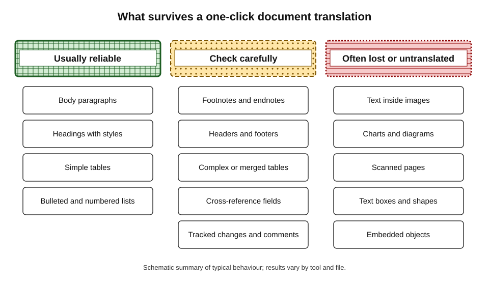
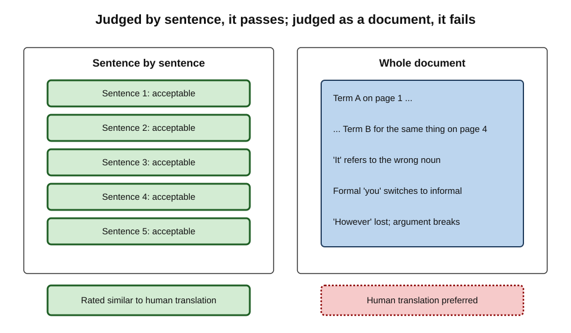
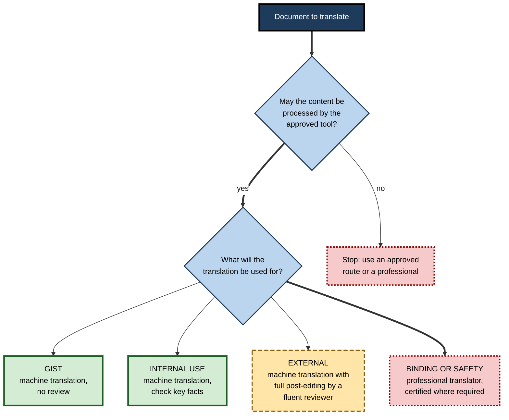
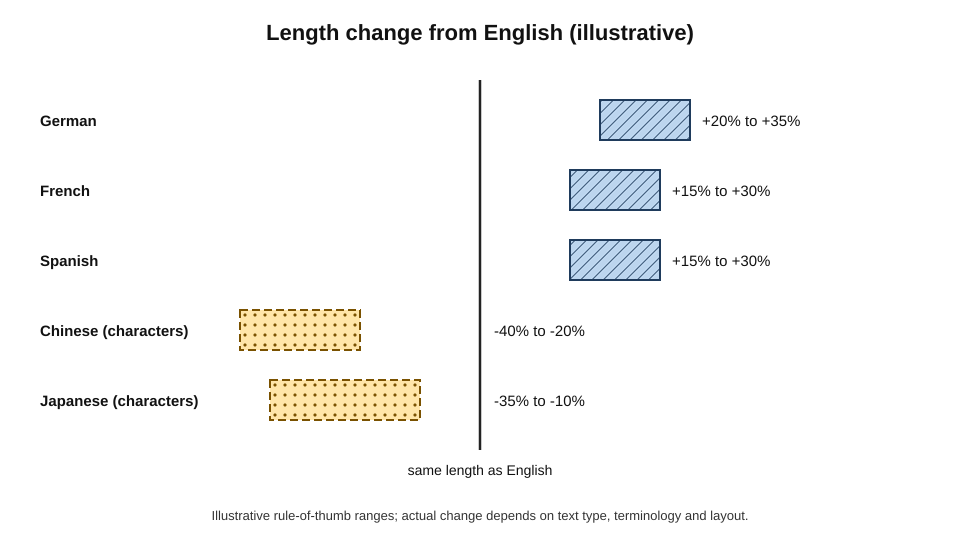
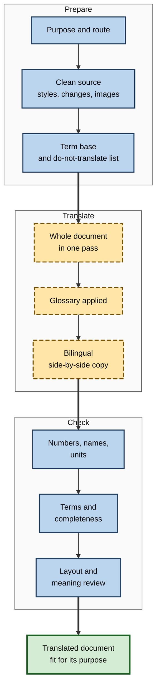
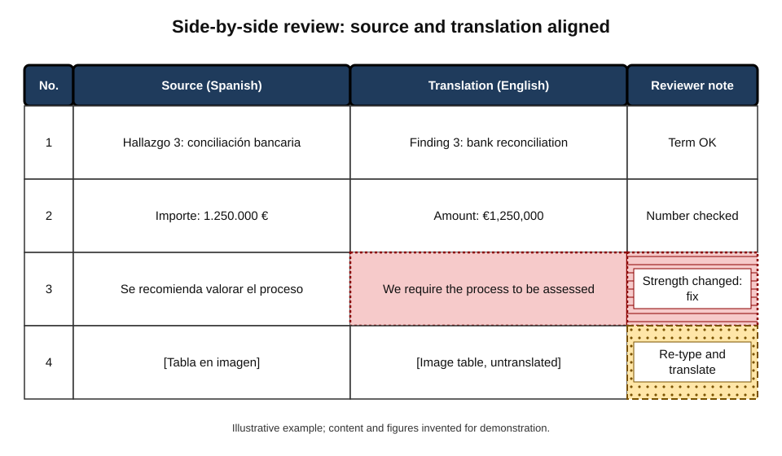

# D.5. Translating documents

A Spanish subsidiary sends a 30-page audit report; head office needs it in English by tomorrow. A procurement team must issue tender documents in French and German. A new safety procedure must reach factory staff in Polish and Romanian. Modern word processors can translate an entire file in under a minute, often keeping headings, tables and layout intact. Whether the result can be relied on depends on what the document is for — and on problems that appear only when a whole document, rather than a sentence, is translated.

> **Definition — Document translation:** translating a complete file — its text, structure and formatting — from one language into another, so that the result works as a document in the target language, not merely as a collection of translated sentences.

> **Definition — Machine translation (MT):** automatic translation by software; today usually by neural networks, either dedicated translation engines or general large language models.

**Why translating whole documents is its own problem**

- **Consistency across pages** — a term must be translated the same way on page 2 and page 40.
- **Structure and formatting** — tables, footnotes, headings, fields, tracked changes and text inside images all have to survive.
- **Legal and operational effect** — contracts, policies, safety instructions and regulatory filings have consequences in every language they exist in.
- **Speed tempts over-use** — a one-click translation looks finished, so it is used for purposes it was never fit for.

---

## How Document Translation Works

### Routes available in everyday work

| Route | What it does | Strengths | Weaknesses |
|---|---|---|---|
| Built-in "translate document" in the word processor | Creates a translated copy of the file | Fast; keeps much formatting; within the organisation's suite | Limited control of terminology; quality varies by language pair |
| Dedicated translation service with file upload | Translates the file with a specialised engine | Good formatting preservation; glossary features on business plans | Data handling depends on plan; separate tool |
| General AI assistant | Translates pasted or uploaded text, can follow instructions | Can apply style instructions, explain choices, handle context | Formatting often lost; may "improve" or omit content; length limits |
| Professional translator with computer-assisted tools | Human translation or post-editing, with translation memory and term bases | Accountability, consistency, certified output where required | Slower and costlier |

> **Definition — Post-editing:** a human editing machine-translated output to bring it to a required quality standard.

> **Definition — Translation memory:** a database of previously translated sentence pairs that professional tools reuse, so that repeated text is translated consistently.

> **Definition — Term base (glossary):** a controlled list of approved translations for key terms — product names, defined legal terms, job titles — applied throughout a document.

### What happens to the file

- **Text is extracted** from the document's structure — paragraphs, cells, footnotes, headers.
- **Segments are translated** — by sentence or larger chunks; larger chunks give the model more context.
- **Text is reinserted** into the structure, which may need to stretch, shrink or reverse direction.
- **What can go wrong at each stage:**
  - extraction misses text in images, text boxes, charts or embedded objects;
  - segmentation splits sentences badly at line breaks or bullet points;
  - reinsertion overflows table cells, breaks fields such as cross-references, or mangles tracked changes.

**Figure 1.** Which parts of a document survive automatic translation reliably.

> **Watch out:** text in images, scanned pages, charts and diagrams is often **left untranslated** without warning. A translated document can look complete while its most important figure is still in the source language.

### Instructing an AI assistant to translate

When a general assistant is used — for example, for a short document where formatting matters less than nuance — the instruction does much of the quality control that a translation tool's settings would otherwise do.

- **Purpose and reader** — "for German-speaking customers; formal register using *Sie*".
- **Completeness** — "translate everything, including headings, tables and footnotes; do not summarise, shorten or add anything".
- **Terminology** — the term base, with do-not-translate names.
- **Numbers and units** — "keep all values exactly; convert number formats to German conventions; do not convert units".
- **Uncertainty** — "where the source is ambiguous, keep the ambiguity and flag it in a note after the translation".
- **Output** — "present as a two-column table: source segment, translation", for review.

> **Example (illustrative):** an assistant asked simply to "translate this into French" returned a polished text that silently **omitted** a paragraph of legal small print it judged repetitive. With the instruction "translate everything; do not omit or condense", the paragraph was kept.

> **Watch out:** general assistants are trained to be helpful, which can mean **improving** the source — smoothing awkward sentences, correcting apparent errors, adding clarifications. In translation, any change not in the source is an error, however helpful it looks.

---

## Sentence-Level Versus Document-Level Quality

### The parity debate

**Study card — Läubli, Sennrich and Volk (2018), "Has Machine Translation Achieved Human Parity? A Case for Document-level Evaluation"**

- **Background:** earlier in 2018, Microsoft researchers reported that their Chinese-to-English news translation system had reached **human parity** — evaluators rated its sentences as good as professional human translations.
- **Method:** the authors repeated the comparison with professional translators as raters, showing them **whole documents** as well as isolated sentences.
- **Findings:**
  - when sentences were judged in isolation, the machine and human translations were rated similarly;
  - when whole documents were judged, raters **preferred the human translations** — machine output had problems visible only across sentences.
- **Interpretation:** sentence-level evaluation hides document-level failures: inconsistent terms, wrong pronoun references, broken cohesion.
- **Status:** widely accepted as a methodological correction; later evaluation campaigns moved towards document-level assessment.

**Figure 2.** The same machine translation judged sentence by sentence and as a whole document.

> **Key point:** every sentence of a translated document can look acceptable while the **document** fails — because consistency, reference and flow live between sentences.

### Document-level failures

- **Terminology drift** — "supplier" becomes *Lieferant* in one section and *Anbieter* in another, and the reader wonders whether they are different parties.
- **Defined terms broken** — a capitalised defined term ("the Services") is translated inconsistently, undermining a contract's definitions.
- **Pronoun and gender errors** — the referent of "it" or "they" is lost across sentences; languages with grammatical gender force choices the source left open.
- **Formality inconsistency** — switching between formal and informal "you" (*Sie*/*du*, *vous*/*tu*) within one document.
- **Cross-reference breakage** — "see clause 4.2" correct in the text but the clause renumbered or the field broken.
- **Cohesion loss** — connectors ("however", "therefore") mistranslated so the argument no longer flows.

> **In practice:** large language models, which can take a whole document as context, generally handle consistency and reference better than older sentence-by-sentence engines — but only when the document is processed as a whole and terms are fixed in advance.

---

## Fitness for Purpose

### Purpose decides the route

Not every translation needs to be perfect. The question is what the translated document will be **used for**.

- **Gist** — understanding roughly what a document says, for the reader's own use.
  - *e.g.* scanning a foreign-language news article or supplier brochure.
- **Internal working use** — informing decisions and discussions inside the organisation.
  - *e.g.* the subsidiary's audit report read by head office.
- **External communication** — published or sent to customers, partners or the public.
  - *e.g.* product information, tender documents, a website page.
- **Binding or safety-critical** — documents with legal force or consequences for health and safety.
  - *e.g.* contracts, regulatory filings, safety instructions, medical information, court documents.

**Figure 3.** Choosing a translation route by purpose.

### Light and full post-editing

The international standard for post-editing machine translation, ISO 18587 (2017), distinguishes two levels.

| | Light post-editing | Full post-editing |
|---|---|---|
| Goal | Understandable and accurate enough to use | Comparable to human translation |
| Fixes | Meaning errors, omissions, mistranslated numbers | Everything above, plus style, terminology, consistency, fluency |
| Style | Left as produced if understandable | Matches the target-language norms and house style |
| Typical use | Internal documents, gist with key facts checked | Published, customer-facing and contractual documents |
| Reviewer | Competent in both languages | Qualified translator or equivalent |

> **Remember:** the reviewer must read **both languages**. A fluent target-language reader who cannot read the source can judge style but not accuracy.

---

## Language Features That Affect Documents

### Expansion and contraction

- Translated text rarely has the same length as the source.
  - English into German, French or Spanish commonly **expands**; translating into Chinese or Japanese usually takes fewer characters.
  - Industry rules of thumb put expansion from English into many European languages at roughly a fifth to a third, but the figure varies widely by text type and should be treated as an estimate.
- **Consequences in documents:** overflowing table cells, broken page layouts, truncated headings, captions that no longer fit.

**Figure 4.** Typical length change when English documents are translated (illustrative ranges).

### Direction, scripts and formats

- **Right-to-left languages** — Arabic, Hebrew, Persian and Urdu reverse the reading direction; tables, numbered lists, page order and alignment must mirror.
- **Scripts and fonts** — the document's fonts must contain the target script's characters, or text displays as boxes.
- **Numbers, dates and units** — 1,000.50 versus 1.000,50; 04/05 meaning April 5th or 4 May; decimal commas; currencies; imperial and metric units.
- **Names and addresses** — order of family and given names; address formats.
- **Sorting** — alphabetical lists may need re-sorting in the target language.

> **Watch out:** machine translation usually converts number **formats** correctly but sometimes changes the **value** — dropping a zero, misreading a thousands separator, or converting units without being asked. Every number in a translated document is checked against the source.

---

## The Document Translation Method

### Before translating

1. **Confirm the purpose** — gist, internal, external or binding; this fixes the route and review level.
2. **Confirm the tool is permitted** for this content — documents leave the organisation's control when sent to unapproved services.
3. **Clean the source** — accept or reject tracked changes; fix heading styles; replace text in images with real text where possible.
4. **Prepare a term base** — product names, defined terms, job titles, units, and terms that must **not** be translated (brand names, legal names).
5. **Simplify where you can** — shorter, unambiguous source sentences translate better; this is sometimes called **controlled language**.

### Translating

6. **Translate the whole document in one pass** where the tool allows, so it has document context.
7. **Apply the term base** — through the tool's glossary feature, or by instruction to an AI assistant ("translate *Service Credit* as *Servicegutschrift* throughout").
8. **Keep the source alongside** — a bilingual, side-by-side version makes review far faster.

### Checking

9. **Numbers and names** — every figure, date, name and unit against the source.
10. **Terms** — search the translation for each glossary term and its alternatives.
11. **Completeness** — compare headings, sections, tables and footnotes; check images and charts.
12. **Layout** — overflowing cells, broken fields, mirrored layouts for right-to-left languages.
13. **Meaning** — a bilingual reviewer reads at the level the purpose demands.

**Figure 5.** Preparing, translating and checking a document.

### Building and using a term base

Terminology is where document translation most often fails quietly, and where a small amount of preparation saves the most review time.

**What goes into a working term base**

- **Defined terms** — every capitalised term from a contract's or policy's definitions clause.
- **Product and service names** — usually *not* translated; listed so the tool leaves them alone.
- **Organisation-specific terms** — job titles, department names, internal programme names.
- **Regulated or technical terms** — where the target language has an official equivalent (a statutory term, a standard's vocabulary).
- **Forbidden alternatives** — near-synonyms that must not be used because they mean something else in context.

| Source term (English) | Approved German | Do not use | Note |
|---|---|---|---|
| Service Credit | Servicegutschrift | Rabatt, Erstattung | Defined term — contractual remedy, not a discount |
| Supplier | Lieferant | Anbieter | Use one term throughout to avoid implying two parties |
| Lock-out | Verriegelung (Lockout) | Aussperrung | "Aussperrung" means an industrial-relations lockout |
| AcmeFlow | AcmeFlow | — | Product name: never translate |

*Illustrative entries.*

- **Applying it:**
  - dedicated translation services and professional tools apply glossaries automatically;
  - with a general AI assistant, include the term base in the instruction and ask it to list any term it could not apply;
  - after translation, search for each forbidden alternative — any hit is an error.

> **Key point:** ten minutes building a term base for a long document usually saves far more than ten minutes of review, and prevents the most damaging kind of inconsistency — two words that suggest two different things.

### Keeping language versions in step

- **Documents change after translation.** A policy is revised; a contract is amended; a manual gets a new section.
- **The risk:** the source and translated versions drift apart, and readers in one language follow outdated instructions.
- **Good practice:**
  - **version both together** — the translated file carries the same version number and date as the source it was translated from;
  - **translate only the changes** — compare the old and new source, translate the changed passages and update the translation, so approved wording elsewhere is not disturbed;
  - **use translation memory** where available, so unchanged sentences reuse their approved translations;
  - **record the relationship** — "German version 3.2 corresponds to English version 3.2 of 14 October".

> **Watch out:** re-translating a whole revised document from scratch with a machine translation tool can silently change wording that had already been reviewed and approved in the previous version. Translate the **difference**, not the whole.

### Receiving a machine-translated document

Professionals increasingly *receive* documents that were machine translated by someone else.

- **Ask whether it was translated, and how** — a supplier's English contract summary may be a machine translation of a reviewed original.
- **Treat the original as authoritative** for anything binding; request it alongside the translation.
- **Check the high-risk items** — numbers, dates, obligations, conditions and defined terms — against the original, using a trusted translation route if needed.
- **Watch for tell-tale signs** — inconsistent terms, unnatural phrasing in otherwise fluent text, formatting that does not match the sender's usual documents, untranslated images.

### Back-translation

> **Definition — Back-translation:** translating a translation back into the source language, by a different translator or system, to reveal meaning changes.

- **Useful for:** spotting gross meaning errors in short, high-stakes texts — consent forms, survey questions, warnings.
- **Limits:**
  - a good back-translation does not prove a good translation — two systems can share the same error, or the forward translation can be accurate but unnatural;
  - it costs time and is no substitute for a qualified bilingual reviewer.

---

## Worked Example (illustrative): A Subsidiary's Audit Report

**Situation:** head office in London receives a 30-page internal audit report in Spanish from its Madrid subsidiary. The audit committee meets in two days; members need to read the findings in English.

1. **Purpose:** internal use — the committee will discuss findings; the Spanish original remains the authoritative version.
2. **Route:** the organisation's approved suite translation, followed by light post-editing of the findings and full checking of every number.
3. **Preparation:** tracked changes in the Spanish file are accepted; a short term base fixes the subsidiary's legal name, three job titles and the term *conciliación bancaria* (bank reconciliation).
4. **Translation:** the whole file is translated in one pass into a copy; a side-by-side version is generated.
5. **Checks:**
   - a figure of "1.250.000 €" has correctly become "€1,250,000";
   - a table of overdue items was an embedded image and remains in Spanish — the analyst re-types it as a table and translates it;
   - "*incumplimiento*" is rendered as "breach" in one finding and "non-compliance" in another; the analyst standardises to "non-compliance", which matches the audit's meaning;
   - one recommendation, "*se recomienda valorar*" ("it is recommended to assess"), had become "we require", changing its strength — corrected.
6. **Label:** the English version is marked "Convenience translation for internal discussion. The Spanish original prevails."

| Check | Found | Consequence if missed |
|---|---|---|
| Numbers | Converted correctly | — |
| Image table | Untranslated | Committee misses the overdue-items detail |
| Terminology | Two terms for one concept | Members think there are two kinds of failure |
| Obligation strength | Recommendation became requirement | Subsidiary held to a duty the auditors never set |

- **Conclusion:** about 90 minutes of checking turned a fast machine translation into a document the committee could rely on for discussion.

---

## Case Study (illustrative): Safety Instructions for a Factory Workforce

- **Situation:** a food manufacturer in the UK employed many staff whose first language was Polish, Romanian or Lithuanian. A revised lock-out procedure for cleaning machinery had to reach every operator before a line restart.
- **Initial approach:** a supervisor translated the six-page procedure with a free online translator and printed the results.
- **Problems found by a bilingual team leader:**
  - "isolate the machine" had been rendered in one language with a word closer to "set the machine aside";
  - a warning sentence split across two lines in the source had been translated as two unconnected fragments;
  - text on the procedure's photographs — labels for isolation points — remained in English.
- **Additional concern:** the procedure, containing internal site details, had been pasted into a public website outside the company's approved tools.
- **Actions:**
  1. the safety team used the company's approved translation service with a term base of equipment names and safety verbs agreed with bilingual staff;
  2. the source procedure was simplified first — one instruction per sentence, consistent verbs;
  3. labels on photographs were replaced with numbered callouts and translated captions;
  4. a qualified translator post-edited each language fully;
  5. bilingual operators walked through each translated procedure at the machine before sign-off.
- **Result:** the procedures were issued a week later than first hoped; operators reported fewer questions, and the walk-through caught two remaining ambiguities before restart.
- **Lesson:** for safety-critical documents, the translation is part of the **control**, not a courtesy — it needs the same rigour as the procedure itself.

---

## Professional Practice

### Legal effect and authoritative versions

- **Which version prevails?** Contracts in two languages usually state which version governs if they differ; without such a clause, disputes about meaning can be costly.
- **Convenience translations** — label them clearly, so readers know the original is authoritative.
- **Certified or sworn translation** — courts, immigration authorities and some regulators require translations by accredited translators; machine output cannot meet that requirement on its own.
- **Professional standards** — ISO 17100 sets requirements for translation services, including translator competence and revision by a second linguist.

### Confidentiality

- Uploading a document to a free public translation website can expose it.
  - In 2017 Norwegian journalists reported that documents submitted by staff of several organisations to a free translation website had become searchable online, including contracts and internal correspondence.
- **Approved routes** — enterprise suites and paid business plans usually offer contractual data protections that free consumer tools do not.

> **Watch out:** "it is just a translation" is a common rationalisation for sending confidential documents to unapproved tools. The whole document leaves the organisation's control either way.

### Inclusion and the reader

- Translation is often what makes a document **accessible** to staff, customers and citizens.
- Machine translation has made it affordable to provide many more languages — the obligation is to provide them **well enough** for their purpose.
- Lower-resourced languages generally get lower machine-translation quality, so the review effort should be higher precisely where readers have fewest alternatives.

**Figure 6.** A bilingual side-by-side layout used for reviewing a translated document.

---

## Open Questions

- **When is machine translation good enough to publish without full post-editing?**
  - Quality varies by language pair, domain and text type; organisations draw the line differently and rarely measure it.
- **How should document-level quality be measured?**
  - Most automatic metrics still score sentences; consistency and cohesion across a document are harder to quantify.
- **What happens to lower-resourced languages?**
  - Speakers of these languages may receive poorer translations of documents that affect them most, such as health and legal information.
- **Who is accountable for an AI translation error?**
  - Responsibility between the organisation, the reviewer and the tool provider is unsettled, especially for safety and legal documents.
- **Will translators' role shift entirely to post-editing?**
  - The profession is changing quickly; the long-term effect on quality and on the supply of expert translators is uncertain.

---

## Summary

- **Document translation** must produce a working document, not just translated sentences; **machine translation** now comes from dedicated engines and large language models.
- Routes: built-in suite translation, dedicated services, general assistants, and professionals using **translation memory** and **term bases**.
- Extraction, segmentation and reinsertion can lose **text in images**, break **fields** and overflow **tables**.
- Läubli and colleagues (2018) showed that **sentence-level parity** hides **document-level failures**: terminology drift, broken defined terms, pronoun errors, formality switches, cohesion loss.
- **Purpose** decides the route: gist, internal, external, binding or safety-critical.
- ISO 18587 distinguishes **light** and **full post-editing**; reviewers must read **both languages**.
- Plan for **expansion**, **right-to-left** layouts, scripts, and **number and date formats**; check every number's value.
- Method: confirm purpose and permission, clean the source, build a term base, translate whole documents, keep a bilingual copy, check numbers, terms, completeness, layout and meaning.
- A **term base** with defined terms, names and forbidden alternatives prevents terminology drift; search for forbidden terms after translating.
- Keep **language versions in step**: version them together and translate the **changes**, not the whole revised document.
- **Back-translation** reveals gross errors but proves little on its own.
- Label **convenience translations**; certified translation is required for many official uses; never send confidential documents to unapproved tools.

---

## Self-Check

1. Define document translation and explain why it differs from translating sentences.
2. Compare the four routes for translating a document on speed, control and accountability.
3. Which parts of a document are most likely to be left untranslated or broken?
4. Summarise the 2018 study on human parity and its lesson for document translation.
5. List four document-level translation failures with an example of each.
6. Match each to a route: a supplier brochure read for interest; a contract annex to be signed; a staff newsletter for a foreign subsidiary.
7. Distinguish light from full post-editing.
8. Why must a post-editor read both languages?
9. What layout problems arise from text expansion and right-to-left languages?
10. Why must every number be checked even when formats convert correctly?
11. What is back-translation, and what are its limits?
12. In the audit-report example, which error would have most changed the committee's understanding, and why?
13. What belongs in a term base, and how is it checked after translation?
14. A policy is revised after its French version was approved. How should the French version be updated?
15. A manager proposes publishing machine-translated product safety leaflets in eight languages without review to save cost. Advise them.

### Answer Key

1. It translates a complete file so that it works as a document in the target language, including structure and formatting; unlike sentence translation, it must keep terms consistent across pages, preserve references and cohesion, and survive layout changes.
2. Built-in suite translation — fastest, moderate control, organisation's data terms. Dedicated service — fast, good formatting and glossaries, terms depend on plan. General assistant — flexible instructions but formatting loss and omissions. Professional translator — slowest, most control and accountability, certification possible.
3. Text in images, charts, scanned pages, text boxes and embedded objects; fields such as cross-references; tables that overflow; tracked changes.
4. A claim of human parity for Chinese–English news held when sentences were judged in isolation, but professional raters judging whole documents preferred human translations. Document-level problems — consistency, reference, cohesion — are invisible to sentence-level evaluation.
5. Terminology drift (supplier translated two ways); broken defined terms ("the Services" inconsistent); pronoun or gender errors (wrong referent for "it"); formality switches (*Sie* and *du* mixed); cohesion loss (mistranslated "however").
6. Brochure — gist, machine translation without review. Contract annex — binding, professional translation, with a governing-language clause. Newsletter — external or internal communication, machine translation with post-editing by a fluent reviewer.
7. Light post-editing fixes meaning errors, omissions and numbers so the text is understandable and accurate; full post-editing also fixes style, terminology, consistency and fluency to reach human-translation quality.
8. Only someone who can read the source can tell whether the translation says the same thing; a target-only reader can judge style but not accuracy.
9. Overflowing table cells, broken page layouts and truncated headings from expansion; for right-to-left languages, the need to mirror tables, lists, alignment and page order, and to use fonts supporting the script.
10. Machine translation sometimes changes values — dropped zeros, misread separators, unrequested unit conversions — while formatting them plausibly.
11. Translating a translation back into the source language to spot meaning changes. Two systems can share an error; a good back-translation does not prove a natural or accurate forward translation; it is no substitute for a qualified bilingual reviewer.
12. The recommendation turned into a requirement, because it changed what the subsidiary was obliged to do and could have led the committee to hold managers to a duty the auditors never set. (The untranslated image table is a close second, as it hid detail.)
13. Defined terms, product names not to translate, organisation-specific terms, official technical equivalents and forbidden alternatives. After translation, search for every forbidden alternative and confirm each approved term is used consistently.
14. Compare old and new English versions, translate only the changed passages (reusing translation memory), review them, and issue the French version with the matching version number and date — rather than re-translating the whole document and disturbing approved wording.
15. Safety leaflets are safety-critical and may be subject to legal language requirements. Use an approved route with a term base, full post-editing by qualified translators, checking of every warning and number, translated labels on images, and testing with readers; budget more review for lower-resourced languages.

---

## Glossary

| Term | Meaning |
|---|---|
| Back-translation | Translating a translation back into the source language to reveal meaning changes. |
| Certified translation | A translation formally attested by an accredited translator for official use. |
| Controlled language | Simplified, consistent source writing that translates more reliably. |
| Convenience translation | A translation provided for understanding, where the original version prevails. |
| Document translation | Translating a complete file so it works as a document in the target language. |
| Full post-editing | Editing machine translation to a quality comparable with human translation. |
| Human parity | The claim that machine translation is rated as good as professional human translation. |
| Light post-editing | Editing machine translation only enough to make it accurate and understandable. |
| Machine translation (MT) | Automatic translation by software. |
| Post-editing | Human editing of machine-translated output to a required standard. |
| Term base | A controlled list of approved translations for key terms. |
| Terminology drift | Inconsistent translation of the same term within a document. |
| Text expansion | The increase in length when text is translated into some languages. |
| Translation memory | A database of previous translations reused for consistency. |
