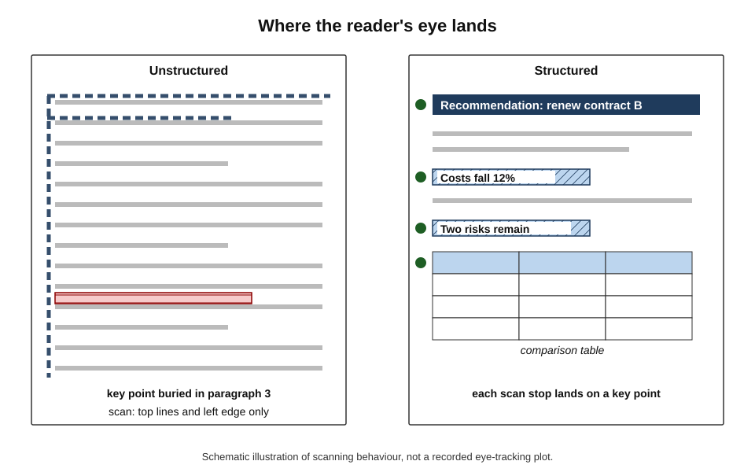
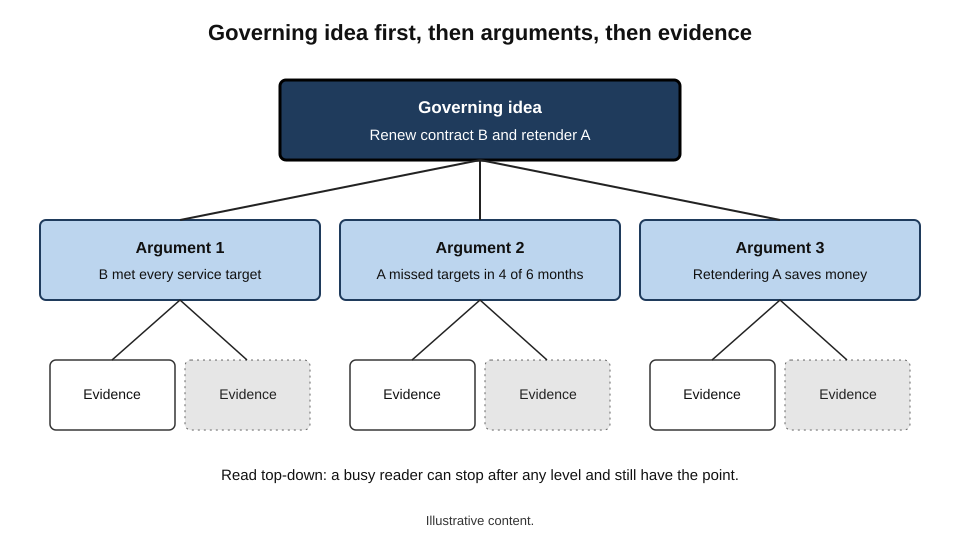
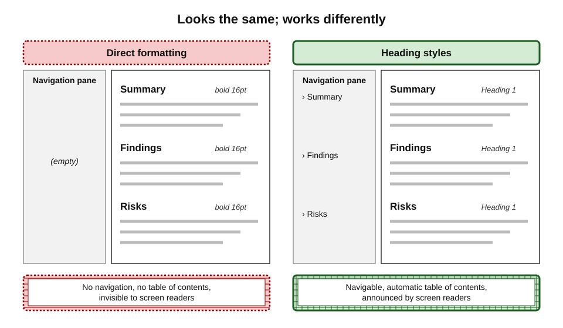
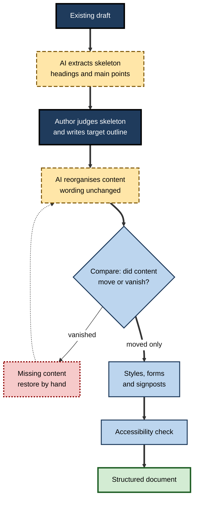
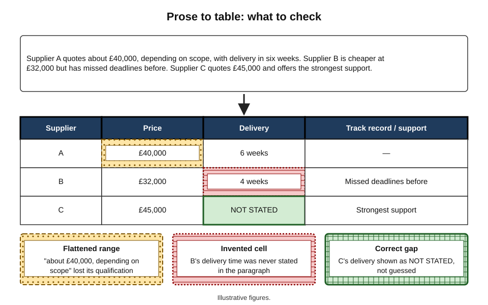
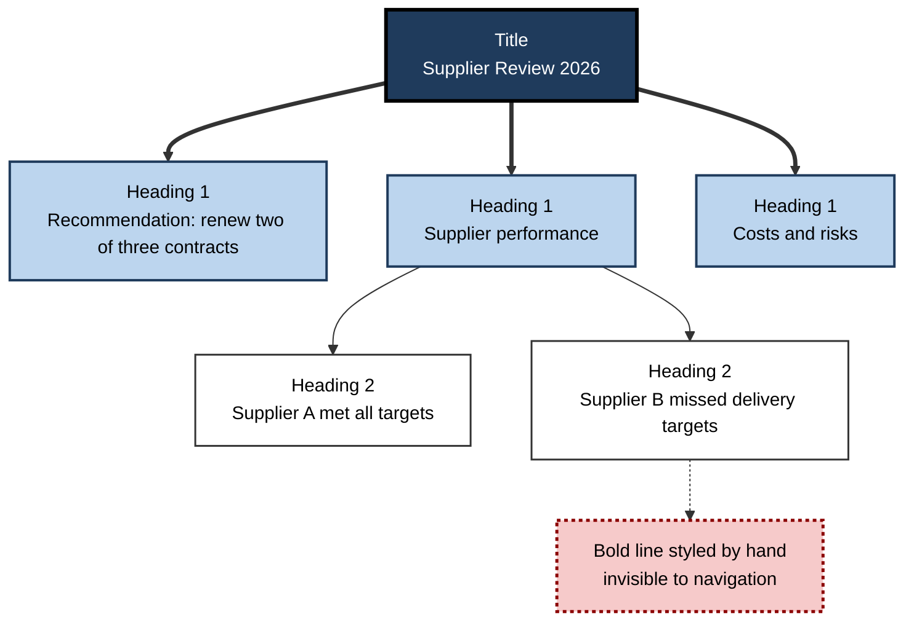

# D.6. Formatting and structuring help

Two reports contain the same facts. The first is twelve pages of unbroken paragraphs, with bold text standing in for headings and numbers buried in sentences. The second opens with its conclusion, uses consistent headings and puts comparisons in tables. Readers trust and use the second far more — yet it needed no more knowledge, only better **structure**.

AI features in word processors can now restructure, reformat and tabulate on request. That makes the second kind of document easier to produce — and makes it easier to give the first kind a convincing disguise.

> **Definition — Document structure:** the organisation of a document's content into a meaningful order and hierarchy — sections, headings, lists, tables — that reflects the logic of its argument and lets readers navigate it.

> **Definition — Formatting:** the visual presentation of text — fonts, sizes, spacing, emphasis, alignment — ideally applied through named styles that encode the role of each element.

**Why structure and formatting help matters**

- **Readers scan before they read.** Structure decides whether the key point is found at all.
- **Structure is logic made visible.** A clear outline exposes gaps and repetition in an argument; a muddled one hides them.
- **Machines read structure too.** Screen readers, search, summarising tools and translation all work better on properly structured documents.
- **AI can restructure in seconds.** That power can clarify a document — or impose a tidy-looking structure on muddled thinking.

---

## How Readers Use Structure

### Scanning and signalling

- **Readers of work documents rarely read every word.** They look for headings, bold terms, lists, tables and the first sentence of paragraphs.
- **Eye-tracking studies of web reading** published by Jakob Nielsen's group in 2006 described an **F-shaped pattern**: readers read across the top, then a shorter line lower down, then scan down the left edge.
  - Later work by the same group stressed that the pattern is a symptom of **poorly structured** content; good headings and front-loaded sentences change how people scan.
- **Text-signalling research** — reviewed by Robert Lorch in 1989 — found that headings, previews, summaries and typographic cues generally help readers recall the **structure and main topics** of a text, though they do not automatically improve memory for details.

**Figure 1.** How readers scan an unstructured page compared with a structured one.

> **Key point:** a heading is a **promise** about what follows. Readers use headings to decide what to skip, so a vague or misleading heading costs more than no heading at all.

### Chunking

- **George Miller (1956)** proposed that people hold about seven items in short-term memory; later work, notably by **Nelson Cowan (2001)**, suggests a capacity nearer **four chunks** for most material.
- **Chunking** — grouping items into meaningful units — lets readers handle more information.
  - *e.g.* a 16-digit card number read as four groups of four.
- **In documents,** chunking means:
  - short sections with a single topic;
  - lists of a manageable length, grouped under sub-headings when longer;
  - tables that group related values.

> **Watch out:** the "magical number seven" is often quoted as a rule for list length. Miller's paper was about memory span for unrelated items, not about how many bullets a document may contain; the useful principle is **grouping**, not a fixed number.

### Information design traditions

- **Information Mapping** — developed by **Robert Horn** from the late 1960s — breaks documents into labelled blocks of a single information type (procedure, concept, principle, fact), with consistent labelling and only relevant content in each block.
- **The Pyramid Principle** — **Barbara Minto**, a McKinsey consultant who taught structured writing from the 1960s and published her method in book form in the 1980s — puts the governing idea first, then the key supporting arguments, then the evidence beneath each.
- **Plain-language and technical-writing standards** — emphasise main points first, informative headings, lists for parallel items and tables for comparisons.

**Figure 2.** The pyramid structure: the governing idea first, supported by grouped arguments and evidence.

---

## Styles, Not Direct Formatting

### The distinction that matters most

> **Definition — Style (in a word processor):** a named set of formatting attributes — such as *Heading 1*, *Body Text*, *Quote* — applied to text according to its role, so that all text with the same role looks and behaves the same.

> **Definition — Direct formatting:** formatting applied manually to individual pieces of text — making a line bold and larger — without recording its role.

| | Styles | Direct formatting |
|---|---|---|
| What it records | The role of the text (heading, body, caption) | Only its appearance |
| Navigation pane and table of contents | Built automatically from headings | Not possible |
| Consistency | Change the style once, every instance updates | Each instance edited by hand |
| Screen readers and accessibility | Headings announced and navigable | Invisible as structure |
| AI tools, search and translation | Can use the structure | See undifferentiated text |
| Templates and house style | Enforceable | Drifts with every author |

**Figure 3.** The same page built with direct formatting and with styles.

> **Remember:** if a line *looks* like a heading, it should *be* a heading — applied with a heading style.

### What AI can do with styles

- **Apply styles to unstyled text** — "format this document using the house template's heading styles".
- **Detect implied headings** — lines in bold, short and followed by paragraphs are converted to heading styles.
- **Fix inconsistent formatting** — mixed fonts, sizes and spacing from pasted content brought into line.
- **Insert structural elements** — tables of contents, headers and footers, page numbers, captions.
  - Microsoft added the ability for Copilot in Word to insert tables of contents and set up headers and footers with fields such as page numbers in 2026.
- **Match an existing format** — Google's 2026 Docs update included an option for Gemini to mirror the formatting and structure of a source document when generating content.

> **Watch out:** AI formatting features sometimes apply **direct formatting that merely looks like styles**. After an AI formatting pass, open the navigation pane or style inspector to check that headings are real headings.

---

## Restructuring Content

### Kinds of structural help

- **Outlining** — extract the existing structure of a draft as a list of headings and key points.
  - Reveals what the document actually says, in order.
- **Reordering** — move sections into a more logical order: conclusion first, chronology, priority.
- **Splitting and merging** — break an overlong section into sub-sections; combine sections that repeat each other.
- **Changing form** — turn prose into lists, lists into tables, or bullet fragments into connected prose.
- **Adding signposts** — headings, an executive summary, an introduction that previews the structure, section summaries.
- **Templating** — fit content into a standard structure (a business case template, a report format).

### Choosing the right form for content

| Content | Best form | Why | Common AI mistake |
|---|---|---|---|
| A sequence of steps | Numbered list | Order matters and each step is an action | Merging steps into prose |
| Parallel items of similar kind | Bulleted list | Scannable; no implied order | Making items unparallel or adding filler items |
| Comparison of options across attributes | Table | Lets readers compare along rows and columns | Tables for simple lists; empty or vague cells |
| An argument or explanation with reasons | Prose paragraphs | Connectives ("because", "therefore") carry the logic | Bullet fragments that drop the reasoning |
| A decision with conditions | Decision table or flowchart | Shows which condition leads to which outcome | Losing conditions when tabulating |
| Definitions | Glossary or definition list | Quick lookup | Inconsistent wording with the body text |

> **Key point:** structure should follow the **logic** of the content. Bullets for an argument destroy its reasoning; prose for a comparison hides it.

### The disguise problem

- AI can make any content **look** organised: headings on every section, bullets throughout, a table of options.
- Looking organised is not the same as **being** organised:
  - headings may label topics without stating points ("Background", "Considerations", "Other");
  - bullets may list fragments that never connect into an argument;
  - a table may have columns nobody needed.
- **The test:** read only the headings and the first sentence of each section. Do they tell the story of the document? If not, the structure is cosmetic.

> **Definition — Informative heading:** a heading that states the point of its section ("Option B costs 30% less over five years") rather than merely naming its topic ("Costs").

> **In practice:** many consulting and government writing guides ask for informative headings in decision documents, so that a senior reader can absorb the argument from the headings alone.

---

## The Restructuring Method

### A procedure for an existing draft

1. **Extract the skeleton.** Ask the tool for the document's current outline: every heading and the main point of each section.
2. **Judge the skeleton yourself.** Does it start with what the reader most needs? Is anything repeated, missing or out of order?
3. **Decide the new structure.** Write or edit the target outline — the governing idea, the sections and their points.
4. **Instruct the restructure.** Ask the tool to reorganise the content to the new outline, **without changing wording** except transitions, and to report anything it could not place.
5. **Compare.** Use tracked changes or a document compare to confirm that content moved rather than vanished.
6. **Apply styles.** Ensure headings use heading styles and lists use list styles.
7. **Choose forms.** Convert content to lists, tables or prose according to its logic.
8. **Signpost.** Add or revise the executive summary and informative headings last, once the structure is settled.
9. **Check accessibility.** Run the accessibility checker; fix heading order, alternative text, table headers and reading order.

**Figure 4.** Restructuring an existing draft.

### Worked example (illustrative): restructuring a project update

**Situation:** a project manager's six-page monthly update to a steering committee follows the order in which events happened. The decision the committee must take — whether to approve a two-week delay — appears on page five.

1. **Skeleton.** The tool's outline shows: Background; Activities in March; Supplier issues; Testing; Budget; Next steps; Request for decision.
2. **Judgement.** The committee needs the decision first, then the reasons, then the evidence. Background is unnecessary for regular readers.
3. **Target outline:**
   - *Decision needed: approve a two-week delay to go-live*;
   - *Why: supplier data arrived late and testing found two critical defects*;
   - *Impact: no budget change; training rescheduled*;
   - *Status by workstream* (table);
   - *Background* (appendix).
4. **Restructure.** The tool reorganises the content and reports one paragraph about a staffing change it could not place; the manager moves it into the impact section.
5. **Compare.** A document compare shows the testing section lost a sentence giving the defect count; it is restored.
6. **Forms.** Workstream statuses, previously in three paragraphs, become a table with columns *Workstream, Status, Issue, Owner*.
7. **Headings.** Topic headings are replaced with informative ones.

| | Original | Restructured |
|---|---|---|
| Position of the decision | Page 5 | First line |
| Headings | Topic labels | Informative statements |
| Workstream status | Three paragraphs | One table |
| Length | 6 pages | 3 pages plus appendix |
| Content lost in restructure | — | One sentence, caught and restored |

*Illustrative figures.*

- **Conclusion:** the restructure changed what the committee would read first and how fast it could decide. The compare step mattered: a silent loss of the defect count would have weakened the case for the delay.

---

## Tables and Lists from Text

### Converting prose to tables

- **When it helps:** several items described along the same attributes — suppliers by cost, risk and lead time; options by benefit and drawback.
- **How AI does it:** it identifies entities and attributes in the prose and arranges them in rows and columns.
- **What goes wrong:**
  - **invented cells** — the prose said nothing about one supplier's lead time, but a value appears;
  - **flattened nuance** — "about £40,000, depending on scope" becomes "£40,000";
  - **misaligned rows** — an attribute of one item moved to another;
  - **unhelpful columns** — attributes chosen because they were easy to fill, not because the reader needs them.

**Figure 5.** Converting a paragraph into a comparison table, and the errors to check.

> **Remember:** instruct "leave a cell blank or write NOT STATED if the text does not give the value". A blank cell is information; an invented one is an error.

### Converting prose to bullets — and back

- **Prose to bullets** — useful for parallel items, steps and lists of requirements.
  - Risk: losing the connectives that carried the argument ("because", "unless", "which means").
- **Bullets to prose** — useful when notes must become a narrative for readers who need the reasoning.
  - Risk: the tool supplies connections the notes did not make — a causal link between two points that were merely listed together.

> **Watch out:** when AI turns bullet points into prose, check every **because**, **therefore** and **as a result**. Each one is a claim about causation that may not have been in the original notes.

---

## Structure and Accessibility

### Why accessible structure matters

- **People using screen readers** navigate by headings, lists and table headers; without them, a document is a single undifferentiated stream.
- **Legal and policy duties** — many public bodies and organisations are required to publish accessible documents; the Web Content Accessibility Guidelines (WCAG, version 2.2 published in 2023) are the reference standard for digital content, and PDF/UA (ISO 14289) for accessible PDFs.
- **Everyone benefits** — the same structure that helps a screen-reader user helps a busy reader, a search engine and an AI tool.

**Accessibility features AI can help with**

- **Heading order** — headings that follow a logical hierarchy (no jump from Heading 1 to Heading 3).
- **Alternative text** — descriptions of images and charts; AI can draft them, but the author must check that the description conveys the **point** of the image, not just its appearance.
- **Table headers** — header rows marked as headers; no merged cells that confuse reading order.
- **Meaningful link text and labels** — not "click here".
- **Reading order** — text boxes and floating objects read in the right sequence.
- **Plain language** — for readers with cognitive or language barriers.

> **Definition — Alternative text (alt text):** a short written description of an image or graphic, read aloud by screen readers and displayed when the image cannot be seen.

> **Example:** AI-drafted alt text for a bar chart: "A bar chart with five blue bars." Useful alt text: "Bar chart: customer complaints fell each quarter, from 420 in Q1 to 180 in Q4." The second conveys what a sighted reader learns from the chart.

### Heading hierarchy

**Figure 6.** A correct heading hierarchy, as navigated by a reader or screen reader.

---

## Structure by Document Type

Different document genres have conventional structures because their readers need different things first.

| Document type | Reader's first need | Conventional structure | Typical AI structuring help |
|---|---|---|---|
| Decision paper or business case | What is being asked and why | Recommendation, rationale, options, costs, risks, background | Move the recommendation to the top; tabulate options |
| Report of findings | What was found and what it means | Summary of findings, method, detailed findings, implications | Group findings by theme; add section summaries |
| Policy | What the rule is and who it applies to | Purpose, scope, definitions, rules, responsibilities, review date | Separate rules from explanation; number clauses |
| Procedure | What to do, in order | Purpose, prerequisites, numbered steps, exceptions, contacts | Convert prose to numbered steps; flag missing prerequisites |
| Proposal or tender response | Whether it meets the buyer's criteria | Mirrors the buyer's evaluation questions | Map content to the buyer's criteria headings |

> **Watch out:** an AI tool asked to "structure this better" applies a **generic** structure. Name the document type and, where one exists, supply the organisation's template — otherwise a policy may come back shaped like a blog post.

---

## Formatting Across Tools

### Moving content between applications

- **Copying from a chat assistant** often brings **Markdown** — a lightweight plain-text formatting convention created by John Gruber in 2004, in which `#` marks headings and `*` marks bullets.
  - Pasted into a word processor, Markdown may arrive as literal symbols, or be converted to direct formatting rather than styles.
- **Copying between documents** can import foreign styles, so a document ends up with three different "Heading 1" appearances.
- **Exporting to PDF** keeps headings as navigable structure only if the document used heading styles and the export option for tagged, accessible PDF is chosen.

**Good habits**

- **Paste as plain text**, then apply the document's own styles.
- **Use the built-in assistant** where formatting matters, since it works with the document's styles directly.
- **Inspect styles** after any large paste or AI insertion; clear direct formatting where it has crept in.
- **Export with tags** when producing PDFs for wide distribution.

> **In practice:** many professionals draft in a chat assistant for flexibility but always **rebuild the formatting** in the organisation's template, rather than trying to preserve the chat output's appearance.

---

## Case Study (illustrative): Templates and Structure Across a Team

- **Situation:** a regional public-health team produced around a hundred briefing papers a year for elected members. Papers varied widely in structure; members complained they could not find recommendations, and accessibility audits found most papers had no real headings.
- **Approach:**
  1. the team agreed a **template** with heading styles: *Recommendation*, *Key facts*, *Options*, *Risks*, *Equalities impact*, *Background*;
  2. writers drafted freely, then used the document assistant to **fit the draft to the template**, report any content it could not place and apply heading styles;
  3. options were required in a **comparison table** with fixed columns;
  4. headings in *Key facts* had to be **informative statements**;
  5. the accessibility checker was run before every submission, and AI-drafted alt text was edited by the author.
- **Problems in the first month:**
  - several papers lost content during template fitting — a paragraph on costs moved into *Background* and was later cut;
  - tables appeared with values the drafts never stated.
- **Fixes:** a mandatory document compare after template fitting; an instruction that table cells must be blank where the draft gave no value.
- **Result:** over the following year members reported finding recommendations faster, accessibility audit failures fell sharply and writers said papers took less time to finalise, though first drafts took the same time.
- **Lesson:** AI made **applying** structure cheap; the template and the compare step made the structure **trustworthy**.

---

## Professional Practice

- **Structure before style** — decide what the document must say and in what order before polishing its appearance.
- **Use templates with real styles** — and let AI fit content into them rather than invent new structures each time.
- **Keep formatting semantic** — headings as headings, lists as lists, captions as captions.
- **Check every conversion** — prose to table, prose to bullets and bullets to prose all change meaning in characteristic ways.
- **Read the headings alone** — if they do not tell the story, restructure.
- **Run the accessibility checker** — every time, before sharing.

> **In practice:** experienced editors often ask AI first for a **reverse outline** — the main point of every paragraph in one line each — as a diagnostic. Paragraphs that cannot be summarised in one line usually need splitting or rewriting.

### Common structural faults AI can help diagnose

- **Buried lead** — the main point appears late; ask "where does this document first state its conclusion?"
- **Mixed levels** — a heading covers both a detail and a major theme; ask for the outline and look for uneven sections.
- **Orphan sections** — a section that connects to nothing before or after it.
- **Repetition** — the same point made in several sections; ask "which points are made more than once, and where?"
- **Missing parts** — a recommendation without costs, a procedure without prerequisites, a policy without scope.
- **Overlong sections** — anything that cannot be summarised in one line probably needs splitting.

> **Watch out:** the diagnosis is reliable more often than the cure. AI is good at **naming** a structural fault; the fix — what to cut, what to merge, which point leads — is a judgement about the reader that belongs to the author.

> **Definition — Reverse outline:** an outline built after drafting by listing the main point of each paragraph or section, used to diagnose the structure of a draft.

---

## Open Questions

- **Will AI restructuring improve thinking or disguise its absence?**
  - Tools can impose a clean structure on any content; whether writers still develop the skill of structuring an argument is unknown.
- **How reliable is AI-generated alternative text?**
  - It is improving quickly, but conveying the *purpose* of an image requires knowing why the author included it.
- **Should documents be written for machines as well as people?**
  - As AI tools increasingly read documents on readers' behalf, structure designed for machine parsing may become as important as structure designed for human scanning.
- **Will templates converge across organisations?**
  - If many organisations ask the same assistants to "structure this better", documents may converge on a few generic shapes, losing genre conventions that served particular readers.
- **How much structure is too much?**
  - Heavy bulleting and tabulation can fragment reasoning; the right balance differs by genre and reader.

---

## Summary

- **Structure** organises content into a meaningful hierarchy; **formatting** presents it, ideally through **styles**.
- Readers **scan**; headings, lists and tables act as **signals** that help them find and recall the main structure (Nielsen's F-pattern; Lorch's review of signalling).
- **Chunking** helps readers handle information; the lesson of Miller and Cowan is grouping, not a fixed number of bullets.
- Information Mapping (Horn) and the **Pyramid Principle** (Minto) put single-purpose blocks and the governing idea first.
- **Styles** record role and enable navigation, tables of contents, accessibility and consistent house style; **direct formatting** records only appearance.
- AI can apply styles, detect headings, insert tables of contents, fit templates and match formats — check that its formatting is semantic.
- Choose form by **logic**: numbered lists for steps, bullets for parallel items, tables for comparisons, prose for arguments.
- Beware the **disguise problem**; use **informative headings** and test whether headings alone tell the story.
- Restructure by extracting the skeleton, judging it, setting a target outline, reorganising without rewording, **comparing**, then styling and signposting.
- Prose-to-table conversion risks **invented cells**, flattened nuance and misalignment; bullets-to-prose risks **invented causation**.
- Accessible structure — heading order, **alt text**, table headers, reading order — serves every reader.
- Each **document type** has a conventional structure; name the type and supply the template, or AI applies a generic shape.
- Content moved between tools brings **Markdown**, foreign styles and direct formatting; paste as plain text and re-apply styles.

---

## Self-Check

1. Distinguish document structure from formatting.
2. What did Nielsen's 2006 eye-tracking work describe, and what did the same group later emphasise?
3. Why is "no more than seven bullets" a misreading of Miller (1956)?
4. State the core idea of the Pyramid Principle.
5. Give four advantages of styles over direct formatting.
6. How can a user check that an AI formatting pass applied real heading styles?
7. Match each content type to its best form: installation steps; three vendors compared on cost, risk and support; the reasoning behind a recommendation.
8. What is the disguise problem, and what simple test reveals it?
9. Rewrite the topic heading "Costs" as an informative heading for a business case.
10. List four errors that occur when AI converts prose into a table, and the instruction that prevents one of them.
11. Why should every "because" be checked when bullets are turned into prose?
12. Contrast poor and useful alt text for a line chart of monthly sales.
13. In the restructuring worked example, what would have been lost without the compare step, and why did it matter?
14. A team wants AI to fit all papers into a new template. Propose safeguards.
15. Name four structural faults AI can help diagnose and explain why the fix still belongs to the author.
16. Why should content pasted from a chat assistant be pasted as plain text?

### Answer Key

1. Structure is the organisation of content into order and hierarchy reflecting its logic; formatting is visual presentation, ideally applied through styles that record each element's role.
2. An F-shaped scanning pattern on web pages: across the top, a shorter line lower down, then down the left. The group later stressed that the pattern signals poorly structured content, and that good headings and front-loaded text change scanning.
3. Miller's paper concerned short-term memory span for unrelated items; later work suggests about four chunks. It is not a rule for bullets; the useful lesson is to group information meaningfully.
4. Start with the governing idea, then the grouped key arguments supporting it, then the evidence beneath each argument.
5. Automatic navigation pane and table of contents; consistency through single-point changes; accessibility for screen readers; usable structure for AI, search and translation; enforceable house style.
6. Open the navigation pane or style inspector and confirm each heading appears with a heading style.
7. Steps — numbered list; vendor comparison — table; reasoning — prose paragraphs.
8. AI can make muddled content look organised with headings, bullets and tables. Read only the headings and first sentences: if they do not tell the document's story, the structure is cosmetic.
9. *e.g.* "Option B costs £120,000 less than Option A over five years".
10. Invented cells, flattened nuance (ranges become single figures), misaligned rows, unhelpful columns. Prevent invented cells with "leave blank or write NOT STATED where the text gives no value".
11. Because the tool may add causal links that the original notes did not make; each connective is a new claim.
12. Poor: "A line chart with a blue line." Useful: "Line chart: monthly sales rose steadily from £80,000 in January to £130,000 in June, with a dip in April."
13. The sentence giving the defect count from testing. It was key evidence for the requested delay; without it the committee's decision would rest on weaker grounds.
14. Template with real styles; instruction to report unplaced content; mandatory document compare after fitting; blank cells where values are not stated; author review of headings and alt text; accessibility check before submission.
15. Buried lead, mixed levels, orphan sections, repetition, missing parts, overlong sections (any four). Deciding what to cut, merge or put first depends on what the reader needs, which only the author can judge.
16. Because chat output often carries Markdown symbols or direct formatting; pasting as plain text and applying the document's own styles keeps the structure semantic, navigable and accessible.

---

## Glossary

| Term | Meaning |
|---|---|
| Alternative text (alt text) | A written description of an image read by screen readers. |
| Chunking | Grouping items into meaningful units so they are easier to process and remember. |
| Direct formatting | Formatting applied manually to text without recording its role. |
| Document structure | The organisation of content into a meaningful order and hierarchy. |
| F-shaped pattern | A scanning pattern observed in eye-tracking of poorly structured web pages. |
| Formatting | The visual presentation of text. |
| Information Mapping | Robert Horn's method of writing in labelled, single-purpose blocks. |
| Informative heading | A heading that states the point of its section. |
| Markdown | A plain-text formatting convention using symbols such as # for headings. |
| Pyramid Principle | Barbara Minto's method: governing idea first, then grouped arguments, then evidence. |
| Reverse outline | An outline made after drafting from the main point of each paragraph. |
| Signalling | Typographic and structural cues, such as headings and previews, that guide reading. |
| Style | A named set of formatting attributes applied according to the role of text. |
| Template | A document pattern with predefined structure and styles. |
| WCAG | Web Content Accessibility Guidelines, the reference standard for accessible digital content. |
