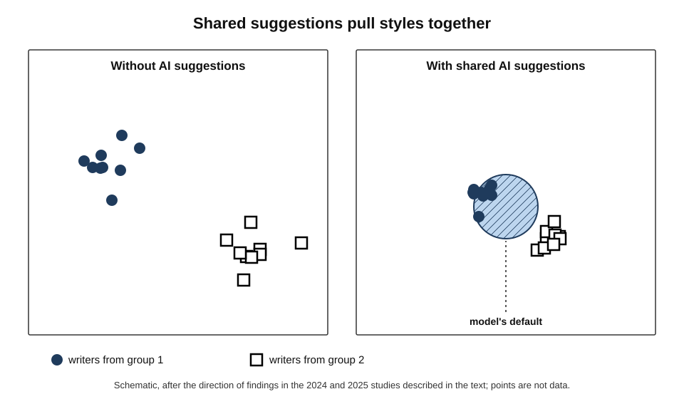
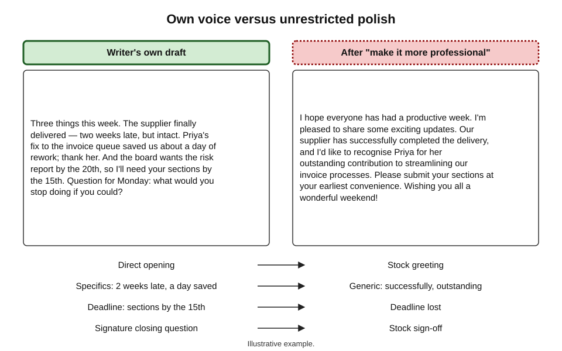
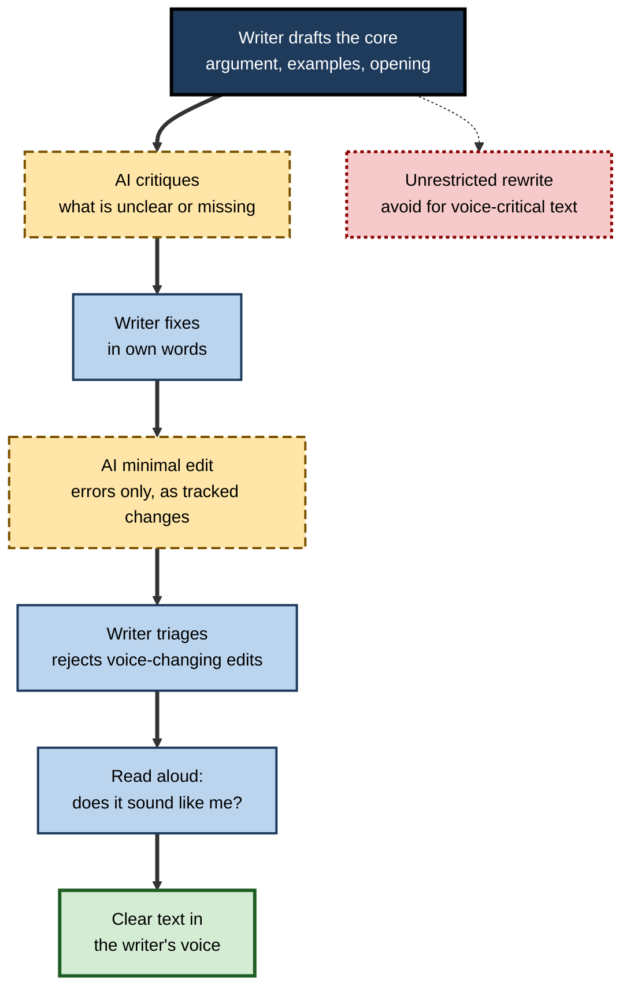
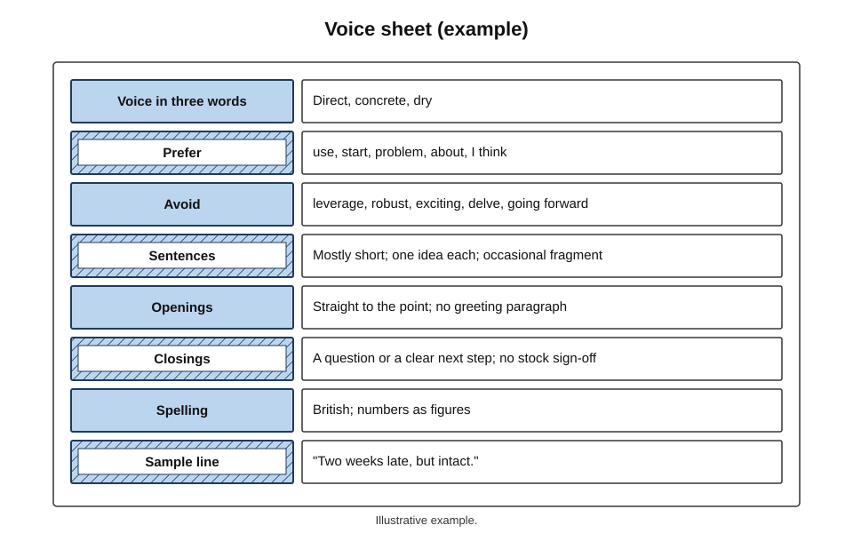
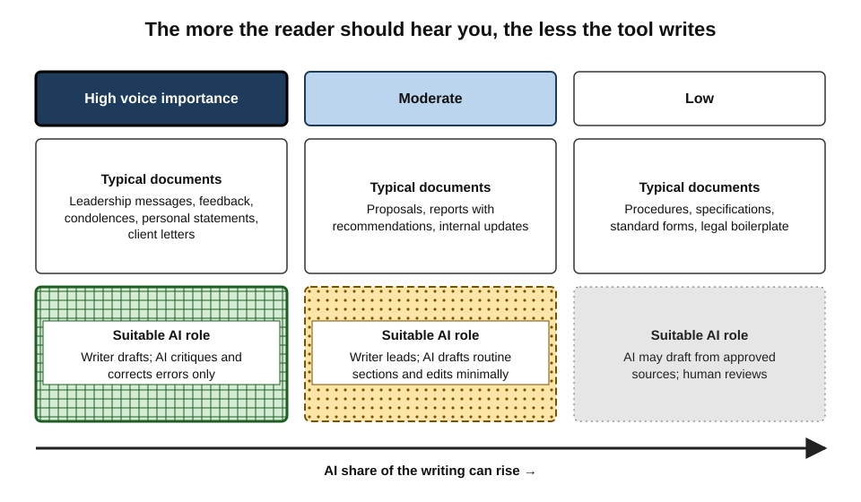

# D.8. Keeping your own voice

A head of department has written a short note to her team every Friday for five years. People read them because they sound like her — dry, specific, occasionally blunt, always ending with a question. After a few weeks of letting an assistant "polish" them, a colleague asks whether she is all right: the notes have become warm, balanced, upbeat and interchangeable with any other manager's. Nothing in them is wrong. Something in them is missing.

> **Definition — Voice (in writing):** the distinctive, recognisable character of a writer's prose — their characteristic word choices, sentence rhythms, level of directness, humour, examples and stance towards the reader — which lets readers sense who is speaking.

> **Definition — Homogenisation:** the convergence of many writers' texts towards similar wording, structure and ideas, as when many people use the same AI writing tools.

**Why voice matters at work**

- **Trust is personal.** Colleagues, clients and teams respond to a recognisable person; a generic voice weakens the relationship the writing serves.
- **Voice carries judgement.** What a writer chooses to stress, doubt or omit is part of their professional contribution.
- **Distinctiveness has value.** In proposals, thought leadership and leadership communication, sounding like everyone else is a competitive weakness.
- **AI pulls towards the typical.** Without deliberate effort, AI-assisted writing drifts towards the same phrases, structures and tone.

---

## What Voice Is Made Of

### The components of voice

- **Vocabulary** — preferred words, technical register, favourite expressions, words the writer never uses.
- **Syntax and rhythm** — sentence length and variety, use of fragments, lists, questions.
- **Stance** — how confident, sceptical, warm or formal the writer is towards the subject and the reader.
- **Directness** — whether the main point arrives first or is built towards.
- **Examples and references** — the kinds of illustration a writer reaches for (sport, history, engineering, local life).
- **Humour and personality** — irony, understatement, self-deprecation, or their deliberate absence.
- **Cultural markers** — idioms, politeness conventions and references from the writer's own background.

**Figure 1.** The components of a writer's voice.

```mermaid
%%{init: {'theme':'base','themeVariables':{'fontFamily':'Arial, Helvetica, sans-serif','fontSize':'15px','primaryColor':'#FFFFFF','primaryTextColor':'#111111','primaryBorderColor':'#222222','lineColor':'#333333','secondaryColor':'#F2F2F2','tertiaryColor':'#FFFFFF','clusterBkg':'#FAFAFA','clusterBorder':'#555555','edgeLabelBackground':'#FFFFFF','titleColor':'#111111'}}}%%
flowchart TD
    classDef core    fill:#1F3B5C,stroke:#000000,stroke-width:3px,color:#FFFFFF
    classDef key     fill:#BCD5EE,stroke:#1F3B5C,stroke-width:2px,color:#000000
    classDef detail  fill:#FFFFFF,stroke:#333333,stroke-width:1.5px,color:#000000

    V["A writer's voice"]
    W["Vocabulary<br/>favourite and avoided words"]
    S["Syntax and rhythm<br/>sentence length and variety"]
    T["Stance<br/>confidence, warmth, scepticism"]
    D["Directness<br/>point first or built towards"]
    E["Examples<br/>where illustrations come from"]
    H["Humour and personality"]
    C["Cultural markers<br/>idiom, politeness, references"]

    V ==> W
    V ==> S
    V ==> T
    V ==> D
    V --> E
    V --> H
    V --> C

    class V core
    class W,S,T,D key
    class E,H,C detail
```

### Voice can be measured

- **Stylometry** — the statistical study of writing style — shows that voice is real and measurable, not merely a feeling.
- **Frederick Mosteller and David Wallace (1964)** used the frequencies of common function words (*upon*, *whilst*, *by*) to attribute the disputed *Federalist Papers* to James Madison rather than Alexander Hamilton.
- **John Burrows (2002)** proposed **Delta**, a measure of stylistic distance based on the most frequent words, now widely used in authorship attribution.
- **In 2013**, stylometric analysis by Patrick Juola and others supported the suspicion that the crime novel *The Cuckoo's Calling*, published under the name Robert Galbraith, was written by J. K. Rowling — which she then confirmed.

> **Definition — Stylometry:** the quantitative analysis of writing style — word frequencies, sentence lengths, function-word patterns — used to characterise or identify authors.

> **Key point:** much of a writer's voice lives in **small, frequent choices** that neither writer nor reader notices consciously. These are exactly the choices an AI rewrite changes wholesale.

---

## How AI Pulls Writing Towards the Typical

### The mechanism

- **Likelihood** — language models generate text that is probable given their training; distinctive choices are, by definition, less probable.
- **Preference training** — assistants are tuned on human ratings, which tend to reward clear, polite, balanced, positive text — a particular voice in its own right.
- **Suggestion acceptance** — every accepted suggestion replaces a writer's choice with the model's; over a document, the model's choices accumulate.
- **Defaults of culture** — models trained mostly on text from certain regions reproduce those regions' idioms and norms.

### The evidence

**Study card — Arnold, Chauncey and Gajos (2020), predictive text**

- **Method:** participants wrote image captions with or without word-by-word predictive suggestions on a phone-style keyboard.
- **Finding:** captions written with suggestions were **shorter and more predictable** — they contained fewer unexpected words — than captions written without them.
- **Significance:** even small, word-level suggestions change what people write, not just how fast.

**Study card — Doshi and Hauser (2024), *Science Advances***

- **Method:** participants wrote short stories with no AI help, with one AI-generated story idea, or with a choice of several AI ideas; independent readers rated the stories.
- **Findings:**
  - access to AI ideas made individual stories rated as **more creative and better written**, especially for writers who were less creative at baseline;
  - stories written with AI help were **more similar to each other** than stories written without it.
- **Interpretation:** a gain for the individual and a loss for the collection — a "social dilemma" of AI-assisted creativity.

**Study card — Agarwal, Naaman and Vashistha (2025), CHI conference**

- **Method:** 118 participants from India and the United States wrote on culturally grounded topics, with and without AI writing suggestions.
- **Findings:**
  - AI suggestions made Indian and American participants' writing **more similar to each other**;
  - the convergence came mainly at the expense of **Indian** writing styles, which shifted towards American norms;
  - Indian participants accepted more suggestions yet gained less productivity per suggestion, because they often had to modify them;
  - some descriptions of Indian festivals and food took on a Western framing.
- **Significance:** homogenisation is not neutral — it moves writers towards the styles that dominate the training data.

**Figure 2.** Homogenisation: distinct writers' styles drawn towards a common centre by shared AI suggestions.

**Study card — Kobak and colleagues (2024–2025), "Delving into" excess vocabulary**

- **Method:** analysed the vocabulary of millions of biomedical abstracts over a decade, looking for words whose frequency jumped far beyond prior trends after chat assistants became available.
- **Findings:**
  - a sudden rise in style words such as *delves*, *showcasing* and *underscores* in 2024;
  - from the excess, the authors estimated that **at least a tenth** of 2024 abstracts had been processed with language models, with higher rates in some fields and countries.
- **Significance:** AI-assisted writing leaves a **detectable collective fingerprint** — a shared voice that readers increasingly recognise.

> **Watch out:** "AI words" such as *delve* are a population-level signal, not proof that a given text was AI-written. Many people have always used them. Avoid them for the sake of your voice, not to "pass" a detector.

**Study card — Jakesch and colleagues (2023), co-writing with opinionated models**

- **Method:** participants wrote short social-media posts on whether social media is good for society, using a writing assistant secretly configured to favour one side.
- **Findings:** participants' posts — and, in a later survey, their own stated opinions — shifted towards the side the assistant favoured.
- **Significance:** an assistant shapes not only phrasing but **what the writer argues** — and possibly believes.

---

## Signs a Voice Is Being Lost

- **Stock openings and closings** — "In today's fast-paced world", "I hope this finds you well", "In conclusion, it is clear that…".
- **Inflated vocabulary** — *leverage*, *robust*, *seamless*, *pivotal*, *landscape*, *tapestry*.
- **Uniform rhythm** — every paragraph the same length; every list three items; every sentence medium-long.
- **Balanced hedging** — every claim softened, every view "on the one hand… on the other".
- **Relentless positivity** — problems reframed as "opportunities", criticism turned into encouragement.
- **Lost specifics** — the writer's concrete anecdotes and examples replaced with general statements.
- **Cultural flattening** — local idioms, names and references replaced with generic or foreign ones.

> **Mnemonic — "SIUBRLC":** Stock phrases, Inflated words, Uniform rhythm, Balanced hedging, Relentless positivity, Lost specifics, Cultural flattening — the seven signs. More memorably: "**S**he **I**s **U**sing **B**oring **R**obot **L**anguage **C**onstantly."

**Figure 3.** The same paragraph in a writer's own voice and after an unrestricted AI polish.

---

## Protecting Voice: Methods

### Write first, assist second

- **Draft the core yourself** — the argument, the examples, the opening and closing — before involving AI.
- **Use AI for specific tasks** — finding a typo, tightening a long sentence, checking consistency, suggesting a missing point.
- **Prefer critique to rewriting** — ask "what is unclear here?" rather than "rewrite this"; then fix it in your own words.

**Figure 4.** A voice-preserving workflow.

### Instruct for minimal change

- **Minimal-edit instructions** — "correct spelling, grammar and clear errors only; do not change word choice, tone or sentence structure".
- **Explain the voice** — "my style is direct, short sentences, dry humour, British spelling; keep it".
- **Give samples** — some tools offer to **match the writing style** of existing text; supplying two or three genuine samples of one's writing helps any assistant.
- **Ask for explanations, not replacements** — "list problems with reasons; I will fix them".
- **Use tracked changes** — every change visible and individually reversible.

| Request | Effect on voice | When to use |
|---|---|---|
| "Rewrite this to be more professional" | Large — replaces the writer's choices wholesale | Rarely; only for text where voice does not matter |
| "Improve this" | Large and unpredictable | Avoid — the tool decides what "better" means |
| "Correct errors only; keep wording and tone" | Small | Most professional writing |
| "List unclear passages with reasons" | None directly — writer fixes | Voice-critical writing |
| "Match the style of these samples" | Moderate — moves towards the writer's own patterns | Drafting routine text in one's own voice |

### A personal voice sheet

> **Definition — Voice sheet:** a short written description of a writer's or organisation's voice — characteristic features, preferred and banned words, examples — used to brief people and tools.

- **Contents:**
  - three to five adjectives describing the voice ("direct, concrete, dry, warm to the team");
  - preferred words and words to avoid;
  - typical sentence length and structure;
  - how the writer opens and closes;
  - two or three short samples of genuine writing.
- **Uses:**
  - pasted into instructions to AI tools;
  - shared with assistants and ghost-writers;
  - used by the writer as a self-check.

**Figure 5.** An example of a personal voice sheet.

### Deciding where voice matters

Voice matters more in some documents than others.

- **High** — leadership messages, thought leadership, personal statements, condolences, feedback, client relationship letters, creative work.
- **Moderate** — proposals, reports with recommendations, internal updates.
- **Low** — procedures, technical specifications, standard forms, legal clauses — where consistency and precision matter more than personality.

**Figure 6.** How much AI assistance suits documents of different voice importance.

> **In practice:** many writers adopt a simple rule — **the more the reader is meant to hear me, the less the tool writes**.

---

## Worked Example (illustrative): A Friday Note

**Original (the writer's own draft):**
"Three things this week. The supplier finally delivered — two weeks late, but intact. Priya's fix to the invoice queue saved us about a day of rework; thank her. And the board wants the risk report by the 20th, so I'll need your sections by the 15th. Question for Monday: what would you stop doing if you could?"

**AI "polish" (instruction: "make this more professional"):**
"I hope everyone has had a productive week. I'm pleased to share some exciting updates. Our supplier has successfully completed the delivery, and I'd like to recognise Priya for her outstanding contribution to streamlining our invoice processes. Additionally, please note that the board has requested the risk report by the 20th; I would be grateful if you could submit your sections at your earliest convenience. Wishing you all a wonderful weekend!"

| Voice feature | Original | AI polish |
|---|---|---|
| Opening | Straight to the point ("Three things this week.") | Stock greeting |
| Specifics | Two weeks late; saved about a day | "Successfully completed"; "outstanding contribution" |
| Directness | "I'll need your sections by the 15th" | "at your earliest convenience" — deadline lost |
| Stance | Dry, candid ("finally", "but intact") | Upbeat, generic ("exciting updates") |
| Signature habit | Closing question to the team | Replaced with "wonderful weekend" |

**Minimal-edit instruction ("fix errors only; keep wording and tone"):** the tool changed nothing except adding a missing comma.

- **Conclusion:** the "professional" version was polite and fluent, but it removed the specifics, the deadline and the writer's signature habits — and with them most of the note's usefulness.

> **Watch out:** in the polished version a **deadline disappeared**. Voice-flattening rewrites often lose content as well as character.

---

## Using AI to Understand and Strengthen a Voice

The same tools that flatten voice can help a writer see it more clearly.

### Describing one's own voice

- **Supply samples, ask for description** — give an assistant several pieces of one's own best writing and ask it to describe the features they share: sentence length, typical openings, favoured words, stance, humour.
- **Check the description** — writers often recognise habits they had not noticed ("you often end with a question"; "you rarely use the passive").
- **Turn it into a voice sheet** — keep what feels true; discard what does not.

### Diagnosing drift

- **Compare before and after** — ask the tool to list every stylistic change between one's own draft and an edited version, not just the content changes.
- **Ask what is generic** — "which sentences in this draft could appear in any company's report?" Identifying generic sentences is something models do reasonably well, because generic text is what they generate most readily.
- **Find the specifics** — "where could a concrete example, number or name replace a general statement?"

### Practising rather than replacing

- **Use alternatives as contrast** — reading an AI version beside one's own makes one's own choices visible, and choosing between them is a deliberate act of style.
- **Imitate good models deliberately** — writers have always learned by studying writers they admire; AI can supply varied examples of a register or genre to study, while the writer still does the writing.

> **In practice:** some writers keep a one-page "**not me**" list — phrases the assistant keeps suggesting that they never accept — and paste it into instructions as words to avoid.

---

## Ghost-Writing, Delegation and Voice

### A long tradition

- **Speechwriters, communications teams and assistants** have long drafted words that leaders deliver as their own.
- **Accepted norms** in most organisations:
  - the named author **approves** and takes responsibility for the content;
  - the drafter writes **in the principal's voice**, studying their past writing and speech;
  - for highly personal messages, the principal writes, or at least substantially rewrites, the text.
- **AI as ghost-writer** fits this tradition in some respects — the principal still approves — but differs in two ways:
  - an AI drafter has no knowledge of the principal beyond what it is given, so voice must be supplied explicitly;
  - human ghost-writers can be asked what they meant and why; AI choices are statistical defaults.

| | Human ghost-writer | AI drafting assistant |
|---|---|---|
| Knowledge of the principal | Built over time through conversation and observation | Only what is supplied: samples, voice sheet, instructions |
| Default voice | The drafter's own, adapted | The model's typical, preference-trained voice |
| Accountability for drafting choices | Can explain and defend them | Cannot; choices must be judged by the principal |
| Confidentiality | Bound by employment and professional duty | Depends on tool route and contract |
| Best use | Speeches, major letters, sensitive messages | Routine messages in an established voice, with review |

> **Key point:** whether a human or a tool drafts, a message sent in someone's name should **sound like them and say what they mean** — and they should have read every word.

### Where delegation of voice is inappropriate

- **Condolence and personal support** — readers expect the sender's own words.
- **Apologies for serious failures** — generic phrasing reads as evasion.
- **Feedback on a person's work** — the relationship is part of the message.
- **Personal statements and reflective writing** — the point is the writer's own thinking.

---

## Voice Across Genres

Voice is not uniform; skilled writers adjust it to genre while remaining recognisable.

- **Reports** — voice appears in judgement and emphasis more than in phrasing: what is foregrounded, how confidently conclusions are stated.
- **Proposals** — voice signals the organisation's character and the author's understanding of the client; generic proposals are easy to spot and easy to reject.
- **Leadership messages** — voice carries most of the message's effect; readers listen for the person.
- **Procedures and technical documents** — voice should recede; consistency and precision matter more.
- **Personal professional writing** — cover letters, reflective pieces, thought leadership — voice is part of what is being judged.

> **Watch out:** "keeping one's voice" does not mean refusing to adapt. A writer who sounds identical in a safety procedure and a farewell note is not showing voice but ignoring genre. The aim is a **recognisable writer adapting well**, not one register everywhere.

---

## Organisational Voice and Personal Voice

- **Organisations have voices too** — brand guidelines, tone-of-voice documents, house style.
- **Tension:** an organisational voice wants consistency; a personal voice wants individuality.
- **Resolution in practice:**
  - customer-facing and public documents follow the **organisational voice**;
  - leadership and relationship writing keeps the **personal voice** within organisational norms;
  - AI tools can be briefed with the organisational voice sheet for routine content.
- **The homogenisation risk at organisational scale** — if every team uses the same assistant with the same defaults, the organisation's documents may converge on the tool's voice, not the organisation's.

### Case study (illustrative): a charity's appeal letters

- **Situation:** a medium-sized charity's fundraising team began drafting supporter letters with an AI assistant to save time.
- **Observed effect:** over two quarters, letters became smoother and more uniform. Response rates to appeals fell, and several long-standing supporters wrote to say the letters "didn't sound like you any more".
- **Diagnosis:**
  - letters had lost the specific stories from frontline staff that had characterised them;
  - phrasing converged on generic charity language;
  - the chief executive's personal sign-off paragraph had been rewritten each time.
- **Actions:**
  1. a **voice sheet** built from the charity's best-performing past letters;
  2. stories from frontline staff written by people, then lightly edited;
  3. AI limited to structure suggestions, error correction and producing versions for different supporter groups from human-written core text;
  4. the chief executive's paragraph written by the chief executive.
- **Result:** response rates recovered over the following campaigns, though other factors also changed; supporter complaints about tone stopped.
- **Lesson:** the efficiency gain was real, but the **voice** was part of what the letters were for.

---

## Voice, Fairness and the Second-Language Writer

- **AI can help** writers working in a second language express ideas in fluent, appropriate prose — a real benefit for fairness in workplaces that judge people by their writing.
- **AI can also erase** the writer's identity, replacing their idiom with one dominant norm, as the 2025 cross-cultural study found.
- **Readers' bias matters** — part of the pressure to "polish" comes from readers who penalise non-standard English; organisations can reduce that pressure by valuing clarity over conformity.
- **A balanced approach** — use AI to correct errors and clarify meaning; keep distinctive expressions that are clear; choose consciously which norms to adopt.

> **Key point:** keeping one's voice is not a refusal of help. It is the decision to use help **for clarity and correctness**, not as a replacement for the writer.

---

## Open Questions

- **Will workplace writing converge on one AI voice?**
  - Evidence of homogenisation is consistent in experiments and visible in published text; long-term effects on organisational communication are unknown.
- **Can tools learn an individual voice well enough?**
  - Style-matching features are improving; whether matched text carries the writer's *judgement* as well as their *style* is unclear.
- **How do readers respond when they detect AI voice?**
  - Early studies suggest trust falls when readers suspect AI authorship; norms may shift as AI assistance becomes expected.
- **Does writing with AI change what writers think?**
  - Experiments on opinionated assistants suggest it can; the size and durability of the effect in everyday work are unstudied.
- **Is a recognisable personal voice still an advantage?**
  - If readers come to expect AI-smoothed prose, distinctive writing may stand out more — or be read as unpolished; how professional norms will settle is unclear.
- **Who sets the default voice?**
  - Tool providers' choices of default tone influence millions of documents with little public discussion.

---

## Summary

- **Voice** is a writer's recognisable character — vocabulary, rhythm, stance, directness, examples, humour, cultural markers.
- Voice is **measurable**: stylometry (Mosteller and Wallace, 1964; Burrows' Delta, 2002; the 2013 Galbraith case) shows it lives in small, frequent choices.
- AI pulls towards the **typical** through likelihood, preference training, accumulated suggestion acceptance and dominant cultural defaults.
- Evidence: predictive text makes writing **more predictable** (Arnold and colleagues, 2020); AI ideas raise individual quality but make stories **more similar** (Doshi and Hauser, 2024); suggestions homogenise towards **Western styles** (Agarwal and colleagues, 2025); a collective **"AI vocabulary"** is visible in published abstracts (Kobak and colleagues); opinionated assistants shift **arguments and attitudes** (Jakesch and colleagues, 2023).
- Signs of lost voice: stock phrases, inflated words, uniform rhythm, balanced hedging, relentless positivity, lost specifics, cultural flattening.
- Methods: **write first**, prefer **critique** to rewriting, use **minimal-edit** instructions and tracked changes, give **samples**, keep a **voice sheet**, and decide **where voice matters**.
- AI can also **reveal** a voice: describe it from samples, diagnose drift, find generic sentences, and keep a "not me" list.
- AI drafting resembles **ghost-writing**, but the AI knows only what it is given and defaults to its own voice; some messages should never be delegated.
- Voice adapts to **genre** while remaining recognisable.
- Organisational and personal voices coexist; uniform tool defaults risk replacing both.
- For second-language writers, use AI for **clarity and correctness**, not for erasing identity.

---

## Self-Check

1. Define voice and homogenisation.
2. List five components of a writer's voice.
3. How did Mosteller and Wallace attribute the disputed *Federalist Papers*, and what does it show about voice?
4. Explain three mechanisms by which AI writing tools pull text towards the typical.
5. Summarise the Doshi and Hauser findings and the "social dilemma" they reveal.
6. What did the 2025 cross-cultural study find, and why does it matter for fairness?
7. Why is the appearance of "delve" not proof that a particular text is AI-written?
8. What did the study of opinionated writing assistants show beyond style?
9. Name five signs that a voice is being lost.
10. Rank these requests by effect on voice: "Improve this"; "Correct errors only"; "List unclear passages with reasons".
11. What goes into a voice sheet, and how is it used?
12. In the Friday-note example, what content was lost along with the voice?
13. Compare a human ghost-writer with an AI drafting assistant on knowledge of the principal and default voice.
14. Name three kinds of message whose voice should not be delegated, and explain why.
15. Describe two ways to use AI to understand, rather than replace, your own voice.
16. A non-native English-speaking colleague asks whether to run every document through a "make it sound native" rewrite. Advise them.

### Answer Key

1. Voice is the recognisable character of a writer's prose — word choice, rhythm, stance, directness, examples, humour. Homogenisation is the convergence of many writers' texts towards similar wording, structure and ideas, as with shared AI tools.
2. Vocabulary, syntax and rhythm, stance, directness, examples, humour, cultural markers (any five).
3. They compared frequencies of common function words in the disputed papers with known writings of Madison and Hamilton, attributing them to Madison. Voice lives in small, frequent, largely unconscious choices.
4. Models generate probable text, and distinctive choices are improbable; preference training rewards a polite, balanced, positive house voice; each accepted suggestion replaces a writer's choice; dominant cultures in training data set the defaults.
5. AI ideas made individual stories rated more creative and better written, especially for less creative writers, but made stories more similar to one another. Each writer gains while the collection loses diversity.
6. AI suggestions made Indian and American writing more similar, mainly by moving Indian writing towards American styles, including Western framing of cultural topics, while Indian users gained less per suggestion. Tools can impose dominant norms on writers from other cultures.
7. It is a population-level signal from word-frequency shifts; many writers used such words before AI, and a single word cannot establish authorship.
8. That an assistant favouring one side shifted the opinions participants wrote — and their later stated attitudes — so tools can influence what writers argue and possibly believe.
9. Stock openings and closings, inflated vocabulary, uniform rhythm, balanced hedging everywhere, relentless positivity, lost specifics, cultural flattening (any five).
10. Largest effect: "Improve this"; then "Correct errors only" (small); "List unclear passages with reasons" (none directly — the writer fixes).
11. Adjectives describing the voice, preferred and avoided words, typical sentence patterns, openings and closings, and genuine samples. It is pasted into AI instructions, shared with assistants and used for self-checking.
12. The concrete specifics (two weeks late; a day saved), the explicit deadline for sections (the 15th), and the closing question that engaged the team.
13. A human ghost-writer learns the principal's voice over time and adapts their own; an AI knows only supplied samples and instructions and defaults to its typical, preference-trained voice.
14. Condolences, apologies for serious failures, feedback on a person's work, personal statements (any three) — because readers expect the sender's own words and the relationship or the writer's own thinking is the point of the message.
15. Supply samples and ask the tool to describe shared features, then check and keep what is true in a voice sheet; or ask it to list stylistic differences between your draft and an edited version, or to identify generic sentences that could appear in anyone's writing.
16. Use AI to correct errors and clarify unclear passages, ideally with minimal-edit instructions and tracked changes; keep distinctive expressions that are clear; avoid wholesale rewrites for personal or relationship writing; and remember that the goal is clarity, not erasing identity.

---

## Glossary

| Term | Meaning |
|---|---|
| Burrows' Delta | A stylometric measure of distance between texts based on the most frequent words. |
| Function words | Common grammatical words such as *the*, *of*, *upon*, whose frequencies characterise style. |
| Ghost-writing | Drafting text that another person sends or delivers under their own name. |
| Homogenisation | Convergence of many writers' texts towards similar wording, structure and ideas. |
| Minimal-edit instruction | A request that a tool correct errors only, leaving wording and tone unchanged. |
| Organisational voice | The consistent tone and style an organisation uses in its communications. |
| Preference training | Tuning a model on human ratings of its outputs, which shapes its default style. |
| Style matching | A feature that adapts generated text to the style of supplied samples. |
| Stylometry | Quantitative analysis of writing style to characterise or identify authors. |
| Voice | The distinctive, recognisable character of a writer's prose. |
| Voice sheet | A short description of a writer's or organisation's voice, used to brief people and tools. |
