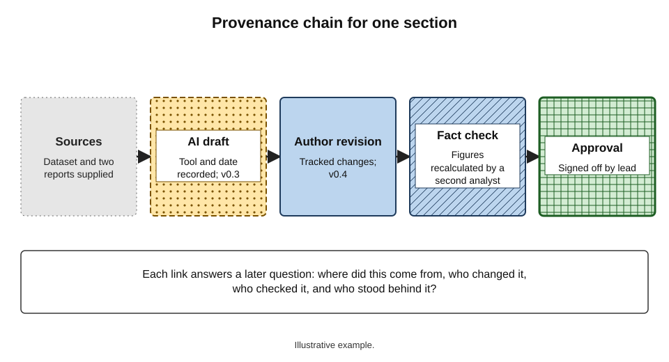
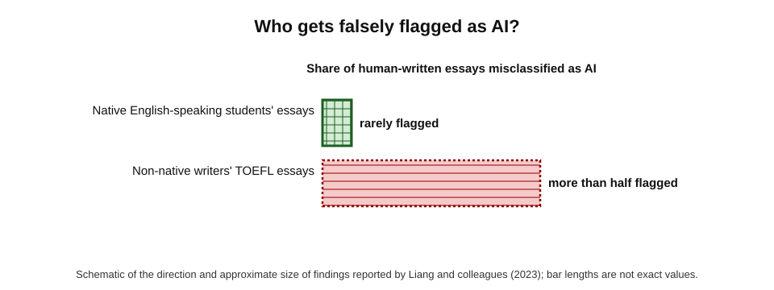
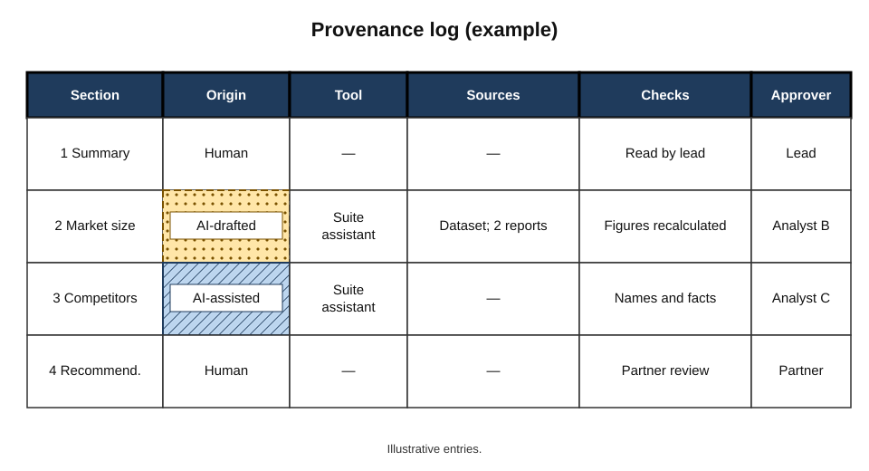
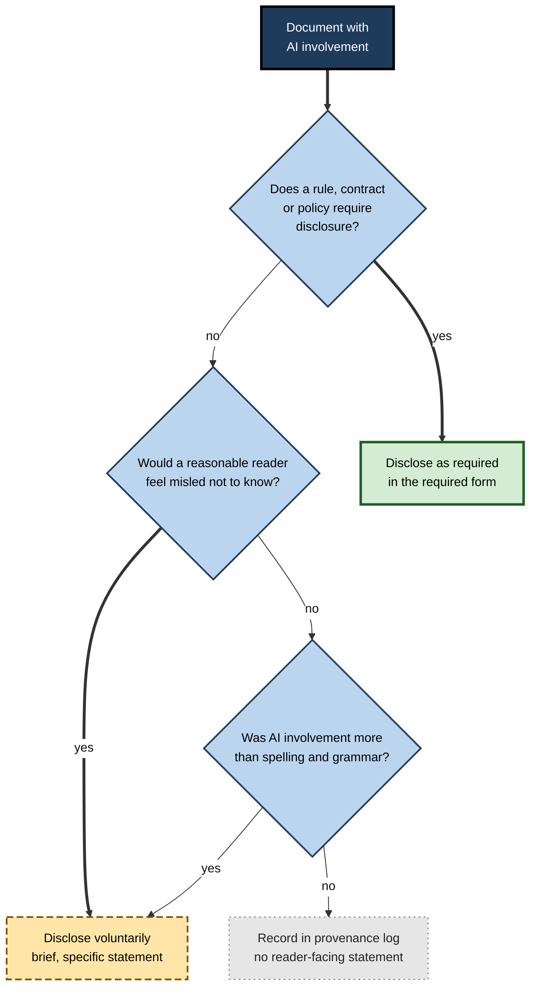
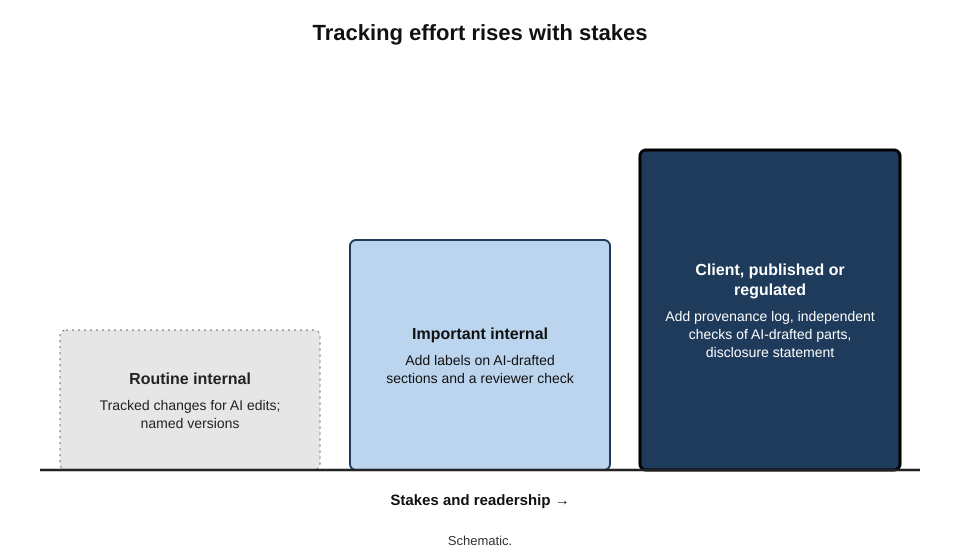
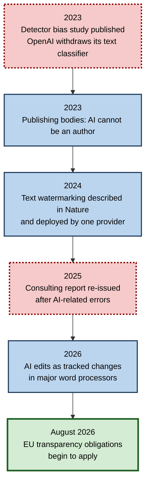

# D.9. Tracking what was AI-written

Six months after a report is delivered, a client queries a statistic in section 4. Who wrote that paragraph? Was it drafted by the assistant, edited by an analyst, checked against a source? Nobody remembers, and the document's history shows only that a file was saved many times.

In 2025 a major consulting firm had to re-issue a government report after errors traced to AI-generated content were found — and only then added a note disclosing that AI had been used. Knowing which parts of a document came from AI, and what was done to them, has become part of professional accountability.

> **Definition — Provenance (of a document):** the record of where a document's content came from and how it was produced — who or what wrote each part, from which sources, and what checks and changes followed.

> **Definition — AI disclosure:** a statement telling readers whether, how and to what extent AI tools were used in producing a document.

**Why tracking AI involvement matters**

- **Accountability** — when something is wrong, the organisation needs to know how it got there and who checked it.
- **Quality control** — AI-generated passages need different checks from human-written ones; that is impossible if nobody knows which is which.
- **Disclosure duties** — publishers, universities, courts, clients and some regulators now expect or require disclosure.
- **Intellectual property** — in several jurisdictions, purely machine-generated material may not be protected by copyright, which matters for valuable documents.
- **Trust** — readers who discover undisclosed AI use often feel misled, even when the content was sound.

---

## Two Ways to Know: Provenance and Detection

### Recording versus guessing

There are two fundamentally different ways to establish whether text was AI-written.

- **Provenance** — record it **at the time of writing**: logs, tracked changes, version history, labels, writing-process records.
- **Detection** — infer it **afterwards** from the text itself, using classifiers or watermarks.

| | Provenance (recorded) | Detection (inferred) |
|---|---|---|
| When it happens | During writing | After the text exists |
| What it relies on | Records kept by people and tools | Statistical patterns or hidden watermarks in the text |
| Reliability | High, if records are kept honestly | Variable; false positives and negatives are common |
| Fairness risk | Low | High — some writers are flagged more than others |
| Survives editing and paraphrase | Yes, if each step is recorded | Watermarks and classifiers weaken with heavy editing |
| Who controls it | The author and organisation | Often a third-party tool |

> **Key point:** for documents an organisation produces itself, **provenance beats detection**. Recording what happened is cheap and reliable; reconstructing it afterwards is expensive and uncertain.

**Figure 1.** A provenance chain for one section of a document.

### Why AI detectors are unreliable

**Study card — Liang and colleagues (2023), "GPT detectors are biased against non-native English writers"**

- **Method:** ran essays through seven widely used AI-text detectors. Essays came from native English-speaking students and from non-native writers taking an English proficiency test (TOEFL).
- **Findings:**
  - detectors classified the native speakers' essays accurately as human-written;
  - **more than half** of the non-native writers' essays were misclassified as AI-generated;
  - simply prompting a model to use more literary language made AI-written text evade detection.
- **Explanation:** detectors rely partly on **perplexity** — how predictable text is. Writers with a smaller vocabulary in a second language produce more predictable text, which looks "machine-like".
- **Significance:** detection tools can systematically penalise particular groups of honest writers.

> **Definition — Perplexity:** a measure of how surprising a text is to a language model; lower perplexity means more predictable text.

- **Further evidence of weakness:**
  - in July 2023 OpenAI withdrew its own AI-text classifier, citing its low rate of accuracy;
  - light paraphrasing, translation or human editing typically reduces detection substantially.

**Figure 2.** False accusations from an AI detector fall unevenly on different writers.

> **Watch out:** a detector score is **not evidence** that a person used AI. Using it as the basis for disciplinary or contractual action risks serious injustice, especially to second-language writers.

### Watermarking

> **Definition — Watermark (for AI text):** a hidden statistical signal embedded in generated text by the model provider — for example, by subtly biasing word choices — which a matching detector can later recognise.

- **SynthID Text** — Google DeepMind described a text-watermarking method in *Nature* in October 2024 and deployed it in its Gemini products; in a large live test, users did not rate watermarked responses as lower in quality.
- **Limits:**
  - only works for text from providers that embed it, and only with that provider's detector;
  - weakened by heavy paraphrasing, translation or substantial human rewriting;
  - a watermark shows a model generated the words, not whether a person checked or approved them.
- **Regulation:** the EU AI Act's Article 50 requires providers of generative AI systems to mark outputs in a machine-readable, detectable way. The obligations applied from 2 August 2026, with a later deadline (2 December 2026) for marking by systems already on the market, and a Commission-endorsed code of practice published in 2026 sets out how providers can comply.

> **Key point:** watermarks and detectors may help platforms and regulators at scale; inside an organisation, the dependable record is still **what the author logged**.

---

## Methods of Tracking

### What can be recorded

- **Tracked changes for AI edits** — word processors increasingly let AI assistants make edits as tracked changes, attributed to the assistant; Microsoft added word-level tracked changes for Copilot edits in Word in 2026.
- **Comments and labels** — a comment on a passage: "Drafted by AI from sources A and B; facts checked by [name], [date]".
- **Version history** — named versions at key points: "v0.3 — AI first draft", "v0.4 — author revision".
- **A provenance log** — a short table kept with the document listing which sections involved AI, which tool, what sources and what checks.
- **Writing-process tracking** — tools that record how text entered the document (typed, pasted, AI-generated).
  - *e.g.* Grammarly's "Authorship" feature, launched for education in 2024, categorises text by origin as it is written in Google Docs or Word.
- **Disclosure statements** — the reader-facing summary of the above.

| Method | Effort | Granularity | Survives export and copying | Best use |
|---|---|---|---|---|
| Tracked changes attributed to AI | Low | Word level | Only while changes are kept | Editing passes during drafting |
| Comments and labels | Low | Passage level | Often stripped on export | Marking AI-drafted sections for reviewers |
| Named version history | Low | Document stage | Stays with the cloud file | Showing the sequence of drafts |
| Provenance laundering | Loss of information about a text's origin through copying and reuse. |
| Provenance log | Moderate | Section level | Yes, if kept with the file or in a register | High-stakes and client documents |
| Writing-process tracking tools | Low once set up | Character level | Report can be exported | Education; contexts needing evidence of authorship |
| Disclosure statement | Low | Whole document | Yes — part of the text | Every document where readers should know |

> **Watch out:** writing-process records can be gamed. In late 2025 a plagiarism-focused publication reported that text passed through a "humanise" rewriting feature and moved to a new document could be recorded largely as typed by a human. Records are only as good as the process around them.

### A provenance log

> **Definition — Provenance log:** a brief record, kept with a document, of each section's origin (human, AI-assisted, AI-generated), the tools and sources used, and the checks performed.

**Figure 3.** An example provenance log for a client report.

- **What to record per section:**
  - **origin** — human-written, AI-assisted (human draft, AI edits), or AI-drafted (AI draft, human edits);
  - **tool** — which assistant or feature;
  - **sources** — the files or data the AI was given;
  - **checks** — facts, figures, references verified, by whom and when;
  - **approver** — who signed off the final text.
- **When it pays off:**
  - client queries and disputes;
  - audits and regulatory reviews;
  - re-use of content in later documents;
  - incident investigations when an error is found.

> **Mnemonic — "OTSCA":** Origin, Tool, Sources, Checks, Approver — the five columns of a provenance log.

---

## Disclosure

### Norms by setting (October 2026)

Disclosure norms differ sharply between settings and are still moving.

- **Scholarly publishing** — major bodies (including the Committee on Publication Ethics and the International Committee of Medical Journal Editors) hold that AI tools cannot be authors, because they cannot take responsibility; use of AI in writing should be disclosed, typically in the methods or acknowledgements.
- **Education** — institutions set their own rules, from prohibition to permitted use with declaration; many require students to state how AI was used.
- **Courts** — numerous courts and tribunals in several countries have issued practice directions or orders requiring lawyers to verify, and sometimes disclose, AI-assisted filings, following cases of fabricated citations.
- **Public information** — under the EU AI Act, deployers who publish AI-generated or manipulated text to inform the public on matters of public interest must disclose it, unless the text has undergone human review or editorial control and someone holds editorial responsibility.
- **Client work** — contracts and engagement terms increasingly specify whether and how AI may be used and disclosed.
- **Ordinary business documents** — internal memos, emails and routine reports usually carry no formal duty, but organisational policies may require labelling.

| Setting | Typical expectation | Who sets it |
|---|---|---|
| Journal article | Disclose AI use; AI cannot be an author | Publishers and editorial bodies |
| Student assessment | Follow the course rule; declare use | Institution and course |
| Court filing | Verify every citation; disclose where required | Court rules and practice directions |
| Published public-interest text (EU) | Disclose AI generation unless under human editorial responsibility | EU AI Act |
| Client deliverable | As agreed in the contract or engagement terms | Client and firm |
| Internal routine document | Organisational policy; often none | Employer |

### Deciding whether and how to disclose

**Figure 4.** Deciding whether to disclose AI involvement in a document.

### Writing a useful disclosure

A useful disclosure is **specific**: it tells the reader what the AI did and what the humans did.

- **Weak:** "AI may have been used in preparing this document."
  - Vague, defensive, uninformative.
- **Useful:** "Sections 2 and 3 were drafted with the assistance of [tool] from the project's interview notes. All figures and references were checked against source documents by the authors, who take full responsibility for the content."
  - Says *where*, *how*, *what was checked* and *who is responsible*.

> **Remember:** a good disclosure answers **where, how, what was checked, and who is responsible**.

> **Watch out:** a disclosure does not transfer responsibility to the tool. "Generated by AI" is not a defence for an error; the author and organisation remain accountable.

---

## Case Study: A Government Report Re-issued (2025)

- **Situation:** in 2025 the Australian Government's Department of Employment and Workplace Relations commissioned Deloitte Australia to review an IT system used to enforce welfare compliance. The report, worth around A$440,000, was published in mid-2025.
- **Problem:** an academic reviewing the report found references to academic works that did not exist and a quotation attributed to a court judgment that could not be found in it.
- **Response:**
  - the firm issued a revised version that corrected the references and footnotes;
  - the revised report included a disclosure that a generative AI tool (a large language model accessed through a cloud service) had been used in its preparation;
  - the firm agreed to refund the final instalment of its fee; it stated that the substance and recommendations of the report were unchanged.
- **Reaction:** the episode drew public criticism, including from members of parliament, of AI use in government consulting.
- **Analysis:**
  - the errors were of the **fabricated citation** kind characteristic of unchecked generative output;
  - disclosure came **after** discovery, not with the original document — which magnified the reputational damage;
  - a provenance log and source-checking step would have identified which passages needed verification before delivery.
- **Lesson:** tracking and disclosing AI involvement is not bureaucracy; it is the mechanism that tells reviewers **where to look** — and it is far less costly before publication than after.

---

## Worked Example (illustrative): Setting Up Tracking for a Team Report

**Situation:** a five-person team is producing a 40-page market assessment for a client whose contract requires disclosure of AI use.

1. **Agree the categories** — human-written, AI-assisted, AI-drafted — and what each means.
2. **Set the tools** — AI edits made as tracked changes; named versions at each stage; a provenance log as the document's final page during drafting (removed from the client copy but archived).
3. **Record as you go** — each writer adds a log row when using AI on a section, with the tool and sources.
4. **Check by category** — AI-drafted sections get full fact and reference checks by someone other than the drafter; AI-assisted sections get a figure check.
5. **Disclose** — the delivered report carries a statement drawn from the log.

| Section | Origin | Tool | Sources given to AI | Checks | Approver |
|---|---|---|---|---|---|
| 1. Executive summary | Human-written | — | — | Read by lead | Lead partner |
| 2. Market size | AI-drafted | Suite assistant | Industry dataset, two analyst reports | Every figure re-calculated | Analyst B |
| 3. Competitors | AI-assisted | Suite assistant (edits) | — | Names and facts checked | Analyst C |
| 4. Recommendations | Human-written | — | — | Partner review | Lead partner |

*Illustrative entries.*

- **Disclosure produced from the log:** "Section 2 was drafted with the assistance of an AI tool from the cited industry dataset and analyst reports, and Section 3 was edited with AI assistance. All figures were independently recalculated and all names and facts checked by the authors."
- **Effort:** about one minute per log entry; one hour of checking for Section 2.
- **Conclusion:** the log cost little, directed checking effort to the right sections and produced the client disclosure directly.

---

## Provenance When Content Is Reused

### How provenance gets lost

- **Boilerplate migration** — an AI-drafted paragraph in one proposal is copied into the next, then into the template, and within a year nobody knows it was AI-drafted or what sources it rested on.
- **Library ingestion** — content libraries collect "best" passages from past documents, stripped of their history.
- **Copy-and-paste across tools** — text moved through email, chat and different editors loses tracked changes, comments and metadata.
- **Summaries of summaries** — an AI summary becomes the source for another document, and errors in the first summary become "facts" in the second.

> **Definition — Provenance laundering:** the loss of information about a text's origin as it is copied, reused and re-edited, so that AI-generated or unverified content comes to be treated as verified human work.

**Keeping provenance through reuse**

- **Label at the library level** — each reusable item records its origin, sources and verification date.
- **Re-verify before reuse** — a passage verified for one document is checked again before reuse, especially figures and claims about the organisation.
- **Cite internal sources** — when a document draws on an earlier internal document, say so, so that corrections can flow forward.
- **Avoid summary chains** — go back to original sources for anything that matters, rather than summarising a summary.

> **Watch out:** fabricated or wrong content is most dangerous after it has been **reused once**. It then appears to have been accepted by someone, and reviewers are less likely to question it.

---

## Organisational Policy on AI Labelling

### What policies typically cover

- **Categories** — definitions of human-written, AI-assisted and AI-drafted (or similar terms), with examples.
- **Thresholds** — what level of AI involvement must be recorded internally and what must be disclosed externally.
- **Document types** — stricter rules for client deliverables, regulatory submissions, publications and legal documents.
- **Records** — where provenance information is kept and for how long.
- **Responsibilities** — who decides disclosure for each document (usually the accountable author or approver).
- **Prohibited uses** — for example, AI-generated quotations attributed to real people, or AI drafting of certain regulated statements.
- **Detection** — a statement that AI detectors are not used as evidence against staff, or are used only with safeguards.

| Policy element | Weak version | Strong version |
|---|---|---|
| Categories | "Disclose AI use where appropriate" | Defined categories with examples |
| Threshold | Left to individual judgement | Clear rules by document type |
| Records | None | Provenance log for specified documents |
| Responsibility | Unclear | Named role decides and signs |
| Detection | Detector scores used informally | Detectors not used as evidence of misconduct |

> **In practice:** the most workable policies are **short** — a page — and attach rules to document types people recognise ("client deliverables", "board papers") rather than to abstract levels of AI involvement.

---

## Process Evidence in Education and Assessment

Education faces the provenance question most sharply, because assessment depends on knowing what a student did.

- **Detection fails** — because of perplexity bias and easy evasion, detector scores are unreliable and unfair as evidence.
- **Process evidence works better:**
  - **version history** showing how a document developed over time;
  - **drafts and notes** submitted alongside the final work;
  - **writing-process tracking**, where students opt in, recording typed, pasted and AI-generated text;
  - **conversation** — asking the student to explain choices, sources and reasoning.
- **Assessment design** — tasks that make thinking visible (staged submissions, reflective commentaries, oral defences) reduce reliance on any after-the-fact judgement.
- **Declared use** — many institutions now ask students to state how they used AI, turning the question from detection to honesty.

> **Key point:** the shift in education — from **detecting** AI use to **documenting** the writing process — is the same shift recommended for professional documents: provenance over detection.

---

## Copyright and Ownership

- **Human authorship requirement** — in the United States, the Copyright Office has stated that copyright protects only material with sufficient human authorship; purely AI-generated material is not registrable, though human selection, arrangement and modification of it can be.
  - In 2025 a federal appeals court upheld the refusal to register a work listing an AI system as its sole author (*Thaler v. Perlmutter*).
- **Other jurisdictions differ** — the United Kingdom has a provision on "computer-generated works", and other countries take varying positions; the law is unsettled internationally.
- **Practical consequence** — for documents whose value depends on protection (published reports, training materials, proprietary methods), records of human contribution may matter if ownership is ever disputed.

> **Watch out:** this is a fast-moving and jurisdiction-specific area. Organisations with valuable content should take legal advice rather than rely on general statements.

---

## Professional Practice

- **Make tracking proportionate** — a provenance log for client deliverables and published documents; tracked changes and version names for everyday work; nothing special for spelling fixes.
- **Track at the point of use** — logging later from memory is unreliable.
- **Keep records with the document** — or in a register linked to it — and retain them as long as the document.
- **Separate internal records from external disclosure** — the log can be detailed; the disclosure should be brief and clear.
- **Never rely on detectors** to establish authorship of colleagues' or students' work; use process evidence and conversation.

**Figure 5.** A proportionate approach to tracking, from routine to high-stakes documents.

**Figure 6.** Key developments in AI text provenance and disclosure, 2023–2026.

---

## Open Questions

- **Will provenance standards for text emerge?**
  - Content-credential standards are maturing for images and video; robust, interoperable provenance for editable text is much harder.
- **How much AI involvement should trigger disclosure?**
  - Spelling correction clearly does not; whole-document generation clearly does; the large middle ground is unsettled.
- **Can watermarks survive real editing?**
  - Research shows watermarks weaken under paraphrase and translation; whether marking obligations will be meaningful for heavily edited text is uncertain.
- **Will disclosure reduce trust or build it?**
  - Studies suggest readers may judge disclosed AI-assisted work more harshly; norms may shift as AI use becomes expected.
- **Will provenance become a selling point?**
  - Some publishers and firms may come to advertise verified human authorship or documented AI use as a mark of quality; whether readers will value such labels is untested.
- **Who owns AI-assisted documents?**
  - Copyright law on AI-assisted work differs by jurisdiction and is being tested in courts.

---

## Summary

- **Provenance** records where content came from and how it was produced; **AI disclosure** tells readers how AI was used.
- Tracking supports **accountability, quality control, disclosure duties, IP protection and trust**.
- **Provenance beats detection** for an organisation's own documents.
- Detectors are unreliable and **biased**: Liang and colleagues (2023) found more than half of non-native writers' essays misclassified as AI; OpenAI withdrew its classifier in 2023.
- **Watermarks** (such as SynthID Text, 2024) help at scale but weaken with editing and say nothing about human checking; the EU AI Act requires providers to mark outputs from August 2026.
- Tracking methods: **tracked changes for AI edits, comments, named versions, provenance logs, writing-process tools, disclosure statements**.
- A provenance log records **Origin, Tool, Sources, Checks, Approver** (OTSCA).
- Disclosure norms differ by setting — publishing, education, courts, public information, client work; useful disclosures say **where, how, what was checked and who is responsible**.
- The 2025 re-issued government report shows the cost of late disclosure and unchecked AI content.
- Provenance is lost through **reuse** — boilerplate migration, library ingestion, copying and summary chains (**provenance laundering**); label library items and re-verify before reuse.
- Workable **AI labelling policies** are short, define categories and thresholds by document type, name who decides, and do not treat detector scores as evidence.
- Education is moving from **detecting** AI use to **documenting** the writing process — the same shift recommended for professional work.
- Copyright generally requires **human authorship**; the law varies by jurisdiction.

---

## Self-Check

1. Define provenance and AI disclosure.
2. Give four reasons for tracking AI involvement in documents.
3. Compare provenance and detection on reliability and fairness.
4. Summarise the 2023 study of detector bias and explain the role of perplexity.
5. What is a text watermark, and what are three of its limits?
6. List five tracking methods and say which survives export best.
7. What are the five columns of a provenance log?
8. Contrast a weak and a useful disclosure statement.
9. Why does disclosure not transfer responsibility?
10. What lessons does the 2025 re-issued government report teach about tracking and disclosure?
11. A lecturer wants to fail students whose essays score highly on an AI detector. Advise them.
12. When does the EU AI Act require deployers to disclose AI-generated text, and what exception applies?
13. What is provenance laundering, and how can a content library prevent it?
14. List five elements of an organisational AI-labelling policy.
15. Why is process evidence preferable to detection in assessing students' work?
16. Design a proportionate tracking approach for a team that writes both internal updates and client reports.

### Answer Key

1. Provenance is the record of where a document's content came from and how it was produced, including who or what wrote each part and what checks followed. AI disclosure is a reader-facing statement of whether, how and how far AI was used.
2. Accountability for errors; directing quality checks to AI-produced content; meeting disclosure duties; protecting intellectual property; maintaining readers' trust.
3. Provenance is recorded at the time, highly reliable if honest and low in fairness risk; detection infers authorship afterwards, is often wrong, weakens with editing and can systematically penalise some writers.
4. Seven detectors classified native speakers' essays accurately but misclassified more than half of non-native writers' TOEFL essays as AI-written. Detectors rely partly on low perplexity (predictability), and second-language writers' more limited vocabulary produces more predictable text.
5. A hidden statistical signal embedded in generated text by the provider. Limits: works only for that provider's outputs and detector; weakened by paraphrase, translation and heavy editing; shows generation, not human checking or approval.
6. Tracked changes, comments, named versions, provenance logs, writing-process tracking, disclosure statements. The disclosure statement (part of the text) and a provenance log kept with the file or in a register survive export best.
7. Origin, Tool, Sources, Checks, Approver.
8. Weak: "AI may have been used." Useful: names the sections, the tool's role, the sources, the checks done and who takes responsibility.
9. Professional and legal responsibility rests with the people and organisation who issue the document; a tool cannot be accountable, and stating that AI was used does not excuse unchecked errors.
10. Unchecked AI content can introduce fabricated references; disclosure after discovery magnifies damage; provenance records and source checks would have shown where to verify before delivery.
11. Detector scores are unreliable and biased, especially against second-language writers, and are not evidence of misconduct. Use process evidence — drafts, version history, notes — and a conversation with the student; design assessments that make process visible.
12. When deployers publish AI-generated or manipulated text to inform the public on matters of public interest; the exception is where the text has undergone human review or editorial control and a person or body holds editorial responsibility.
13. The loss of a text's origin as it is copied and reused, so unverified AI content comes to be treated as verified human work. A library prevents it by recording each item's origin, sources and verification date, and by requiring re-verification before reuse.
14. Categories with examples; thresholds by document type; record-keeping; named responsibility for disclosure decisions; prohibited uses; a position on detectors (any five).
15. Detector scores are unreliable and biased against some writers; drafts, version history, writing-process records and conversation show how the work actually developed and give the student a fair way to demonstrate authorship.
16. Internal updates: AI edits as tracked changes and named versions only. Client reports: a provenance log per section, independent checks of AI-drafted content, disclosure drawn from the log as the client requires, records archived with the deliverable.

---

## Glossary

| Term | Meaning |
|---|---|
| AI disclosure | A reader-facing statement of whether and how AI was used in producing a document. |
| AI-assisted | Text written by a person with AI edits or suggestions. |
| AI-drafted | Text first drafted by AI and then edited by a person. |
| AI-text detector | A tool that estimates whether text was machine-generated from its statistical features. |
| Content credentials | Standardised provenance metadata attached to digital content. |
| False positive | A human-written text wrongly classified as AI-generated. |
| Perplexity | A measure of how predictable a text is to a language model. |
| Provenance | The record of where content came from and how it was produced. |
| Provenance laundering | Loss of information about a text's origin through copying and reuse. |
| Provenance log | A per-section record of origin, tool, sources, checks and approver. |
| Process evidence | Records of how a document was written, such as drafts, version history and notes. |
| Watermark | A hidden statistical signal embedded in generated text to allow later detection. |
| Writing-process tracking | Recording how text entered a document — typed, pasted or generated. |
