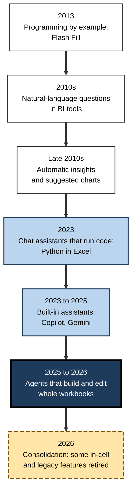
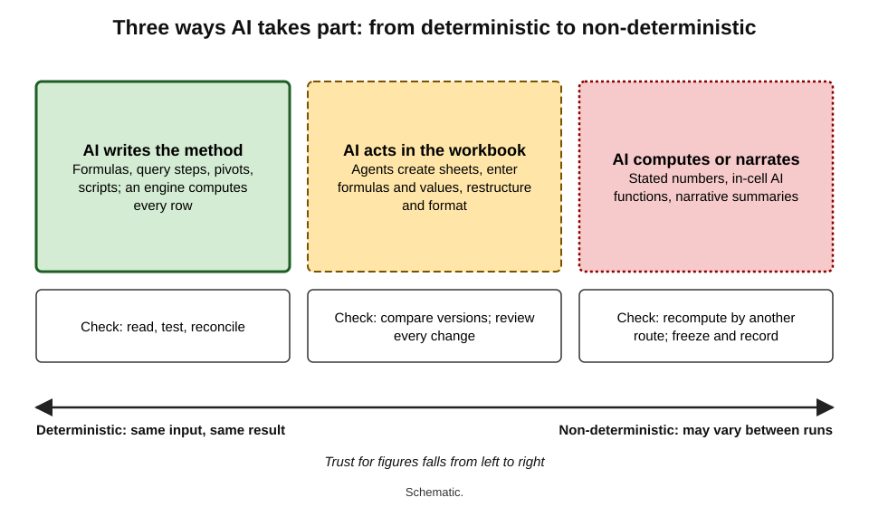
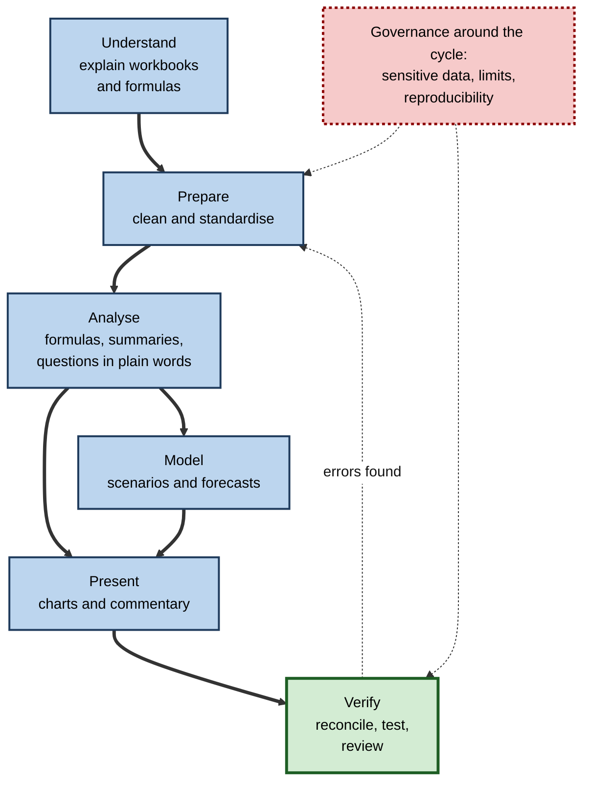
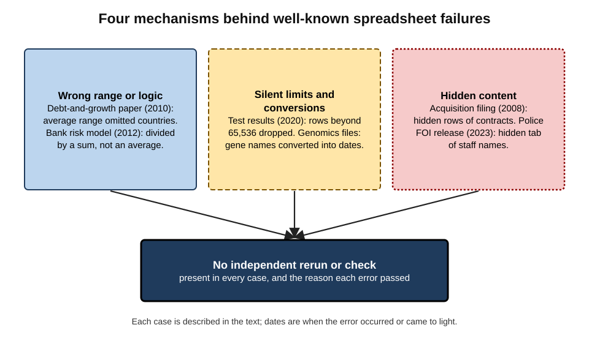
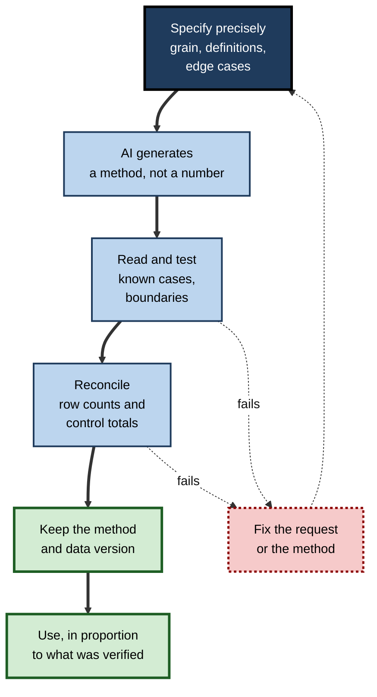
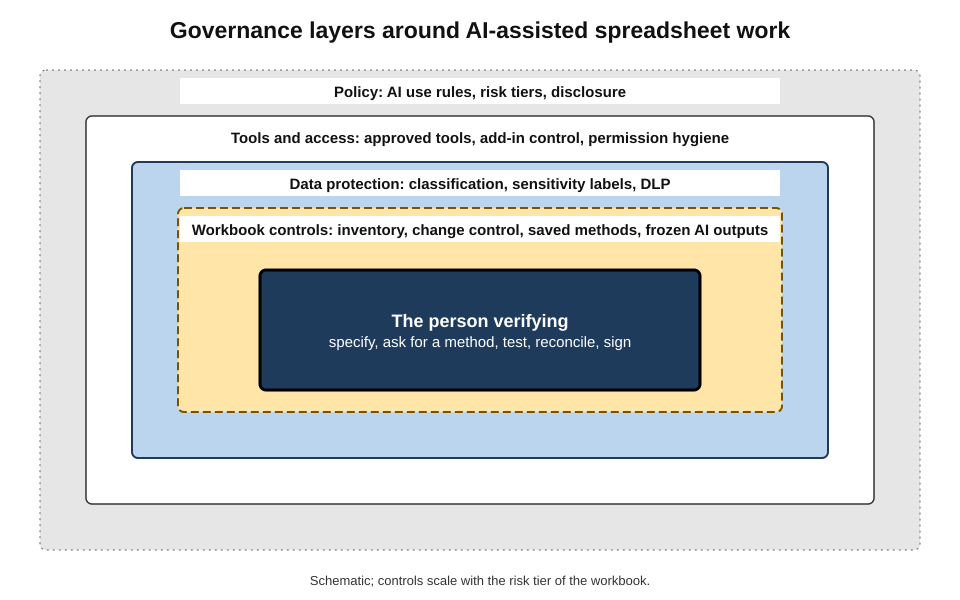

# E. AI in Spreadsheets & Data Tools

For forty years the spreadsheet has been the most widely used analytical tool in working life: budgets, forecasts, rotas, price lists, pipelines and payrolls all live in grids of cells. It is also among the most error-prone, because almost anyone can build one and almost nobody tests them.

AI has now arrived inside the grid. It writes formulas from a sentence, cleans messy columns, answers questions about tables, draws charts and builds whole workbooks. It makes spreadsheets far more powerful and keeps every one of their old weaknesses. It also adds new ones.

> **Definition — AI in spreadsheets and data tools:** the use of AI models within or alongside spreadsheets and everyday data tools — to write formulas, queries and code, to prepare, summarise, chart and model data, and to answer questions about tables in plain language — with people remaining responsible for the correctness, security and use of the results.

**Why it matters**

- **Spreadsheets carry consequential numbers.** Prices, pay, budgets, risk limits and public statistics have all depended on them, and some famous failures have come from single cells.
- **AI lowers the skill needed to produce analysis** much faster than it lowers the skill needed to check it.
- **Data tools hold the most sensitive information** an organisation has — and AI features move that information to new places.
- **The professional value has moved.** Writing formulas is becoming cheap. Specifying, verifying and governing the work is not.

---

## The Spreadsheet as a Medium

### A short history

- **1979 — VisiCalc.** Dan Bricklin and Bob Frankston released the first electronic spreadsheet for personal computers. For many businesses it was the reason to buy one. Change one cell and every dependent cell recalculated.
- **1983 — Lotus 1-2-3** dominated the IBM PC era, adding charts and database functions.
- **1985–1987 — Microsoft Excel** appeared on the Macintosh and then on Windows. It became the dominant spreadsheet in the 1990s.
- **2006 — Google Sheets** (originally Google Spreadsheets) brought the spreadsheet into the browser, with real-time collaboration.
- **2010s — business-intelligence tools** such as Power BI and Tableau took over large-scale reporting. The spreadsheet stayed the place where people work with data directly.

> **Definition — Spreadsheet:** a grid of cells holding values and formulas, in which results recalculate automatically when inputs change.

### Programming for everyone

- **A formula is a small program.** Researchers in end-user programming have long described spreadsheet users as the world's largest population of programmers, most of whom do not see themselves as programmers.
- **The strength is immediacy.** Logic and data sit side by side, results show at once, and no software team is needed.
- **The weakness is the same immediacy.** There is no compiler, no test suite, no code review and no separation of data from logic, unless the author imposes them.

> **Definition — End-user computing (EUC):** applications such as spreadsheets and small databases built and run by business users rather than by IT departments.

> **Key point:** AI in spreadsheets inherits the spreadsheet's central bargain. It makes computation accessible to everyone, and it puts the burden of correctness on people who were never trained to carry it.

---

## How Intelligence Entered the Grid

**Figure 1.** How AI assistance in spreadsheets and data tools developed.

- **Programming by example (2013).** Flash Fill in Excel, from research by Sumit Gulwani at Microsoft Research, inferred a text transformation from one or two typed examples.
- **Natural-language questions (2010s).** Power BI's Q&A and, from 2019, Tableau's Ask Data let users type questions over datasets. Tableau retired Ask Data in 2024. Microsoft has announced that Power BI Q&A will be retired by December 2026 in favour of Copilot.
- **Automatic insights (late 2010s).** Spreadsheet features began suggesting pivot tables, charts and notable patterns for a selected range.
- **Code-running assistants (2023).** Chat assistants that write and run code on an uploaded file let non-programmers analyse data in plain language. Python in Excel, introduced in 2023, brought code into the workbook itself.
- **Built-in assistants (2023–2025).** Copilot in Excel and Gemini in Google Sheets began working inside the sheet: writing formulas, creating pivots and charts, and summarising.
- **Agents (2025–2026).** Agent-style assistants plan and carry out multi-step work, such as building a model across several sheets. Microsoft made agent mode in Excel generally available in January 2026.
- **Consolidation (2026).** Microsoft announced in August 2026 that its in-cell `COPILOT` function, released in preview in 2025, would stop working from 14 September 2026, and pointed users to the side-pane assistant. Google offers an `AI` function in Sheets on selected plans, with usage limits.

> **Watch out:** product names, features, limits and plans in this field change every few months. The dates above describe the position as of late 2026. The durable lessons are about **how** AI participates in data work, not **which** product does it.

---

## Three Ways AI Takes Part

Every AI feature in a data tool does one of three things. Each has a different relationship to correctness.

**Figure 2.** Three ways AI takes part in spreadsheet work, from deterministic to non-deterministic.

### AI writes the method

- **The output is a formula, a set of query steps, a pivot definition or a script.** The spreadsheet or another engine then computes the result.
- **The result is deterministic.** The same inputs always give the same output, and the method can be read, tested and rerun.
- **The risk is a wrong method that looks right.**

### AI acts in the workbook

- **Agents and assistants create sheets, enter formulas, format, restructure and fill values** on the user's behalf.
- **The result is a mixture.** Some cells hold formulas the agent wrote; some hold values it entered; some structure reflects its choices.
- **The risk is change that nobody fully reviews**, including changes nobody asked for.

### AI computes or narrates directly

- **The model itself produces numbers or text.** Examples are a chat answer stating a total, an in-cell AI function classifying a comment, or a narrative summary of a table.
- **The result may be non-deterministic.** It can change between runs and between model versions.
- **The risk is numbers that were never calculated**, and outputs that drift over time.

| | AI writes the method | AI acts in the workbook | AI computes or narrates |
|---|---|---|---|
| What is produced | Formula, query, pivot, script | Edits across the workbook | Numbers or text from the model |
| Deterministic? | Yes, once written | Partly | No |
| How to check | Read, test, reconcile | Compare versions; review every change | Recompute by another route |
| Typical failure | Silent formula error | Unreviewed or unrequested change | Stated number never computed |
| Best suited to | Calculations, recurring work | Building structure fast, with review | Text tasks: classify, summarise, explain |

> **Key point:** the further a feature sits towards **direct computation by the model**, the less it should be trusted for figures. The safest general pattern is: **AI writes the method; the engine computes; the person verifies.**

---

## AI Across the Work of Data

The everyday tasks of spreadsheet work form a loop: understand the data, prepare it, analyse it, present it, model with it and check it. AI now helps at every stage.

**Figure 3.** Where AI helps in the cycle of spreadsheet work, and where checking is essential.

- **Understanding.** AI can turn formulas into plain language and help map a workbook someone else built. It sees only part of what a workbook contains, though. Hidden sheets, links and code often lie outside its view.
- **Preparing.** Cleaning and standardising is where AI's grasp of meaning helps most, for example in recognising that "Deutschland" and "Germany" are one country. It is also where silent damage is easiest: over-merged records, invented values, destroyed originals.
- **Analysing.** Natural-language formula help and plain-language questions over tables open functions and analyses to non-specialists. Summaries of whole datasets are the most requested and most vaguely specified task. General analysis as a task is a wider subject. In this setting the questions are what the tool actually computed, and on which rows.
- **Presenting.** Charts generated from a request are fast. They are also only as honest as the defaults the request failed to override.
- **Modelling.** AI can lay out the structure of a budget, a break-even analysis or a cash flow in minutes. A professional-looking model can still hide period mismatches and invented assumptions.
- **Verifying.** Spotting errors and anomalies, and checking every AI-produced calculation, decide whether the speed gained elsewhere is worth anything.

Around the cycle sit three conditions that constrain it:

- **Sensitive data**, which limit which tools may touch which sheets.
- **Scale**, since large spreadsheets exceed what AI tools can read at once.
- **Reproducibility**, which requires that results can be rerun when the model behind them has changed.

There is also a judgement that runs through the whole cycle: knowing when doing the work by hand is quicker, safer or more instructive.

> **In practice:** experienced analysts apply AI unevenly across the cycle. They use it heavily for drafting methods and explaining unfamiliar logic, carefully for cleaning and modelling, and sparingly for any number that will be signed, filed or paid.

---

## A History of Spreadsheet Risk

AI did not create spreadsheet risk. It arrived in a field with decades of documented failure, and that history is the best guide to what AI will make easier to get wrong.

### Errors are the base rate

- **Raymond Panko's reviews** of field audits and experiments found that most audited operational spreadsheets contained errors. In experiments, a few per cent of formula cells were wrong. In a workbook of thousands of formulas, that makes an error somewhere nearly certain.
- **The European Spreadsheet Risks Interest Group (EuSpRIG)**, founded in 1999, has collected public reports of spreadsheet failures and research on prevention for over twenty-five years.
- **Developers are overconfident.** People who build spreadsheets rarely believe their own contain errors.

> **Watch out:** the exact error percentages come from non-random samples and varying definitions, so they are **uncertain**. The qualitative finding is robust: spreadsheet errors are common and their authors underestimate them.

### Landmark failures

**Study card — Herndon, Ash and Pollin (2013) on Reinhart and Rogoff (2010)**

- **Background:** an influential 2010 paper by the economists Carmen Reinhart and Kenneth Rogoff reported that, in its data, countries with public debt above 90% of national output had sharply lower average growth. The paper was widely cited in debates about austerity after the 2008 financial crisis.
- **Re-analysis:** Thomas Herndon, a graduate student at the University of Massachusetts Amherst, tried to replicate the result for a class assignment. With his professors Michael Ash and Robert Pollin, he obtained the authors' spreadsheet and found three problems:
  - an averaging formula whose range left out several countries;
  - the exclusion of some years of data for some countries;
  - an unconventional way of weighting country averages.
- **Result:** with the corrections, average growth for the high-debt group was positive, at about 2%, rather than slightly negative. The apparent sharp threshold at 90% largely disappeared.
- **Response and status:** Reinhart and Rogoff acknowledged the spreadsheet error. They argued that the broader association between high debt and slower growth still held in weaker form, and that relationship is still debated by economists.
- **Lesson:** a cell-range error in a spreadsheet influenced a global policy debate. It was found only because someone **reran the analysis from the original workbook**.

- **The London Whale (2012).** At JPMorgan Chase, a risk model operated through manually linked spreadsheets divided by a sum where it should have divided by an average. The result understated risk on a trading position that went on to lose about 6.2 billion US dollars. The formula error was one contributor among several governance failures.
- **Public Health England (2020).** Templates in a legacy file format with a limit of 65,536 rows silently dropped 15,841 positive COVID-19 test results, which delayed contact tracing.
- **Gene names (2016 onwards).** Researchers found that about one in five genomics papers with spreadsheet gene lists had symbols silently converted into dates. Some genes were later renamed so that spreadsheets would stop misreading them.
- **Hidden data (2008 and 2023).** Hidden rows in a spreadsheet filed in the Barclays–Lehman acquisition, and a hidden tab in a police freedom-of-information release, exposed content their senders could not see.

**Figure 4.** How spreadsheet failures arise: the same few mechanisms in different settings.

> **Key point:** the failures share a small set of mechanisms: wrong ranges and logic, silent limits and conversions, hidden content and no independent rerun. AI can reduce some of these, for example by catching inconsistent formulas. It can multiply others, for example by producing plausible logic faster than anyone reviews it.

---

## Why AI-Generated Formulas and Analysis Go Wrong

### Three gaps

- **The generation gap.** A language model produces likely text, not verified results. A formula or number can look right and be wrong, and a description of a method does not prove the method was carried out.
- **The visibility gap.** An assistant may see one sheet, a sample of rows or only what was pasted. Hidden sheets, external links, macros, query steps and the meaning of codes often lie outside its view.
- **The specification gap.** Most requests leave the important decisions unstated: the grain of the data, how blanks are treated, which definition of "revenue" or "churn" applies, how the axis is scaled, which rows are excluded. The tool fills these gaps with defaults or guesses.

### The evidence

- **Benchmarks.** On SpreadsheetBench, built in 2024 from more than 900 real questions on spreadsheet forums, Microsoft reported in 2025 that its agent mode in Excel completed about 57% of tasks. On a harder 2026 successor of multi-sheet business workflows, the best system completed about 35% end to end and about 12% of debugging tasks.
- **Vendor guidance.** Microsoft advised against using its in-cell AI function for numerical calculations, for anything needing accuracy or reproducibility, or for work with legal, regulatory or compliance implications. It also warned that results could change as the underlying model changed.
- **User behaviour.** A 2025 global survey of employees by KPMG and the University of Melbourne found that about two-thirds of workers using AI relied on its output without evaluating its accuracy. More than half reported mistakes in their work caused by AI.
- **Uneven capability.** A 2023 field experiment with consultants found that AI greatly improved work on tasks within its competence. On a data-and-judgement task just outside it, consultants using AI did markedly worse than those without.

> **Watch out:** benchmark figures are moving quickly, and some come from vendors rather than independent evaluators. They support a qualitative conclusion, not a fixed error rate. On realistic, multi-step spreadsheet work, AI tools still fail often enough that **verification is never optional**.

| | Traditional spreadsheet risk | What AI reduces | What AI adds or amplifies |
|---|---|---|---|
| Formula errors | Slips and wrong logic | Syntax errors; unfamiliar functions | Plausible wrong logic produced quickly |
| Review | Rarely done | Fast second reading of formulas | Larger volumes to review; automation bias |
| Data handling | Files emailed and copied | — | New flows to model providers and add-ins |
| Reproducibility | Undocumented manual steps | Methods can be generated and saved | Non-deterministic outputs; model and feature changes |
| Skills | Uneven spreadsheet literacy | Access to advanced functions | Erosion of the skills needed to check |

---

## Verification as the Core Discipline

Verification turns AI-assisted data work from a liability into an asset. Its principles are few and stable, even as the tools change.

**Figure 5.** The verification loop for AI-assisted spreadsheet work.

1. **Specify precisely.** State the layout, grain, definitions, edge cases and the form of the answer. A precise request is already half a test specification.
2. **Ask for a method, not a number.** Request formulas, queries, pivots or code that an engine runs on every row. Never rely on numbers a model has merely stated.
3. **Read and test.** Hand-check one ordinary case and the awkward ones: blanks, missing keys, boundaries, the last row.
4. **Reconcile.** Check that rows in equal rows used and that key totals agree with an independent source.
5. **Keep the method and the data version**, so that the result can be rerun.
6. **Use the result in proportion** to the verification done, and label anything unverified as provisional.

> **Mnemonic — "Some Answers Really Can Keep Users safe":** Specify, Ask for a method, Read and test, Check totals (reconcile), Keep the method, Use in proportion.

> **Remember:** **computed, not stated; method kept; totals reconciled; checking scaled to stakes.**

---

## Governing AI in Enterprise Data Tools

Organisations have governed important spreadsheets, with varying success, since accounting scandals and model failures made them visible. AI extends that governance in three directions: **data flows**, **model behaviour** and **record-keeping**.

**Figure 6.** Layers of governance for AI in spreadsheets and data tools.

### Inherited controls

- **Internal control over financial reporting.** Since the US Sarbanes–Oxley Act of 2002, companies listed in the United States have had to evidence controls over spreadsheets that feed financial statements. These include access, change control, review and reconciliation.
- **Model risk management.** Banking supervisors expect models used for decisions, including spreadsheet tools, to be inventoried, validated and controlled in proportion to their risk. Examples are US supervisory guidance SR 11-7 (2011) and the UK Prudential Regulation Authority's model risk principles, SS1/23, published in 2023.
- **EUC policies** list critical spreadsheets, assign owners and rate their risk.

### AI-specific controls

- **Approved tools and add-ins.** Only vetted AI features and extensions are allowed, and administrators control installation.
- **Data classification and sensitivity labels.** Files are labelled by sensitivity. In Microsoft's platform, assistants return content from label-encrypted files only to users who hold the right to copy content out (EXTRACT). A 2026 change extended a setting that blocks AI analysis of labelled files across Excel, Word and PowerPoint.
- **Data loss prevention.** Rules detect sensitive patterns and block inappropriate uploads or sharing.
- **Permission hygiene.** Assistants that can search everything a user can access make over-shared files easy to find, so access is reviewed before deployment.
- **Rules on AI outputs in controlled workbooks.** Examples: no live AI formulas in reporting workbooks; AI-generated values frozen with date and tool; AI-generated logic tested and reviewed like any other change.
- **Logging and disclosure.** AI interactions are logged for investigation, and reports record where AI was used and how its output was verified.

| Risk tier | Example | Minimum controls |
|---|---|---|
| Low | Personal or exploratory analysis | Approved tool; no sensitive data; sense checks |
| Medium | Team reporting, internal dashboards | Saved methods; reconciliation; peer check of key figures |
| High | Management and board reporting, pricing | Inventory entry; change control; independent review; documented verification |
| Critical | Financial statements, regulatory returns, decisions about individuals | Full model-risk controls; no AI-stated numbers; frozen and recorded AI outputs; sign-off by accountable owner |

> **Definition — AI use policy:** an organisation's rules on which AI tools may be used, for which tasks and data, under what checks and with what records.

> **Watch out:** policies that simply ban AI from spreadsheets tend to push use into unapproved personal tools, sometimes called **shadow AI**, where there is no control at all. Effective governance usually combines **approved, capable tools** with clear rules on data and verification.

### Case study (illustrative): a finance function adopts AI in its spreadsheets

- **Situation:** the finance team of a mid-sized manufacturer, about forty people, wanted to use AI in its spreadsheets after staff were found pasting ledger extracts into personal chat accounts.
- **Actions:**
  1. **Inventory and tiering.** About 300 recurring workbooks were listed. Forty were rated high or critical, including the month-end close, the cash forecast and pricing.
  2. **Tools.** The organisation's enterprise assistant was approved. Personal AI accounts and unvetted add-ins were blocked for finance data.
  3. **Rules.** AI could draft formulas, queries, structure and commentary. All figures in high-tier workbooks had to be computed by saved methods and reconciled to the ledger. Live AI formulas were banned from reporting workbooks.
  4. **Records.** A change log noted AI-generated logic and how it was tested. Classification outputs were frozen with date and prompt.
  5. **Skills.** Staff were trained in verification: test blocks, reconciliation and reading formulas. Juniors performed key reconciliations by hand each quarter.
  6. **Permissions.** Before deployment, a review of shared drives removed organisation-wide access to payroll and pricing files.
- **Result after two quarters:** reported time on routine reconciliations fell substantially. Two AI-drafted formula errors were caught by test blocks before use. Pasting into personal tools largely stopped. Internal audit accepted the controls.
- **Lesson:** the gains came from AI, and the safety came from structure: approved tools, tiered rules, saved methods, reconciliation and preserved skills. The rules were the same ones good spreadsheet governance had always recommended, now applied consistently.

---

## Mastery: The Professional Who Uses AI With Data

### What distinguishes the very best

- **Precise specification.** They state the grain, the definitions and the edge cases before asking for anything.
- **Method over answer.** They habitually turn AI help into formulas, queries and code that can be rerun.
- **Fluent verification.** Sense checks, test cases and reconciliations have become reflexes rather than effort.
- **Knowledge of the limits.** They know what each tool can see, how much data it can read, where its outputs go and how stable they are.
- **Judgement about when not to use AI.** Small, signed, novel or sensitive work is done by hand without hesitation.
- **Teaching others.** They spread good habits, such as test blocks, data notes and "show the denominator", through their teams.

| | Novice user | Competent user | Expert user |
|---|---|---|---|
| Request | "Analyse this" | States the measure and filter | States grain, definitions, edge cases, form of answer |
| Output sought | An answer | A formula or chart | A saved method plus its tests |
| Checking | Looks plausible | Hand-checks a row | Tests edge cases, reconciles, compares versions |
| Data handling | Pastes whatever is open | Uses approved tools | Minimises, classifies, records |
| Scale | Uploads everything | Filters first | Reduces, describes, delegates the method, reconciles |
| Judgement | Uses AI for everything | Avoids it when unsure | Chooses AI, manual or built method deliberately |

> **In practice:** many employers now assess data skills by asking candidates to **critique** an AI-generated workbook or analysis, finding its errors and explaining what they would check, rather than by asking them to build one. The ability to verify has become the scarce skill.

---

## Open Questions

- **Will AI make spreadsheets safer or more dangerous overall?**
  - AI can catch errors and enforce good structure, and it can also produce plausible logic faster than anyone reviews it. Which effect dominates in practice is not yet measured.
- **Will the spreadsheet survive as the main everyday data tool?**
  - Agents and natural-language querying over governed data could move work away from the grid. Equally, AI may make the grid more capable and keep people in it.
- **Can AI outputs become reproducible enough for regulated use?**
  - Model updates, sampling and feature withdrawals undermine reruns. Whether vendors will offer stable, versioned behaviour for analysis is open.
- **What will professionals need to know by hand?**
  - The minimum spreadsheet and statistical skill needed to supervise AI safely is debated, and probably differs by role.
- **How should responsibility be shared?**
  - When an agent builds a model that is wrong, how responsibility divides between user, reviewer, organisation and vendor is unsettled in practice and in law.

---

## Summary

- **AI in spreadsheets and data tools** writes formulas, queries and code, prepares, summarises, charts and models data, and answers plain-language questions about tables. People remain responsible for correctness, security and use.
- The spreadsheet (VisiCalc 1979, Lotus 1-2-3, Excel, Google Sheets) is **end-user programming** at vast scale. It is powerful, immediate and rarely tested.
- AI entered in stages: **programming by example**, natural-language queries in BI tools, automatic insights, code-running assistants, built-in assistants, **agents**, and in 2026 consolidation with some features retired.
- AI takes part in three ways: it **writes the method** (deterministic, checkable), **acts in the workbook** (needs change review) or **computes and narrates directly** (non-deterministic, not for figures).
- Spreadsheet risk predates AI. Errors are a **base rate** (Panko), and landmark failures (**Reinhart–Rogoff**, the London Whale, Public Health England, gene names, hidden data) share a few mechanisms.
- AI errs through **generation, visibility and specification gaps**. Benchmarks show frequent failure on realistic multi-sheet work, and users often trust output unchecked.
- **Verification** is the core discipline: specify, ask for a method, read and test, reconcile, keep the method, use in proportion.
- **Enterprise governance** combines inherited controls (SOX, model risk, EUC inventories) with AI-specific ones: approved tools, labels and DLP, permission hygiene, rules on AI outputs, logging. Pure bans drive **shadow AI**.
- Mastery means **precise specification, method over answer, fluent verification, knowledge of limits and judgement about when to work by hand**.

---

## Self-Check

1. Define AI in spreadsheets and data tools, and state what remains the person's responsibility.
2. Why can spreadsheet users be described as programmers, and what does that imply for risk?
3. Outline the main stages by which AI entered spreadsheets and data tools.
4. Compare the three ways AI takes part in spreadsheet work on determinism, checking and suitable uses.
5. Explain why "AI writes the method; the engine computes; the person verifies" is the safest general pattern.
6. What did Panko's reviews conclude about spreadsheet errors, and why are the exact figures uncertain?
7. Summarise the Reinhart–Rogoff episode and explain why its lesson concerns reproducibility as much as error.
8. Name the three gaps through which AI-generated formulas and analysis go wrong, with an example of each.
9. What do benchmarks, vendor guidance and user surveys together suggest about AI in spreadsheets?
10. Describe the six steps of the verification loop.
11. List four inherited controls and four AI-specific controls for enterprise data tools.
12. Why can a ban on AI in spreadsheets increase risk?
13. In the illustrative finance case, which actions produced the gains and which produced the safety?
14. Contrast how a novice and an expert would ask an assistant for regional sales growth and check the result.
15. A board member asks whether the organisation can now "let AI do the numbers". Give a balanced, evidence-based answer.

### Answer Key

1. Using AI within or alongside spreadsheets and data tools to write methods, prepare, summarise, chart and model data and answer questions about tables. People remain responsible for correctness, security and use of the results.
2. Formulas are small programs, and most users write them without training, testing or review. Errors are therefore common and usually undetected unless checks are imposed.
3. Programming by example (Flash Fill, 2013); natural-language questions in BI tools (2010s); automatic insights (late 2010s); code-running chat assistants and Python in Excel (2023); built-in assistants (2023–2025); agents (2025–2026); consolidation and retirements (2026).
4. Writes the method: deterministic, checked by reading, testing and reconciling, suited to calculations. Acts in the workbook: partly deterministic, checked by reviewing every change, suited to building structure with review. Computes or narrates: non-deterministic, checked by recomputing another way, suited to text tasks rather than figures.
5. A method is visible, testable and rerunnable. The engine's arithmetic is reliable. Human verification covers what neither the model nor the engine can know, such as definitions and purpose.
6. Most audited spreadsheets contained errors, and a few per cent of formula cells were wrong in experiments, so errors in large workbooks are near certain. Samples were not random and definitions of error varied.
7. A formula range omitting countries, plus data exclusions and weighting choices, produced a dramatic debt threshold that weakened sharply when corrected. The authors accepted the error but defended a weaker conclusion. The error was found only because the original spreadsheet could be obtained and rerun.
8. Generation: a stated total that was never calculated. Visibility: an explanation that misses a hidden override sheet. Specification: churn computed with free trials included when the standard excludes them.
9. AI fails often on realistic multi-step spreadsheet tasks. Vendors themselves warn against relying on in-cell AI for numbers. Many users accept output without checking. Verification is therefore essential.
10. Specify precisely; ask for a method rather than a number; read and test it on known and edge cases; reconcile counts and totals; keep the method and data version; use the result in proportion to what was verified.
11. Inherited: SOX controls over financial reporting; model-risk inventories and validation; EUC policies and owners; change control and review. AI-specific: approved tools and add-ins; sensitivity labels and DLP; permission hygiene; rules on AI outputs (no live AI formulas, frozen values); logging and disclosure.
12. Staff who find AI useful move to personal, unapproved tools, which sends data outside control with no logging, no labels and no verification rules.
13. Gains came from AI drafting formulas, queries, structure and commentary. Safety came from the inventory and tiering, approved tools, saved methods with reconciliation, change logs, frozen outputs, training, manual practice and permission review.
14. Novice: "How did regional sales do?", then accepts the narrative. Expert: specifies the measure (net revenue), periods (complete quarters), grain, exclusions and form (a pivot with the formula). The expert checks one region by filtering, reconciles total sales to the ledger, confirms the growth formula, and replaces adjectives with figures and denominators.
15. AI can greatly speed producing formulas, queries, models and commentary, and can act as a useful second reviewer. Evidence shows frequent failure on realistic multi-step work, non-reproducible outputs and over-trust by users. The numbers should be computed by saved, reconciled methods, verified in proportion to their stakes, and signed by accountable people, with AI helping rather than deciding.

---

## Glossary

| Term | Meaning |
|---|---|
| Agent | An AI assistant that plans and carries out multi-step actions, such as building or editing a workbook. |
| AI function | A spreadsheet function that sends a prompt and cell values to a model and returns its output. |
| AI use policy | Rules on which AI tools may be used, for what, with what data, checks and records. |
| Built-in assistant | An AI assistant integrated into a spreadsheet application. |
| Data loss prevention | Controls that detect sensitive information and block inappropriate sharing. |
| Deterministic | Always producing the same output from the same inputs. |
| End-user computing | Applications built and run by business users rather than IT departments. |
| EuSpRIG | The European Spreadsheet Risks Interest Group, which studies spreadsheet failures and controls. |
| Flash Fill | An Excel feature that infers a transformation from typed examples. |
| Model risk management | Inventorying, validating and controlling models used for decisions. |
| Natural-language query | A typed question that a tool translates into a calculation over data. |
| Programming by example | Inferring a program from examples of desired outputs. |
| Reconciliation | Checking that a calculated figure agrees with an independent trusted figure. |
| Sensitivity label | A classification on a file that can enforce protections, including limits on AI processing. |
| Shadow AI | Use of unapproved AI tools outside an organisation's controls. |
| Spreadsheet | A grid of cells holding values and formulas that recalculate automatically. |
| Verification | Establishing with independent evidence that an output is correct for its purpose. |
