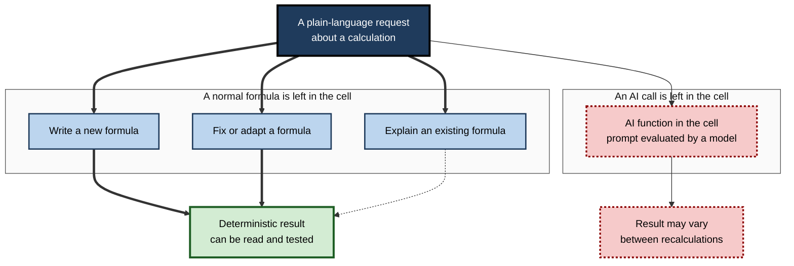
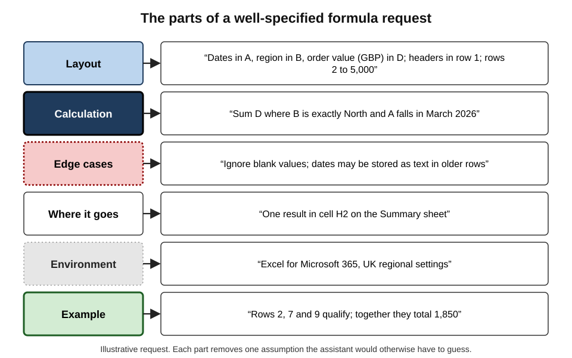
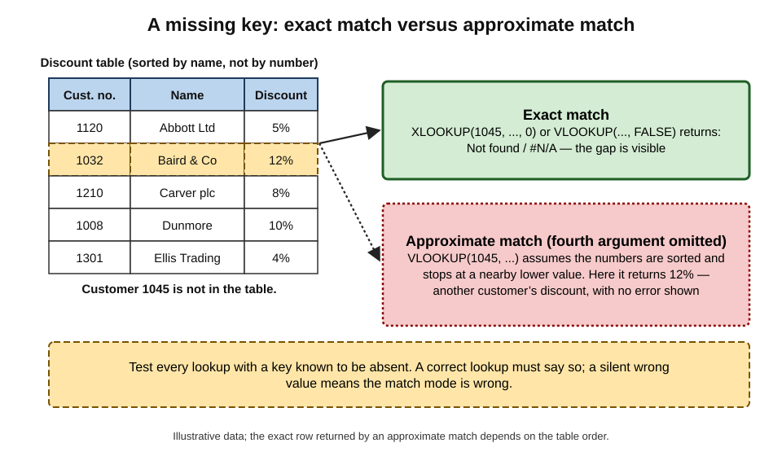
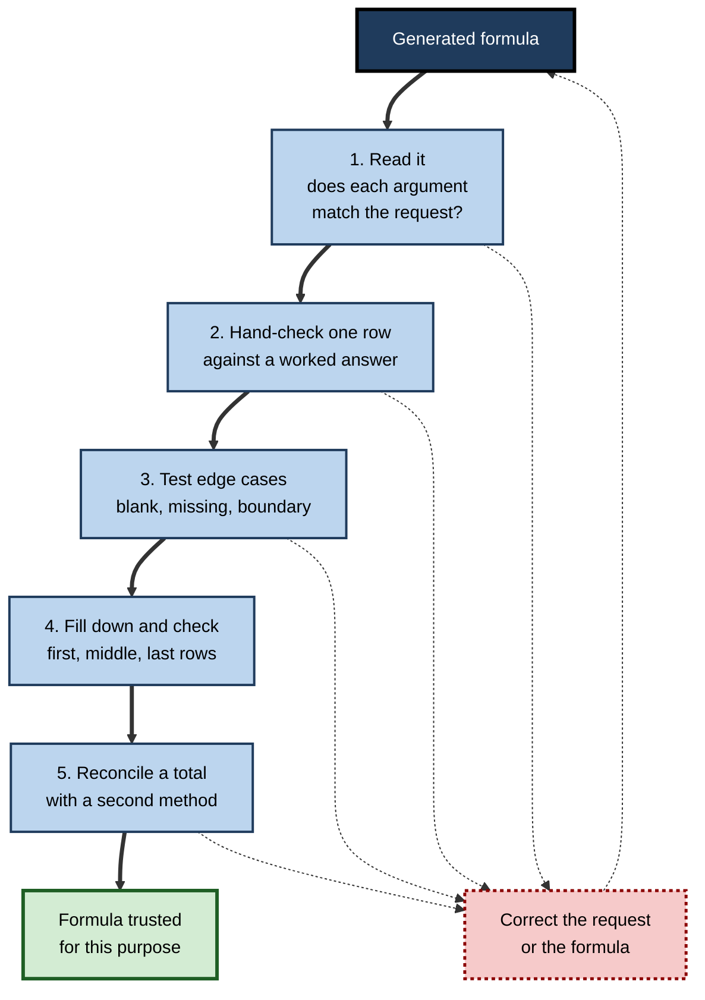
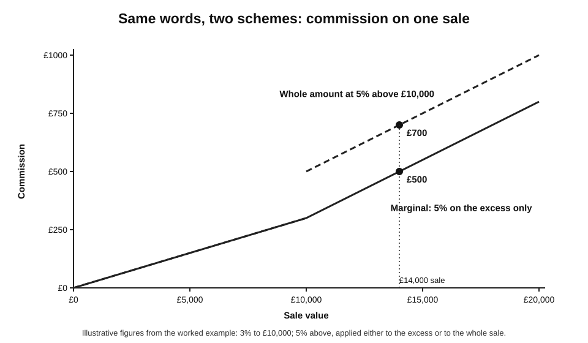

# E.1. Natural-language formula help

A sales coordinator needs the total value of orders from the North region in March, but does not know which function to use. She types "add up column D where column B says North and the date in column A is in March" into the assistant pane of her spreadsheet, and a working `SUMIFS` formula appears in seconds.

A colleague asks for help matching invoice numbers to customer names and receives a `VLOOKUP` that quietly returns the wrong customer for every invoice not in the list. Both formulas looked equally professional. Only one was right.

> **Definition — Natural-language formula help:** the use of an AI model to translate a plain-language description of a calculation into a spreadsheet formula, or to explain, repair or adapt an existing formula, with the person deciding whether the formula is correct before relying on it.

**Why it matters**

- **Formulas are the engine of a spreadsheet.** Every total, forecast, commission and budget variance depends on them; an error in one formula can flow into hundreds of cells.
- **Most spreadsheet users know only a handful of functions.** Natural-language help opens the rest — lookups, conditional totals, text handling, dynamic arrays — to people who could never recall their syntax.
- **A formula is inspectable.** Unlike a number typed into a chat window, a formula can be read, tested and rerun, which makes formula generation one of the safer uses of AI with data.
- **A wrong formula looks exactly like a right one.** It returns a plausible number, without an error message, until someone checks.

---

## What a Formula Is and Why Natural Language Helps

### The formula as a small program

- **A formula is an instruction**, not a value: it tells the spreadsheet how to compute a result from other cells.
  - *e.g.* `=SUM(D2:D500)` means "add the values in D2 to D500".
- **It recalculates automatically** when its inputs change — the property that made spreadsheets transformative.
- **It is deterministic**: the same inputs always produce the same output.
- **It is a form of programming.** Researchers in end-user programming have long described spreadsheet authors as the world's largest group of programmers, most of whom never think of themselves as such.

> **Definition — Function:** a named, built-in operation such as `SUM`, `XLOOKUP` or `TEXT` that takes arguments and returns a result inside a formula.

> **Definition — Cell reference:** the address of a cell or range used in a formula, such as `B2` or `A2:A500`. A **relative** reference (`B2`) shifts when the formula is copied; an **absolute** reference (`$B$2`) does not.

### The gap that AI fills

- **Knowing what is wanted is not the same as knowing how to write it.** Most users can state the calculation precisely in words but cannot recall the function, the argument order or the syntax.
- **Traditional help was search-based.** Users searched forums, copied an example, and adapted it — slow, and often wrong when the example's layout differed.
- **Natural-language help works in the user's own terms** and, when built into the spreadsheet, can see column headers and data types.

**Origins**

- **Programming by example (2011–2013).** Sumit Gulwani at Microsoft Research showed that a spreadsheet could infer a text-transformation program from one or two examples of the desired output. This became **Flash Fill** in Excel 2013 — the first mass-market spreadsheet feature that wrote logic on the user's behalf.
- **Formula suggestions (late 2010s onward).** Spreadsheet tools began proposing formulas and completing them as the user typed.
- **Large language model assistants (2023 onward).** Chat assistants, and then assistants built into Excel and Google Sheets, began writing complete formulas from plain-language requests and explaining existing ones.

> **Key point:** natural-language help shifts the scarce skill from **remembering syntax** to **specifying the calculation precisely and checking the result**.

---

## Four Kinds of Help

**Figure 1.** Four kinds of natural-language formula help, by what ends up in the spreadsheet.

### Writing a new formula

- The user describes the calculation; the assistant proposes a formula, often with an explanation.
- **Built-in assistants** (Copilot in Excel, Gemini in Google Sheets) can read the sheet's headers and insert the formula as a new column.
- **General chat assistants** know nothing about the sheet except what the user types, so the user must describe the layout.

### Explaining an existing formula

- The assistant restates a formula in words, argument by argument.
  - *e.g.* "This looks up the value in A2 in column A of the Prices sheet and returns the matching value from column C; if nothing is found it returns 0."
- **Valuable for inherited workbooks** and for learning — each explanation teaches a function.

### Fixing or adapting a formula

- The user pastes a formula that returns an error or a wrong result and describes what it should do.
- **Typical fixes:** wrong range, missing absolute reference, text compared with numbers, wrong match mode, wrong separator for the locale.

### AI functions inside cells

- **Some spreadsheets let a model be called from a formula**, with a prompt and cell references as arguments.
  - Google Sheets offers an `AI` function that sends a prompt and referenced cells to Gemini and writes the response into the cell (available on selected paid plans as of 2026).
  - Microsoft released a `COPILOT` function to preview users in 2025, then announced in August 2026 that it would no longer be available after 14 September 2026, directing users to the Copilot side pane instead.
- **These are not formula help.** They do not produce a formula; they put a model's text output into the grid.

> **Watch out:** Microsoft's own guidance for its in-cell `COPILOT` function warned against using it for numerical calculations, for tasks needing accuracy or reproducibility, and for anything with legal, regulatory or compliance implications — and noted that results could change over time as the underlying model changed. An AI function suits classifying or summarising text, not computing figures.

| | Generated formula | AI function in a cell |
|---|---|---|
| What is stored | An ordinary formula | A prompt sent to a model |
| Same inputs, same output? | Always | Not guaranteed |
| Can it be read and audited? | Yes, argument by argument | Only the prompt; the reasoning is hidden |
| Suits | Totals, lookups, dates, logic | Classifying, tagging, short text generation |
| Main risk | A wrong formula that looks right | Inconsistent or invented output |
| Dependence on the vendor | None once written | Breaks if the feature is withdrawn |

> **Key point:** the safest pattern is to use AI to **write** a deterministic formula, then let the spreadsheet compute — not to let the model compute.

---

## Asking for a Formula Well

### What the assistant needs to know

**Figure 2.** The parts of a well-specified formula request.

- **Layout** — which columns hold what, where the headers are, how many rows.
  - *e.g.* "Column A has order dates, B region names, D order values in pounds; headers in row 1; data in rows 2–5,000."
- **The calculation in precise words** — including the unit and the condition.
  - *e.g.* "Sum D where B is exactly 'North' and A falls in March 2026."
- **Edge cases** — blanks, duplicates, missing matches, text that looks like numbers.
  - *e.g.* "If no match is found, show 'Not found' rather than an error."
- **Where the result goes** — one cell, a new column, a summary table.
- **The environment** — Excel or Google Sheets, version, and the regional settings that control separators.
- **An example** — one row with the expected answer worked out by hand.

> **Mnemonic — LCEWEE:** Layout, Calculation, Edge cases, Where it goes, Environment, Example.

### Vague and precise requests

| | Vague request | Precise request |
|---|---|---|
| Wording | "Get the price for each product" | "In C2, return the unit price from column C of the Prices sheet where Prices column A equals A2; exact match only; show 'Missing' if absent" |
| Likely formula | A lookup with a default match mode | `=XLOOKUP(A2,Prices!A:A,Prices!C:C,"Missing",0)` |
| Hidden assumption | Approximate match, unsorted data | None — every choice is stated |
| Ease of checking | Hard — what was intended is unclear | Easy — compare the formula with the words |

> **In practice:** writing the request precisely is half the work of checking it. A request that states the match type, the blank handling and the unit becomes the test specification for the formula that comes back.

### Iterating

- **Ask for the formula and an explanation together**, then check that the explanation matches the request.
- **Ask for alternatives** when the first answer uses an unfamiliar function: "Give a version using `INDEX` and `MATCH` instead of `XLOOKUP`."
- **Ask what could go wrong**: "Which inputs would make this formula return a wrong answer without an error?"
- **Correct with specifics**, not "that's wrong": "Row 14 should return 250 but returns 0 — the order date there is stored as text."

---

## The Function Families Most Requested

Most everyday requests fall into a few families, each with characteristic traps.

### Lookups

- **What they do:** find a value in one table and return a related value — prices for products, names for IDs.
- **Functions:** `VLOOKUP`, `HLOOKUP`, `INDEX` with `MATCH`, `XLOOKUP` (Excel from 2019–2020 in Microsoft 365, and in Google Sheets since 2022).
- **Traps:**
  - `VLOOKUP` defaults to **approximate match** when its last argument is omitted — on unsorted data it returns the wrong row without any error;
  - a column number hard-coded into `VLOOKUP` breaks silently when a column is inserted;
  - lookups fail when IDs are numbers in one table and text in the other.

> **Watch out:** a `VLOOKUP` written without `FALSE` (or `0`) as the fourth argument is one of the most common silent errors in business spreadsheets. AI assistants usually include it — but not always, and pasted older formulas often lack it.

**Figure 3.** How an approximate-match lookup returns a wrong value without an error.

### Conditional aggregation

- **What they do:** count, sum or average only the rows meeting conditions.
- **Functions:** `COUNTIF(S)`, `SUMIF(S)`, `AVERAGEIF(S)`, `MAXIFS`, `MINIFS`.
- **Traps:**
  - criteria written as text (`">=01/03/2026"`) interpreted differently under different regional date settings;
  - sum and criteria ranges of different sizes;
  - partial-text matches catching too much (`"*North*"` also matches "North-East").

### Dates and times

- **How they work:** dates are stored as **serial numbers** — days counted from a starting date — formatted to look like dates.
- **Functions:** `DATE`, `EOMONTH`, `EDATE`, `NETWORKDAYS`, `DATEDIF`, `WEEKDAY`.
- **Traps:**
  - dates imported as text, which look right but are ignored by date conditions;
  - US and UK day–month order confused (03/04 is 4 March or 3 April);
  - week numbering differing between systems (`WEEKNUM` versus the ISO week);
  - Excel's historical treatment of 1900 as a leap year, kept for compatibility with Lotus 1-2-3.

### Text

- **Functions:** `LEFT`, `MID`, `RIGHT`, `TEXTBEFORE`, `TEXTAFTER`, `TEXTSPLIT`, `TRIM`, `SUBSTITUTE`, `CONCAT`, `TEXTJOIN`, and `REGEXEXTRACT` in Google Sheets.
- **Traps:** invisible characters (non-breaking spaces from web pages), inconsistent separators, names in varied formats.

### Logic

- **Functions:** `IF`, `IFS`, `SWITCH`, `AND`, `OR`, `IFERROR`.
- **Traps:**
  - deeply nested `IF`s with a missing branch;
  - `IFERROR` hiding genuine errors behind a zero or blank — a common AI suggestion that makes broken lookups look complete.

### Dynamic arrays and reusable logic

- **Dynamic array functions** return a whole range from one formula: `FILTER`, `UNIQUE`, `SORT`, `SEQUENCE`.
- **`LET`** names intermediate values inside a formula, making long formulas readable.
- **`LAMBDA`** (Excel, and Google Sheets) defines a custom reusable function from a formula.
- **Traps:**
  - a spill range blocked by existing content (`#SPILL!`);
  - array formulas copied into files opened in older versions that do not support them.

| Family | Typical request | Characteristic silent error | Quick test |
|---|---|---|---|
| Lookup | "Get the price for each code" | Approximate match on unsorted data | Look up a code known to be absent |
| Conditional total | "Sum sales for North in March" | Date criteria read as text | Filter the rows by hand and compare |
| Dates | "Working days between two dates" | Text dates ignored | Check one pair on a calendar |
| Text | "Extract the surname" | Middle names, extra spaces | Try three awkward names |
| Logic | "Band scores into grades" | Boundary value in the wrong band | Test each boundary exactly |
| Dynamic array | "List unique customers" | Spill blocked or trailing blanks counted | Compare count with a pivot table |

---

## Why AI-Written Formulas Go Wrong

### How the model produces a formula

- A language model generates text that is **statistically likely** given the request and the patterns in its training data.
- It does **not** execute the formula before suggesting it (unless the tool runs it in the sheet), and it does not know the data unless shown.
- **Consequence:** the formula is shaped like formulas that answered similar requests elsewhere — usually right for common patterns, less reliable for unusual layouts and rare functions.

### Common failure patterns

- **Wrong references** — ranges that miss rows, or point to the wrong sheet.
- **Relative and absolute references mixed up** — the formula is correct in the first row and wrong when filled down.
  - *e.g.* `=B2/B10` filled down becomes `=B3/B11`; the intended `=B2/$B$10` keeps the total fixed.
- **Invented or misplaced functions** — a function from Google Sheets offered for Excel, a function from a newer version than the user has, or occasionally a function that does not exist.
- **Locale mismatches** — commas as argument separators where the regional setting expects semicolons; function names that differ in localised versions.
- **Plausible but wrong logic** — "greater than" where "greater than or equal to" was meant; averaging averages instead of weighting.
- **Errors hidden by wrapping** — an `IFERROR(...,0)` that turns every failed lookup into a zero which then flows into totals.

> **Definition — Silent error:** a formula error that produces a plausible value rather than an error message, so it is noticed only by testing or reconciliation.

> **Watch out:** a formula that "works" on the first row proves very little. Most formula errors show up only on edge cases — blanks, missing matches, boundary values, the last row — or when the formula is copied.

### The evidence on correctness

- **Benchmarks of spreadsheet tasks.** SpreadsheetBench (2024) collected over 900 real questions posted on spreadsheet help forums, with the original workbooks. Microsoft reported in 2025 that its agent-style assistant in Excel solved about 57% of them — a large advance, yet roughly two in five realistic requests still failed. A harder successor benchmark of multi-sheet business workflows (2026) found the best system completing only about 35% of tasks end to end.
- **Formula correctness depends on the request.** Common, well-specified patterns — a conditional sum, a lookup — are solved far more reliably than multi-step logic across sheets.
- **User trust runs ahead of accuracy.** A 2025 global survey of employees by KPMG and the University of Melbourne found that about two-thirds of those using AI at work relied on its output without evaluating its accuracy, and over half reported making mistakes in their work because of AI.

> **Watch out:** benchmark figures change quickly and measure whole tasks, not single formulas; they are best read as evidence that **realistic** spreadsheet requests still fail often enough that checking is never optional — not as a fixed accuracy rate.

---

## Checking a Generated Formula

**Figure 4.** Checking a generated formula before relying on it.

1. **Read it.** Ask for an explanation if any function is unfamiliar; check each argument against the request.
2. **Hand-check one ordinary row** with an answer worked out independently.
3. **Test edge cases deliberately** — a blank input, a value with no match, a value exactly on a boundary, text where a number is expected.
4. **Fill down and inspect** the first, a middle and the last row; check that absolute references stayed fixed.
5. **Reconcile a total** with a second method — a filter and the status-bar sum, or a pivot table.

> **Remember:** read, one row, edge cases, fill down, reconcile — five checks, most taking under a minute.

### Tools built into the spreadsheet

- **Formula auditing** — Excel's Trace Precedents and Trace Dependents draw arrows to and from a cell; **Evaluate Formula** steps through a calculation one part at a time.
- **Error checking** — flags formulas inconsistent with their neighbours, numbers stored as text, and references to empty cells.
- **Show Formulas** — displays every formula instead of its result, so a column of formulas can be scanned for an odd one out.

> **In practice:** experienced modellers keep a small **test block** beside a new formula — three or four hand-entered inputs with known correct outputs. When the formula or its request changes, the test block shows at once whether anything broke.

---

## Worked Example (illustrative): A Commission Formula

**Situation (illustrative figures):** a sales manager wants commission calculated per sale — 3% on sales up to £10,000, 5% on the part above £10,000, and nothing for cancelled orders (column E says "Cancelled"). Sale values are in column D.

**Step 1 — the first request:** "Calculate commission: 3% up to 10k, 5% above."

- The assistant returns `=IF(D2>10000,D2*0.05,D2*0.03)`.
- **Problem:** this applies 5% to the **whole** sale above £10,000, not to the part above it, and ignores cancellations.

**Step 2 — the precise request:** "In F2, commission on D2: 3% of the first £10,000 plus 5% of any amount above £10,000; zero if E2 is 'Cancelled'; the formula will be filled down to row 2,000."

- The assistant returns `=IF(E2="Cancelled",0,MIN(D2,10000)*0.03+MAX(D2-10000,0)*0.05)`.

**Step 3 — hand-check and edge cases**

| Sale (D) | Status (E) | Worked by hand | Formula result | Correct? |
|---|---|---|---|---|
| £8,000 | Paid | 8,000 × 3% = £240 | £240 | Yes |
| £10,000 | Paid | 10,000 × 3% = £300 | £300 | Yes — boundary |
| £14,000 | Paid | £300 + 4,000 × 5% = £500 | £500 | Yes |
| £14,000 | Cancelled | £0 | £0 | Yes |
| (blank) | (blank) | £0 | £0 | Yes |
| £14,000 | cancelled | £0 | £0 | Yes — comparison ignores case |

**Step 4 — the version from Step 1 on the same £14,000 sale:** 14,000 × 5% = £700 — overpaying by £200 on one sale, and on every large sale thereafter.

- **Conclusion:** the first formula was syntactically perfect and economically wrong because the request was ambiguous. The second request stated the tier logic, the exclusion and the fill-down — and its edge-case table became the permanent test block.

> **Watch out:** "3% up to 10k and 5% above" is ambiguous even between people. **Tiered** (marginal) and **slab** (whole-amount) commission schemes are both common; the formula can only be as clear as the request.

**Figure 5.** Marginal and whole-amount commission for the same sale values.

---

## Learning From Formula Help

### Help that builds skill and help that replaces it

- **Building skill:** asking why a function works, reading the explanation, then writing the next similar formula unaided.
- **Replacing skill:** pasting every formula without reading it.
- **Why it matters:** the person who cannot read a formula cannot check one. Checking requires enough knowledge of the function to know what an error would look like.

> **In practice:** many analysts adopt a simple rule — never paste a formula that could not be explained aloud to a colleague. If it cannot be explained, ask the assistant to explain it until it can, or ask for a simpler formula.

### Readable over clever

- **Prefer readable formulas.** A request can specify "use `LET` to name the intermediate values" or "split this into helper columns".
- **Helper columns** — intermediate results in visible columns — are easier to audit than one long nested formula, at the cost of width.
- **Named ranges and structured references** (`Sales[Amount]` in an Excel table) say what a range means, not just where it is.

> **Example:** `=SUMIFS(Sales[Amount],Sales[Region],"North",Sales[Month],"2026-03")` is self-explanatory; `=SUMIFS($D$2:$D$5000,$B$2:$B$5000,"North",$H$2:$H$5000,"2026-03")` says the same thing but must be decoded.

---

## Formula Help in Professional Settings

### Where it pays

- **Finance** — variance formulas, period lookups, rolling averages, date logic for accounting periods.
- **Operations** — service-level calculations, working-day counts, capacity totals.
- **Human resources** — tenure, leave balances, banding — where rules are precise and edge cases (leap years, part-time ratios) matter.
- **Sales and marketing** — commission, conversion rates, campaign attribution windows.

### Organisational practice

- **Formula review for consequential workbooks.** Organisations that treat important spreadsheets as controlled tools — under internal-control regimes such as those following the US Sarbanes–Oxley Act (2002) — require changes to key formulas to be reviewed, whether a person or an AI wrote them.
- **Standards over improvisation.** Shared templates with tested formulas reduce the number of formulas anyone needs to generate.
- **Recording AI involvement.** Some teams note in a comment or change log when a key formula was AI-generated and how it was tested.

### Case study (illustrative): the discount lookup

- **Situation:** a wholesale distributor's pricing analyst used a chat assistant to build a formula applying customer-specific discount rates from a 3,000-row discount table to monthly invoices.
- **What happened:**
  1. the assistant returned a `VLOOKUP` with the fourth argument omitted;
  2. the formula returned discounts for every invoice, so it appeared complete;
  3. the analyst checked three invoices for large customers, all correct, and released the price file.
- **Problem:** the discount table was sorted by customer name, but the lookup used customer number. For customers missing from the table, approximate matching returned the discount of a neighbouring customer instead of zero.
- **Discovery:** two months later, a small customer queried an unexpectedly generous invoice; investigation found about 140 customers receiving discounts they were not entitled to.
- **Actions:**
  1. formula replaced with an exact-match `XLOOKUP` returning 0 where no match exists;
  2. a test block added with one customer known to be absent from the table;
  3. a monthly reconciliation added — total discount compared with the expected total from the contracts system;
  4. a team rule adopted that any lookup must be tested with a deliberately missing key.
- **Lesson:** the three checks the analyst made were all **ordinary cases**, which any formula handles. The failure lived in the edge case — the missing key — that no one tested.

---

## Open Questions

- **Will built-in assistants verify their own formulas?**
  - Assistants that can run formulas in the sheet and inspect results could test edge cases automatically; how far users will trust such self-checks, and whether they catch the errors that matter, is not yet established.
- **Does formula help deskill or upskill?**
  - Explanations can teach functions, but routine pasting may erode the ability to check; evidence on long-term effects for spreadsheet users is thin.
- **Should AI calls live inside formulas at all?**
  - In-cell AI functions are convenient for text tasks but break determinism and depend on the vendor; the withdrawal of one such function within about a year of release illustrates the dependency risk.
- **How should AI-generated formulas be recorded?**
  - Practices for marking and testing AI-written logic in controlled workbooks are still emerging.

---

## Summary

- **Natural-language formula help** turns a plain-language description into a formula, or explains, fixes or adapts one; the person decides whether it is correct.
- A **formula** is a small deterministic program: inspectable, testable and recalculated automatically. Using AI to **write** formulas is safer than letting a model **compute** answers.
- Four kinds of help: **write**, **explain**, **fix**, and **AI functions in cells** — the last puts non-deterministic model output in the grid and suits text tasks, not calculations.
- A good request states **Layout, Calculation, Edge cases, Where it goes, Environment, Example** (LCEWEE).
- Each function family has a characteristic **silent error**: approximate-match lookups, text dates, boundary values, `IFERROR` hiding failures, broken references when filled down.
- Models generate likely-looking formulas without necessarily running them; realistic benchmarks show many spreadsheet requests still fail, and users often trust output unchecked.
- Check every consequential formula: **read it, hand-check a row, test edge cases, fill down, reconcile a total**; keep a test block.
- Prefer **readable** formulas — `LET`, helper columns, structured references — and never paste a formula that cannot be explained.

---

## Self-Check

1. Define natural-language formula help and state who is responsible for correctness.
2. Why is a generated formula generally safer than a number stated by a chat assistant?
3. Distinguish a generated formula from an AI function in a cell on determinism, auditability and suitable uses.
4. List the six parts of a well-specified formula request.
5. Explain why a `VLOOKUP` without its fourth argument can return a wrong value without an error.
6. What happens when a formula with relative references is filled down, and when is an absolute reference needed?
7. Why can `IFERROR` make a broken formula look complete?
8. Name three reasons dates cause silent formula errors.
9. Describe the five checks for a generated formula.
10. In the commission example, why was the first formula wrong, and what made the second request better?
11. What do realistic spreadsheet benchmarks suggest about the reliability of AI assistance, and how should such figures be read?
12. A colleague pastes every AI-written formula without reading it, saying "it gives numbers, so it works". Explain the risks and propose a working rule.
13. Design a test block for a formula that assigns grades A–E from percentage scores with boundaries at 70, 60, 50 and 40.
14. In the discount case study, identify the root cause, why the analyst's checks missed it, and three controls that would have caught it.

### Answer Key

1. Using an AI model to turn a plain-language description into a formula, or to explain, fix or adapt one. The person relying on the formula remains responsible for checking it.
2. A formula is visible, deterministic and testable: it can be read, checked on known cases and reruns identically. A number stated in chat may not have been computed at all and cannot be audited.
3. A generated formula is ordinary, deterministic and readable; it suits calculations. An AI function sends a prompt to a model each time; output may vary, the reasoning is hidden, and it suits text classification or summarising, not figures.
4. Layout, the calculation in precise words, edge cases, where the result goes, the environment (application, version, locale), and a worked example.
5. Omitting the argument defaults to approximate match, which assumes sorted data and returns the nearest lower value when no exact match exists — a plausible wrong answer rather than `#N/A`.
6. Relative references shift row by row, so a reference to a fixed cell such as a total moves too. Use absolute references (`$B$10`) for anything that must stay fixed when copied.
7. It replaces every error — including failed lookups and broken references — with a chosen value such as 0, which then flows into totals unnoticed.
8. Dates stored as text are ignored by date criteria; day–month order differs between regions; week-numbering systems differ; serial-number conventions (including Excel's 1900 leap-year quirk) can confuse calculations.
9. Read each argument against the request; hand-check one ordinary row; test edge cases (blank, missing, boundary, wrong type); fill down and inspect first, middle and last rows; reconcile a total by a second method.
10. "3% up to 10k, 5% above" was ambiguous; the assistant applied 5% to the whole sale and ignored cancellations. The second request specified marginal tiers, the cancellation rule and fill-down, and was verified with a table of edge cases.
11. Even strong systems fail a substantial share of realistic, multi-step requests, and harder multi-sheet workflows fail more often. Figures change quickly and measure whole tasks, so they indicate that checking remains necessary rather than giving a fixed error rate.
12. "Gives numbers" proves nothing: silent errors produce plausible values; edge cases and fill-down errors go unseen; the colleague cannot check what they cannot read. Rule: no formula is pasted unless it can be explained aloud and has passed a hand-checked row and edge-case tests; consequential formulas also reconciled.
13. Inputs and expected grades: 85 → A; 70 → A (boundary, if "70 and above"); 69.9 → B; 60 → B; 50 → C; 40 → D; 39.9 → E; 0 → E; blank → blank or "No score"; text "absent" → a defined message. The test confirms the inclusive/exclusive choice at every boundary.
14. Root cause: approximate-match lookup on a table not sorted by the lookup key, with missing keys returning a neighbour's discount. Checks used only ordinary cases for customers present in the table. Controls: exact-match lookup returning 0 when absent; a test block with a deliberately missing key; reconciliation of total discounts against contract data; peer review of pricing formulas.

---

## Glossary

| Term | Meaning |
|---|---|
| Absolute reference | A cell reference fixed with `$` signs so it does not change when copied. |
| AI function | A spreadsheet function that sends a prompt and cell values to an AI model and returns its text. |
| Approximate match | A lookup mode that returns the nearest lower value when no exact match exists, assuming sorted data. |
| Cell reference | The address of a cell or range used in a formula. |
| Conditional aggregation | Counting, summing or averaging only rows that meet stated conditions. |
| Deterministic | Always producing the same output from the same inputs. |
| Dynamic array | A formula result that spills over a range of cells. |
| Evaluate Formula | An auditing tool that steps through a formula's calculation. |
| Flash Fill | An Excel feature that infers a transformation from examples of the desired output. |
| Formula | An instruction in a cell that computes a result from other cells. |
| Function | A named built-in operation used within a formula. |
| Helper column | A visible column holding an intermediate result to simplify formulas. |
| `LAMBDA` | A function that defines a reusable custom function from a formula. |
| `LET` | A function that names intermediate values inside a formula. |
| Programming by example | Inferring a program from examples of inputs and desired outputs. |
| Relative reference | A cell reference that shifts when a formula is copied. |
| Silent error | A formula error that returns a plausible value rather than an error message. |
| Structured reference | A reference to an Excel table column by name, such as `Sales[Amount]`. |
| Test block | Hand-entered inputs with known correct outputs kept beside a formula to test it. |
