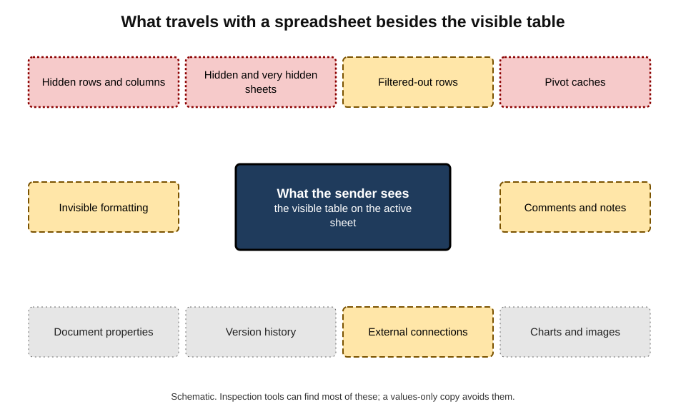
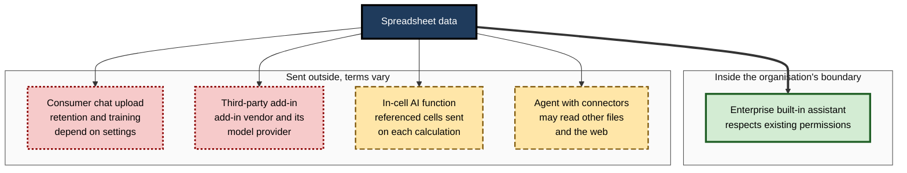
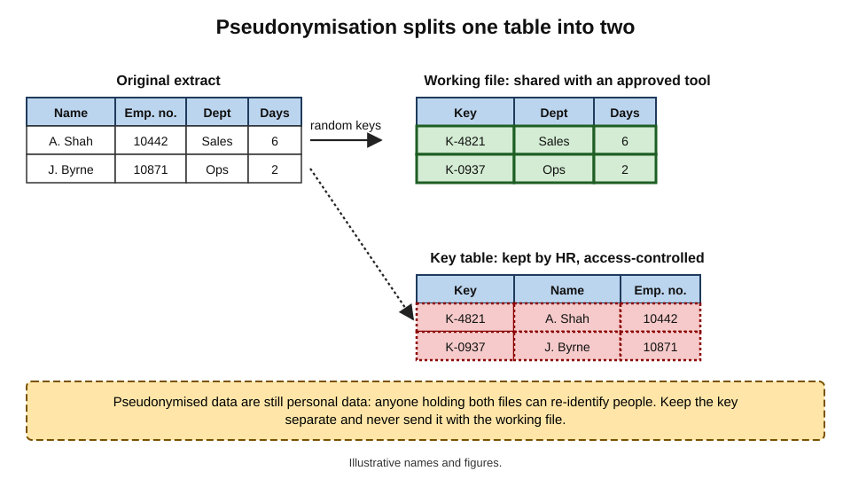
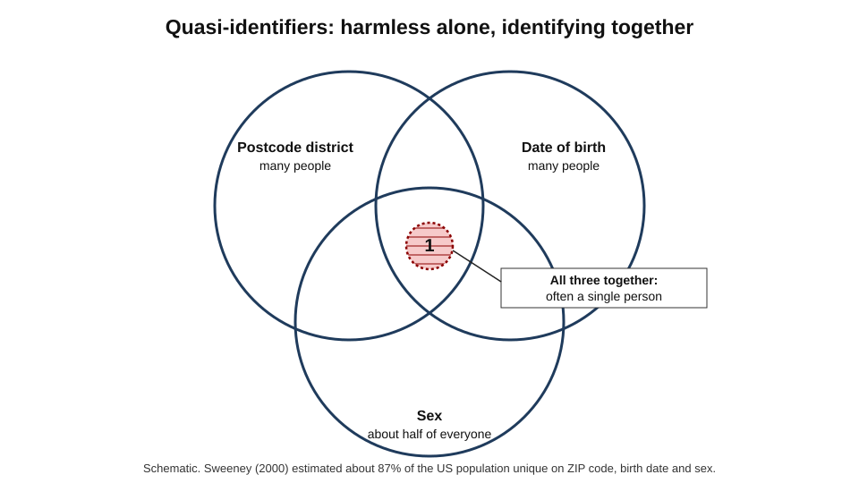
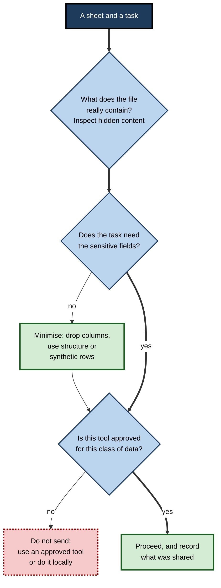

# E.10. Sensitive data in spreadsheet tools

In August 2023 a police service, answering a routine freedom-of-information request about officer numbers by rank, published a spreadsheet online. The visible table held only the requested totals. A second, hidden tab held the surname, initial, rank and role of every officer and member of staff — around ten thousand people, in a region where police officers face real threats to their safety. The spreadsheet did exactly what it was built to do. The data nobody could see were the data that mattered.

> **Definition — Sensitive data:** information whose disclosure, alteration or loss could harm individuals or an organisation — including personal data, special categories of personal data, confidential business information and data subject to legal or contractual restrictions.

> **Definition — Personal data:** any information relating to an identified or identifiable living person — directly, by name or identifier, or indirectly, by combining details.

**Why it matters**

- **Spreadsheets concentrate sensitive data.** Payroll, customer lists, patient extracts, pricing, deal pipelines — whole populations of records sit in single, portable files.
- **Spreadsheets hide data well.** Hidden sheets, cached copies and metadata travel with the file, unseen by its sender.
- **AI tools move data.** Every upload, in-cell AI call, add-in and assistant query sends cell contents somewhere; where, and under what terms, depends on the tool.
- **AI makes existing exposure searchable.** An assistant that can read everything a user can read turns over-shared files from a latent risk into an easily found one.

---

## Why Spreadsheets Are a Special Risk

- **Bulk** — one file may hold every customer, employee or patient.
- **Portability** — easily emailed, copied, uploaded, synced to personal devices.
- **Ubiquity** — everyone can create one; few are governed.
- **Hidden layers** — content not visible on screen but present in the file.
- **Derived copies** — extracts of extracts, each a new uncontrolled copy of the source system's data.
- **Weak defaults** — sharing links that anyone with the link can open; files stored in personal drives.

> **Key point:** most spreadsheet data incidents are not hacks. They are **ordinary actions** — attaching, uploading, sharing, publishing — performed on files whose full contents the sender did not know.

### Special categories and regulated data

- **Special category data** — under the UK and EU General Data Protection Regulation (GDPR), personal data revealing racial or ethnic origin, political opinions, religious beliefs, trade-union membership, genetic or biometric data, health, sex life or sexual orientation — attract stricter conditions.
- **Other regulated data** — payment-card numbers (under industry security standards), financial account data, criminal-offence data, children's data, and sector rules in health and finance.
- **Confidential business data** — prices, margins, bids, unreleased results, merger plans; disclosure may breach contracts or market rules.

---

## Where Sensitive Data Hide in a Workbook

**Figure 1.** Places in a workbook where sensitive data can sit unseen.

- **Hidden rows, columns and sheets** — including "very hidden" sheets that the normal unhide dialogue does not list.
- **Filtered-out rows** — present in the file, invisible on screen.
- **Pivot caches** — a pivot table's stored copy of its source data, which can be expanded to show detail even after the source sheet is deleted.
- **Cells formatted to be invisible** — white text, or the custom number format `;;;`, which displays nothing.
- **Comments and notes** — sometimes containing names, health details or opinions.
- **Document properties and metadata** — author names, company, file paths, last-modified-by.
- **Version history** — earlier versions in cloud storage may contain data later removed.
- **External data connections** — queries that refresh from databases, sometimes with stored credentials or server names.
- **Charts and images** — charts can retain cached data; pasted screenshots may show other records.
- **Named ranges** — pointing to data on hidden sheets.

> **In practice:** office applications include an inspection tool (in Excel, **Document Inspector**) that finds and removes hidden rows and sheets, comments, personal information in properties and other hidden content. Running it — and then **saving a fresh file containing only the values intended for release** — is a basic step before any spreadsheet leaves its controlled environment.

> **Watch out:** deleting a source sheet does not necessarily delete the data behind a pivot table built from it. The safest release format for tabular data is a new file built from **values only**, or a plain-text format such as CSV containing exactly the intended rows and columns.

---

## How AI Tools Touch Spreadsheet Data

### Five data flows

**Figure 2.** How spreadsheet data flow to different kinds of AI tool.

- **Enterprise built-in assistants** — such as Copilot in Microsoft 365 or Gemini in Google Workspace under business terms — process data within the vendor's enterprise commitments, inherit the user's existing permissions, and are subject to the organisation's administrative controls.
- **Consumer chat assistants** — files uploaded to personal accounts may be retained and, depending on settings and terms, used to improve models.
- **Third-party add-ins** — spreadsheet extensions that call AI models send cell contents to the add-in vendor and often onward to a model provider, under the add-in's own terms.
- **In-cell AI functions** — send the referenced cells to a model each time the function calculates.
- **Agents with connectors** — may read other files, mailboxes or web pages as part of a task, widening what is touched.

| | Enterprise built-in assistant | Consumer chat upload | Third-party add-in | In-cell AI function | Agent with connectors |
|---|---|---|---|---|---|
| Where data go | Vendor's enterprise service | Consumer service | Add-in vendor, then model provider | Model service, per calculation | Several services, task-dependent |
| Governed by | Organisation's contract and admin controls | Personal terms and settings | Add-in's terms | Plan terms | Configured permissions |
| Respects file permissions and labels | Yes, by design | No — the upload is a copy | Rarely | Within the plan's controls | Depends on configuration |
| Typical risk | Over-shared files become easy to find | Copy outside control; possible training use | Unknown processors | Repeated transmission; quotas | Broad reach; unintended access |
| Suitable for sensitive data | If approved and labelled appropriately | No | Only if vetted and approved | Rarely | Only with tight scope |

> **Watch out:** "the AI is built into the spreadsheet" does not settle where data go. Built-in features from the spreadsheet vendor, add-ins from other companies and personal-account features can look alike in the interface and differ completely in where they send data.

### Enterprise controls

- **Sensitivity labels** — classifications such as "Confidential" applied to files, which can enforce encryption and restrict actions. In Microsoft's platform, an assistant returns content from a label-encrypted file only if the user holds both the view right and the right to copy content out (called EXTRACT); a 2026 change extended a setting that blocks AI analysis of labelled files across Word, Excel and PowerPoint.
- **Data loss prevention (DLP)** — rules that detect patterns such as card numbers or national insurance numbers and block or warn on sharing or uploading.
- **Approved-tool lists and add-in management** — administrators allow only vetted add-ins and AI services.
- **Audit logs** — records of AI interactions and file access for investigation.

> **Definition — Sensitivity label:** a classification attached to a file or item that records how sensitive it is and can enforce protections such as encryption, access limits and restrictions on AI processing.

> **Definition — Data loss prevention:** technology and policy that detect sensitive information in files and messages and prevent it from being shared or sent where it should not go.

### Oversharing made visible

- **Before AI**, a file shared with "everyone in the organisation" was exposed but obscure — few would ever find it.
- **With an assistant that searches everything a user can access**, asking "what are the salaries in the finance team?" may surface that file at once.
- **The remedy is permission hygiene**, not blaming the assistant — reviewing who can access what, removing organisation-wide links, labelling sensitive files.

> **Key point:** enterprise AI assistants usually do not grant new access; they make **existing access** easy to use. Organisations that deploy them discover how much they had over-shared.

---

## Reducing What Is Exposed

### Minimisation

- **Use only the columns the task needs.** A formula for absence rates needs dates and departments, not names and diagnoses.
- **Use only the rows the task needs.**
- **Use structure instead of data** — for writing a formula or script, column names and a few **synthetic** rows usually suffice.

> **Definition — Synthetic data:** artificial records with the same structure and realistic values as real data, containing no real individuals, used to build and test methods safely.

### Pseudonymisation and anonymisation

> **Definition — Pseudonymisation:** replacing direct identifiers (names, employee numbers) with artificial keys, with the key table kept separately, so that data cannot be attributed to a person without the additional information.

> **Definition — Anonymisation:** processing data so that individuals are no longer identifiable by any reasonably likely means; truly anonymous data fall outside data-protection law.

- **Pseudonymised data are still personal data** under the GDPR, because re-identification is possible with the key.
- **Anonymisation is harder than it looks** — removing names is rarely enough.

**Figure 3.** Pseudonymisation: the working file and the key held apart.

**Study card — Latanya Sweeney: re-identification from ordinary fields (1997–2000)**

- **Demonstration (1997):** using a "de-identified" hospital dataset released by a US state agency, which retained postcode, date of birth and sex, Sweeney identified the medical records of the state's governor by matching them against a public voter list.
- **Analysis (2000):** using 1990 US census data, she estimated that about **87%** of the US population could be uniquely identified by the combination of five-digit ZIP code, full date of birth and sex.
- **Conclusion:** fields that look harmless individually — **quasi-identifiers** — become identifying in combination.
- **Influence:** led to the idea of **k-anonymity** — every combination of quasi-identifiers should be shared by at least k people — and shaped later de-identification rules.

> **Definition — Quasi-identifier:** a field that does not identify a person on its own but can do so in combination with others, such as postcode, date of birth, sex or job title.

**Figure 4.** Ordinary fields combining to single out one person.

### Aggregation and small-number suppression

- **Aggregate** — counts and totals by group instead of individual rows.
- **Suppress small cells** — groups with very few people (statistical offices commonly use thresholds such as fewer than 5 or 10) are hidden or merged, because a count of one is an individual.
- **Band values** — ages in five-year bands, salaries in ranges.

> **Watch out:** in a small team, even an aggregate can identify someone — "the one person in the Leeds office on long-term sick leave". Suppression thresholds must reflect how small the groups really are.

---

## Before Using AI on a Spreadsheet

**Figure 5.** Questions to answer before sending spreadsheet data to an AI tool.

1. **Inspect** — what is really in the file, including hidden content?
2. **Classify** — personal, special category, confidential, regulated?
3. **Minimise** — does the task need those fields at all?
4. **Choose the tool** — is it approved for this class of data, under the organisation's terms?
5. **Record** — what was shared, with which tool, for what purpose.

> **Mnemonic — "I Can Make Clean Records":** Inspect, Classify, Minimise, Choose the tool, Record.

---

## Worked Example (illustrative): An Absence Analysis

**Situation (illustrative figures):** an HR analyst wants an assistant's help analysing sickness absence by department for 1,800 employees. The source extract has 14 columns.

**Step 1 — inspect.** Document Inspector finds a hidden sheet of salary data and comments naming two employees' medical conditions.

**Step 2 — classify and minimise.**

| Column | Needed for the task? | Treatment |
|---|---|---|
| Name | No | Removed |
| Employee number | Only to count distinct people | Replaced with a random key; key table kept in HR |
| Date of birth | Only as age group | Banded to ten-year groups |
| Department | Yes | Kept |
| Office location | No | Removed |
| Absence start and end dates | Yes | Kept |
| Absence reason (medical) | No — rates only | Removed |
| Salary (hidden sheet) | No | Sheet deleted; file rebuilt from values |

**Step 3 — check small groups.** Two departments have fewer than ten employees; they are merged into "Other" for any output.

**Step 4 — choose the tool.** The organisation's enterprise assistant is approved for internal personal data; the minimised file is used there. A consumer assistant is not used.

**Step 5 — record.** A note in the analysis log states the extract date, columns removed, keying method and tool.

- **Conclusion:** the analysis needed 4 of the original 14 columns and none of the special-category data. Minimisation reduced the exposure far more than any tool setting could — and the hidden salary sheet, which the analyst had not known about, never left HR.

---

## Case Study: The Hidden Tab

- **Situation:** on 8 August 2023 the Police Service of Northern Ireland (PSNI) responded to a freedom-of-information request asking for the number of officers and staff at each rank and grade.
- **What happened:**
  1. the response was prepared from a spreadsheet extracted from the human-resources system;
  2. the requested table was on one tab; a **hidden tab** contained the underlying data — surnames, initials, ranks, roles and locations of around 9,500 officers and staff;
  3. the spreadsheet was published on a public website of freedom-of-information responses and was available for a few hours before removal.
- **Consequences:**
  - the data were obtained by people hostile to the police, in a region where officers have been targeted by violent groups;
  - staff faced fear for their safety, and some moved home;
  - the UK Information Commissioner's Office fined the service £750,000 in 2024, citing the absence of simple procedures to check for hidden data before release.
- **Lesson:** the visible table answered the request accurately; the harm lay entirely in content the sender could not see. **Inspecting for hidden content and releasing values only** are cheap, simple steps whose absence can cause severe harm.

---

## Case Study (illustrative): The Helpful Add-in

- **Situation:** a payroll team installed a free spreadsheet add-in that promised AI-powered "smart categorisation" of free-text fields.
- **What happened:** an administrator used it to categorise expense descriptions in the monthly payroll workbook, which also held names, bank details and salaries on the same sheet.
- **Discovery:** an IT review of add-in traffic found that the add-in sent entire selected ranges — not just the description column — to its vendor's servers in another country, under terms permitting retention for service improvement.
- **Actions:**
  1. the add-in was removed and blocked organisation-wide;
  2. the incident was assessed under the data-breach procedure, and the vendor asked to delete the data;
  3. add-in installation was restricted to an approved list;
  4. payroll workbooks were restructured so that free-text fields sit on a separate sheet without identifiers.
- **Lesson:** convenience features can be data flows. Before any AI feature touches a sheet, it is necessary to know **which cells it sends, to whom, and on what terms**.

---

## Building and Testing With Synthetic Data

Many AI-assisted spreadsheet tasks — writing a formula, designing a cleaning step, building a script — need the **structure** of the data, not the data themselves.

- **Create a synthetic sample** — the same columns, types and typical formats, with invented values: "Employee K-0001, Sales, 2026-03-14, 3 days".
- **Include the awkward cases deliberately** — blanks, duplicates, text numbers, odd dates, very large values — so the method is tested on what will actually occur.
- **Develop the method with AI on the synthetic sample**, in any approved tool.
- **Run the finished method on the real data** in an environment approved for it, without sending the real rows to the assistant.

> **Watch out:** synthetic data generated by modifying real records — shuffling a few names, changing some digits — may still identify people. Genuinely synthetic samples are built from scratch to match the structure, not derived from the individuals.

| | Real data sent to AI | Synthetic sample sent to AI |
|---|---|---|
| Exposure of personal data | Yes | None, if built from scratch |
| Tests realistic edge cases | Yes, if present | Only those deliberately included |
| Method still verified on real data | Needed | Needed |
| Suitable for unapproved tools | No | Usually yes, subject to policy on business information |

---

## Sensitive Data in AI Outputs and Histories

Attention usually goes to what is sent **to** an AI tool. What comes **back**, and what is kept, matters as much.

- **Outputs can concentrate sensitive data.** A summary such as "the three highest earners in Finance are…" or "employees with more than ten days' sick leave" turns a large file into a short, highly sensitive list — easy to paste into an email or slide.
- **Outputs inherit the classification of their inputs.** A chart of salaries by named person is as sensitive as the payroll file.
- **Chat histories are copies.** Conversations containing pasted data persist in the tool's history unless deleted, and may be visible to administrators or retained under the service's terms.
- **Generated files and code** — cleaned extracts, scripts with embedded sample rows, exported charts — are new copies that need the same handling as the source.
- **Logs and caches** — some tools keep logs of prompts and responses for safety monitoring or troubleshooting for a set period.

> **Watch out:** screenshots are a common blind spot. A screenshot of a spreadsheet pasted into a chat assistant, an email or a slide carries every visible cell — including neighbouring columns of names or salaries that were not the point of the picture — and image-reading models can extract that text as easily as a person can read it.

> **In practice:** a sound habit is to treat an AI conversation about sensitive data like a working file: give it the same classification, delete it when the task ends, and never forward its outputs more widely than the source data could be forwarded.

---

## Sharing and Publishing Spreadsheets Safely

Many of the worst spreadsheet incidents happen at the moment of sharing. A short release routine prevents most of them.

1. **Decide what the recipient needs** — the table, not the workbook.
2. **Build a release file from values only** — a new workbook or CSV containing exactly the intended rows and columns.
3. **Inspect it** — hidden content, comments, properties, connections, named ranges.
4. **Check small numbers** — any group small enough to identify a person is suppressed or merged.
5. **Check the link or channel** — sharing restricted to named people; "anyone with the link" avoided for sensitive data; external publication only through the approved route.
6. **Second-person review** for anything published or sent outside the organisation.
7. **Record what was released**, to whom and when.

> **Remember:** **need, values, inspect, small numbers, link, second person, record.**

| Sharing route | Main risk | Safer practice |
|---|---|---|
| Email attachment | Whole workbook with hidden content travels; cannot be recalled | Values-only release file; inspected; encrypted if sensitive |
| Cloud link | "Anyone with the link" spreads beyond intended readers | Named people; expiry dates; view-only |
| Publication on a website | Permanent, copied by others within minutes | Values-only CSV; second-person check; small-number suppression |
| Upload to an AI tool | Copy outside organisational control | Approved tool; minimised data; record of use |
| Shared drive | Access broader than intended; found by assistants | Permission review; sensitivity labels |

> **Watch out:** once a spreadsheet is published online, removal does not undo the exposure. In the police case the file was available for only a few hours, yet copies circulated afterwards. Prevention is the only effective control.

---

## Professional Practice

- **Data classification** — labelling files by sensitivity so that tools and people know how to treat them.
- **Release procedures** — a second person checks any spreadsheet published or sent externally, including hidden content.
- **Least privilege** — access to sensitive workbooks limited to those who need it; sharing links reviewed.
- **Retention** — extracts deleted when the task ends; copies in chat histories and downloads cleared.
- **Incident reporting** — mistakes reported promptly; under the GDPR, notifiable personal-data breaches must generally be reported to the regulator within 72 hours of the organisation becoming aware of them.

> **In practice:** the single most effective habit is to ask, before any spreadsheet leaves a controlled place — by email, upload, add-in or publication — "what is **in** this file that I cannot see?"

---

## Open Questions

- **Will AI tools respect labels everywhere?**
  - Enterprise suites increasingly enforce labels in their own assistants; consistent enforcement across add-ins, consumer tools and agents is far from complete.
- **Can anonymisation keep pace with re-identification?**
  - More powerful models and more public data make linking easier; what counts as "reasonably likely" re-identification is contested.
- **How should agents' reach be bounded?**
  - Agents that read many files to complete a task need permission models finer than "everything the user can access".
- **Will assistants detect sensitive content before sending it?**
  - Built-in warnings are emerging, but reliable detection of sensitive data in arbitrary spreadsheets remains difficult.

---

## Summary

- **Sensitive data** include personal, special-category, regulated and confidential business data; spreadsheets concentrate them in portable files.
- Hidden places: hidden and very hidden sheets, filtered rows, **pivot caches**, invisible formatting, comments, **metadata**, version history, connections, charts, named ranges. Use **Document Inspector** and release **values only**.
- AI data flows differ: **enterprise built-in assistants**, **consumer uploads**, **third-party add-ins**, **in-cell AI functions**, **agents with connectors** — each with different destinations and terms.
- Enterprise controls: **sensitivity labels** (with rights such as EXTRACT governing AI access), **DLP**, approved tools and add-ins, audit logs. AI assistants expose **over-sharing**; permission hygiene is the remedy.
- Reduce exposure by **minimisation**, synthetic data, **pseudonymisation** (still personal data), aggregation, banding and **small-number suppression**; beware **quasi-identifiers** (Sweeney: ZIP code, date of birth and sex identify most people).
- Before using AI: **Inspect, Classify, Minimise, Choose the tool, Record**.
- The **PSNI 2023** hidden-tab release shows that unseen content causes the harm.

---

## Self-Check

1. Define sensitive data and personal data.
2. Give five reasons spreadsheets carry special data risk.
3. List eight places sensitive data can hide in a workbook.
4. Why is a values-only file safer than deleting a source sheet?
5. Compare an enterprise built-in assistant with a third-party add-in on where data go and whether file labels are respected.
6. What is the EXTRACT right, and how does it affect AI assistants?
7. Explain how AI assistants make over-sharing visible, and what fixes it.
8. Distinguish pseudonymisation from anonymisation, and state the legal status of pseudonymised data.
9. Summarise Sweeney's findings and the concept of a quasi-identifier.
10. Why might an aggregate table still identify someone?
11. Describe the five steps before using AI on a spreadsheet.
12. In the absence worked example, which treatments reduced exposure most?
13. What went wrong in the PSNI case and what simple steps would have prevented it?
14. A manager wants to paste a client list with contract values into a free chat assistant to draft renewal priorities. Advise.

15. Why can an AI output be more sensitive than the request that produced it? Give an example.
16. Describe the seven-step release routine for sharing a spreadsheet outside a team.

### Answer Key

1. Sensitive data: information whose disclosure, alteration or loss could harm people or an organisation. Personal data: information relating to an identified or identifiable living person.
2. Bulk records; portability; ubiquity with little governance; hidden layers; uncontrolled derived copies; weak sharing defaults.
3. Hidden rows, columns and sheets; very hidden sheets; filtered rows; pivot caches; invisible formatting; comments and notes; document properties; version history; external connections; charts and images; named ranges.
4. Pivot caches, named ranges, charts or other objects may retain data after a sheet is deleted; a new file built from values contains only what was deliberately copied.
5. Enterprise assistant: data stay within the vendor's enterprise service under the organisation's contract and controls, respecting permissions and labels. Add-in: data go to the add-in vendor and often a model provider under its own terms, usually without label enforcement.
6. A usage right allowing content to be copied out of a protected file; assistants return content from label-encrypted files only if the user holds both view and EXTRACT rights.
7. Assistants can find anything the user can access, so widely shared sensitive files surface easily. Fix: permission hygiene — review access, remove broad links, label sensitive files.
8. Pseudonymisation replaces identifiers with keys held separately; anonymisation makes individuals unidentifiable by reasonably likely means. Pseudonymised data remain personal data.
9. Sweeney re-identified a governor's medical records from "de-identified" hospital data using ZIP code, birth date and sex, and estimated these three identify about 87% of the US population. Quasi-identifiers are harmless-looking fields that identify in combination.
10. Small groups can isolate individuals ("the one person on long-term sick leave in Leeds"); counts of one or two reveal people.
11. Inspect for hidden content; classify the data; minimise to what the task needs; choose a tool approved for that data; record what was shared.
12. Removing unnecessary columns (especially medical reasons and names), deleting the hidden salary sheet by rebuilding from values, and keying employee numbers; merging small departments.
13. A hidden tab of staff details was published with an FOI response. Inspecting for hidden content, releasing a values-only file of the requested table, and a second-person check before release would have prevented it.
14. Do not paste client names and contract values into an unapproved consumer tool — confidential business data may be retained outside the organisation's control. Use an approved enterprise assistant, or minimise: anonymise client names to codes, band contract values, and keep the key locally; record the use.
15. Outputs can distil a large file into a short list of exactly the sensitive facts — for example "the five employees with the most sick days" — which is easy to forward and more harmful than the bulk data it came from.
16. Decide what the recipient needs; build a values-only release file; inspect it for hidden content and metadata; suppress small numbers; restrict the link or channel; have a second person review; record what was released, to whom and when.

---

## Glossary

| Term | Meaning |
|---|---|
| Anonymisation | Processing data so individuals are no longer identifiable by reasonably likely means. |
| Data loss prevention | Controls that detect sensitive information and block inappropriate sharing. |
| Document Inspector | An Excel tool that finds and removes hidden content and metadata. |
| EXTRACT right | A usage right permitting content to be copied out of a protected file. |
| k-anonymity | A property where each combination of quasi-identifiers is shared by at least k people. |
| Metadata | Data about a file, such as author and file path. |
| Minimisation | Using only the data a task needs. |
| Personal data | Information relating to an identifiable living person. |
| Pseudonymisation | Replacing identifiers with keys held separately. |
| Quasi-identifier | A field that identifies a person in combination with others. |
| Sensitivity label | A classification on a file that can enforce protections. |
| Small-number suppression | Hiding or merging groups too small to publish safely. |
| Special category data | Personal data such as health or ethnicity given extra protection under the GDPR. |
| Synthetic data | Artificial records with realistic structure and no real individuals. |
