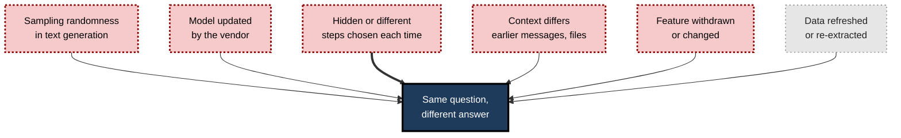
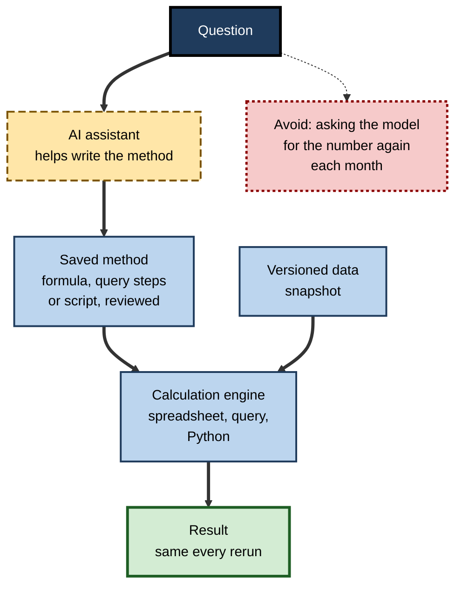
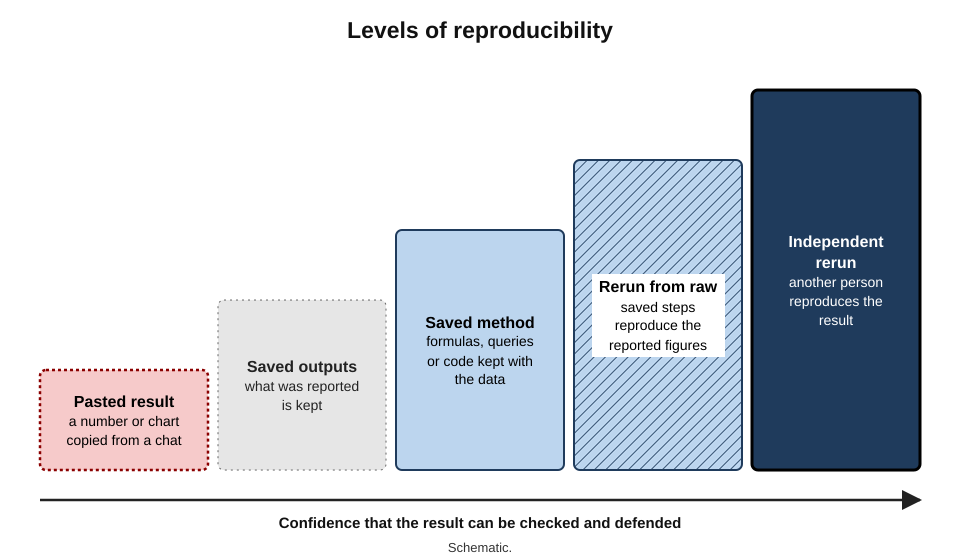
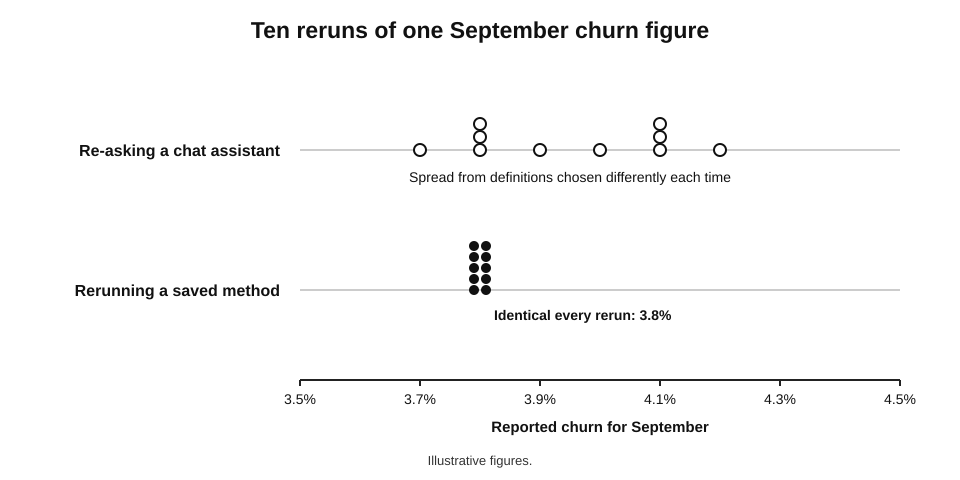
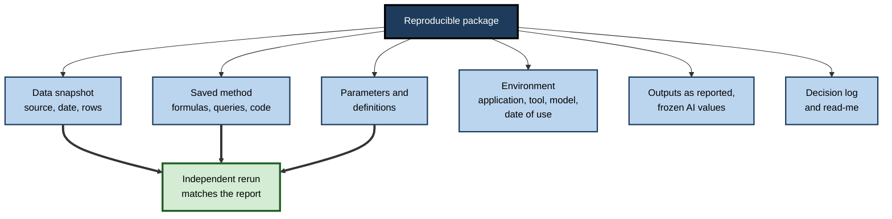

# E.11. Reproducibility of AI-assisted analysis

Each month a customer-success analyst uploads the latest customer file to an AI assistant and asks the same question: "What was monthly churn?" In September the answer was 4.1%. In October, checking September again with the same file and the same words, she gets 3.8%. Neither answer came with a method she can rerun. The finance director wants to know which figure was reported to the board, why it changed, and whether anything else has. Nobody can say.

> **Definition — Reproducibility:** the ability to obtain the same results from the same data by repeating the same analytical steps — by the original analyst at a later date, or by someone else.

> **Definition — Replicability:** the ability to obtain consistent findings when the same question is studied with new data, using the same or a similar method.

**Why it matters**

- **An analysis that cannot be rerun cannot be checked**, corrected, extended or defended.
- **AI introduces new sources of variation** — random sampling in generation, silent model updates, hidden steps, features that are withdrawn.
- **Reported numbers have a life after reporting.** Auditors, regulators, boards and successors ask how a figure was produced, sometimes years later.
- **Recurring analyses must be consistent over time.** A monthly trend built from steps that vary from month to month measures the steps, not the business.

---

## What Reproducibility Requires

### Same data, same steps, same result

- **Same data** — the exact extract, from a known source, at a known date.
- **Same steps** — every filter, join, definition, calculation and exclusion, in order.
- **Same environment** — the application and versions that executed the steps.
- **Same result** — identical numbers, or differences explained and negligible.

> **Key point:** reproducibility is a property of the **method record**, not of the result. A correct figure produced by steps that no one recorded is not reproducible — it is merely unrepeated.

### Why it has long mattered

- **Spreadsheet analyses have been overturned when someone reran them.** The best-known case is the 2013 re-examination of an influential economics paper on public debt and growth, in which a graduate student obtained the authors' spreadsheet and found a formula range that omitted several countries; correcting it and other choices weakened the paper's headline result considerably. The discovery was possible only because the spreadsheet existed and could be rerun.

**Study card — Stodden, Seiler and Ma (2018): computational reproducibility in a leading journal**

- **Design:** after the journal *Science* adopted a policy requiring authors to share data and code, the researchers contacted the authors of 204 computational articles published under that policy and requested the materials.
- **Results:**
  - materials were obtained for only about **44%** of the articles;
  - the researchers estimated that the findings of only about **26%** could be reproduced from the shared materials.
- **Conclusion:** even under a formal sharing policy, most analyses could not be rerun by others.
- **Lesson:** reproducibility does not happen by default; it needs records made **at the time of the analysis**.

---

## How AI Threatens Reproducibility

**Figure 1.** Sources of variation in AI-assisted analysis.

### Non-determinism in generation

> **Definition — Non-determinism:** the property of a process that can produce different outputs from identical inputs.

- **Language models generate text by sampling** from probabilities; settings such as "temperature" control how much randomness is used.
- **Even at the most deterministic settings**, identical requests can produce different outputs, because of how computations are batched and performed on the underlying hardware. Researchers testing several models in 2024 reported such variation on a noticeable share of repeated requests.
- **In analysis, small wording differences become method differences** — a different filter, a different definition of "active", a different handling of blanks.

### Model and tool changes

- **Vendors update models** behind the same product name; the same request may be handled by a different model next month.
- **Features change or disappear.** Microsoft warned that results of its in-cell `COPILOT` function could change over time as the model changed, and in August 2026 announced the function's withdrawal from 14 September 2026, so formulas using it would stop working. Microsoft has likewise announced that Power BI's natural-language Q&A feature will be retired by December 2026.
- **Consequence:** any result that depends on **calling a model again** is exposed to change outside the analyst's control.

### Hidden steps

- **Chat-based analysis hides its method** unless the analyst asks for it — which rows were used, which definition, which exclusions.
- **Code may be generated and run but not saved.**
- **Chat histories are not records** — they can be deleted, are hard to search, and may not show the code actually executed.

### Context dependence

- **An assistant's answer depends on everything in the conversation** — earlier files, earlier instructions, earlier mistakes. The same question in a fresh conversation may be handled differently.

| Source of variation | Example | Can the analyst control it? | Remedy |
|---|---|---|---|
| Sampling randomness | Different filter chosen on a rerun | Partly | Save the generated method; do not regenerate it |
| Model update | New model interprets "churn" differently | No | Do not depend on re-calling the model for results |
| Feature withdrawal | In-cell AI function retired | No | Avoid model calls inside production workbooks |
| Hidden steps | Exclusions not reported | Yes | Require and save code, queries, formulas |
| Context | Earlier instructions alter behaviour | Yes | Fresh, documented request; saved prompt |
| Data refresh | New extract includes late records | Yes | Snapshot and version the data |

---

## Freezing the Method: The Core Pattern

**Figure 2.** Using AI to produce a deterministic method that is saved and rerun, rather than re-asking the model for the result.

- **AI helps write the method** — a formula, a set of Power Query steps, a SQL query, a Python script.
- **The method is reviewed and saved** with the analysis.
- **A deterministic engine runs it** on a saved data snapshot.
- **Rerunning gives the same result**, whatever has happened to the model since.

> **Remember:** **AI writes the recipe once; the engine cooks it every time.**

### When AI output itself is the data

- **Some tasks have no deterministic method** — classifying free-text comments, extracting fields from documents, tagging records.
- **Remedy — freeze the output:**
  1. run the AI step once on the full set;
  2. save the outputs as **values**, never as live AI formulas;
  3. record the tool, model or version name if shown, date, prompt and settings;
  4. review a random sample and record the error rate found;
  5. for new data, classify only the new records — do not re-classify the history unless the whole series is redone and documented.

> **Watch out:** re-classifying a whole history each month with a model that may have changed creates trend breaks that look like real change. A rise in "billing complaints" may be the model's reinterpretation, not customers' experience.

---

## What to Keep: The Reproducible Package

**Figure 3.** Levels of reproducibility, from a pasted result to an independent rerun.

| Element | What it records | Spreadsheet form | AI-specific addition |
|---|---|---|---|
| Data | Exact input | Saved extract with source, date and row count | The file actually uploaded or referenced |
| Method | Every step | Formulas, Power Query steps, pivot settings, scripts | Generated code and formulas saved, not just results |
| Parameters | Choices that vary | Input cells for dates, thresholds, definitions | Prompt text where AI output is used as data |
| Environment | What executed it | Application and version; add-ins | Tool, model or version name, date of use |
| Outputs | What was reported | Values and charts as reported | AI-generated values frozen with their date |
| Decisions | Why choices were made | Log of definitions and exclusions | Which AI suggestions were accepted or rejected |
| Instructions | How to rerun | A short "read me" sheet | Note of which steps involved AI |

> **Definition — Provenance:** the documented origin and processing history of a result — which data, which steps, which tools, by whom and when.

> **Definition — Audit trail:** a chronological record of the actions taken in producing or changing a result, sufficient for someone else to follow and check them.

### Practical tools

- **Power Query** — the step list is itself a rerunnable record of the data preparation.
- **Scripts and notebooks** — Python or R code, saved as files; notebooks combine code, results and notes.
- **Python in Excel** — keeps code within the workbook, alongside its results.
- **Version history and version control** — cloud storage keeps earlier versions; code repositories (such as Git) record every change to scripts.
- **A "read me" or "About" sheet** — purpose, source, steps, owner, date.

> **In practice:** a strong test of reproducibility is the **"run from raw" test** — delete every derived sheet or output, rerun the saved steps from the raw data, and compare with the reported figures. If they match, the analysis is reproducible; if not, the difference is the undocumented part.

---

## Worked Example (illustrative): The Churn Figure That Moved

**Situation (illustrative figures):** the September churn figure was 4.1% when first produced through a chat assistant and 3.8% when re-asked in October from the same file.

**Step 1 — recover the method.** The analyst asks the assistant, in a fresh conversation, for code computing September churn from the file, and saves it. Running it gives **3.8%**.

**Step 2 — find the difference.** Reading the code shows its definition of the starting customer base: all customers active on 1 September, **excluding** customers on free trials. The September answer had evidently included trials — 4.1% matches a recomputation that includes them.

| Definition of the base | Customers at start | Lost in September | Churn |
|---|---|---|---|
| Including free trials | 12,400 | 508 | 508 ÷ 12,400 = **4.1%** |
| Excluding free trials | 10,900 | 414 | 414 ÷ 10,900 = **3.8%** |

> **Formula — Monthly churn rate:** customers lost during the month ÷ customers at the start of the month. Example: 414 ÷ 10,900 ≈ **3.8%**.

**Step 3 — decide the definition.** The company's standard, agreed with finance, excludes free trials. 3.8% is correct by that standard; the board was given 4.1%.

**Step 4 — make it reproducible.**

1. The definition is written into the analysis log and an input cell ("Exclude trials: Yes").
2. The calculation is moved into Power Query and a pivot table, using the saved logic.
3. Each month's extract is saved with its date and row count.
4. Past months are recomputed with the same steps; the corrected series is reported with a note.

- **Conclusion:** neither number was an arithmetic error. The assistant chose **different, reasonable definitions** on different occasions, and nothing recorded which. Fixing the definition in a saved method made the figure stable — and exposed that one reported number used the wrong definition.

**Figure 4.** The same question asked repeatedly of a chat assistant, compared with a saved method rerun.

---

## Case Study (illustrative): The Complaint Categories That Drifted

- **Situation:** a utility company used an AI function in a shared spreadsheet to classify about 3,000 customer complaints a month into eight categories for a regulatory report.
- **What happened:**
  1. the classification formulas stayed live in the workbook, recalculating whenever the file was opened or edited;
  2. after a vendor model update, "billing" complaints in the historic months rose by a fifth, and "metering" complaints fell — in data already reported;
  3. the regulator queried why figures for earlier quarters differed between two submissions.
- **Diagnosis:**
  - the historic classifications had been **re-generated** by a changed model;
  - no record existed of which classification had been reported, or of the prompt and settings used;
  - nobody had measured the classifier's error rate.
- **Actions:**
  1. reported classifications were recovered from the submitted reports and frozen as values;
  2. new months were classified once, frozen, and stored with date, prompt and tool name;
  3. a monthly random sample of 100 complaints was classified by staff to estimate error rates;
  4. the category definitions were written down and included in the prompt;
  5. live AI formulas were banned from regulatory workbooks.
- **Result:** consistent series restored; the regulator accepted an explanation and the corrected submission; the measured error rate (about 9% of complaints misclassified) was disclosed in the method note.
- **Lesson:** an AI result that can regenerate itself is **not a record**. Freezing outputs, recording conditions and measuring error turned an unstable feature into a defensible process.

---

## Recording an AI Step

When an AI tool's output becomes part of a result — classifications, extracted fields, generated commentary — a short record makes the step explainable later.

| Field | What to record | Example (illustrative) |
|---|---|---|
| Purpose | What the step did | Tagged survey comments into nine themes |
| Input | Which data, which version | survey_2026Q3_v2.csv, 2,140 rows |
| Tool | Product and, if shown, model or version | Enterprise assistant, model name as displayed |
| Date | When it was run | 2 October 2026 |
| Instruction | The exact prompt, including definitions | Saved as theme_prompt_v3.txt |
| Settings | Any options chosen | Default settings; one pass |
| Output | Where the frozen result is stored | Column "Theme" saved as values |
| Check | How it was verified and the result | 150-item sample; 88% agreement |
| Owner | Who is accountable | Insights analyst |

- **Keep it next to the work** — in an "About" sheet, a log tab or a short text file in the same folder.
- **Keep it short** — a record that takes longer to write than the task will not be kept.

> **Key point:** the record does not make the AI step deterministic. It makes the step **explainable** — which is what auditors, regulators and successors actually need.

---

## Versioning Data in Everyday Tools

The data are the half of reproducibility most often forgotten. A saved method run on a different extract gives a different answer.

- **Snapshot inputs** — save each period's extract as a read-only file rather than overwriting last month's.
- **Name files consistently** — source, content, date and version: `crm_customers_2026-09-30_v1.csv`.
- **Record row counts and control totals** for each snapshot — the quickest way to confirm later that "the same data" really are the same.
- **Use checksums for critical files** — a short code computed from a file's contents that changes if even one character changes.
- **Separate raw from derived** — raw extracts in one folder, never edited; outputs in another.

> **Definition — Checksum:** a short value calculated from a file's contents, used to confirm that the file has not changed since the value was recorded.

> **Watch out:** "the September file" is not a version. Systems re-extract with late corrections, and a file regenerated in October may differ from the one used in September. Only a saved snapshot, with its row count and totals, pins the data down.

---

## Reproducing Work Done by Agents

Agent-style assistants change workbooks through many small actions. Reproducing their work raises its own questions.

- **Rerunning the agent is not reproduction.** The same instruction given again may produce a different structure, different formulas and different results.
- **The workbook the agent produced is the artefact.** Once reviewed, it is saved, versioned and rerun like any other workbook; the agent is not called again to regenerate it.
- **Action logs help** — some tools record the steps an agent took; where available, they should be kept with the workbook.
- **Version comparison is essential** — comparing the workbook before and after an agent's changes shows exactly what it did, including changes nobody requested.

---

## Reproducible Is Not the Same as Right

- **A reproducible analysis can be reproducibly wrong.** Rerunning a flawed method on the same data gives the same flawed answer every time.
- **Robustness asks a different question:** would other reasonable choices — another definition of "active customer", another treatment of outliers — give a materially different answer?
- **AI makes robustness checks cheap.** An assistant can write alternative versions of a method quickly; running them and comparing results shows how much the conclusion depends on the choices.
- **Analytical choices matter as much as data.** Studies in which many independent teams analysed the same dataset have found widely varying answers from defensible choices alone.

> **Definition — Robustness check:** rerunning an analysis with alternative reasonable choices of data, definitions or methods to see whether the conclusion still holds.

> **In practice:** for any consequential figure, a short note — "with trials included, churn would be 4.1% rather than 3.8%" — tells readers how sensitive the result is to its definitions, and protects the analyst when someone later uses a different one.

---

## A Routine for Recurring Reports

Monthly and quarterly reports are where reproducibility pays most, because every period is compared with the last.

1. **Fix the definitions** — write down the measures, filters and exclusions, and agree them with the report's owner.
2. **Encode them once** — in Power Query steps, a script or formulas driven by labelled parameter cells; AI may help write them.
3. **Snapshot each period's data** — read-only, consistently named, with row counts and control totals.
4. **Run the saved method** — never re-ask a model for the figures.
5. **Reconcile** — this period's totals against the source system; last period's figures reproduced exactly from last period's snapshot.
6. **Freeze any AI-generated content** — commentary, classifications — as values, with date and tool recorded.
7. **Log changes** — any change to definitions or method is dated, explained, and applied to history if comparisons are to remain valid.

> **Remember:** **define, encode, snapshot, run, reconcile, freeze, log.**

| Practice | Without it | With it |
|---|---|---|
| Written definitions | Each period's analyst interprets "churn" afresh | Same measure every period |
| Saved method | Figures depend on how a request was phrased | Identical steps every run |
| Data snapshots | Last month cannot be reproduced | Any period can be rerun |
| Reproducing last period | Silent changes go unnoticed | Drift is detected immediately |
| Change log | Trend breaks look like real change | Breaks are explained and restated |

> **In practice:** reproducing **last** period's figures exactly before producing **this** period's is the single cheapest control in recurring reporting. If last month cannot be reproduced, something has changed — the data, the method or the tool — and the change must be found before any new figure is trusted.

---

## Common Objections, and Answers

- **"It was only a quick analysis."**
  - Quick analyses become reported figures surprisingly often. A saved formula or script costs seconds at the time and hours to recreate later.
- **"The chat history is the record."**
  - Chat histories can be deleted, may not show the code actually executed, and record a conversation rather than a method. They are evidence of what happened, not a means of rerunning it.
- **"The model gives the same answer anyway."**
  - Often it does; sometimes it does not, and nothing signals which occasion is which. Variation is most likely precisely where definitions are ambiguous — the cases that matter.
- **"Documentation slows us down."**
  - The records described here are short. The real slowdown comes later, when a figure is questioned and nobody can show how it was produced.
- **"We will just ask the AI to explain how it got the number."**
  - An explanation produced after the event is a new generation, not a record of what was done; it may describe a different method from the one that produced the figure.

> **Key point:** each objection treats reproducibility as a cost paid now. It is better understood as **insurance** — cheap to buy at the time of the analysis, and impossible to buy afterwards.

---

## Reproducibility in Professional Settings

- **Finance and audit** — figures in accounts and management reports must be traceable to source and reproducible; auditors may ask for the steps behind any number.
- **Regulated reporting** — submissions must be consistent across periods and explainable when revised.
- **Research and policy** — evidence used for public decisions should be rerunnable by others.
- **Operations** — recurring dashboards need stable definitions so that trends mean what they appear to mean.

**Figure 5.** What a reviewer needs in order to rerun an AI-assisted analysis.

> **Mnemonic — "Data, Method, Parameters, Environment, Outputs, Log" — "Do Make Proper Evidence Of Logic".**

### Disclosing AI involvement

- **State where AI was used** — "classification of free-text comments was performed with an AI tool on 3 October 2026 and reviewed on a sample of 100 items; estimated error rate 9%".
- **State what was verified** — reconciliations, reruns, reviews.
- **Keep the record proportionate** — a quick internal estimate needs a line; a regulatory figure needs the full package.

---

## Open Questions

- **Will AI vendors offer stable, versioned models for analysis?**
  - Some services allow a model version to be pinned for a period; long-term stability for record-keeping is uncommon.
- **How should prompts be treated as part of a method?**
  - Prompts influence results but are not deterministic code; whether and how to version them is unsettled.
- **Can AI tools produce their own audit trails?**
  - Built-in logs of steps and data accessed would help reproducibility greatly; their completeness and accessibility vary.
- **What level of reproducibility is proportionate for everyday work?**
  - Full packages for every quick analysis would be excessive; practical thresholds are a matter of judgement and emerging policy.

---

## Summary

- **Reproducibility**: same data, same steps, same result; **replicability**: consistent findings with new data. Reproducibility is a property of the **method record**.
- Analyses have long been corrected because someone could rerun them; many published computational analyses cannot be rerun even under sharing policies (Stodden and colleagues, 2018: about 26% reproducible).
- AI adds variation: **sampling randomness**, **model updates**, **feature withdrawals** (such as the 2026 retirement of an in-cell AI function), **hidden steps**, **context dependence** — plus ordinary data refreshes.
- Core pattern: **AI writes the method once; a deterministic engine reruns it** on versioned data. Where AI output is itself the data, **freeze it as values** with date, prompt and tool, and measure its error rate.
- Keep a **reproducible package**: data, method, parameters, environment, outputs, decision log, read-me. Test with **"run from raw"**.
- Disclose AI involvement and verification in proportion to the stakes.

---

## Self-Check

1. Define reproducibility and replicability and explain the difference.
2. Why is reproducibility a property of the method record rather than of the result?
3. Summarise the Stodden study and its lesson.
4. List five sources of variation in AI-assisted analysis.
5. Why can identical requests give different outputs even at deterministic settings?
6. Explain the "freeze the method" pattern.
7. How should AI outputs that are themselves data, such as classifications, be handled?
8. What are the elements of a reproducible package?
9. Describe the "run from raw" test.
10. In the churn example, what caused the change, and how was it fixed?
11. Why did the complaint categories drift, and what controls restored consistency?
12. Write a one-paragraph disclosure of AI involvement for a quarterly report that used AI to tag survey comments.
13. A team relies on live in-cell AI formulas in a monthly operations workbook. What risks follow, and what would you change?

14. What should a record of an AI step contain, and why does it not make the step deterministic?
15. Why is "the September file" not a version, and what pins data down?
16. Distinguish reproducibility from robustness and explain how AI can help with each.

### Answer Key

1. Reproducibility: the same results from the same data by repeating the same steps. Replicability: consistent findings when the question is studied with new data. The first tests the analysis; the second tests the finding.
2. A correct result produced by unrecorded steps cannot be rerun or checked; only a record of data, steps and environment allows it to be reproduced.
3. Of 204 computational articles in *Science* under a sharing policy, materials were obtained for about 44% and findings reproduced for about 26%. Lesson: reproducibility requires records made at the time.
4. Sampling randomness; model updates; feature withdrawal or change; hidden steps; context dependence; data refreshes.
5. Generation involves sampling, and even at the most deterministic settings the way computations are batched and executed on hardware can change results.
6. AI helps write a deterministic method — formula, query or script — which is reviewed and saved; an engine runs it on versioned data, so reruns give the same result regardless of model changes.
7. Run once; save outputs as values; record tool, version or model name, date, prompt and settings; measure error on a sample; classify only new records unless the whole series is redone and documented.
8. Data snapshot; saved method; parameters and definitions; environment; outputs as reported; decision log; read-me instructions.
9. Delete derived outputs, rerun the saved steps from raw data and compare with reported figures; a mismatch reveals undocumented steps.
10. The assistant used different definitions on different occasions (including or excluding free trials). Fixed by agreeing the definition, encoding it as a parameter, moving the calculation into saved query and pivot steps, versioning extracts and recomputing history.
11. Live AI formulas recalculated historic classifications after a model update. Controls: recovering and freezing reported values; classifying new months once and freezing them with conditions recorded; sample-based error measurement; written category definitions; banning live AI formulas from regulatory workbooks.
12. E.g. "Free-text survey comments (n = 2,140) were tagged into nine themes using [tool] on 2 October 2026, with the theme definitions supplied in the instruction. Tags were saved as fixed values. A random sample of 150 comments was tagged independently by two staff; agreement with the AI tags was 88%. Theme counts in this report should be read with that error margin."
13. Results may change on recalculation or after model updates; quotas may leave rows blank; the feature may be withdrawn; past figures cannot be reproduced. Change: replace live AI formulas with frozen values recorded with date and prompt, or with deterministic formulas where possible; version data; document the method; sample-check outputs.
14. Purpose, input and version, tool and model if shown, date, exact instruction, settings, where the frozen output is stored, how it was checked, and the owner. Rerunning the same instruction may still give different output; the record makes the step explainable, not repeatable.
15. Systems re-extract with late corrections, so a regenerated file may differ. A saved, read-only snapshot with a consistent name, row count, control totals and, for critical files, a checksum.
16. Reproducibility: the same method on the same data gives the same result. Robustness: other reasonable choices give a similar conclusion. AI helps the first by writing methods to save and rerun, and the second by quickly producing alternative versions of a method to compare.

---

## Glossary

| Term | Meaning |
|---|---|
| Audit trail | A chronological record of actions taken in producing a result. |
| Checksum | A short value computed from a file's contents to confirm it has not changed. |
| Freezing | Saving AI outputs as fixed values with a record of how they were produced. |
| Non-determinism | Producing different outputs from identical inputs. |
| Notebook | A document combining code, results and explanatory text. |
| Parameter | An input that can vary between runs, such as a date range or definition. |
| Provenance | The documented origin and processing history of a result. |
| Replicability | Obtaining consistent findings with new data. |
| Reproducibility | Obtaining the same results from the same data and steps. |
| Reproducible package | The data, method, parameters, environment, outputs and log needed to rerun an analysis. |
| Robustness check | Rerunning an analysis with other reasonable choices to see if the conclusion holds. |
| Run from raw | Rerunning saved steps from raw data to confirm the reported results. |
| Temperature | A setting controlling how much randomness a language model uses in generation. |
| Version control | A system recording every change to files such as scripts. |
