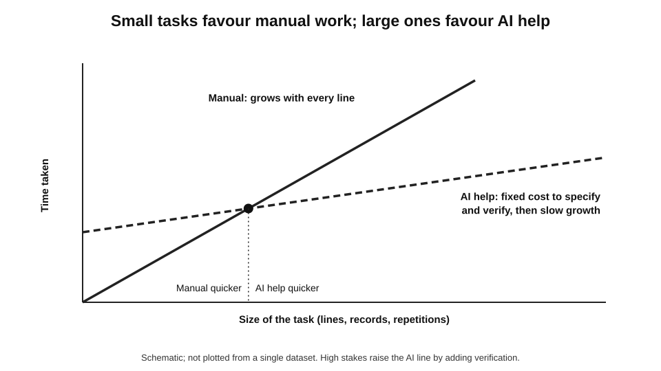
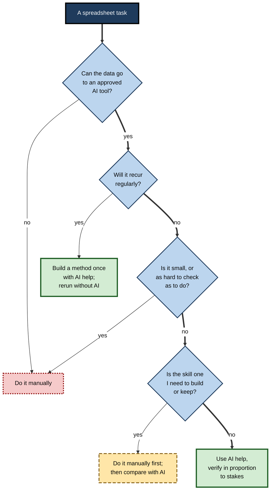
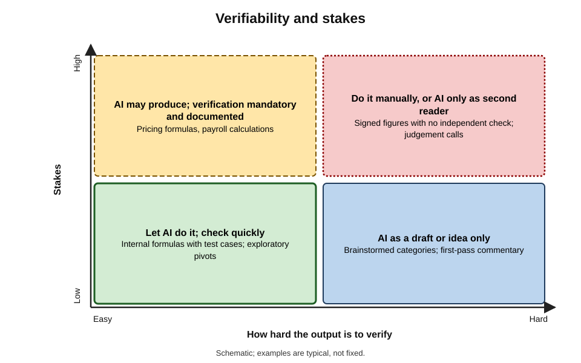
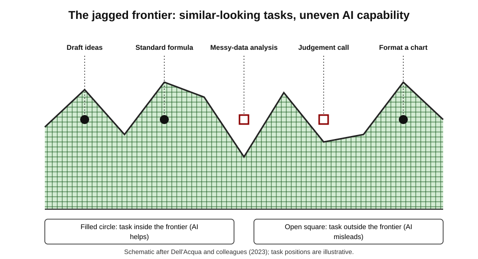
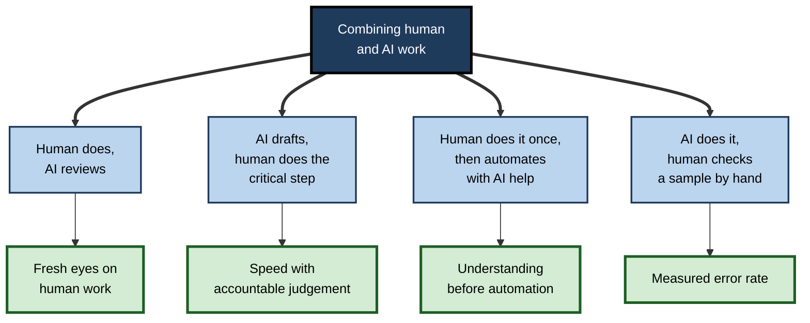

# E.12. When to do it manually

At month end, a management accountant needs to check twelve accrual lines against their supporting invoices. Her spreadsheet assistant could do it: upload the invoices, ask for a reconciliation, review the result. She does it by hand in eleven minutes instead. Writing the request, checking which invoices the assistant had read and verifying each match would have taken longer — and her signature goes on the result.

The same afternoon she asks the assistant to write the Power Query steps that will reconcile 4,000 supplier lines every month from now on. Knowing which job to keep and which to hand over is the skill.

> **Definition — Doing it manually:** carrying out a spreadsheet or data task with one's own judgement and conventional tools — formulas, filters, pivot tables, a calculator — without AI generating the method or the result.

**Why it matters**

- **AI assistance has costs that are easy to overlook** — writing the request, checking the output, handling the data safely, fixing what went wrong.
- **For many small, high-stakes or novel tasks, those costs exceed the time saved.**
- **Some work must stay in human hands** — because of accountability, confidentiality or the need to keep skills alive.
- **The professional standard is not "always use AI" or "never use AI"** but choosing deliberately, task by task.

---

## The Real Cost of Using AI

### What a time saving must cover

- **Specifying** — describing the layout, the calculation, the edge cases and the context.
- **Waiting and iterating** — correcting misunderstandings, re-asking.
- **Verifying** — reading formulas or code, hand-checking, reconciling (the larger the stakes, the longer this takes).
- **Data handling** — minimising, choosing an approved tool, recording what was shared.
- **Residual risk** — the expected cost of an error that passes the checks.

> **Definition — Verification cost:** the time and effort needed to establish that an output is correct enough for its purpose.

> **Key point:** AI saves time on **producing**; it rarely saves time on **checking**, and sometimes adds to it, because checking someone else's work is slower than checking one's own.

### A simple comparison

> **Formula — Choosing AI or manual:** use AI when (specify + iterate + verify + expected cost of an undetected AI error) is less than (manual time + expected cost of an undetected manual error). Example (illustrative figures): AI — 4 + 3 + 9 minutes + (2% × 60 minutes of rework) ≈ **17.2 minutes**; manual — 11 minutes + (1% × 60) ≈ **11.6 minutes**. Manual wins.

- **The comparison changes with scale.** For twelve lines, manual wins; for 4,000 lines a month, a method written once with AI help and run repeatedly wins easily.
- **The expected cost of an error** is probability × consequence. Where consequences are severe — a filing, a payroll run, a price list — even a small probability dominates.

**Figure 1.** Time for a task done manually and with AI help, by size of task.

---

## Factors That Favour Doing It Manually

### Small and quick

- **When the task takes minutes by hand**, specifying and verifying an AI result often takes as long.
  - *e.g.* summing a dozen cells; fixing one formula; looking up three values.

### Novel or ambiguous

- **When the question is not yet clear**, working through the data by hand is how the question becomes clear.
- **AI tools answer the question as asked**; when the right question is still forming, manual exploration shapes it.

### Hard to verify

- **When checking the output is as hard as producing it**, AI saves little.
  - *e.g.* a judgement-based classification of thirty contracts where each must be read anyway.
- **When no independent check exists** — no control total, no second source — the person must do the reasoning themselves to stand behind it.

### High stakes and irreversible

- **Figures that will be signed, filed, published or paid** — statutory accounts, regulatory returns, payroll, contract prices.
- **The signatory is accountable** regardless of the tool; many professionals perform the final critical step themselves.

### Sensitive

- **When the data cannot go to any available AI tool** — special-category personal data, inside information, client-privileged material — without an approved environment, the work is done without AI.

### Learning value

- **When the person needs the skill** — a new analyst learning pivot tables, a manager learning to read a balance sheet.
- **Doing it by hand first** builds the understanding needed to check AI output later.

### Recurring and stable

- **Paradoxically, recurring tasks often favour removing AI from the loop** — not by doing them by hand each time, but by building a deterministic method once (with AI help) and running it repeatedly without re-asking a model.

| Factor | Favours manual when | Favours AI help when |
|---|---|---|
| Size | Minutes of work | Hours of work, or many repetitions |
| Clarity | Question still forming | Question and method well defined |
| Verifiability | Checking costs as much as doing | Cheap, independent checks exist |
| Stakes | Signed, filed, paid, irreversible | Internal, exploratory, reversible |
| Sensitivity | No approved tool for the data | Approved tool, minimised data |
| Learning | The skill must be built or kept | The skill is held and the task is routine |
| Recurrence | — | Build a method once, rerun deterministically |

> **Mnemonic — "Small Novel Hard High Secret Skill":** Small, Novel, Hard to verify, High stakes, Secret (sensitive), Skill to build — six signs that manual may be better.

---

## Deciding Task by Task

**Figure 2.** A decision path for choosing manual work, AI help or a built method.

### The verifiability–stakes matrix

**Figure 3.** How verifiability and stakes together guide the use of AI.

- **Easy to verify, low stakes** — let AI do it; check quickly.
- **Easy to verify, high stakes** — AI may produce; verification is mandatory and documented.
- **Hard to verify, low stakes** — AI acceptable as a draft or idea; do not rely on it for anything that matters.
- **Hard to verify, high stakes** — do it manually, or with AI only as a second reader of human work.

> **Key point:** **verifiability** is the hinge. AI is most valuable where its output can be checked much faster than it can be produced.

---

## Evidence on Where AI Helps and Hurts

**Study card — Dell'Acqua and colleagues (2023): the "jagged technological frontier"**

- **Design:** a field experiment with 758 consultants at Boston Consulting Group, working on realistic tasks with or without access to GPT-4.
- **Tasks:**
  - some were **inside** the AI's capability frontier (such as generating and developing product ideas);
  - one was designed to fall **outside** it — a business-analysis problem requiring careful use of spreadsheet data and interview notes, where the AI's plausible answer was wrong.
- **Results:**
  - inside the frontier, consultants with AI completed more tasks, faster, and at markedly higher quality;
  - outside it, consultants with AI were about **19 percentage points less likely** to reach the correct answer than those without.
- **Conclusion:** AI's capability is **jagged** — excellent at some tasks, misleading on others of similar apparent difficulty — and users cannot easily tell which side of the frontier a task lies on.
- **Lesson:** the costliest errors arise when AI is used confidently on a task just beyond its frontier — exactly the data-heavy, judgement-heavy work common in spreadsheets.

**Figure 4.** The jagged frontier: AI capability varies unevenly across tasks of similar apparent difficulty.

**Study card — Lisanne Bainbridge, "Ironies of Automation" (1983)**

- **Argument:** automating a task leaves human operators two jobs — monitoring the automation and taking over when it fails.
- **The ironies:**
  - monitoring is tedious, so humans do it poorly;
  - taking over requires the very skills that automation stops them practising;
  - the tasks left to humans are the hardest ones — those the automation could not handle.
- **Status:** written about industrial process control, the paper has become one of the most cited analyses of human–automation interaction and is widely applied to AI.
- **Lesson for spreadsheet work:** a team that never builds a pivot table, writes a lookup or reconciles by hand may be unable to do so — or to check the AI — on the day it matters.

> **Definition — Deskilling:** the loss of skill through disuse when a tool takes over the work that once exercised it.

> **Watch out:** claims that AI "makes everyone an analyst" overlook the evidence on frontiers and deskilling. AI raises the **floor** of what novices can produce; it does not supply the judgement needed to know when the output is wrong.

---

## Hybrid Patterns

Manual and AI work are not exclusive; many of the best practices combine them.

**Figure 5.** Ways to combine manual work and AI help.

- **Human does, AI reviews** — the person builds the reconciliation; the assistant is asked to look for errors. AI as **second reader** keeps judgement with the person while adding a different set of eyes.
- **AI drafts, human does the critical step** — the assistant lays out a model's structure; the person enters and sources the assumptions and signs off.
- **Human does it once, then automates** — the first time, the person reconciles by hand and learns where the problems lie; the second time, AI helps write the method that encodes what was learned.
- **AI does it, human checks a sample** — for large classification or extraction tasks, a random sample done by hand measures the error rate.

> **In practice:** "do it once by hand, then automate" is one of the most reliable patterns in data work. The manual pass reveals the edge cases — the odd supplier name, the missing month, the duplicate — that the automated method must handle.

---

## Worked Example (illustrative): Three Tasks, Three Choices

**Situation (illustrative figures):** a finance analyst has three tasks on one morning.

| Task | Manual time | AI route time (specify + iterate + verify) | Stakes | Choice |
|---|---|---|---|---|
| Check 12 accrual lines against invoices | 11 min | 4 + 3 + 9 = 16 min | Signed at month end | Manual |
| Write a formula to band 2,000 customers by revenue | 15 min | 2 + 1 + 4 = 7 min | Internal analysis | AI help, verify edge cases |
| Reconcile 4,000 supplier lines every month | 3 hours a month | 45 min once to build a query with AI help, then 10 min a month to run and review | Feeds payments | Build a method once; rerun without AI |

**Step 1 — the accruals.** Small, signed and hard to check faster than to do. Manual.

**Step 2 — the banding formula.** Clear specification, cheap verification (test boundary values), internal use. AI writes the formula; the analyst tests 9,999.99, 10,000 and 10,000.01 at each boundary.

**Step 3 — the supplier reconciliation.** Recurring and large. The analyst reconciles one month by hand first, noting the awkward cases (credit notes, split invoices, supplier name variants). AI then helps write Power Query steps that handle each case; the method is saved and rerun monthly.

> **Formula — Payback of building a method:** months to recover set-up time = set-up time ÷ monthly time saved. Example: 45 minutes ÷ (180 − 10 minutes) ≈ **0.26 months** — repaid in the first month.

- **Conclusion:** the same analyst, on the same morning, chose manual, AI-assisted and built-method approaches — each for a reason she could state. That deliberate choice, not the tool, is the professional skill.

---

## Case Study (illustrative): The Team That Forgot the Pivot

- **Situation:** a sales-operations team of six relied for two years on an AI assistant to produce its weekly pipeline analysis — pivot tables, variance commentary and charts.
- **What happened:**
  1. a change in the company's data-protection policy suspended the assistant's access to customer-level data for six weeks while a review took place;
  2. the team could not reproduce the weekly analysis by hand; two newer members had never built a pivot table;
  3. the first manual reports contained errors — a filter left on, a double-counted region — that went to the sales director.
- **Diagnosis:**
  - the team had automated a skill none of them had practised;
  - no written method existed — the analysis lived in prompts and the assistant's outputs;
  - review had become checking that the output "looked right", not reconciling it.
- **Actions:**
  1. the weekly analysis was rebuilt as a saved Power Query and pivot workbook — deterministic, documented, runnable without AI;
  2. AI was reassigned to drafting commentary from the computed tables, with a human editor;
  3. each team member rebuilt the analysis by hand once a quarter as a practice exercise and a check;
  4. a reconciliation of pipeline totals to the CRM was added every week.
- **Result:** when AI access returned, the team used it for commentary and ad-hoc questions; the core numbers no longer depended on it.
- **Lesson:** Bainbridge's irony in miniature — the day the tool was unavailable was the day the team needed the skills it had stopped using. Keeping a manual capability, and a method that does not depend on a model, is a form of resilience.

---

## Doing It Manually, Well

Manual work is not automatically safe. People make errors too — the spreadsheet-error literature is a record of human mistakes. Choosing manual work means doing it with the same discipline expected of AI-assisted work.

- **Use the same checks** — totals reconciled, a second method for key figures, test cases for formulas.
- **Work in a structure** — inputs separate from calculations; no numbers typed into formulas.
- **Slow down at the critical step** — the cell that will be signed, the figure that goes into the payment run.
- **Use a second person** for anything material; self-review misses errors that a fresh reader catches.
- **Let AI review afterwards** — a manual reconciliation can still be read by an assistant looking for inconsistencies, with the person keeping judgement.

> **Watch out:** "I did it myself, so I know it is right" is the overconfidence that research on spreadsheet developers has documented for decades. Manual work moves the source of error; it does not remove it.

| | Typical manual error | Typical AI-assisted error |
|---|---|---|
| Kind | Slips — typing, pointing, copying | Plausible wrong logic; wrong definition |
| Visibility | Often random, sometimes obvious | Systematic, fluent, rarely obvious |
| Scale | Usually one cell or row | Often the whole column or model |
| Best detection | Reconciliation, second reader | Edge-case tests, reconciliation, reading the method |
| Typical root cause | Fatigue, haste | Ambiguous request, partial view |

---

## Spreadsheet Skills Worth Keeping by Hand

Not every manual skill must be preserved. Those worth keeping are the ones needed to **check** AI output and to **work when it is unavailable or unsuitable**.

- **Reading formulas** — lookups, conditional totals, logical tests; without this, no AI formula can be checked.
- **Building a pivot table** — the fastest independent route to most totals and counts.
- **Filtering and sorting to inspect data** — the first look at extremes, blanks and oddities.
- **Reconciling** — matching two lists, explaining differences, tying totals to a ledger.
- **Estimating** — rough mental arithmetic to sense-check any figure.
- **Structuring a simple model** — inputs, calculations, outputs, checks.
- **Recognising data problems** — text numbers, broken dates, duplicates, sentinel codes.

> **In practice:** a practical test of whether a skill has been kept is to perform it occasionally without help — one reconciliation a quarter, one model built from scratch a year. The point is not nostalgia; it is keeping the ability to judge the tool.

---

## Recognising the Moment to Switch

Sometimes a task begun with AI help should be finished by hand. Spreadsheet work offers characteristic signals.

- **The third correction** — after two rounds of fixing an assistant's formula, writing it oneself is usually quicker.
- **Explanations that do not match the output** — the assistant describes one method while the result implies another.
- **Unverifiable coverage** — it is unclear which rows or sheets were read.
- **Growing structure** — each request adds sheets and complexity the task does not need.
- **Rising stakes** — what began as exploration is about to become a reported figure.

> **Remember:** when checking the AI's work starts to take longer than doing the work, **switch** — and keep anything useful, such as a correct formula or a good structure, from the attempt.

---

## Work That Organisations Reserve for People

Some organisations and professions go beyond individual judgement and **reserve** certain spreadsheet work for people by rule.

- **Final figures in statutory and regulatory reporting** — prepared by controlled, deterministic processes and signed by accountable officers; AI may assist with drafting and review but not produce the reported numbers.
- **Decisions about individuals** — pay, promotion, redundancy, credit, benefits — where data-protection law in the UK and EU restricts decisions based solely on automated processing with significant effects, and fairness must be demonstrable.
- **Price setting and contractual commitments** — figures that bind the organisation are prepared and checked by named people.
- **Audit evidence** — auditors' professional standards require them to evaluate the reliability of information they use; AI-generated analyses are evidence to be tested, not conclusions to be adopted.
- **Data that cannot leave a secure environment** — where no approved AI tool exists inside it, the work is manual by necessity.

> **Key point:** reserving work for people is not hostility to AI. It reflects where **accountability, law and evidence standards** require a human judgement that can be explained and defended.

### Short cases (illustrative)

- **A pricing analyst** uses AI to write the formulas for a new price list, then personally checks every price above a threshold against the approved margin before release — the release step is reserved.
- **An HR adviser** uses AI to summarise anonymised absence trends for a policy paper, but compiles the list of individuals for attendance meetings by hand from the HR system, applying the policy's rules case by case.
- **An auditor** asks an assistant to suggest analytical procedures for a client's revenue, then performs and documents the reconciliation herself, treating the assistant's suggestions as a starting point.

---

## Manual Work as a Professional Choice

- **Accountability** — whoever signs is responsible for the number, however it was produced; many choose to perform the decisive step themselves.
- **Documentation** — recording why a task was done manually ("small, signed, no independent check") is as legitimate as recording AI use.
- **Teaching** — juniors benefit from doing core tasks by hand before automating them. A sequence many teams find effective:
  1. **Do it by hand** — the junior builds the pivot, lookup or reconciliation unaided, with a senior's review.
  2. **Compare with AI** — the same task is then given to an assistant, and the two results and methods are compared; differences are explained.
  3. **Use AI with checks** — the junior uses AI for the task routinely, applying the checks learned in the manual pass.
  4. **Revisit by hand** — periodically, to keep the skill and to recalibrate trust in the tool.
  - **Why it works:** the manual pass builds the mental model needed to see when the AI's version is wrong; the comparison shows, concretely, where AI helps and where it errs.
- **Organisational policy** — some organisations require manual preparation or independent manual review for defined categories of work, such as statutory figures or decisions about individuals.
- **Resilience** — an organisation whose critical numbers can be produced only through an AI tool depends on that tool's availability, pricing, terms and continued existence.

> **In practice:** a simple discipline is to ask, before reaching for an assistant, "how long would this take by hand, and how long to check the AI's version?" If the honest answer to the second is longer, do it by hand.

---

## Open Questions

- **Which spreadsheet skills must people retain?**
  - There is little evidence on the minimum skill needed to supervise AI in data work, and it may differ by role.
- **Will verification become cheaper?**
  - Tools that show their working, run checks and state their coverage could shift the balance towards AI for more tasks; how far is unknown.
- **Can users learn where the frontier lies?**
  - Experience may help people recognise tasks outside AI's competence, but the frontier moves with each model.
- **How should organisations measure deskilling?**
  - Practice exercises and manual reruns are possible measures; systematic evidence from workplaces is scarce.

---

## Summary

- **Doing it manually** means using one's own judgement and conventional tools without AI generating the method or result.
- AI's real cost includes **specifying, iterating, verifying, data handling and residual risk**; AI saves producing time, rarely checking time.
- Compare AI and manual routes including the **expected cost of undetected errors**; scale changes the answer — small tasks favour manual, recurring large ones favour a **method built once**.
- Signs favouring manual: **Small, Novel, Hard to verify, High stakes, Secret, Skill to build**.
- **Verifiability** is the hinge: AI is most valuable where output can be checked much faster than produced.
- Evidence: AI's frontier is **jagged** (Dell'Acqua and colleagues, 2023 — 19 points worse outside it); automation erodes the skills needed to supervise it (**Bainbridge, 1983**).
- Hybrids: human does and AI reviews; AI drafts and human does the critical step; **do it once by hand, then automate**; AI does and human samples.
- Manual work is a legitimate, documentable professional choice that preserves accountability, skill and resilience.

---

## Self-Check

1. Define doing it manually and verification cost.
2. List the five components of the real cost of using AI on a task.
3. Using the comparison formula, decide between AI and manual for: manual 20 minutes, 1% error; AI 3 + 2 + 6 minutes, 3% error; rework cost 120 minutes.
4. Why do recurring tasks often favour building a method rather than repeatedly asking AI?
5. Give the six signs that a task may be better done manually.
6. Explain the verifiability–stakes matrix and what each quadrant implies.
7. Summarise the jagged-frontier study and its relevance to spreadsheet work.
8. State Bainbridge's ironies of automation and apply them to a team that relies on AI for analysis.
9. Describe four hybrid patterns and when each suits.
10. Why is "do it once by hand, then automate" effective?
11. In the worked example, why was each task handled differently?
12. In the case study, what made the team fragile, and what restored resilience?
13. A graduate trainee asks why she should learn lookups and pivot tables when the assistant can write them. Answer.
14. Design a team rule for when AI may and may not be used in month-end close.

15. Compare typical manual errors with typical AI-assisted errors in spreadsheet work.
16. Name five spreadsheet skills worth keeping by hand and explain why.
17. Give four signals that a task begun with AI help should be finished manually.

### Answer Key

1. Doing a task with one's own judgement and conventional tools without AI generating the method or result. Verification cost: the effort needed to establish that an output is correct enough for its purpose.
2. Specifying; waiting and iterating; verifying; data handling; residual risk of undetected error.
3. AI: 11 + 0.03 × 120 = 14.6 minutes. Manual: 20 + 0.01 × 120 = 21.2 minutes. AI help is better here, if the error estimates hold.
4. A deterministic method built once is faster each time, reproducible and independent of model changes; re-asking AI repeats specification and verification costs and introduces variation.
5. Small; novel or ambiguous; hard to verify; high stakes; sensitive data; skill to build or keep.
6. Easy/low: AI with quick checks. Easy/high: AI with mandatory documented verification. Hard/low: AI as a draft only. Hard/high: manual, or AI only as a second reader.
7. Consultants with GPT-4 did much better on tasks inside AI's capability but about 19 points worse on a data-and-judgement task outside it; spreadsheet analysis often sits near that frontier, where AI's plausible errors are hardest to spot.
8. Automation leaves monitoring (done poorly) and takeover (needing skills no longer practised), and leaves the hardest tasks to humans. A team relying on AI may be unable to check it or to work without it when needed.
9. Human does, AI reviews (keeps judgement, adds fresh eyes); AI drafts, human does the critical step (speed with accountability); human does once then automates (learning edge cases first); AI does, human samples (measures error at scale).
10. The manual pass reveals edge cases and problems that the automated method must handle, and builds the understanding needed to check it.
11. Accruals: small, signed and hard to check faster than do — manual. Banding: clear, cheap to verify, internal — AI help. Supplier reconciliation: large and recurring — build a method once after a manual pass.
12. No member practised the core skills, the method lived only in prompts, and review had become superficial. Restored by a saved deterministic workbook, reassigning AI to commentary, quarterly manual reruns, and weekly reconciliation to the CRM.
13. Because checking AI output requires understanding what the formula or pivot should do; without that skill she cannot spot silent errors, cannot work when the tool is unavailable or unsuitable, and cannot judge when a task lies beyond AI's competence. Learning by hand first, then using AI, gives both speed and judgement.
14. For example: AI may draft formulas, queries and commentary and act as a second reviewer; all figures in the close must be computed by saved, deterministic methods and reconciled to the ledger; no AI-stated numbers; no sensitive data in unapproved tools; final review and sign-off by the accountable person without reliance on AI; AI use recorded in the close file; each team member performs key reconciliations by hand at least once a quarter.
15. Manual errors are usually slips — random, local and sometimes obvious — caught by reconciliation and a second reader. AI-assisted errors are often systematic, fluent and spread across a column or model, caused by ambiguous requests or partial views, and caught by edge-case tests, reading the method and reconciliation.
16. Reading formulas, building pivot tables, filtering and sorting to inspect data, reconciling, estimating, structuring a simple model, recognising data problems — because they are needed to check AI output and to work when AI is unavailable or unsuitable.
17. A third round of corrections; explanations that do not match the output; unclear coverage of rows or sheets; growing unnecessary structure; stakes rising from exploration to reporting.

---

## Glossary

| Term | Meaning |
|---|---|
| Built method | A deterministic set of formulas, queries or code written once and rerun. |
| Deskilling | Loss of skill through disuse when a tool takes over the work. |
| Expected cost of error | The probability of an undetected error multiplied by its consequence. |
| Ironies of automation | Bainbridge's observation that automation erodes the skills needed to supervise and replace it. |
| Jagged frontier | The uneven boundary of tasks AI performs well and poorly. |
| Manual work | Doing a task without AI generating the method or result. |
| Payback period | The time needed for savings to recover a set-up cost. |
| Second reader | A reviewer, human or AI, who checks work produced by someone else. |
| Verifiability | How quickly and reliably an output can be checked. |
| Verification cost | The effort needed to establish that an output is correct enough. |
