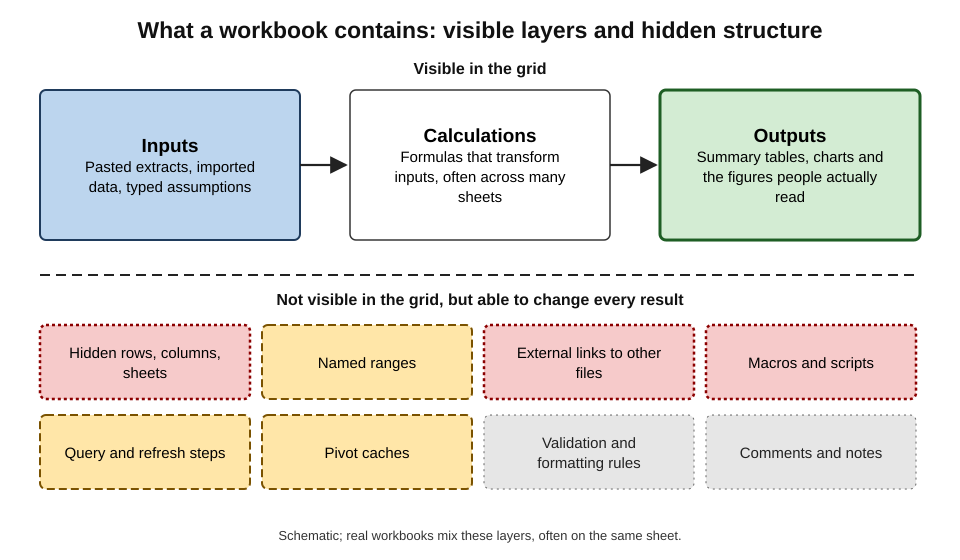
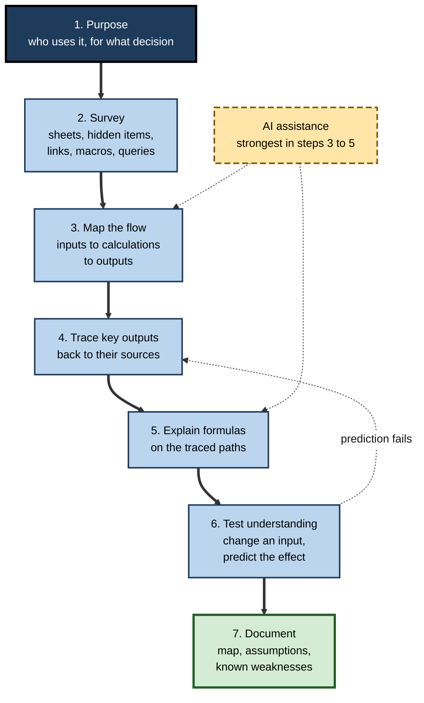
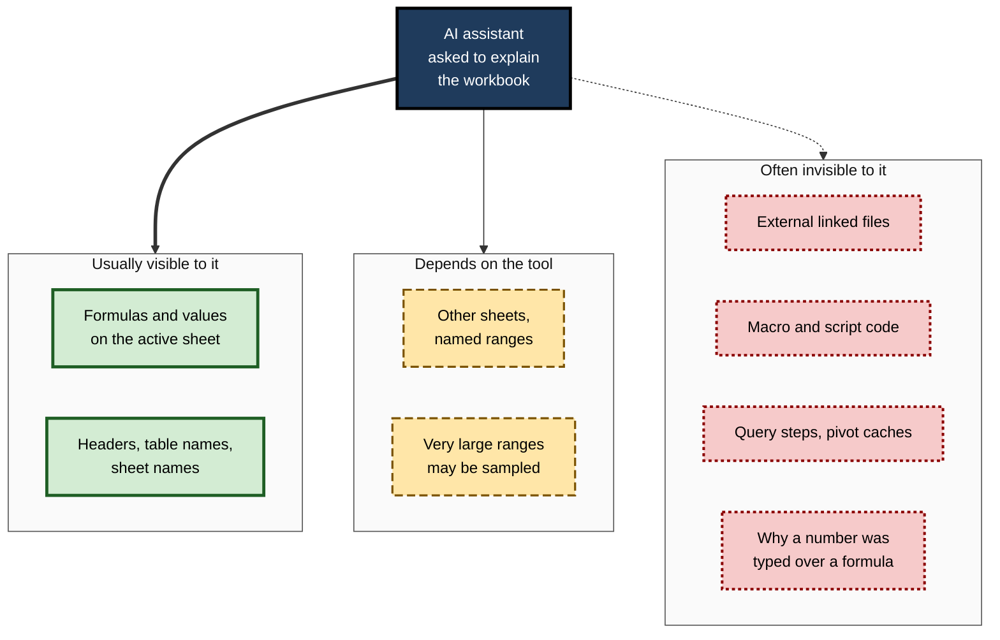
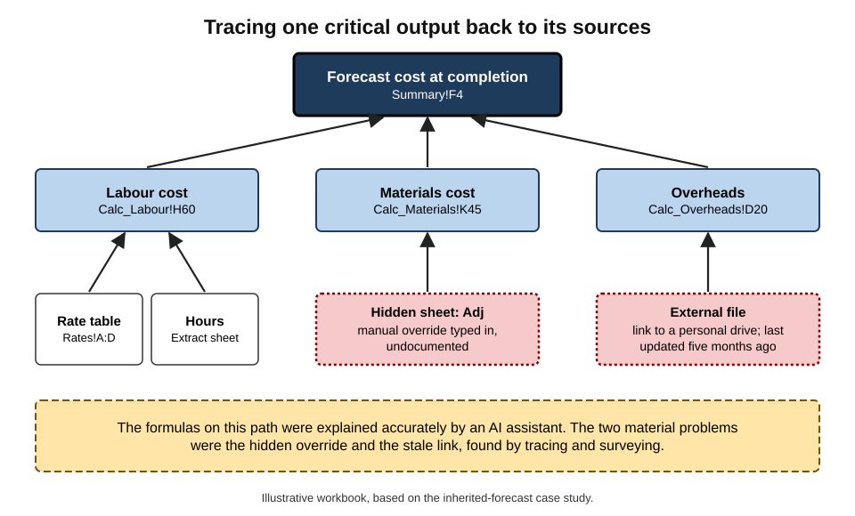
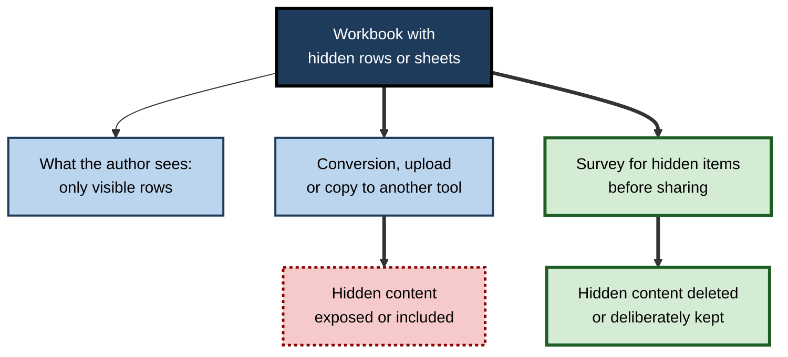

# E.2. Explaining an unfamiliar spreadsheet

A project accountant inherits the cost-forecasting workbook from a colleague who has just left: fourteen sheets, several thousand formulas, two hidden tabs and a cell on the summary sheet that the finance director reads every month. Nobody else knows how it works. An AI assistant can explain any formula in seconds — but explaining formulas one at a time is not the same as understanding a workbook, and the most important things about an inherited spreadsheet are often the ones no formula shows.

> **Definition — Explaining an unfamiliar spreadsheet:** building an accurate understanding of a workbook someone else created — its purpose, structure, data flow, key calculations, assumptions and weaknesses — using inspection, auditing tools and, increasingly, AI explanation, so that it can be used, maintained or retired safely.

**Why it matters**

- **Spreadsheets outlive their authors.** Critical workbooks pass from person to person with little or no documentation.
- **Understanding is the precondition for every safe change.** A modification to a workbook nobody understands can break outputs far away from the edited cell.
- **AI explanation is fast but partial.** It can describe what it is shown; it cannot report what is hidden, linked from elsewhere or simply missing.
- **Inherited spreadsheets carry inherited errors.** Taking ownership means taking responsibility for problems that existed before the hand-over.

---

## Why Spreadsheets Are Hard to Read

### The visibility problem

- **A spreadsheet shows results, not logic.** The grid displays values; the formulas producing them are visible one cell at a time.
- **Logic is scattered.** A single output may depend on cells across many sheets, with no visible thread connecting them.
- **Structure is implicit.** Nothing forces an author to separate inputs from calculations or to label anything.
- **Things can be hidden** — rows, columns, sheets, named ranges, formatting that makes text invisible, and logic held outside the grid altogether.

> **Key point:** reading a spreadsheet is closer to reading an undocumented program than to reading a document. The skills — finding entry points, tracing dependencies, testing assumptions — are those of code comprehension.

### What lives in a workbook

**Figure 1.** The layers of a typical business workbook, including the parts not visible in the grid.

- **Inputs** — data pasted or imported, and assumptions typed by hand.
  - *e.g.* a monthly extract from the finance system; a growth rate of 4%.
- **Calculations** — formulas transforming inputs.
- **Outputs** — summary tables, charts and figures that people actually read.
- **Hidden structure:**
  - **hidden rows, columns and sheets**;
  - **named ranges** — names standing for cells or ranges, sometimes pointing to deleted locations;
  - **external links** — formulas pulling values from other files, which may be missing, moved or out of date;
  - **macros** written in VBA (Visual Basic for Applications) or scripts in Google Apps Script — code that changes the workbook when run;
  - **Power Query** steps — recorded import and transformation instructions that run on refresh;
  - **pivot caches** — stored copies of source data behind pivot tables, which may hold data no longer visible in the sheet;
  - **data validation and conditional formatting** rules that constrain or highlight entries;
  - **comments and notes**, sometimes the only documentation.

> **Definition — Named range:** a name assigned to a cell or range (for example `TaxRate`) that formulas can use instead of a cell address.

> **Definition — External link:** a reference in one workbook to cells in another file, whose values are only as current as the last update from that file.

---

## A Method for Understanding a Workbook

**Figure 2.** A method for understanding an inherited workbook.

### 1. Establish the purpose

- **Ask before opening the file:** who uses the workbook, which figures they rely on, how often it is updated and what decision it supports.
- **Identify the critical outputs** — the handful of cells or charts whose values leave the workbook.
- **Why first:** purpose tells the reader which of thousands of formulas matter.

### 2. Survey the whole workbook

- **List every sheet**, including hidden and "very hidden" ones (sheets hidden through the VBA editor that do not appear in the normal unhide list).
- **Check for external links**, named ranges, macros, queries, pivot tables and data connections.
- **Note the size** — used range per sheet, number of formulas, file size.
- **Look for warning signs:** `#REF!` errors, named ranges pointing to `#REF!`, links to files on personal drives, macros with no description.

> **Definition — Very hidden sheet:** an Excel sheet whose visibility has been set through the code editor so that it does not appear in the ordinary unhide dialogue.

### 3. Map the data flow

- **Classify each sheet** as input, calculation, output or mixed.
- **Draw the flow** between sheets — which sheets feed which.
- **Identify hard-coded numbers** inside calculation areas: constants typed into formulas (`=B4*1.2`) or values pasted over formulas.

> **Watch out:** a value pasted over a formula looks identical to the formula's result. Inherited workbooks frequently contain cells where someone "fixed" a number by typing over a formula, silently breaking the link to its inputs.

### 4. Trace the key outputs

- **Work backwards** from each critical output to its sources, using precedent tracing.
- **Record the path** — the chain of cells and sheets that produce the figure.
- **Note branching** — conditions under which different logic applies.

### 5. Explain the formulas on those paths

- **This is where AI helps most.** Paste a formula, or select it with a built-in assistant, and ask for a plain-language explanation.
- **Ask for the formula's intent and its assumptions**, not just its mechanics.
  - *e.g.* "Explain what this formula does, what it assumes about the data, and what inputs would make it give a wrong answer."

### 6. Test the understanding

- **Predict, then change.** On a copy of the workbook, change an input and predict the effect on an output before recalculating.
- **A failed prediction is valuable** — it shows where understanding, or the workbook, is wrong.

### 7. Document

- **A workbook map** — one page listing purpose, sheets and their roles, flow, key outputs and their paths, assumptions, external dependencies, known issues.
- **Store it with the workbook**, ideally as a first sheet named "About".

> **Mnemonic — PSMTETD, "Please Survey My Tangled Excel Then Document":** Purpose, Survey, Map, Trace, Explain, Test, Document.

---

## Auditing Tools That Do Not Need AI

### Built into the spreadsheet

- **Trace Precedents / Trace Dependents** (Excel) — arrows showing which cells feed a cell and which cells it feeds.
- **Evaluate Formula** — steps through a formula, showing each intermediate result.
- **Show Formulas** — displays formulas instead of values across a sheet.
- **Go To Special** — selects all formulas, constants, blanks or errors, revealing hard-coded numbers in calculation areas.
- **Name Manager** — lists every named range and what it refers to.
- **Edit Links / Workbook Links** — lists external files the workbook depends on.
- **Inquire / Spreadsheet Compare** (in some Excel editions) — workbook analysis reports and side-by-side comparison of two versions.
- **Google Sheets** offers version history, named ranges, and formula display; dependency tracing is more limited, often supplemented by add-ons.

### Specialised tools

- **Spreadsheet auditing software** used in finance and audit maps every formula, flags inconsistencies and compares versions.
- **Formula-map views** colour-code cells by type — input, formula, constant — so that a pasted value in a formula column stands out.

| | Built-in auditing tools | AI explanation | Specialised audit software |
|---|---|---|---|
| Sees hidden sheets and names | Yes, if the user looks | Only if given them | Yes, systematically |
| Explains intent in plain language | No | Yes | Limited |
| Traces dependencies reliably | Yes, cell by cell | Partly; may miss off-sheet links | Yes, across the workbook |
| Finds pasted values in formula areas | With Go To Special | Rarely, unless asked | Yes |
| Effort for a large workbook | High | Low per formula | Low once set up |
| Risk | Missing something by fatigue | Confident description of a partial view | Cost and training |

> **Key point:** auditing tools are **complete but mute**; AI is **articulate but partial**. Using them together — tools to find, AI to explain — is stronger than either alone.

---

## What AI Explanation Can and Cannot Do

### Strengths

- **Translating formulas into plain language**, including long nested formulas that would take minutes to decode.
- **Recognising common patterns** — a running total, a lookup with a fallback, a date-based period test.
- **Inferring likely purpose** from headers, sheet names and formula shapes.
  - *e.g.* "This sheet appears to allocate shared costs to projects in proportion to headcount."
- **Suggesting documentation** — drafting a workbook map from the explanations.
- **Answering follow-up questions** at the reader's own pace and level.

### Limits

**Figure 3.** What an AI assistant typically can and cannot see in a workbook.

- **Partial view.** Built-in assistants may work only on the current sheet or a selected table; chat assistants see only what is pasted or uploaded.
- **Large workbooks exceed what the model can take in** at once; the tool may sample or summarise, without always saying so.
- **Hidden and external logic** — macros, linked files, query steps — is frequently outside the assistant's view.
- **Intent is guessed, not known.** The assistant infers purpose from names and patterns; an unusual business rule may be "explained" as the common rule it resembles.
- **Errors may be explained as features.** Asked to explain a formula, an assistant typically explains what it does — not whether that is what it should do.

> **Watch out:** "This formula calculates the quarterly total" is an explanation of what the formula **does**. It is not evidence that the quarterly total is the right figure, that the range covers the whole quarter, or that the quarter is defined as the business defines it.

### Asking well

- **Ask for mechanics, intent and risks separately.**
  - "What does this formula compute?"
  - "What business rule does it appear to implement?"
  - "What assumptions does it make about the data, and when would it give a wrong answer?"
- **Give context.** "This workbook allocates IT costs to departments; finance relies on the Summary sheet."
- **Ask for uncertainty.** "Which parts of your explanation are guesses from names rather than read from formulas?"
- **Cross-check with tools.** Confirm any claimed dependency with precedent tracing.

---

## Worked Example (illustrative): Decoding a Nested Formula

**Situation (illustrative figures):** cell `F12` on the Allocation sheet contains:

`=IF($C12="",0,IFERROR(INDEX(Rates!$D:$D,MATCH($C12&"|"&TEXT(F$3,"yyyy-mm"),Rates!$A:$A,0)),Rates!$D$2)*E12)`

**Step 1 — ask the assistant for a plain-language explanation.** It answers, in substance:

1. if the cost-centre code in `C12` is blank, return 0;
2. otherwise build a key from the cost-centre code and the month in row 3, such as `CC104|2026-03`;
3. find that key in column A of the Rates sheet and take the rate in column D;
4. if the key is not found, use the rate in `Rates!D2`;
5. multiply the rate by the hours in `E12`.

**Step 2 — check the explanation with tools.**

- Evaluate Formula on `F12` confirms the key `CC104|2026-03` and the matched rate.
- Inspecting `Rates!A:A` shows the keys are built by a formula in that column; the explanation was right.

**Step 3 — ask about risks.** The assistant notes that `IFERROR` falls back to `Rates!D2` when a rate is missing. Inspection shows `D2` holds the **2023 default rate** — so any cost centre without a current rate is silently charged at a three-year-old rate.

**Step 4 — quantify.** A filter on the Rates sheet for the current year shows 11 of 64 cost centres have no 2026 rate. Their charges all use the stale default.

| What was learned | Source |
|---|---|
| The formula's mechanics | AI explanation, confirmed by Evaluate Formula |
| The key construction | Inspection of the Rates sheet |
| The silent fallback | AI risk question, then inspection of `D2` |
| The scale of the problem | A manual filter and count |

- **Conclusion:** the explanation of mechanics took seconds and was accurate. The **important finding** — the stale fallback — came from asking a separate risk question and then inspecting the cell the formula relied on.

> **Watch out:** an `IFERROR` with a fallback value is a business decision disguised as error handling. In an inherited workbook, every fallback deserves the question "is this default still right?"

---

## Explaining the Logic Outside the Grid

Much of an inherited workbook's behaviour may live in code and recorded steps rather than in formulas. These are where AI explanation is most valuable — and where acting on an explanation is most dangerous.

### Macros and scripts

- **What they are:** VBA macros in Excel, Apps Script in Google Sheets and, increasingly, Office Scripts in Excel for the web — programs that copy data, reformat sheets, send emails or overwrite values when run.
- **Why they matter:** a macro run each month may paste values over formulas, delete rows or import a file — steps that leave no trace in the grid.
- **AI help:** pasting the code into an assistant and asking "what does this macro do, step by step, and which cells and files does it change?" usually yields a clear account.
- **What to ask in addition:**
  - "Which actions are irreversible?"
  - "Does it read or write any file, folder or email address outside this workbook?"
  - "What happens if it is run twice?"

> **Watch out:** macros in files from unknown sources are a well-known route for malicious software, which is why office applications block macros from the internet by default. Explaining a macro is safe; **running** one from an inherited or external file should wait until it is understood and, in organisations, until IT policy allows it.

### Query steps

- **Power Query** records each import and transformation step — source, filters, merges, type changes — in a formula language called M.
- **Why they matter:** a filter step deep in a query can exclude records before they ever reach the grid — the most invisible exclusion of all.
- **AI help:** an assistant can translate a query's step list or M code into plain language: "keeps only rows where Status is not 'Test'; merges with the Customers table on Customer ID; changes Amount to a decimal number".
- **Check:** compare the row count of the source with the row count the query loads.

### Pivot tables and data models

- **Pivot tables** summarise a source range or a data model; their filters, calculated fields and "show values as" settings change what the numbers mean.
- **Data models** (Power Pivot in Excel) hold relationships between tables and measures written in a language called DAX.
- **AI help:** explaining a measure's formula, or the effect of a pivot's filters, in plain language.

| Kind of logic | Where it lives | Visible in the grid? | Typical hidden effect | First question to ask |
|---|---|---|---|---|
| Formulas | Cells | Yes, one cell at a time | Wrong range, fallback value | What does it assume? |
| Macros and scripts | Code modules | No | Overwrites, deletions, imports | What does it change, irreversibly? |
| Query steps | Query editor | No | Records filtered before loading | What is excluded, and how many rows? |
| Pivot settings | Pivot table options | Partly | Filters, calculated fields | What is filtered out of this view? |
| Data-model measures | Data model | No | Definitions of totals and ratios | How is this measure defined? |

> **Key point:** the more of a workbook's behaviour lives outside the grid, the less a formula-by-formula explanation tells the reader. A complete explanation names **every place logic lives**.

---

## Writing the Explanation Down

### The workbook map

An explanation that exists only in one person's head recreates the problem it solved. The output of understanding a workbook should be a short, durable document.

- **Purpose and users** — what decision the workbook supports and who relies on which outputs.
- **Owner and version** — who maintains it now; where the controlled copy lives.
- **Sheet inventory** — each sheet's role (input, calculation, output, check), including hidden ones.
- **Data flow** — a simple diagram or list of which sheets feed which.
- **Key outputs and their paths** — for each critical figure, the chain of sheets and main formulas.
- **External dependencies** — linked files, data connections, macros, queries, and when each runs.
- **Assumptions** — the typed inputs that drive results, with their sources and dates.
- **Periodic procedure** — the steps performed each cycle, in order.
- **Known issues** — weaknesses found, risks accepted, improvements planned.

> **In practice:** an AI assistant can draft a workbook map from its explanations of each sheet in minutes. The reviewer's job is to correct it — especially the purpose, the procedure and the known issues, which no formula reveals.

### Explaining to different readers

- **A successor** needs the procedure, the dependencies and the known issues.
- **A reviewer or auditor** needs the paths of key outputs, the assumptions and the checks.
- **A manager** needs the purpose, the reliability of the outputs and the key-person risk.

---

## Reading Structure, Not Just Formulas

### Signs of a well-built workbook

- **Inputs, calculations and outputs on separate sheets** or clearly separated areas.
- **Inputs visually distinguished** — a consistent fill for cells meant to be typed into.
- **One formula pattern per row or column**, copied consistently.
- **No hard-coded numbers inside formulas**; constants held in labelled input cells.
- **Checks** — cells that confirm totals agree and flag when they do not.
- **An "About" or cover sheet** stating purpose, owner and version.

### Signs of risk

- **Mixed sheets** where inputs, calculations and outputs interleave.
- **Inconsistent formulas** in a block that should be uniform.
- **Long formulas** referring to many sheets.
- **Circular references** enabled through iterative calculation, sometimes deliberately (interest calculations), sometimes by accident.
- **Links to files** on personal drives or obsolete locations.
- **Dates in sheet names** ("Copy of Forecast v3 FINAL (2)") suggesting uncontrolled copying.

**Figure 4.** A precedent map for one critical output, showing a hidden dependency.

> **In practice:** before explaining any formula, many reviewers first run Go To Special for **constants** on calculation sheets. Every number found there is either a legitimate input in the wrong place or a pasted-over formula — and either deserves a question.

---

## The Hidden-Content Problem

### Hidden is not gone

- **Hidden rows, columns and sheets still hold data** and still feed formulas.
- **Converting or sharing can reveal them.** Exporting to another format, copying to another tool or uploading to an assistant may expose content the author believed was hidden.
- **Deleted is not always gone** — pivot caches and external-link caches can retain values after source data is removed.

### Case study: hidden rows in a bank acquisition

- **Situation:** in September 2008, during the collapse of Lehman Brothers, Barclays agreed to buy parts of Lehman's North American business. A spreadsheet listing trading contracts to be included was prepared under extreme time pressure.
- **What happened:**
  1. a junior associate at the law firm advising Barclays was asked to reformat the spreadsheet and convert it into a document to file with the bankruptcy court;
  2. the working spreadsheet contained rows that had been **hidden** rather than deleted — 179 contracts Barclays did not intend to acquire;
  3. on conversion, the hidden rows became visible and part of the filed list.
- **Result:** Barclays later had to ask the court to exclude the contracts, arguing they had been included by mistake — a costly and public correction.
- **Lesson:** whoever explains, converts or shares an inherited spreadsheet must first find out what is **hidden** in it. The structure the reader sees is not necessarily the structure the file contains.

**Figure 5.** How hidden content travels when a spreadsheet is converted or shared.

---

## Taking Ownership Professionally

### Questions to ask the previous owner

- Which outputs are used, by whom and when?
- What are the manual steps each period — pastes, refreshes, overrides?
- Which numbers are typed in rather than calculated, and why?
- What breaks most often?
- What would the previous owner change if they had time?

### When the previous owner is gone

- **Treat the workbook as evidence**, not documentation: version history, comments, change dates and the shapes of formulas reveal how it has been used.
- **Reconcile outputs** with an independent source — the general ledger, the HR system — before trusting them.
- **Run the previous period again** from its inputs and compare with the figures already reported.

### Case study (illustrative): the inherited forecast

- **Situation:** a project accountant inherited a fourteen-sheet cost forecast when its author left at short notice.
- **Approach:**
  1. purpose established with the finance director — one output, the forecast cost at completion, mattered most;
  2. survey found two hidden sheets, three external links (one to a file on the former owner's personal drive) and 27 constants inside calculation areas;
  3. an AI assistant explained the formulas on the traced path of the key output, sheet by sheet;
  4. each claimed dependency was confirmed with precedent tracing;
  5. last quarter's forecast was rerun from saved inputs.
- **Findings:**
  - the rerun did not reproduce last quarter's reported figure — a manual override on a hidden sheet had been applied and never recorded;
  - the external link to the personal drive was stale, so one cost line had not updated for five months;
  - the AI explanations of the visible formulas were accurate; neither problem lay in a visible formula.
- **Actions:** link replaced with a controlled source; override documented and moved to a visible, labelled input; an "About" sheet and a monthly reconciliation added.
- **Lesson:** AI made the formulas readable in hours rather than days, but the material problems were in **hidden content, stale links and undocumented manual steps** — found by method, not by explanation.

---

## Open Questions

- **Can assistants reliably explain whole workbooks, not just formulas?**
  - Larger context windows and agent-style tools that inspect workbooks are improving coverage, but how well they handle hidden content, external links and code is not well established.
- **Should explanations say what they could not see?**
  - Few tools report the limits of their view; an explanation that lists what was excluded would be far easier to trust.
- **Will automatic documentation reduce key-person risk?**
  - AI-drafted workbook maps could ease hand-overs, but their accuracy on complex, idiosyncratic models is unproven.
- **Does explanation help people learn spreadsheets or just consume them?**
  - As with any explanation tool, the effect on skill depends on how actively the reader engages.

---

## Summary

- **Explaining an unfamiliar spreadsheet** means understanding its purpose, structure, data flow, key calculations, assumptions and weaknesses — not just its individual formulas.
- Spreadsheets show **results, not logic**; logic is scattered, structure implicit, and much may be **hidden**: hidden sheets, named ranges, external links, macros, query steps, pivot caches.
- A method: **Purpose, Survey, Map, Trace, Explain, Test, Document**.
- **Auditing tools** (precedents, Evaluate Formula, Go To Special, Name Manager, link lists) are complete but mute; **AI explanation** is articulate but partial. Use both.
- AI explains what a formula **does**, not whether it is **right**; ask separately for intent and risks, and confirm claimed dependencies.
- **Fallback values and pasted-over formulas** are common hidden decisions in inherited workbooks.
- **Hidden is not gone**: hidden content can travel when files are converted or shared (Barclays–Lehman, 2008).
- Taking ownership means reconciling outputs, rerunning a past period and writing a **workbook map**.

---

## Self-Check

1. Define what it means to explain an unfamiliar spreadsheet, and why it differs from explaining formulas.
2. List six kinds of content in a workbook that are not visible in the ordinary grid.
3. Why is establishing purpose the first step?
4. What is a very hidden sheet, and why does it matter during a survey?
5. Why is a value pasted over a formula dangerous, and how can such values be found?
6. Compare built-in auditing tools, AI explanation and specialised audit software on completeness and explanation.
7. Give three limits of AI explanation of a workbook.
8. What three separate questions should be asked about an important formula?
9. In the worked example, what was the material finding and how was it reached?
10. Summarise the Barclays–Lehman hidden-rows episode and its lesson.
11. List five signs of a well-built workbook and five signs of risk.
12. You inherit a workbook whose author has left and whose output goes to the board next week. Describe your first five actions.
13. An AI assistant says confidently, "This workbook calculates monthly revenue from the Orders sheet." What else must be established before relying on that statement?
14. Why should an inherited macro be explained before it is run, and which three questions should be asked about it?
15. List the main contents of a workbook map and say which parts an AI draft is least likely to get right.

### Answer Key

1. Building an accurate understanding of the workbook's purpose, structure, data flow, key calculations, assumptions and weaknesses so it can be used or changed safely. Explaining formulas covers only mechanics of individual cells, not flow, hidden content or correctness.
2. Hidden rows/columns/sheets; named ranges; external links; macros or scripts; Power Query steps; pivot caches; validation and conditional-formatting rules; comments.
3. Purpose identifies the critical outputs and therefore which of many formulas matter, focusing effort.
4. A sheet hidden via the code editor so it does not appear in the normal unhide list; a survey that relies on the unhide dialogue will miss it and the logic or data it holds.
5. It looks like the formula's result but no longer updates from inputs, silently breaking the model. Found with Go To Special (constants) on calculation areas, formula-display views or audit tools.
6. Built-in tools are complete cell by cell but give no plain-language meaning; AI explains intent fluently but sees a partial view and may miss links or hidden logic; audit software is systematic and complete but needs cost and training.
7. Partial view of the workbook; sampling of large ranges; inability to see macros, links or query steps; guessed intent; explaining errors as features.
8. What does it compute? What business rule does it seem to implement? What does it assume, and when would it give a wrong answer?
9. An `IFERROR` fallback used a stale 2023 default rate for 11 cost centres without current rates. Found by asking a separate risk question, inspecting the fallback cell and counting affected centres.
10. A spreadsheet of contracts in Barclays' 2008 purchase of Lehman assets contained hidden rather than deleted rows — 179 unwanted contracts — which appeared when it was converted for court filing; Barclays had to seek their exclusion. Lesson: survey for hidden content before converting or sharing.
11. Good: separated inputs/calculations/outputs; distinguishable inputs; consistent formulas; no hard-coded constants; check cells; a cover sheet. Risk: mixed sheets; inconsistent formulas; long multi-sheet formulas; unintended circular references; links to personal drives; uncontrolled copies.
12. For example: confirm which outputs the board sees and who prepared them before; survey for hidden sheets, links, macros and constants; reconcile key outputs with independent sources; rerun the last period from its inputs and compare with reported figures; trace and explain the formulas on the key output's path, confirming dependencies with tools; record findings and caveats for the board pack.
13. Whether the Orders sheet is complete and current (external links, refresh steps); how revenue is defined (tax, refunds, cancellations); whether hidden rows or overrides affect it; whether the summary range covers all months; whether the figure reconciles with the finance system.
14. Macros can overwrite, delete, import or send data, and files from unknown sources may carry malicious code. Ask what it changes irreversibly, whether it reads or writes anything outside the workbook, and what happens if it runs twice.
15. Purpose and users; owner and version; sheet inventory; data flow; key outputs and paths; external dependencies; assumptions; periodic procedure; known issues. An AI draft is least reliable on purpose, the manual procedure and known issues, which formulas do not reveal.

---

## Glossary

| Term | Meaning |
|---|---|
| Circular reference | A formula that depends, directly or indirectly, on its own result. |
| DAX | The formula language for measures in Power Pivot and Power BI data models. |
| Dependent | A cell whose formula uses another cell. |
| Evaluate Formula | A tool that steps through a formula's calculation, showing intermediate results. |
| External link | A reference to cells in another workbook file. |
| Go To Special | A tool that selects cells by type, such as constants, formulas or errors. |
| Hard-coded value | A constant typed into a formula or over a formula, rather than held in a labelled input. |
| Macro | Recorded or written code (such as VBA) that performs actions in a workbook. |
| Named range | A name standing for a cell or range, used in formulas. |
| Pivot cache | A stored copy of source data behind a pivot table. |
| Power Query | A tool recording data import and transformation steps that run on refresh. |
| Precedent | A cell that feeds into another cell's formula. |
| Very hidden sheet | A sheet hidden through the code editor, absent from the normal unhide list. |
| Workbook map | A short document describing a workbook's purpose, structure, flow, outputs and risks. |
